# Chương 1 Cơ bản về Học tăng cường

## 1.1 Tổng quan về học tăng cường
**Học tăng cường (reinforcement learning, RL)** nghiên cứu bài toán: tác tử (agent) làm thế nào để tối đa hóa phần thưởng (reward) mà nó nhận được trong một môi trường (environment) phức tạp và bất định. Như hình 1.1, học tăng cường gồm hai thành phần: tác tử và môi trường. Trong quá trình học tăng cường, tác tử liên tục tương tác với môi trường. Sau khi nhận được một trạng thái (state) từ môi trường, tác tử dùng trạng thái đó để đưa ra một hành động (action), hành động này còn được gọi là quyết định (decision). Hành động này sau đó được thực thi trong môi trường; dựa trên hành động của tác tử, môi trường trả về trạng thái tiếp theo cùng với phần thưởng mà hành động hiện tại mang lại. Mục đích của tác tử là thu được càng nhiều phần thưởng từ môi trường càng tốt.

<div align=center>
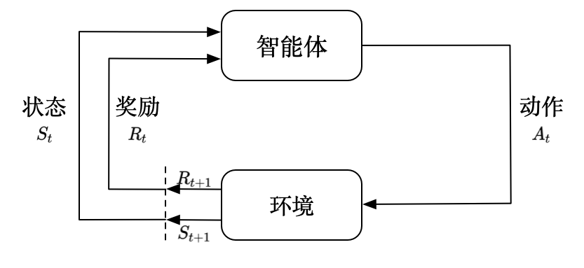
</div>
<div align=center>Hình 1.1 Sơ đồ học tăng cường</div>

### 1.1.1 Học tăng cường và học có giám sát

Chúng ta có thể so sánh học tăng cường với học có giám sát. Lấy bài toán phân loại ảnh làm ví dụ, như hình 1.2, **học có giám sát (supervised learning)** giả định rằng chúng ta có một lượng lớn dữ liệu đã được gán nhãn, ví dụ các ảnh ô tô, máy bay, ghế đã được gán nhãn. Các ảnh này phải thỏa mãn điều kiện độc lập và phân phối đồng nhất, tức là giữa chúng không có quan hệ liên kết nào. Giả sử chúng ta huấn luyện một bộ phân loại (classifier), chẳng hạn một mạng nơ-ron (neural network). Để phân biệt ảnh đầu vào là ô tô hay máy bay, trong quá trình huấn luyện cần truyền thông tin nhãn đúng cho mạng nơ-ron. Khi mạng nơ-ron dự đoán sai, chẳng hạn đầu vào là ảnh ô tô nhưng nó dự đoán là máy bay, chúng ta sẽ trực tiếp nói với nó rằng dự đoán đó sai, nhãn đúng phải là ô tô. Cuối cùng, dựa trên các lỗi như vậy, chúng ta xây dựng một hàm mất mát (loss function) và huấn luyện mạng nơ-ron bằng lan truyền ngược (back propagation).

<div align=center>
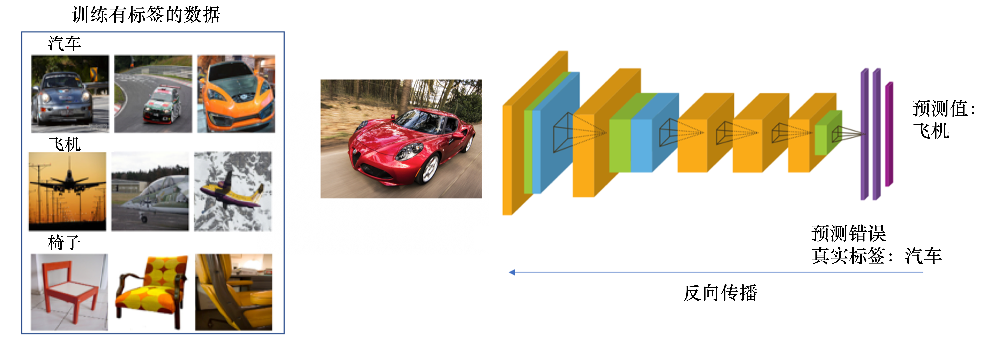
</div>
<div align=center>Hình 1.2 Học có giám sát</div>

Vì vậy, trong học có giám sát có hai giả định:
  * Dữ liệu đầu vào (dữ liệu đã gán nhãn) không được có liên hệ với nhau. Bởi nếu dữ liệu đầu vào có liên hệ, bộ học (learner) sẽ khó học.
  * Cần cho bộ học biết nhãn đúng là gì, để nó có thể dùng nhãn đúng sửa lại dự đoán của mình.

> Thông thường ta giả định toàn bộ mẫu trong không gian mẫu tuân theo một phân phối chưa biết, và mỗi mẫu ta thu được đều được lấy mẫu độc lập từ phân phối này, tức là độc lập và phân phối đồng nhất (independent and identically distributed, viết tắt i.i.d.).

Trong học tăng cường, cả hai giả định của học có giám sát thực ra đều không được thỏa mãn. Lấy trò chơi Breakout của Atari làm ví dụ, như hình 1.3, đây là trò chơi phá gạch: điều khiển tấm ván di chuyển sang trái phải để đỡ bóng bật lên phá gạch. Trong lúc chơi, ta thấy rằng các quan sát (observation) mà tác tử nhận được không độc lập và phân phối đồng nhất, khung hình trước và khung hình sau có tính liên tục rất mạnh. Dữ liệu chúng ta thu được là dữ liệu chuỗi thời gian có tương quan, không thỏa mãn i.i.d. Ngoài ra, chúng ta cũng không nhận được phản hồi ngay lập tức, trò chơi không cho ta biết hành động nào là đúng. Ví dụ, bây giờ ta di chuyển tấm ván sang phải, việc này chỉ làm bóng bay lên hoặc lệch sang trái một chút, chứ ta không nhận được phản hồi tức thời. Do đó, học tăng cường khó chính là vì tác tử không nhận được phản hồi tức thời, nhưng chúng ta vẫn muốn tác tử học được trong môi trường này.

<div align=center>
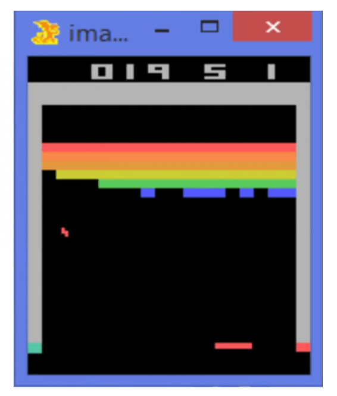
</div>
<div align=center>Hình 1.3 Trò chơi Breakout của Atari</div>

Như hình 1.4, dữ liệu huấn luyện của học tăng cường chính là một quá trình chơi game. Ta bắt đầu từ bước 1, thực hiện một hành động, chẳng hạn di chuyển tấm ván sang phải để đỡ bóng. Ở bước 2 ta lại thực hiện một hành động; dữ liệu huấn luyện thu được là một chuỗi quá trình chơi. Giả sử bây giờ đang ở bước 3, ta đưa chuỗi này vào mạng và mong mạng có thể đưa ra một hành động, tức là ở trạng thái hiện tại nên đi sang phải hay sang trái. Ở đây có một vấn đề: chúng ta không có nhãn để cho biết hành động hiện tại đúng hay sai, phải đợi đến khi trò chơi kết thúc mới có thể biết, mà trò chơi có thể 10 giây sau mới kết thúc. Hành động hiện tại có giúp ích cho việc thắng cuối cùng hay không, thực ra chúng ta không rõ. Đây chính là vấn đề **phần thưởng trễ (delayed reward)**, phần thưởng trễ khiến việc huấn luyện mạng trở nên rất khó khăn.

<div align=center>
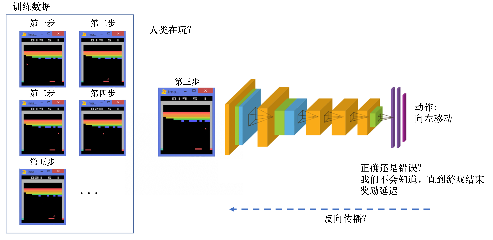
</div>
<div align=center>Hình 1.4 Học tăng cường: chơi Breakout</div>

Khác biệt giữa học tăng cường và học có giám sát như sau.

(1) Mẫu đầu vào của học tăng cường là dữ liệu tuần tự, không giống như trong học có giám sát nơi các mẫu là độc lập.

(2) Bộ học không biết hành động đúng ở mỗi bước, bộ học phải tự khám phá xem hành động nào mang lại nhiều phần thưởng nhất, và chỉ có thể tìm ra hành động có lợi nhất bằng cách thử liên tục.

(3) Quá trình tác tử có được năng lực thực chất là quá trình không ngừng khám phá thử-và-sai (trial-and-error exploration). Khám phá (exploration) và khai thác (exploitation) là những vấn đề cốt lõi của học tăng cường. Trong đó, khám phá nghĩa là thử một số hành động mới, những hành động mới này có thể mang lại nhiều phần thưởng hơn, nhưng cũng có thể khiến ta "trắng tay"; khai thác nghĩa là thực hiện hành động đã biết là thu được nhiều phần thưởng nhất, lặp lại hành động đó, vì ta biết làm vậy sẽ được một mức phần thưởng nhất định. Do đó, chúng ta cần cân bằng giữa khám phá và khai thác, đây cũng là điều không có trong học có giám sát.

(4) Trong quá trình học tăng cường, không có người giám sát (supervisor) mạnh, chỉ có **tín hiệu phần thưởng (reward signal)**, và tín hiệu phần thưởng lại bị trễ, tức là rất lâu sau môi trường mới cho ta biết hành động trước đó có hiệu quả hay không. Vì không có phản hồi tức thời nên việc tác tử học bằng học tăng cường rất khó. Sau khi thực hiện một hành động, nếu dùng học có giám sát, ta có thể nhận được chỉ dẫn ngay, ví dụ: ta vừa làm sai, hành động đúng phải là gì. Còn trong học tăng cường, môi trường có thể cho ta biết hành động này sai, nhưng không cho biết hành động đúng là gì. Khó hơn nữa, nó có thể một hai phút sau mới cho ta biết hành động đó sai. Đây cũng là điểm khác nhau giữa học tăng cường và học có giám sát.

Qua so sánh với học có giám sát, ta có thể tóm tắt một số đặc trưng của học tăng cường.

(1) Học tăng cường có quá trình khám phá thử-và-sai, nó hiểu môi trường thông qua việc khám phá môi trường.

(2) Tác tử học tăng cường nhận được phần thưởng trễ từ môi trường.

(3) Trong quá trình huấn luyện học tăng cường, thời gian rất quan trọng. Vì dữ liệu ta có là dữ liệu có tương quan theo thời gian (sequential data), chứ không phải dữ liệu i.i.d. Trong học máy, nếu dữ liệu quan sát có tương quan mạnh thì việc huấn luyện sẽ rất bất ổn định. Đó cũng là lý do trong học có giám sát ta muốn dữ liệu thỏa mãn i.i.d. càng nhiều càng tốt, để loại bỏ tương quan giữa các dữ liệu.

(4) Hành động của tác tử ảnh hưởng đến dữ liệu mà nó nhận được sau đó, đây là điểm rất quan trọng. Trong quá trình huấn luyện tác tử, nhiều khi chúng ta lấy dữ liệu chính từ việc tác tử đang học tương tác với môi trường. Vì vậy nếu trong quá trình huấn luyện tác tử không ổn định thì dữ liệu ta thu thập sẽ rất tệ. Chúng ta huấn luyện tác tử bằng dữ liệu, nếu dữ liệu có vấn đề thì toàn bộ quá trình huấn luyện sẽ thất bại. Vì vậy một vấn đề rất quan trọng trong học tăng cường là làm sao để hành động của tác tử luôn được cải thiện một cách ổn định.

### 1.1.2 Ví dụ về học tăng cường

Tại sao chúng ta quan tâm đến học tăng cường? Một lý do rất quan trọng là mô hình học tăng cường có thể đạt hiệu năng vượt con người. Dữ liệu giám sát trong học có giám sát thực chất do con người gán nhãn, ví dụ nhãn ảnh của ImageNet đều do người gán. Vì vậy có thể khẳng định giới hạn trên (upper bound) của thuật toán học có giám sát là hiệu năng của con người; kết quả gán nhãn quyết định rằng nó không bao giờ vượt qua được con người. Nhưng với học tăng cường, nó tự khám phá trong môi trường, có tiềm năng rất lớn, có thể đạt hiệu năng vượt năng lực con người, chẳng hạn thuật toán học tăng cường AlphaGo của DeepMind có thể đánh bại các kỳ thủ hàng đầu của nhân loại.

Dưới đây là một số ví dụ về học tăng cường trong đời sống thực.

(1) Trong tự nhiên, linh dương thực ra cũng đang học tăng cường. Lúc mới sinh, nó có thể còn không biết đứng, sau đó qua thử-và-sai, một thời gian sau nó đã có thể chạy rất nhanh và thích nghi với môi trường.

(2) Ta cũng có thể xem giao dịch chứng khoán là một quá trình học tăng cường. Ta có thể liên tục mua bán cổ phiếu, rồi dựa trên phản hồi của thị trường để học cách mua bán sao cho phần thưởng là lớn nhất.

(3) Chơi game Atari hoặc các trò chơi máy tính khác cũng là một quá trình học tăng cường, ta có thể liên tục thử-và-sai để biết cách chơi thế nào mới qua màn.

Hình 1.5 là một ví dụ kinh điển của học tăng cường: trò chơi Pong của Atari. Trong trò chơi, người chơi bên phải đánh bóng sang trái, rồi người chơi bên trái phải đánh bóng sang phải. Tác tử học tăng cường đã huấn luyện xong khác với người chơi bình thường: tác tử học tăng cường sẽ liên tục rung lắc vô nghĩa, còn người chơi bình thường thì không làm những động tác như vậy.

<div align=center>
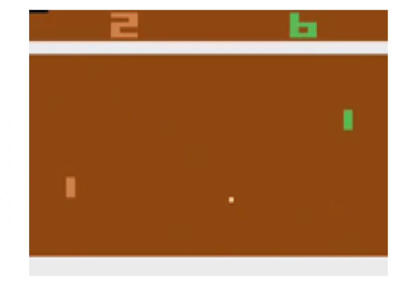
</div>
<div align=center>Hình 1.5 Trò chơi Pong</div>

Trong trò chơi Pong thực ra chỉ có hai hành động: đi lên hoặc đi xuống. Như hình 1.6, nếu học tăng cường học một mạng chính sách (policy network) để phân loại, thì mạng chính sách nhận đầu vào là ảnh của khung hình hiện tại và đưa ra khả năng của tất cả các quyết định, ví dụ xác suất đi lên.

<div align=center>
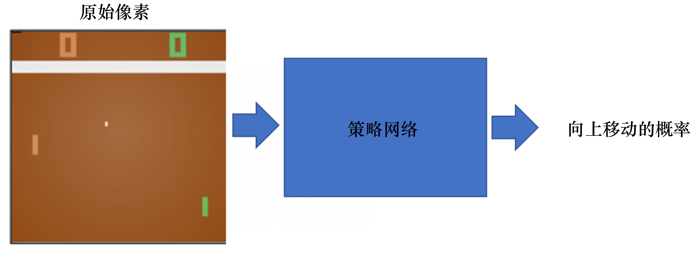
</div>
<div align=center>Hình 1.6 Học tăng cường chơi Pong</div>

Như hình 1.7, với học có giám sát, ta có thể trực tiếp cho tác tử biết nhãn của hành động đúng là gì. Nhưng trong trò chơi Pong, ta không biết nhãn của hành động đúng là gì.

<div align=center>
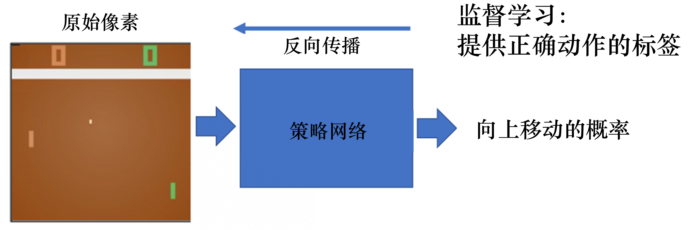
</div>
<div align=center>Hình 1.7 Học có giám sát chơi Pong</div>

Trong học tăng cường, chúng ta cho tác tử thử chơi Pong, lấy mẫu (sampling) hành động cho đến khi trò chơi kết thúc, rồi đánh giá (thưởng/phạt) từng hành động. Hình 1.8 là một quá trình triển khai thử (rollout). Rollout nghĩa là từ khung hình hiện tại ta lấy mẫu hành động, sinh ra nhiều ván chơi. Cho tác tử hiện tại tương tác với môi trường, ta sẽ thu được một chuỗi các quan sát. Mỗi chuỗi quan sát có thể xem là một quỹ đạo (trajectory). Quỹ đạo chính là khung hình hiện tại cùng với chính sách mà nó thực hiện, tức là chuỗi các trạng thái và hành động:
$$
\tau=\left(s_{0}, a_{0}, s_{1}, a_{1}, \ldots\right)
$$
Khi kết thúc, ta sẽ biết rốt cuộc có đánh bóng được sang phần sân đối phương không, đối phương có đỡ được không, ta thắng hay thua. Ta có thể dùng chuỗi quan sát cùng phần thưởng cuối cùng (eventual reward) để huấn luyện tác tử, giúp nó thực hiện các hành động có thể đem lại phần thưởng cuối cùng nhiều nhất có thể. Một ván chơi được gọi là một **tập (episode)** hoặc một **lượt thử (trial)**.

<div align=center>
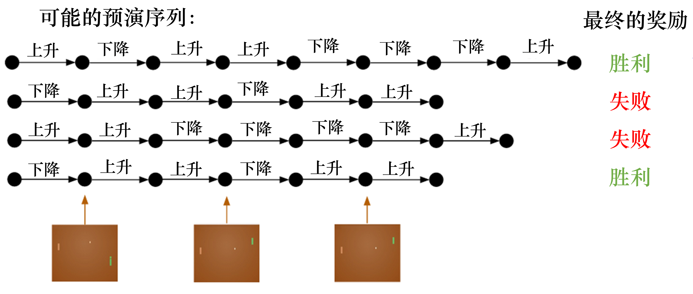
</div>
<div align=center>Hình 1.8 Các chuỗi rollout có thể có</div>

### 1.1.3 Lịch sử của học tăng cường

Học tăng cường đã có một lịch sử nhất định; học tăng cường thời kỳ đầu được gọi là học tăng cường tiêu chuẩn. Gần đây giới nghiên cứu kết hợp học tăng cường với học sâu (deep learning), tạo thành học tăng cường sâu (deep reinforcement learning), vì vậy học tăng cường sâu = học sâu + học tăng cường. Có thể so sánh học tăng cường tiêu chuẩn và học tăng cường sâu với thị giác máy tính truyền thống và thị giác máy tính sâu.

Như hình 1.9a, thị giác máy tính (computer vision) truyền thống gồm hai bước.

(1) Cho một ảnh, trước tiên ta trích xuất đặc trưng (feature) của nó, dùng các đặc trưng được thiết kế thủ công, chẳng hạn biểu đồ tần suất gradient định hướng (histogram of oriented gradients, HOG), mô hình thành phần biến dạng (deformable part model, DPM).

(2) Sau khi trích xuất các đặc trưng này, ta huấn luyện riêng một bộ phân loại. Bộ phân loại này có thể là máy vectơ hỗ trợ (support vector machine, SVM) hoặc Boosting, rồi từ đó phân biệt ảnh là chó hay mèo.


<div align=center>
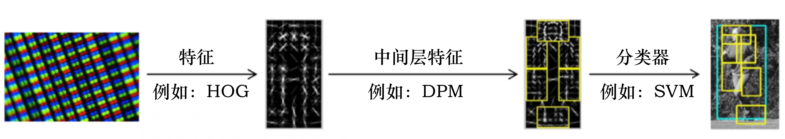
</div>
<div align=center>(a) Thị giác máy tính truyền thống</div>
<div align=center>
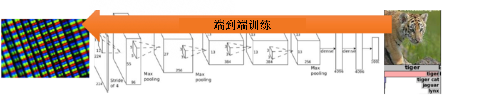
</div>
<div align=center>(b) Thị giác máy tính sâu</div>

<div align=center>Hình 1.9 Khác biệt giữa thị giác máy tính truyền thống và thị giác máy tính sâu</div>

Năm 2012, Krizhevsky và cộng sự đề xuất AlexNet. AlexNet giành chiến thắng trong cuộc thi phân loại ImageNet, nhanh chóng thu hút sự chú ý rộng rãi đến mạng nơ-ron tích chập (convolutional neural network).
Mọi người gộp việc trích xuất đặc trưng và phân loại lại làm một, tức là huấn luyện một mạng nơ-ron. Mạng nơ-ron này vừa có thể trích xuất đặc trưng vừa có thể phân loại, nó cho phép huấn luyện đầu-cuối (end-to-end), như hình 1.9b, tham số của nó có thể được tối ưu rất tốt ở mọi giai đoạn, đây là một bước đột phá rất quan trọng.

Chúng ta có thể đưa mạng nơ-ron vào học tăng cường.

* Học tăng cường tiêu chuẩn: ví dụ quá trình TD-Gammon chơi Backgammon thực chất là quá trình thiết kế đặc trưng rồi huấn luyện hàm giá trị (value function), như hình 1.10a. Học tăng cường tiêu chuẩn trước tiên thiết kế nhiều đặc trưng, các đặc trưng này mô tả toàn bộ trạng thái hiện tại. Có được các đặc trưng này, ta có thể huấn luyện một mạng phân loại hoặc huấn luyện riêng một hàm ước lượng giá trị để chọn hành động.

* Học tăng cường sâu: từ khi có học sâu, có mạng nơ-ron, ta có thể cải tiến quá trình tác tử chơi game thành một quá trình huấn luyện đầu-cuối (end-to-end training), như hình 1.10b. Ta không cần thiết kế đặc trưng, đưa trực tiếp trạng thái vào là có thể cho ra hành động. Ta có thể dùng một mạng nơ-ron để xấp xỉ hàm giá trị hoặc mạng chính sách, bỏ qua bước kỹ thuật đặc trưng (feature engineering).

<div align=center>
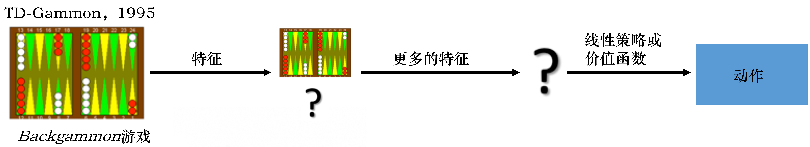
</div>
<div align=center>(a) Học tăng cường tiêu chuẩn</div>
<div align=center>
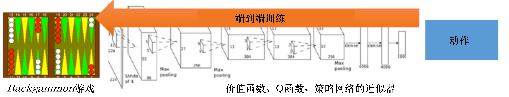
</div>
<div align=center>(b) Học tăng cường sâu</div>
<div align=center>Hình 1.10 Khác biệt giữa học tăng cường tiêu chuẩn và học tăng cường sâu</div>

### 1.1.4 Ứng dụng của học tăng cường

Tại sao những năm gần đây học tăng cường có nhiều ứng dụng, như chơi game và một số ứng dụng robot, thậm chí đánh bại được các kỳ thủ hàng đầu? Có mấy lý do sau. Thứ nhất, chúng ta có nhiều năng lực tính toán (computation power) hơn, có nhiều GPU hơn, có thể thử-và-sai nhiều hơn và nhanh hơn. Thứ hai, qua nhiều lần thử khác nhau, tác tử thu được nhiều thông tin trong môi trường, từ đó có thể đạt phần thưởng lớn trong môi trường. Cuối cùng, nhờ huấn luyện đầu-cuối, ta tối ưu đồng thời việc trích xuất đặc trưng với ước lượng giá trị hoặc ra quyết định, nhờ vậy thu được một mạng ra quyết định mạnh hơn.

Tiếp theo giới thiệu một số ví dụ thú vị trong học tăng cường, như hình 1.11.

(1) [Tác tử biết đi do DeepMind phát triển](https://www.youtube.com/watch?v=gn4nRCC9TwQ). Tác tử này cứ tiến lên một bước sẽ nhận được một phần thưởng. Tác tử có nhiều hình dạng khác nhau và có thể học được nhiều kỹ năng thú vị. Ví dụ, tác tử giống người học cách đi tiến lên trên con đường quanh co. Kết quả rất thú vị: tác tử giơ tay rất cao, vì giơ tay giúp cơ thể giữ thăng bằng, nhờ đó nó có thể tiến lên nhanh hơn trong môi trường. Hơn nữa ta cũng có thể tăng độ khó của môi trường, thêm vào một số nhiễu loạn, khi đó tác tử sẽ trở nên bền vững (robust) hơn.

(2) [Cánh tay robot gắp vật](https://ai.googleblog.com/2016/03/deep-learning-for-robots-learning-from.html). Vì áp dụng học tăng cường vào việc gắp vật tự động bằng cánh tay robot cần rất nhiều rollout, nên ta có thể dùng nhiều cánh tay robot để huấn luyện. Hệ thống phân tán (distributed system) cho phép các cánh tay robot thử gắp các vật khác nhau, hình dạng các vật trong khay khác nhau, nhờ đó cánh tay robot học được một hành động thống nhất, rồi với các vật khác nhau đều có thể dùng thuật toán gắp tối ưu. Vì hình dạng các vật khác nhau rất nhiều nên một số thuật toán gắp truyền thống không thể gắp được mọi vật. Thuật toán gắp truyền thống cần mô hình hóa từng vật, việc này rất tốn thời gian. Nhưng với học tăng cường, ta có thể học được một thuật toán gắp thống nhất, áp dụng được cho nhiều loại vật khác nhau.

(3) [Cánh tay robot xoay khối Rubik của OpenAI](https://www.youtube.com/watch?v=jwSbzNHGflM). Năm 2018, OpenAI thiết kế một cánh tay robot có "ngón tay", có thể xoay khối gỗ trong tay bằng các ngón để đạt trạng thái mong muốn. Ngón tay con người thực ra rất linh hoạt, làm sao để ngón tay của cánh tay robot cũng linh hoạt như vậy luôn là một vấn đề. OpenAI trước tiên huấn luyện tác tử bằng học tăng cường trong một môi trường ảo, rồi áp dụng nó lên cánh tay robot thật. Đây là cách làm khá phổ biến trong học tăng cường: trước tiên có được một tác tử tốt trong môi trường ảo, sau đó áp dụng nó lên robot thật. Lý do là cánh tay robot thật thường rất dễ hỏng và rất đắt, thông thường không thể mua với số lượng lớn. Năm 2019, OpenAI cải tiến thêm cánh tay robot này, sau khi cải tiến nó có thể chơi khối Rubik.

(4) [Tác tử mặc quần áo](https://www.youtube.com/watch?v=ixmE5nt2o88). Nhiều khi ta cần tạo cảnh nhân vật mặc quần áo trong phim hoặc hoạt hình; dùng lệnh viết tay để điều khiển robot mặc quần áo là rất khó, mặc quần áo cũng là một thao tác rất tinh vi. Ta có thể huấn luyện tác tử học tăng cường để thực hiện chức năng mặc quần áo. Ta còn có thể thêm nhiễu loạn vào, và tác tử có thể chống lại nhiễu loạn. Cũng có thể xảy ra trường hợp thất bại (failure case), khi đó tác tử không mặc được quần áo.

<div align=center>
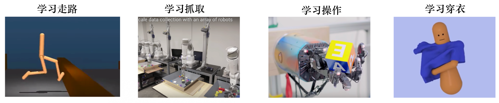
</div>
<div align=center>Hình 1.11 Các ví dụ về học tăng cường</div>

## 1.2 Ra quyết định tuần tự

### 1.2.1 Tác tử và môi trường

Tiếp theo chúng ta giới thiệu quá trình **ra quyết định tuần tự (sequential decision making)**. Học tăng cường nghiên cứu bài toán tác tử tương tác với môi trường: tác tử ở bên trái hình 1.12 liên tục tương tác với môi trường ở bên phải hình 1.12. Tác tử xuất hành động của nó cho môi trường, môi trường nhận hành động này rồi tiến sang bước tiếp theo, trả về cho tác tử quan sát của bước tiếp theo và phần thưởng do hành động này mang lại. Sự tương tác như vậy tạo ra nhiều quan sát, mục đích của tác tử là từ các quan sát này học được chính sách (policy) giúp tối đa hóa phần thưởng.

<div align=center>
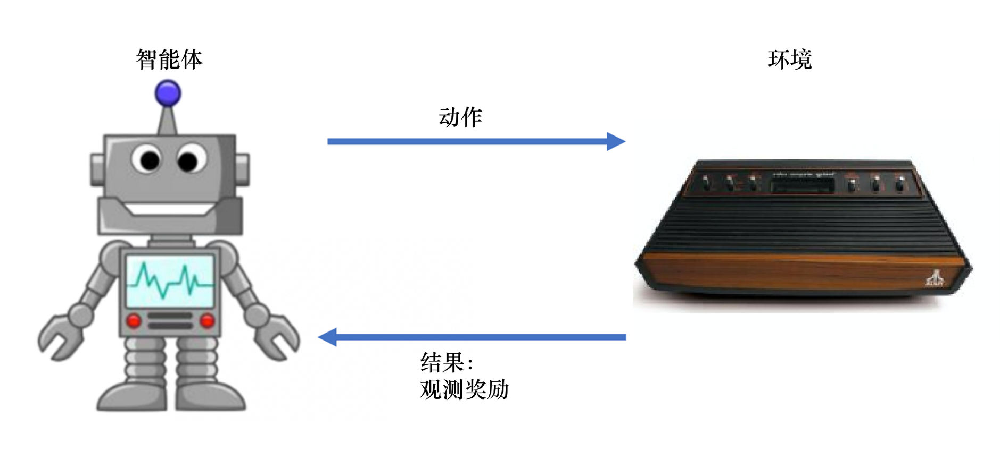
</div>
<div align=center>Hình 1.12 Tác tử và môi trường</div>

### 1.2.2 Phần thưởng

Phần thưởng là một tín hiệu phản hồi vô hướng (scalar feedback signal) do môi trường đưa ra, tín hiệu này cho biết tác tử thực hiện một chính sách nào đó ở một bước nào đó thì hiệu quả ra sao. Mục đích của học tăng cường là tối đa hóa phần thưởng tác tử nhận được; tác tử tồn tại trong môi trường với mục đích tối đa hóa phần thưởng tích lũy kỳ vọng (expected cumulative reward) của nó. Ở các môi trường khác nhau, phần thưởng cũng khác nhau. Dưới đây là một vài ví dụ về phần thưởng.

(1) Ví dụ một kỳ thủ cờ, mục đích của họ là thắng; khi ván cờ kết thúc, họ sẽ nhận được phần thưởng dương (thắng) hoặc phần thưởng âm (thua).

(2) Trong quản lý cổ phiếu, phần thưởng được quyết định bởi lãi và lỗ từ cổ phiếu.

(3) Khi chơi game Atari, phần thưởng chính là điểm số trò chơi tăng hay giảm; mức độ thưa (sparsity) của phần thưởng quyết định độ khó của trò chơi.

### 1.2.3 Ra quyết định tuần tự

Trong một môi trường học tăng cường, mục đích của tác tử là chọn một chuỗi hành động để tối đa hóa phần thưởng, vì vậy các hành động được chọn phải có ảnh hưởng lâu dài. Nhưng trong quá trình này, phần thưởng của tác tử thực ra bị trễ, tức là hành động ta chọn ở một bước hiện tại có thể phải rất lâu sau mới biết nó gây ra ảnh hưởng gì. Như hình 1.13, khi chơi Pong của Atari, có thể chỉ đến khi trò chơi kết thúc ta mới biết bóng có được đánh trả sang hay không. Các hành động đi lên (up) hoặc đi xuống (down) trong quá trình chơi không trực tiếp tạo ra phần thưởng. Một chủ đề quan trọng trong học tăng cường là sự đánh đổi (trade-off) giữa phần thưởng ngắn hạn và phần thưởng dài hạn, nghiên cứu cách giúp tác tử đạt được nhiều phần thưởng dài hạn hơn.

Trong quá trình tương tác với môi trường, tác tử nhận được nhiều quan sát. Với mỗi quan sát, tác tử thực hiện một hành động và nhận một phần thưởng. Vì vậy lịch sử (history) là chuỗi các quan sát, hành động, phần thưởng:
$$
H_{t}=o_{1},  a_{1}, r_{1}, \ldots, o_{t}, a_{t}, r_{t}
$$

Khi thực hiện hành động hiện tại, tác tử phụ thuộc vào lịch sử nó có trước đó, vì vậy ta có thể xem trạng thái của toàn bộ trò chơi là một hàm của lịch sử này:

$$
S_{t}=f\left(H_{t}\right)
$$

<div align=center>
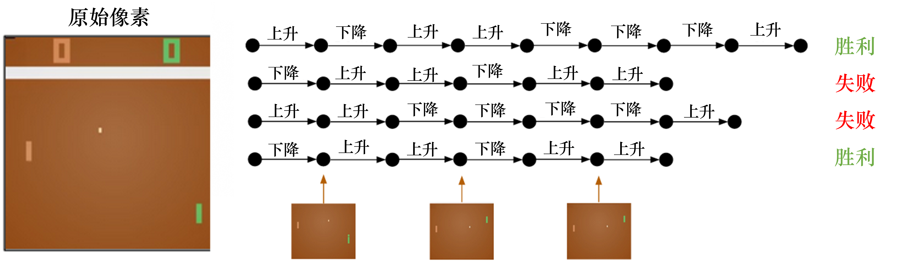
</div>
<div align=center>Hình 1.13 Chơi trò chơi Pong</div>


Q: Trạng thái và quan sát có quan hệ gì với nhau?

A: **Trạng thái** là mô tả đầy đủ về thế giới, không che giấu thông tin nào của thế giới. **Quan sát** là mô tả một phần của trạng thái, có thể bỏ sót một số thông tin. Trong học tăng cường sâu, chúng ta gần như luôn dùng vectơ, ma trận hoặc tenxơ (tensor) bậc cao giá trị thực để biểu diễn trạng thái và quan sát. Ví dụ, ta có thể dùng ma trận giá trị điểm ảnh RGB để biểu diễn một quan sát thị giác, có thể dùng góc và vận tốc của các khớp robot để biểu diễn trạng thái của robot.

Môi trường có hàm riêng $s_{t}^{e}=f^{e}\left(H_{t}\right)$ để cập nhật trạng thái, bên trong tác tử cũng có một hàm $s_{t}^{a}=f^{a}\left(H_{t}\right)$ để cập nhật trạng thái. Khi trạng thái của tác tử tương đương với trạng thái của môi trường, tức là khi tác tử quan sát được toàn bộ trạng thái của môi trường, ta gọi môi trường này là quan sát được hoàn toàn (fully observed). Trong trường hợp này, học tăng cường thường được mô hình hóa thành bài toán quá trình quyết định Markov (Markov decision process, MDP). Trong quá trình quyết định Markov, $o_{t}=s_{t}^{e}=s_{t}^{a}$.

Nhưng có trường hợp quan sát mà tác tử nhận được không chứa toàn bộ trạng thái vận hành của môi trường, vì trong thiết lập của học tăng cường, trạng thái của môi trường mới là toàn bộ trạng thái thực sự. Ví dụ tác tử chơi blackjack, thứ nó nhìn thấy thực ra chỉ là các lá bài đã lật. Hoặc khi chơi game Atari, quan sát chỉ là thông tin của khung hình hiện tại trên màn hình, ta không có được toàn bộ trạng thái vận hành bên trong trò chơi. Tức là khi tác tử chỉ thấy được một phần quan sát, ta gọi môi trường này là quan sát được một phần (partially observed). Trong trường hợp này, học tăng cường thường được mô hình hóa thành bài toán **quá trình quyết định Markov quan sát được một phần (partially observable Markov decision process, POMDP)**. POMDP là một dạng tổng quát hóa của quá trình quyết định Markov. POMDP vẫn có tính chất Markov (Markov property), nhưng giả định rằng tác tử không thể cảm nhận trạng thái của môi trường mà chỉ biết được một phần giá trị quan sát. Ví dụ trong lái xe tự động, tác tử chỉ có thể cảm nhận thông tin môi trường hữu hạn do cảm biến thu thập. POMDP có thể được mô tả bằng một bộ bảy $(S,A,T,R,\Omega,O,\gamma)$. Trong đó $S$ là không gian trạng thái (state space), là biến ẩn (latent variable); $A$ là không gian hành động (action space); $T(s'|s,a)$ là xác suất chuyển trạng thái (state transition probability); $R$ là hàm phần thưởng (reward function); $\Omega(o|s,a)$ là xác suất quan sát (observation probability); $O$ là không gian quan sát (observation space); $\gamma$ là hệ số chiết khấu (discount factor).

## 1.3 Không gian hành động

Các môi trường khác nhau cho phép các loại hành động khác nhau. Trong một môi trường cho trước, tập hợp các hành động hợp lệ thường được gọi là không gian hành động (action space). Các môi trường như game Atari và cờ vây (Go) có không gian hành động rời rạc (discrete action space), trong không gian hành động này số lượng hành động của tác tử là hữu hạn. Ở các môi trường khác, chẳng hạn điều khiển một tác tử trong thế giới vật lý, môi trường có không gian hành động liên tục (continuous action space). Trong không gian hành động liên tục, hành động là một vectơ giá trị thực.

Ví dụ, nếu robot đi mê cung chỉ có 4 cách di chuyển là đi về phía đông, nam, tây, bắc thì không gian hành động của nó là rời rạc; nếu robot có thể di chuyển theo bất kỳ góc nào trong 360 độ thì không gian hành động của nó là liên tục.

## 1.4 Các thành phần và các loại tác tử học tăng cường

Một tác tử học tăng cường có thể có một hoặc nhiều thành phần sau.

* **Chính sách (policy)**. Tác tử dùng chính sách để chọn hành động tiếp theo.

* **Hàm giá trị (value function)**. Ta dùng hàm giá trị để đánh giá trạng thái hiện tại. Hàm giá trị dùng để đánh giá việc tác tử đi vào một trạng thái nào đó sẽ ảnh hưởng bao nhiêu đến phần thưởng về sau. Giá trị hàm giá trị càng lớn, chứng tỏ tác tử đi vào trạng thái đó càng có lợi.

* **Mô hình (model)**. Mô hình thể hiện sự hiểu biết của tác tử về trạng thái của môi trường, nó quyết định cách thế giới trong môi trường vận hành. Dưới đây ta tìm hiểu sâu chi tiết của 3 thành phần này.

### 1.4.1 Chính sách
Chính sách là mô hình hành động của tác tử, nó quyết định hành động của tác tử. Nó thực chất là một hàm, dùng để biến trạng thái đầu vào thành hành động. Chính sách có hai loại: chính sách ngẫu nhiên và chính sách tất định.

**Chính sách ngẫu nhiên (stochastic policy)** chính là hàm $\pi$, tức $\pi(a | s)=p\left(a_{t}=a | s_{t}=s\right)$. Đầu vào là một trạng thái $s$, đầu ra là một xác suất.
Xác suất này là xác suất của tất cả các hành động của tác tử, sau đó lấy mẫu từ phân phối xác suất này sẽ được hành động mà tác tử sẽ thực hiện. Ví dụ có thể có xác suất 0.7 đi sang trái và 0.3 đi sang phải, khi đó lấy mẫu sẽ cho ra hành động mà tác tử thực hiện.

**Chính sách tất định (deterministic policy)** là tác tử trực tiếp chọn hành động có khả năng nhất, tức $a^{*}=\underset{a}{\arg \max} \pi(a \mid s)$.


Như hình 1.14, xét game Atari, đầu vào của hàm chính sách là một khung hình của trò chơi, đầu ra của nó quyết định tác tử di chuyển sang trái hay sang phải.

<div align=center>
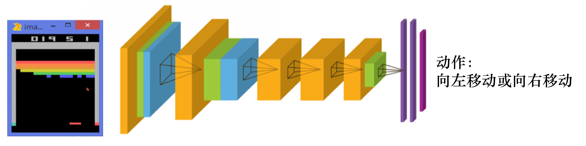
</div>
<div align=center>Hình 1.14 Hàm chính sách</div>

Thông thường, học tăng cường hay dùng chính sách ngẫu nhiên, chính sách ngẫu nhiên có nhiều ưu điểm. Ví dụ, khi học có thể đưa vào một mức ngẫu nhiên nhất định để khám phá môi trường tốt hơn;
hành động của chính sách ngẫu nhiên có tính đa dạng, điều này rất quan trọng khi nhiều tác tử đối kháng với nhau (trò chơi đa tác tử). Tác tử dùng chính sách tất định luôn thực hiện cùng một hành động với cùng một trạng thái, điều này khiến chính sách của nó rất dễ bị đối thủ đoán ra.

### 1.4.2 Hàm giá trị
Giá trị của hàm giá trị là dự đoán về phần thưởng tương lai, ta dùng nó để đánh giá trạng thái tốt hay xấu.
Trong hàm giá trị có một **hệ số chiết khấu (discount factor)**, vì chúng ta muốn nhận được càng nhiều phần thưởng càng tốt trong thời gian càng ngắn càng tốt. Ví dụ bây giờ cho ta hai lựa chọn: 10 ngày nữa nhận 100 đồng hoặc nhận 100 đồng ngay bây giờ. Chắc chắn ta muốn nhận 100 đồng ngay bây giờ hơn, vì ta có thể gửi 100 đồng này vào ngân hàng để có thêm chút lãi. Vì vậy ta có thể đưa hệ số chiết khấu vào định nghĩa của hàm giá trị, hàm giá trị được định nghĩa là

$$
V_{\pi}(s) \doteq \mathbb{E}_{\pi}\left[G_{t} \mid s_{t}=s\right]=\mathbb{E}_{\pi}\left[\sum_{k=0}^{\infty} \gamma^{k} r_{t+k+1} \mid s_{t}=s\right], \text{với mọi } s \in S
$$

Chỉ số dưới của kỳ vọng (expectation) $\mathbb{E}_{\pi}$ là hàm $\pi$, giá trị của hàm $\pi$ phản ánh khi ta dùng chính sách $\pi$ thì rốt cuộc có thể nhận được bao nhiêu phần thưởng.

Chúng ta còn có một loại hàm giá trị khác: hàm Q (Q-function). Hàm Q chứa hai biến: trạng thái và hành động. Nó được định nghĩa là
$$
Q_{\pi}(s, a) \doteq \mathbb{E}_{\pi}\left[G_{t} \mid s_{t}=s, a_{t}=a\right]=\mathbb{E}_{\pi}\left[\sum_{k=0}^{\infty} \gamma^{k} r_{t+k+1} \mid s_{t}=s, a_{t}=a\right]
$$
Vì vậy kỳ vọng phần thưởng ta có thể nhận được trong tương lai phụ thuộc vào trạng thái hiện tại và hành động hiện tại. Hàm Q là một hàm cần học trong các thuật toán học tăng cường. Bởi vì khi có được hàm Q, hành động tối ưu cần thực hiện khi vào một trạng thái nào đó có thể suy ra từ hàm Q.

### 1.4.3 Mô hình
Thành phần thứ 3 là mô hình, mô hình quyết định trạng thái tiếp theo. Trạng thái tiếp theo phụ thuộc vào trạng thái hiện tại và hành động hiện tại. Nó gồm hai phần: xác suất chuyển trạng thái và hàm phần thưởng. Xác suất chuyển trạng thái (state transition probability) là
$$
p_{s s^{\prime}}^{a}=p\left(s_{t+1}=s^{\prime} \mid s_{t}=s, a_{t}=a\right)
$$

Hàm phần thưởng (reward function) cho biết khi ta thực hiện một hành động ở trạng thái hiện tại thì nhận được phần thưởng bao nhiêu, tức là
$$
R(s,a)=\mathbb{E}\left[r_{t+1} \mid s_{t}=s, a_{t}=a\right]
$$
Khi có đủ 3 thành phần chính sách, hàm giá trị và mô hình, ta có một **quá trình quyết định Markov (Markov decision process)**. Như hình 1.15, quá trình quyết định này trực quan hóa việc chuyển giữa các trạng thái và các hành động được thực hiện.

<div align=center>
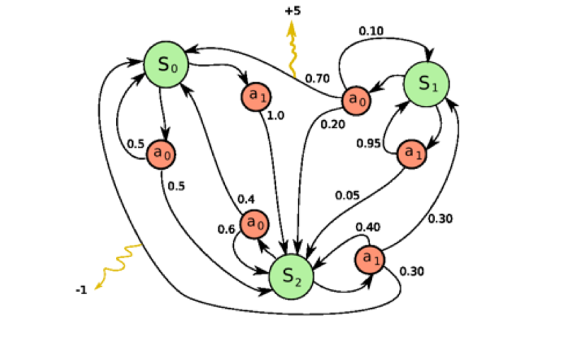
</div>
<div align=center>Hình 1.15 Quá trình quyết định Markov</div>

Hãy xem một ví dụ đi mê cung. Như hình 1.16, yêu cầu tác tử xuất phát từ điểm bắt đầu (start) và đi đến vị trí đích (goal). Mỗi bước đi, ta nhận phần thưởng $-$1. Các hành động có thể thực hiện là đi lên, xuống, trái, phải. Ta dùng vị trí hiện tại của tác tử để mô tả trạng thái hiện tại.


<div align=center>
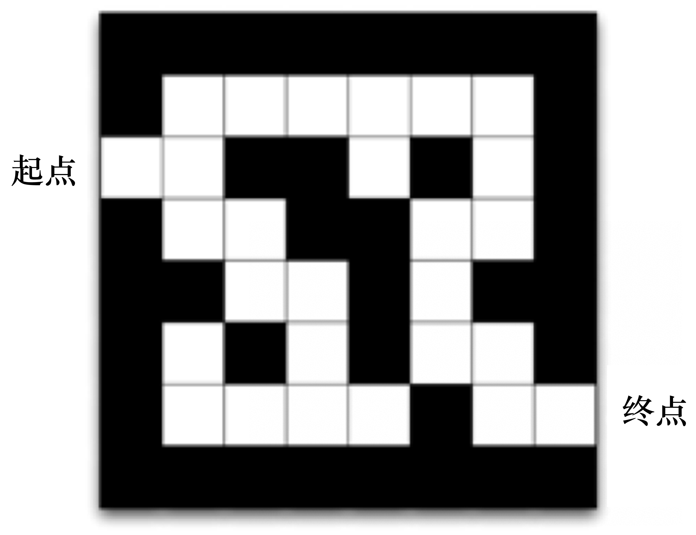
</div>
<div align=center>Hình 1.16 Ví dụ đi mê cung</div>


Ta có thể dùng các phương pháp học tăng cường khác nhau để giải môi trường này.
Nếu dùng phương pháp học tăng cường dựa trên chính sách (policy-based RL), khi đã học tốt môi trường này, ở mỗi trạng thái ta sẽ có một hành động tốt nhất. Như hình 1.17, ví dụ hiện ta đang ở điểm bắt đầu, ta biết hành động tốt nhất là đi sang phải; ở ô thứ hai, hành động tốt nhất là đi lên; ô thứ ba là đi sang phải... Với chính sách tối ưu, ta có thể đến đích nhanh nhất.


<div align=center>
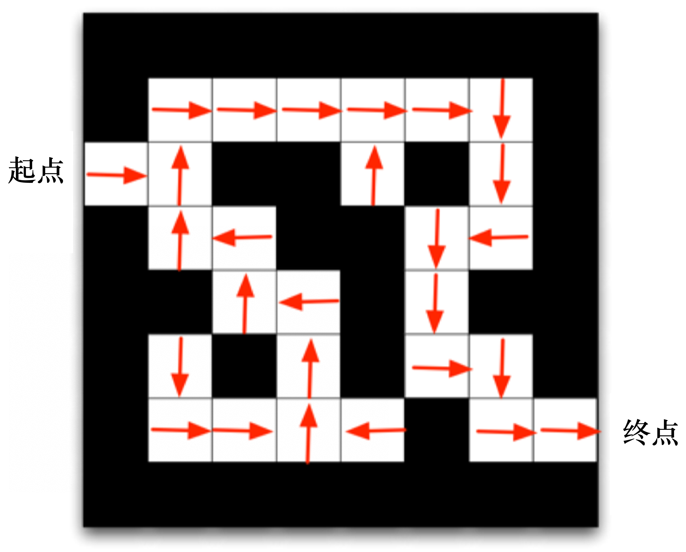
</div>
<div align=center>Hình 1.17 Kết quả thu được bằng phương pháp học tăng cường dựa trên chính sách</div>


Nếu đổi sang phương pháp học tăng cường dựa trên giá trị (value-based RL), dùng hàm giá trị làm định hướng, ta sẽ có một cách biểu diễn khác: mỗi trạng thái trả về một giá trị. Như hình 1.18, ví dụ khi ở điểm bắt đầu, giá trị là $-$16, vì nhanh nhất ta cần 16 bước để đến đích. Vì mỗi bước bị trừ 1 nên giá trị ở đây là $-$16.
Càng gần đích, con số này càng lớn. Ở chỗ rẽ, ví dụ đang ở ô thứ hai, giá trị là $-$15, tác tử sẽ nhìn ô phía trên và phía dưới, nó thấy giá trị ô phía trên lớn hơn, là $-$14, còn ô phía dưới là $-$16, nên tác tử sẽ chọn hành động đi lên. Như vậy, thông qua các giá trị khác nhau đã học được, ta có thể rút ra chính sách tốt nhất hiện tại.

<div align=center>
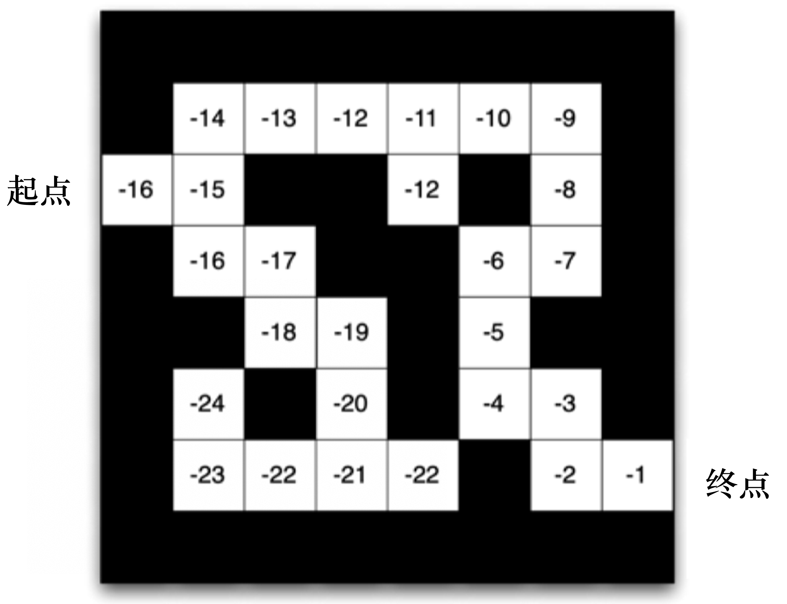
</div>
<div align=center>Hình 1.18 Kết quả thu được bằng phương pháp học tăng cường dựa trên giá trị</div>


### 1.4.4 Các loại tác tử học tăng cường
#### 1. Tác tử dựa trên giá trị và tác tử dựa trên chính sách

Dựa vào thứ mà tác tử học, ta có thể phân loại tác tử. **Tác tử dựa trên giá trị (value-based agent)** học tường minh (explicit) hàm giá trị, học ngầm (implicit) chính sách của nó. Chính sách được suy ra từ hàm giá trị đã học. **Tác tử dựa trên chính sách (policy-based agent)** học trực tiếp chính sách, ta cho nó một trạng thái, nó sẽ đưa ra xác suất của các hành động tương ứng. Tác tử dựa trên chính sách không học hàm giá trị. Kết hợp tác tử dựa trên giá trị và tác tử dựa trên chính sách ta có **tác tử diễn viên-nhà phê bình (actor-critic agent)**. Loại tác tử này học cả chính sách và hàm giá trị, rồi thông qua tương tác giữa hai thứ để tìm ra hành động tốt nhất.

Q: Phương pháp học tăng cường dựa trên chính sách và dựa trên giá trị khác nhau thế nào?

A: Với một quá trình quyết định Markov đã biết xác suất chuyển trạng thái, ta có thể dùng thuật toán quy hoạch động (dynamic programming) để giải. Xét theo cách ra quyết định, học tăng cường lại có thể chia thành phương pháp dựa trên chính sách và phương pháp dựa trên giá trị. Cách ra quyết định là căn cứ để tác tử chọn một hành động từ tập hành động tại một trạng thái cho trước, nó là tĩnh, không thay đổi theo trạng thái.
Trong phương pháp học tăng cường dựa trên chính sách, tác tử xây dựng một chính sách hành động (xác định cần thực hiện hành động gì ở một trạng thái cho trước) và hành động theo chính sách này. Thuật toán học tăng cường tối ưu trực tiếp chính sách, giúp chính sách đó đạt được phần thưởng lớn nhất.
Còn trong phương pháp học tăng cường dựa trên giá trị, tác tử không cần xây dựng chính sách tường minh, nó duy trì một bảng giá trị hoặc hàm giá trị, và thông qua bảng giá trị hoặc hàm giá trị này để chọn hành động có giá trị lớn nhất. Phương pháp dựa trên lặp giá trị (value iteration) chỉ áp dụng được trong môi trường không liên tục, rời rạc (như cờ vây hoặc một số trò chơi); với các tình huống có tập hành động rất lớn, hành động liên tục (như điều khiển robot), nó khó học được kết quả tốt (khi đó phương pháp dựa trên lặp chính sách (policy iteration) có thể chọn hành động liên tục dựa trên chính sách đã thiết lập).
Các thuật toán học tăng cường dựa trên giá trị gồm Q-learning, Sarsa,..., còn thuật toán học tăng cường dựa trên chính sách gồm thuật toán gradient chính sách (Policy Gradient, PG),... Ngoài ra, thuật toán diễn viên-nhà phê bình (actor-critic) dùng đồng thời chính sách và đánh giá giá trị để ra quyết định. Trong đó, tác tử thực hiện hành động theo chính sách, còn hàm giá trị đánh giá giá trị của hành động đã thực hiện; nhờ vậy có thể tăng tốc quá trình học so với thuật toán gradient chính sách ban đầu và đạt hiệu quả tốt hơn.

#### 2. Tác tử học tăng cường có mô hình và không mô hình


Ngoài ra, ta có thể phân loại tác tử dựa trên việc tác tử có học mô hình môi trường hay không.
Tác tử học tăng cường **có mô hình (model-based)** chọn hành động thông qua việc học sự chuyển trạng thái.
Tác tử học tăng cường **không mô hình (model-free)** không ước lượng trực tiếp sự chuyển trạng thái, cũng không có được các biến chuyển cụ thể của môi trường; nó ra quyết định thông qua việc học hàm giá trị và hàm chính sách. Trong mô hình của tác tử học tăng cường không mô hình không có mô hình chuyển trạng thái của môi trường.

Ta có thể dùng quá trình quyết định Markov để định nghĩa nhiệm vụ học tăng cường và biểu diễn nó dưới dạng bộ bốn $<S,A,P,R>$, tức tập trạng thái, tập hành động, hàm chuyển trạng thái (state transition function) và hàm phần thưởng. Nếu mọi phần tử trong bộ bốn này đều đã biết, và tập trạng thái cùng tập hành động là tập hữu hạn trong số bước hữu hạn, thì tác tử có thể mô hình hóa môi trường thật, xây dựng một thế giới ảo để mô phỏng trạng thái và phản ứng tương tác trong môi trường thật.
Cụ thể, khi tác tử biết hàm chuyển trạng thái $P(s_{t+1}|s_t,a_t)$ và hàm phần thưởng $R(s_t,a_t)$, nó sẽ biết được ở một trạng thái nào đó thực hiện một hành động nào đó sẽ nhận phần thưởng bao nhiêu và trạng thái tiếp theo của môi trường là gì; như vậy tác tử không cần thực hiện hành động trong môi trường thật mà chỉ cần học và lập kế hoạch chính sách ngay trong thế giới ảo. Phương pháp học này gọi là **học tăng cường có mô hình**.
Quy trình học tăng cường có mô hình được thể hiện ở hình 1.19.


<div align=center>
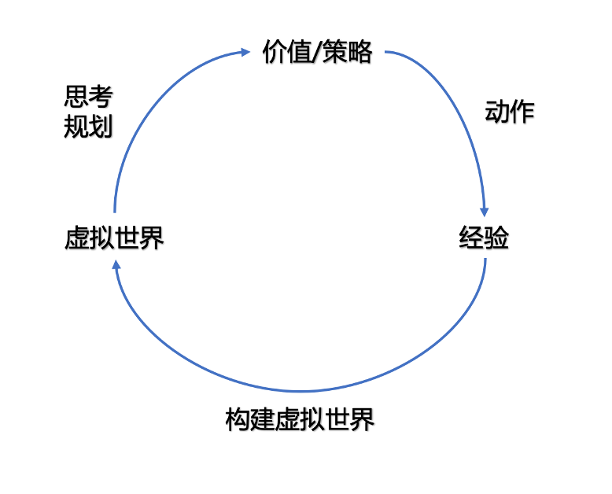
</div>
<div align=center>Hình 1.19 Quy trình học tăng cường có mô hình</div>

Tuy nhiên trong ứng dụng thực tế, không dễ để tác tử biết được tất cả các phần tử của quá trình quyết định Markov. Thông thường, hàm chuyển trạng thái và hàm phần thưởng rất khó ước lượng, thậm chí cả các trạng thái trong môi trường cũng có thể chưa biết, khi đó cần dùng học tăng cường không mô hình. Học tăng cường không mô hình không mô hình hóa môi trường thật, tác tử chỉ có thể thực hiện hành động trong môi trường thật theo một chính sách nào đó, chờ phần thưởng và sự chuyển trạng thái, rồi dựa vào các thông tin phản hồi này để cập nhật chính sách hành động, lặp đi lặp lại như vậy cho đến khi học được chính sách tối ưu (optimal policy).

Q: Học tăng cường có mô hình và không mô hình khác nhau thế nào?

A: Dựa trên việc có cần mô hình hóa môi trường thật hay không, học tăng cường có thể chia thành học tăng cường có mô hình và học tăng cường không mô hình. Học tăng cường có mô hình là dựa vào kinh nghiệm trong môi trường để xây dựng một thế giới ảo, đồng thời học trong cả môi trường thật và thế giới ảo; học tăng cường không mô hình là không mô hình hóa môi trường, trực tiếp tương tác với môi trường thật để học được chính sách tối ưu.

Tóm lại, học tăng cường có mô hình so với không mô hình chỉ có thêm một bước, đó là mô hình hóa môi trường thật. Do đó, một số phương pháp học tăng cường có mô hình cũng có thể dùng trong phương pháp học tăng cường không mô hình. Trong ứng dụng thực tế, nếu không rõ nên dùng học tăng cường có mô hình hay không mô hình, có thể suy nghĩ xem trước khi tác tử thực hiện hành động, liệu có thể dự đoán được trạng thái và phần thưởng của bước tiếp theo hay không; nếu có thể thì ta mô hình hóa được môi trường và có thể dùng học có mô hình.

Học tăng cường không mô hình thường thuộc nhóm phương pháp hướng dữ liệu (data-driven), cần lượng lớn mẫu để ước lượng trạng thái, hành động và hàm phần thưởng, từ đó tối ưu chính sách hành động. Ví dụ, trong trò chơi *Space Invaders* (Kẻ xâm lược không gian) trên nền tảng Atari, học tăng cường sâu không mô hình cần khoảng hai trăm triệu khung hình trò chơi mới học được hiệu quả khá lý tưởng. Ngược lại, học tăng cường sâu có mô hình có thể phần nào giảm bớt vấn đề thiếu dữ liệu huấn luyện, vì tác tử có thể huấn luyện trong thế giới ảo.
Khả năng tổng quát hóa (generalization) của học không mô hình tốt hơn học tăng cường có mô hình, lý do là học tăng cường có mô hình cần mô hình hóa môi trường thật, và giữa thế giới ảo với môi trường thật có thể còn khác biệt, điều này hạn chế khả năng tổng quát hóa của thuật toán học tăng cường có mô hình.
Phương pháp học tăng cường có mô hình có thể mô hình hóa môi trường, điều này khiến nhóm phương pháp này có một sức hấp dẫn riêng, đó là "khả năng tưởng tượng". Trong học tăng cường không mô hình, tác tử chỉ có thể thực hiện chính sách từng bước một, chờ phản hồi của môi trường thật; còn học tăng cường có mô hình có thể dự đoán trong thế giới ảo những gì sắp xảy ra và chọn chính sách có lợi nhất cho mình.

Hiện nay, đa số phương pháp học tăng cường sâu đều dùng học tăng cường không mô hình, bởi vì: học tăng cường không mô hình đơn giản, trực quan hơn và có nhiều tài liệu mã nguồn mở, ví dụ dòng AlphaGo đều dùng học tăng cường không mô hình; trong nghiên cứu học tăng cường hiện tại, đa số trường hợp môi trường là tĩnh, mô tả được, trạng thái của tác tử là rời rạc, quan sát được (như nền tảng game Atari), những bài toán tương đối đơn giản, xác định như vậy không cần ước lượng hàm chuyển trạng thái và hàm phần thưởng, có thể dùng trực tiếp học tăng cường không mô hình, huấn luyện với lượng lớn mẫu là đã đạt hiệu quả khá tốt.

Như hình 1.20, ta có thể đặt các loại mô hình vào cùng một hình. Hình 1.20 có 3 thành phần: hàm giá trị, chính sách và mô hình. Dựa vào việc một tác tử có cả ba, hai hay chỉ một trong ba thành phần này mà ta có thể chia nó thành nhiều loại.


<div align=center>
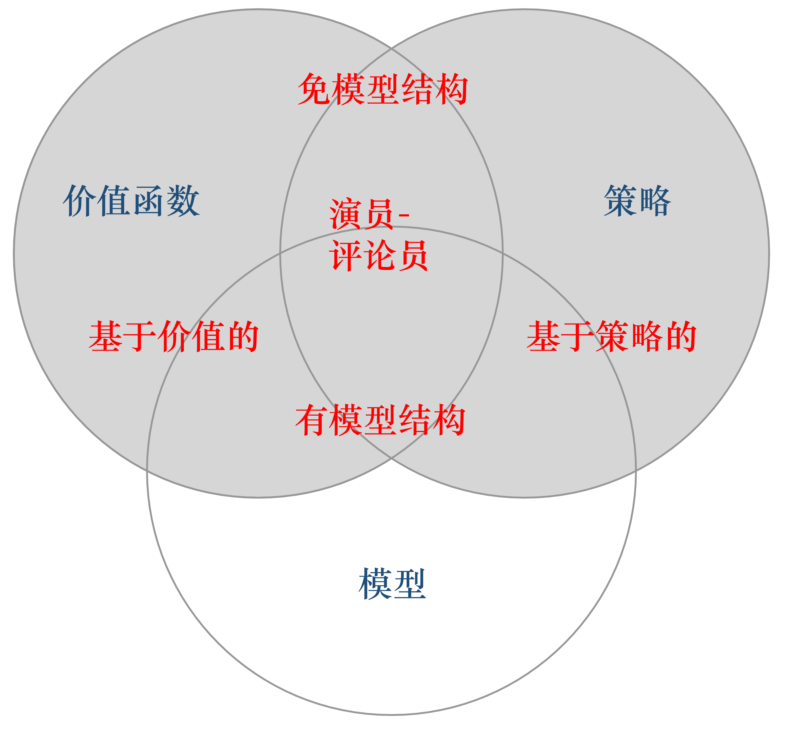
</div>
<div align=center>Hình 1.20 Các loại tác tử học tăng cường</div>

## 1.5 Học và lập kế hoạch

Học (learning) và lập kế hoạch (planning) là hai bài toán cơ bản của ra quyết định tuần tự.
Như hình 1.21, trong học tăng cường, môi trường ban đầu là chưa biết, tác tử không biết môi trường hoạt động thế nào, nó cải thiện dần chính sách thông qua việc liên tục tương tác với môi trường.

<div align=center>
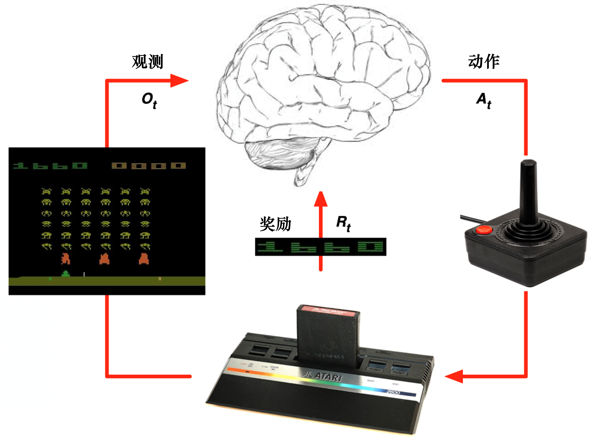
</div>
<div align=center>Hình 1.21 Học</div>


Như hình 1.22, trong lập kế hoạch, môi trường đã biết, tác tử được cho biết thông tin chi tiết về quy tắc vận hành của toàn bộ môi trường. Tác tử có thể tính ra một mô hình hoàn hảo và tính toán mà không cần bất kỳ tương tác nào với môi trường. Tác tử không cần tương tác thời gian thực với môi trường mà vẫn biết được môi trường tương lai, chỉ cần biết trạng thái hiện tại là có thể bắt đầu suy nghĩ để tìm lời giải tối ưu.

Trong trò chơi ở hình 1.22, quy tắc là xác định, ta biết sau khi chọn trái thì môi trường sẽ thay đổi thế nào. Ta hoàn toàn có thể dựa vào quy tắc đã biết để mô phỏng bên trong toàn bộ quá trình ra quyết định mà không cần tương tác với môi trường.
Một hướng giải bài toán học tăng cường phổ biến là: trước tiên học xem môi trường hoạt động thế nào, tức là hiểu cách môi trường vận hành, nói cách khác là học được một mô hình, rồi dùng mô hình này để lập kế hoạch.


<div align=center>
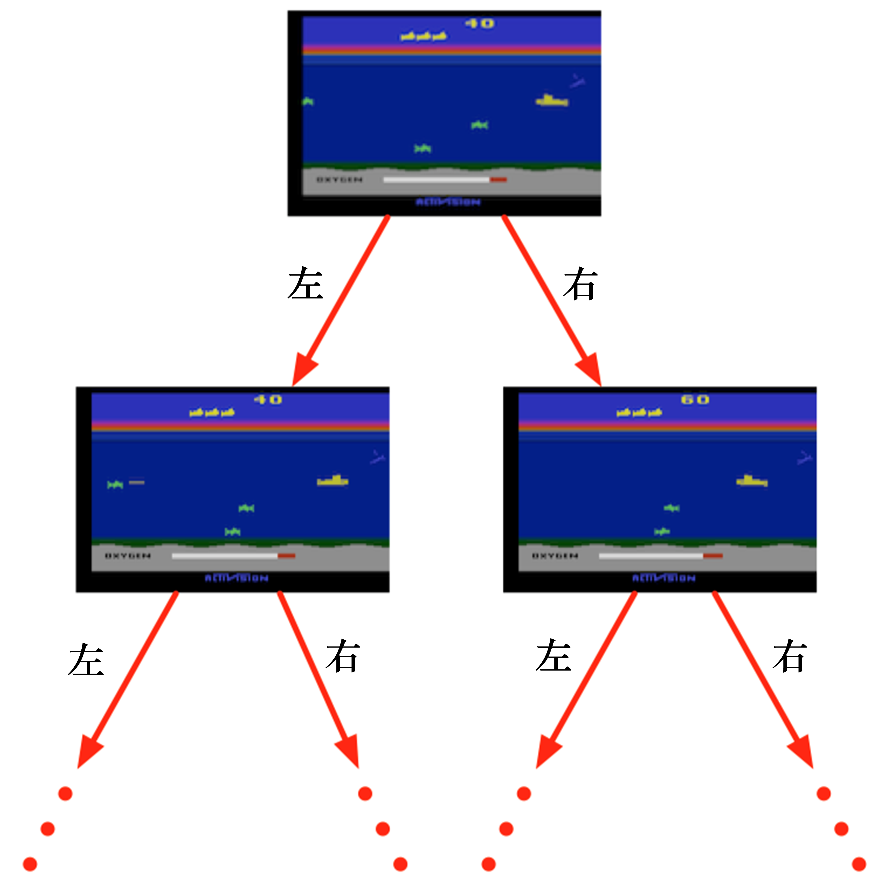
</div>
<div align=center>Hình 1.22 Lập kế hoạch</div>

## 1.6 Khám phá và khai thác

Trong học tăng cường, khám phá (exploration) và khai thác (exploitation) là hai vấn đề rất cốt lõi.
Khám phá nghĩa là ta đi khám phá môi trường, thử các hành động khác nhau để tìm ra chính sách tốt nhất (chính sách mang lại phần thưởng lớn nhất).
Khai thác nghĩa là ta không thử hành động mới, mà thực hiện hành động đã biết là mang lại phần thưởng lớn.
Lúc mới bắt đầu, tác tử học tăng cường không biết sau khi thực hiện một hành động nào đó thì điều gì sẽ xảy ra, nên nó chỉ có thể khám phá bằng thử-và-sai; vì vậy khám phá chính là dùng thử-và-sai để hiểu hành động đã thực hiện có mang lại phần thưởng tốt hay không. Khai thác là trực tiếp thực hiện hành động đã biết là mang lại phần thưởng tốt. Vì vậy ở đây có một bài toán đánh đổi: làm sao hy sinh một phần phần thưởng ngắn hạn để hiểu các hành động, từ đó học được chính sách tốt hơn.

Dưới đây là một số ví dụ về khám phá và khai thác.
Lấy việc chọn nhà hàng làm ví dụ, khai thác là ta đến thẳng nhà hàng yêu thích nhất, vì ta đã đến đó nhiều lần nên biết món ăn ở đó đều rất ngon.
Khám phá là ta dùng điện thoại tìm một nhà hàng mới, rồi thử xem món ăn ở đó có ngon không. Có thể ta sẽ rất không hài lòng với nhà hàng mới, như vậy là phí tiền.
Lấy quảng cáo làm ví dụ, khai thác là trực tiếp dùng chiến lược quảng cáo tốt nhất. Khám phá là đổi sang một chiến lược quảng cáo khác, xem chiến lược mới có đạt hiệu quả tốt hơn không.
Lấy khoan dầu làm ví dụ, khai thác là khoan dầu trực tiếp ở nơi đã biết, như vậy chắc chắn có dầu.
Khám phá là khoan dầu ở một nơi mới, như vậy có xác suất lớn là không tìm thấy mỏ dầu, nhưng cũng có xác suất nhỏ phát hiện được một mỏ dầu rất lớn.
Lấy chơi game làm ví dụ, khai thác là ta luôn dùng một chiến thuật nào đó. Ví dụ khi chơi *Street Fighter*, chiến thuật có thể là ngồi xổm ở góc rồi liên tục tung cước. Chiến thuật này rất có thể hiệu quả, nhưng gặp một số đối thủ nhất định thì có thể mất tác dụng.
Khám phá là ta có thể thử một số chiêu thức mới, có khi ta tung ra "tuyệt chiêu", như vậy có thể "một đòn hạ gục".

Khác với nhiệm vụ học có giám sát, phần thưởng cuối cùng của nhiệm vụ học tăng cường chỉ quan sát được sau nhiều bước hành động. Ở đây ta hãy xét trường hợp đơn giản trước: tối đa hóa phần thưởng một bước, tức chỉ xét một bước hành động. Cần lưu ý rằng, ngay cả trong trường hợp đơn giản như vậy, học tăng cường vẫn khác biệt rõ rệt so với học có giám sát, vì tác tử phải thử-và-sai để khám phá kết quả của từng hành động, chứ không có dữ liệu huấn luyện nào cho tác tử biết nên thực hiện hành động nào.

Muốn tối đa hóa phần thưởng một bước cần xét hai mặt: một là cần biết phần thưởng mỗi hành động mang lại, hai là cần thực hiện hành động có phần thưởng lớn nhất. Nếu phần thưởng tương ứng với mỗi hành động là một giá trị xác định, thì thử hết tất cả các hành động là tìm được hành động có phần thưởng lớn nhất. Tuy nhiên, trường hợp tổng quát hơn là phần thưởng của một hành động đến từ một phân phối xác suất, chỉ thử một lần thì không thể biết chính xác giá trị phần thưởng trung bình.

Thực tế, nhiệm vụ học tăng cường một bước tương ứng với một mô hình lý thuyết, đó là **máy đánh bạc $K$ tay cần ($K$-armed bandit)**. $K$-armed bandit còn được gọi là **máy đánh bạc nhiều tay cần (multi-armed bandit)**. Như hình 1.23, máy $K$-armed bandit có $K$ tay cần, người chơi sau khi bỏ một đồng xu vào có thể chọn kéo một trong các tay cần, mỗi tay cần nhả ra đồng xu với một xác suất nhất định, nhưng người chơi không biết xác suất này. Mục tiêu của người chơi là thông qua một chiến lược nào đó để tối đa hóa phần thưởng của mình, tức là thu được nhiều đồng xu nhất.
Nếu chỉ muốn biết phần thưởng kỳ vọng của từng tay cần, có thể dùng **phương pháp chỉ khám phá (exploration-only)**: chia đều tất cả cơ hội thử cho mỗi tay cần (tức lần lượt kéo từng tay cần), cuối cùng dùng xác suất nhả xu trung bình của mỗi tay cần làm ước lượng xấp xỉ cho phần thưởng kỳ vọng của nó. Nếu chỉ muốn thực hiện hành động có phần thưởng lớn nhất, có thể dùng **phương pháp chỉ khai thác (exploitation-only)**: kéo tay cần tốt nhất hiện tại (tức tay cần có phần thưởng trung bình lớn nhất cho đến thời điểm này), nếu có nhiều tay cần cùng tốt nhất thì chọn ngẫu nhiên một trong số đó.

Rõ ràng, phương pháp chỉ khám phá ước lượng tốt phần thưởng của mỗi tay cần, nhưng sẽ mất nhiều cơ hội chọn tay cần tốt nhất; phương pháp chỉ khai thác thì ngược lại, nó không ước lượng tốt phần thưởng kỳ vọng của các tay cần, rất có thể thường xuyên không chọn được tay cần tốt nhất. Do đó, cả hai phương pháp đều khó tối đa hóa phần thưởng tích lũy cuối cùng.

Thực tế, khám phá (ước lượng tay cần tốt hay xấu) và khai thác (chọn tay cần tốt nhất hiện tại) là mâu thuẫn với nhau, vì số lần thử (tổng số xu bỏ vào) có hạn, tăng cường bên này tất yếu sẽ làm yếu bên kia; đây chính là **thế lưỡng nan khám phá-khai thác (exploration-exploitation dilemma)** mà học tăng cường phải đối mặt. Rõ ràng, muốn phần thưởng tích lũy lớn nhất thì phải đạt được sự cân bằng tốt giữa khám phá và khai thác.

<div align=center>
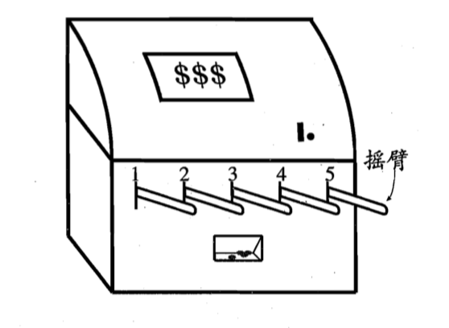
</div>
<div align=center>Hình 1.23 Minh họa máy <i>K</i>-armed bandit</div>

## 1.7 Thực nghiệm học tăng cường
Học tăng cường là một nhánh của học máy kết hợp giữa lý thuyết và thực hành, chúng ta không chỉ cần hiểu các nguyên lý toán học đằng sau thuật toán mà còn phải thực hành cài đặt thuật toán trên máy. Khám phá xem thuật toán có đạt hiệu quả mong đợi trong nhiều môi trường thực nghiệm hay không cũng là một quá trình rất quan trọng.

Ta có thể dùng Python và một số thư viện học sâu để cài đặt thuật toán học tăng cường. Hiện có nhiều thư viện học sâu có thể dùng, như PyTorch, TensorFlow, Keras, thành thạo hai ba thư viện trong số đó là đã có thể làm được rất nhiều việc. Vì vậy chúng ta không cần "phát minh lại bánh xe" từ đầu.
### 1.7.1 Gym
OpenAI là một công ty nghiên cứu trí tuệ nhân tạo phi lợi nhuận, đã công bố rất nhiều tài nguyên học tập và tài nguyên thuật toán. Sở dĩ gọi là OpenAI là vì họ đã mã nguồn mở (open source) tất cả các thuật toán phát triển ra.
Như hình 1.24, **thư viện Gym** của OpenAI là một thư viện mô phỏng môi trường, trong đó có nhiều môi trường sẵn có. Với các kịch bản khác nhau, ta có thể chọn môi trường khác nhau. Kịch bản điều khiển rời rạc (hành động đầu ra là đếm được, ví dụ hành động lên hoặc xuống trong trò chơi Pong) thường dùng môi trường Atari để đánh giá; kịch bản điều khiển liên tục (hành động đầu ra là không đếm được, ví dụ khi robot đi không chỉ có hướng mà còn có góc, góc là không đếm được, là một đại lượng liên tục) thường dùng môi trường MuJoCo để đánh giá. **Gym Retro** là bản mở rộng thêm của môi trường Gym, chứa nhiều trò chơi hơn.


<div align=center>
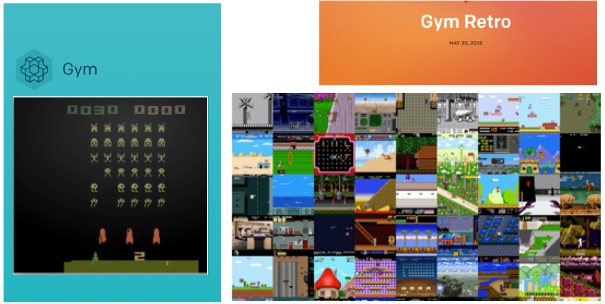
</div>
<div align=center>Hình 1.24 Thư viện Gym của OpenAI</div>


Ta có thể cài thư viện Gym bằng pip. Vì Gym từ phiên bản 0.26.0 trở đi không tương thích với code trước đó, nên ta cài Gym phiên bản trước 0.26.0, ví dụ 0.25.2.

> **Ghi chú của người dịch:** OpenAI Gym đã ngừng phát triển; thư viện kế nhiệm chính thức là **[Gymnasium](https://gymnasium.farama.org/)** do Farama Foundation duy trì. `gym==0.25.2` không còn chạy được với Python và NumPy bản mới, vì vậy toàn bộ code trong bản dịch (các chương và notebook) đã được chuyển sang Gymnasium. Những khác biệt chính:
>
> | Gym cũ | Gymnasium |
> |---|---|
> | `import gym` | `import gymnasium as gym` |
> | `observation = env.reset()` | `observation, info = env.reset()` |
> | `observation, reward, done, info = env.step(action)` | `observation, reward, terminated, truncated, info = env.step(action)` |
> | `env.seed(3)` | `env.reset(seed=3)` |
> | gọi `env.render()` | khai báo khi tạo môi trường: `gym.make(..., render_mode="human")` |
>
> `terminated` cho biết tập kết thúc vì đạt trạng thái kết thúc của bài toán (ví dụ cây sào đổ), còn `truncated` cho biết tập bị cắt ngang vì điều kiện bên ngoài như hết giới hạn số bước. `done` của Gym cũ tương ứng với `terminated or truncated`.

```bash
pip install "gymnasium[classic-control]"
```
Ngoài ra, để hiển thị giao diện đồ họa, ta cần cài thêm thư viện pygame (gói `gymnasium[classic-control]` ở trên đã kèm sẵn pygame).
```bash
pip install pygame
```

Import thư viện Gym trong môi trường Python, nếu không báo lỗi thì có thể coi là Gym đã cài đặt thành công.


```bash
$python
>>>import gymnasium as gym
```

Ví dụ khi đã cài Gym, ta có thể gọi trực tiếp môi trường Taxi-v3 (trong Gymnasium 1.x là Taxi-v4). Sau khi khởi tạo môi trường này, ta có thể bắt đầu tương tác. Khi tác tử nhận được một quan sát, nó sẽ đưa ra một hành động. Hành động này được môi trường dùng để thực hiện một bước, sau đó môi trường tiến lên một bước, trả về quan sát mới, phần thưởng và một biến cờ (flag) done, done cho biết trò chơi đã kết thúc hay chưa (trong Gymnasium, done được tách thành hai cờ terminated và truncated). Chỉ với vài dòng code là có thể cài đặt khung (framework) của học tăng cường:

```python
import gymnasium as gym
env = gym.make("Taxi-v4")
observation, info = env.reset()
agent = load_agent()
for step in range(100):
    action = agent(observation)
    observation, reward, terminated, truncated, info = env.step(action)
```

> Đoạn code trên chỉ là ví dụ, mục đích giúp người đọc hiểu khung cài đặt code của thuật toán học tăng cường, không phải code hoàn chỉnh; hàm load\_agent chưa được định nghĩa nên chạy đoạn code này sẽ báo lỗi.


Như hình 1.25, thư viện Gym có nhiều trò chơi điều khiển kinh điển (classic control). Ví dụ Acrobot yêu cầu dựng đứng một robot hai thanh nối; CartPole yêu cầu điều khiển một chiếc xe đẩy để giữ cây sào đứng thẳng; MountainCar yêu cầu di chuyển xe tới lui để đưa nó đến vị trí lá cờ. Khi mới bắt đầu thử nghiệm học tăng cường, ta có thể chọn các môi trường đơn giản này, vì học tăng cường trên các môi trường này có thể thấy kết quả trong một hai phút.

<div align=center>
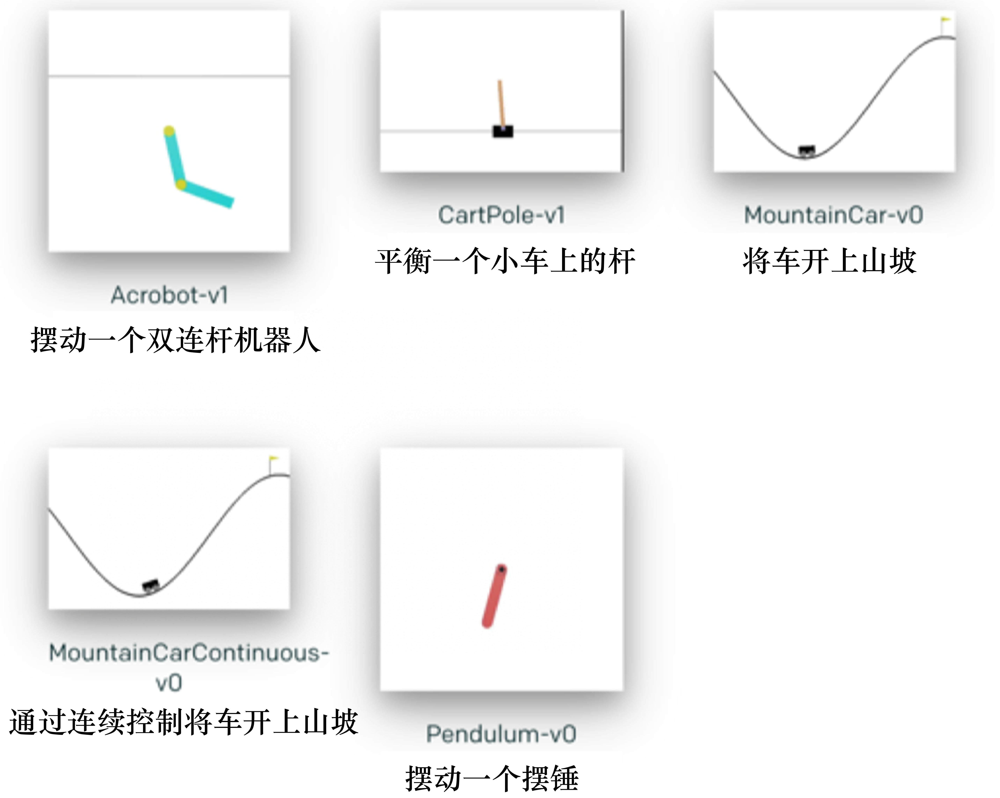
</div>
<div align=center>Hình 1.25 Các bài toán điều khiển kinh điển</div>


Bạn có thể bấm vào [liên kết này](https://gymnasium.farama.org/environments/classic_control/) để xem các môi trường này. Khi mới bắt đầu thử nghiệm học tăng cường, có thể chọn các môi trường đơn giản này, vì chúng có thể cho thấy kết quả trong một hai phút.

Như hình 1.26, môi trường CartPole-v0 có hai hành động: đẩy xe sang trái và đẩy xe sang phải. Ta còn nhận được quan sát: vị trí hiện tại của xe, vận tốc di chuyển sang trái/phải hiện tại của xe, góc của sào và vận tốc của điểm cao nhất (đỉnh) của sào.
Quan sát càng chi tiết thì ta càng mô tả tốt toàn bộ trạng thái hiện tại. Ở đây có định nghĩa phần thưởng: nếu đi thêm được một bước, ta sẽ nhận một phần thưởng (giá trị phần thưởng là 1), vì vậy ta cần sống sót càng lâu càng tốt để nhận nhiều phần thưởng hơn. Khi góc của sào lớn hơn một góc nhất định (không giữ được thăng bằng), hoặc tâm của xe chạm tới mép cửa sổ giao diện đồ họa, hoặc số bước tích lũy vượt quá 200, trò chơi kết thúc. Vì vậy mục đích của tác tử là điều khiển sào, giữ nó thăng bằng lâu nhất có thể và giữ ở giữa môi trường càng nhiều càng tốt.


<div align=center>
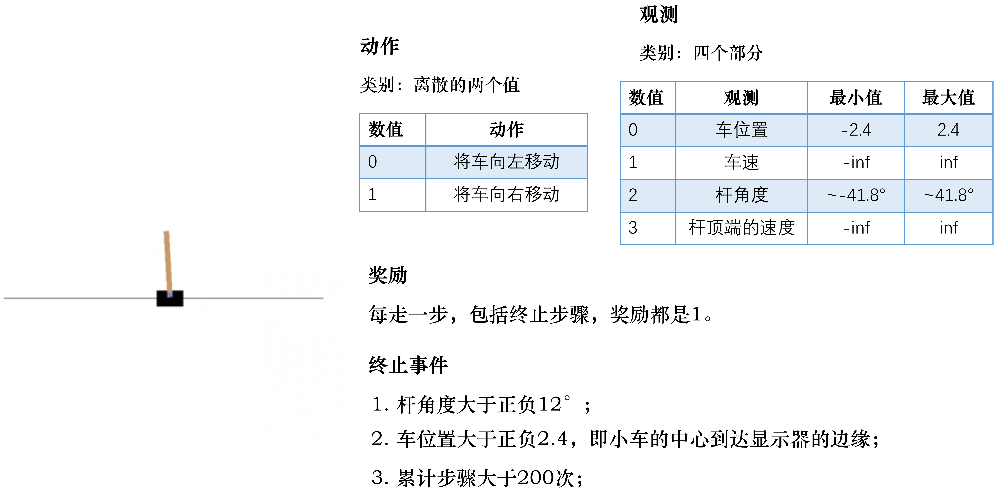
</div>
<div align=center>Hình 1.26 Ví dụ CartPole-v0</div>


```python
import gymnasium as gym  # Import gói môi trường giao diện Python của Gymnasium
env = gym.make('CartPole-v0', render_mode="human")  # Tạo môi trường thực nghiệm; render_mode="human" để hiển thị giao diện đồ họa
env.reset()  # Đặt lại (reset) một tập (episode)
for _ in range(1000):
    action = env.action_space.sample() # Chọn ngẫu nhiên một hành động từ không gian hành động
    env.step(action) # Gửi hành động, trong ngoặc là hành động cụ thể; với render_mode="human", mỗi bước sẽ tự hiển thị
env.close() # Đóng môi trường
```

Lưu ý: nếu đã vẽ cửa sổ giao diện đồ họa của thực nghiệm thì cách tốt nhất để đóng cửa sổ là gọi env.close(). Cố đóng trực tiếp cửa sổ giao diện đồ họa có thể khiến bộ nhớ không được giải phóng, thậm chí gây treo máy.

Khi chạy đoạn code này, robot sẽ lái xe chạy mãi về một hướng cho đến khi ta không nhìn thấy nữa, vì ta chưa bắt đầu huấn luyện robot.

Đa số trò chơi nhỏ trong Gym đều có thể biểu diễn hành động bằng một số thực bình thường hoặc một vectơ. In giá trị trả về của env.action\_space.sample() sẽ thấy kết quả là 1 hoặc 0. Ý nghĩa của env.action\_space.sample() là chọn ngẫu nhiên một hành động trong toàn bộ không gian hành động của trò chơi làm đầu ra. Trong ví dụ này, chỉ có hai hành động: 0 và 1, một trái một phải. Trong Gym cũ, phương thức env.step() có 4 giá trị trả về: observation, reward, done, info; trong Gymnasium có 5 giá trị trả về: observation, reward, terminated, truncated, info.

observation là thông tin trạng thái, là giá trị điểm ảnh màn hình hoặc thông tin mô tả trạng thái bàn chơi quan sát được trong trò chơi. reward là giá trị phần thưởng, tức phần thưởng nhận được sau khi gửi hành động. Giá trị phần thưởng khác nhau tùy trò chơi, nhưng nguyên tắc chung là hành động giúp hoàn thành trò chơi sẽ nhận phần thưởng cao hơn. done cho biết trò chơi đã kết thúc chưa, nếu đã kết thúc thì cần đặt lại trò chơi và bắt đầu một tập mới. Trong Gymnasium, terminated cho biết tập kết thúc vì đạt trạng thái kết thúc của bài toán, truncated cho biết tập bị cắt ngang vì hết giới hạn số bước; done cũ tương ứng với terminated or truncated. info là một số thông tin thô dùng để chẩn đoán và gỡ lỗi (debug), có thể hữu ích cho việc huấn luyện. Tuy nhiên, khi OpenAI đánh giá robot ta nộp lên thì không cho phép dùng các thông tin này.

Các giá trị trả về cần dùng trong mỗi lần huấn luyện là observation, reward, done (trong Gymnasium là observation, reward, terminated, truncated). Nhưng cấu trúc của observation sẽ thay đổi tùy trò chơi. Lấy CartPole-v0 làm ví dụ, ta sửa code như sau:

```python
import gymnasium as gym
env = gym.make('CartPole-v0', render_mode="human")
env.reset()
for _ in range(1000):
    action = env.action_space.sample()
    observation, reward, terminated, truncated, info = env.step(action)
    print(observation)
env.close()
```

Đầu ra:
```
[ 0.01653398 0.19114579 0.02013859 -0.28050058]
[ 0.0203569 -0.00425755 0.01452858 0.01846535]
[ 0.02027175 -0.19958481 0.01489789 0.31569658] 
......
```

Từ đầu ra có thể thấy đây là một quan sát 4 chiều. Ở các trò chơi khác có thể có quan sát nhiều chiều hơn.

env.step() hoàn thành trọn vẹn một quá trình $S \to A \to R \to S'$. Chỉ cần liên tục quan sát quá trình như vậy và cho tác tử dùng thuật toán tương ứng để huấn luyện trong đó, ta sẽ có được một mô hình học tăng cường chất lượng cao.

Các môi trường đã đăng ký trong Gym có thể xem bằng code sau:
```python
import gymnasium as gym
envs_ids = list(gym.registry.keys())
print(envs_ids)
```
Mỗi môi trường trong Gym đều định nghĩa không gian quan sát (observation space) và không gian hành động (action space). Không gian quan sát và không gian hành động có thể là rời rạc (nhận một số hữu hạn giá trị rời rạc), cũng có thể là liên tục (nhận giá trị liên tục).

### 1.7.2 Ví dụ MountainCar-v0

Tiếp theo, ta học cách tương tác với Gym qua một ví dụ. Ta chọn **xe leo núi (MountainCar-v0)** làm ví dụ.

Trước tiên hãy xem không gian quan sát và không gian hành động của nhiệm vụ này:
```python
import gymnasium as gym
env = gym.make('MountainCar-v0')
print('Không gian quan sát = {}'.format(env.observation_space))
print('Không gian hành động = {}'.format(env.action_space))
print('Phạm vi quan sát = {} ~ {}'.format(env.observation_space.low,
        env.observation_space.high))
print('Số hành động = {}'.format(env.action_space.n))
```

Đầu ra:

```
Không gian quan sát = Box([-1.2  -0.07], [0.6  0.07], (2,), float32)
Không gian hành động = Discrete(3)
Phạm vi quan sát = [-1.2  -0.07] ~ [0.6  0.07]
Số hành động = 3    
```

Trong Gym, không gian quan sát của môi trường được biểu diễn bằng env.observation\_space, không gian hành động bằng env.action\_space. Không gian rời rạc được biểu diễn bằng lớp gym.spaces.Discrete, không gian liên tục bằng lớp gym.spaces.Box. Với không gian rời rạc, Discrete(n) cho biết số giá trị có thể nhận là n; với không gian liên tục, các thành viên low và high của thể hiện (instance) lớp Box cho biết phạm vi giá trị của mỗi số thực dấu phẩy động. Quan sát trong MountainCar-v0 là một mảng numpy độ dài 2, kiểu giá trị trong mảng là float. Hành động trong MountainCar-v0 là số nguyên, phạm vi giá trị là {0,1,2}.

Tiếp theo cài đặt tác tử để điều khiển xe di chuyển, code tương ứng như sau.

```python
class SimpleAgent:
    def __init__(self, env):
        pass
    
    def decide(self, observation): # Ra quyết định
        position, velocity = observation
        lb = min(-0.09 * (position + 0.25) ** 2 + 0.03,
                0.3 * (position + 0.9) ** 4 - 0.008)
        ub = -0.07 * (position + 0.38) ** 2 + 0.07
        if lb < velocity < ub:
            action = 2
        else:
            action = 0
        return action # Trả về hành động

    def learn(self, *args): # Học
        pass
    
agent = SimpleAgent(env)
```

Phương thức decide() của lớp SimpleAgent dùng để ra quyết định, phương thức learn() dùng để học. Tác tử này không phải tác tử học tăng cường, nó không thể học, chỉ có thể ra quyết định theo biểu thức toán học cho trước.

Tiếp theo ta cho tác tử tương tác với môi trường, code như sau.

```python
def play(env, agent, render=False, train=False):
    episode_reward = 0. # Ghi lại tổng phần thưởng của tập, giá trị ban đầu là 0
    observation, info = env.reset() # Đặt lại môi trường trò chơi, bắt đầu tập mới
    while True: # Lặp liên tục cho đến khi tập kết thúc
        if render: # Kiểm tra có hiển thị hay không
            env.render() # Hiển thị giao diện đồ họa (môi trường cần được tạo với render_mode="human")
        action = agent.decide(observation)
        next_observation, reward, terminated, truncated, _ = env.step(action) # Thực hiện hành động
        done = terminated or truncated # Tập kết thúc thật (terminated) hoặc bị cắt do hết số bước (truncated)
        episode_reward += reward # Cộng dồn phần thưởng của tập
        if train: # Kiểm tra có huấn luyện tác tử hay không
            agent.learn(observation, action, reward, terminated) # Học
        if done: # Tập kết thúc, thoát vòng lặp
            break
        observation = next_observation
    return episode_reward # Trả về tổng phần thưởng của tập
```

Hàm play trong đoạn code trên cho tác tử tương tác với môi trường trong một tập (episode), hàm có 4 tham số. env là lớp môi trường. agent là lớp tác tử. render là biến kiểu bool, dùng để xác định có cần hiển thị đồ họa hay không. Nếu render là True, trong quá trình tương tác sẽ gọi env.render() để hiển thị giao diện đồ họa, có thể đóng giao diện đồ họa bằng cách gọi env.close(). train là biến kiểu bool, dùng để xác định có huấn luyện tác tử hay không; trong quá trình huấn luyện đặt là True để tác tử học; trong quá trình kiểm thử đặt là False để tác tử giữ nguyên. Giá trị trả về episode\_reward của hàm là số kiểu float, biểu thị tổng phần thưởng của tập (episode reward) khi tác tử tương tác với môi trường trong một tập.

Tiếp theo, ta dùng code dưới đây để cho tác tử tương tác với môi trường một tập và hiển thị giao diện đồ họa.

```python
env = gym.make('MountainCar-v0', render_mode="human") # Gymnasium: chế độ hiển thị được khai báo khi tạo môi trường
env.reset(seed=3) # Đặt hạt giống ngẫu nhiên (random seed) để kết quả có thể tái lập (Gymnasium bỏ env.seed())
episode_reward = play(env, agent, render=True)
print('Phần thưởng của tập = {}'.format(episode_reward))
env.close() # Đóng giao diện đồ họa
```

Đầu ra:
```
Phần thưởng của tập = -105.0    
```

Để đánh giá hiệu năng của tác tử, cần tính phần thưởng trung bình của tập qua 100 tập tương tác liên tiếp, code như sau.
```python
env = gym.make('MountainCar-v0') # Tạo lại môi trường không hiển thị đồ họa để chạy nhanh
episode_rewards = [play(env, agent) for _ in range(100)]
print('Phần thưởng trung bình của tập = {}'.format(np.mean(episode_rewards)))
```

Đầu ra:
```
Phần thưởng trung bình của tập = -106.63
```

Phần thưởng trung bình của tập ứng với chính sách của lớp SimpleAgent vào khoảng $-$110 (khi chạy bằng Gymnasium, các con số ở trên có thể hơi khác do cách sinh số ngẫu nhiên thay đổi), còn với nhiệm vụ xe leo núi, chỉ cần phần thưởng trung bình của 100 tập liên tiếp lớn hơn $-$110 là có thể coi nhiệm vụ đã được giải quyết. Code cài đặt đầy đủ xem tại [code xe leo núi](https://github.com/datawhalechina/easy-rl/blob/master/docs/chapter1/RL_example.py) (bản tiếng Việt: [RL_example_vi.py](./RL_example_vi.py)).

Khi kiểm tra hiệu năng của tác tử trên một nhiệm vụ nào đó trong Gym, theo thói quen, giới học thuật thường quan tâm nhất đến phần thưởng trung bình của 100 tập. Với một số nhiệm vụ, còn có quy định một giá trị phần thưởng tham chiếu; khi phần thưởng của 100 tập liên tiếp lớn hơn giá trị quy định thì coi nhiệm vụ đã được giải quyết. Còn với nhiệm vụ không quy định giá trị thì không có khái niệm nhiệm vụ đã được giải quyết hay chưa.

Tóm tắt cách dùng Gym: dùng env=gym.make(tên môi trường) để lấy môi trường, dùng env.reset() để khởi tạo môi trường, dùng env.step(hành động) để thực hiện một bước môi trường, dùng env.render() để hiển thị môi trường (trong Gymnasium: truyền render_mode="human" vào gym.make), dùng env.close() để đóng môi trường. Gym có [tài liệu chính thức](https://www.gymlibrary.dev/), người đọc có thể đọc tài liệu để học thêm về Gym; tài liệu của Gymnasium ở [gymnasium.farama.org](https://gymnasium.farama.org/).

## Tài liệu tham khảo

* [百面深度学习 (Bách diện học sâu)](https://book.douban.com/subject/35043939/)
* [强化学习：原理与Python实现 (Học tăng cường: Nguyên lý và cài đặt bằng Python)](https://book.douban.com/subject/34478302/)

* [强化学习基础 David Silver 笔记 (Ghi chú Cơ bản học tăng cường của David Silver)](https://zhuanlan.zhihu.com/c_135909947)
* [David Silver 强化学习公开课中文讲解及实践 (Giảng giải và thực hành khóa học mở về học tăng cường của David Silver)](https://zhuanlan.zhihu.com/reinforce)
* [UCL Course on RL(David Silver)](https://www.davidsilver.uk/teaching/)

* [白话强化学习与PyTorch (Học tăng cường dễ hiểu và PyTorch)](https://book.douban.com/subject/34809676/)

* [OpenAI Spinning Up ](https://spinningup.openai.com/en/latest/spinningup/rl_intro.html#)

* [神经网络与深度学习 (Mạng nơ-ron và học sâu)](https://nndl.github.io/)

* [机器学习 (Học máy)](https://book.douban.com/subject/26708119//)
