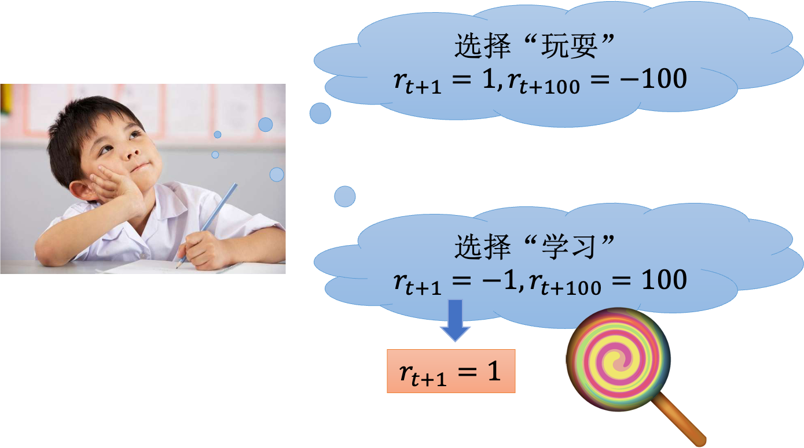
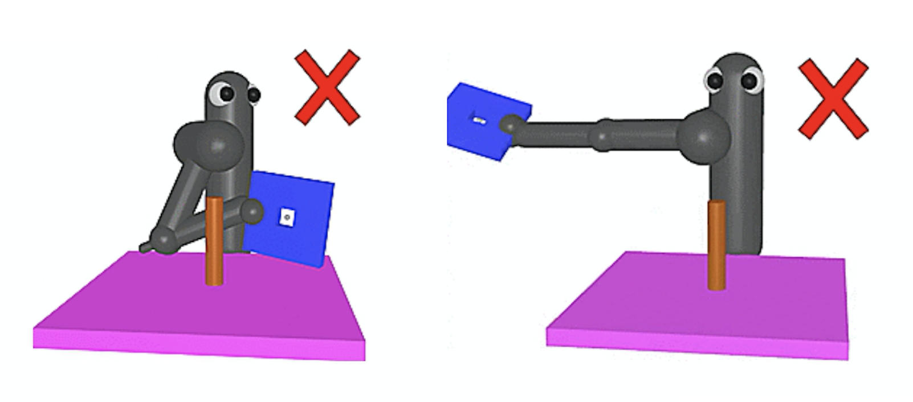
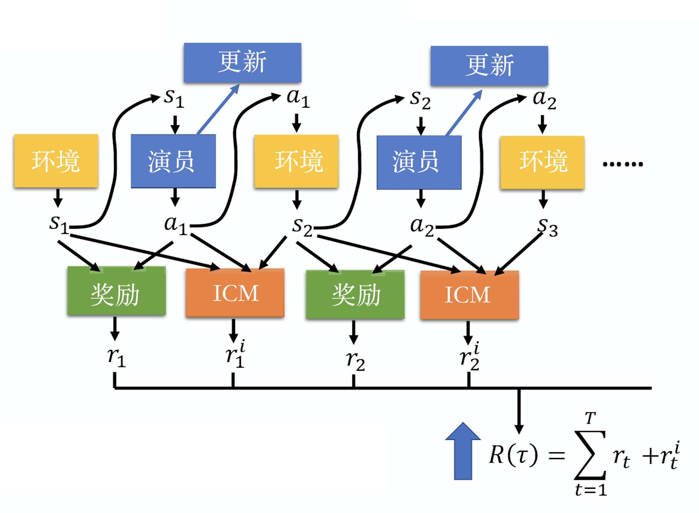
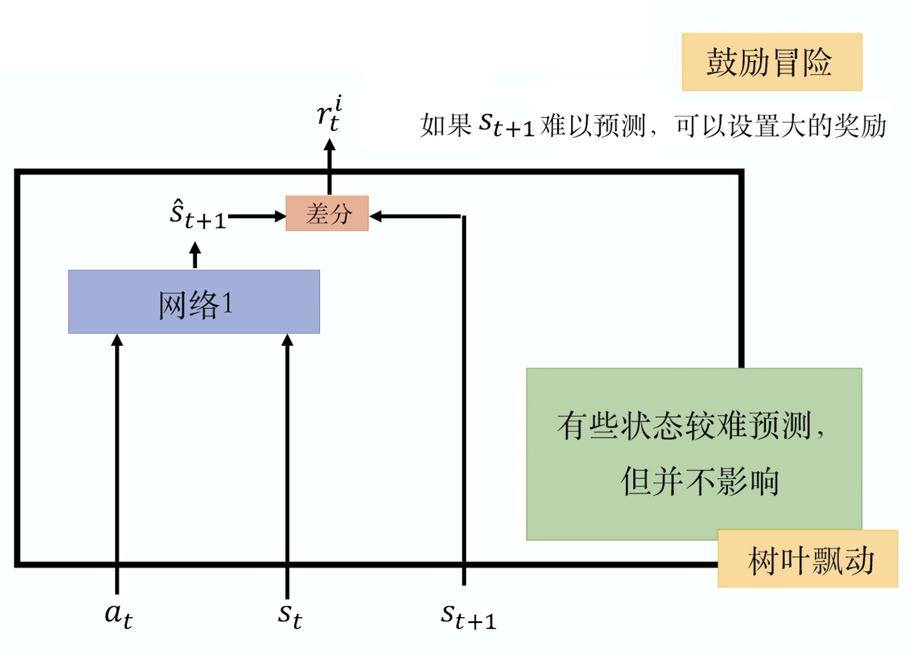
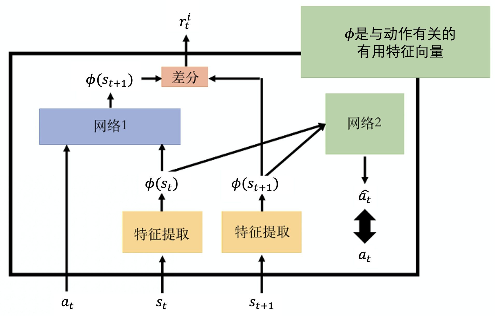
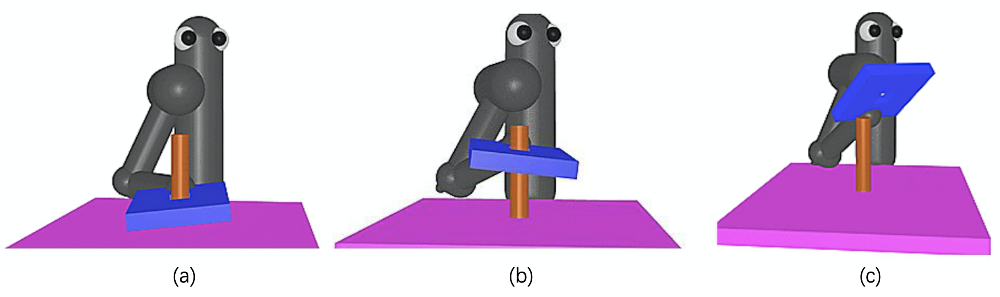
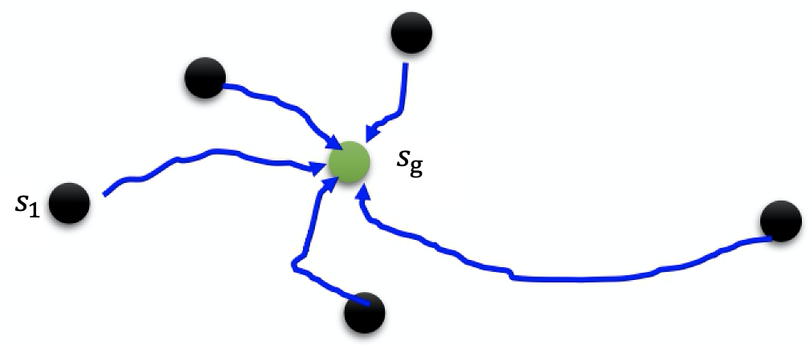
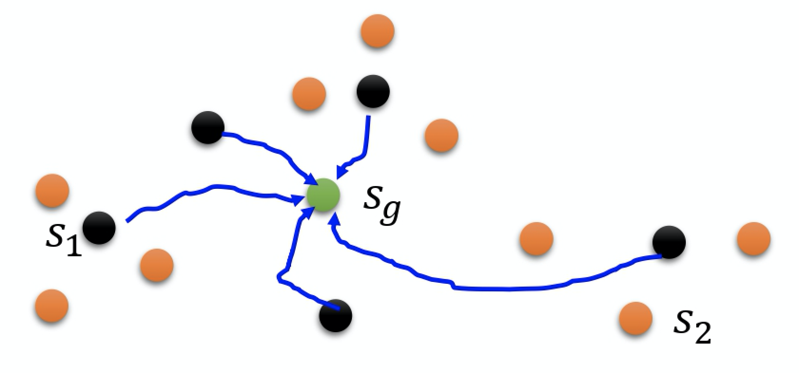
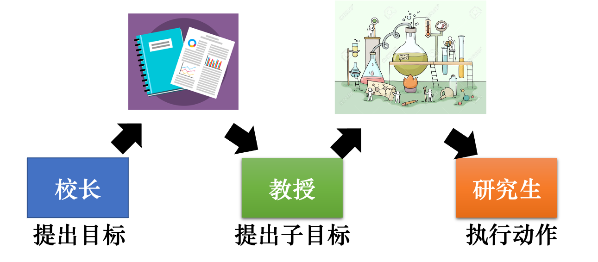
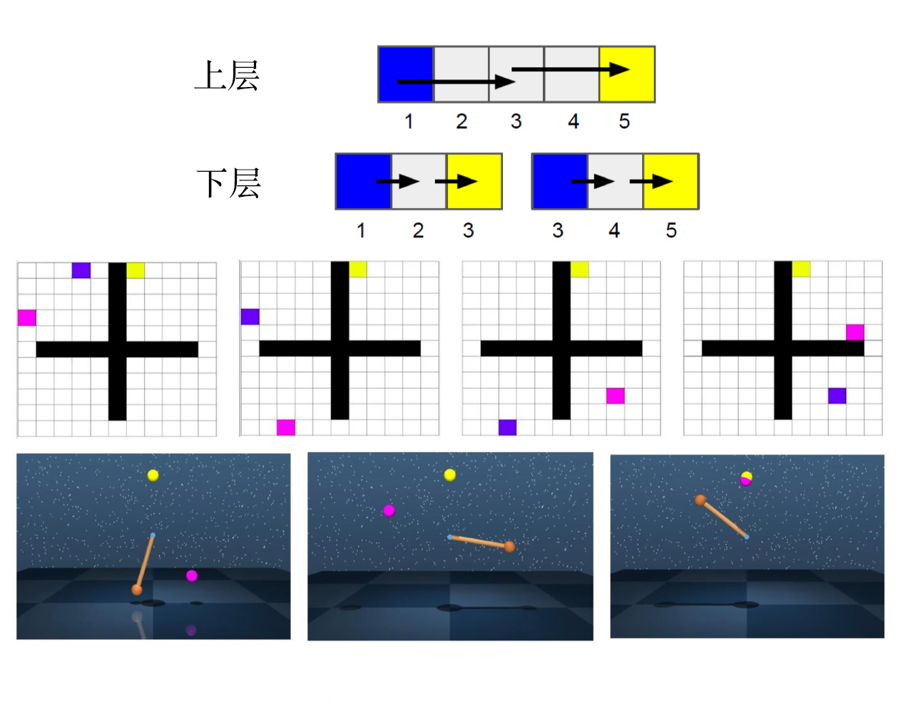

# Chương 10 Phần thưởng thưa
Thực tế khi dùng học tăng cường để huấn luyện tác tử, phần lớn thời gian tác tử không nhận được phần thưởng. Trong trường hợp không nhận được phần thưởng, huấn luyện tác tử rất khó. Ví dụ, giả sử ta muốn huấn luyện một cánh tay robot, trên bàn có một con ốc vít và một cái tua vít, huấn luyện nó dùng tua vít vặn con ốc vào rất khó, vì lúc đầu tác tử không biết gì cả, lý do duy nhất khiến nó có thể thực hiện các hành động khác nhau là khám phá (exploration). Ví dụ, khi làm Q-learning sẽ có một ít tính ngẫu nhiên, để nó thực hiện một số hành động chưa từng làm trước đây, nhưng phải ngẫu nhiên đến mức nó nhặt được tua vít lên, rồi vặn con ốc vào, mới nhận được phần thưởng 1, việc này gần như không bao giờ xảy ra. Vì vậy, bất kể diễn viên làm gì, phần thưởng nó nhận được luôn là 0, với nó thì thực hiện hành động gì cũng tệ như nhau hoặc tốt như nhau. Vì vậy, cuối cùng nó chẳng học được gì.

Nếu phần thưởng trong môi trường rất thưa (sparse), bài toán học tăng cường sẽ trở nên rất khó, nhưng con người có thể học trên phần thưởng rất thưa. Phần lớn thời gian trong đời người chỉ là sống ở đó, không nhận được phần thưởng hay hình phạt gì. Nhưng con người vẫn có thể thực hiện đủ loại hành vi. Vì vậy, một trí tuệ nhân tạo thực sự giỏi phải có thể học cách tương tác với môi trường ngay cả khi phần thưởng thưa.

Ta có thể giải quyết vấn đề phần thưởng thưa theo 3 hướng, dưới đây giới thiệu lần lượt.

## 10.1 Thiết kế phần thưởng

Hướng thứ nhất là **thiết kế phần thưởng (reward shaping)**. Môi trường có một phần thưởng cố định, đó là phần thưởng thực, nhưng để kết quả tác tử học được là thứ ta mong muốn, ta cố ý thiết kế một số phần thưởng để dẫn dắt tác tử.

Ví dụ, như hình 10.1, nếu ta xem một đứa trẻ là một tác tử, nó có thể thực hiện hai hành động: chơi hoặc học. Nếu nó chơi, ở thời điểm tiếp theo sẽ nhận phần thưởng 1. Nhưng đến kỳ thi hằng tháng, thành tích có thể rất kém, nên sau 100 giờ, nó sẽ nhận phần thưởng $-$100. Nó cũng có thể quyết định học, ở thời điểm tiếp theo, vì không được chơi nên thấy rất khó chịu, nên nhận phần thưởng $-$1. Nhưng sau 100 giờ, nó có thể nhận phần thưởng 100. Với một đứa trẻ, có thể nó sẽ muốn thực hiện hành động chơi chứ không phải hành động học. Thứ ta tính là phần thưởng tích lũy, nhưng có thể với đứa trẻ, việc chiết khấu rất nặng (hệ số chiết khấu $\gamma$ rất nhỏ), nên nó không mấy quan tâm đến phần thưởng tương lai. Hơn nữa vì nó là trẻ con, chưa có nhiều kinh nghiệm, nên hàm Q của nó ước lượng rất không chính xác. Vì vậy bắt nó ước lượng phần thưởng tích lũy rất xa về sau, nó không ước lượng được. Lúc này người lớn phải dẫn dắt nó, nói với nó: "Nếu con chịu học, con sẽ được một cây kẹo mút." Với đứa trẻ, phần thưởng ở thời điểm tiếp theo trở thành dương, có thể nó sẽ nghĩ học tốt hơn chơi. Tuy đây không phải phần thưởng thực, mà là phần thưởng do người khác dẫn dắt nó. Khái niệm thiết kế phần thưởng cũng như vậy, nói đơn giản, là ta tự tìm cách thiết kế một số phần thưởng, các phần thưởng này không phải phần thưởng thực của môi trường. Khi chơi game Atari, phần thưởng thực là phần thưởng do máy chơi game đưa ra, nhưng ta có thể tự thiết kế một số phần thưởng để dẫn dắt tác tử, để tác tử làm việc ta muốn nó làm.

> Ghi chú của người dịch: bản gốc viết "hệ số chiết khấu sẽ rất lớn, nên nó không mấy quan tâm đến phần thưởng tương lai". Theo định nghĩa $\gamma \in [0,1]$ ở các chương trước, $\gamma$ lớn nghĩa là càng coi trọng tương lai; ý của tác giả là mức chiết khấu nặng, tức $\gamma$ nhỏ, nên bản dịch diễn đạt lại cho đúng.

Hình 10.1 Thiết kế phần thưởng

Lấy ví dụ tác tử của Meta (trước đây là Facebook) chơi *ViZDoom*. *ViZDoom* là một trò chơi bắn súng góc nhìn thứ nhất, trong trò chơi bắn súng này, giết được kẻ địch thì nhận phần thưởng dương, bị giết thì nhận phần thưởng âm. Các nhà nghiên cứu thiết kế một số phần thưởng mới, dùng phần thưởng mới để dẫn dắt tác tử làm tốt hơn, đây không phải phần thưởng thực trong trò chơi. Ví dụ mất máu thì trừ điểm, đạn dược giảm thì trừ điểm, nhặt được gói tiếp tế thì cộng điểm, đứng yên tại chỗ thì trừ điểm, di chuyển thì cộng điểm. Còn sống sẽ bị trừ một điểm rất nhỏ, vì nếu không làm vậy, tác tử sẽ chỉ muốn sống sót, luôn né tránh kẻ địch, làm vậy sẽ khiến tác tử hiếu chiến hơn một chút.

Thiết kế phần thưởng có vấn đề, vì ta cần tri thức chuyên ngành (domain knowledge). Ví dụ, như hình 10.2, robot muốn học cách luồn tấm ván màu xanh lam qua cây cột. Robot rất khó học được, ta có thể thiết kế phần thưởng. Một cách nói có vẻ hợp lý là, tấm ván xanh lam càng gần cây cột thì phần thưởng càng lớn. Nhưng cách robot tiến lại gần sẽ có vấn đề, nó sẽ dùng tấm ván xanh lam đập vào cây cột. Trong khi robot phải đặt tấm ván xanh lam lên trên cây cột thì mới luồn tấm ván qua cây cột được. Do đó, cách thiết kế phần thưởng này có vấn đề. Còn cách thiết kế phần thưởng nào có vấn đề, cách nào không có vấn đề, sẽ trở thành một loại tri thức chuyên ngành, là thứ ta cần điều chỉnh.

Hình 10.2 Vấn đề của thiết kế phần thưởng

## 10.2 Sự tò mò

Tiếp theo giới thiệu các loại phần thưởng ta có thể tự thêm vào và nhìn chung có vẻ hữu ích. Ví dụ, một kỹ thuật là thêm sự tò mò (curiosity) cho tác tử, gọi là **phần thưởng hướng tò mò (curiosity driven reward)**. Như hình 10.3, ta đưa một trạng thái và một hành động nào đó vào hàm phần thưởng, hàm phần thưởng sẽ đưa ra phần thưởng nhận được khi thực hiện hành động này ở trạng thái này, tổng phần thưởng càng lớn càng tốt.

Trong kỹ thuật hướng tò mò, ta thêm một hàm phần thưởng mới — **mô-đun tò mò nội tại (intrinsic curiosity module, ICM)**, nó dùng để thêm sự tò mò cho tác tử. Mô-đun tò mò nội tại cần 3 đầu vào: trạng thái $s_1$, hành động $a_1$ và trạng thái $s_2$. Dựa vào đầu vào, nó đưa ra một phần thưởng khác $r_1^i$. Với tác tử, tổng phần thưởng không chỉ có $r$, mà còn có $r^i$. Nó không chỉ cộng tất cả các $r$ lại, mà còn cộng tất cả các $r^i$ để làm tổng phần thưởng. Vì vậy khi tương tác với môi trường, nó không chỉ mong $r$ càng lớn càng tốt, mà đồng thời mong $r^i$ càng lớn càng tốt, nó mong phần thưởng nhận được từ mô-đun tò mò nội tại càng lớn càng tốt. Mô-đun tò mò nội tại đại diện cho một loại tò mò.

Hình 10.3 Sự tò mò

Thiết kế mô-đun tò mò nội tại như thế nào? Thiết kế nguyên thủy nhất như hình 10.4, đầu vào của mô-đun tò mò nội tại là trạng thái hiện tại $s_t$, hành động thực hiện ở trạng thái này $a_t$ và trạng thái tiếp theo $s_{t+1}$, đầu ra là một phần thưởng $r^i_t$. Vậy $r^i_t$ được tính như thế nào? Trong mô-đun tò mò nội tại, ta có một mạng, mạng này nhận đầu vào $a_t$ và $s_t$, đưa ra $\hat{s}_{t+1}$, tức là mạng này dựa vào $a_t$ và $s_t$ để dự đoán $\hat{s}_{t+1}$. Rồi xem mức độ tương đồng giữa dự đoán $\hat{s}_{t+1}$ của mạng và tình huống thực $s_{t+1}$, càng không giống thì phần thưởng nhận được càng lớn. Vì vậy ý nghĩa của phần thưởng $r_t^i$ là, trạng thái tương lai càng khó dự đoán, phần thưởng nhận được càng lớn. Đây chính là khuyến khích tác tử mạo hiểm, khám phá, thực hiện hành động này bây giờ, những gì xảy ra trong tương lai càng khó dự đoán, phần thưởng của hành động này càng lớn. Vì vậy nếu có mô-đun tò mò nội tại như vậy, tác tử sẽ có xu hướng thực hiện một số hành động có rủi ro khá lớn, nó muốn khám phá thế giới chưa biết. Giả sử một trạng thái nào đó là thứ nó không có cách nào dự đoán, nó sẽ đặc biệt muốn tiếp cận trạng thái đó, điều này có thể nâng cao khả năng khám phá của tác tử.

Mạng 1 được huấn luyện riêng. Khi huấn luyện, ta đưa vào mạng 1 $a_t$, $s_t$, $s_{t+1}$, để mạng 1 học cách dựa vào $a_t$, $s_t$ cho trước để dự đoán $\hat{s}_{t+1}$. Khi tác tử tương tác với môi trường, ta cần cố định mô-đun tò mò nội tại. Ý tưởng này có một vấn đề: một số trạng thái rất khó dự đoán không có nghĩa là nó tốt, nó nên được thử. Ví dụ, kết quả của trò cò quay Nga (Russian roulette) cũng không thể dự đoán, nhưng không có nghĩa là người ta nên chơi cò quay Nga mỗi ngày. Vì vậy chỉ khuyến khích tác tử mạo hiểm là không đủ, vì nếu chỉ có kiến trúc mạng này, tác tử chỉ biết thứ gì nó không thể dự đoán. Nếu ở một trạng thái nào đó thực hiện một hành động nào đó, tác tử không thể dự đoán kết quả tiếp theo, nó sẽ thực hiện hành động đó, nhưng điều này không có nghĩa là kết quả đó chắc chắn tốt. Ví dụ, có thể trong một trò chơi nào đó, ở hậu cảnh có gió thổi cỏ lay, có lá cây bay, những việc không quan trọng như vậy. Có lẽ việc lá cây bay là rất khó dự đoán, với tác tử, nó ở một trạng thái nào đó không làm gì cả, chỉ nhìn lá cây bay, phát hiện lá cây bay là không thể dự đoán, tiếp theo nó sẽ cứ nhìn lá cây bay mãi. Vì vậy tác tử chỉ có sự tò mò là không đủ, còn phải cho nó biết việc gì mới thực sự quan trọng.

Hình 10.4 Thiết kế mô-đun tò mò nội tại

Làm sao cho tác tử biết việc gì thực sự quan trọng? Ta cần thêm một mô-đun khác, ta cần học một **bộ trích xuất đặc trưng (feature extractor)**. Như hình 10.5, ô màu vàng đại diện cho bộ trích xuất đặc trưng, nó nhận đầu vào là một trạng thái, đưa ra một vectơ đặc trưng để đại diện cho trạng thái này, ta mong bộ trích xuất đặc trưng có thể lọc bỏ những hình ảnh vô nghĩa, những thứ vô nghĩa trong trạng thái, ví dụ gió thổi cỏ lay, mây trắng trôi và lá cây bay.

Giả sử bộ trích xuất đặc trưng có thể lọc bỏ thông tin không quan trọng, việc mạng 1 thực sự làm là: cho nó một hành động và biểu diễn đặc trưng (feature representation) của trạng thái $s_t$, để nó dự đoán biểu diễn đặc trưng của trạng thái $s_{t+1}$. Tiếp theo ta đánh giá xem kết quả dự đoán này có giống biểu diễn đặc trưng của trạng thái thực $s_{t+1}$ không, càng không giống thì phần thưởng càng lớn. Học bộ trích xuất đặc trưng như thế nào? Làm sao để bộ trích xuất đặc trưng lọc bỏ thông tin không quan trọng?
Ta có thể học một mạng khác, tức mạng 2. Mạng 2 nhận vectơ $\pmb{\phi}(s_t)$ và $\pmb{\phi}(s_{t+1})$ làm đầu vào, nó cần dự đoán hành động $a$ là gì, nó mong hành động $a$ này càng gần hành động thực $a$ càng tốt. Mạng 2 sẽ đưa ra một hành động $a_t$, nó sẽ đưa ra hành động cần thực hiện để đi từ trạng thái $s_t$ đến trạng thái $s_{t+1}$, càng gần hành động thực càng tốt. Thêm mạng 2 là vì cần dùng $\pmb{\phi}(s_t)$, $\pmb{\phi}(s_{t+1})$ để dự đoán hành động. Vì vậy, đặc trưng ta trích xuất ra có liên quan đến việc dự đoán hành động, những thứ như gió thổi cỏ lay không liên quan đến hành động mà tác tử cần thực hiện sẽ bị lọc bỏ, sẽ không được biểu diễn trong vectơ được trích xuất.

> Ghi chú của người dịch: bản gốc viết "cho nó một diễn viên (演员) và biểu diễn đặc trưng của trạng thái $s_t$"; theo hình 10.5 và mô tả mạng 1 ở trên, đầu vào phải là **hành động** $a_t$, nên bản dịch đã sửa.

Hình 10.5 Mô-đun tò mò

## 10.3 Học theo giáo trình

Hướng thứ hai là **học theo giáo trình (curriculum learning)**. Học theo giáo trình không phải khái niệm riêng của học tăng cường, trong học máy đặc biệt là học sâu, ta đều dùng đến khái niệm học theo giáo trình. Cụ thể, học theo giáo trình là ta lập kế hoạch cho việc học của tác tử, dữ liệu huấn luyện "đút" cho nó có thứ tự, thường là từ dễ đến khó. Ví dụ, giả sử ta muốn dạy một bạn nhỏ học vi tích phân, làm sai bài thì phạt, như vậy rất khó học được. Ta nên dạy phép nhân trước, rồi mới dạy vi tích phân. Vì vậy học theo giáo trình là khi huấn luyện tác tử, dữ liệu huấn luyện đi từ dễ đến khó. Dù không phải học tăng cường, thông thường khi huấn luyện mạng sâu, đôi khi ta cũng làm như vậy. Ví dụ, khi huấn luyện mạng nơ-ron hồi quy (RNN), đã có rất nhiều tài liệu chứng minh, cho tác tử xem chuỗi ngắn trước, rồi từ từ cho nó xem chuỗi dài, thường nó có thể học tốt hơn. Trong học tăng cường, ta cần giúp tác tử lập kế hoạch giáo trình của nó, độ khó của giáo trình từ dễ đến khó.

Ví dụ, tác tử của Meta chơi *ViZDoom* thể hiện rất tốt, nó tham gia cuộc thi *ViZDoom* và giành hạng nhất. Với tác tử chơi *ViZDoom* của Meta, có lập kế hoạch giáo trình cho tác tử, từ giáo trình 0 đến giáo trình 7. Trong các giáo trình khác nhau, tốc độ và lượng máu của quái vật khác nhau. Vì vậy, trong giáo trình càng nâng cao, tốc độ của quái vật càng nhanh, lượng máu càng nhiều. Nếu vào thẳng giáo trình 7, tác tử không thể học được. Phải bắt đầu từ giáo trình 0, tăng độ khó từng chút một, như vậy tác tử mới học được.

Ví dụ khác, với nhiệm vụ luồn tấm ván xanh lam qua cây cột, làm sao để robot học dần từ dễ đến khó? Như hình 10.6 (trái), có thể lúc đầu, tấm ván đã ở trên cây cột. Lúc này, robot chỉ cần ấn tấm ván xanh lam xuống là được. Trường hợp này khá đơn giản, robot chắc sẽ học được rất nhanh. Vì robot chỉ có hai lựa chọn lên và xuống, đi xuống thì nhận phần thưởng, nhiệm vụ kết thúc, nên nó cũng không biết mình học cái gì. Như hình 10.6 (giữa), ta đặt tấm ván cao lên một chút, robot đôi khi sẽ vụng về kéo tấm ván lên, rồi lấy tấm ván ra. Nếu robot có thể học được cách ấn tấm ván, thì cách lấy tấm ván cũng có khả năng lớn học được. Giả sử bây giờ robot đã học được rằng, chỉ cần tấm ván gần cây cột, nó có thể ấn tấm ván xuống. Tiếp theo, ta cho nó học trường hợp tổng quát hơn. Như hình 10.6 (phải), lúc đầu, để tấm ván cách cây cột xa một chút. Sau đó, khi tấm ván được đặt lên trên cây cột, robot sẽ biết ấn tấm ván xuống, đây chính là khái niệm học theo giáo trình. Tất nhiên học theo giáo trình hơi đặc biệt một chút, nó cần con người thiết kế giáo trình cho tác tử.

Hình 10.6 Học theo giáo trình

Có một phương pháp khá tổng quát: **sinh giáo trình ngược (reverse curriculum generation)**. Ta có thể dùng một phương pháp khá tổng quát để giúp tác tử thiết kế giáo trình. Như hình 10.7, giả sử lúc đầu ta có một trạng thái $s_\mathrm{g}$, đây là **trạng thái đích (goal state)**, tức kết quả lý tưởng nhất cuối cùng. Nếu lấy thí nghiệm tấm ván và cây cột làm ví dụ, trạng thái đích là luồn tấm ván qua cây cột. Nếu lấy việc huấn luyện cánh tay robot gắp đồ vật làm ví dụ, gắp được đồ vật được gọi là trạng thái đích. Tiếp theo ta dựa vào trạng thái đích để tìm các trạng thái khác, các trạng thái khác này khá gần trạng thái đích. Ví dụ, trong ví dụ cánh tay robot gắp đồ vật, cánh tay robot có thể chưa gắp được đồ vật. Giả sử trạng thái rất gần trạng thái đích được gọi là $s_1$. Cánh tay robot chưa gắp được đồ vật, nhưng nó rất gần trạng thái đích, trạng thái này có thể gọi là $s_1$. Còn thế nào là gần, điều này tùy vào tình huống cụ thể. Ta cần dựa vào nhiệm vụ để thiết kế cách lấy mẫu $s_1$ từ $s_\mathrm{g}$. Tiếp theo, tác tử bắt đầu tương tác với môi trường từ $s_1$, xem nó có đạt được trạng thái đích $s_\mathrm{g}$ hay không, ở mỗi trạng thái, khi tác tử tương tác với môi trường, đều nhận được một phần thưởng.

Hình 10.7 Sinh giáo trình ngược

Tiếp theo, ta bỏ đi các trường hợp có phần thưởng đặc biệt cực đoan. Trường hợp phần thưởng đặc biệt cực đoan nghĩa là các trường hợp này quá dễ hoặc quá khó. Nếu phần thưởng rất lớn, cho thấy trường hợp này quá dễ, không cần học nữa, vì tác tử đã biết rồi, nó có thể nhận phần thưởng rất lớn. Nếu phần thưởng quá nhỏ, cho thấy trường hợp này quá khó, với năng lực hiện tại của tác tử thì nó không học được, nên không học cái này, chỉ học những trường hợp có phần thưởng vừa phải.

Tiếp theo, dựa vào các trường hợp có phần thưởng vừa phải này để lấy mẫu thêm nhiều trạng thái. Giả sử lúc đầu, cánh tay robot ở một vị trí nào đó có thể gắp được. Tiếp theo, cánh tay robot đặt xa hơn một chút, xem có gắp được không; lại gắp được rồi, lại đặt xa hơn một chút, xem có gắp được không. Đây là một phương pháp hữu ích, gọi là **học theo giáo trình ngược (reverse curriculum learning)**. Phần trước nói về học theo giáo trình, tức là ta cần lập kế hoạch thứ tự học cho tác tử. Còn học theo giáo trình ngược là suy ngược từ trạng thái đích, như hình 10.8, tức là suy ngược từ mục tiêu, nên được gọi là học theo giáo trình ngược.

Hình 10.8 Học theo giáo trình ngược

## 10.4 Học tăng cường phân cấp
Hướng thứ ba là **học tăng cường phân cấp (hierarchical reinforcement learning, HRL)**. Học tăng cường phân cấp là: ta có nhiều tác tử, một số tác tử phụ trách những thứ cấp cao hơn, chúng phụ trách đặt mục tiêu, đặt xong mục tiêu thì giao mục tiêu cho các tác tử khác, để các tác tử khác thực hiện mục tiêu. Ý tưởng như vậy cũng rất hợp lý. Ví dụ, giả sử ta muốn viết một bài báo khoa học, trước tiên ta phải nghĩ ra điểm mới, nghĩ ra điểm mới xong còn phải làm thí nghiệm. Làm thí nghiệm xong, ta phải viết bài. Viết bài xong còn phải nộp bài, đăng bài. Mỗi hành động bên dưới lại được chia nhỏ hơn, ví dụ làm thí nghiệm thế nào? Ta phải thu thập dữ liệu trước, thu thập xong dữ liệu phải gán nhãn, còn phải thiết kế một mạng, rồi huấn luyện không chạy, phải huấn luyện nhiều lần. Thiết kế lại kiến trúc mạng vài lần, cuối cùng mới huấn luyện được mạng. Vì vậy, khi ta hoàn thành một nhiệm vụ rất lớn, không phải bắt đầu từ những hành động rất cấp thấp, mà thực ra có một kế hoạch. Trước tiên ta sẽ nghĩ, nếu muốn hoàn thành nhiệm vụ lớn nhất này, cần phân rã nó thành những nhiệm vụ nhỏ nào, mỗi nhiệm vụ nhỏ phân rã thành các nhiệm vụ nhỏ hơn thế nào. Ví dụ, viết thẳng một cuốn sách có thể rất khó, nhưng nếu chia cuốn sách thành mấy chương, mỗi chương chia thành mấy mục, mỗi mục lại chia thành mấy đoạn, mỗi đoạn lại chia thành mấy câu, như vậy có thể dễ viết hơn, đây chính là học tăng cường phân cấp.

Như hình 10.9, ví dụ, giả sử hiệu trưởng, giáo sư và nghiên cứu sinh đều là tác tử, và trường của ta chỉ cần lọt vào top 100 (100 trường đứng đầu bảng xếp hạng QS) là nhận được phần thưởng. Giả sử để lọt vào top 100, hiệu trưởng phải đưa ra tầm nhìn (vision) và nói với các tác tử khác rằng bây giờ ta cần đạt được mục tiêu gì. Tầm nhìn của hiệu trưởng có thể là mỗi giáo sư mỗi năm phải đăng 3 bài tạp chí. Các tác tử này đều được phân cấp, vì vậy tác tử ở trên, hành động của nó là đưa ra tầm nhìn. Nó truyền tầm nhìn của mình cho tác tử ở tầng dưới, tác tử ở tầng dưới sẽ nhận tầm nhìn này. Nếu bên dưới nó còn có tác tử khác, nó sẽ đưa ra tầm nhìn mới. Ví dụ, hiệu trưởng muốn giáo sư đăng bài tạp chí, nhưng giáo sư không có thời gian làm thí nghiệm, nên chỉ có thể để nghiên cứu sinh bên dưới làm thí nghiệm. Vì vậy giáo sư đưa ra tầm nhìn, lập kế hoạch thí nghiệm, nghiên cứu sinh mới là người thực hiện thí nghiệm này. Làm ra thí nghiệm rồi, mọi người đều nhận được phần thưởng. Hiện tại là như sau, khi học, mỗi tác tử đều học, mục tiêu chung của họ là nhận được phần thưởng cuối cùng. Các tác tử phía trước, hành động họ đưa ra chính là tầm nhìn. Nhưng giả sử tầm nhìn họ đưa ra là thứ tác tử bên dưới không đạt được, sẽ bị ghét. Ví dụ, giáo sư cứ bắt nghiên cứu sinh làm những thí nghiệm rất khó, nghiên cứu sinh làm không được, giáo sư sẽ nhận một hình phạt. Vì vậy nếu tác tử tầng dưới không thể đạt được mục tiêu do tác tử tầng trên đưa ra, tác tử tầng trên sẽ bị ghét, nó sẽ nhận phần thưởng âm. Vì vậy nó phải tránh đưa ra những tầm nhìn mà tác tử tầng dưới không làm được. Mỗi tác tử đều lấy tầm nhìn do tác tử tầng trên đưa ra làm đầu vào, quyết định bản thân cần sinh ra đầu ra gì.

Nhưng dù thấy tầm nhìn bên trên bảo ta làm một việc gì đó, cuối cùng cũng chưa chắc làm được việc đó. Như hình 10.10, giả sử mục tiêu ban đầu của giáo sư là đăng bài tạp chí, nhưng giáo sư đột nhiên chuyển mục tiêu, muốn trở thành một YouTuber. Lúc này, ta cần đổi tầm nhìn ban đầu thành trở thành YouTuber. Vì tuy tầm nhìn ban đầu là đăng bài tạp chí, nhưng về sau thành YouTuber, các hành động này không bị lãng phí. Ta giả định rằng tầm nhìn ban đầu chính là trở thành YouTuber, ta sẽ biết muốn thành YouTuber thì phải làm thế nào. Đây chính là học tăng cường phân cấp, một kỹ thuật có thể cài đặt được.

Hình 10.9 Ví dụ học tăng cường phân cấp

Hình 10.10 Thay đổi tầm nhìn

Hình 10.11 là ví dụ trò chơi thực. Trò chơi thứ nhất là đi mê cung, màu xanh lam là tác tử, tác tử màu xanh lam cần đi đến mục tiêu màu vàng. Trò chơi thứ hai là con lắc đơn, con lắc đơn cần chạm vào quả bóng màu vàng. Tầm nhìn là gì? Trong trò chơi đi mê cung, chỉ có hai tác tử, tác tử tầng dưới phụ trách quyết định đi như thế nào, tác tử tầng trên phụ trách đưa ra tầm nhìn. Tuy thực tế ta có thể dùng rất nhiều tầng, nhưng ở đây chỉ dùng hai tầng. Các điểm màu hồng trong trò chơi đi mê cung chính là tầm nhìn. Tác tử tầng trên nói với tác tử màu xanh lam rằng mục tiêu đầu tiên của ta bây giờ là đi đến một vị trí nào đó trước. Sau khi tác tử màu xanh lam đến nơi, lại nói mục tiêu mới là đi đến một vị trí khác. Sau khi tác tử màu xanh lam lại đến nơi, mục tiêu mới sẽ ở vị trí khác. Tiếp theo tác tử màu xanh lam lại đến được vị trí này, cuối cùng mong tác tử màu xanh lam có thể đến được vị trí màu vàng. Ví dụ con lắc đơn cũng vậy, các điểm màu hồng đại diện cho tầm nhìn do tác tử tầng trên đưa ra, nên tác tử này đầu tiên lắc đến đây, tiếp theo, tầm nhìn mới lại chạy đến một vị trí nào đó, nên nó lại lắc đến vị trí tương ứng. Sau đó, tầm nhìn mới lại chạy lên trên. Rồi lại lắc lên trên, cuối cùng đi đến vị trí màu vàng. Đây chính là học tăng cường phân cấp.

Hình 10.11 Ví dụ đi mê cung và con lắc đơn

Cuối cùng, ta tổng kết học tăng cường phân cấp. Học tăng cường phân cấp là phân rã một bài toán học tăng cường phức tạp thành nhiều bài toán con nhỏ, đơn giản, mỗi bài toán con đều có thể được mô hình hóa riêng bằng quá trình quyết định Markov. Như vậy, ta có thể chia chính sách của tác tử thành chính sách cấp cao và chính sách cấp thấp, chính sách cấp cao dựa vào trạng thái hiện tại để quyết định cách thực hiện chính sách cấp thấp. Như vậy, tác tử có thể giải quyết một số nhiệm vụ rất phức tạp.

## Tài liệu tham khảo

* [神经网络与深度学习 (Mạng nơ-ron và học sâu)](https://nndl.github.io/)
