# Chương 11 Học bắt chước

**Học bắt chước (imitation learning, IL)** bàn về vấn đề: giả sử ta không có cả phần thưởng, thì làm sao cập nhật và cho tác tử tương tác với môi trường? Học bắt chước còn được gọi là **học từ minh họa (learning from demonstration)**, **học việc (apprenticeship learning)**, **học bằng quan sát (learning by watching)**. Trong học bắt chước, có một số minh họa của chuyên gia (expert demonstration), tác tử cũng có thể tương tác với môi trường, nhưng nó không nhận được bất kỳ phần thưởng nào từ môi trường, nó chỉ có thể học thông qua minh họa của chuyên gia để biết cái gì là tốt, cái gì là không tốt. Thực ra, trong đa số trường hợp, ta đều không thể nhận được phần thưởng rất rõ ràng từ môi trường. Ví dụ, nếu là trò chơi cờ hoặc trò chơi điện tử, ta sẽ có phần thưởng rất rõ ràng. Nhưng đa số trường hợp là không có phần thưởng, lấy chatbot làm ví dụ, robot trò chuyện với người, trò chuyện thế nào là tốt, trò chuyện thế nào là không tốt, ta không thể đưa ra phần thưởng rõ ràng.

Tất nhiên, tuy ta không thể đưa ra phần thưởng rõ ràng, nhưng ta có thể thu thập minh họa của chuyên gia. Ví dụ, trong lĩnh vực ô tô tự lái, tuy ta không thể đưa ra phần thưởng cho ô tô tự lái, nhưng ta có thể thu thập rất nhiều bản ghi lái xe của con người. Trong lĩnh vực chatbot, ta có thể không định nghĩa được thế nào là cuộc hội thoại tốt, thế nào là cuộc hội thoại không tốt, nhưng ta có thể thu thập rất nhiều cuộc hội thoại của con người làm mẫu. Do đó học bắt chước có tính thực dụng rất cao. Giả sử ta không biết nên định nghĩa phần thưởng thế nào, ta có thể thu thập minh họa của chuyên gia. Nếu ta có thể thu thập được một số minh họa, có thể thu thập được sự tương tác thực tế giữa một số tác tử rất giỏi (ví dụ con người) với môi trường, thì có thể cân nhắc dùng học bắt chước. Trong học bắt chước, ta giới thiệu hai phương pháp: **nhân bản hành vi (behavior cloning, BC)** và **học tăng cường ngược (inverse reinforcement learning, IRL)**. Học tăng cường ngược còn được gọi là **điều khiển tối ưu ngược (inverse optimal control)**.

## 11.1 Nhân bản hành vi

Thực ra nhân bản hành vi khá giống học có giám sát. Lấy ô tô tự lái làm ví dụ, như hình 11.1, ta có thể thu thập dữ liệu con người lái ô tô, ví dụ có thể thu thập bằng camera hành trình. Khi nhìn thấy quan sát như hình 11.1, con người sẽ quyết định đi thẳng, tác tử cũng thực hiện hành vi giống con người, tức là cũng đi thẳng. Chuyên gia làm gì, tác tử làm y hệt như vậy, đây gọi là nhân bản hành vi.

Làm sao để tác tử học được hành vi giống hệt chuyên gia? Ta có thể xem nó là một bài toán học có giám sát, trước tiên thu thập rất nhiều dữ liệu camera hành trình, rồi thu thập xem con người trong từng tình huống cụ thể sẽ thực hiện hành vi gì (dữ liệu huấn luyện). Ta biết con người ở trạng thái $s_1$ sẽ thực hiện hành động $a_1$, con người ở trạng thái $s_2$ sẽ thực hiện hành động $a_2$, con người ở trạng thái $s_3$ sẽ thực hiện hành động $a_3$... Tiếp theo, ta học một mạng. Mạng này chính là diễn viên (actor), khi đầu vào là $s_i$, ta mong đầu ra của nó là $a_i$.

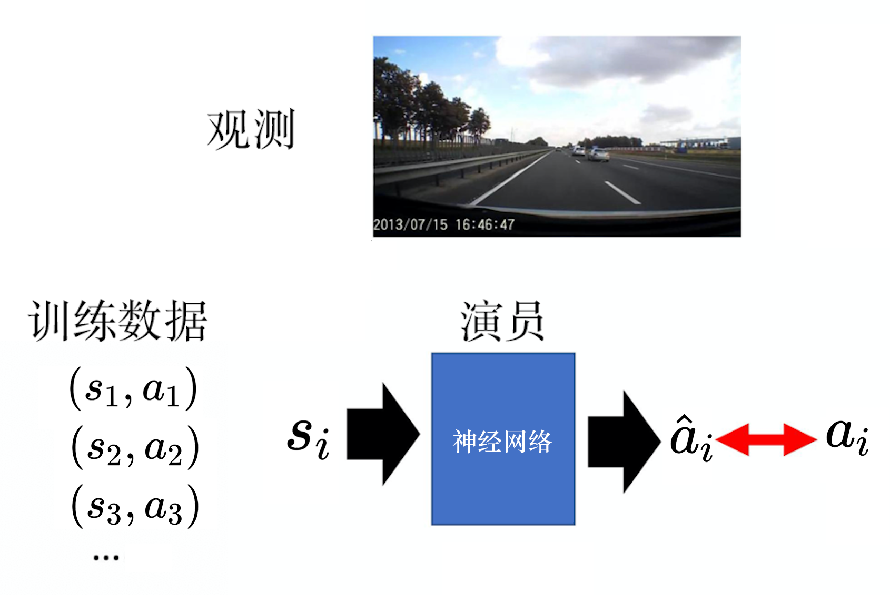

Hình 11.1 Ví dụ ô tô tự lái

Nhân bản hành vi tuy rất đơn giản, nhưng vấn đề của nó là: nếu ta chỉ thu thập minh họa của chuyên gia, có thể các quan sát và trạng thái ta đã thấy là rất hạn chế. Ví dụ, như hình 11.2, giả sử ta muốn học tự lái một chiếc ô tô qua khúc cua trong hình. Nếu là chuyên gia, nó sẽ đi theo đường màu đỏ qua khúc cua. Nhưng giả sử tác tử rất ngốc, khi lái xe nó đâm vào tường, nó sẽ mãi không biết xử lý tình huống đâm tường như thế nào. Vì trong dữ liệu huấn luyện chưa từng có dữ liệu liên quan đến đâm tường, nên nó hoàn toàn không biết xử lý tình huống đâm tường thế nào. Chơi game cũng vậy, cho chuyên gia chơi *Super Mario*, chuyên gia có thể rất giỏi, chưa bao giờ nhảy hụt ống nước, nên tác tử hoàn toàn không biết khi nhảy hụt ống nước thì phải xử lý thế nào. Vì vậy chỉ dùng nhân bản hành vi là không đủ, chỉ quan sát minh họa của chuyên gia là không đủ, còn cần kết hợp một phương pháp khác: **tổng hợp tập dữ liệu (dataset aggregation, DAgger)**.

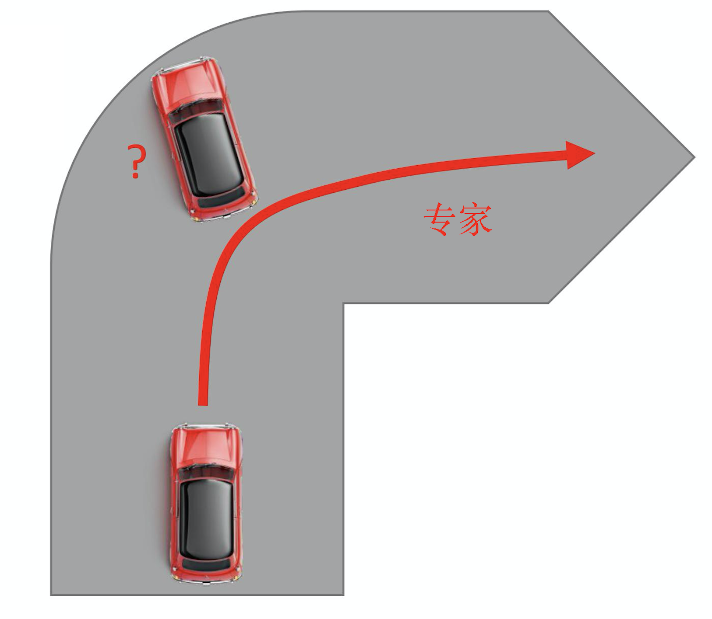

Hình 11.2 Vấn đề của nhân bản hành vi

Ta mong thu thập được dữ liệu đa dạng hơn, chứ không chỉ thu thập các quan sát mà chuyên gia nhìn thấy. Ta mong có thể thu thập hành vi mà chuyên gia thực hiện trong đủ loại tình huống cực đoan. Như hình 11.3, lấy ô tô tự lái làm ví dụ, lúc đầu ta có diễn viên $\theta_1$, và cho nó lái chiếc xe này, đồng thời trên xe có một chuyên gia ngồi. Chuyên gia này sẽ liên tục nói với tác tử rằng nếu ở trong tình huống này, mình sẽ lái thế nào. Vì vậy $\theta_1$ cứ tự lái theo ý mình, nhưng chuyên gia liên tục nói ra suy nghĩ của mình. Ví dụ, lúc đầu, chuyên gia có thể nói đi thẳng. Khi rẽ, chuyên gia có thể nói rẽ phải. Nhưng $\theta_1$ không quan tâm đến chỉ thị của chuyên gia, nên nó sẽ tiếp tục đâm vào tường. Tuy chuyên gia nói rẽ phải, nhưng bất kể chuyên gia ra lệnh thế nào cũng vô ích, $\theta_1$ sẽ làm việc của mình, vì thứ ta cần ghi lại là: trong tình huống $\theta_1$ nhìn thấy quan sát này, chuyên gia sẽ phản ứng thế nào. Phương pháp này rõ ràng có vấn đề, vì mỗi lần ta lái ô tô tự lái lại hy sinh một chuyên gia. Dùng phương pháp này, sau khi hy sinh một chuyên gia, ta sẽ biết con người khi sắp đâm tường sẽ thực hiện hành vi gì. Rồi dùng các dữ liệu này để huấn luyện diễn viên mới $\theta_2$, và lặp lại quá trình này nhiều lần, phương pháp này gọi là tổng hợp tập dữ liệu.

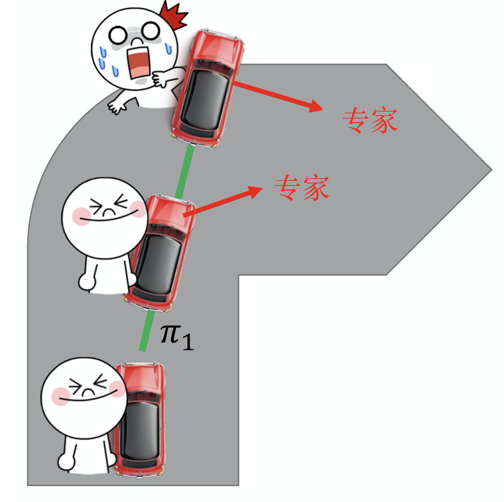

Hình 11.3 Tổng hợp tập dữ liệu

Nhân bản hành vi còn một vấn đề nữa: tác tử sẽ bắt chước hoàn toàn hành vi của chuyên gia, bất kể hành vi của chuyên gia có hợp lý hay không, dù không hợp lý, không có tác dụng gì, dù đó chỉ là thói quen của bản thân chuyên gia, tác tử cũng sẽ ghi nhớ nó. Nếu tác tử thực sự có thể nhớ tất cả hành vi của chuyên gia, có lẽ cũng không sao. Vì nếu chuyên gia làm như vậy, một số hành vi là thừa. Nhưng không có vấn đề gì, giả sử hành vi của tác tử có thể mô phỏng hoàn toàn hành vi của chuyên gia, thì cũng thôi, nó giỏi như chuyên gia, chỉ là làm một số việc thừa. Nhưng vấn đề là tác tử là một mạng, dung lượng (capacity) của mạng là có hạn. Dù cho mạng dữ liệu huấn luyện, độ chính xác nó đạt được trên dữ liệu huấn luyện thường cũng không phải 100%, có những việc nó không học được. Lúc này, cái gì nên học, cái gì không nên học trở nên rất quan trọng.

Ví dụ, như hình 11.4, khi học tiếng Trung, giáo viên có giọng nói và cử chỉ tay, nhưng chỉ phần giọng nói là quan trọng, phần cử chỉ tay là không quan trọng. Có thể tác tử chỉ học được một thứ, nếu nó chỉ học được giọng nói thì không có vấn đề. Nếu nó chỉ học được cử chỉ tay, thì có vấn đề. Vì vậy cho tác tử học xem thứ gì cần bắt chước, thứ gì không cần bắt chước, việc này rất quan trọng. Còn nhân bản hành vi đơn thuần không học việc này, vì tác tử chỉ sao chép toàn bộ hành vi của chuyên gia mà thôi, nó không biết hành vi nào là quan trọng, có ảnh hưởng đến những gì tiếp theo, hành vi nào là không quan trọng, không có ảnh hưởng đến những gì tiếp theo.

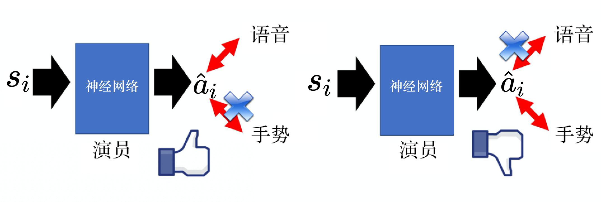

Hình 11.4 Tác tử học tiếng Trung

Vấn đề của nhân bản hành vi còn nằm ở chỗ: khi ta dùng nhân bản hành vi, dữ liệu huấn luyện và dữ liệu kiểm thử không khớp nhau (mismatch). Ta có thể dùng phương pháp tổng hợp tập dữ liệu để giảm bớt vấn đề này. Khi huấn luyện và khi kiểm thử, phân phối dữ liệu là khác nhau. Vì trong học tăng cường, hành động sẽ ảnh hưởng đến trạng thái tiếp theo. Ta có trạng thái $s_1$ trước, rồi thực hiện hành động $a_1$, $a_1$ sẽ quyết định trạng thái tiếp theo $s_2$. Vì vậy trong học tăng cường có một đặc điểm rất quan trọng, đó là hành động ta thực hiện sẽ ảnh hưởng đến trạng thái tiếp theo, tức là sẽ ảnh hưởng đến phân phối của trạng thái. Nếu dùng nhân bản hành vi, ta chỉ có thể quan sát được một số cặp trạng thái-hành động $(s,a)$ của chuyên gia $\hat{\theta}$.

Ta mong có thể học được một $\theta^*$, và mong $\theta^*$ càng gần $\hat{\theta}$ càng tốt. Nếu $\theta^*$ có thể giống hệt $\hat{\theta}$, trạng thái nhìn thấy khi huấn luyện và trạng thái nhìn thấy khi kiểm thử sẽ giống nhau. Vì tuy hành động sẽ ảnh hưởng đến trạng thái ta nhìn thấy, nhưng giả sử hai chính sách giống hệt nhau, ở cùng một trạng thái đều thực hiện cùng một hành động, thì các trạng thái ta nhìn thấy tiếp theo đều sẽ giống nhau. Nhưng vấn đề là ta rất khó làm cho chính sách học được giống hệt chính sách của chuyên gia. Chuyên gia là một con người thật, mạng muốn giống hệt con người thì hơi khó.

Nếu $\theta^*$ và $\hat{\theta}$ có một chút sai số, trong bài toán học có giám sát thông thường, mỗi mẫu (example) đều độc lập, có lẽ không có vấn đề gì. Nhưng với bài toán học tăng cường, có thể ở một chỗ nào đó chính là "sai một li, đi một dặm". Có thể ở một chỗ nào đó, tác tử không thể sao chép hoàn toàn hành vi của chuyên gia, nó sao chép kém đi một chút, có thể kết quả cuối cùng sẽ kém đi rất nhiều. Vì vậy nhân bản hành vi không thể giải quyết hoàn toàn bài toán học bắt chước, ta còn có một phương pháp khác khá tốt, gọi là học tăng cường ngược.

## 11.2 Học tăng cường ngược

Tại sao gọi là học tăng cường ngược? Vì trong học tăng cường ban đầu, có một môi trường và một hàm phần thưởng. Như hình 11.5, dựa vào môi trường và hàm phần thưởng, thông qua kỹ thuật học tăng cường, ta sẽ tìm ra một diễn viên, và học ra được một diễn viên tối ưu.

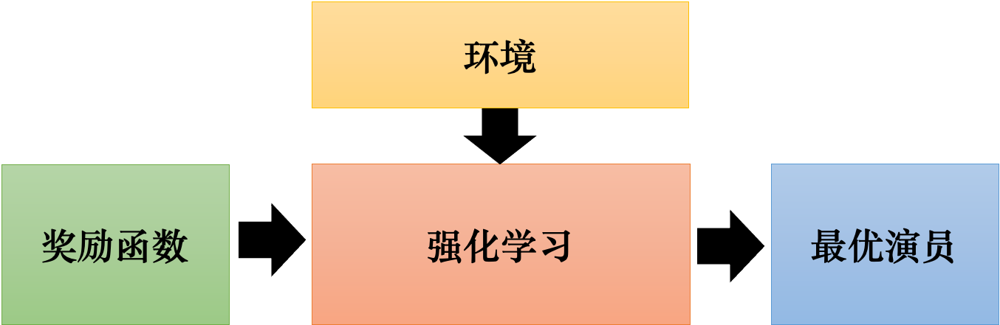

Hình 11.5 Quá trình học của học tăng cường

Nhưng học tăng cường ngược thì vừa hay ngược lại, như hình 11.6, nó không có hàm phần thưởng, chỉ có một số minh họa của chuyên gia, nhưng vẫn có môi trường. Học tăng cường ngược giả sử hiện có một số minh họa của chuyên gia, dùng $\hat{\tau}$ để biểu thị minh họa của chuyên gia. Nếu là chơi game, mỗi $\tau$ là bản ghi một ván chơi của một người chơi game rất giỏi. Nếu là ô tô tự lái, thì là bản ghi con người lái ô tô. Đây chính là minh họa của chuyên gia, mỗi $\tau$ là một quỹ đạo.

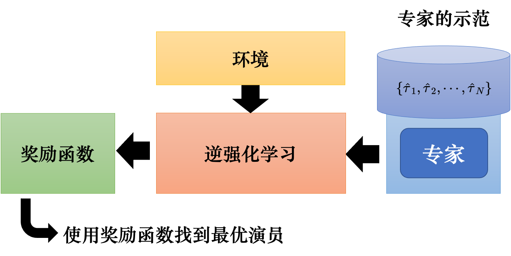

Hình 11.6 Quá trình học của học tăng cường ngược

Thu thập tất cả minh họa của chuyên gia lại, rồi dùng kỹ thuật học tăng cường ngược. Khi dùng kỹ thuật học tăng cường ngược, tác tử có thể tương tác với môi trường. Nhưng nó không nhận được phần thưởng, phần thưởng của nó phải được suy ra từ chuyên gia. Có môi trường và minh họa của chuyên gia rồi, có thể suy ngược ra hàm phần thưởng. Học tăng cường là từ hàm phần thưởng suy ra hành động gì, diễn viên nào là tốt nhất. Học tăng cường ngược thì ngược lại, ta có minh họa của chuyên gia, ta tin rằng nó khá tốt, ta suy ngược lại xem chuyên gia vì hàm phần thưởng như thế nào mà thực hiện những hành vi này. Có hàm phần thưởng rồi, tiếp theo, ta có thể dùng phương pháp học tăng cường thông thường để tìm ra diễn viên tối ưu. Vì vậy học tăng cường ngược là trước tiên tìm ra hàm phần thưởng, tìm ra hàm phần thưởng rồi, mới dùng học tăng cường để tìm ra diễn viên tối ưu.

Tìm ra hàm phần thưởng này, so với học tăng cường ban đầu có lợi ích gì? Một lợi ích có thể là có lẽ hàm phần thưởng khá đơn giản. Tức là tuy hành vi của chuyên gia rất phức tạp, nhưng có thể một hàm phần thưởng đơn giản lại dẫn đến hành vi rất phức tạp. Một ví dụ là hàm phần thưởng của bản thân con người chỉ đơn giản là sống, mỗi khi sống thêm một giây, ta được cộng một điểm. Nhưng con người có những hành vi rất phức tạp, mà những hành vi phức tạp này đều chỉ xoay quanh việc nhận điểm từ hàm phần thưởng này mà thôi. Đôi khi hàm phần thưởng rất đơn giản có thể suy ra hành vi rất phức tạp.

Thực tế học tăng cường ngược được làm như thế nào? Như hình 11.7, trước tiên, ta có một chuyên gia $\hat{\theta}$, chuyên gia này tương tác với môi trường, sinh ra rất nhiều quỹ đạo $\{\hat{\tau}_1,\hat{\tau}_2,\cdots,\hat{\tau}_N\}$. Nếu ta chơi game, thì cho một cao thủ chơi $N$ ván, ghi lại chuỗi trạng thái và hành động của $N$ ván. Tiếp theo, ta có một diễn viên $\theta$, lúc đầu diễn viên rất kém, diễn viên này cũng tương tác với môi trường. Nó cũng chơi $N$ ván, nó cũng có bản ghi của $N$ ván. Tiếp theo, ta cần suy ngược ra hàm phần thưởng. Suy ngược hàm phần thưởng như thế nào? Nguyên tắc là chuyên gia luôn giỏi nhất, là khái niệm "bắn tên trước, vẽ bia sau". Chuyên gia chơi game, có được bản ghi các ván chơi này, diễn viên cũng chơi game, có được bản ghi các ván chơi này. Tiếp theo, ta cần định ra một hàm phần thưởng, nguyên tắc của hàm phần thưởng này là điểm của chuyên gia phải cao hơn điểm của diễn viên (bắn tên trước, vẽ bia sau), nên ta học ra một hàm phần thưởng, hàm phần thưởng này làm phần thưởng chuyên gia nhận được lớn hơn phần thưởng diễn viên nhận được. Có hàm phần thưởng mới rồi, ta có thể dùng phương pháp học tăng cường thông thường để học một diễn viên, diễn viên này sẽ tối đa hóa phần thưởng của nó theo hàm phần thưởng. Nó cũng sẽ thực hiện một số hành động. Nhưng diễn viên này tuy có thể tối đa hóa hàm phần thưởng, thực hiện rất nhiều hành động, có được rất nhiều bản ghi trò chơi.

Nhưng tiếp theo, ta thay đổi hàm phần thưởng. Diễn viên này sẽ rất tức giận, nó đã có thể đạt điểm cao trên hàm phần thưởng này. Nhưng sau khi nó đạt điểm cao, ta lại sửa hàm phần thưởng, vẫn để chuyên gia đạt điểm cao hơn diễn viên. Đây chính là học tăng cường ngược. Có hàm phần thưởng mới rồi, dựa vào hàm phần thưởng mới này, ta có thể có được diễn viên mới, diễn viên mới lại tương tác với môi trường. Sau khi nó tương tác với môi trường, ta lại định nghĩa lại hàm phần thưởng, để phần thưởng của chuyên gia lớn hơn của diễn viên.

Làm sao để phần thưởng của chuyên gia lớn hơn diễn viên? Như hình 11.7, khi học, hàm phần thưởng có lẽ chính là mạng nơ-ron. Đầu vào của mạng nơ-ron là $\tau$, đầu ra là điểm số nên cho $\tau$. Hoặc giả sử ta thấy đưa vào cả $\tau$ quá khó, vì $\tau$ là một chuỗi rất dài của $s$ và $a$. Có lẽ đưa vào nó một cặp $s$ và $a$, nó sẽ đưa ra một số thực. Cộng các số thực mà cả $\tau$ nhận được lại là được $R(\tau)$. Khi huấn luyện, với $\left\{\hat{\tau}_{1}, \hat{\tau}_{2}, \cdots, \hat{\tau}_{N}\right\}$, ta mong giá trị $R$ nó đưa ra càng lớn càng tốt. Với $\left\{\tau_{1}, \tau_{2}, \cdots, \tau_{N}\right\}$, ta mong giá trị $R$ càng nhỏ càng tốt.

Thế nào có thể gọi là một hàm phần thưởng tốt nhất? Hàm phần thưởng ta học được cuối cùng phải là: chuyên gia và diễn viên trên hàm phần thưởng này đều đạt điểm cao như nhau. Hàm phần thưởng cuối cùng không thể phân biệt ai nên đạt điểm cao hơn. Thường khi huấn luyện, ta sẽ làm theo cách lặp. Học tăng cường ngược sớm nhất có một số hạn chế đối với hàm phần thưởng, nó giả định hàm phần thưởng là tuyến tính (linear). Nếu hàm phần thưởng là tuyến tính, ta có thể chứng minh thuật toán này sẽ hội tụ (converge). Nhưng nếu hàm phần thưởng không tuyến tính, ta không thể chứng minh nó sẽ hội tụ.

Thực ra chỉ cần ta xem diễn viên trong học tăng cường ngược là bộ sinh (generator), xem hàm phần thưởng là bộ phân biệt (discriminator), nó chính là mạng đối sinh (GAN). Vì vậy học tăng cường ngược có hội tụ hay không tương đương với mạng đối sinh có hội tụ hay không. Nếu ta đã từng cài đặt, sẽ biết học tăng cường ngược chưa chắc hội tụ. Nhưng trừ khi ta đặt một hạn chế rất nghiêm ngặt lên $R$, còn nếu $R$ là một mạng thông thường, ta sẽ gặp rắc rối lớn.

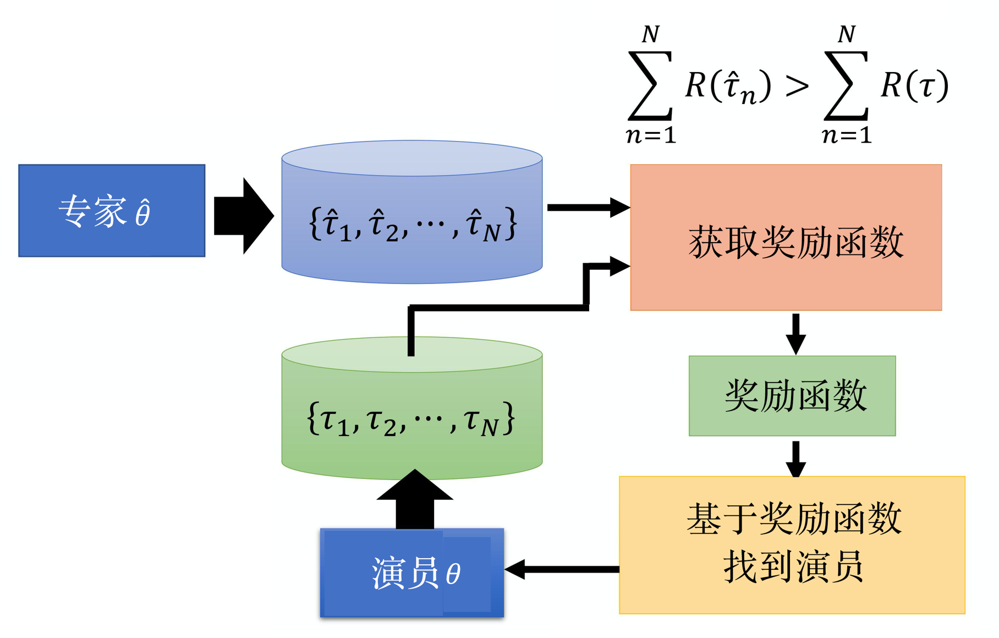

Hình 11.7 Khung của học tăng cường ngược

Ta có thể so sánh chi tiết học tăng cường ngược và mạng đối sinh. Như hình 11.8, trong mạng đối sinh, ta có một loạt hình ảnh rất đẹp, một bộ sinh và một bộ phân biệt. Lúc đầu, bộ sinh không biết phải tạo ra hình ảnh như thế nào, nó sẽ vẽ bừa. Công việc của bộ phân biệt là chấm điểm cho hình vẽ, hình của chuyên gia vẽ được điểm cao, hình do bộ sinh vẽ được điểm thấp. Bộ sinh sẽ tìm cách đánh lừa bộ phân biệt, bộ sinh mong bộ phân biệt cũng chấm điểm cao cho hình nó vẽ. Toàn bộ quá trình giống hệt học tăng cường ngược. Hình do chuyên gia vẽ chính là minh họa của chuyên gia. Bộ sinh chính là diễn viên, bộ sinh vẽ rất nhiều hình, diễn viên tương tác với môi trường, sinh ra rất nhiều quỹ đạo. Bản ghi tương tác giữa diễn viên và môi trường thực ra tương đương với các hình ảnh trong mạng đối sinh. Sau đó ta học một hàm phần thưởng. Hàm phần thưởng chính là bộ phân biệt. Hàm phần thưởng phải chấm điểm cao cho minh họa của chuyên gia, chấm điểm thấp cho kết quả tương tác của diễn viên. Tiếp theo, diễn viên sẽ tìm cách đạt điểm cao từ hàm phần thưởng đã học được, rồi lặp lại theo vòng.

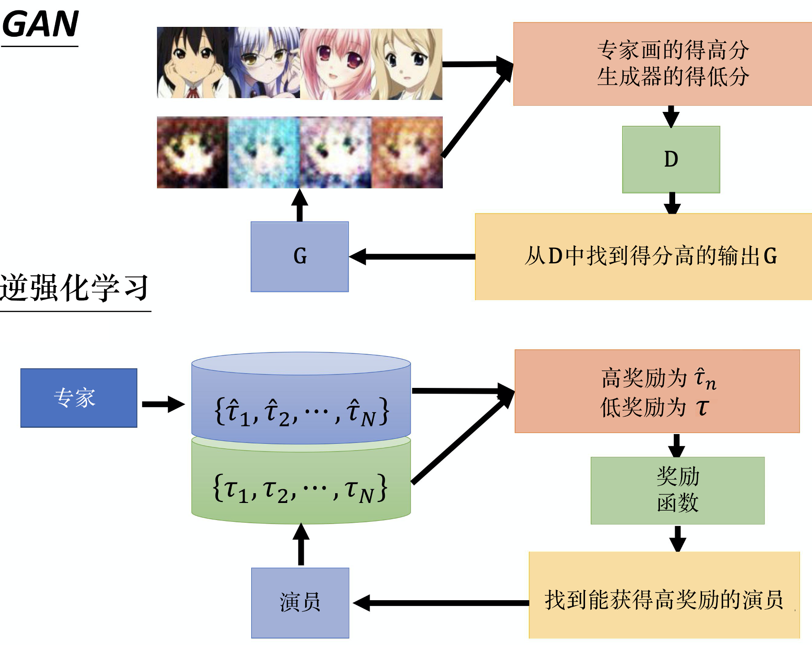

Hình 11.8 Khác biệt giữa mạng đối sinh và học tăng cường ngược

Học tăng cường ngược có rất nhiều ứng dụng, ví dụ có thể dùng cho ô tô tự lái, có người dùng kỹ thuật này để học các phong cách lái ô tô tự lái khác nhau. Mỗi người khi lái xe có phong cách khác nhau, ví dụ có được đè vạch không, có được lùi không, có tuân thủ luật giao thông không,... Phong cách của mỗi người là khác nhau, dùng học tăng cường ngược có thể giúp ô tô tự lái học được nhiều phong cách lái xe khác nhau.

Học tăng cường ngược có một điểm thú vị: thường ta không cần quá nhiều dữ liệu huấn luyện, dữ liệu huấn luyện thường chỉ có một con số. Vì học tăng cường ngược chỉ là một loại minh họa, thực tế tác tử có thể tương tác với môi trường nhiều lần, nên ta thường thấy chỉ dùng vài mẫu dữ liệu là có thể huấn luyện ra một số kết quả thú vị. Hình 11.9 là ví dụ cho ô tô tự lái học cách đỗ xe an toàn trong bãi đỗ xe. Minh họa của ví dụ này như sau: màu xanh lam là đích, ô tô tự lái cần lái đến đích màu xanh lam để đỗ xe. Cho tác tử xem 4 minh họa của chỉ một hàng, để nó học cách lái xe, cuối cùng nó có thể học được rằng, nếu nó muốn đỗ xe ở vị trí đích màu đỏ, thì nên lái như thế này. Cho tác tử xem các minh họa khác nhau, phong cách lái xe nó học được cuối cùng sẽ hơi khác nhau. Ví dụ, hàng thứ hai của hình 11.9 là cách lái xe không tuân thủ quy tắc, vì nó sẽ lái ra ngoài đường, và còn đi xuyên qua các xe khác. Vì vậy tác tử sẽ học được một số hành vi không tuân thủ quy tắc giao thông, ví dụ không nhất thiết phải đi trên đường, có thể đi ở chỗ không phải đường,... Hàng thứ ba của hình 11.9 là lùi xe để đỗ, tác tử cũng sẽ học được rằng nó có thể lùi.

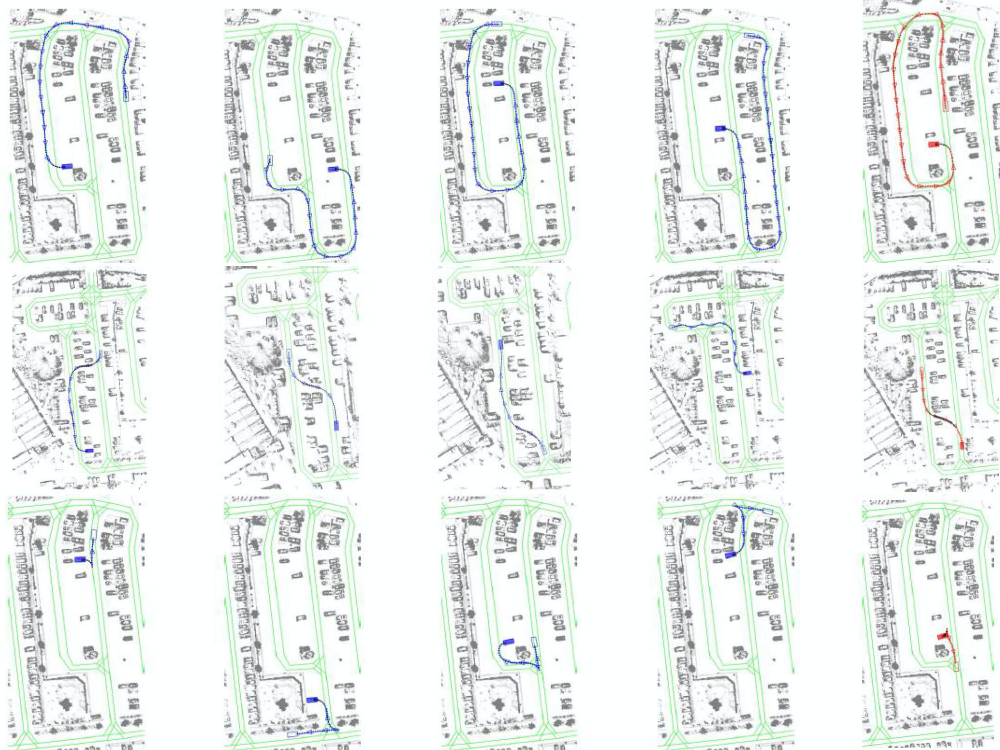

Hình 11.9 Ví dụ đỗ xe của ô tô tự lái

Ta cũng có thể dùng học tăng cường ngược để huấn luyện robot, ta có thể cho robot làm một số động tác mà con người muốn nó làm. Trước đây, nếu ta muốn huấn luyện robot, cho nó làm động tác ta muốn, thực ra khá phiền phức. Ví dụ, nếu ta muốn điều khiển cánh tay robot, cần tốn rất nhiều công sức viết chương trình, như vậy mới cho cánh tay robot làm được một việc rất đơn giản. Có kỹ thuật học tăng cường ngược, bản thân ta có thể làm minh họa, robot học thông qua minh họa. Ví dụ, cho robot học xếp đĩa, kéo cánh tay robot đi xếp đĩa, máy tự động di chuyển. Ví dụ khác, cho robot học rót nước, con người chỉ dạy nó 20 lần, vị trí đặt cốc mỗi lần hơi khác nhau.

## 11.3 Học bắt chước góc nhìn ngôi thứ ba

Thực ra còn rất nhiều nghiên cứu liên quan đến huấn luyện robot, như hình 11.10, ví dụ, khi ta dạy robot làm động tác, cần chú ý rằng có thể góc nhìn của robot không giống góc nhìn của con người. Trong ví dụ trên, động tác của con người và robot là như nhau. Nhưng trong thế giới tương lai, có thể robot học bằng cách nhìn hành vi của con người. Vừa rồi là con người kéo, giả sử ta muốn robot học đánh golf, nếu giống ví dụ trên, thì là con người kéo cánh tay robot đi đánh golf, nhưng trong tương lai liệu có thể robot nhìn con người đánh golf, tự nó học được đánh golf không? Lúc này, cần chú ý rằng góc nhìn của robot khác với góc nhìn khi nó thực sự thực hiện hành vi này. Robot phải hiểu rằng khi nó ở góc nhìn ngôi thứ ba, nhìn người khác đánh golf, rõ ràng khác với góc nhìn khi nó thực sự tự đánh golf. Nhưng làm sao nó tổng quát hóa kinh nghiệm quan sát được ở góc nhìn ngôi thứ ba thành hành vi thực hiện ở góc nhìn ngôi thứ nhất, điều này cần dùng đến kỹ thuật **học bắt chước góc nhìn ngôi thứ ba (third person imitation learning)**.

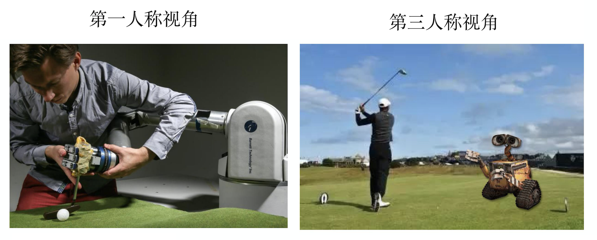

Hình 11.10 Ví dụ học bắt chước góc nhìn ngôi thứ ba

Làm việc này như thế nào? Kỹ thuật học bắt chước góc nhìn ngôi thứ ba thực ra không chỉ dùng học bắt chước, nó còn dùng **huấn luyện đối kháng miền (domain-adversarial training)**. Huấn luyện đối kháng miền cũng là một kỹ thuật của mạng đối sinh. Như hình 11.11, ta mong có một bộ trích xuất đặc trưng (feature extractor), có hai ảnh thuộc các miền (domain) khác nhau, sau khi qua bộ trích xuất đặc trưng, không thể phân biệt ảnh đến từ miền nào. Kỹ thuật dùng cho học bắt chước góc nhìn ngôi thứ nhất và ngôi thứ ba là như nhau, mong học được một bộ trích xuất đặc trưng, góc nhìn của tác tử khi ở ngôi thứ ba và khi ở ngôi thứ nhất thực ra là như nhau, chỉ cần trích xuất ra thứ quan trọng nhất là được.

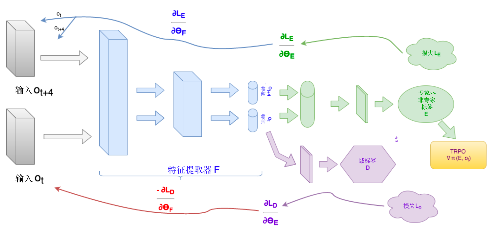

Hình 11.11 Khung học bắt chước góc nhìn ngôi thứ ba

## 11.4 Sinh chuỗi và chatbot

Thực ra ta có thể hiểu sinh câu (sentence generation) hoặc chatbot là học bắt chước. Như hình 11.12, máy đang bắt chước con người viết câu, khi ta viết câu, ta xem mỗi chữ viết ra là một hành động, tất cả các chữ hợp lại là một tập (episode). Ví dụ, trong sinh câu, ta cho máy xem rất nhiều chữ do con người viết. Nếu muốn cho máy học làm thơ, thì phải cho nó xem *Đường thi tam bách thủ* (300 bài thơ Đường). Chữ con người viết thực ra chính là minh họa của chuyên gia. Mỗi từ thực ra là một hành động. Khi máy sinh câu, thực ra nó đang bắt chước quỹ đạo của chuyên gia. Chatbot cũng vậy, trong chatbot ta thu thập được rất nhiều bản ghi hội thoại tương tác của con người, đây chính là minh họa của chuyên gia.

Nếu ta đơn thuần dùng kỹ thuật hợp lý cực đại (maximum likelihood) để tối đa hóa likelihood, thực ra đây chính là nhân bản hành vi. Nhân bản hành vi là nhìn thấy một trạng thái, tiếp theo dự đoán ta sẽ có hành động gì, có một đáp án chuẩn (ground truth) cho máy biết hành động nào là tốt nhất. Khi làm likelihood cũng vậy, cho phần câu đã sinh ra, tiếp theo máy cần dự đoán viết chữ nào là tốt nhất. Vì vậy, thực ra hợp lý cực đại khi làm sinh chuỗi (sequence generation), tương ứng trong học bắt chước chính là nhân bản hành vi. Chỉ có hợp lý cực đại là không đủ, ta muốn dùng mạng đối sinh chuỗi (sequence GAN). Thực ra mạng đối sinh chuỗi tương ứng với học tăng cường ngược, học tăng cường ngược chính là một kỹ thuật của mạng đối sinh. Ta đặt kỹ thuật học tăng cường ngược vào sinh câu, chatbot, thực ra chính là mạng đối sinh chuỗi và các biến thể của nó.

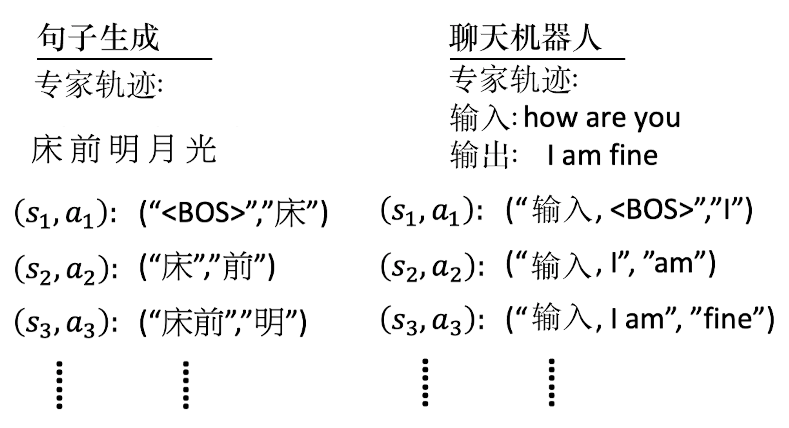

Hình 11.12 Ví dụ học bắt chước

## Tài liệu tham khảo

* [机器学习 (Học máy)](https://book.douban.com/subject/26708119//)
* [模仿学习（Imitation Learning）介绍 (Giới thiệu học bắt chước)](https://zhuanlan.zhihu.com/p/25688750)
