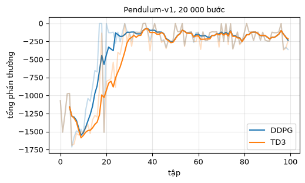
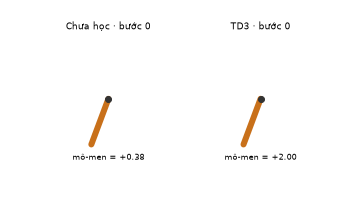

# Chương 12 · Code

> Ghi chú của người dịch: trang này do người dịch biên soạn, không có trong sách gốc. MinRL không có DDPG, nên code trên trang được viết thêm *(thêm)*, dựa trên notebook `DDPG_vi` và `TD3_vi` của bản gốc EasyRL nhưng gọn hơn. Mục 4 có một nhận xét quan trọng về notebook DDPG.
>
> Ký hiệu: theo [chương 12](chapter12/chapter12_vi): diễn viên tất định $\mu_\theta(s)$, nhà phê bình $Q_w(s, a)$, các mạng mục tiêu $\mu_{\theta'}$, $Q_{w'}$, hệ số cập nhật mềm $\tau$.

Mỗi khối code đã được chạy sẵn trên CPU. Kết quả, hình vẽ và ảnh động nằm ngay bên dưới. Các khối chạy lần lượt từ trên xuống và dùng chung biến, như các ô của một notebook. Muốn tự chạy, xem [mục 5](#_5-chạy-trên-máy).

## 1. Môi trường con lắc

<small class="viz-ref">Mục 12.1 · dự án 3</small>

`Pendulum-v1`: một con lắc treo ở trục, bắt đầu ở một góc ngẫu nhiên. Hành động là **mô-men xoắn liên tục** trong $[-2, 2]$. Mục tiêu là đưa con lắc lên thẳng đứng và giữ ở đó. Quan sát là $(\cos\theta, \sin\theta, \dot\theta)$. Phần thưởng mỗi bước là $-(\theta^2 + 0.1\dot\theta^2 + 0.001 u^2)$, luôn $\le 0$. Mỗi tập dài 200 bước. Tổng thưởng gần 0 là tốt, khoảng $-150$ được coi là giải xong.

Hành động liên tục nên không thể lấy $\max_a Q(s,a)$ bằng cách duyệt hết các hành động như DQN. DDPG học thêm một mạng $\mu_\theta(s)$ trả ra **trực tiếp** hành động tốt nhất.

<!-- run -->
```python
import copy
import numpy as np
import torch
from torch import nn
import gymnasium as gym
import matplotlib.pyplot as plt
from viz import plot_returns, save_gif, draw_pendulum, rollout

torch.set_num_threads(1)
env = gym.make("Pendulum-v1")
print("Quan sát:", env.observation_space)
print("Hành động:", env.action_space)
rng0 = np.random.default_rng(0)
random_returns = [rollout(gym.make("Pendulum-v1"), lambda o: rng0.uniform(-2, 2, 1), seed=i)[2] for i in range(10)]
print(f"Chính sách ngẫu nhiên: tổng thưởng trung bình {np.mean(random_returns):.0f}")
```

<!-- output -->
```output
Quan sát: Box([-1. -1. -8.], [1. 1. 8.], (3,), float32)
Hành động: Box(-2.0, 2.0, (1,), float32)
Chính sách ngẫu nhiên: tổng thưởng trung bình -1225
```
<!-- /output -->

## 2. DDPG và TD3 trong một hàm

<small class="viz-ref">Mục 12.2, 12.3 · hình 12.5–12.10</small>

DDPG có bốn mạng: diễn viên $\mu_\theta$, nhà phê bình $Q_w$, và hai bản sao mục tiêu. Mỗi bước gồm:

- **Nhà phê bình** hồi quy về $y = r + \gamma\, Q_{w'}\big(s', \mu_{\theta'}(s')\big)$, giống DQN, chỉ khác là hành động ở $s'$ do diễn viên mục tiêu đưa ra thay vì lấy $\max$.
- **Diễn viên** đi lên theo $\nabla_\theta Q_w\big(s, \mu_\theta(s)\big)$: chỉnh $\mu_\theta$ để nhà phê bình chấm điểm cao hơn.
- **Mạng mục tiêu** được kéo dần về mạng chính: $\theta' \leftarrow \tau\theta + (1-\tau)\theta'$.
- **Khám phá** bằng cách cộng nhiễu vào hành động. Notebook dùng nhiễu Ornstein–Uhlenbeck, ở đây dùng nhiễu Gauss đơn giản hơn.

TD3 (mục 12.3) thêm ba mẹo, mỗi mẹo là một cờ trong hàm dưới:

| Mẹo của TD3 | Cờ | Thay đổi trong code |
|---|---|---|
| Hai nhà phê bình, lấy giá trị nhỏ hơn (chống ước lượng quá cao) | `twin` | `q_next = torch.min(Q1'(s',a'), Q2'(s',a'))` |
| Cập nhật diễn viên chậm hơn | `delay` | diễn viên và mạng mục tiêu chỉ cập nhật mỗi 2 bước |
| Làm trơn chính sách mục tiêu | `smooth` | $a' = \operatorname{clip}(\mu_{\theta'}(s') + \operatorname{clip}(\epsilon, -0.5, 0.5), -1, 1)$, $\epsilon \sim \mathcal N(0, 0.2^2)$ |

<!-- run -->
```python
def mlp(n_in, n_out, hidden=256, out=None):
    layers = [nn.Linear(n_in, hidden), nn.ReLU(), nn.Linear(hidden, hidden), nn.ReLU(), nn.Linear(hidden, n_out)]
    return nn.Sequential(*layers, *([out] if out else []))

def train(steps=20_000, twin=False, delay=False, smooth=False, seed=0,
          gamma=0.99, tau=0.005, batch=128, noise=0.1, warmup=1000):
    torch.manual_seed(seed)
    rng = np.random.default_rng(seed)
    env = gym.make("Pendulum-v1")
    scale = float(env.action_space.high[0])                    # mạng ra [-1, 1], nhân 2 thành mô-men
    actor = mlp(3, 1, out=nn.Tanh())                           # μ_θ(s)
    critics = [mlp(4, 1) for _ in range(2 if twin else 1)]     # Q_w(s, a), TD3 dùng 2 mạng
    actor_t = copy.deepcopy(actor)                             # μ_θ'  (bản sao THẬT, xem mục 4)
    critics_t = [copy.deepcopy(c) for c in critics]            # Q_w'
    opt_actor = torch.optim.Adam(actor.parameters(), lr=1e-4)
    opt_critic = torch.optim.Adam([p for c in critics for p in c.parameters()], lr=1e-3)
    Q = lambda net, s, a: net(torch.cat([s, a], dim=1))

    buffer, returns, ep_return = [], [], 0.0
    obs, _ = env.reset(seed=seed)
    for step in range(steps):
        # 1. Tương tác: hành động của diễn viên + nhiễu khám phá (vài nghìn bước đầu: ngẫu nhiên)
        if step < warmup:
            a = rng.uniform(-1, 1, 1)
        else:
            with torch.no_grad():
                a = actor(torch.as_tensor(obs, dtype=torch.float32)).numpy()
            a = np.clip(a + rng.normal(0, noise, 1), -1, 1)
        obs2, r, terminated, truncated, _ = env.step(scale * a)
        buffer.append((obs, a, r, obs2, terminated))
        obs, ep_return = obs2, ep_return + r
        if terminated or truncated:
            returns.append(ep_return)
            ep_return = 0.0
            obs, _ = env.reset()
        if step < warmup:
            continue

        # 2. Lấy một lô từ bộ đệm phát lại
        idx = rng.integers(len(buffer), size=batch)
        s, a_b, r_b, s2, done = (torch.as_tensor(np.array(x), dtype=torch.float32)
                                 for x in zip(*[buffer[i] for i in idx]))
        r_b, done = r_b[:, None], done[:, None]

        # 3. Nhà phê bình: hồi quy về y = r + γ Q_w'(s', μ_θ'(s'))
        with torch.no_grad():
            a2 = actor_t(s2)
            if smooth:                                           # TD3: làm trơn chính sách mục tiêu
                a2 = (a2 + (0.2 * torch.randn_like(a2)).clamp(-0.5, 0.5)).clamp(-1, 1)
            q_next = torch.min(*[Q(c, s2, a2) for c in critics_t]) if twin else Q(critics_t[0], s2, a2)
            y = r_b + gamma * (1 - done) * q_next
        critic_loss = sum(((Q(c, s, a_b) - y) ** 2).mean() for c in critics)
        opt_critic.zero_grad(); critic_loss.backward(); opt_critic.step()

        # 4. Diễn viên: tối đa hóa Q_w(s, μ_θ(s)); TD3 chỉ làm mỗi 2 bước
        if not delay or step % 2 == 0:
            actor_loss = -Q(critics[0], s, actor(s)).mean()
            opt_actor.zero_grad(); actor_loss.backward(); opt_actor.step()
            # 5. Cập nhật mềm: θ' ← τθ + (1 − τ)θ'
            with torch.no_grad():
                for net, net_t in [(actor, actor_t), *zip(critics, critics_t)]:
                    for p, p_t in zip(net.parameters(), net_t.parameters()):
                        p_t.lerp_(p, tau)
    return actor, returns
```

## 3. Huấn luyện và so sánh

Mỗi thuật toán chạy 20 000 bước, tức 100 tập:

<!-- run -->
```python
actor_ddpg, ret_ddpg = train()
actor_td3, ret_td3 = train(twin=True, delay=True, smooth=True)

def evaluate(actor, n=10):
    act = lambda o: 2.0 * actor(torch.as_tensor(o, dtype=torch.float32)).detach().numpy()
    return np.mean([rollout(gym.make("Pendulum-v1"), act, seed=100 + i)[2] for i in range(n)])

for name, actor, rets in [("DDPG", actor_ddpg, ret_ddpg), ("TD3", actor_td3, ret_td3)]:
    blocks = [int(np.mean(rets[i:i + 10])) for i in range(0, len(rets), 10)]
    print(f"{name}: trung bình mỗi 10 tập = {blocks}")
    print(f"      đánh giá 10 tập không nhiễu = {evaluate(actor):.0f}")
plot_returns({"DDPG": ret_ddpg, "TD3": ret_td3}, k=5, title="Pendulum-v1, 20 000 bước")
```

<!-- output -->
```output
DDPG: trung bình mỗi 10 tập = [-1354, -857, -127, -121, -188, -130, -168, -176, -144, -204]
      đánh giá 10 tập không nhiễu = -167
TD3: trung bình mỗi 10 tập = [-1372, -1237, -513, -146, -194, -142, -188, -181, -144, -194]
      đánh giá 10 tập không nhiễu = -166
```

<div align=center></div>
<!-- /output -->

Cả hai đều giải được bài trong khoảng 30 tập đầu (từ khoảng $-1300$ lên khoảng $-150$), và cho kết quả đánh giá gần như bằng nhau (khoảng $-166$). TD3 khởi động chậm hơn một chút, vì diễn viên chỉ cập nhật mỗi 2 bước. Trên con lắc, DDPG chưa gặp vấn đề ước lượng quá cao đủ nặng để ba mẹo của TD3 tạo khác biệt. Lợi ích của TD3 thường thấy rõ trên các bài điều khiển nhiều chiều như MuJoCo.

Ảnh động dưới: con lắc trước khi học (diễn viên mới khởi tạo) và sau khi học bằng TD3, cùng một vị trí xuất phát.

<!-- run -->
```python
torch.manual_seed(1)
untrained = mlp(3, 1, out=nn.Tanh())
runs = {}
for name, actor in [("Chưa học", untrained), ("TD3", actor_td3)]:
    act = lambda o, actor=actor: 2.0 * actor(torch.as_tensor(o, dtype=torch.float32)).detach().numpy()
    runs[name] = rollout(gym.make("Pendulum-v1"), act, seed=4, max_steps=200)

def draw(fig, i):
    t = 2 * i
    for k, (name, (obs, acts, total)) in enumerate(runs.items()):
        draw_pendulum(fig.add_subplot(1, 2, k + 1), obs[t], acts[t] if t < len(acts) else None,
                      title=f"{name} · bước {t}")

save_gif(draw, 100, "pendulum.gif", fps=15, figsize=(5, 2.8), dpi=72)
```

<!-- output -->
<div align=center></div>
<!-- /output -->

## 4. Notebook của EasyRL, và một lỗi cần biết

| Notebook | Nội dung | Mở |
|---|---|---|
| `DDPG_vi.ipynb` | DDPG trên Pendulum-v1, nhiễu OU | [GitHub](https://github.com/nmc2004nd/easy-rl-vi/blob/main/notebooks/DDPG_vi.ipynb) · [Colab](https://colab.research.google.com/github/nmc2004nd/easy-rl-vi/blob/main/notebooks/DDPG_vi.ipynb) |
| `TD3_vi.ipynb` | TD3 trên Pendulum-v1 | [GitHub](https://github.com/nmc2004nd/easy-rl-vi/blob/main/notebooks/TD3_vi.ipynb) · [Colab](https://colab.research.google.com/github/nmc2004nd/easy-rl-vi/blob/main/notebooks/TD3_vi.ipynb) |
| `SAC_vi.ipynb` | SAC (diễn viên-nhà phê bình mềm), không có trong sách | [GitHub](https://github.com/nmc2004nd/easy-rl-vi/blob/main/notebooks/SAC_vi.ipynb) · [Colab](https://colab.research.google.com/github/nmc2004nd/easy-rl-vi/blob/main/notebooks/SAC_vi.ipynb) |

Trong `DDPG_vi.ipynb`, mạng mục tiêu được tạo như sau:

```python
self.critic = models['critic'].to(self.device)
self.target_critic = models['critic'].to(self.device)   # cùng một đối tượng với self.critic!
self.actor = models['actor'].to(self.device)
self.target_actor = models['actor'].to(self.device)
```

`nn.Module.to()` trả về **chính** mô-đun đó, không tạo bản sao. Vì vậy `target_critic` và `critic` là cùng một mạng, `target_actor` và `actor` cũng vậy. Phép cập nhật mềm phía sau không có tác dụng gì: notebook thực chất chạy DDPG **không có mạng mục tiêu**. Kiểm tra nhanh:

<!-- run -->
```python
net = nn.Linear(3, 1)
print("net.to('cpu') is net:", net.to("cpu") is net)
print("copy.deepcopy(net) is net:", copy.deepcopy(net) is net)
```

<!-- output -->
```output
net.to('cpu') is net: True
copy.deepcopy(net) is net: False
```
<!-- /output -->

Cách sửa là dùng `copy.deepcopy(models['critic'])` cho mạng mục tiêu, như code ở mục 2. Theo output lưu sẵn trong notebook, nó vẫn học được trên Pendulum: 20 tập kiểm thử cho tổng thưởng từ khoảng $-1$ đến $-356$. Lý do là bài này đủ dễ. Nhưng đó không phải là DDPG đúng như mục 12.2 mô tả. Notebook `TD3_vi` tạo các mạng mục tiêu riêng nên không mắc lỗi này.

## 5. Chạy trên máy

```bash
git clone https://github.com/nmc2004nd/easy-rl-vi.git
cd easy-rl-vi/docs/code/py          # chạy từ đây để import được viz
pip install numpy matplotlib pillow gymnasium torch
```

Chép lần lượt các khối code trên trang vào Jupyter rồi chạy theo thứ tự. Mỗi thuật toán huấn luyện mất khoảng 1,5 phút trên một nhân CPU. Kết quả trên trang được dựng bằng `python3 scripts/build_code_pages.py docs/chapter12/chapter12_code_vi.md`.
