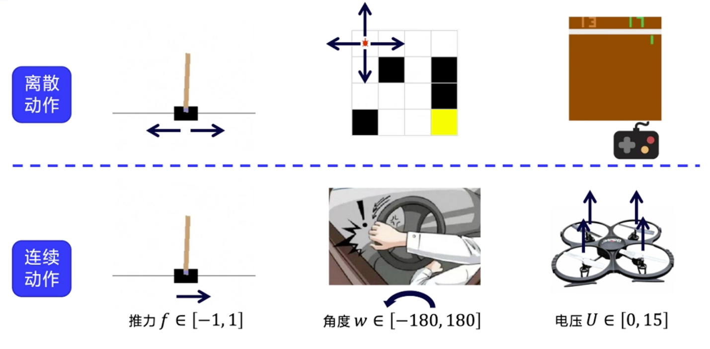
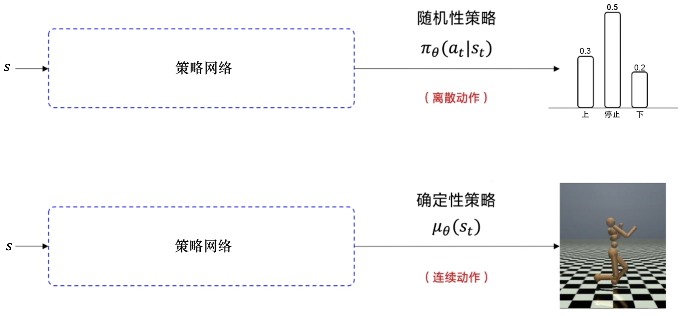
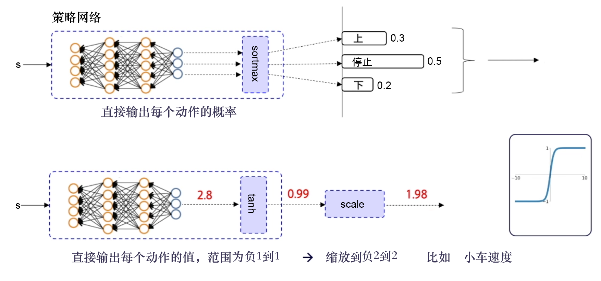
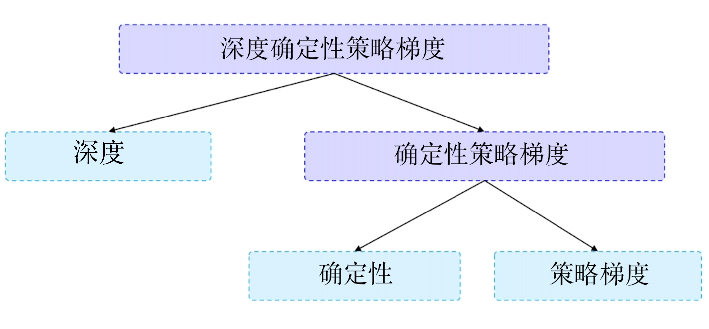
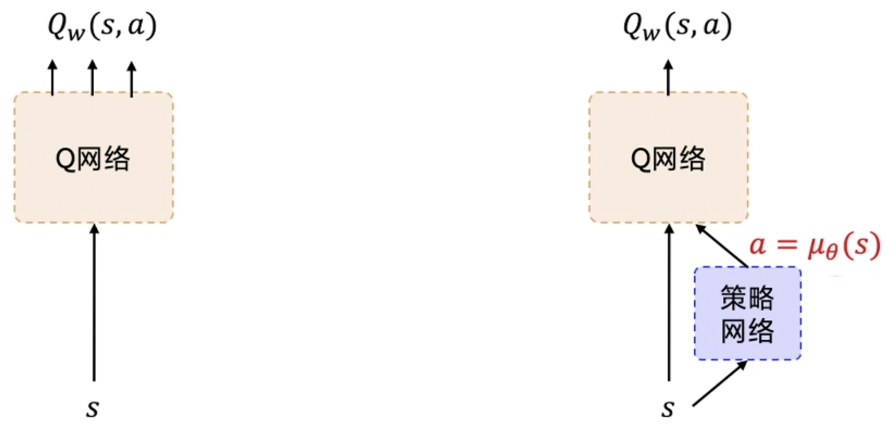
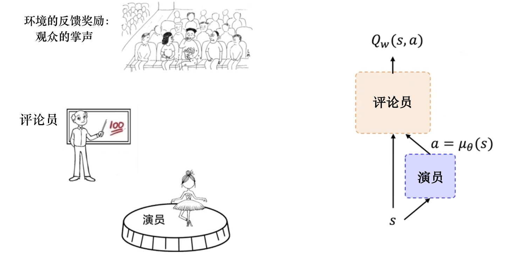
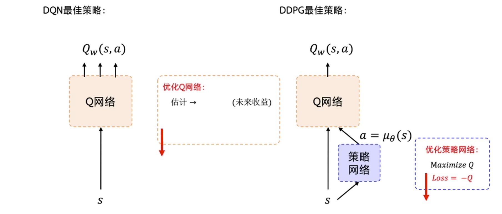
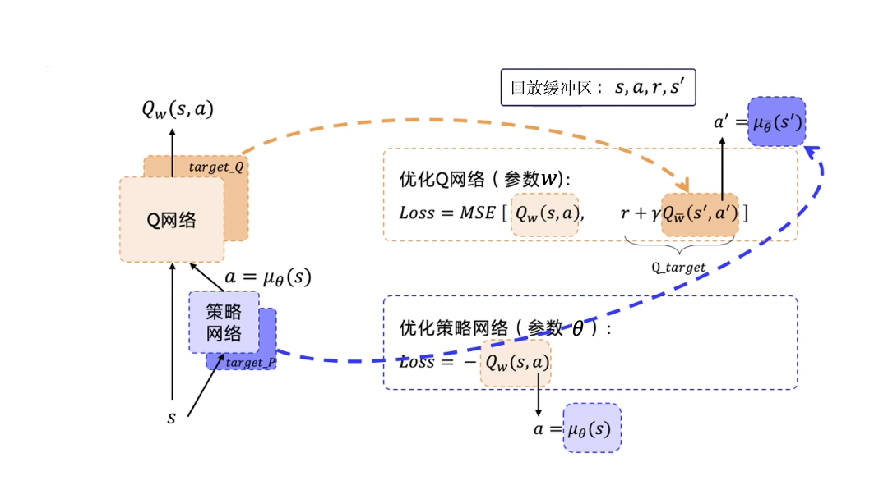
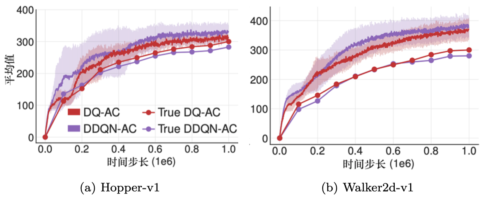
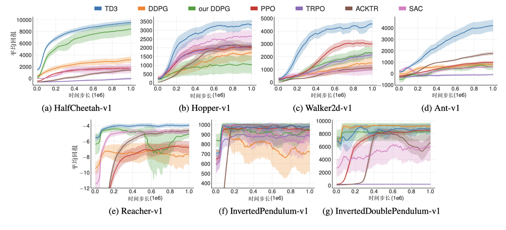

# Chương 12 Gradient chính sách tất định sâu

## 12.1 Khác biệt giữa hành động rời rạc và hành động liên tục

Hành động rời rạc và hành động liên tục là hai khái niệm tương đối, một cái đếm được, một cái không đếm được. Như hình 12.1, có một số ví dụ về hành động rời rạc và hành động liên tục. Trong môi trường *CartPole*, có hai hành động là đẩy xe sang trái và đẩy xe sang phải. Trong môi trường *Frozen Lake*, chú rùa nhỏ có 4 hành động lên, xuống, trái, phải. Trong trò chơi *Pong* của Atari, trò chơi có hành động của 6 phím bấm có thể đưa ra. Nhưng trong tình huống thực tế, ta thường gặp trường hợp không gian hành động liên tục, tức là hành động đầu ra không đếm được. Ví dụ: độ lớn lực đẩy xe, góc quay cụ thể của vô lăng ở thời điểm tiếp theo, độ lớn điện áp cấp cho 4 cánh quạt của máy bay bốn cánh quạt (quadcopter).

Hình 12.1 Khác biệt giữa hành động rời rạc và hành động liên tục

Với các hành động liên tục này, các thuật toán như Q-learning, mạng Q sâu không thể xử lý được. Vậy làm sao ta đưa ra hành động liên tục? Lúc này, mạng nơ-ron "vạn năng" lại xuất hiện. Như hình 12.2, trong kịch bản hành động rời rạc, ví dụ ta đưa ra các hành động lên, xuống hoặc dừng. Có bao nhiêu hành động, mạng nơ-ron đưa ra bấy nhiêu giá trị xác suất, ta dùng $\pi_\theta(a_t|s_t)$ để biểu thị chính sách ngẫu nhiên này. Trong kịch bản hành động liên tục, ví dụ ta cần đưa ra góc gập của cánh tay robot, ta đưa ra một số thực dấu phẩy động (floating-point) cụ thể. Ta dùng $\mu_{\theta}(s_t)$ để đại diện cho chính sách tất định này.

Ta giải thích thêm về chính sách ngẫu nhiên và chính sách tất định. Với chính sách ngẫu nhiên (stochastic policy), đưa vào một trạng thái $s$ nào đó, khả năng thực hiện một hành động nào đó không phải là 100%, mà có một xác suất (giống như bốc thăm), rút ngẫu nhiên một hành động theo xác suất. Còn với chính sách tất định (deterministic policy), nó không chịu ảnh hưởng của xác suất. Khi tham số của mạng nơ-ron được cố định, đưa vào cùng một trạng thái, nhất định đưa ra cùng một hành động, đây chính là chính sách tất định.

Hình 12.2 Dùng mạng nơ-ron xử lý hành động liên tục và hành động rời rạc

Như hình 12.3, để đưa ra hành động rời rạc, ta thêm một tầng softmax để đảm bảo tất cả các đầu ra là xác suất hành động, và tổng xác suất của tất cả các hành động bằng 1. Để đưa ra hành động liên tục, thông thường ta có thể thêm một tầng hàm tanh ở tầng đầu ra. Tác dụng của hàm tanh là giới hạn đầu ra trong [$-$1,1]. Có đầu ra rồi, ta có thể co giãn nó theo phạm vi hành động thực tế, rồi đưa cho môi trường. Ví dụ mạng nơ-ron đưa ra một số thực 2.8, sau khi qua hàm tanh, nó được giới hạn trong khoảng [$-$1,1], đưa ra 0.99. Giả sử phạm vi tốc độ của xe là [$-$2,2], ta phóng to theo tỉ lệ từ [$-$1,1] lên [$-$2,2], 0.99 nhân 2, cuối cùng đầu ra là 1.98, dùng nó làm tốc độ của xe hoặc lực đẩy xe đưa cho môi trường.

Hình 12.3 Dùng mạng nơ-ron đưa ra hành động rời rạc và hành động liên tục

## 12.2 Gradient chính sách tất định sâu

Trong lĩnh vực điều khiển liên tục, thuật toán học tăng cường khá kinh điển chính là **gradient chính sách tất định sâu (deep deterministic policy gradient, DDPG)**. Như hình 12.4, đặc điểm của DDPG có thể tách ra từ chính tên của nó, tách thành sâu, tất định và gradient chính sách.

Sâu là vì dùng mạng nơ-ron; tất định cho biết DDPG đưa ra một hành động tất định, có thể dùng cho môi trường có hành động liên tục; gradient chính sách cho biết nó dùng mạng chính sách. Thuật toán REINFORCE cứ mỗi tập cập nhật một lần, nhưng DDPG cập nhật mạng chính sách một lần sau mỗi bước, nó là một mạng chính sách cập nhật từng bước.

Hình 12.4 DDPG

DDPG là một phiên bản mở rộng của mạng Q sâu, có thể mở rộng sang không gian hành động liên tục. Trong việc huấn luyện DDPG, nó học hỏi các mẹo của mạng Q sâu: mạng mục tiêu (target network) và phát lại kinh nghiệm (experience replay). Phát lại kinh nghiệm giống với mạng Q sâu, nhưng cách cập nhật mạng mục tiêu hơi khác mạng Q sâu. DDPG được đề xuất để mạng Q sâu có thể mở rộng sang không gian hành động liên tục, chính là các giá trị liên tục như tốc độ xe, góc, điện áp mà ta vừa nhắc đến. Như hình 12.5, DDPG thêm một mạng chính sách vào trên nền mạng Q sâu để đưa ra trực tiếp giá trị hành động, nên DDPG cần vừa học mạng Q, vừa học mạng chính sách. Tham số của mạng Q được ký hiệu là $w$. Tham số của mạng chính sách được ký hiệu là $\theta$. Ta gọi cấu trúc như vậy là cấu trúc diễn viên-nhà phê bình (actor-critic).

Hình 12.5 Từ mạng Q sâu đến DDPG

Giải thích một cách dễ hiểu cấu trúc diễn viên-nhà phê bình. Như hình 12.6, mạng chính sách đóng vai diễn viên, nó phụ trách thể hiện đầu ra ra bên ngoài, đưa ra hành động. Mạng Q chính là nhà phê bình, nó ở mỗi bước đều đánh giá hành động do diễn viên đưa ra, chấm một điểm, ước lượng hành động của diễn viên trong tương lai có thể có bao nhiêu phần thưởng, tức là ước lượng giá trị Q của hành động diễn viên đưa ra khoảng bao nhiêu, tức $Q_w(s,a)$. Diễn viên cần dựa vào trạng thái hiện tại của sân khấu để đưa ra một hành động. Nhà phê bình chính là giám khảo, nó cần dựa vào trạng thái hiện tại của sân khấu và hành động diễn viên đưa ra để chấm điểm $Q_w(s,a)$ cho màn thể hiện vừa rồi của diễn viên. Diễn viên dựa vào điểm của giám khảo để điều chỉnh chính sách của mình, tức là cập nhật tham số mạng nơ-ron $\theta$ của diễn viên, cố gắng lần sau làm tốt hơn. Còn nhà phê bình cần dựa vào phản hồi của khán giả, tức phần thưởng phản hồi từ môi trường để điều chỉnh chiến lược chấm điểm của mình, tức là cập nhật tham số mạng nơ-ron $w$ của nhà phê bình, mục tiêu cuối cùng của nhà phê bình là giúp màn biểu diễn của diễn viên nhận được càng nhiều tiếng hoan hô và tràng pháo tay của khán giả càng tốt, từ đó tối đa hóa tổng lợi ích trong tương lai.

Khi mới bắt đầu huấn luyện, tham số của hai mạng nơ-ron này là ngẫu nhiên. Vì vậy ban đầu nhà phê bình chấm điểm ngẫu nhiên, diễn viên cũng đưa ra hành động ngẫu nhiên. Nhưng vì có phần thưởng phản hồi từ môi trường, nên điểm chấm của nhà phê bình sẽ ngày càng chính xác, màn thể hiện của diễn viên được đánh giá cũng sẽ ngày càng tốt. Đã là diễn viên là một mạng nơ-ron, là mạng chính sách ta mong huấn luyện tốt, ta cần tính gradient để cập nhật tối ưu tham số $\theta$ bên trong nó. Nói đơn giản, ta mong điều chỉnh tham số mạng của diễn viên, để điểm của giám khảo càng cao càng tốt. Chú ý, diễn viên ở đây không quan tâm đến khán giả, nó chỉ quan tâm đến giám khảo, nó chỉ chiều theo điểm của giám khảo $Q_w(s,a)$.

Hình 12.6 Giải thích dễ hiểu cấu trúc diễn viên-nhà phê bình

Liên hệ giữa mạng Q sâu và DDPG như hình 12.7. Chính sách tốt nhất của mạng Q sâu là muốn học ra một mạng Q rất tốt, học xong mạng này, ta mong hành động được chọn làm giá trị Q lớn nhất. Mục đích của DDPG cũng là tìm hành động làm giá trị Q lớn nhất. Diễn viên chỉ để chiều theo điểm của giám khảo mà thôi, nên gradient tối ưu mạng chính sách là để tối đa hóa giá trị Q này, vì vậy hàm mất mát được xây dựng là lấy Q với dấu trừ. Khi viết code, ta đưa hàm mất mát này vào bộ tối ưu, nó sẽ tự động tối thiểu hóa hàm mất mát, tức là tối đa hóa Q.

Ở đây cần chú ý, ngoài mạng chính sách cần tối ưu, DDPG còn có một mạng Q cũng cần tối ưu. Nhà phê bình lúc đầu cũng không biết chấm điểm thế nào, nó cũng đang học từng bước, dần dần đưa ra điểm chính xác. Cách ta tối ưu mạng Q thực ra giống cách mạng Q sâu tối ưu mạng Q, ta dùng phần thưởng thực $r$ và $Q$ của bước tiếp theo tức $Q^{\prime}$ để khớp phần thưởng tương lai $Q\_\text{target}$. Rồi để đầu ra của mạng Q tiệm cận $Q\_\text{target}$. Vì vậy hàm mất mát được xây dựng là trực tiếp tính sai số bình phương trung bình (mean squared error) của hai giá trị này. Xây dựng xong hàm mất mát, ta đưa nó vào bộ tối ưu, để nó tự động tối thiểu hóa hàm mất mát.

Hình 12.7 Liên hệ giữa mạng Q sâu và DDPG

Như hình 12.8, ta có thể xây dựng hàm mất mát của hai mạng. Hàm mất mát của mạng chính sách là một hàm hợp. Ta thay $a = \mu_\theta(s)$ vào, cuối cùng thứ mạng chính sách cần tối ưu là tham số $\theta$ của mạng chính sách. Thứ mạng Q cần tối ưu là sai số bình phương trung bình giữa $Q_w(s,a)$ và $Q\_\text{target}$. Nhưng việc tối ưu mạng Q có một vấn đề giống hệt mạng Q sâu, đó là $Q\_\text{target}$ phía sau không ổn định. Ngoài ra, $Q_{\bar{w}}\left(s^{\prime}, a^{\prime}\right)$ phía sau cũng không ổn định, vì $Q_{\bar{w}}\left(s^{\prime}, a^{\prime}\right)$ cũng là một giá trị ước lượng.

Để $Q\_\text{target}$ ổn định hơn, DDPG xây dựng mạng mục tiêu riêng cho mạng Q và mạng chính sách, tức mạng target\_Q và mạng chính sách target\_P. Mạng $\text{target}\_Q$ dùng để tính $Q_{\bar{w}}\left(s^{\prime}, a^{\prime}\right)$ trong $Q\_\text{target}$. Hành động tiếp theo $a'$ cần trong $Q_{\bar{w}}\left(s^{\prime}, a^{\prime}\right)$ được đưa ra bởi mạng $\text{target}\_P$, tức $a^{\prime}=\mu_{\bar{\theta}}\left(s^{\prime}\right)$. Tham số của mạng Q và mạng chính sách lần lượt là $w$ và $\theta$, tham số của mạng $\text{target}\_Q$ và mạng chính sách $\text{target}\_P$ lần lượt là $\bar{w}$ và $\bar{\theta}$. DDPG có 4 mạng, mạng mục tiêu của mạng chính sách và mạng mục tiêu của mạng Q là hai mạng có màu đậm hơn, chúng chỉ để việc tính $Q\_\text{target}$ ổn định hơn. Vì hai mạng này cũng cố định tham số một thời gian rồi mới đồng bộ tham số mới nhất với mạng đánh giá.

> Ghi chú của người dịch: bản gốc viết "tham số của mạng Q và mạng chính sách là $w$, tham số của target\_Q và target\_P là $\bar{w}$"; theo các ký hiệu đã dùng ở trên ($\theta$ cho mạng chính sách, $\mu_{\bar{\theta}}$ cho target\_P), bản dịch đã bổ sung $\theta$ và $\bar{\theta}$ cho đúng.

Dữ liệu cần dùng để huấn luyện ở đây là $s$, $a$, $r$, $s'$, ta chỉ cần dùng 4 dữ liệu này. Ta dùng bộ đệm phát lại (replay buffer) để lưu các dữ liệu này, rồi lấy mẫu để huấn luyện. Mẹo phát lại kinh nghiệm giống trong mạng Q sâu. Chú ý, vì DDPG dùng mẹo phát lại kinh nghiệm, nên DDPG là một thuật toán off-policy (khác chính sách).

Hình 12.8 Mạng mục tiêu và phát lại kinh nghiệm

DDPG huấn luyện một chính sách tất định theo cách off-policy. Vì chính sách là tất định, nên nếu tác tử dùng on-policy để khám phá, lúc đầu rất có thể nó sẽ không thử đủ nhiều hành động để tìm ra tín hiệu học hữu ích. Để chính sách của DDPG khám phá tốt hơn, khi huấn luyện ta thêm nhiễu vào hành động của chúng. Tác giả gốc của DDPG khuyến nghị dùng [nhiễu OU](https://en.wikipedia.org/wiki/Ornstein–Uhlenbeck_process) (nhiễu Ornstein-Uhlenbeck) có tương quan theo thời gian, nhưng kết quả gần đây cho thấy nhiễu Gauss không tương quan, trung bình bằng 0 cho hiệu quả rất tốt. Vì cái sau đơn giản hơn, nên ta thích dùng nó hơn. Để thuận tiện có được dữ liệu huấn luyện chất lượng cao hơn, ta có thể giảm nhiễu trong quá trình huấn luyện. Khi kiểm thử, để xem chính sách thể hiện thế nào khi tận dụng những gì nó đã học được, ta không thêm nhiễu vào hành động.

## 12.3 Gradient chính sách tất định sâu trễ kép

Tuy DDPG đôi khi thể hiện rất tốt, nhưng nó thường rất nhạy cảm với siêu tham số và các loại điều chỉnh khác. Như hình 12.9, vấn đề thường gặp của DDPG là hàm Q đã học tốt bắt đầu ước lượng quá cao giá trị Q một cách đáng kể, rồi dẫn đến chính sách bị phá hỏng, vì nó khai thác sai số trong hàm Q.

Hình 12.9 Vấn đề của DDPG

Ta có thể so sánh giá trị Q thực với giá trị Q do mạng Q đưa ra. Giá trị Q thực có thể tính bằng Monte Carlo. Lấy mẫu 1000 quỹ đạo theo chính sách hiện tại, có được $G$ rồi lấy trung bình, từ đó có giá trị Q thực.

**Gradient chính sách tất định sâu trễ kép (twin delayed DDPG, TD3)** giải quyết vấn đề này bằng cách đưa vào 3 mẹo then chốt.
* **Q-learning kép có cắt (clipped double Q-learning)**. TD3 học hai hàm Q (do đó trong tên có "twin" - kép). TD3 học đồng thời hai hàm Q bằng cách tối thiểu hóa sai số bình phương trung bình: $Q_{\phi_1}$ và $Q_{\phi_2}$. Cả hai hàm Q đều dùng một mục tiêu, giá trị nhỏ hơn trong hai hàm Q sẽ được dùng làm Q-target như sau:

$$
y\left(r, s^{\prime}, d\right)=r+\gamma(1-d) \min _{i=1,2} Q_{\phi_{i, \text{targ}}}\left(s^{\prime}, a_\text{TD3}\left(s^{\prime}\right)\right)
$$

* **Cập nhật chính sách trễ (delayed policy updates)**. Kết quả thực nghiệm liên quan cho thấy, huấn luyện đồng bộ mạng hành động và mạng đánh giá mà không dùng mạng mục tiêu sẽ khiến quá trình huấn luyện không ổn định; nhưng khi chỉ cố định mạng hành động, mạng đánh giá thường có thể hội tụ về kết quả đúng. Vì vậy thuật toán TD3 cập nhật mạng hành động với tần suất thấp hơn, cập nhật mạng đánh giá với tần suất cao hơn, thường cứ cập nhật mạng đánh giá hai lần thì cập nhật chính sách một lần.
* **Làm trơn chính sách mục tiêu (target policy smoothing)**. TD3 đưa vào ý tưởng làm trơn (smoothing). TD3 thêm nhiễu vào hành động mục tiêu, thông qua việc làm trơn sự thay đổi của Q theo hành động, khiến chính sách khó khai thác sai số của hàm Q hơn.

3 mẹo này kết hợp lại giúp hiệu năng tăng mạnh so với DDPG cơ sở (baseline).

Nguyên lý làm việc của làm trơn chính sách mục tiêu như sau:
$$
a_\text{TD3}\left(s^{\prime}\right)=\operatorname{clip}\left(\mu_{\theta, \text{targ}}\left(s^{\prime}\right)+\operatorname{clip}(\epsilon,-c, c), a_{\text {low }}, a_{\text {high }}\right)
$$
Trong đó $\epsilon$ về bản chất là một nhiễu, được lấy mẫu từ phân phối chuẩn, tức $\epsilon \sim N(0,\sigma)$. Làm trơn chính sách mục tiêu là một phương pháp chính quy hóa (regularization).

Như hình 12.10, ta có thể so sánh thuật toán TD3 với các thuật toán khác. DDPG do chính tác giả thuật toán TD3 cài đặt (trong hình là our DDPG) và DDPG do bản chính thức cài đặt thể hiện khác nhau, điều này cho thấy DDPG rất nhạy cảm với khởi tạo và điều chỉnh tham số. TD3 không nhạy cảm với tham số như vậy. Trong bài báo TD3, hiệu năng của TD3 cao hơn **diễn viên-nhà phê bình mềm (soft actor-critic, SAC)**. Nhưng trong bài báo SAC, hiệu năng của SAC lại cao hơn TD3, đó là vì rất nhiều thuật toán học tăng cường có lẽ nhạy cảm với tham số và điều kiện ban đầu.

Hình 12.10 So sánh TD3 với các thuật toán khác

Tác giả TD3 đã cung cấp [bản cài đặt PyTorch](https://github.com/sfujim/TD3/) tương ứng, code viết rất tốt, ta có thể học nó như một thư viện chuẩn của học tăng cường. TD3 huấn luyện chính sách tất định theo cách off-policy. Vì chính sách này là tất định, nên nếu tác tử muốn khám phá chính sách, lúc đầu có thể nó sẽ không thử thực hiện đủ nhiều loại hành động để tìm ra tín hiệu học hữu ích. Để chính sách TD3 khám phá tốt hơn, khi huấn luyện ta thêm nhiễu vào hành động của chúng, thường là nhiễu Gauss không tương quan có trung bình bằng 0. Để thuận tiện có được dữ liệu huấn luyện chất lượng cao, ta có thể giảm độ lớn của nhiễu trong quá trình huấn luyện.
Khi kiểm thử, để xem mức độ chính sách tận dụng kiến thức đã học, ta không thêm nhiễu vào hành động.

## Tài liệu tham khảo
* [百度强化学习 (Khóa học học tăng cường của Baidu)](https://aistudio.baidu.com/aistudio/education/lessonvideo/460292)

* [OpenAI Spinning Up ](https://spinningup.openai.com/en/latest/algorithms/ddpg.html#)

* [Intro to Reinforcement Learning (强化学习纲要 - Đại cương học tăng cường)](https://github.com/zhoubolei/introRL)

* [天授文档 (Tài liệu Tianshou)](https://tianshou.readthedocs.io/zh/latest/index.html)
