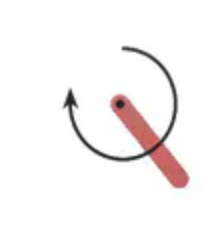
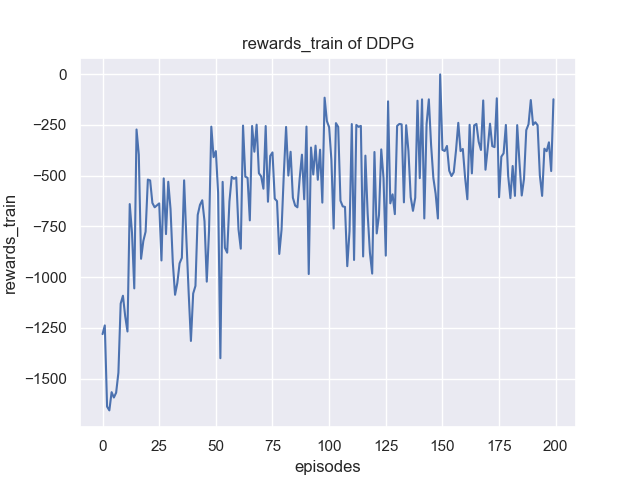
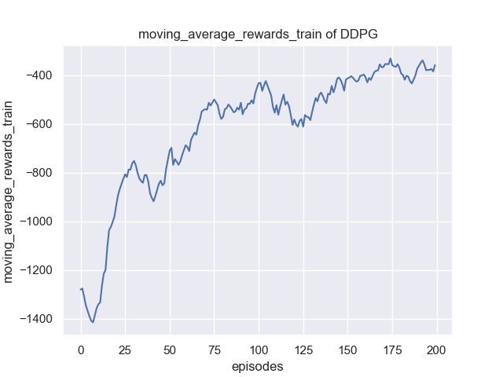
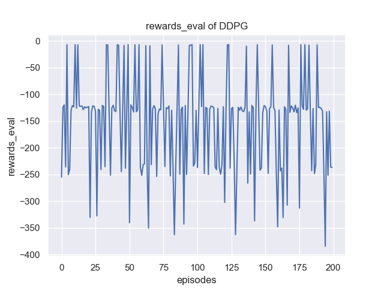
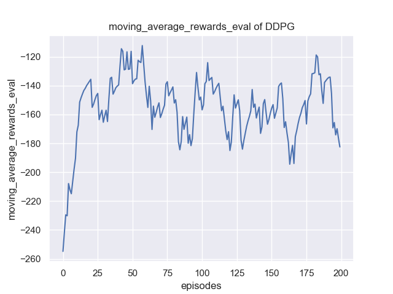
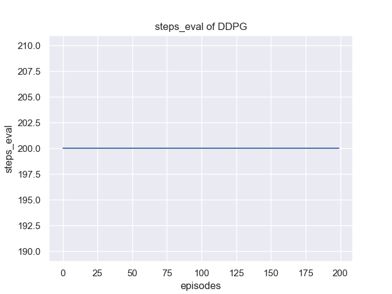
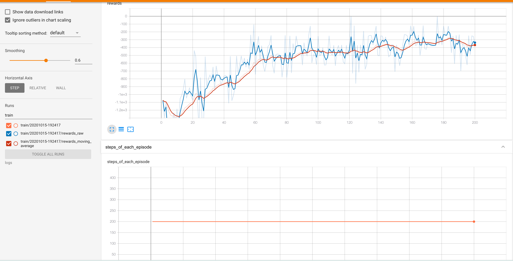

# Dùng phương pháp Policy-Based giải Pendulum-v0

Dùng các phương pháp dựa trên chính sách (policy-based) như DDPG để giải môi trường Pendulum-v0

## Pendulum-v0



Con lắc bắt đầu ở vị trí ngẫu nhiên, mục tiêu là lắc nó lên, giữ nó đứng thẳng hướng lên trên. Không gian hành động là liên tục, khoảng giá trị là [-2,2]. Reward (phần thưởng) của mỗi step (bước) thấp nhất là -16.27, cao nhất là 0.

Môi trường được tạo như sau:

```python
env = gym.make('Pendulum-v1') # cần import gymnasium as gym; Gymnasium chỉ còn Pendulum-v1
env.reset(seed=1) # Đặt hạt giống ngẫu nhiên (random seed) cho env (Gymnasium bỏ env.seed())
n_states = env.observation_space.shape[0] # Lấy tổng số chiều trạng thái
```

## Giao diện cơ bản của học tăng cường

```python
rewards = [] # Ghi lại tổng rewards
moving_average_rewards = [] # Ghi lại tổng rewards sau khi xử lý trung bình trượt
ep_steps = []
for i_episode in range(1, cfg.max_episodes+1): # cfg.max_episodes là số episode huấn luyện tối đa
    state, info = env.reset() # Đặt lại (reset) trạng thái môi trường
    ep_reward = 0
    for i_step in range(1, cfg.max_steps+1): # cfg.max_steps là số bước tối đa của mỗi episode
        action = agent.select_action(state) # Chọn action dựa trên state hiện tại của môi trường
        next_state, reward, terminated, truncated, _ = env.step(action) # Cập nhật tham số môi trường
        done = terminated or truncated # Gymnasium tách done thành terminated và truncated
        ep_reward += reward
        agent.memory.push(state, action, reward, next_state, terminated) # Lưu các transition như state vào memory
        state = next_state # Chuyển sang trạng thái tiếp theo
        agent.update() # Cập nhật mạng sau mỗi bước
        if done:
            break
    # Cập nhật target network, sao chép toàn bộ weights và biases của DQN
    if i_episode % cfg.target_update == 0: #  cfg.target_update là tần suất cập nhật target_net
        agent.target_net.load_state_dict(agent.policy_net.state_dict())
    print('Episode:', i_episode, ' Reward: %i' %
          int(ep_reward), 'n_steps:', i_step, 'done: ', done,' Explore: %.2f' % agent.epsilon)
    ep_steps.append(i_step)
    rewards.append(ep_reward)
    # Tính reward theo cửa sổ trượt
    if i_episode == 1:
        moving_average_rewards.append(ep_reward)
    else:
        moving_average_rewards.append(
            0.9*moving_average_rewards[-1]+0.1*ep_reward)
```

## Yêu cầu nhiệm vụ

Huấn luyện và vẽ đồ thị đường cong reward cũng như reward sau khi lấy trung bình trượt theo episode, đồng thời ghi lại các siêu tham số (hyperparameter) và viết thành báo cáo, ví dụ như sau:






Đồng thời cũng có thể vẽ đường cong khi kiểm thử (eval) mô hình:







Cũng có thể dùng [tensorboard](https://pytorch.org/docs/stable/tensorboard.html) để xem kết quả, như sau:



### Chú ý

1. Phạm vi action của môi trường lần này nằm trong [-2,2], còn hàm kích hoạt tanh ở đầu ra của mạng nơ-ron cho giá trị trong [-1,1], có thể dùng cách NormalizedActions(gym.ActionWrapper) để giải quyết
2. Vì môi trường lần này là hệ có quán tính, khuyến nghị thêm nhiễu Ornstein-Uhlenbeck để tăng mức khám phá, có thể tham khảo [bài viết trên Zhihu](https://zhuanlan.zhihu.com/p/96720878)
3. Khuyến nghị làm thí nghiệm nhiều lần và lưu lại rewards, rồi dùng seaborn để vẽ, có thể tham khảo [CSDN](https://blog.csdn.net/JohnJim0/article/details/106715402)

> Ghi chú của người dịch: code trên đã được chuyển từ `gym` sang Gymnasium; Gymnasium không còn `Pendulum-v0` nên dùng `Pendulum-v1` (cùng bài toán, phiên bản mới hơn). Bản gốc ghi miền giá trị của tanh là [0,1] và tên thư viện là "searborn"; bản dịch đã sửa thành [-1,1] (miền giá trị đúng của tanh) và "seaborn". Chú thích của `cfg.max_steps` trong code gốc ghi "补偿" (bù trừ), có lẽ là lỗi gõ của "số bước"; bản dịch ghi theo nghĩa đúng của biến.
