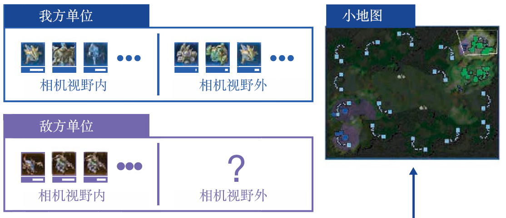
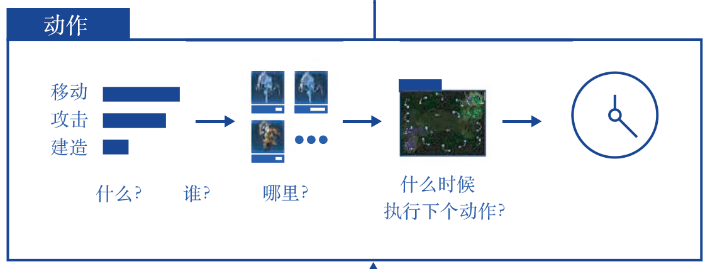
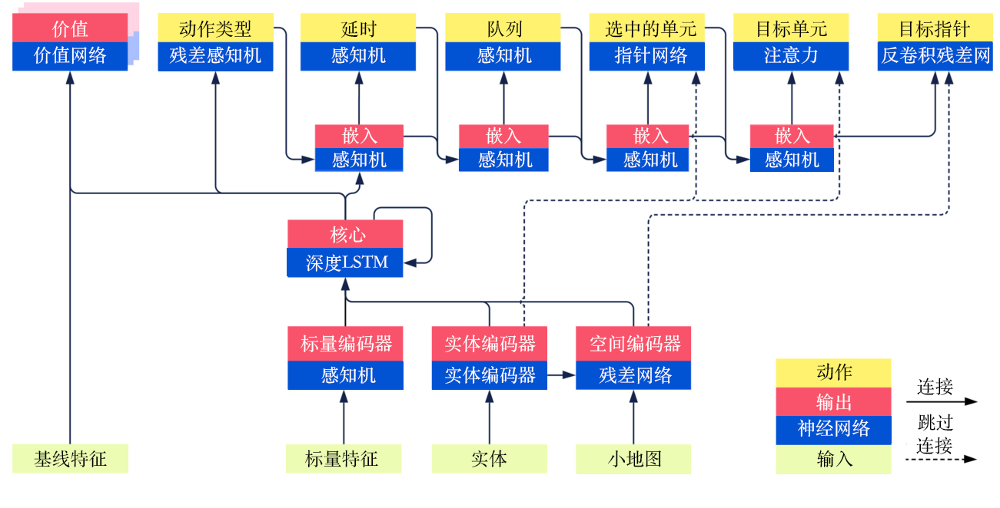
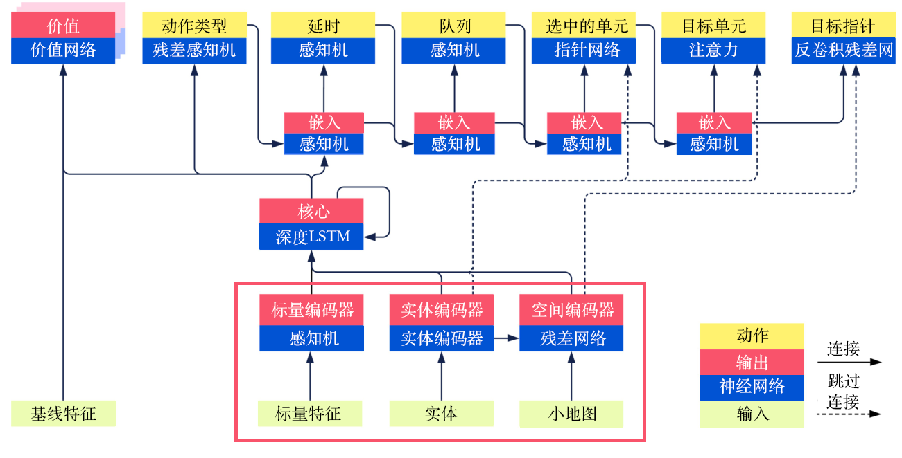
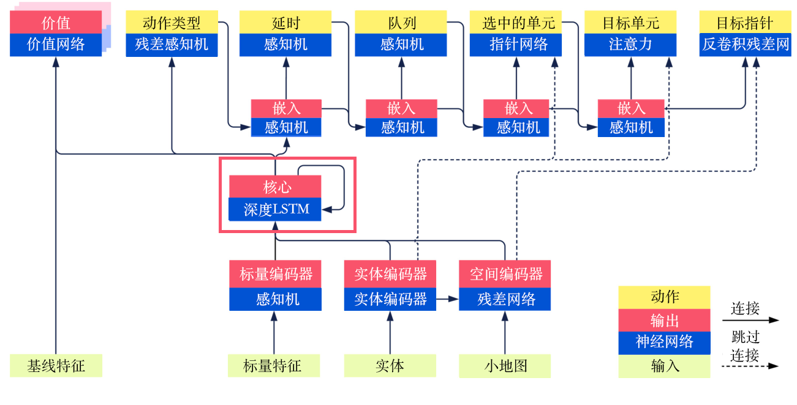
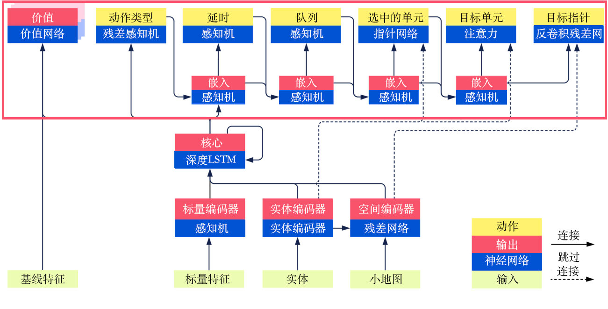
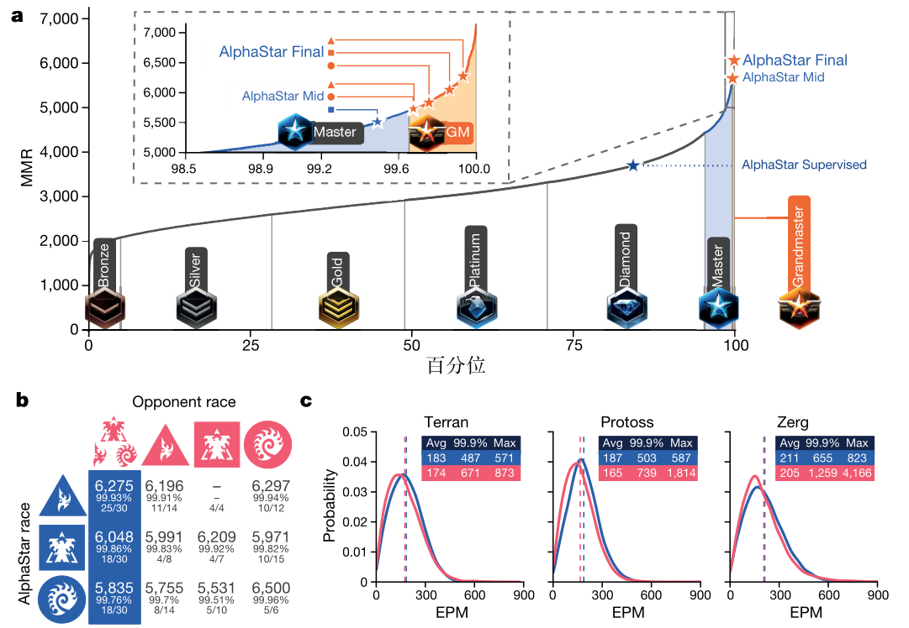
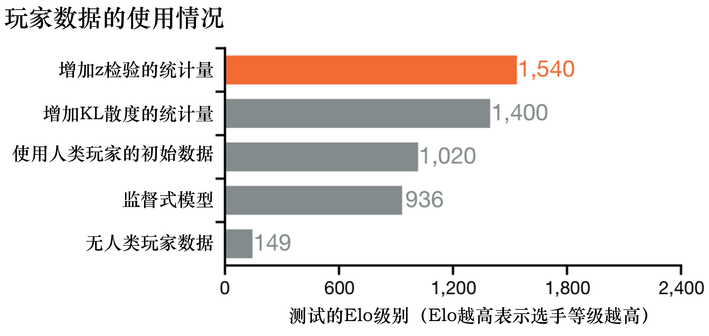

# Chương 13 Phân tích bài báo AlphaStar

## 13.1 Giới thiệu AlphaStar và bối cảnh

So với Deep Blue và AlphaGo trước đây, với các trò chơi chiến thuật đối kháng như *StarCraft II*, việc dùng AI đối đầu với con người khó hơn nhiều. Ví dụ trong *StarCraft II*, muốn đánh bại đối phương ở chế độ người chơi đấu người chơi, phải học đủ loại chiến thuật, đủ loại kỹ năng vi điều khiển (micro) và nắm bắt thời cơ. Trong trò chơi, người chơi còn cần đưa ra phán đoán và hành động đúng theo thời gian thực đối với sự thay đổi đội hình của đối phương, thậm chí phải đánh lừa đối phương để đạt mục đích chiến thuật. Tóm lại, muốn AI làm quen với trò chơi này là rất khó. Nhưng DeepMind đã làm được.

AlphaStar là sản phẩm do DeepMind và Blizzard dùng kỹ thuật học tăng cường sâu để máy tính đối đầu với người chơi *StarCraft II*, nó được biết đến rộng rãi vì những năm gần đây đã đánh bại tuyển thủ chuyên nghiệp và 99,8% người chơi trên máy chủ châu Âu trong các trận đấu *StarCraft II*. Vào 2 giờ sáng ngày 25 tháng 1 năm 2019 (giờ Bắc Kinh), AlphaStar do Blizzard và DeepMind hợp tác nghiên cứu phát triển chính thức ra mắt qua livestream. Theo lịch livestream, AlphaStar đã thi đấu trình diễn 5 trận với hai tuyển thủ chuyên nghiệp *StarCraft II*. Cộng thêm các trận không được trình diễn trên livestream, trong tổng cộng 11 trận đấu giữa con người và AlphaStar, con người chỉ thắng được 1 trận. DeepMind cũng đã công bố công trình nghiên cứu trên tạp chí *Nature* tháng 10 năm 2019. Chương này sẽ phân tích sâu bài báo này, bạn đọc quan tâm có thể đọc bản gốc.

## 13.2 Đầu vào và đầu ra của mô hình AlphaStar là gì? — Thiết kế môi trường

Bước đầu tiên để xây dựng mô hình học tăng cường sâu là xây dựng đầu vào và đầu ra của mô hình, với một môi trường phức tạp như *StarCraft II*, bước đầu tiên của bài báo là trừu tượng hóa môi trường trò chơi thành rất nhiều thông tin dữ liệu độc lập.

### 13.2.1 Trạng thái (đầu vào của mạng)

AlphaStar chia trạng thái môi trường của *StarCraft II* thành 4 phần, lần lượt là thông tin thực thể (entities), thông tin bản đồ (map), thông tin dữ liệu người chơi (player data), thông tin thống kê trò chơi (game statistics), như hình 13.1.

Hình 13.1 Thành phần của trạng thái môi trường

Phần thứ nhất — thông tin thực thể, ví dụ ở thời điểm hiện tại trong môi trường có những công trình, binh chủng nào, và ta dùng vectơ để biểu diễn thông tin thuộc tính của mỗi thực thể. Ví dụ với một công trình, vectơ của nó ở thời điểm hiện tại chứa các thông tin như lượng máu, cấp độ, vị trí và thời gian hồi chiêu (cooldown) của công trình này. Vì vậy với toàn bộ thông tin thực thể của khung hình hiện tại, môi trường sẽ đưa cho mạng nơ-ron $N$ vectơ độ dài $K$, lần lượt biểu thị thông tin cụ thể của $N$ thực thể mà tác tử có thể nhìn thấy lúc này (thông tin vectơ).

Phần thứ hai — thông tin bản đồ, phần này khá dễ hiểu, tức là đưa thông tin trong bản đồ vào mạng nơ-ron dưới dạng ma trận, để biểu diễn thông tin bản đồ toàn cục của trạng thái hiện tại (thông tin vectơ hoặc thông tin hình ảnh).

Phần thứ ba — thông tin dữ liệu người chơi, tức là thông tin như cấp độ và chủng tộc của người chơi ở trạng thái hiện tại (thông tin vô hướng).

Phần thứ tư — thông tin thống kê trò chơi, vị trí tầm nhìn (vị trí của cửa sổ nhỏ, khác với thông tin bản đồ toàn cục ở phần thứ hai), còn có thông tin như thời gian bắt đầu của trò chơi hiện tại (thông tin vô hướng).

### 13.2.2 Hành động (đầu ra của mạng)

Thông tin hành động của AlphaStar chủ yếu chia thành 6 phần, như hình 13.2, lần lượt là loại hành động (action type), đơn vị được chọn (selected units), mục tiêu (target), hàng đợi thực hiện hành động (queued), có lặp lại hay không (repeat) và độ trễ (delay), các phần có liên quan với nhau.

Hình 13.2 Thành phần của thông tin hành động

Phần thứ nhất — loại hành động, tức là loại hành động sẽ thực hiện tiếp theo là di chuyển lính, nâng cấp công trình hay di chuyển vị trí cửa sổ nhỏ,...

Phần thứ hai — đơn vị được chọn, tiếp nối phần thứ nhất, ví dụ loại hành động ta cần thực hiện là di chuyển lính, thì ta nên chọn cụ thể di chuyển con lính nào.

Phần thứ ba — mục tiêu, tiếp nối phần thứ hai, sau khi ta di chuyển lính A, là đi đến một vị trí nào đó trên bản đồ hay đi tấn công mục tiêu nào của đối thủ,..., tức là chọn điểm đến hoặc đối tượng tấn công.

Phần thứ tư — hàng đợi thực hiện hành động, tức là có thực hiện hành động ngay hay không, với lính A, là đến điểm đến rồi tấn công ngay hay đứng chờ tại chỗ.

Phần thứ năm — có lặp lại hay không, nếu cần lính A tấn công liên tục, thì không cần tính hành động tiếp theo qua mạng nữa, lặp lại trực tiếp hành động trước là được.

Phần thứ sáu — độ trễ, tức là chờ bao lâu rồi mới nhận đầu vào của mạng, có thể hiểu là độ trễ của một thao tác.

## 13.3 Mô hình tính toán của AlphaStar là gì? — Cấu trúc mạng

Ở mục 13.2 ta đã giải thích đầu vào và đầu ra của mạng AlphaStar, tức trạng thái và hành động, vậy từ trạng thái làm sao có được hành động? Ở đây trước tiên ta đưa ra tổng quan cấu trúc mạng của nó, như hình 13.3, phần sau sẽ thảo luận chi tiết.

Hình 13.3 Tổng quan cấu trúc mạng AlphaStar

### 13.3.1 Phần đầu vào

Hình 13.4 Phần đầu vào của cấu trúc mạng AlphaStar

Từ khung đỏ trong hình 13.4 có thể thấy, phần đầu vào của mô hình chủ yếu có 3 phần: đặc trưng vô hướng (scalar features), ví dụ các thông tin như cấp độ người chơi và vị trí cửa sổ nhỏ mô tả ở trên; thực thể (entities), là vectơ, tức toàn bộ thông tin thuộc tính hiện tại của một công trình hoặc một con lính đã mô tả ở trên; bản đồ nhỏ (minimap), tức dữ liệu hình ảnh.

- Với đặc trưng vô hướng, dùng perceptron nhiều tầng (multilayer perceptron, MLP) là có được vectơ tương ứng, có thể xem là một quá trình nhúng (embedding).
- Với thực thể, dùng kiến trúc Transformer thường dùng trong xử lý ngôn ngữ tự nhiên làm bộ mã hóa (encoder).
- Với bản đồ nhỏ, dùng kiến trúc ResNet thường dùng trong xử lý ảnh làm bộ mã hóa, có được một vectơ có độ dài cố định.

### 13.3.2 Quá trình trung gian

Quá trình trung gian khá đơn giản, tức là thông qua một mô-đun mạng bộ nhớ ngắn-dài hạn sâu (deep LSTM) để hợp nhất 3 loại embedding ở trạng thái hiện tại và đưa ra đầu ra cho thời điểm tiếp theo, như hình 13.5, và đưa đầu ra này lần lượt vào mạng giá trị (value network), perceptron nhiều tầng dư (residual MLP) và perceptron nhiều tầng phía sau của loại hành động.

Hình 13.5 Mô-đun mạng bộ nhớ ngắn-dài hạn sâu trong cấu trúc mạng AlphaStar

### 13.3.3 Phần đầu ra

Như đã giới thiệu ở trên, các hành động đầu ra có liên quan trước sau với nhau, như hình 13.6, ta giới thiệu lần lượt theo thứ tự.

Hình 13.6 Phần đầu ra của cấu trúc mạng AlphaStar

Đầu tiên là loại hành động: dùng vectơ embedding của mạng bộ nhớ ngắn-dài hạn sâu làm đầu vào, dùng perceptron nhiều tầng dư để có kết quả đầu ra của hàm kích hoạt Softmax cho loại hành động, và truyền nó cho mô hình con tiếp theo để nhúng.

Tiếp theo là độ trễ: đưa kết quả nhúng của loại hành động cùng với kết quả của mạng bộ nhớ ngắn-dài hạn sâu vào perceptron nhiều tầng để có kết quả, và truyền cho mô hình con tiếp theo để nhúng.

Tiếp theo là hàng đợi thực hiện hành động: đưa kết quả của độ trễ cùng với kết quả nhúng vào perceptron nhiều tầng để có kết quả, và truyền cho mô hình con tiếp theo để nhúng.

Sau đó là đơn vị được chọn: đưa kết quả của hàng đợi, kết quả nhúng và toàn bộ kết quả sau khi mã hóa thực thể (kết quả không lấy trung bình) cùng vào mạng con trỏ (pointer network) để có kết quả, và truyền cho mô hình con tiếp theo để nhúng. Mạng con trỏ ở đây có đầu vào là một chuỗi, đầu ra là một chuỗi khác, và các phần tử của chuỗi đầu ra đến từ chuỗi đầu vào. Nó chủ yếu dùng trong xử lý ngôn ngữ tự nhiên, ở đây rất phù hợp với việc tính đơn vị được chọn.

Tiếp theo là chọn một trong hai: đơn vị mục tiêu (target unit) và điểm mục tiêu (target point), với đơn vị mục tiêu, dùng cơ chế chú ý (attention) để có được đối tượng tối ưu mà hành động tác động lên; với vùng mục tiêu, dùng mạng dư giải chập (deconvolution residual network), giải chập vectơ embedding thành kích thước bản đồ, từ đó thực hiện hành động tương ứng di chuyển mục tiêu đến một điểm nào đó.

## 13.4 AlphaStar khổng lồ được huấn luyện như thế nào? — Thuật toán học

Với mô hình phức tạp ở trên, rốt cuộc AlphaStar được huấn luyện như thế nào? Tóm lại tổng cộng chia thành 4 phần, tức học có giám sát (chủ yếu giải quyết vấn đề khởi tạo huấn luyện), học tăng cường, học bắt chước (phối hợp với học tăng cường) và học đa tác tử hay tự học (hướng đến bài toán cụ thể của đối kháng), dưới đây ta phân tích lần lượt.

### 13.4.1 Học có giám sát

Khi mới bắt đầu huấn luyện, AlphaStar trước tiên dùng học có giám sát, tức là dùng dữ liệu của con người để khởi tạo khá tốt. Đầu vào của mô hình là dữ liệu các ván đấu của con người thu thập được, đầu ra là mạng nơ-ron đã huấn luyện. Cách làm cụ thể là, với dữ liệu ván đấu của con người thu thập được, tức là với mỗi thời điểm giải mã trạng thái trò chơi, đưa trạng thái ở mỗi thời điểm vào mạng để có phân phối xác suất của mỗi hành động, cuối cùng tính độ phân kỳ KL giữa đầu ra của mô hình và dữ liệu ván đấu của con người, và dùng độ phân kỳ KL để tối ưu mạng, trong đó trong độ phân kỳ KL cần dùng các hàm mất mát khác nhau. Ví dụ, hàm mất mát của loại hành động, tức hàm mất mát của bài toán phân loại thì cần dùng entropy chéo. Còn với các bài toán hồi quy như định vị mục tiêu thì cần tính sai số bình phương trung bình (mean square error, MSE). Tất nhiên còn một số chi tiết, mọi người có thể tự đọc bài báo. Tóm lại, qua học có giám sát, phân phối xác suất đầu ra của mô hình có thể tương tự phân phối xác suất đầu ra của người chơi.

### 13.4.2 Học tăng cường

Mục tiêu ở đây là tối ưu chính sách để phần thưởng kỳ vọng lớn nhất, tức là

$$
    J(\pi_{\theta}) = E_{\pi_{\theta}} \sum_{t=0}r(s_t,a_t)
$$

Nhưng mô hình huấn luyện của AlphaStar là mô hình off-policy (khác chính sách), vì kiến trúc nó dùng là kiến trúc tương tự IMPALA, tức là diễn viên (actor) phụ trách tương tác với môi trường và lấy mẫu, bộ học (learner) phụ trách tối ưu mạng và cập nhật tham số, mà diễn viên và bộ học thường tính toán bất đồng bộ, hơn nữa vì không gian loại hành động đầu ra đã giới thiệu ở trên rất phức tạp, nên dẫn đến việc khớp hàm giá trị khá khó.

> Ghi chú của người dịch: bản gốc viết "dùng mô hình phi lấy mẫu (非采样), tức mô hình miễn chính sách (免策略)"; theo ngữ cảnh (kiến trúc IMPALA, actor và learner bất đồng bộ, dùng V-trace), ý đúng là mô hình **off-policy**.

AlphaStar xây dựng mô hình học tăng cường theo cách sau.

(1) Trước hết là dùng cấu trúc diễn viên-nhà phê bình (actor-critic) kinh điển, dùng mạng chính sách đưa ra hành động của tác tử ở trạng thái hiện tại, tức tính $\pi(a_t|s_t)$, dùng mạng giá trị tính phần thưởng kỳ vọng của tác tử ở trạng thái hiện tại, tức tính $V(s_t) = E \sum_{t'=t}r_{t'} = E_{a_t}[r(s_t,a_t)+V(s_{t+1})]$. Cách tính cụ thể là: với trạng thái hiện tại $s$, tính phần thưởng bổ sung mà hành động hiện tại $a$ có thể nhận được so với "hành động trung bình".

$$
    A(s_t,a_t)=[r(s_t,a_t)+V(s_{t+1})]-V(s_t)
$$

Tức là phần thưởng kỳ vọng của hành động hiện tại trừ đi phần thưởng kỳ vọng của trạng thái hiện tại. Trong AlphaStar, cập nhật chính sách hướng lên (upgoing policy update, UPGO) cũng được áp dụng, cập nhật chính sách hướng lên dùng một biến lặp $G_t$ để thay cho phần thưởng kỳ vọng của hành động ban đầu $r(s_t,a_t)+V(s_{t+1})$, tức là đưa thông tin lạc quan trong tương lai vào phần thưởng bổ sung, biểu thức trên có thể viết lại thành:

$$
    A(s_t,a_t)=G_t-V(s_t)
$$

Trong đó,

$$
    G_t=
    \begin{cases}
        r_t+G_{t+1} &, \text{nếu } Q(s_{t+1},a_{t+1})\geqslant V(s_{t+1}) \\
        r_t+V(s_{t+1}) &, \text{trường hợp khác} \\
    \end{cases}
$$

(2) Dựa trên hành động tính được ở trên, cập nhật gradient chính sách, tức $\nabla_{\theta}J = A(s_t,a_t)\nabla_{\theta}\mathrm{log} \pi_{\theta}(a_t|s_t)$. Ta đã giới thiệu ở trên, nếu phân phối dựa trên $\pi_{\theta}$ khó giải, hay nói cách khác chính sách học $\pi_{\theta}$ khác với chính sách thu thập $\pi_{\mu}$, ta cần dùng lấy mẫu theo trọng số quan trọng (importance sampling), tức $\nabla_{\theta}J = E_{\pi_{\mu}}\frac{\pi_{\theta} (a_t|s_t)}{\pi_{\mu} (a_t|s_t)} A_{\pi_{\theta}}(s_t,a_t)\nabla_{\theta}\mathrm{log} \pi_{\theta}(a_t|s_t)$. Tất nhiên ta còn cần tránh trường hợp $\frac{\pi_{\theta} (a_t|s_t)}{\pi_{\mu} (a_t|s_t)}$ trở thành vô cùng, ta cần dùng V-trace để giới hạn hệ số quan trọng. Đây cũng là một phương pháp cập nhật dùng cho off-policy, được thể hiện ở mục 4.1 của bài báo IMPALA. Tức là giới hạn giá trị lớn nhất của hệ số quan trọng là 1, công thức như sau:

$$
    \nabla_{\theta}J = E_{\pi_{\mu}}\rho_t A_{\pi_{\theta}}(s_t,a_t)\nabla_{\theta}\mathrm{log} \pi_{\theta}(a_t|s_t)
$$

Trong đó,

$$
    \rho_t = \mathrm{min}(\frac{\pi_{\theta} (a_t|s_t)}{\pi_{\mu} (a_t|s_t)},1)
$$

(3) Dùng sai phân thời gian ($\lambda$) để tối ưu mạng giá trị, đồng thời đưa vào dữ liệu của đối thủ. Với hàm giá trị của ta

$$
    V_{\pi_{\theta}}(s_t)=E_{\pi_{\theta}}\sum_{t'=t}\gamma^{t'-t}r(s_t,a_t)=E_{a_t\sim\pi_{\theta}(\cdot|s_t)}[r(s_t,a_t)+\gamma V(s_{t+1})]
$$

có thể dùng phương pháp sai phân thời gian để tính hàm mất mát sai số bình phương trung bình, có các loại sau.

- $\mathrm{TD}(0)$, biểu thức là $L = [(r_t+\gamma V_{t+1})-V_t]^2$, tức thông tin của bước (step) hiện tại, có độ chệch, phương sai nhỏ.
- $\mathrm{TD}(1)$, tức phương pháp Monte Carlo, biểu thức là $L = [(\sum_{t'=t}^\infty\gamma^{t'-t}r_{t'})-V_t]^2$, tức thông tin của vô số bước trong tương lai, không chệch, phương sai lớn.
- $\mathrm{TD}(\lambda)$, tức trung bình có trọng số của hai phương pháp trên. Cân bằng kết quả của bước hiện tại, bước tiếp theo cho đến vô số bước sau.
    - Đã biết với $\lambda \in (0,1)$, $(1-\lambda)+(1-\lambda)\lambda+(1-\lambda)\lambda ^2+...=1$.
    - $G_t^{\lambda} = \lim_{T\rightarrow\infty} (1-\lambda)(r_t+V_{t+1})+(1-\lambda)\lambda(r_t+\gamma r_{t+1}+\gamma^2 V_{t+2})+...$.

> Ghi chú của người dịch: ở dòng cuối, bản gốc viết vế trái là $r_t$; theo định nghĩa của TD($\lambda$), đây là lợi tức $\lambda$ (λ-return) $G_t^{\lambda}$, nên bản dịch đã sửa. Ngoài ra, trong điều kiện của $G_t$ (UPGO) ở trên, bản gốc viết nhầm $Q(s_{s+1},a_{t+1})$, đã sửa thành $Q(s_{t+1},a_{t+1})$.

### 13.4.3 Học bắt chước
Học bắt chước đưa vào thêm hàm mất mát học có giám sát và đại lượng thống kê của con người $Z$, tức là thưởng cho các thông tin như thứ tự xây dựng (build order), đơn vị xây dựng (build unit), nâng cấp (upgrade), kỹ năng (effect), và đưa đại lượng thống kê $Z$ vào mạng chính sách và mạng giá trị. Ngoài ra, việc AlphaStar tận dụng dữ liệu của con người còn thể hiện ở công việc tiền huấn luyện (pre-training) mạng bằng học có giám sát đã giới thiệu ở trên.

### 13.4.4 Học đa tác tử / tự học

Tự học (self-play) đã được áp dụng trong AlphaGo. Tự học nói dễ hiểu là tự chơi với chính mình, tự đối đầu với chính mình. AlphaStar có một số cập nhật cho việc này, tức chiến lược tự học hư cấu có ưu tiên (prioritized fictitious self-play). Tự học hư cấu là trong quá trình huấn luyện, cứ một khoảng thời gian thì lưu lại (snapshot), và chọn ngẫu nhiên đồng đều đối thủ từ các bản lưu để đấu với tác tử đang huấn luyện. Còn tự học hư cấu có ưu tiên là ưu tiên chọn các đối thủ thường đánh bại được tác tử để huấn luyện đối đầu, tiêu chí đánh giá là xác suất. Trong AlphaStar, các tác tử được huấn luyện chia thành 3 loại: tác tử chính (main agent), kẻ khai thác liên minh (league exploiter) và kẻ khai thác chính (main exploiter).

- Tác tử chính: tác tử đang huấn luyện và các tổ tiên của nó. Nó có xác suất 0,5 chọn đối thủ trong tất cả các đối thủ của liên minh (league), dùng chiến lược tự học hư cấu có ưu tiên, tức là đối thủ đánh bại được tác tử thì xác suất được chọn cao, không đánh bại được tác tử thì xác suất thấp. Có xác suất 0,35 tự đấu với chính mình, có xác suất 0,15 đấu với kẻ khai thác liên minh có thể đánh bại tác tử hoặc các tác tử trước đó.

- Kẻ khai thác liên minh: có thể đánh bại tất cả các tác tử trong liên minh. Nó huấn luyện với các đối thủ trong toàn liên minh theo xác suất tính bằng chiến lược tự học hư cấu có ưu tiên, khi đánh bại tất cả các tác tử với tỉ lệ thắng 0,7 hoặc sau $2 \times 10^9$ bước kể từ lần lưu trước thì lưu chính sách, và khi lưu, có xác suất 0,25 đặt lại chính sách của kẻ khai thác liên minh trên sân thành chính sách được khởi tạo bằng học có giám sát.

- Kẻ khai thác chính: có thể đánh bại tất cả các tác tử đang huấn luyện. Trong quá trình huấn luyện, chọn ngẫu nhiên 1 tác tử chính trong 3 tác tử, nếu có thể đánh bại tác tử đó với xác suất cao hơn 0,1 thì huấn luyện với nó, nếu không thì chọn lại đối thủ từ các tác tử chính trước đó. Khi đánh bại cả 3 tác tử chính đang học với tỉ lệ thắng 0,7, hoặc sau $4 \times 10^9$ bước kể từ lần lưu trước thì lưu chính sách, và thực hiện thao tác đặt lại chính sách khởi tạo.

Khác biệt giữa chúng nằm ở: cách chọn đối thủ đối đầu trong quá trình huấn luyện; trong trường hợp nào thì lưu (snapshot) chính sách hiện tại; với xác suất bao nhiêu thì đặt lại tham số chính sách thành tham số khởi tạo do học có giám sát đưa ra.

## 13.5 Kết quả thực nghiệm của AlphaStar thế nào? — Kết quả thực nghiệm

### 13.5.1 Kết quả tổng quan

Hình 13.7 Kết quả thực nghiệm của AlphaStar

Hình 13.7(a) là kết quả đối đầu giữa tác tử sau huấn luyện và con người (bảng xếp hạng ladder). Cụ thể, AlphaStar vừa kết thúc học có giám sát có thể đạt cấp "Kim cương" (Diamond), còn AlphaStar huấn luyện được một nửa (20 ngày) và huấn luyện xong (40 ngày) có thể đạt cấp "Cao thủ" (Master). Điều này cũng cho thấy AlphaStar đã có thể đánh bại tuyệt đại đa số người chơi thông thường.

Hình 13.7(b) là tỉ lệ thắng khi đối đầu giữa các chủng tộc khác nhau.

Hình 13.7(c) là phân phối số hành động hiệu quả mỗi phút (APM) do *StarCraft II* báo cáo, trong đó màu xanh lam là kết quả cuối cùng của AlphaStar, màu đỏ là kết quả của tuyển thủ con người, đường nét đứt biểu thị giá trị trung bình.

### 13.5.2 Các thực nghiệm khác (thực nghiệm cắt bỏ)

Bài báo AlphaStar cũng dùng thực nghiệm cắt bỏ (ablation study), tức phương pháp kiểm soát biến, để phân tích thêm ảnh hưởng của từng điều kiện ràng buộc đến kết quả đối đầu. Dưới đây lấy một ví dụ đặc biệt.

Hình 13.8 Tình hình sử dụng dữ liệu ván đấu của con người trong AlphaStar

Hình 13.8 là tình hình sử dụng dữ liệu ván đấu của con người. Có thể thấy trong trường hợp không có dữ liệu ván đấu của con người, giá trị chỉ là 149, nhưng chỉ cần qua học có giám sát đơn giản, giá trị tương ứng có thể đạt 936, tất nhiên học tăng cường sau khi khởi tạo bằng dữ liệu con người có thể đạt hiệu quả tốt hơn, dùng học tăng cường cộng với độ phân kỳ KL của học có giám sát có thể đạt hiệu quả gần với việc dùng đầy đủ đại lượng thống kê của con người $Z$. Từ đó ta có thể phân tích ra, dữ liệu ván đấu của con người trong AlphaStar rất quan trọng đối với hiệu năng của toàn bộ mô hình, nó không hoàn toàn giống AlphaGo, tồn tại trường hợp có thể huấn luyện mà không dùng dữ liệu con người.

## 13.6 Tổng kết về AlphaStar

Tổng kết về AlphaStar như sau.

(1) AlphaStar thiết kế một kiến trúc mạng nơ-ron có thể hợp nhất cao độ các thông tin hình ảnh, văn bản, vô hướng,..., và trong thiết kế mạng dùng kỹ thuật tự hồi quy (autoregressive), từ đó tách rời (decouple) không gian hành động có cấu trúc.

(2) Nó kết hợp nội dung của học bắt chước và học có giám sát, ví dụ cách tính đại lượng thống kê của con người $Z$.

(3) Nó có phương pháp học tăng cường sâu phức tạp và chiến lược huấn luyện siêu phức tạp.

(4) Quá trình huấn luyện đầu-cuối (end-to-end) của mô hình hoàn chỉnh cần lượng lớn tài nguyên tính toán. Về điều này, bài báo gốc viết như sau: mỗi tác tử dùng 32 bộ xử lý tenxơ (tensor processing unit, TPU) thế hệ thứ ba để huấn luyện trong 44 ngày; trong thời gian huấn luyện, đã tạo ra gần 900 người chơi trò chơi khác nhau.

## Tài liệu tham khảo

[Vinyals, Oriol, et al. "Grandmaster level in StarCraft II using multi-agent reinforcement learning." Nature (2019): 1-5.](https://www.nature.com/articles/s41586-019-1724-z?)
