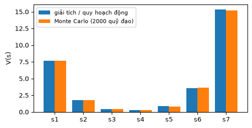
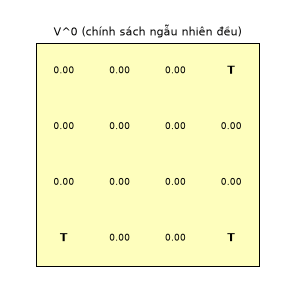
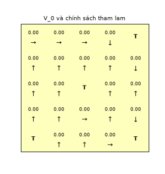

# Chương 2 · Code

> Ghi chú của người dịch: trang này do người dịch biên soạn, không có trong sách gốc. Code chuyển thể từ [MinRL](https://github.com/10-OASIS-01/minrl/tree/ed5eb99) (Yibin Liu, giấy phép MIT, commit `ed5eb99`) và từ [notebook đi kèm](https://github.com/nmc2004nd/easy-rl-vi/tree/main/notebooks) của bản gốc EasyRL. Chú thích đã dịch sang tiếng Việt. Phần không có trong MinRL được ghi *(thêm)*.
>
> Ký hiệu: trang này giữ ký hiệu của [chương 2](chapter2/chapter2_vi) ($V(s)$, $Q(s,a)$, $R$, $P$, $\gamma$). Bảng quy đổi: [Quy ước ký hiệu](notation_vi).

Mỗi khối code đã được chạy sẵn. Kết quả (khung "kết quả"), hình vẽ và ảnh động nằm ngay bên dưới. Các khối chạy lần lượt từ trên xuống và dùng chung biến, như các ô của một notebook. Muốn tự chạy, xem [mục 5](#_5-chạy-trên-máy).

## 1. Quá trình phần thưởng Markov: ba cách tính giá trị

<small class="viz-ref">Mục 2.2 · hình 2.3–2.8 · công thức (2.2)</small>

Chuỗi 7 trạng thái ở hình 2.3–2.4: mỗi trạng thái sang trái hoặc sang phải với xác suất 0.4 và ở lại với xác suất 0.2; hai trạng thái ở hai đầu thì ở lại với xác suất 0.6. Phần thưởng là $\boldsymbol R = [5, 0, 0, 0, 0, 0, 10]$ (hình 2.8). Mục này viết thêm *(thêm)*, vì MinRL không có ví dụ MRP.

<!-- run -->
```python
import numpy as np
import matplotlib.pyplot as plt

n = 7
P = np.zeros((n, n))
for i in range(n):
    if i == 0:
        P[i, 0], P[i, 1] = 0.6, 0.4
    elif i == n - 1:
        P[i, i], P[i, i - 1] = 0.6, 0.4
    else:
        P[i, i - 1], P[i, i], P[i, i + 1] = 0.4, 0.2, 0.4
R = np.array([5, 0, 0, 0, 0, 0, 10.0])
gamma = 0.5

# Lấy mẫu vài quỹ đạo bắt đầu từ s_3 (chỉ số 2), như ví dụ trong mục 2.1.3
rng = np.random.default_rng(0)
for _ in range(3):
    s, traj = 2, [2]
    for _ in range(4):
        s = rng.choice(n, p=P[s])
        traj.append(s)
    print(", ".join(f"s{t + 1}" for t in traj))
```

<!-- output -->
```output
s3, s4, s3, s2, s1
s3, s4, s5, s6, s7
s3, s3, s4, s5, s4
```
<!-- /output -->

**Cách 1: nghiệm giải tích.** Phương trình Bellman dạng ma trận $V = R + \gamma P V$ cho $V = (I - \gamma P)^{-1} R$. Trên máy tính nên giải hệ tuyến tính thay vì tính nghịch đảo.

**Cách 2: quy hoạch động** (hình 2.7). Lặp $V' \leftarrow R + \gamma P V$ tới khi $\lVert V - V'\rVert < \epsilon$.

**Cách 3: Monte Carlo** (hình 2.6). Từ trạng thái $s$, sinh $N$ quỹ đạo dài $H$ bước, tính lợi tức $g = \sum_{i} \gamma^{i} r_{t+i}$ của từng quỹ đạo rồi lấy trung bình.

<!-- run -->
```python
# Cách 1: giải (I - γP) V = R
V_exact = np.linalg.solve(np.eye(n) - gamma * P, R)

# Cách 2: lặp Bellman (hình 2.7)
V, k = np.zeros(n), 0
while True:
    V_new = R + gamma * P @ V
    k += 1
    if np.abs(V_new - V).max() < 1e-8:
        break
    V = V_new

# Cách 3: Monte Carlo (hình 2.6), N quỹ đạo dài H bước cho mỗi trạng thái
def mc_value(s0, N=2000, H=30):
    total = 0.0
    for _ in range(N):
        s, g = s0, 0.0
        for i in range(H):
            g += gamma ** i * R[s]       # phần thưởng nhận ở trạng thái thứ i
            s = rng.choice(n, p=P[s])
        total += g
    return total / N

V_mc = np.array([mc_value(s) for s in range(n)])
print("Giải tích :", V_exact.round(3))
print(f"Lặp ({k} vòng):", V_new.round(3))
print("Monte Carlo:", V_mc.round(3))

x = np.arange(n)
plt.figure(figsize=(5.5, 2.8))
plt.bar(x - 0.2, V_exact, 0.4, label="giải tích / quy hoạch động")
plt.bar(x + 0.2, V_mc, 0.4, label="Monte Carlo (2000 quỹ đạo)")
plt.xticks(x, [f"s{i + 1}" for i in x]); plt.ylabel("V(s)"); plt.legend(fontsize=8)
```

<!-- output -->
```output
Giải tích : [ 7.659  1.806  0.467  0.296  0.865  3.595 15.313]
Lặp (29 vòng): [ 7.659  1.806  0.467  0.296  0.865  3.595 15.313]
Monte Carlo: [ 7.629  1.742  0.461  0.315  0.801  3.632 15.185]
```

<div align=center></div>
<!-- /output -->

Ba cách cho cùng một đáp án. Monte Carlo lệch một chút vì chỉ dùng hữu hạn quỹ đạo; sai số giảm theo $1/\sqrt N$. Phép lặp cần chưa tới 30 vòng vì $\gamma = 0.5$ nhỏ: sai số giảm ít nhất một nửa sau mỗi vòng.

## 2. Đánh giá chính sách trong MDP

<small class="viz-ref">Mục 2.3.6, 2.3.9 · công thức (2.10), (2.18)</small>

Từ đây ta dùng `GridWorld` của MinRL: lưới 4×4, tác tử xuất phát ở góc trên trái, mỗi bước nhận $-0.1$. Góc dưới phải là đích ($+1$), hai góc còn lại là bẫy ($-1$); bước vào ô kết thúc thì tập kết thúc. `transition(s, a)` chính là mô hình $p(s', r \mid s, a)$ mà quy hoạch động cần biết.

Đánh giá chính sách lặp công thức (2.18) cho tới khi hội tụ:

$$
V^{t+1}(s)=\sum_{a} \pi(a \mid s)\Big(R(s, a)+\gamma \sum_{s'} p(s' \mid s, a)\, V^{t}(s')\Big)
$$

Mã nguồn của `PolicyEvaluator` trong MinRL (bấm để mở):

[policy_evaluation.py](../code/py/minrl_vi/policy_evaluation.py ':include :type=code :fragment=PolicyEvaluator')

<!-- run -->
```python
from minrl_vi import GridWorld, PolicyEvaluator, PolicyOptimizer, random_policy

env = GridWorld(size=4)
print(env.render())
policy = random_policy(env)               # π(a|s) đều trên các hành động hợp lệ
V_pi = PolicyEvaluator(env, gamma=0.9).evaluate_policy(policy)
print(V_pi.reshape(4, 4).round(3))
```

<!-- output -->
```output
A . . T
. . . .
. . . .
T . . T
[[-0.892 -0.88  -0.883  0.   ]
 [-0.88  -0.825 -0.73  -0.638]
 [-0.883 -0.73  -0.456 -0.061]
 [ 0.    -0.638 -0.061  0.   ]]
```
<!-- /output -->

Ảnh động dưới chạy lại phép lặp (2.18) từng vòng một, bắt đầu từ $V^0 = 0$. Thông tin về phần thưởng ở các ô kết thúc lan dần ra các ô xa hơn.

<!-- run -->
```python
from viz import save_gif, plot_values

def evaluation_sweeps(env, policy, gamma, n_sweeps):
    """Giống PolicyEvaluator, nhưng trả về V sau mỗi vòng quét (để vẽ)."""
    V, history = np.zeros(env.n_states), [np.zeros(env.n_states)]
    for _ in range(n_sweeps):
        V_new = np.zeros(env.n_states)
        for s in range(env.n_states):
            if s in env.terminal_states:
                continue
            for a, p in enumerate(policy[s]):
                s2, r, done = env.transition(s, a)
                V_new[s] += p * (r + gamma * (not done) * V[s2])
        V = V_new
        history.append(V.copy())
    return history

hist = evaluation_sweeps(env, policy, 0.9, 25)
terminal = set(env.terminal_states)

def draw(fig, t):
    plot_values(fig.add_subplot(1, 1, 1), hist[t], (4, 4), title=f"V^{t} (chính sách ngẫu nhiên đều)",
                terminal=terminal)

save_gif(draw, len(hist), "policy_evaluation.gif", fps=4, figsize=(3.2, 3.4), dpi=90)
```

<!-- output -->
<div align=center></div>
<!-- /output -->

## 3. Lặp chính sách và lặp giá trị

<small class="viz-ref">Mục 2.3.11–2.3.13 · công thức (2.20)–(2.24)</small>

`PolicyOptimizer` của MinRL cài cả hai thuật toán trên cùng `GridWorld`:

- **Lặp chính sách** xen kẽ hai bước: đánh giá trọn vẹn chính sách hiện tại bằng `PolicyEvaluator`, rồi cải thiện tham lam $\pi(s) \leftarrow \arg\max_a Q_\pi(s,a)$. Dừng khi chính sách không đổi.
- **Lặp giá trị** lặp công thức (2.22): $V(s) \leftarrow \max_{a}\big(R(s, a)+\gamma \sum_{s'} p(s' \mid s, a) V(s')\big)$, rồi lấy chính sách tham lam ở cuối.

[policy_optimization.py](../code/py/minrl_vi/policy_optimization.py ':include :type=code :fragment=PolicyOptimizer')

<!-- run -->
```python
opt_pi = PolicyOptimizer(env, gamma=0.9)
policy_pi, V_star_pi = opt_pi.policy_iteration()
opt_vi = PolicyOptimizer(env, gamma=0.9)
policy_vi, V_star_vi = opt_vi.value_iteration()

print("V* (lặp chính sách):\n", V_star_pi.reshape(4, 4).round(3))
print("Hai thuật toán cho cùng V*:", np.allclose(V_star_pi, V_star_vi))
opt_vi.print_policy(policy_vi)
```

<!-- output -->
```output
V* (lặp chính sách):
 [[0.181 0.312 0.458 0.   ]
 [0.312 0.458 0.62  0.8  ]
 [0.458 0.62  0.8   1.   ]
 [0.    0.8   1.    0.   ]]
Hai thuật toán cho cùng V*: True
→ → ↓ T
→ → → ↓
→ → → ↓
T → → T
```
<!-- /output -->

Ảnh động dưới chạy lặp giá trị từng vòng trên lưới 5×5 (đích ở góc dưới phải, hai bẫy ở hai góc còn lại, thêm một bẫy ở giữa). Mũi tên là chính sách tham lam theo $V_k$ hiện tại. Giá trị lan dần ra từ ô đích, mỗi vòng thêm một bước. Vì đường ngắn nhất từ ô xa nhất tới đích chỉ có 8 bước, ở lưới này $V_k$ đứng yên hẳn sau 8 vòng, và chính sách tham lam không đổi nữa từ vòng thứ 7.

<!-- run -->
```python
env5 = GridWorld(size=5, terminal_states={4: -1.0, 20: -1.0, 12: -1.0, 24: 1.0}, step_reward=-0.04)
opt5 = PolicyOptimizer(env5, gamma=0.9)
symbols = ["↑", "→", "↓", "←"]

V, frames = np.zeros(env5.n_states), []
for k in range(10):
    q = np.array([opt5.action_values(s, V) for s in range(env5.n_states)])   # Q_{k+1}(s,a), (2.23)
    arrows = ["" if s in env5.terminal_states else symbols[int(q[s].argmax())] for s in range(25)]
    frames.append((k, V.copy(), arrows))
    V = np.where([s in env5.terminal_states for s in range(25)], 0.0, q.max(axis=1))  # V_{k+1}, (2.24)

def draw_vi(fig, i):
    k, V_k, arrows = frames[i]
    plot_values(fig.add_subplot(1, 1, 1), V_k, (5, 5), title=f"V_{k} và chính sách tham lam",
                terminal=set(env5.terminal_states), arrows=arrows)

save_gif(draw_vi, len(frames), "value_iteration.gif", fps=2, figsize=(3.6, 3.8), dpi=90)
```

<!-- output -->
<div align=center></div>
<!-- /output -->

## 4. Code notebook của EasyRL

Notebook [`Value Iteration/value_iteration_vi.ipynb`](https://github.com/nmc2004nd/easy-rl-vi/blob/main/notebooks/Value%20Iteration/value_iteration_vi.ipynb) chạy lặp giá trị trên môi trường "người say đi trong hẻm" (`DrunkenWalkEnv`, bản đồ `theAlley`, nằm trong `notebooks/envs/simple_grid.py`). Con hẻm là một hàng 13 ô `S...H...H...G`. Trên mặt đường thường, người say đi đúng hướng với xác suất 0.8 và lệch sang hai bên với xác suất 0.1 mỗi bên. Ở ổ gà `H`, người đó vấp ngã với xác suất 0.2 (phần thưởng $-5$, tập kết thúc). Tới `G` được $+10$. Vì vậy `env.P[s][a]` là một danh sách nhiều bộ `(xác suất, s', r, kết_thúc)`. Hàm `value_iteration` dưới đây lấy nguyên từ notebook. Hàm lặp trên bảng $Q$ thay vì $V$ (công thức (2.23) và (2.24) gộp làm một).

<!-- run -->
```python
import sys
sys.path.insert(0, "../../../notebooks")      # để import được notebooks/envs
from envs.simple_grid import DrunkenWalkEnv

env_nb = DrunkenWalkEnv(map_name="theAlley")
env_nb.reset(seed=1)
np.random.seed(1)

def value_iteration(env, theta=0.005, discount_factor=0.9):
    Q = np.zeros((env.nS, env.nA))  # khởi tạo một bảng Q
    count = 0
    while True:
        delta = 0.0
        Q_tmp = np.zeros((env.nS, env.nA))
        for state in range(env.nS):
            for a in range(env.nA):
                accum = 0.0
                reward_total = 0.0
                for prob, next_state, reward, done in env.P[state][a]:
                    accum += prob * np.max(Q[next_state, :])
                    reward_total += prob * reward
                Q_tmp[state, a] = reward_total + discount_factor * accum
                delta = max(delta, abs(Q_tmp[state, a] - Q[state, a]))
        Q = Q_tmp
        count += 1
        if delta < theta or count > 100:  # chưa hội tụ thì cũng dừng sau 100 vòng
            break
    return Q

Q = value_iteration(env_nb)
policy_nb = Q.argmax(axis=1)
print("Số trạng thái:", env_nb.nS, " số hành động:", env_nb.nA)
print("Chính sách:", policy_nb.tolist())

num_episode = 1000  # kiểm thử 1000 lần, như trong notebook
def test(env, policy):
    success = []  # ghi lại tập này có đi tới đích hay không
    for i_ep in range(num_episode):
        state, info = env.reset()
        while True:
            action = policy[state]
            next_state, reward, terminated, truncated, _ = env.step(action)
            state = next_state
            if terminated or truncated:
                break
        success.append(1 if state == 12 else 0)  # ô 12 là đích
    print("Tỉ lệ thành công khi kiểm thử là:", np.array(success).sum() / num_episode)

test(env_nb, policy_nb)
```

<!-- output -->
```output
Số trạng thái: 13  số hành động: 4
Chính sách: [2, 2, 2, 2, 2, 2, 2, 2, 2, 2, 2, 2, 2]
Tỉ lệ thành công khi kiểm thử là: 0.638
```
<!-- /output -->

Chính sách tối ưu là luôn đi sang phải (hành động 2). Không thể tránh hai ổ gà, nên xác suất tới đích tối đa chỉ là $0.8^2 = 0.64$, khớp với tỉ lệ đo được.

## 5. Chạy trên máy

```bash
git clone https://github.com/nmc2004nd/easy-rl-vi.git
cd easy-rl-vi/docs/code/py          # chạy từ đây để import được minrl_vi, viz
pip install numpy matplotlib pillow gymnasium
```

Chép lần lượt các khối code trên trang vào Jupyter (hoặc một file `.py`) rồi chạy theo thứ tự. Ảnh GIF được lưu vào thư mục hiện tại. Kết quả trên trang được dựng bằng `python3 scripts/build_code_pages.py docs/chapter2/chapter2_code_vi.md`.
