# Chương 2 Quá trình quyết định Markov
Hình 2.1 mô tả sự tương tác giữa tác tử (agent) và môi trường (environment) trong học tăng cường: tác tử nhận trạng thái của môi trường, thực hiện hành động và trả hành động đó về cho môi trường. Sau khi nhận hành động của tác tử, môi trường chuyển sang trạng thái tiếp theo và gửi trạng thái tiếp theo cho tác tử. Trong học tăng cường, tác tử và môi trường tương tác với nhau như vậy, và quá trình tương tác này có thể được biểu diễn bằng quá trình quyết định Markov (Markov decision process, MDP). Vì vậy quá trình quyết định Markov là khung cơ bản của học tăng cường.

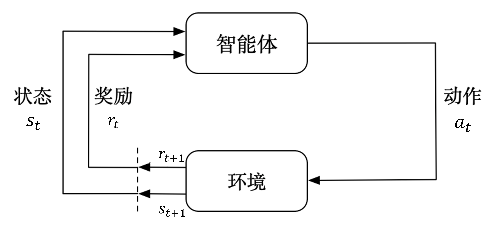

Hình 2.1 Tương tác giữa tác tử và môi trường

Chương này giới thiệu quá trình quyết định Markov. Trước khi giới thiệu nó, chúng ta giới thiệu các phiên bản đơn giản hơn: quá trình Markov (Markov process, MP) và quá trình phần thưởng Markov (Markov reward process, MRP). Thông qua so sánh với hai quá trình này, ta sẽ dễ hiểu quá trình quyết định Markov hơn. Tiếp theo, chúng ta sẽ giới thiệu **đánh giá chính sách (policy evaluation)** trong quá trình quyết định Markov, tức là khi đã cho trước chính sách thì tính hàm giá trị của nó như thế nào. Cuối cùng, chúng ta sẽ giới thiệu bài toán điều khiển (control) của quá trình quyết định Markov, cụ thể gồm hai thuật toán **lặp chính sách (policy iteration)** và **lặp giá trị (value iteration)**. Trong quá trình quyết định Markov, môi trường là quan sát được toàn bộ (fully observable). Nhưng nhiều khi trong môi trường có những đại lượng không quan sát được, tuy nhiên bài toán quan sát được một phần này cũng có thể chuyển thành bài toán quá trình quyết định Markov.

## 2.1 Quá trình Markov
### 2.1.1 Tính chất Markov
Trong quá trình ngẫu nhiên (stochastic process), **tính chất Markov (Markov property)** nghĩa là: với một quá trình ngẫu nhiên, khi đã biết trạng thái hiện tại và tất cả các trạng thái quá khứ, phân phối xác suất có điều kiện của trạng thái tương lai chỉ phụ thuộc vào trạng thái hiện tại. Lấy quá trình ngẫu nhiên rời rạc làm ví dụ, giả sử các biến ngẫu nhiên $X_0,X_1,\cdots,X_T$ tạo thành một quá trình ngẫu nhiên. Tập hợp tất cả các giá trị có thể có của các biến ngẫu nhiên này được gọi là không gian trạng thái (state space). Nếu phân phối xác suất có điều kiện của $X_{t+1}$ đối với các trạng thái quá khứ chỉ là một hàm của $X_t$, thì
$$
p\left(X_{t+1}=x_{t+1} \mid X_{0:t}=x_{0: t}\right)=p\left(X_{t+1}=x_{t+1} \mid X_{t}=x_{t}\right)
$$
Trong đó, $X_{0:t}$ là tập biến $X_{0}, X_{1}, \cdots, X_{t}$, $x_{0: t}$ là chuỗi trạng thái $x_{0}, x_{1}, \cdots, x_{t}$ trong không gian trạng thái. Tính chất Markov cũng có thể phát biểu là: khi đã biết trạng thái hiện tại, trạng thái tương lai và trạng thái quá khứ độc lập có điều kiện với nhau. Nếu một quá trình thỏa mãn **tính chất Markov** thì sự chuyển đổi trong tương lai độc lập với quá khứ, nó chỉ phụ thuộc vào hiện tại. Tính chất Markov là nền tảng của mọi quá trình Markov.

### 2.1.2 Chuỗi Markov

Quá trình Markov là một dãy biến ngẫu nhiên $s_1,\cdots,s_t$ có tính chất Markov, trong đó trạng thái ở thời điểm tiếp theo $s_{t+1}$ chỉ phụ thuộc vào trạng thái hiện tại $s_t$. Đặt lịch sử trạng thái là $h_{t}=\left\{s_{1}, s_{2}, s_{3}, \ldots, s_{t}\right\}$ ($h_t$ chứa tất cả các trạng thái trước đó), thì quá trình Markov thỏa mãn điều kiện:
$$
  p\left(s_{t+1} \mid s_{t}\right) =p\left(s_{t+1} \mid h_{t}\right) \tag{2.1}
$$
Việc chuyển từ trạng thái hiện tại $s_t$ sang $s_{t+1}$ tương đương trực tiếp với việc chuyển từ toàn bộ các trạng thái trước đó sang $s_{t+1}$.

Quá trình Markov thời gian rời rạc còn được gọi là **chuỗi Markov (Markov chain)**. Chuỗi Markov là quá trình Markov đơn giản nhất, số trạng thái của nó là hữu hạn. Ví dụ, hình 2.2 có 4 trạng thái, 4 trạng thái này chuyển qua lại giữa $s_1,s_2,s_3,s_4$. Ví dụ bắt đầu từ $s_1$, $s_1$ có xác suất 0.1 ở lại trạng thái $s_1$, xác suất 0.2 chuyển sang $s_2$, xác suất 0.7 chuyển sang $s_4$. Nếu $s_4$ là trạng thái hiện tại, nó có xác suất 0.3 chuyển sang $s_2$, xác suất 0.2 chuyển sang $s_3$, xác suất 0.5 ở lại trạng thái hiện tại.

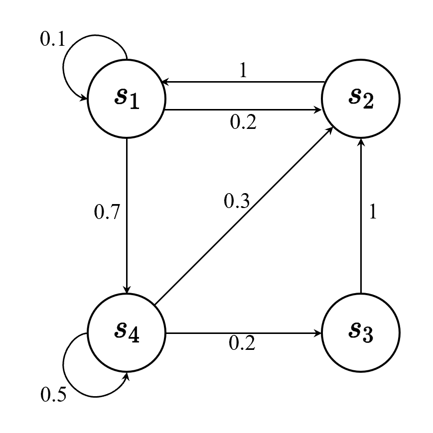

 
Hình 2.2 Ví dụ chuỗi Markov

Ta có thể dùng **ma trận chuyển trạng thái (state transition matrix)** $\boldsymbol{P}$ để mô tả việc chuyển trạng thái $p\left(s_{t+1}=s^{\prime} \mid s_{t}=s\right)$:
$$
  \boldsymbol{P}=\left(\begin{array}{cccc}
    p\left(s_{1} \mid s_{1}\right) & p\left(s_{2} \mid s_{1}\right) & \ldots & p\left(s_{N} \mid s_{1}\right) \\
    p\left(s_{1} \mid s_{2}\right) & p\left(s_{2} \mid s_{2}\right) & \ldots & p\left(s_{N} \mid s_{2}\right) \\
    \vdots & \vdots & \ddots & \vdots \\
    p\left(s_{1} \mid s_{N}\right) & p\left(s_{2} \mid s_{N}\right) & \ldots & p\left(s_{N} \mid s_{N}\right)
    \end{array}\right)
$$
Ma trận chuyển trạng thái tương tự như xác suất có điều kiện (conditional probability), nó biểu thị: khi biết hiện tại ta đang ở trạng thái $s_t$, xác suất đi đến tất cả các trạng thái tiếp theo là bao nhiêu. Vì vậy mỗi hàng của nó mô tả xác suất đi từ một nút đến tất cả các nút khác.

### 2.1.3 Ví dụ về quá trình Markov
Hình 2.3 là một ví dụ về quá trình Markov, ở đây có bảy trạng thái. Ví dụ bắt đầu từ $s_1$, nó có xác suất 0.4 đến $s_2$, xác suất 0.6 ở lại trạng thái hiện tại. $s_2$ có xác suất 0.4 đến $s_1$, xác suất 0.4 đến $s_3$, và xác suất 0.2 ở lại trạng thái hiện tại. Vì vậy khi đã có chuỗi Markov với các xác suất chuyển trạng thái, ta có thể lấy mẫu (sampling) trên chuỗi này để thu được các quỹ đạo (trajectory). Ví dụ, giả sử bắt đầu từ trạng thái $s_3$, ta có thể thu được 3 quỹ đạo:
* $s_3, s_4, s_5, s_6, s_6$;
* $s_3, s_2, s_3, s_2, s_1$;
* $s_3, s_4, s_4, s_5, s_5$.

Bằng cách lấy mẫu trạng thái, ta có thể sinh ra rất nhiều quỹ đạo như vậy.

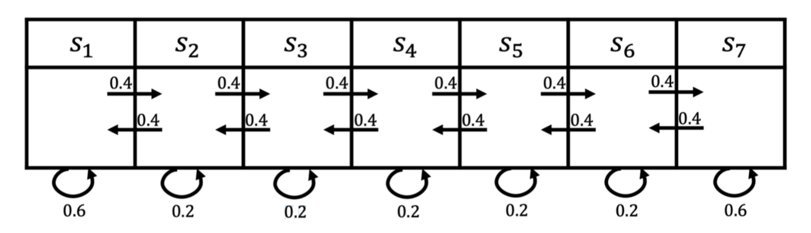

Hình 2.3 Ví dụ về quá trình Markov

## 2.2 Quá trình phần thưởng Markov

**Quá trình phần thưởng Markov (Markov reward process, MRP)** là chuỗi Markov cộng thêm hàm phần thưởng. Trong quá trình phần thưởng Markov, ma trận chuyển trạng thái và các trạng thái đều giống chuỗi Markov, chỉ có thêm **hàm phần thưởng (reward function)**. Hàm phần thưởng $R$ là một kỳ vọng, biểu thị khi ta đến một trạng thái nào đó thì có thể nhận được bao nhiêu phần thưởng. Ở đây còn định nghĩa thêm hệ số chiết khấu (discount factor) $\gamma$. Nếu số trạng thái là hữu hạn thì $R$ có thể là một vectơ.

### 2.2.1 Lợi tức và hàm giá trị

Ở đây ta định nghĩa thêm một số khái niệm. **Tầm (horizon)** là độ dài của một tập (episode) (số bước thời gian tối đa của mỗi tập), nó được xác định bởi một số hữu hạn bước.
**Lợi tức (return)** có thể định nghĩa là tổng cộng dồn từng bước của phần thưởng. Giả sử chuỗi phần thưởng sau thời điểm $t$ là $r_{t+1},r_{t+2},r_{t+3},\cdots$, thì lợi tức là
$$
  G_{t}=r_{t+1}+\gamma r_{t+2}+\gamma^{2} r_{t+3}+\gamma^{3} r_{t+4}+\ldots+\gamma^{T-t-1} r_{T}
$$
Trong đó, $T$ là thời điểm cuối cùng, $\gamma$ là hệ số chiết khấu, phần thưởng nhận được càng về sau thì bị chiết khấu càng nhiều. Điều này cho thấy ta muốn nhận phần thưởng hiện tại hơn, còn phần thưởng tương lai thì phải chiết khấu. Khi đã có lợi tức, ta có thể định nghĩa giá trị của trạng thái, đó là **hàm giá trị trạng thái (state-value function)**. Với quá trình phần thưởng Markov, hàm giá trị trạng thái được định nghĩa là kỳ vọng của lợi tức, tức là
$$
\begin{aligned}
    V^{t}(s) &=\mathbb{E}\left[G_{t} \mid s_{t}=s\right] \\
    &=\mathbb{E}\left[r_{t+1}+\gamma r_{t+2}+\gamma^{2} r_{t+3}+\ldots+\gamma^{T-t-1} r_{T} \mid s_{t}=s\right]
\end{aligned}  
$$
Trong đó, $G_t$ là **lợi tức chiết khấu (discounted return)** đã định nghĩa ở trên. Ta lấy kỳ vọng của $G_t$, kỳ vọng cho biết bắt đầu từ trạng thái này thì ta có thể nhận được bao nhiêu giá trị. Vì vậy kỳ vọng cũng có thể xem là biểu hiện giá trị hiện tại của các phần thưởng có thể nhận được trong tương lai, tức là khi ta đi vào một trạng thái nào đó thì hiện tại ta có bao nhiêu giá trị.

Lý do ta dùng hệ số chiết khấu như sau. Thứ nhất, một số quá trình Markov có vòng lặp, nó không kết thúc, ta muốn tránh phần thưởng vô hạn. Thứ hai, ta không thể xây dựng mô hình mô phỏng môi trường hoàn hảo, việc đánh giá tương lai chưa chắc chính xác, ta không hoàn toàn tin tưởng mô hình; vì sự bất định này nên ta thêm chiết khấu vào việc đánh giá tương lai. Ta muốn biểu diễn sự bất định này, mong muốn nhận phần thưởng càng sớm càng tốt chứ không phải nhận ở một thời điểm nào đó trong tương lai. Thứ ba, nếu phần thưởng có giá trị thực tế, có thể ta muốn nhận phần thưởng ngay lập tức hơn là nhận sau (tiền bây giờ có giá trị hơn tiền sau này). Cuối cùng, ta cũng muốn nhận phần thưởng tức thời (immediate reward) hơn. Đôi khi có thể đặt hệ số chiết khấu bằng 0 ($\gamma=0$), khi đó ta chỉ quan tâm đến phần thưởng hiện tại. Ta cũng có thể đặt hệ số chiết khấu bằng 1 ($\gamma=1$), khi đó phần thưởng tương lai không bị chiết khấu, phần thưởng nhận trong tương lai và phần thưởng nhận hiện tại là như nhau. Hệ số chiết khấu có thể được điều chỉnh như một siêu tham số (hyperparameter) của tác tử học tăng cường; bằng cách điều chỉnh hệ số chiết khấu, ta có thể có được các tác tử hành động khác nhau.

Trong quá trình phần thưởng Markov, ta tính giá trị như thế nào? Như hình 2.4, quá trình phần thưởng Markov vẫn là việc chuyển trạng thái, hàm phần thưởng của nó có thể được định nghĩa: tác tử khi đi vào trạng thái thứ nhất $s_1$ sẽ nhận phần thưởng 5, khi đi vào trạng thái thứ bảy $s_7$ sẽ nhận phần thưởng 10, đi vào các trạng thái khác không có phần thưởng. Ta có thể dùng vectơ để biểu diễn hàm phần thưởng, tức là

$$
  \boldsymbol{R}=[5,0,0,0,0,0,10]
$$

 

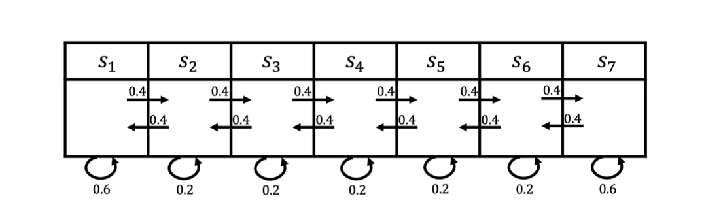

 
Hình 2.4 Ví dụ về quá trình phần thưởng Markov

Ta lấy mẫu lợi tức $G$ cho các tập dài 4 bước ($\gamma=0.5$).

  (1) Lợi tức của $s_{4}, s_{5}, s_{6}, s_{7}$: $0+0.5\times 0+0.25 \times 0+ 0.125\times 10=1.25$

  (2) Lợi tức của $s_{4}, s_{3}, s_{2}, s_{1}$: $0+0.5 \times 0+0.25\times 0+0.125 \times 5=0.625$

  (3) Lợi tức của $s_{4}, s_{5}, s_{6}, s_{6}$: $0+0.5\times 0 +0.25 \times 0+0.125 \times 0=0$

Bây giờ ta có thể tính phần thưởng thu được trên mỗi quỹ đạo. Ví dụ ta tính phần thưởng của quỹ đạo $s_4,s_5,s_6,s_7$, ở đây hệ số chiết khấu là 0.5. Ở $s_4$, phần thưởng là 0. Ở trạng thái tiếp theo $s_5$, vì đã sang bước tiếp theo nên phải chiết khấu $s_5$, phần thưởng của $s_5$ cũng là 0. Sau đó là $s_6$, phần thưởng cũng là 0, hệ số chiết khấu phải là 0.25. Khi đến $s_7$, ta nhận được một phần thưởng, nhưng vì phần thưởng của trạng thái $s_7$ là phần thưởng nhận được trong tương lai nên ta phải chiết khấu nó 3 lần. Cuối cùng lợi tức của quỹ đạo này là 1.25. Tương tự, ta có thể tính lợi tức của các quỹ đạo khác.

Từ đây nảy sinh một câu hỏi: khi đã có lợi tức thực tế của một số quỹ đạo, làm sao tính hàm giá trị của nó? Ví dụ ta muốn biết giá trị của $s_4$, tức là khi đi vào $s_4$ thì giá trị của nó rốt cuộc là bao nhiêu? Một cách làm khả thi là sinh ra rất nhiều quỹ đạo rồi cộng gộp lại. Ví dụ ta có thể bắt đầu từ $s_4$, lấy mẫu sinh ra nhiều quỹ đạo, tính lợi tức của tất cả các quỹ đạo này, rồi lấy trung bình làm giá trị khi đi vào $s_4$. Đây thực chất là một cách tính hàm giá trị, tức là tính giá trị của $s_4$ bằng phương pháp lấy mẫu Monte Carlo (Monte Carlo, MC).
### 2.2.2 Phương trình Bellman

Nhưng ở đây ta dùng một cách tính khác, từ hàm giá trị suy ra **phương trình Bellman (Bellman equation)**:
$$
  V(s)=\underbrace{R(s)}_{\text {phần thưởng tức thời}}+\underbrace{\gamma \sum_{s^{\prime} \in S} p\left(s^{\prime} \mid s\right) V\left(s^{\prime}\right)}_{\text {tổng chiết khấu của phần thưởng tương lai}}
$$
Trong đó,
* $s'$ có thể xem là tất cả các trạng thái tương lai,
* $p(s'|s)$ là xác suất chuyển từ trạng thái hiện tại sang trạng thái tương lai.
* $V(s')$ là giá trị của một trạng thái tương lai nào đó. Ta bắt đầu từ trạng thái hiện tại, có một xác suất nhất định đi đến tất cả các trạng thái tương lai, nên ta phải viết $p\left(s^{\prime} \mid s\right)$ vào. Sau khi có trạng thái tương lai, ta nhân với $\gamma$, như vậy là chiết khấu phần thưởng tương lai.
* $\gamma \sum_{s^{\prime} \in S} p\left(s^{\prime} \mid s\right) V\left(s^{\prime}\right)$ có thể xem là tổng chiết khấu của phần thưởng tương lai (discounted sum of future reward).

Phương trình Bellman định nghĩa quan hệ giữa trạng thái hiện tại và trạng thái tương lai. Tổng chiết khấu của phần thưởng tương lai cộng với phần thưởng tức thời tạo thành phương trình Bellman.

**1. Công thức kỳ vọng toàn phần**

Trước khi suy ra phương trình Bellman, ta mô phỏng theo cách chứng minh của **công thức kỳ vọng toàn phần (law of total expectation)** để chứng minh:
$$
  \mathbb{E}[V(s_{t+1})|s_t]=\mathbb{E}[\mathbb{E}[G_{t+1}|s_{t+1}]|s_t]=\mathbb{E}[G_{t+1}|s_t]
$$

> Công thức kỳ vọng toàn phần còn được gọi là luật kỳ vọng lặp (law of iterated expectations, LIE).
Nếu $A_i$ là một phân hoạch (partition) hữu hạn hoặc đếm được của không gian mẫu, thì công thức kỳ vọng toàn phần có thể được định nghĩa là
$$
  \mathbb{E}[X]=\sum_{i} \mathbb{E}\left[X \mid A_{i}\right] p\left(A_{i}\right)
$$

Chứng minh:
Để ký hiệu gọn và dễ đọc, ta bỏ chỉ số dưới, đặt $s=s_t$, $g'=G_{t+1}$, $s'=s_{t+1}$. Theo định nghĩa của kỳ vọng có điều kiện, ta có thể viết lại kỳ vọng của lợi tức là

$$
  \begin{aligned}
    \mathbb{E}\left[G_{t+1} \mid s_{t+1}\right] &=\mathbb{E}\left[g^{\prime} \mid s^{\prime}\right] \\
    &=\sum_{g^{\prime}} g^{\prime}~p\left(g^{\prime} \mid s^{\prime}\right)
    \end{aligned} \tag{2.2}
$$

> Nếu $X$ và $Y$ đều là biến ngẫu nhiên rời rạc, thì kỳ vọng có điều kiện (conditional expectation) $\mathbb{E}[X|Y=y]$ được định nghĩa là
$$
  \mathbb{E}[X \mid Y=y]=\sum_{x} x p(X=x \mid Y=y)
$$

Đặt $s_t=s$, lấy kỳ vọng hai vế của biểu thức (2.2) ta được
$$
  \begin{aligned}
    \mathbb{E}\left[\mathbb{E}\left[G_{t+1} \mid s_{t+1}\right] \mid s_{t}\right] &=\mathbb{E} \left[\mathbb{E}\left[g^{\prime} \mid s^{\prime}\right] \mid s\right] \\
    &=\mathbb{E} \left[\sum_{g^{\prime}} g^{\prime}~p\left(g^{\prime} \mid s^{\prime}\right)\mid s\right]\\
    &=\sum_{s^{\prime}} \sum_{g^{\prime}} g^{\prime} p\left(g^{\prime} \mid s^{\prime}, s\right) p\left(s^{\prime} \mid s\right) \\
    &=\sum_{s^{\prime}} \sum_{g^{\prime}} \frac{g^{\prime} p\left(g^{\prime} \mid s^{\prime}, s\right) p\left(s^{\prime} \mid s\right) p(s)}{p(s)} \\
    &=\sum_{s^{\prime}} \sum_{g^{\prime}} \frac{g^{\prime} p\left(g^{\prime} \mid s^{\prime}, s\right) p\left(s^{\prime}, s\right)}{p(s)} \\
    &=\sum_{s^{\prime}} \sum_{g^{\prime}} \frac{g^{\prime} p\left(g^{\prime}, s^{\prime}, s\right)}{p(s)} \\
    &=\sum_{s^{\prime}} \sum_{g^{\prime}} g^{\prime} p\left(g^{\prime}, s^{\prime} \mid s\right) \\
    &=\sum_{g^{\prime}} \sum_{s^{\prime}} g^{\prime} p\left(g^{\prime}, s^{\prime} \mid s\right) \\
    &=\sum_{g^{\prime}} g^{\prime} p\left(g^{\prime} \mid s\right) \\
    &=\mathbb{E}\left[g^{\prime} \mid s\right]=\mathbb{E}\left[G_{t+1} \mid s_{t}\right]
    \end{aligned}    
$$

> **Ghi chú của người dịch:** ở dòng thứ 3, vì đang xét đồng thời các biến phụ thuộc vào trạng thái gốc $s$, xác suất có điều kiện của $g'$ được viết tường minh hơn là dưới cả điều kiện $s'$ và $s$, tức là thay $p(g' \mid s')$ thành $p(g' \mid s', s)$. Hai cách viết bằng nhau nhờ tính chất Markov: khi đã biết $s'$ thì $g'$ không còn phụ thuộc vào $s$.

**2. Suy ra phương trình Bellman**

Quá trình suy ra phương trình Bellman như sau:

$$
  \begin{aligned}
    V(s)&=\mathbb{E}\left[G_{t} \mid s_{t}=s\right]\\
    &=\mathbb{E}\left[r_{t+1}+\gamma r_{t+2}+\gamma^{2} r_{t+3}+\ldots \mid s_{t}=s\right]  \\
    &=\mathbb{E}\left[r_{t+1}|s_t=s\right] +\gamma \mathbb{E}\left[r_{t+2}+\gamma r_{t+3}+\gamma^{2} r_{t+4}+\ldots \mid s_{t}=s\right]\\
    &=R(s)+\gamma \mathbb{E}[G_{t+1}|s_t=s] \\
    &=R(s)+\gamma \mathbb{E}[V(s_{t+1})|s_t=s]\\
    &=R(s)+\gamma \sum_{s^{\prime} \in S} p\left(s^{\prime} \mid s\right) V\left(s^{\prime}\right)
    \end{aligned}  
$$

> Phương trình Bellman chính là quan hệ lặp giữa trạng thái hiện tại và trạng thái tương lai, cho biết hàm giá trị của trạng thái hiện tại có thể được tính thông qua hàm giá trị của trạng thái tiếp theo. Phương trình Bellman được đặt theo tên người đề xuất nó, nhà sáng lập quy hoạch động (dynamic programming) Richard Bellman, và còn được gọi là "phương trình quy hoạch động".

Phương trình Bellman định nghĩa quan hệ lặp giữa các trạng thái, tức là
$$
  V(s)=R(s)+\gamma \sum_{s^{\prime} \in S} p\left(s^{\prime} \mid s\right) V\left(s^{\prime}\right)
$$

Giả sử có một chuỗi Markov như hình 2.5a, phương trình Bellman mô tả việc chuyển từ trạng thái hiện tại sang trạng thái tương lai. Như hình 2.5b, giả sử hiện tại ta ở $s_1$, thì nó chỉ có thể đi đến 3 trạng thái tương lai: xác suất 0.1 ở lại vị trí hiện tại, xác suất 0.2 đi đến trạng thái $s_2$, xác suất 0.7 đi đến trạng thái $s_4$. Vì vậy ta nhân xác suất chuyển trạng thái với giá trị của trạng thái tương lai, rồi cộng thêm phần thưởng tức thời (immediate reward), sẽ được giá trị của trạng thái hiện tại. Phương trình Bellman định nghĩa chính là quan hệ lặp giữa trạng thái hiện tại và trạng thái tương lai.

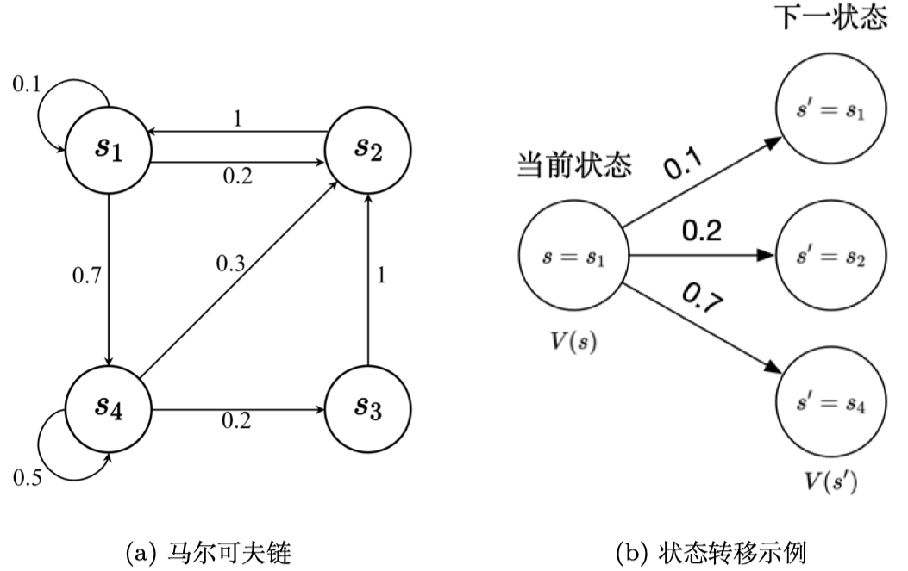

Hình 2.5 Chuyển trạng thái

Ta có thể viết phương trình Bellman dưới dạng ma trận:
$$
  \left(\begin{array}{c}
    V\left(s_{1}\right) \\
    V\left(s_{2}\right) \\
    \vdots \\
    V\left(s_{N}\right)
    \end{array}\right)=\left(\begin{array}{c}
    R\left(s_{1}\right) \\
    R\left(s_{2}\right) \\
    \vdots \\
    R\left(s_{N}\right)
    \end{array}\right)+\gamma\left(\begin{array}{cccc}
    p\left(s_{1} \mid s_{1}\right) & p\left(s_{2} \mid s_{1}\right) & \ldots & p\left(s_{N} \mid s_{1}\right) \\
    p\left(s_{1} \mid s_{2}\right) & p\left(s_{2} \mid s_{2}\right) & \ldots & p\left(s_{N} \mid s_{2}\right) \\
    \vdots & \vdots & \ddots & \vdots \\
    p\left(s_{1} \mid s_{N}\right) & p\left(s_{2} \mid s_{N}\right) & \ldots & p\left(s_{N} \mid s_{N}\right)
    \end{array}\right)\left(\begin{array}{c}
    V\left(s_{1}\right) \\
    V\left(s_{2}\right) \\
    \vdots \\
    V\left(s_{N}\right)
    \end{array}\right) 
$$

Trạng thái hiện tại của ta là vectơ $[V(s_1),V(s_2),\cdots,V(s_N)]^\mathrm{T}$. Xét từng hàng, vectơ $\boldsymbol{V}$ nhân với một hàng của ma trận chuyển trạng thái, rồi cộng thêm phần thưởng mà nó có thể nhận được hiện tại, sẽ được giá trị hiện tại của nó.

Khi viết phương trình Bellman dưới dạng ma trận, ta có thể giải trực tiếp:
$$
  \begin{aligned}
    \boldsymbol{V} &= \boldsymbol{\boldsymbol{R}}+ \gamma \boldsymbol{P}\boldsymbol{V} \\
    \boldsymbol{I}\boldsymbol{V} &= \boldsymbol{R}+ \gamma \boldsymbol{P}\boldsymbol{V} \\
    (\boldsymbol{I}-\gamma \boldsymbol{P})\boldsymbol{V}&=\boldsymbol{R} \\
    \boldsymbol{V}&=(\boldsymbol{I}-\gamma \boldsymbol{P})^{-1}\boldsymbol{R}
    \end{aligned}
$$

Ta có thể thu được trực tiếp **nghiệm giải tích (analytic solution)**:
$$
  \boldsymbol{V}=(\boldsymbol{I}-\gamma \boldsymbol{P})^{-1} \boldsymbol{R}
$$

Ta có thể tính trực tiếp giá trị của $\boldsymbol{V}$ bằng cách nghịch đảo ma trận. Nhưng có một vấn đề là độ phức tạp của phép nghịch đảo ma trận là $O(N^3)$. Vì vậy khi số trạng thái rất lớn, ví dụ từ 10 trạng thái lên 1000 trạng thái, hoặc lên 1 triệu trạng thái, khi có 1 triệu trạng thái thì ma trận chuyển trạng thái sẽ là ma trận 1 triệu × 1 triệu, nghịch đảo một ma trận lớn như vậy là rất khó. Vì vậy phương pháp giải bằng nghiệm giải tích này chỉ phù hợp với quá trình phần thưởng Markov rất nhỏ.

### 2.2.3 Thuật toán lặp để tính giá trị của quá trình phần thưởng Markov

Ta có thể áp dụng các phương pháp lặp cho quá trình phần thưởng Markov có rất nhiều trạng thái (large MRP), ví dụ: phương pháp quy hoạch động, phương pháp Monte Carlo (tính bằng cách lấy mẫu), phương pháp **học sai phân thời gian (temporal-difference learning, TD learning)** (học sai phân thời gian là sự kết hợp giữa quy hoạch động và phương pháp Monte Carlo).

Trước tiên ta dùng phương pháp Monte Carlo để tính giá trị. Như hình 2.6, phương pháp Monte Carlo là: khi có một quá trình phần thưởng Markov, ta có thể bắt đầu từ một trạng thái nào đó, thả một chiếc thuyền vào ma trận chuyển trạng thái, để nó "trôi theo dòng nước", như vậy sẽ sinh ra một quỹ đạo. Sau khi sinh ra một quỹ đạo, ta sẽ có phần thưởng, khi đó tính trực tiếp phần thưởng đã chiết khấu, tức lợi tức $g$. Tính xong thì cộng dồn lại, được lợi tức $G_t$. Khi đã tích lũy một số lượng quỹ đạo nhất định, ta lấy trực tiếp $G_t$ chia cho số quỹ đạo, sẽ được giá trị của trạng thái đó.

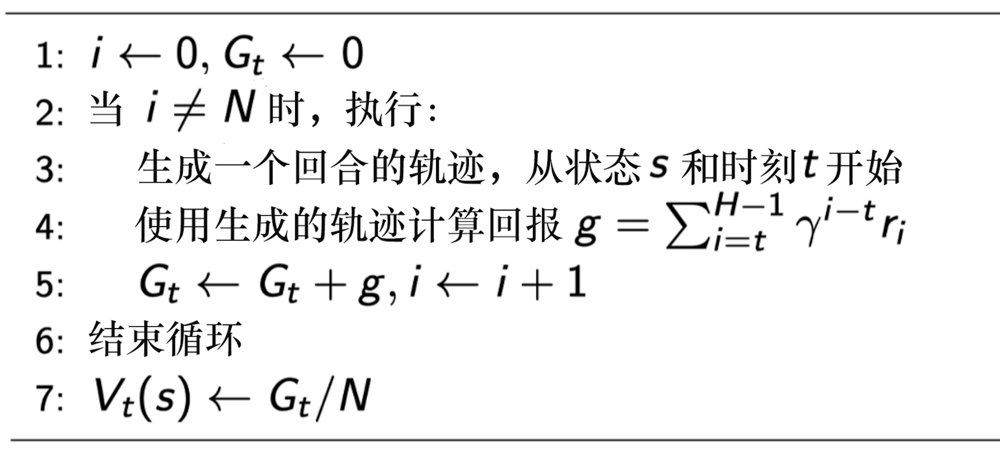

 
Hình 2.6 Phương pháp Monte Carlo tính giá trị của quá trình phần thưởng Markov

Bản dịch thuật toán ở hình 2.6:

$$
\begin{array}{rl}
\hline
1{:} & i \leftarrow 0,\ G_t \leftarrow 0 \\
2{:} & \textbf{khi } i \neq N \textbf{ thì thực hiện:} \\
3{:} & \quad \text{sinh quỹ đạo của một tập (episode), bắt đầu từ trạng thái } s \text{ tại thời điểm } t \\
4{:} & \quad \text{dùng quỹ đạo vừa sinh để tính lợi tức } g=\sum_{i=t}^{H-1} \gamma^{i-t} r_i \\
5{:} & \quad G_t \leftarrow G_t+g,\ i \leftarrow i+1 \\
6{:} & \textbf{kết thúc vòng lặp} \\
7{:} & V_t(s) \leftarrow G_t / N
\\ \hline
\end{array}
$$

Ví dụ ta muốn tính giá trị của trạng thái $s_4$, có thể bắt đầu từ trạng thái $s_4$, sinh ngẫu nhiên nhiều quỹ đạo. Thả chiếc thuyền vào ma trận chuyển trạng thái, rồi nó sẽ "trôi theo dòng nước", sinh ra quỹ đạo. Mỗi quỹ đạo cho một lợi tức, ta thu được rất nhiều lợi tức, ví dụ 100 hay 1000 lợi tức, rồi lấy trung bình trực tiếp, kết quả đó tương đương với giá trị hiện tại của $s_4$, vì giá trị $V(s_4)$ của $s_4$ định nghĩa việc trong tương lai ta có thể nhận được bao nhiêu phần thưởng. Đây chính là phương pháp lấy mẫu Monte Carlo.

Như hình 2.7, ta cũng có thể dùng phương pháp quy hoạch động, lặp liên tục phương trình Bellman cho đến khi hàm giá trị hội tụ, khi đó ta có được giá trị của các trạng thái. Ta dùng phương pháp **tự cập nhật (bootstrapping)** để lặp liên tục phương trình Bellman; khi trạng thái vừa cập nhật lần cuối không khác biệt nhiều so với trạng thái trước đó, việc cập nhật có thể dừng lại, và ta có thể xuất $V'(s)$ mới nhất làm giá trị của trạng thái hiện tại. Ở đây chính là biến phương trình Bellman thành một phép cập nhật Bellman (Bellman update), nhờ đó có được giá trị của trạng thái.

Phương pháp quy hoạch động dựa trên ước lượng giá trị của các trạng thái kế tiếp để cập nhật ước lượng giá trị của trạng thái hiện tại (như dòng thứ 3 của thuật toán ở hình 2.7, dùng $V'$ để cập nhật $V$). Ý tưởng cập nhật một giá trị ước lượng dựa trên các giá trị ước lượng khác được gọi là bootstrapping.

 

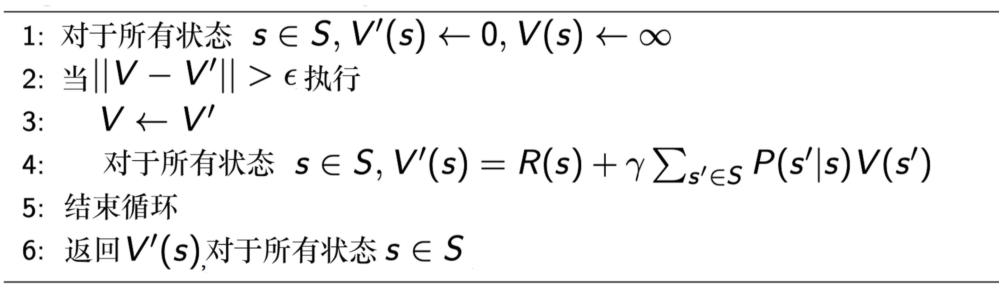

 
Hình 2.7 Thuật toán quy hoạch động tính giá trị của quá trình phần thưởng Markov

Bản dịch thuật toán ở hình 2.7:

$$
\begin{array}{rl}
\hline
1{:} & \text{với mọi trạng thái } s \in S:\ V'(s) \leftarrow 0,\ V(s) \leftarrow \infty \\
2{:} & \textbf{khi } \|V-V'\| > \epsilon \textbf{ thì thực hiện:} \\
3{:} & \quad V \leftarrow V' \\
4{:} & \quad \text{với mọi trạng thái } s \in S:\ V'(s)=R(s)+\gamma \sum_{s' \in S} P(s' \mid s) V(s') \\
5{:} & \textbf{kết thúc vòng lặp} \\
6{:} & \textbf{trả về } V'(s) \text{ với mọi trạng thái } s \in S
\\ \hline
\end{array}
$$

> Nghĩa gốc của bootstrap là "dây kéo ở cổ giày ống". Ở đây dùng điển tích trong tác phẩm văn học Đức *Những cuộc phiêu lưu của Nam tước Münchhausen*, nơi nhân vật tự kéo dây giày ống của mình để nhấc bản thân lên (tự thân vận động), vì vậy bản tiếng Trung dịch là "自举" (tự nâng). Trong tiếng Việt thường giữ nguyên thuật ngữ bootstrapping.

### 2.2.4 Ví dụ về quá trình phần thưởng Markov

Như hình 2.8, nếu ta thêm phần thưởng vào chuỗi Markov thì mỗi khi đến một trạng thái, ta sẽ nhận được một phần thưởng. Ta có thể thiết lập phần thưởng tương ứng, ví dụ khi tác tử đến trạng thái $s_1$ thì nhận phần thưởng 5; khi đến $s_7$ thì nhận phần thưởng 10; đến các trạng thái khác thì không có phần thưởng nào.
Vì ở đây số trạng thái là hữu hạn, nên ta có thể dùng vectơ $\boldsymbol{R}=[5,0,0,0,0,0,10]$ để biểu diễn hàm phần thưởng, $\boldsymbol{R}$ biểu thị độ lớn phần thưởng của mỗi trạng thái.

Ta dùng một ví dụ hình ảnh để hiểu quá trình phần thưởng Markov. Ta thả một chiếc thuyền giấy xuống dòng sông, nó sẽ trôi theo dòng nước, bản thân nó không có động lực. Vì vậy ta có thể xem quá trình phần thưởng Markov như một ví dụ "trôi theo dòng nước": khi bắt đầu từ một điểm nào đó, chiếc thuyền giấy sẽ trôi theo các xác suất chuyển trạng thái đã định nghĩa trước, mỗi khi nó đến một trạng thái, ta đều có thể nhận được một ít phần thưởng.

 

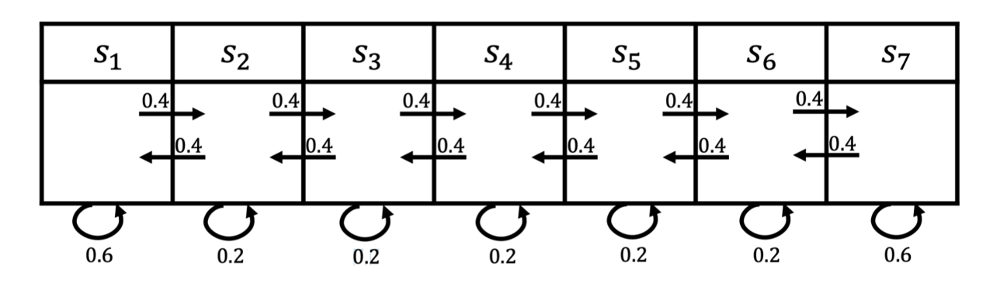

 
Hình 2.8 Ví dụ về quá trình phần thưởng Markov

## 2.3 Quá trình quyết định Markov
So với quá trình phần thưởng Markov, quá trình quyết định Markov có thêm quyết định (quyết định ở đây là hành động), các định nghĩa khác tương tự quá trình phần thưởng Markov. Ngoài ra, việc chuyển trạng thái cũng có thêm một điều kiện, trở thành $p\left(s_{t+1}=s^{\prime} \mid s_{t}=s,a_{t}=a\right)$. Trạng thái tương lai không chỉ phụ thuộc vào trạng thái hiện tại, mà còn phụ thuộc vào hành động tác tử thực hiện ở trạng thái hiện tại. Quá trình quyết định Markov thỏa mãn điều kiện:
$$
  p\left(s_{t+1} \mid s_{t}, a_{t}\right) =p\left(s_{t+1} \mid h_{t}, a_{t}\right)   
$$

Với hàm phần thưởng, nó cũng có thêm hành động hiện tại, trở thành $R\left(s_{t}=s, a_{t}=a\right)=\mathbb{E}\left[r_{t} \mid s_{t}=s, a_{t}=a\right]$. Trạng thái hiện tại và hành động được thực hiện sẽ quyết định tác tử hiện tại có thể nhận được bao nhiêu phần thưởng.

### 2.3.1 Chính sách trong quá trình quyết định Markov

Chính sách (policy) định nghĩa ở một trạng thái nào đó nên thực hiện hành động gì. Khi biết trạng thái hiện tại, ta có thể đưa trạng thái hiện tại vào hàm chính sách để nhận được một xác suất, tức là
$$
  \pi(a \mid s)=p\left(a_{t}=a \mid s_{t}=s\right)
$$
Xác suất cho biết trong tất cả các hành động có thể có thì hành động thế nào, ví dụ có thể có xác suất 0.7 đi sang trái, xác suất 0.3 đi sang phải, đây là một cách biểu diễn bằng xác suất. Ngoài ra chính sách cũng có thể là tất định, nó có thể xuất trực tiếp một giá trị, hoặc trực tiếp cho ta biết hiện tại nên thực hiện hành động gì, chứ không phải xác suất của các hành động. Giả sử hàm xác suất là dừng (stationary), thì ở các thời điểm khác nhau, hành động ta thực hiện thực chất đều là lấy mẫu từ hàm chính sách.

Khi đã biết quá trình quyết định Markov và chính sách $\pi$, ta có thể chuyển quá trình quyết định Markov thành quá trình phần thưởng Markov. Trong quá trình quyết định Markov, hàm chuyển trạng thái $P(s'|s,a)$ dựa trên trạng thái hiện tại và hành động hiện tại. Vì hiện tại ta đã biết hàm chính sách, tức là biết xác suất của các hành động có thể thực hiện ở mỗi trạng thái, nên ta có thể lấy tổng trực tiếp theo hành động, loại bỏ $a$, như vậy ta sẽ được xác suất chuyển của quá trình phần thưởng Markov, ở đây không còn hành động, tức là
$$
  P_{\pi}\left(s^{\prime} \mid s\right)=\sum_{a \in A} \pi(a \mid s) p\left(s^{\prime} \mid s, a\right)
$$

Với hàm phần thưởng, ta cũng có thể loại bỏ hành động, như vậy sẽ được hàm phần thưởng tương tự quá trình phần thưởng Markov, tức là
$$
  r_{\pi}(s)=\sum_{a \in A} \pi(a \mid s) R(s, a)
$$

### 2.3.2 Khác biệt giữa quá trình quyết định Markov và quá trình Markov/quá trình phần thưởng Markov
Sự khác biệt giữa việc chuyển trạng thái trong quá trình quyết định Markov với việc chuyển trạng thái trong quá trình phần thưởng Markov và quá trình Markov được thể hiện ở hình 2.9. Việc chuyển trạng thái trong quá trình Markov/quá trình phần thưởng Markov được quyết định trực tiếp. Ví dụ trạng thái hiện tại là $s$, thì xác suất chuyển trực tiếp quyết định trạng thái tiếp theo là gì. Nhưng với quá trình quyết định Markov, ở giữa có thêm một tầng hành động $a$, tức là khi tác tử ở trạng thái hiện tại, trước tiên nó phải quyết định thực hiện một hành động nào đó, khi đó ta sẽ đi đến một nút màu đen. Sau khi đến nút màu đen này, vì có một mức độ bất định nhất định, nên khi trạng thái hiện tại của tác tử và hành động hiện tại của tác tử đã được quyết định, việc tác tử đi vào trạng thái tương lai thực ra cũng là một phân phối xác suất. Trong quá trình chuyển từ trạng thái hiện tại sang trạng thái tương lai có thêm một tầng quyết định, đây là điểm rất khác biệt giữa quá trình quyết định Markov với quá trình Markov/quá trình phần thưởng Markov trước đó. Trong quá trình quyết định Markov, hành động do tác tử quyết định, tác tử sẽ thực hiện hành động để quyết định việc chuyển trạng thái trong tương lai.

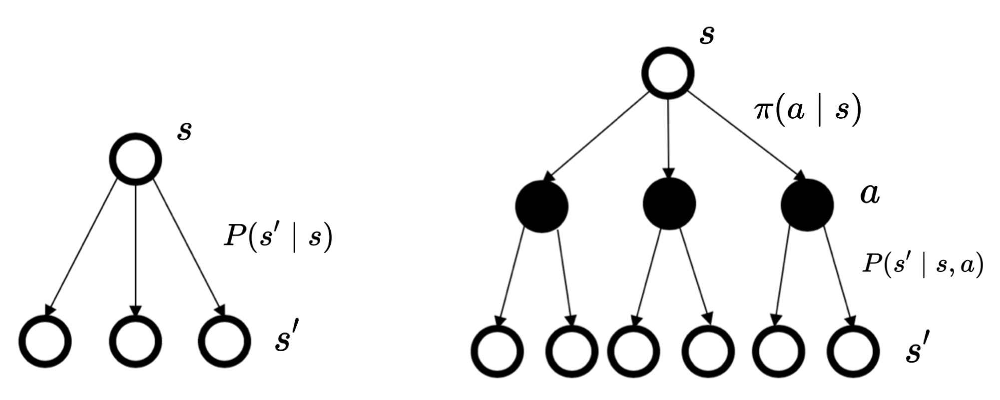

 
Hình 2.9 So sánh việc chuyển trạng thái của quá trình quyết định Markov với quá trình Markov/quá trình phần thưởng Markov

### 2.3.3 Hàm giá trị trong quá trình quyết định Markov

Hàm giá trị trong quá trình quyết định Markov có thể được định nghĩa là
$$
V_{\pi}(s)=\mathbb{E}_{\pi}\left[G_{t} \mid s_{t}=s\right] \tag{2.3}
$$
Trong đó, kỳ vọng dựa trên chính sách mà ta áp dụng. Khi chính sách đã được quyết định, ta lấy mẫu theo chính sách để có một kỳ vọng, từ đó tính ra hàm giá trị của nó.

Ở đây ta giới thiệu thêm **hàm Q (Q-function)**. Hàm Q còn được gọi là **hàm giá trị hành động (action-value function)**. Hàm Q định nghĩa kỳ vọng của lợi tức có thể nhận được khi thực hiện một hành động nào đó ở một trạng thái nào đó, tức là
$$
Q_{\pi}(s, a)=\mathbb{E}_{\pi}\left[G_{t} \mid s_{t}=s, a_{t}=a\right] \tag{2.4}
$$
Kỳ vọng ở đây thực chất cũng dựa trên hàm chính sách. Vì vậy ta cần lấy tổng theo hàm chính sách, rồi được giá trị của nó.
Lấy tổng theo hành động trong hàm Q, ta sẽ được hàm giá trị:
$$
V_{\pi}(s)=\sum_{a \in A} \pi(a \mid s) Q_{\pi}(s, a)
\tag{2.5}
$$

Ở đây ta suy ra phương trình Bellman của hàm Q:
$$
  \begin{aligned}
    Q(s,a)&=\mathbb{E}\left[G_{t} \mid s_{t}=s,a_{t}=a\right]\\
    &=\mathbb{E}\left[r_{t+1}+\gamma r_{t+2}+\gamma^{2} r_{t+3}+\ldots \mid s_{t}=s,a_{t}=a\right]  \\
    &=\mathbb{E}\left[r_{t+1}|s_{t}=s,a_{t}=a\right] +\gamma \mathbb{E}\left[r_{t+2}+\gamma r_{t+3}+\gamma^{2} r_{t+4}+\ldots \mid s_{t}=s,a_{t}=a\right]\\
    &=R(s,a)+\gamma \mathbb{E}[G_{t+1}|s_{t}=s,a_{t}=a] \\
    &=R(s,a)+\gamma \mathbb{E}[V(s_{t+1})|s_{t}=s,a_{t}=a]\\
    &=R(s,a)+\gamma \sum_{s^{\prime} \in S} p\left(s^{\prime} \mid s,a\right) V\left(s^{\prime}\right)
    \end{aligned}
$$

### 2.3.4 Phương trình kỳ vọng Bellman

Ta có thể tách hàm giá trị trạng thái và hàm Q thành hai phần: phần thưởng tức thời và giá trị chiết khấu của trạng thái kế tiếp (discounted value of successor state).
Bằng cách phân tách hàm giá trị trạng thái, ta có được một phương trình Bellman tương tự như của quá trình phần thưởng Markov trước đó — **phương trình kỳ vọng Bellman (Bellman expectation equation)**:
$$
  V_{\pi}(s)=\mathbb{E}_{\pi}\left[r_{t+1}+\gamma V_{\pi}\left(s_{t+1}\right) \mid s_{t}=s\right] \tag{2.6} 
$$

Với hàm Q, ta cũng có thể phân tách tương tự, được phương trình kỳ vọng Bellman của hàm Q:
$$
  Q_{\pi}(s, a)=\mathbb{E}_{\pi}\left[r_{t+1}+\gamma Q_{\pi}\left(s_{t+1}, a_{t+1}\right) \mid s_{t}=s, a_{t}=a\right] \tag{2.7}
$$
Phương trình kỳ vọng Bellman định nghĩa mối liên hệ giữa trạng thái hiện tại và trạng thái tương lai.

Ta phân tách đơn giản thêm một bước, trước tiên đưa ra biểu thức (2.8):

$$
  V_{\pi}(s)=\sum_{a \in A} \pi(a \mid s) Q_{\pi}(s, a) \tag{2.8} 
$$

Tiếp theo, ta đưa ra biểu thức (2.9):
$$
  Q_{\pi}(s, a)=R(s,a)+\gamma \sum_{s^{\prime} \in S} p\left(s^{\prime} \mid s, a\right) V_{\pi}\left(s^{\prime}\right) \tag{2.9} 
$$

Biểu thức (2.8) và (2.9) thể hiện mối liên hệ giữa hàm giá trị trạng thái và hàm Q.

Thay biểu thức (2.9) vào biểu thức (2.8) ta được
$$
  V_{\pi}(s)=\sum_{a \in A} \pi(a \mid s)\left(R(s, a)+\gamma \sum_{s^{\prime} \in S} p\left(s^{\prime} \mid s, a\right) V_{\pi}\left(s^{\prime}\right)\right) \tag{2.10} 
$$

Biểu thức (2.10) thể hiện mối liên hệ giữa giá trị của trạng thái hiện tại và giá trị của trạng thái tương lai.

Thay biểu thức (2.8) vào biểu thức (2.9) ta được
$$
  Q_{\pi}(s, a)=R(s, a)+\gamma \sum_{s^{\prime} \in S} p\left(s^{\prime} \mid s, a\right) \sum_{a^{\prime} \in A} \pi\left(a^{\prime} \mid s^{\prime}\right) Q_{\pi}\left(s^{\prime}, a^{\prime}\right) \tag{2.11} 
$$

Biểu thức (2.11) thể hiện mối liên hệ giữa hàm Q ở thời điểm hiện tại và hàm Q ở thời điểm tương lai.

Biểu thức (2.10) và (2.11) là một dạng khác của phương trình kỳ vọng Bellman.

### 2.3.5 Sơ đồ backup

Tiếp theo ta giới thiệu khái niệm **backup (cập nhật ngược)**. Backup tương tự như quan hệ lặp giữa các lần bootstrapping: với một trạng thái, giá trị hiện tại của nó có quan hệ tuyến tính với giá trị tương lai của nó.
Ta gọi các sơ đồ tương tự hình 2.10 là **sơ đồ backup (backup diagram)** hay sơ đồ truy ngược, vì quan hệ mà chúng thể hiện tạo thành cơ sở của các thao tác cập nhật hoặc backup, mà các thao tác này lại là cốt lõi của các phương pháp học tăng cường. Các thao tác này chuyển thông tin giá trị từ các trạng thái kế tiếp (hoặc cặp trạng thái-hành động kế tiếp) của một trạng thái (hoặc cặp trạng thái-hành động) ngược trở về nó.
Mỗi vòng tròn rỗng biểu thị một trạng thái, mỗi vòng tròn đặc biểu thị một cặp trạng thái-hành động (state-action pair).

 

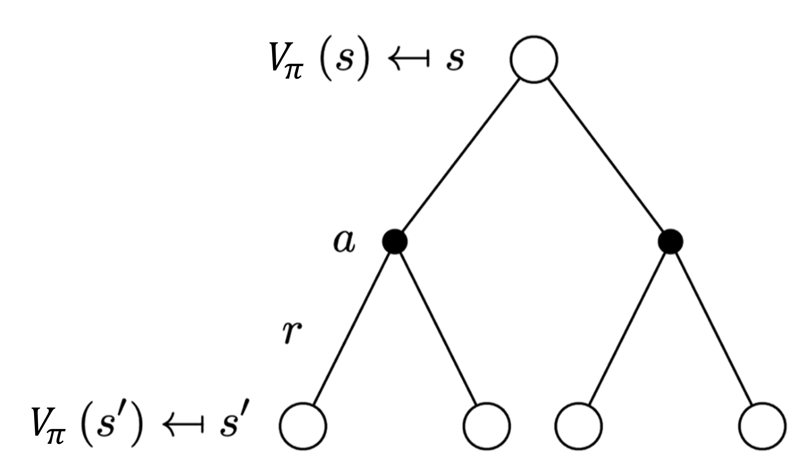

Hình 2.10 Sơ đồ backup của $V_{\pi}$

Như biểu thức (2.12), ở đây có hai tầng lấy tổng. Tầng tổng thứ nhất là lấy tổng trên các nút lá, backup lên một tầng, ta có thể backup giá trị tương lai (giá trị của $s'$) lên các nút màu đen.
Tầng tổng thứ hai là lấy tổng theo hành động, sau khi có giá trị của các nút đen, backup lên thêm một tầng, ta sẽ được giá trị của nút gốc, tức giá trị của trạng thái hiện tại.
$$
V_{\pi}(s)=\sum_{a \in A} \pi(a \mid s)\left(R(s, a)+\gamma \sum_{s^{\prime} \in S} p\left(s^{\prime} \mid s, a\right) V_{\pi}\left(s^{\prime}\right)\right) \tag{2.12}
$$

Hình 2.11 là phân tách cách tính hàm giá trị trạng thái, công thức tính của hình 2.11b là
$$
  V_{\pi}(s)=\sum_{a \in A} \pi(a \mid s) Q_{\pi}(s, a) \tag{2.13} 
$$

Hình 2.11b cho thấy quan hệ giữa hàm giá trị trạng thái và hàm Q. Hình 2.11c tính hàm Q là

$$
  Q_{\pi}(s,a)=R(s, a)+\gamma \sum_{s^{\prime} \in S} p\left(s^{\prime} \mid s, a\right) V_{\pi}\left(s^{\prime}\right) \tag{2.14} 
$$

Thay biểu thức (2.14) vào biểu thức (2.13) ta được
$$
  V_{\pi}(s)=\sum_{a \in A} \pi(a \mid s)\left(R(s, a)+\gamma \sum_{s^{\prime} \in S} p\left(s^{\prime} \mid s, a\right) V_{\pi}\left(s^{\prime}\right)\right)
$$

Vì vậy sơ đồ backup định nghĩa mối liên hệ giữa hàm giá trị trạng thái ở thời điểm tiếp theo và hàm giá trị trạng thái ở thời điểm trước đó.

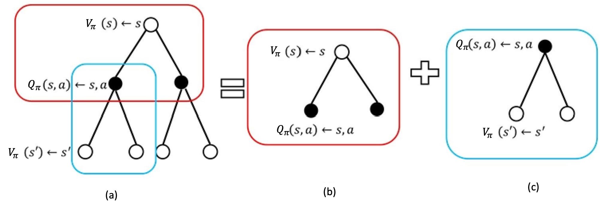

Hình 2.11 Phân tách cách tính hàm giá trị trạng thái

Với hàm Q, ta cũng có thể suy ra tương tự. Như hình 2.12, nút gốc bây giờ là một nút của hàm Q. Hàm Q ứng với các nút màu đen. Hàm Q ở thời điểm tiếp theo ứng với các nút lá, có 4 nút lá màu đen.
$$
Q_{\pi}(s, a)=R(s, a)+\gamma \sum_{s^{\prime} \in S} p\left(s^{\prime} \mid s, a\right) \sum_{a^{\prime} \in A} \pi\left(a^{\prime} \mid s^{\prime}\right) Q_{\pi}\left(s^{\prime}, a^{\prime}\right) \tag{2.15}
$$

Như biểu thức (2.15), ở đây cũng có hai tầng lấy tổng. Tầng tổng thứ nhất đẩy các nút lá từ nút đen lên nút tròn rỗng, đi vào trạng thái của nút tròn rỗng.
Khi đã đến một trạng thái nào đó, ta lại lấy tổng trên các nút tròn rỗng, như vậy đẩy các nút tròn rỗng ngược trở về hàm Q ở thời điểm hiện tại.

 

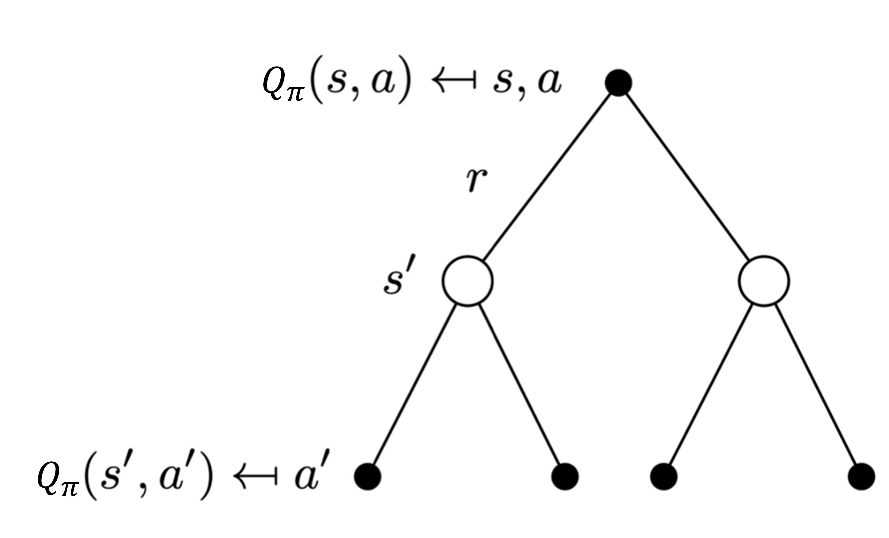

Hình 2.12 Sơ đồ backup của $Q_{\pi}$

Trong hình 2.13c,
$$
V_{\pi}\left(s^{\prime}\right)=\sum_{a^{\prime} \in A} \pi\left(a^{\prime} \mid s^{\prime}\right) Q_{\pi}\left(s^{\prime}, a^{\prime}\right) \tag{2.16}
$$

Thay biểu thức (2.16) vào biểu thức (2.14) ta được mối liên hệ giữa hàm Q tương lai và hàm Q hiện tại, tức là
$$
  Q_{\pi}(s, a)=R(s, a)+\gamma \sum_{s^{\prime} \in S} p\left(s^{\prime} \mid s, a\right) \sum_{a^{\prime} \in A} \pi\left(a^{\prime} \mid s^{\prime}\right) Q_{\pi}\left(s^{\prime}, a^{\prime}\right)
$$

 

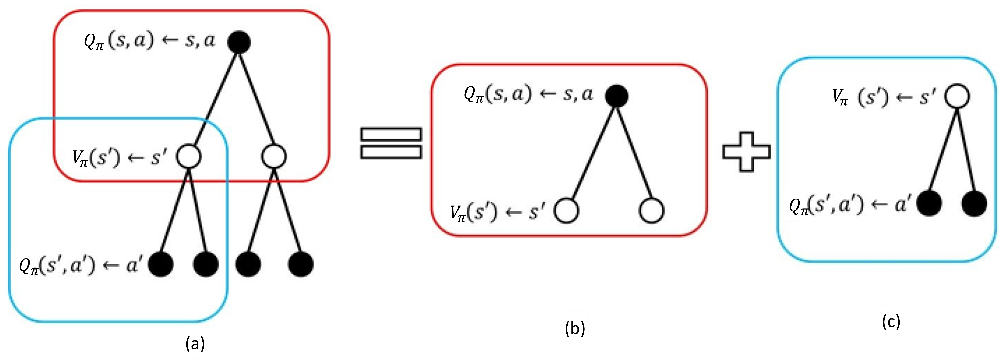

 
Hình 2.13 Phân tách cách tính hàm Q

### 2.3.6 Đánh giá chính sách

Khi đã biết quá trình quyết định Markov và chính sách $\pi$ cần áp dụng, quá trình tính hàm giá trị $V_{\pi}(s)$ chính là **đánh giá chính sách**. Ở một số nơi, đánh giá chính sách còn được gọi là **dự đoán (giá trị) [(value) prediction]**, tức là dự đoán chính sách hiện tại cuối cùng sẽ tạo ra bao nhiêu giá trị. Như hình 2.14a, với quá trình quyết định Markov, ta có thể tưởng tượng có một người lái đò trên thuyền, cô ấy có thể điều khiển thuyền di chuyển, tránh để thuyền trôi theo dòng nước. Vì ở mỗi thời điểm, hành động của người lái đò quyết định hướng đi của thuyền. Như hình 2.14b, với quá trình phần thưởng Markov và quá trình Markov, chiếc thuyền giấy sẽ trôi theo dòng nước và sinh ra quỹ đạo. Điểm khác biệt của quá trình quyết định Markov là có một tác tử điều khiển thuyền, nhờ vậy ta có thể nhận được nhiều phần thưởng nhất có thể.

 
Hình 2.14 Khác biệt giữa quá trình quyết định Markov và quá trình Markov/quá trình phần thưởng Markov

Hãy xem thêm một ví dụ về đánh giá chính sách, tìm hiểu cách tính giá trị của từng trạng thái trong quá trình quyết định. Như hình 2.15, giả sử môi trường có hai hành động: đi sang trái và đi sang phải. Hàm phần thưởng lẽ ra là hàm của hai biến hành động và trạng thái. Nhưng ở đây quy định, bất kể tác tử thực hiện hành động gì, chỉ cần đến trạng thái $s_1$ là có phần thưởng 5; chỉ cần đến trạng thái $s_7$ là có phần thưởng 10, đến các trạng thái khác không có phần thưởng. Ta có thể biểu diễn hàm phần thưởng là $\boldsymbol{R}=[5,0,0,0,0,0,10]$. Giả sử tác tử hiện áp dụng một chính sách: bất kể ở trạng thái nào, hành động của tác tử đều là đi sang trái, tức là áp dụng chính sách tất định $\pi(s)=\text{trái}$. Giả sử hệ số chiết khấu $\gamma=0$, thì với chính sách tất định, hàm giá trị ước lượng cuối cùng là như nhau, tức $\boldsymbol{V}_{\pi}=[5,0,0,0,0,0,10]$.

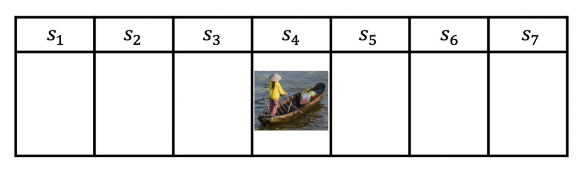

Hình 2.15 Ví dụ đánh giá chính sách

Ta có thể dùng trực tiếp phương trình Bellman để có hàm giá trị:
$$
  V^{k}_{\pi}(s)=r(s, \pi(s))+\gamma \sum_{s^{\prime} \in S} p\left(s^{\prime} \mid s, \pi(s)\right) V^{k-1}_{\pi}\left(s^{\prime}\right)
$$
Trong đó, $k$ là số lần lặp. Ta có thể lặp liên tục, cuối cùng hàm giá trị sẽ hội tụ. Sau khi hội tụ, giá trị của hàm giá trị chính là giá trị của mỗi trạng thái.

Xét thêm một ví dụ, nếu hệ số chiết khấu $\gamma=0.5$, ta có thể lặp theo biểu thức (2.17):
$$
  V^{t}_{\pi}(s)=\sum_{a} p(\pi(s)=a)\left(r(s, a)+\gamma \sum_{s^{\prime} \in S} p\left(s^{\prime} \mid s, a\right) V^{t-1}_{\pi}\left(s^{\prime}\right)\right) \tag{2.17}
$$
Trong đó, $t$ là số lần lặp. Sau đó ta sẽ có được giá trị trạng thái của nó.

Cuối cùng, ví dụ bây giờ ta áp dụng chính sách ngẫu nhiên, ở mỗi trạng thái có xác suất 0.5 đi sang trái, xác suất 0.5 đi sang phải, tức $p(\pi(s)= \text{trái})=0.5$, $p(\pi(s)= \text{phải})=0.5$, làm sao tính giá trị trạng thái dưới chính sách này? Ta có thể làm như sau: ban đầu, ta khởi tạo $V(s')$, mỗi $V(s')$ có một giá trị; tiếp theo, ta đưa $V(s')$ vào phương trình kỳ vọng Bellman để lặp, sẽ tính được giá trị trạng thái của nó.

### 2.3.7 Dự đoán và điều khiển

Dự đoán (prediction) và điều khiển (control) là các bài toán cốt lõi trong quá trình quyết định Markov. Đầu vào của dự đoán (đánh giá một chính sách cho trước) là quá trình quyết định Markov $<S,A,P,R,\gamma>$ và chính sách $\pi$,

đầu ra là hàm giá trị $V_{\pi}$. Dự đoán là: cho trước một quá trình quyết định Markov và một chính sách $\pi$, tính hàm giá trị của nó, tức là tính giá trị của mỗi trạng thái.

Đầu vào của điều khiển (tìm kiếm chính sách tối ưu) là quá trình quyết định Markov $<S,A,P,R,\gamma>$, đầu ra là hàm giá trị tối ưu (optimal value function) $V^*$ và chính sách tối ưu (optimal policy) $\pi^*$. Điều khiển là ta đi tìm một chính sách tối ưu, rồi đồng thời xuất ra hàm giá trị tối ưu và chính sách tối ưu của nó.

Trong quá trình quyết định Markov, cả dự đoán và điều khiển đều có thể giải bằng quy hoạch động. Cần nhấn mạnh rằng, khác biệt giữa hai bài toán là: bài toán dự đoán là cho trước một chính sách, ta cần xác định hàm giá trị của nó là bao nhiêu. Còn bài toán điều khiển là trong điều kiện không có chính sách, ta cần xác định hàm giá trị tối ưu và phương án quyết định tương ứng. Thực tế, hai bài toán này có quan hệ tiến dần: trong học tăng cường, ta giải bài toán dự đoán, rồi từ đó giải bài toán điều khiển.

Lấy một ví dụ minh họa khác biệt giữa dự đoán và điều khiển. Trước tiên là bài toán dự đoán. Trong lưới ô vuông ở hình 2.16a, ta quy định đi từ A $\to$ A' nhận phần thưởng +10, đi từ B $\to$ B' nhận phần thưởng +5, các bước khác có phần thưởng $-$1. Như hình 2.16b, bây giờ ta cho trước một chính sách: ở mọi trạng thái, hành động của tác tử đều ngẫu nhiên, tức là xác suất lên, xuống, trái, phải đều bằng 0.25. Việc của bài toán dự đoán là tìm hàm giá trị dưới kiểu quyết định này. Hình 2.16c là hàm giá trị tương ứng.

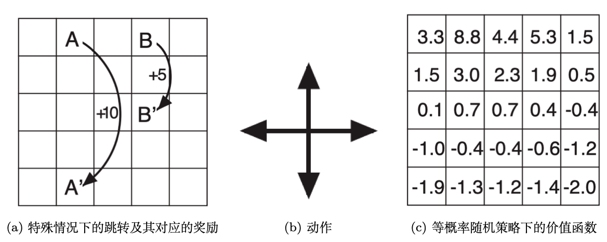

 
Hình 2.16 Ví dụ thế giới lưới (gridworld): dự đoán

Tiếp theo là bài toán điều khiển. Trong bài toán điều khiển, bối cảnh bài toán giống bài toán dự đoán, khác biệt duy nhất là: không còn giới hạn chính sách. Tức là kiểu hành động chưa biết, ta cần tự xác định. Vì vậy bằng cách giải bài toán điều khiển, ta tìm được hàm giá trị tối ưu của mỗi trạng thái, như hình 2.17b; và cũng có được chính sách tối ưu, như hình 2.17c.
Việc của bài toán điều khiển là: với cùng điều kiện, tìm xem trong tất cả các chính sách có thể có, hàm giá trị tối ưu là gì, chính sách tối ưu là gì.

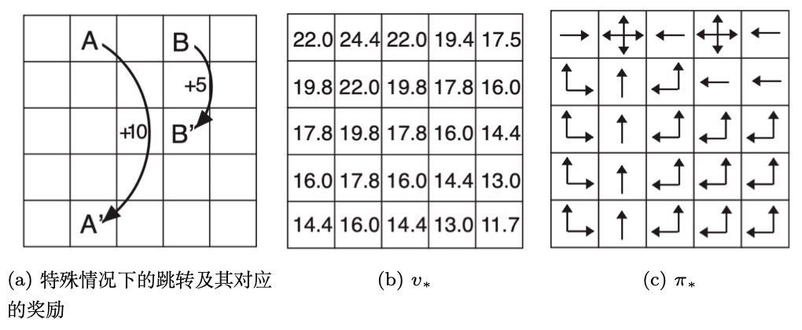

 
Hình 2.17 Ví dụ thế giới lưới: điều khiển

### 2.3.8 Quy hoạch động

**Quy hoạch động (dynamic programming, DP)** phù hợp để giải các bài toán thỏa mãn hai tính chất **cấu trúc con tối ưu (optimal substructure)** và **bài toán con chồng lấp (overlapping subproblem)**. Cấu trúc con tối ưu nghĩa là bài toán có thể tách thành từng bài toán nhỏ, bằng cách giải các bài toán nhỏ này, ta có thể kết hợp đáp án của chúng để có đáp án của bài toán gốc, tức lời giải tối ưu. Bài toán con chồng lấp nghĩa là bài toán con xuất hiện nhiều lần, và lời giải của bài toán con có thể được dùng lại, ta có thể lưu kết quả tính lần đầu của bài toán con và dùng trực tiếp khi cần lại.

Quá trình quyết định Markov thỏa mãn yêu cầu của quy hoạch động: trong phương trình Bellman, ta có thể phân tách nó thành cấu trúc đệ quy. Khi phân tách thành cấu trúc đệ quy, nếu trạng thái con của bài toán con có được một giá trị, thì trạng thái tương lai của nó, vì có liên quan trực tiếp với trạng thái con, cũng có thể được suy ra. Hàm giá trị có thể lưu trữ và tái sử dụng lời giải tối ưu của bài toán con. Quy hoạch động được áp dụng cho bài toán lập kế hoạch (planning) của quá trình quyết định Markov chứ không phải bài toán học (learning); ta phải biết hoàn toàn về môi trường mới có thể làm quy hoạch động, tức là phải biết xác suất chuyển trạng thái và phần thưởng tương ứng. Dùng quy hoạch động để giải bài toán dự đoán và bài toán điều khiển là cách rất hiệu quả để giải bài toán dự đoán và điều khiển của quá trình quyết định Markov.

### 2.3.9 Đánh giá chính sách trong quá trình quyết định Markov

Đánh giá chính sách là: cho trước quá trình quyết định Markov và chính sách, đánh giá xem ta có thể nhận được bao nhiêu giá trị, tức là với chính sách hiện tại, ta có thể nhận được giá trị lớn bao nhiêu. Ta có thể trực tiếp biến **backup kỳ vọng Bellman (Bellman expectation backup)** thành một quá trình lặp, lặp đi lặp lại cho đến khi hội tụ. Quá trình lặp này có thể xem là quá trình **backup đồng bộ (synchronous backup)**.

> Backup đồng bộ nghĩa là mỗi lần lặp đều cập nhật đầy đủ tất cả các trạng thái, điều này đòi hỏi rất nhiều tài nguyên tính toán. Ý tưởng của backup bất đồng bộ (asynchronous backup) là bằng một cách nào đó, khiến mỗi lần lặp không cần cập nhật tất cả các trạng thái, vì trên thực tế, nhiều trạng thái cũng không cần được cập nhật.

Biểu thức (2.18) cho thấy ta có thể chuyển backup kỳ vọng Bellman thành phép lặp quy hoạch động. Khi có $V_t$ ở thời điểm trước, ta có thể dùng quan hệ truy hồi để suy ra giá trị ở thời điểm tiếp theo. Lặp đi lặp lại, cuối cùng giá trị của $V$ đi từ $V_1$, $V_2$ đến giá trị sau khi hội tụ là $V_{\pi}$. $V_{\pi}$ chính là hàm giá trị ứng với chính sách $\pi$ đã cho.

$$
  V^{t+1}(s)=\sum_{a \in A} \pi(a \mid s)\left(R(s, a)+\gamma \sum_{s^{\prime} \in S} p\left(s^{\prime} \mid s, a\right) V^{t}\left(s^{\prime}\right)\right) \tag{2.18} 
$$

Ý tưởng cốt lõi của đánh giá chính sách là lặp đi lặp lại backup kỳ vọng Bellman như biểu thức (2.18), rồi thu được giá trị hội tụ của hàm giá trị. Vì đã cho trước hàm chính sách, nên ta có thể đơn giản hóa trực tiếp thành dạng biểu diễn của quá trình phần thưởng Markov, tương đương với việc bỏ $a$, tức là
$$
  V_{t+1}(s)=r_{\pi}(s)+\gamma P_{\pi}\left(s^{\prime} \mid s\right) V_{t}\left(s^{\prime}\right) \tag{2.19}
$$
Như vậy trong biểu thức lặp chỉ còn hàm giá trị và hàm chuyển trạng thái. Bằng cách lặp biểu thức (2.19), ta cũng có thể có giá trị của mỗi trạng thái. Vì dù trong quá trình phần thưởng Markov hay quá trình quyết định Markov, các biến mà hàm giá trị $V$ chứa đều chỉ liên quan đến trạng thái, nó biểu thị khi tác tử đi vào một trạng thái nào đó thì trong tương lai có thể nhận được bao nhiêu giá trị. Ví dụ môi trường hiện tại là một thế giới lưới nhỏ (small gridworld), mục đích của tác tử là bắt đầu đi từ một trạng thái nào đó rồi đến trạng thái kết thúc, trạng thái kết thúc của nó là góc trên bên trái và góc dưới bên phải (các ô tô đậm như trong hình 2.18 (phải)). Thế giới lưới nhỏ có tổng cộng 14 trạng thái không kết thúc: $1,\cdots,14$. Ta biểu diễn mỗi vị trí bằng một trạng thái. Như hình 2.18 (trái), trong thế giới lưới nhỏ, hàm chính sách của tác tử được cho trước trực tiếp, nó đi ngẫu nhiên ở mỗi trạng thái, tức là ở mỗi trạng thái đều đi lên, xuống, trái, phải, áp dụng chính sách ngẫu nhiên đều (uniform random policy), $\pi(\mathrm{l} \mid .)=\pi(\mathrm{r} \mid .)=\pi(\mathrm{u} \mid .)=\pi(\mathrm{d} \mid .)=0.25$. Khi ở trạng thái biên, ví dụ ở trạng thái số 4 mà đi sang trái thì vẫn ở lại trạng thái số 4. Ta thêm ràng buộc: hành động đi ra ngoài biên không làm thay đổi trạng thái, xác suất tương ứng đặt là 1, ví dụ $p(7\mid7,\mathrm{r})=1$.
Hàm phần thưởng ta đưa ra là tác tử mỗi bước đi sẽ nhận phần thưởng $-$1, tức là trước khi đến trạng thái kết thúc, mỗi bước đi đều nhận phần thưởng $-$1, vì vậy tác tử cần đến trạng thái kết thúc càng nhanh càng tốt.

Sau khi cho hành động, việc chuyển (transition) giữa các trạng thái là tất định, ví dụ $p(2 \mid 6$,u$)=1$, tức là từ trạng thái số 6 đi lên sẽ đến thẳng trạng thái số 2. Nhiều khi có những môi trường mang tính xác suất (probabilistic), ví dụ tác tử ở trạng thái số 6, khi nó chọn đi lên, sàn có thể trơn, khi đó nó có thể trượt đến trạng thái số 3 hoặc số 1, đây chính là chuyển trạng thái có xác suất. Nhưng ta đã đơn giản hóa môi trường, từ trạng thái số 6 đi lên thì đến trạng thái số 2. Vì đã biết mọi xác suất và xác suất chuyển trong môi trường, nên ta có thể dùng trực tiếp biểu thức (2.19) để lặp, như vậy sẽ tính được giá trị của mỗi trạng thái.

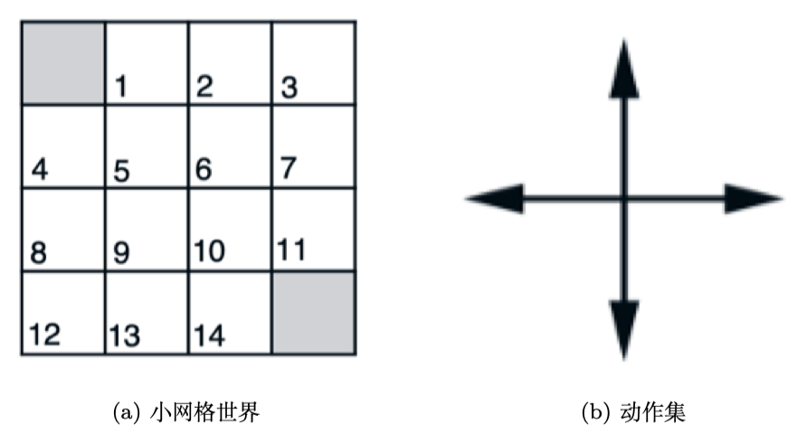

 
Hình 2.18 Môi trường thế giới lưới nhỏ

Hãy xem thêm một ví dụ động, giới thiệu [một trang web của Đại học Stanford](https://cs.stanford.edu/people/karpathy/reinforcejs/gridworld_dp.html), trang này mô phỏng quá trình thay đổi giá trị trạng thái của tất cả các ô trong quá trình cập nhật một bước như biểu thức (2.18).

Như hình 2.19a, thế giới lưới có rất nhiều ô, mỗi ô đại diện cho một trạng thái. Mỗi ô có một giá trị khởi tạo là 0. Mỗi ô còn có một mũi tên, mũi tên này chỉ chính sách tác tử nên thực hiện ở trạng thái hiện tại. Ở đây ta dùng chính sách ngẫu nhiên, bất kể tác tử ở trạng thái nào, xác suất đi lên, xuống, trái, phải đều bằng nhau. Ví dụ ở một trạng thái nào đó, tác tử có xác suất 0.25 cho mỗi hành động lên, xuống, trái, phải, vì vậy hành động của nó là hoàn toàn ngẫu nhiên. Trong môi trường như vậy, ta muốn tính giá trị của mỗi trạng thái. Ta cũng định nghĩa hàm phần thưởng, có thể thấy một số ô có giá trị $R$, ví dụ một số giá trị âm. Có thể thấy vài ô có phần thưởng $-$1, chỉ có một ô có phần thưởng +1. Ở vị trí giữa thế giới lưới, có thể thấy một ô có giá trị $R$ là 1. Vì vậy mỗi trạng thái ứng với một giá trị, có một số trạng thái không có giá trị nào, phần thưởng của chúng là 0.

Như hình 2.19b, ta bắt đầu đánh giá chính sách, đánh giá chính sách là một quá trình lặp liên tục. Khi khởi tạo, tất cả $V(s)$ đều bằng 0. Bây giờ ta lặp một lần, sau một lần lặp, giá trị của một số trạng thái đã thay đổi. Ví dụ một số trạng thái có giá trị $R$ là $-$1, sau một lần lặp, nó sẽ nhận phần thưởng $-$1. Với ô màu xanh lá ở giữa, vì phần thưởng của nó dương nên nó là trạng thái có giá trị +1. Khi lặp lần thứ 1, một số trạng thái đã có thay đổi giá trị.

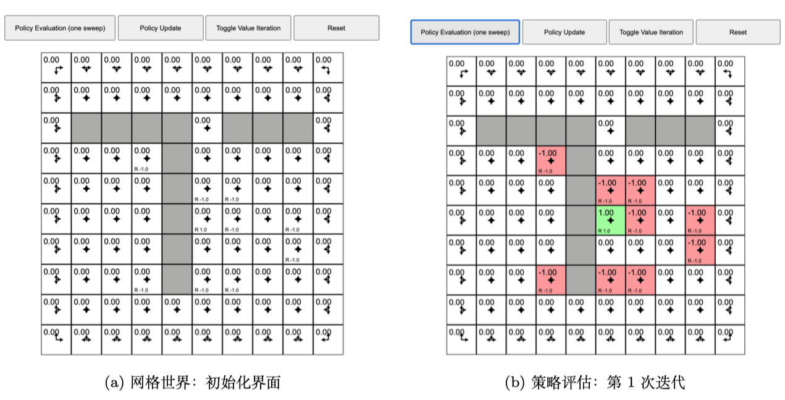

 
Hình 2.19 Thế giới lưới: ví dụ quy hoạch động

Như hình 2.20a, ta lặp thêm một lần, các trạng thái xung quanh những trạng thái đã có giá trị trước đó cũng bắt đầu có giá trị. Vì các trạng thái xung quanh nằm kề với các trạng thái đã có giá trị, nên điều này tương đương với việc chuyển giá trị từ các trạng thái xung quanh sang. Như hình 2.20b, ta lặp dần từng bước, giá trị liên tục thay đổi.

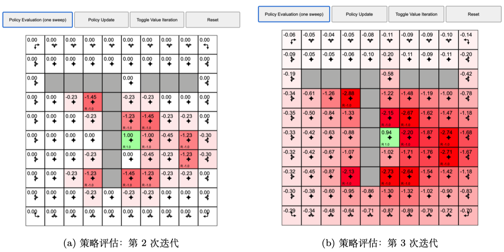

 
Hình 2.20 Thế giới lưới: ví dụ quá trình đánh giá chính sách

Sau khi lặp nhiều lần, hàm giá trị của một số trạng thái ở rất xa cũng đã có giá trị, và toàn bộ quá trình là một quá trình lan tỏa dần dần, đây thực chất cũng là sự trực quan hóa của đánh giá chính sách. Mỗi bước lặp, các trạng thái ở xa sẽ nhận được một ít giá trị, giá trị lan tỏa dần từ các trạng thái đã có phần thưởng. Sau khi thực hiện nhiều lần lặp, giá trị của các trạng thái sẽ dần ổn định, cuối cùng giá trị sẽ cố định không đổi. Sau khi hội tụ, giá trị của mỗi trạng thái chính là giá trị trạng thái của nó.

### 2.3.10 Điều khiển trong quá trình quyết định Markov

Đánh giá chính sách là khi cho trước quá trình quyết định Markov và chính sách, ta có thể ước lượng được giá trị của hàm giá trị. Nếu ta chỉ có quá trình quyết định Markov, thì nên tìm chính sách tốt nhất như thế nào để có được **hàm giá trị tối ưu (optimal value function)**?

Hàm giá trị tối ưu được định nghĩa là
$$
V^{*}(s)=\max _{\pi} V_{\pi}(s)
$$
Hàm giá trị tối ưu nghĩa là ta tìm kiếm một chính sách $\pi$ làm cho giá trị của mỗi trạng thái là lớn nhất. $V^*$ chính là trường hợp giá trị được tối đa hóa khi đến mỗi trạng thái.
Trong trường hợp tối đa hóa này, chính sách ta có được chính là chính sách tối ưu, tức là
$$
\pi^{*}(s)=\underset{\pi}{\arg \max }~ V_{\pi}(s)
$$
Chính sách tối ưu làm cho hàm giá trị của mỗi trạng thái đều đạt giá trị lớn nhất. Vì vậy nếu ta có được một hàm giá trị tối ưu, có thể coi môi trường của quá trình quyết định Markov đó là giải được. Trong trường hợp này, hàm giá trị tối ưu là duy nhất, giá trị cận trên có thể đạt được trong môi trường là duy nhất, nhưng có thể có nhiều chính sách tối ưu, nhiều chính sách tối ưu có thể đạt cùng một giá trị tối ưu.

Khi đã có hàm giá trị tối ưu, ta có thể tối đa hóa hàm Q để có chính sách tối ưu:
$$
  \pi^{*}(a \mid s)=\left\{\begin{array}{ll}
  1, &  a=\underset{a \in A}{\arg \max} Q^{*}(s, a) \\
  0, & \text {trường hợp khác }
  \end{array}\right.
$$

Khi hàm Q đã hội tụ, vì hàm Q là hàm của trạng thái và hành động, nên nếu ở một trạng thái nào đó thực hiện một hành động nào đó làm hàm Q lớn nhất, thì hành động đó chính là hành động tốt nhất. Nếu ta tối ưu được một hàm Q $Q^{*}(s, a)$, ta có thể trực tiếp lấy trong hàm Q hành động làm giá trị hàm Q lớn nhất, và như vậy rút ra được chính sách tối ưu.

Q: Tìm kiếm chính sách (policy search) như thế nào?

A: Phương pháp tìm kiếm chính sách đơn giản nhất là **vét cạn (exhaustive search)**. Giả sử số trạng thái và số hành động đều hữu hạn, thì ở mỗi trạng thái ta có thể chọn $A$ loại hành động, tổng cộng có $|A|^{|S|}$ chính sách có thể. Ta có thể vét cạn tất cả các chính sách, tính hàm giá trị của từng chính sách, so sánh là có được chính sách tối ưu.

Nhưng vét cạn rất kém hiệu quả, vì vậy ta phải dùng các phương pháp khác. Có hai phương pháp thường dùng để tìm chính sách tối ưu: lặp chính sách và lặp giá trị.

Quá trình tìm chính sách tối ưu chính là quá trình điều khiển của quá trình quyết định Markov. Điều khiển quá trình quyết định Markov là tìm một chính sách tối ưu giúp ta có được giá trị hàm giá trị lớn nhất, tức là

$$
  \pi^{*}(s)=\underset{\pi}{\arg \max } ~ V_{\pi}(s)
$$

Với một quá trình quyết định Markov đã được định sẵn, khi tác tử áp dụng chính sách tối ưu, chính sách tối ưu thường là tất định và dừng (nó không thay đổi theo thời gian). Nhưng chính sách tối ưu không nhất thiết là duy nhất, nhiều hành động có thể đạt cùng một giá trị.

Ta có thể giải bài toán điều khiển của quá trình quyết định Markov bằng lặp chính sách và lặp giá trị.

### 2.3.11 Lặp chính sách

Lặp chính sách gồm hai bước: đánh giá chính sách và cải thiện chính sách (policy improvement). Như hình 2.21a, bước thứ nhất là đánh giá chính sách, hiện tại ta đang tối ưu chính sách $\pi$, trong quá trình tối ưu ta có được một chính sách mới nhất. Trước tiên ta giữ chính sách này không đổi, rồi ước lượng giá trị của nó, tức là cho trước hàm chính sách hiện tại để ước lượng hàm giá trị trạng thái.
Bước thứ hai là cải thiện chính sách, sau khi có hàm giá trị trạng thái, ta có thể suy ra thêm hàm Q của nó. Có hàm Q rồi, ta trực tiếp tối đa hóa hàm Q, thông qua một phép tìm kiếm tham lam (greedy) trên hàm Q để cải thiện chính sách thêm nữa. Hai bước này được lặp liên tục. Vì vậy như hình 2.21b, trong lặp chính sách, khi khởi tạo, ta có một hàm giá trị trạng thái $V$ và chính sách $\pi$ được khởi tạo, rồi lặp giữa hai bước này. Đường phía trên của hình 2.21b là giá trị hàm giá trị trạng thái hiện tại, đường phía dưới là giá trị của chính sách.
Quá trình lặp chính sách giống như đá bóng qua lại. Trước tiên ta cho trước hàm chính sách hiện có, tính hàm giá trị trạng thái của nó. Tính xong hàm giá trị trạng thái, ta sẽ có một hàm Q. Ta áp dụng chính sách tham lam lên hàm Q, như vậy giống như đá bóng, "đá" ngược lại về chính sách. Sau đó cải thiện chính sách thêm, sau khi có một chính sách đã cải thiện, nó vẫn chưa phải chính sách tối ưu, ta lại đánh giá chính sách, lại có một hàm giá trị mới. Dựa trên hàm giá trị mới này lại tối đa hóa hàm Q, cứ lặp dần như vậy, hàm giá trị trạng thái và chính sách sẽ hội tụ.

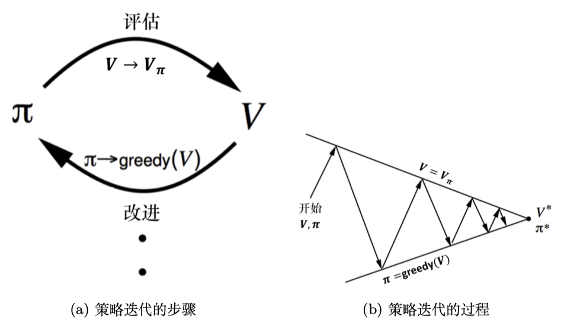

 
Hình 2.21 Lặp chính sách

Ở đây hãy xem lại bước thứ hai — cải thiện chính sách, xem ta cải thiện chính sách như thế nào. Sau khi có hàm giá trị trạng thái, ta có thể dùng hàm phần thưởng và hàm chuyển trạng thái để tính hàm Q:
$$
  Q_{\pi_{i}}(s, a)=R(s, a)+\gamma \sum_{s^{\prime} \in S} p\left(s^{\prime} \mid s, a\right) V_{\pi_{i}}\left(s^{\prime}\right)
$$

Với mỗi trạng thái, cải thiện chính sách sẽ cho ra chính sách của vòng mới; với mỗi trạng thái, ta lấy hành động làm nó đạt giá trị lớn nhất, tức là
$$
  \pi_{i+1}(s)=\underset{a}{\arg \max } ~Q_{\pi_{i}}(s, a)
$$

Như hình 2.22, ta có thể xem hàm Q như một **bảng Q (Q-table)**: trục ngang là tất cả các trạng thái, trục dọc là các hành động có thể có. Nếu có được hàm Q thì cũng có được bảng Q. Với một trạng thái, trong mỗi cột ta lấy giá trị lớn nhất, hành động ứng với giá trị lớn nhất chính là hành động nó nên thực hiện lúc này. Vì vậy phép arg max nghĩa là ở mỗi trạng thái chọn một hành động, hành động này là hành động làm giá trị hàm Q của cột đó lớn nhất.

 

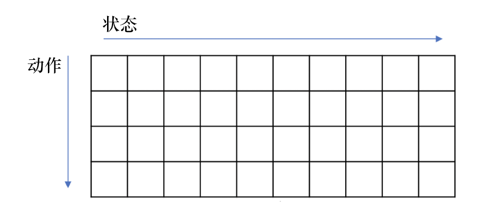

 
Hình 2.22 Bảng Q

**Phương trình tối ưu Bellman**

Khi ta liên tục thực hiện phép arg max, ta sẽ có một sự tăng đơn điệu. Bằng cách thực hiện phép tham lam này (phép arg max), ta sẽ có chính sách tốt hơn hoặc không đổi, mà không làm hàm giá trị kém đi. Vì vậy khi việc cải thiện dừng lại, ta sẽ có một chính sách tối ưu. Khi việc cải thiện dừng lại, ta lấy hành động làm giá trị hàm Q lớn nhất, hàm Q sẽ trực tiếp trở thành hàm giá trị, tức là
$$
  Q_{\pi}\left(s, \pi^{\prime}(s)\right)=\max _{a \in A} Q_{\pi}(s, a)=Q_{\pi}(s, \pi(s))=V_{\pi}(s)
$$

Ta cũng có được **phương trình tối ưu Bellman (Bellman optimality equation)**
$$
  V_{\pi}(s)=\max _{a \in A} Q_{\pi}(s, a)
$$
Phương trình tối ưu Bellman cho thấy: giá trị của một trạng thái dưới chính sách tối ưu phải bằng kỳ vọng của lợi tức thu được khi thực hiện hành động tốt nhất ở trạng thái đó. Khi quá trình quyết định Markov thỏa mãn phương trình tối ưu Bellman, toàn bộ quá trình quyết định Markov đã đạt trạng thái tối ưu.

Chỉ khi toàn bộ trạng thái đã hội tụ, khi ta có hàm giá trị tối ưu, phương trình tối ưu Bellman mới được thỏa mãn. Sau khi thỏa mãn phương trình tối ưu Bellman, ta có thể dùng phép tối đa hóa, tức là

$$
  V^{*}(s)=\max _{a} Q^{*}(s, a) \tag{2.20}
$$
Giá trị ứng với hành động làm giá trị hàm Q lớn nhất chính là giá trị hàm giá trị tối ưu của trạng thái hiện tại. Ngoài ra, ta đưa ra phương trình Bellman của hàm Q

$$
  Q^{*}(s, a)=R(s, a)+\gamma \sum_{s^{\prime} \in S} p\left(s^{\prime} \mid s, a\right) V^{*}\left(s^{\prime}\right) \tag{2.21}
$$

Thay biểu thức (2.20) vào biểu thức (2.21) ta được

$$
  \begin{aligned}
    Q^{*}(s, a)&=R(s, a)+\gamma \sum_{s^{\prime} \in S} p\left(s^{\prime} \mid s, a\right) V^{*}\left(s^{\prime}\right) \\
    &=R(s,a)+\gamma \sum_{s^{\prime} \in S} p\left(s^{\prime} \mid s, a\right) \max _{a'} Q^{*}(s', a')
    \end{aligned}
$$

Ta có được sự chuyển đổi giữa các hàm Q. Q-learning dựa trên phương trình tối ưu Bellman; khi lấy trạng thái có giá trị hàm Q lớn nhất ($\underset{a'}{\max} Q^{*}\left(s^{\prime}, a^{\prime}\right)$) ta được

$$
  Q^{*}(s, a)=R(s, a)+\gamma \sum_{s^{\prime} \in S} p\left(s^{\prime} \mid s, a\right) \max _{a^{\prime}} Q^{*}\left(s^{\prime}, a^{\prime}\right)
$$
Chúng ta sẽ giới thiệu nội dung cụ thể của Q-learning ở chương 3. Ta còn có thể thay biểu thức (2.21) vào biểu thức (2.20) để được

$$
  \begin{aligned}
    V^{*}(s)&=\max _{a} Q^{*}(s, a) \\
    &=\max_{a} \mathbb{E}[G_t|s_t=s,a_t=a]\\  
    &=\max_{a}\mathbb{E}[r_{t+1}+\gamma G_{t+1}|s_t=s,a_t=a]\\
    &=\max_{a}\mathbb{E}[r_{t+1}+\gamma V^*(s_{t+1})|s_t=s,a_t=a]\\
    &=\max_{a}\big(\mathbb{E}[r_{t+1}|s_t=s,a_t=a]+ \gamma\,\mathbb{E}[V^*(s_{t+1})|s_t=s,a_t=a]\big)\\
    &=\max_{a} \left(R(s,a) + \gamma \sum_{s^{\prime} \in S} p\left(s^{\prime} \mid s, a\right) V^{*}\left(s^{\prime}\right)\right)
    \end{aligned}
$$

> **Ghi chú của người dịch:** bản gốc ở dòng thứ 5 viết $\max_{a}\mathbb{E}[r_{t+1}]+\max_a \mathbb{E}[\gamma V^*(s_{t+1})\mid s_t=s,a_t=a]$, tức là tách $\max$. Đây có lẽ là viết nhầm: ý đúng là tách **kỳ vọng** (tuyến tính của kỳ vọng) và giữ nguyên một $\max_a$ bao cả hai số hạng, vì tách $\max$ là sai nói chung ($\max_a (x_a+y_a) \le \max_a x_a + \max_a y_a$). Bản dịch đã sửa dòng 5 và bỏ dòng 6 của bản gốc (cũng đang tách $\max$), vì sau khi sửa thì dòng tiếp theo chính là kết quả cuối. Tương tự, ở công thức thay (2.20) vào (2.21) phía trên, bản gốc viết $\max_{a} Q^{*}(s', a')$, bản dịch đã sửa thành $\max_{a'} Q^{*}(s', a')$.

Ta có được sự chuyển đổi của hàm giá trị trạng thái.

### 2.3.12 Lặp giá trị

**1. Nguyên lý tối ưu**

Ta suy nghĩ vấn đề từ một góc độ khác, phương pháp quy hoạch động chia bài toán tối ưu thành hai phần. Bước thứ nhất thực hiện hành động tối ưu. Sau đó mỗi bước của các trạng thái kế tiếp đều làm theo chính sách tối ưu, kết quả cuối cùng sẽ là tối ưu.

**Định lý nguyên lý tối ưu (principle of optimality theorem)**:
Một chính sách $\pi(a|s)$ đạt giá trị tối ưu tại trạng thái $s$, tức là $V_{\pi}(s) = V^{*}(s)$ đúng, khi và chỉ khi với mọi $s'$ có thể đến được từ $s$, chính sách đều đã đạt giá trị tối ưu. Tức là với mọi $s'$, $V_{\pi}(s') = V^{*}(s')$ luôn đúng.

**2. Lặp giá trị tất định**

Nếu ta biết lời giải tối ưu của bài toán con $V^{*}(s')$, thì có thể dùng lặp giá trị để có lời giải tối ưu $V^{*}(s)$. Lặp giá trị chính là dùng phương trình tối ưu Bellman như một quy tắc cập nhật, tức là
$$
  V(s) \leftarrow \max _{a \in A}\left(R(s, a)+\gamma \sum_{s^{\prime} \in S} p\left(s^{\prime} \mid s, a\right) V\left(s^{\prime}\right)\right) \tag{2.22}
$$

Chỉ khi toàn bộ quá trình quyết định Markov đã đạt trạng thái tối ưu thì biểu thức (2.22) mới thỏa mãn. Nhưng ta có thể chuyển nó thành một đẳng thức backup. Đẳng thức backup chính là một đẳng thức lặp. Ta liên tục lặp phương trình tối ưu Bellman, hàm giá trị sẽ dần tiến tới hàm giá trị tối ưu, đây là tinh túy của thuật toán lặp giá trị.

Để có $V^*$ tối ưu, với $V$ của mỗi trạng thái, ta trực tiếp lặp bằng phương trình tối ưu Bellman, sau nhiều lần lặp, hàm giá trị sẽ hội tụ. Thuật toán lặp giá trị này còn được gọi là lặp giá trị tất định (deterministic value iteration).

**3. Thuật toán lặp giá trị**

Quá trình của thuật toán lặp giá trị như sau.

(1) Khởi tạo: đặt $k=0$, với mọi trạng thái $s$, $V_0(s)=0$.

(2) Với $k=1:H$ ($H$ là số lần lặp cần để $V(s)$ hội tụ)

&ensp;&ensp;&ensp;&ensp;(a) Với mọi trạng thái $s$
$$
Q_{k+1}(s, a)=R(s, a)+\gamma \sum_{s^{\prime} \in S} p\left(s^{\prime} \mid s, a\right) V_{k}\left(s^{\prime}\right) \tag{2.23}
$$

$$
V_{k+1}(s)=\max _{a} Q_{k+1}(s, a) \tag{2.24}
$$

&ensp;&ensp;&ensp;&ensp;(b) $k \leftarrow k+1$.

(3) Sau khi lặp, rút ra chính sách tối ưu:
$$
\pi(s)=\underset{a}{\arg \max } \left[R(s, a)+\gamma \sum_{s^{\prime} \in S} p\left(s^{\prime} \mid s, a\right) V_{H+1}\left(s^{\prime}\right)\right]  
$$

Ta dùng thuật toán lặp giá trị để có được chính sách tối ưu $\pi$. Ta có thể dùng biểu thức (2.22) để lặp, giá trị thu được sau nhiều lần lặp và hội tụ chính là giá trị tối ưu.

Khi bắt đầu thuật toán lặp giá trị, ta khởi tạo tất cả các giá trị, rồi lặp trên từng trạng thái. Thay biểu thức (2.23) vào biểu thức (2.24) ta được biểu thức (2.22). Vì vậy, khi đã có biểu thức (2.23) và (2.24), ta cứ lặp liên tục, sau nhiều lần lặp hàm giá trị sẽ hội tụ, hội tụ rồi sẽ có $V^*$. Khi có $V^*$, một câu hỏi là làm sao suy ra chính sách tối ưu của nó. Ta có thể dùng trực tiếp phép arg max để rút ra chính sách tối ưu. Trước tiên ta tái tạo hàm Q, sau khi tái tạo, hành động có giá trị Q lớn nhất ứng với mỗi cột chính là chính sách tối ưu. Như vậy ta có thể rút ra chính sách tối ưu từ hàm giá trị tối ưu. Ở đây ta chỉ đang giải một bài toán lập kế hoạch (planning), chứ không phải bài toán học tăng cường, vì ta biết môi trường thay đổi thế nào.

Việc lặp giá trị làm tương tự như lan truyền ngược giá trị, mỗi lần lặp lan truyền một bước, vì vậy chính sách và hàm giá trị ở các bước trung gian là không có ý nghĩa. Còn kết quả của mỗi lần lặp trong lặp chính sách đều có ý nghĩa, đều là một chính sách hoàn chỉnh. Hình 2.23 là trực quan hóa một quá trình tìm đường đi ngắn nhất, trong một thế giới lưới, ta đặt một điểm đích, tức là điểm ở góc trên bên trái. Bất kể bắt đầu ở vị trí nào, ta đều muốn có thể đến được đích (thực ra điểm đích này không cần thiết trong quá trình lặp, chỉ để minh họa rõ hơn). Quá trình lặp của lặp giá trị giống như quá trình lan truyền ngược từ một trạng thái nào đó (ở đây là điểm đích) đến các trạng thái khác, vì mỗi lần lặp chỉ ảnh hưởng đến các trạng thái liên quan trực tiếp với nó.
Hãy nhớ lại định lý nguyên lý tối ưu: nếu hàm giá trị $V_{k+1}(s)$ của một trạng thái $s$ mà ta tính ở một lần lặp nào đó là lời giải tối ưu, thì điều kiện tiên quyết là tất cả các trạng thái $s^{\prime}$ có thể đến được từ trạng thái đó đều đã có lời giải tối ưu; nếu không, việc nó làm chỉ là một quá trình tương tự truyền hàm giá trị.

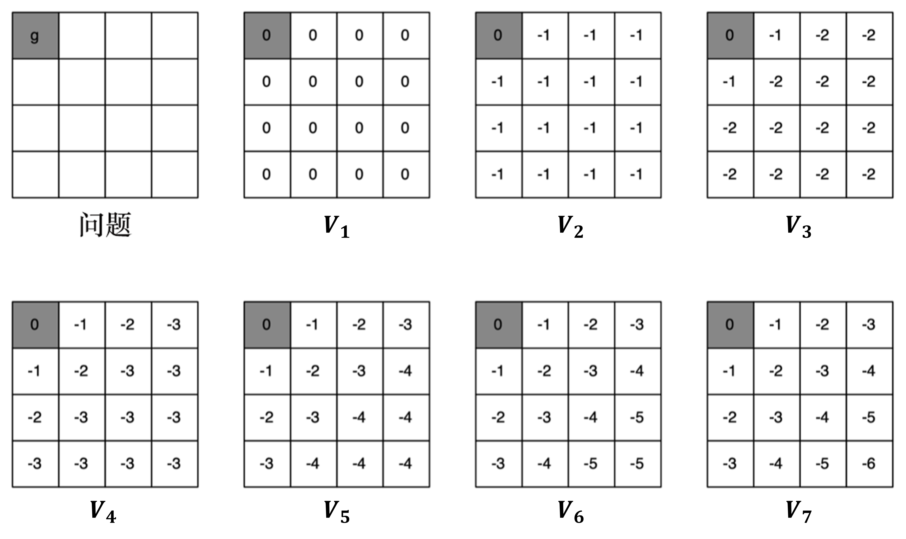

Hình 2.23 Ví dụ: đường đi ngắn nhất

Như hình 2.23, thực ra, với mỗi trạng thái, ta đều có thể xem nó là một điểm đích. Việc lặp bắt đầu từ mỗi điểm đích, mỗi lần ta đều tính lại giá trị dựa trên phương trình tối ưu Bellman. Nếu giá trị của các nút lân cận thay đổi, trở nên tốt hơn, thì giá trị của nó cũng sẽ tốt hơn, cho đến khi các nút lân cận không thay đổi nữa. Vì vậy, trước khi lặp đến $V_7$, tức là trước khi truyền giá trị tối ưu của mỗi điểm đích cho tất cả các trạng thái khác, các giá trị ở giữa chỉ là dữ liệu tạm thời chưa hoàn chỉnh, chúng không đại diện cho giá trị của mỗi trạng thái, vì vậy chính sách sinh ra là chính sách không có ý nghĩa. Lặp giá trị là một quá trình lặp, hình 2.23 trực quan hóa sự thay đổi giá trị của mỗi trạng thái từ $V_1$ đến $V_7$. Hơn nữa vì tác tử mỗi bước đi đều nhận một giá trị âm, nên nó cần đến đích càng nhanh càng tốt, có thể thấy trạng thái càng xa đích thì giá trị càng nhỏ. Sau khi $V_7$ hội tụ, giá trị ở góc dưới bên phải là $-$6, tương đương với việc nó phải đi 6 bước mới đến được đích. Tác tử càng gần đích thì giá trị càng lớn. Khi đã có giá trị tối ưu, ta có thể dùng phép rút trích chính sách (policy extraction) để có chính sách tối ưu.

### 2.3.13 Khác biệt giữa lặp chính sách và lặp giá trị
Hãy xem một minh họa động về điều khiển quá trình quyết định Markov, hình 2.24 là giao diện khởi tạo của thế giới lưới.

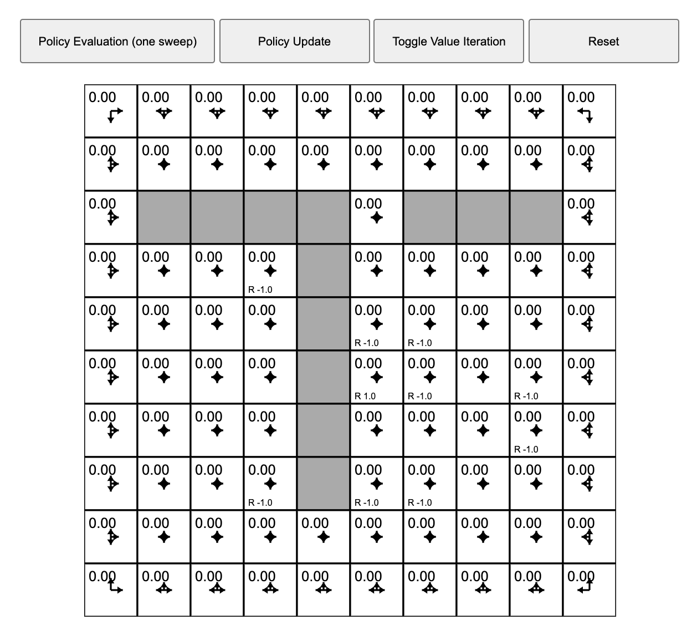

Hình 2.24 Thế giới lưới: giao diện khởi tạo

Trước tiên hãy xem lặp chính sách. Ví dụ trước đó dùng chính sách ngẫu nhiên cố định ở mỗi trạng thái, mỗi trạng thái đều đi lên, xuống, trái, phải với xác suất 0.25, không có thay đổi chính sách. Nhưng bây giờ ta muốn làm lặp chính sách, chính sách của mỗi trạng thái đều được thay đổi. Như hình 2.25a, trước tiên ta thực hiện một lần đánh giá chính sách, có được hàm giá trị, mỗi trạng thái đều có một giá trị. Như hình 2.25b, tiếp theo ta cải thiện chính sách, bấm "cập nhật chính sách (policy update)", khi đó chính sách ở một số ô đã thay đổi. Ví dụ với trạng thái $-$1 ở giữa, chính sách tối ưu của nó là đi xuống. Khi đến trạng thái $-$1, ta nên đi xuống, như vậy sẽ có giá trị tối ưu. Chính sách của ô bên phải ô màu xanh lá cũng thay đổi, chính sách tối ưu nó chọn bây giờ là đi sang trái, tức là ở trạng thái này, chính sách tối ưu là đi sang trái.

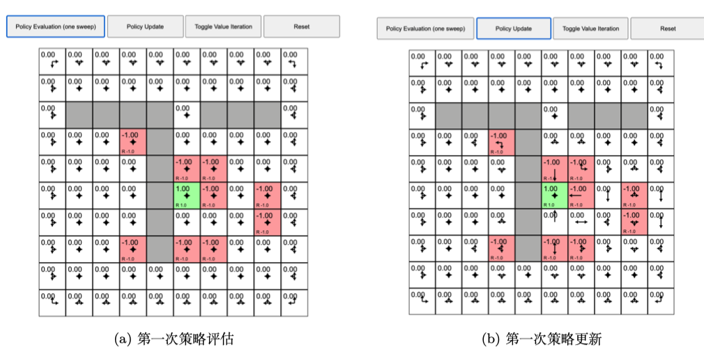

 
Hình 2.25 Điều khiển quá trình quyết định Markov: ví dụ lặp chính sách

Như hình 2.26a, ta thực hiện tiếp vòng đánh giá chính sách tiếp theo, giá trị trong các ô lại bị thay đổi. Sau nhiều lần, giá trị trong các ô sẽ hội tụ. Như hình 2.26b, ta lại thực hiện cập nhật chính sách, giá trị trong mỗi trạng thái hầu như đều thay đổi, chúng không còn thay đổi ngẫu nhiên lên, xuống, trái, phải nữa, mà chọn chính sách tối ưu để thay đổi.

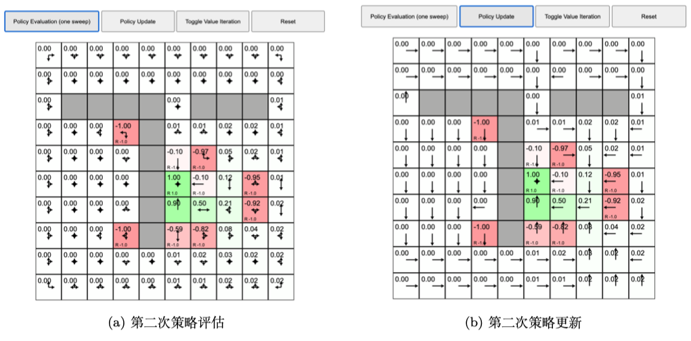

Hình 2.26 Điều khiển quá trình quyết định Markov: ví dụ lặp chính sách

Như hình 2.27a, ta lại thực hiện đánh giá chính sách, giá trị các ô lại liên tục thay đổi, thay đổi xong lại hội tụ. Như hình 2.27b, ta thực hiện thêm một lần cập nhật chính sách. Bây giờ giá trị các ô lại thay đổi, chính sách tối ưu của các ô ở mỗi trạng thái cũng có một số thay đổi. Như hình 2.28a, ta thực hiện thêm một lần cập nhật chính sách, giá trị các ô không thay đổi, điều này cho thấy toàn bộ quá trình quyết định Markov đã hội tụ. Vì vậy giá trị của mỗi trạng thái bây giờ chính là giá trị hàm giá trị tối ưu hiện tại, chính sách ứng với trạng thái hiện tại chính là chính sách tối ưu.

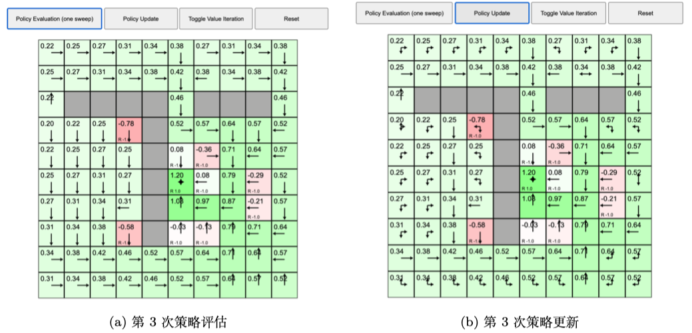

 
Hình 2.27 Điều khiển quá trình quyết định Markov: ví dụ lặp chính sách

Qua ví dụ trên, ta biết rằng lặp chính sách có thể "giải quyết" thế giới lưới. "Giải quyết" nghĩa là bất kể ở trạng thái nào, ta đều có thể dùng chính sách tối ưu ứng với trạng thái đó để đến được trạng thái nhận nhiều phần thưởng nhất.

Như hình 2.28b, ta lại dùng lặp giá trị để giải quá trình quyết định Markov, bấm "chuyển sang lặp giá trị". Khi giá trị các ô đã xác định, sẽ sinh ra trạng thái tối ưu của nó, chính sách rút ra từ trạng thái tối ưu trùng với chính sách tối ưu có được từ lặp chính sách. Ở mỗi trạng thái, ta dùng chính sách tối ưu là có thể đến được trạng thái nhận nhiều phần thưởng nhất.

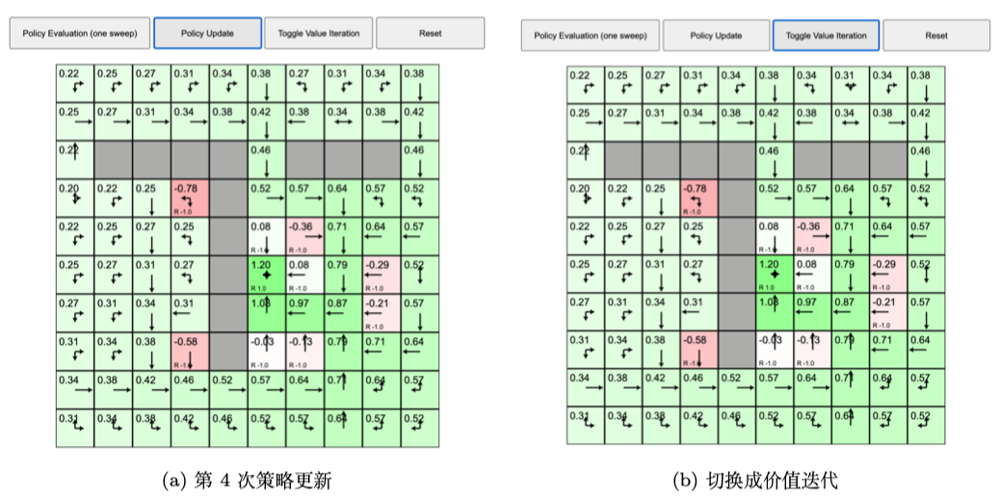

Hình 2.28 Điều khiển quá trình quyết định Markov: ví dụ lặp chính sách

Ta so sánh lại lặp chính sách và lặp giá trị, cả hai thuật toán đều có thể giải bài toán điều khiển của quá trình quyết định Markov. Lặp chính sách gồm hai bước. Trước tiên là đánh giá chính sách, tức là ước lượng giá trị cho hàm chính sách đã tìm được hiện tại. Sau khi có ước lượng, ta cải thiện chính sách, tức là tính hàm Q rồi cải thiện thêm. Lặp lại hai bước này cho đến khi chính sách hội tụ. Lặp giá trị trực tiếp dùng phương trình tối ưu Bellman để lặp, từ đó tìm hàm giá trị tối ưu. Tìm được hàm giá trị tối ưu rồi, ta mới rút ra chính sách tối ưu.

### 2.3.14 Tổng kết dự đoán và điều khiển trong quá trình quyết định Markov
Tổng kết như bảng 2.1, ta dùng thuật toán quy hoạch động để giải bài toán dự đoán và điều khiển trong quá trình quyết định Markov, và dùng các phương trình Bellman khác nhau. Với bài toán dự đoán, tức bài toán đánh giá chính sách, ta liên tục thực hiện phương trình kỳ vọng Bellman, như vậy có thể đánh giá chính sách đã cho và có được hàm giá trị. Với bài toán điều khiển, nếu thuật toán ta dùng là lặp chính sách thì dùng phương trình kỳ vọng Bellman; nếu thuật toán ta dùng là lặp giá trị thì dùng phương trình tối ưu Bellman.

Bảng 2.1 Thuật toán quy hoạch động

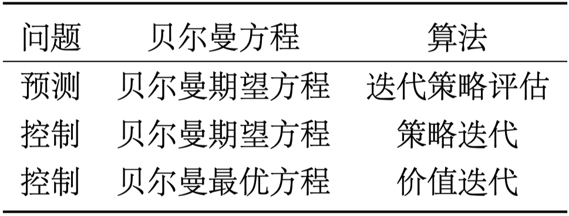

> Ghi chú bảng 2.1 (ảnh gốc bằng tiếng Trung):
>
> | Bài toán | Phương trình Bellman | Thuật toán |
> |---|---|---|
> | Dự đoán (prediction) | Phương trình kỳ vọng Bellman (Bellman expectation equation) | Đánh giá chính sách lặp (iterative policy evaluation) |
> | Điều khiển (control) | Phương trình kỳ vọng Bellman (Bellman expectation equation) | Lặp chính sách (policy iteration) |
> | Điều khiển (control) | Phương trình tối ưu Bellman (Bellman optimality equation) | Lặp giá trị (value iteration) |

## Tài liệu tham khảo
* [强化学习基础 David Silver 笔记 (Ghi chú Cơ bản học tăng cường của David Silver)](https://zhuanlan.zhihu.com/c_135909947)
* [Reinforcement Learning: An Introduction (second edition)](https://book.douban.com/subject/30323890/)
* [David Silver 强化学习公开课中文讲解及实践 (Giảng giải và thực hành khóa học mở về học tăng cường của David Silver)](https://zhuanlan.zhihu.com/reinforce)
* [UCL Course on RL(David Silver)](https://www.davidsilver.uk/teaching/)
* [Derivation of Bellman’s Equation](https://jmichaux.github.io/_notebook/2018-10-14-bellman/)
* [深入浅出强化学习：原理入门 (Học tăng cường dễ hiểu: Nhập môn nguyên lý)](https://book.douban.com/subject/27624485//)
