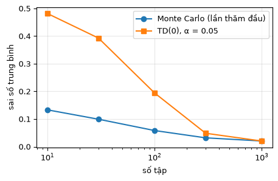
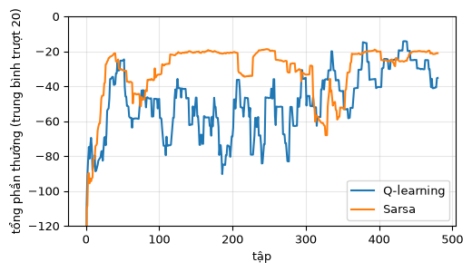
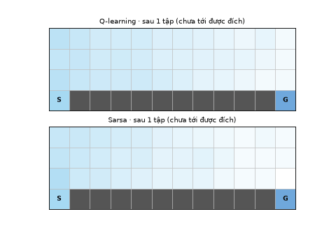
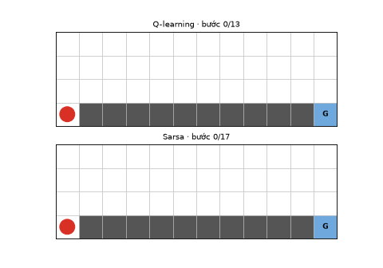

# Chương 3 · Code

> Ghi chú của người dịch: trang này do người dịch biên soạn, không có trong sách gốc. Code dạng bảng chuyển thể từ [MinRL](https://github.com/10-OASIS-01/minrl/tree/ed5eb99) (Yibin Liu, giấy phép MIT, commit `ed5eb99`) và từ [notebook đi kèm](https://github.com/nmc2004nd/easy-rl-vi/tree/main/notebooks) của bản gốc EasyRL. Chú thích đã dịch sang tiếng Việt. Phần không có trong MinRL được ghi *(thêm)*.
>
> Ký hiệu: trang này giữ ký hiệu của [chương 3](chapter3/chapter3_vi) ($V(s)$, $Q(s,a)$, $\alpha$, $\gamma$). Bảng quy đổi: [Quy ước ký hiệu](notation_vi).

## Cách dùng trang này

Mỗi khối code trên trang đã được chạy sẵn. Ngay bên dưới là kết quả (khung có nhãn "kết quả"), hình vẽ và ảnh động. Các khối chạy lần lượt từ trên xuống, dùng chung biến như các ô của một notebook.

Muốn tự sửa tham số (ví dụ `alpha`, `epsilon`) rồi chạy lại, xem [mục 6](#_6-chạy-trên-máy). Môi trường lưới, bộ đánh giá chính sách và hàm vẽ nằm trong thư mục [`docs/code/py/`](https://github.com/nmc2004nd/easy-rl-vi/tree/main/docs/code/py) (gói nhỏ `minrl_vi` và mô-đun `viz`). Phần thuật toán của chương được viết thẳng trên trang để đọc cho dễ.

## 1. Môi trường lưới

<small class="viz-ref">Mục 3.1 · ví dụ lưới của chương 2 và 3</small>

`GridWorld` của MinRL là một lưới vuông tất định. Tác tử xuất phát ở góc trên trái. Mỗi bước nhận phần thưởng $-0.1$. Bước vào ô kết thúc thì nhận phần thưởng của ô đó và tập kết thúc: góc dưới phải là đích ($+1$), hai góc còn lại là bẫy ($-1$). Hành động đâm vào biên bị loại khỏi tập hành động hợp lệ.

<!-- run -->
```python
from minrl_vi import GridWorld, Action

env = GridWorld(size=4)
print(env.render())          # A: tác tử, T: trạng thái kết thúc
print("Hành động hợp lệ ở ô 0:", [Action(a).name for a in env.get_valid_actions(0)])

# Mô hình p(s', r | s, a) của môi trường: hỏi mà không làm tác tử di chuyển
print("Từ ô 2 đi phải:", env.transition(2, Action.RIGHT))   # (s', r, kết_thúc)

# Tương tác thật: reset rồi step
s = env.reset()
for a in [Action.RIGHT, Action.RIGHT, Action.DOWN]:
    s, r, done, _ = env.step(a)
    print(f"a = {a.name:5s} → s' = {s:2d}, r = {r:+.1f}, kết thúc = {done}")
```

<!-- output -->
```output
A . . T
. . . .
. . . .
T . . T
Hành động hợp lệ ở ô 0: ['RIGHT', 'DOWN']
Từ ô 2 đi phải: (3, -1.0, True)
a = RIGHT → s' =  1, r = -0.1, kết thúc = False
a = RIGHT → s' =  2, r = -0.1, kết thúc = False
a = DOWN  → s' =  6, r = -0.1, kết thúc = False
```
<!-- /output -->

Mã nguồn của lớp này (bấm để mở):

[grid_world.py](../code/py/minrl_vi/grid_world.py ':include :type=code :fragment=GridWorld')

## 2. Đánh giá chính sách: quy hoạch động, Monte Carlo và TD

<small class="viz-ref">Mục 3.3.1–3.3.3 · công thức (3.1)</small>

Ta đánh giá chính sách ngẫu nhiên đều $\pi(a\mid s) = 1/|\mathcal A(s)|$ trên lưới 4×4 với $\gamma = 0.9$ bằng ba cách. Cách 1 biết mô hình, nên cho đáp án đúng để đối chiếu. Hai cách sau chỉ dùng các tập sinh ra từ tương tác.

### 2.1 Đáp án đúng: quy hoạch động

`PolicyEvaluator` lặp phương trình kỳ vọng Bellman cho tới khi hội tụ:

$$
V(s) \leftarrow \sum_{a} \pi(a\mid s)\big[r + \gamma V(s')\big]
$$

<!-- run -->
```python
import numpy as np
from minrl_vi import PolicyEvaluator, random_policy

gamma = 0.9
policy = random_policy(env)                      # policy[s] = vector xác suất π(·|s)
V_true = PolicyEvaluator(env, gamma).evaluate_policy(policy)
print(V_true.reshape(4, 4).round(3))
```

<!-- output -->
```output
[[-0.892 -0.88  -0.883  0.   ]
 [-0.88  -0.825 -0.73  -0.638]
 [-0.883 -0.73  -0.456 -0.061]
 [ 0.    -0.638 -0.061  0.   ]]
```
<!-- /output -->

[policy_evaluation.py](../code/py/minrl_vi/policy_evaluation.py ':include :type=code :fragment=PolicyEvaluator')

### 2.2 Monte Carlo

Đây là `MonteCarloEvaluator` của MinRL, rút gọn. Mỗi tập được quét ngược để tính lợi tức $G_t = r_{t+1} + \gamma G_{t+1}$. Sau đó giá trị được cập nhật bằng trung bình cộng dồn:

$$
N(s_t) \leftarrow N(s_t) + 1, \qquad V(s_t) \leftarrow V(s_t) + \frac{1}{N(s_t)}\big(G_t - V(s_t)\big)
$$

| Công thức | Dòng code |
|---|---|
| $G_t = r_{t+1} + \gamma G_{t+1}$ | `G = episode[t][2] + self.gamma * G` |
| lần thăm đầu tiên | `if first_visit and s in visited: continue` |
| $N(s_t) \leftarrow N(s_t)+1$ | `counts[s] += 1` |
| $V(s_t) \leftarrow V(s_t) + \frac{1}{N}(G_t - V(s_t))$ | `self.V[s] += (G - self.V[s]) / counts[s]` |

<!-- run -->
```python
class MonteCarloEvaluator:
    def __init__(self, env, gamma=0.99, seed=0):
        self.env, self.gamma = env, gamma
        self.rng = np.random.default_rng(seed)
        self.V = np.zeros(env.n_states)

    def generate_episode(self, policy, max_steps=1000):
        """Chạy một tập theo chính sách; trả về [(s_t, a_t, r_{t+1}), ...] và cờ bị cắt."""
        state, episode = self.env.reset(), []
        for _ in range(max_steps):
            action = self.rng.choice(self.env.n_actions, p=policy[state])
            nxt, reward, done, _ = self.env.step(action)
            episode.append((state, action, reward))
            state = nxt
            if done:
                return episode, False
        return episode, True

    def evaluate_policy(self, policy, num_episodes=1000, first_visit=True):
        self.V.fill(0)
        counts = np.zeros(self.env.n_states)
        for _ in range(num_episodes):
            episode, truncated = self.generate_episode(policy)
            if truncated:
                continue                  # tập bị cắt không cho lợi tức đầy đủ
            returns, G = np.zeros(len(episode)), 0.0
            for t in reversed(range(len(episode))):
                G = episode[t][2] + self.gamma * G          # G_t = r_{t+1} + γ G_{t+1}
                returns[t] = G
            visited = set()
            for (s, _, _), G in zip(episode, returns):
                if first_visit and s in visited:
                    continue
                visited.add(s)
                counts[s] += 1
                self.V[s] += (G - self.V[s]) / counts[s]   # trung bình cộng dồn
        return self.V.copy()

V_mc = MonteCarloEvaluator(env, gamma).evaluate_policy(policy, num_episodes=2000)
print(V_mc.reshape(4, 4).round(3))
print("Sai số lớn nhất so với đáp án:", np.abs(V_mc - V_true).max().round(4))
```

<!-- output -->
```output
[[-0.889 -0.875 -0.885  0.   ]
 [-0.878 -0.821 -0.739 -0.667]
 [-0.878 -0.714 -0.45  -0.051]
 [ 0.    -0.611 -0.055  0.   ]]
Sai số lớn nhất so với đáp án: 0.0297
```
<!-- /output -->

### 2.3 Sai phân thời gian TD(0) *(thêm)*

MinRL không có TD(0) để dự đoán, nên đoạn này được viết thêm theo cùng phong cách. Khác với Monte Carlo, TD(0) cập nhật ngay sau **mỗi bước** và dùng ước lượng $V(s_{t+1})$ thay cho phần lợi tức còn lại (tự cập nhật, bootstrapping). Đó là công thức (3.1):

$$
V(s_t) \leftarrow V(s_t) + \alpha\big(r_{t+1} + \gamma V(s_{t+1}) - V(s_t)\big)
$$

<!-- run -->
```python
def td0_evaluate(env, policy, gamma, alpha=0.05, num_episodes=2000, seed=0):
    rng = np.random.default_rng(seed)
    V = np.zeros(env.n_states)
    for _ in range(num_episodes):
        s = env.reset()
        for _ in range(1000):
            a = rng.choice(env.n_actions, p=policy[s])
            s_next, r, done, _ = env.step(a)
            td_target = r + gamma * (not done) * V[s_next]   # trạng thái kết thúc có V = 0
            V[s] += alpha * (td_target - V[s])               # công thức (3.1)
            s = s_next
            if done:
                break
    return V

V_td = td0_evaluate(env, policy, gamma)
print(V_td.reshape(4, 4).round(3))
print("Sai số lớn nhất so với đáp án:", np.abs(V_td - V_true).max().round(4))
```

<!-- output -->
```output
[[-0.87  -0.856 -0.892  0.   ]
 [-0.852 -0.812 -0.749 -0.703]
 [-0.829 -0.655 -0.377  0.182]
 [ 0.    -0.619  0.013  0.   ]]
Sai số lớn nhất so với đáp án: 0.2436
```
<!-- /output -->

### 2.4 So sánh theo số tập

Khối dưới vẽ sai số trung bình $\frac{1}{|\mathcal S|}\sum_s |V(s) - V_\pi(s)|$ theo số tập.

<!-- run -->
```python
import matplotlib.pyplot as plt

budgets = [10, 30, 100, 300, 1000]
err_mc = [np.abs(MonteCarloEvaluator(env, gamma, seed=1).evaluate_policy(policy, n) - V_true).mean() for n in budgets]
err_td = [np.abs(td0_evaluate(env, policy, gamma, num_episodes=n, seed=1) - V_true).mean() for n in budgets]

plt.figure(figsize=(5, 3))
plt.plot(budgets, err_mc, "o-", label="Monte Carlo (lần thăm đầu)")
plt.plot(budgets, err_td, "s-", label="TD(0), α = 0.05")
plt.xscale("log"); plt.xlabel("số tập"); plt.ylabel("sai số trung bình")
plt.legend(); plt.grid(alpha=.3)
```

<!-- output -->
<div align=center></div>
<!-- /output -->

Với $\alpha$ cố định, TD(0) không hội tụ hẳn mà dao động quanh đáp án. Monte Carlo dùng $1/N(s)$ nên sai số tiếp tục giảm. Hãy thử sửa `alpha=0.05` thành `0.01` hoặc `0.2` để xem sự đánh đổi giữa tốc độ và độ ồn.

## 3. Sarsa và Q-learning trên bài toán vách đá

<small class="viz-ref">Mục 3.4.1–3.4.3 · hình 3.9, 3.29–3.34 · công thức (3.4)</small>

Lưới có 4×12 ô (hình 3.9). Tác tử đi từ S tới G, mỗi bước nhận $-1$. Rơi xuống vách đá thì nhận $-100$ và bị đưa về S, nhưng tập **không** kết thúc. Đâm vào biên thì đứng yên và vẫn nhận $-1$. Lớp `CliffWalking` được viết thêm, cùng giao diện với `GridWorld`.

<!-- run -->
```python
from minrl_vi import CliffWalking

cliff = CliffWalking()
print(cliff.render())                      # S xuất phát, G đích, C vách đá
print(cliff.transition(36, Action.RIGHT))  # từ S bước sang phải → rơi xuống vách đá
```

<!-- output -->
```output
. . . . . . . . . . . .
. . . . . . . . . . . .
. . . . . . . . . . . .
S C C C C C C C C C C G
(36, -100.0, False)
```
<!-- /output -->

### 3.1 Phần chung: bảng Q và chính sách ε-tham lam

`select_action` lấy từ `QLearningAgent` của MinRL: với xác suất $\varepsilon$ thì chọn ngẫu nhiên, còn lại thì chọn hành động có $Q$ lớn nhất. Khi nhiều hành động bằng nhau, bản này chọn ngẫu nhiên trong số đó *(thêm)*. Nếu luôn lấy hành động đầu tiên, bảng Q toàn số 0 lúc đầu sẽ khiến tác tử luôn đi lên.

<!-- run -->
```python
class TabularAgent:
    def __init__(self, env, alpha=0.5, gamma=1.0, epsilon=0.1, seed=0):
        self.env, self.alpha, self.gamma, self.epsilon = env, alpha, gamma, epsilon
        self.rng = np.random.default_rng(seed)
        self.Q = np.zeros((env.n_states, env.n_actions))   # bảng Q

    def select_action(self, s, greedy=False):
        actions = self.env.get_valid_actions(s)
        if not greedy and self.rng.random() < self.epsilon:
            return int(self.rng.choice(actions))            # khám phá
        q = self.Q[s, actions]
        best = np.flatnonzero(q == q.max())                 # các hành động tốt nhất
        return int(actions[self.rng.choice(best)])          # khai thác

    def greedy_path(self, max_steps=100):
        """Đường đi khi chỉ khai thác (ε = 0)."""
        s, path = self.env.reset(), []
        for _ in range(max_steps):
            s, _, done, _ = self.env.step(self.select_action(s, greedy=True))
            path.append(s)
            if done:
                break
        return path
```

### 3.2 Q-learning (off-policy)

Vòng lặp và phép cập nhật lấy từ `QLearningAgent.train` / `update` của MinRL. Giá trị mục tiêu dùng $\max_{a'} Q(s',a')$, tức hành động tốt nhất ở $s'$, dù bước sau tác tử có thể không chọn hành động đó:

$$
Q(s_t,a_t) \leftarrow Q(s_t,a_t) + \alpha\Big[r_{t+1} + \gamma \max_{a'} Q(s_{t+1},a') - Q(s_t,a_t)\Big]
$$

<!-- run -->
```python
def q_learning(env, n_episodes=500, max_steps=1000, on_episode=None, **kw):
    agent, rewards = TabularAgent(env, **kw), []
    for ep in range(n_episodes):
        s, total = env.reset(), 0.0
        for _ in range(max_steps):
            a = agent.select_action(s)                      # hành vi: ε-tham lam
            s_next, r, done, _ = env.step(a)
            future = 0.0 if done else agent.Q[s_next].max() # mục tiêu: tham lam
            agent.Q[s, a] += agent.alpha * (r + agent.gamma * future - agent.Q[s, a])
            total += r
            s = s_next
            if done:
                break
        rewards.append(total)
        if on_episode:
            on_episode(ep, agent)       # để ghi lại quá trình học (dùng ở mục 3.5)
    return agent, rewards
```

### 3.3 Sarsa (on-policy) *(thêm)*

MinRL không có Sarsa. Đoạn dưới chỉ khác Q-learning ở **hai chỗ**. Thứ nhất, hành động kế tiếp $a_{t+1}$ được chọn **trước** khi cập nhật. Thứ hai, mục tiêu dùng chính $Q(s_{t+1}, a_{t+1})$ đó. Đây là công thức (3.4), đúng thứ tự $(s, a, r, s', a')$ đã đặt tên cho thuật toán:

$$
Q(s_t,a_t) \leftarrow Q(s_t,a_t) + \alpha\big[r_{t+1} + \gamma Q(s_{t+1},a_{t+1}) - Q(s_t,a_t)\big]
$$

<!-- run -->
```python
def sarsa(env, n_episodes=500, max_steps=1000, on_episode=None, **kw):
    agent, rewards = TabularAgent(env, **kw), []
    for ep in range(n_episodes):
        s, total = env.reset(), 0.0
        a = agent.select_action(s)
        for _ in range(max_steps):
            s_next, r, done, _ = env.step(a)
            a_next = None if done else agent.select_action(s_next)    # chọn a' TRƯỚC
            future = 0.0 if done else agent.Q[s_next, a_next]         # dùng đúng a' đó
            agent.Q[s, a] += agent.alpha * (r + agent.gamma * future - agent.Q[s, a])
            total += r
            s, a = s_next, a_next                                     # S ← S'; A ← A'
            if done:
                break
        rewards.append(total)
        if on_episode:
            on_episode(ep, agent)       # để ghi lại quá trình học (dùng ở mục 3.5)
    return agent, rewards
```

### 3.4 So sánh

Cả hai dùng $\alpha = 0.5$, $\gamma = 1$, $\varepsilon = 0.1$ cố định, chạy 500 tập.

<!-- run -->
```python
agent_q, rew_q = q_learning(cliff, seed=0)
agent_s, rew_s = sarsa(cliff, seed=0)

for name, agent, rew in [("Q-learning", agent_q, rew_q), ("Sarsa", agent_s, rew_s)]:
    path = agent.greedy_path()
    print(f"{name}: tổng thưởng trung bình 100 tập cuối = {np.mean(rew[-100:]):.1f}, "
          f"đường tham lam dài {len(path)} bước")
    print(cliff.render(path), "\n")

def smooth(x, k=20):
    return np.convolve(x, np.ones(k) / k, mode="valid")

plt.figure(figsize=(5.5, 3))
plt.plot(smooth(rew_q), label="Q-learning")
plt.plot(smooth(rew_s), label="Sarsa")
plt.ylim(-120, 0); plt.xlabel("tập"); plt.ylabel("tổng phần thưởng (trung bình trượt 20)")
plt.legend(); plt.grid(alpha=.3)
```

<!-- output -->
```output
Q-learning: tổng thưởng trung bình 100 tập cuối = -30.1, đường tham lam dài 13 bước
. . . . . . . . . . . .
. . . . . . . . . . . .
* * * * * * * * * * * *
S C C C C C C C C C C G 

Sarsa: tổng thưởng trung bình 100 tập cuối = -22.2, đường tham lam dài 17 bước
. . . * * * * * * * * .
* * * * . . . . . . * .
* . . . . . . . . . * *
S C C C C C C C C C C G 
```

<div align=center></div>
<!-- /output -->

Kết quả khớp với phân tích ở mục 3.4.3:

- **Q-learning** học được đường **ngắn nhất** (13 bước), đi sát mép vách đá. Nhưng trong lúc huấn luyện, tác tử vẫn khám phá với $\varepsilon = 0.1$, nên thỉnh thoảng bước hụt xuống vách đá. Vì thế tổng thưởng *khi huấn luyện* của nó thấp hơn.
- **Sarsa** học giá trị của chính chính sách ε-tham lam mà nó đang thực thi. Nó "biết" mình có thể bước hụt, nên chọn đường **vòng xa** vách đá. Đường dài hơn nhưng an toàn hơn, nên tổng thưởng khi huấn luyện cao hơn.

Có thể xem từng bước cập nhật bảng Q ở trang [Mô phỏng](chapter3/chapter3_viz_vi).

### 3.5 Xem quá trình học

Khối dưới chạy lại hai thuật toán và chụp bảng Q sau mỗi 10 tập. Màu nền là $\max_a Q(s,a)$: càng nhạt thì càng gần 0, tức càng gần đích. Đường màu cam là đường đi tham lam ở thời điểm đó.

<!-- run -->
```python
from viz import save_gif, plot_cliff

snaps = {"Q-learning": [], "Sarsa": []}
def recorder(name):
    def on_episode(ep, agent):
        if ep % 10 == 0 or ep == 499:
            snaps[name].append((ep, agent.Q.copy(), agent.greedy_path(max_steps=60)))
    return on_episode

q_learning(cliff, seed=0, on_episode=recorder("Q-learning"))
sarsa(cliff, seed=0, on_episode=recorder("Sarsa"))
cliff.reset()

def draw(fig, i):
    for row, name in enumerate(snaps):
        ep, Q, path = snaps[name][i]
        ax = fig.add_subplot(2, 1, row + 1)
        done = path and path[-1] == cliff.goal
        plot_cliff(ax, cliff, Q=Q, path=path if done else (),
                   title=f"{name} · sau {ep + 1} tập" + ("" if done else " (chưa tới được đích)"))

save_gif(draw, len(snaps["Sarsa"]), "cliff_training.gif", fps=5, figsize=(6, 4.2))
```

<!-- output -->
<div align=center></div>
<!-- /output -->

Ở vài chục tập đầu, đường tham lam còn chưa tới được đích. Sau đó Q-learning nhanh chóng "dán" vào mép vách đá. Sarsa lùi ra xa dần, vì những lần bước hụt do khám phá kéo giá trị của các ô sát mép xuống.

Cuối cùng là hai tác tử đã học xong đi theo chính sách tham lam ($\varepsilon = 0$):

<!-- run -->
```python
paths = {"Q-learning": agent_q.greedy_path(), "Sarsa": agent_s.greedy_path()}
cliff.reset()
n_frames = max(len(p) for p in paths.values()) + 1

def draw_walk(fig, t):
    for row, (name, path) in enumerate(paths.items()):
        ax = fig.add_subplot(2, 1, row + 1)
        k = min(t, len(path))
        pos = cliff.start_state if k == 0 else path[k - 1]
        plot_cliff(ax, cliff, path=path[:k], agent=pos,
                   title=f"{name} · bước {k}/{len(path)}")

save_gif(draw_walk, n_frames, "cliff_walk.gif", fps=3, figsize=(6, 4.2))
```

<!-- output -->
<div align=center></div>
<!-- /output -->

## 4. Code notebook của EasyRL

Bản gốc EasyRL có notebook cho chương này. Bản dịch đã chuyển chúng từ Gym sang Gymnasium. Lớp `QLearning` dưới đây lấy nguyên từ [`QLearning_vi.ipynb`](https://github.com/nmc2004nd/easy-rl-vi/blob/main/notebooks/Q-learning/QLearning_vi.ipynb). Khác biệt so với MinRL: bảng Q là `defaultdict`, và $\varepsilon$ giảm dần theo hàm mũ thay vì cố định. Khối này cần thêm `gymnasium`. Phần vẽ bằng `turtle` và `seaborn` đã được bỏ đi.

<!-- run -->
```python
import math
from collections import defaultdict
import gymnasium as gym

class QLearning(object):
    def __init__(self, n_states, n_actions, cfg):
        self.n_actions = n_actions
        self.lr = cfg.lr  # tốc độ học
        self.gamma = cfg.gamma
        self.epsilon = cfg.epsilon_start
        self.sample_count = 0
        self.epsilon_start = cfg.epsilon_start
        self.epsilon_end = cfg.epsilon_end
        self.epsilon_decay = cfg.epsilon_decay
        self.Q_table = defaultdict(lambda: np.zeros(n_actions))  # bảng Q: trạng thái -> giá trị Q của từng hành động

    def sample_action(self, state):
        ''' Lấy mẫu hành động, dùng khi huấn luyện '''
        self.sample_count += 1
        self.epsilon = self.epsilon_end + (self.epsilon_start - self.epsilon_end) * \
            math.exp(-1. * self.sample_count / self.epsilon_decay)  # epsilon giảm dần theo hàm mũ
        if np.random.uniform(0, 1) > self.epsilon:
            action = np.argmax(self.Q_table[str(state)])  # chọn hành động có Q(s,a) lớn nhất
        else:
            action = np.random.choice(self.n_actions)     # chọn hành động ngẫu nhiên
        return action

    def predict_action(self, state):
        ''' Chọn hành động khi kiểm thử '''
        return np.argmax(self.Q_table[str(state)])

    def update(self, state, action, reward, next_state, terminated):
        Q_predict = self.Q_table[str(state)][action]
        if terminated:  # trạng thái kết thúc
            Q_target = reward
        else:
            Q_target = reward + self.gamma * np.max(self.Q_table[str(next_state)])
        self.Q_table[str(state)][action] += self.lr * (Q_target - Q_predict)

class Config:
    def __init__(self):
        self.env_name = 'CliffWalking-v1'
        self.train_eps = 400      # số tập huấn luyện
        self.epsilon_start = 0.95
        self.epsilon_end = 0.01
        self.epsilon_decay = 300
        self.gamma = 0.9
        self.lr = 0.1
        self.seed = 1

cfg = Config()
np.random.seed(cfg.seed)
env_gym = gym.make(cfg.env_name)
agent = QLearning(env_gym.observation_space.n, env_gym.action_space.n, cfg)

rewards = []
for i_ep in range(cfg.train_eps):
    ep_reward = 0
    state, info = env_gym.reset(seed=cfg.seed)
    while True:
        action = agent.sample_action(state)
        next_state, reward, terminated, truncated, info = env_gym.step(action)
        agent.update(state, action, reward, next_state, terminated)
        state = next_state
        ep_reward += reward
        if terminated or truncated:
            break
    rewards.append(ep_reward)
    if (i_ep + 1) % 80 == 0:
        print(f"Tập: {i_ep+1}/{cfg.train_eps}, Phần thưởng: {ep_reward:.1f}, Epsilon: {agent.epsilon:.3f}")

# Kiểm thử một tập, chỉ khai thác
state, _ = env_gym.reset(seed=cfg.seed)
ep_reward = 0
for _ in range(100):
    state, reward, terminated, truncated, _ = env_gym.step(agent.predict_action(state))
    ep_reward += reward
    if terminated or truncated:
        break
print("Phần thưởng khi kiểm thử:", ep_reward, "(tối ưu là -13)")
```

<!-- output -->
```output
Tập: 80/400, Phần thưởng: -39.0, Epsilon: 0.010
Tập: 160/400, Phần thưởng: -124.0, Epsilon: 0.010
Tập: 240/400, Phần thưởng: -32.0, Epsilon: 0.010
Tập: 320/400, Phần thưởng: -13.0, Epsilon: 0.010
Tập: 400/400, Phần thưởng: -13.0, Epsilon: 0.010
Phần thưởng khi kiểm thử: -13 (tối ưu là -13)
```
<!-- /output -->

Các notebook đầy đủ của chương này. Notebook nào chỉ dùng môi trường có sẵn của Gymnasium thì có thêm link Colab. Hai notebook còn lại cần các file trong `notebooks/envs/`, nên hãy clone repo rồi chạy trên máy.

| Notebook | Nội dung | Mở |
|---|---|---|
| `Q-learning/QLearning_vi.ipynb` | Q-learning trên CliffWalking, có vẽ đường cong | [GitHub](https://github.com/nmc2004nd/easy-rl-vi/blob/main/notebooks/Q-learning/QLearning_vi.ipynb) · [Colab](https://colab.research.google.com/github/nmc2004nd/easy-rl-vi/blob/main/notebooks/Q-learning/QLearning_vi.ipynb) |
| `Q-learning/Q-learning探索策略研究_vi.ipynb` | So sánh các chiến lược khám phá | [GitHub](https://github.com/nmc2004nd/easy-rl-vi/blob/main/notebooks/Q-learning/Q-learning探索策略研究_vi.ipynb) |
| `Sarsa_vi.ipynb` | Sarsa trên FrozenLake-v1 | [GitHub](https://github.com/nmc2004nd/easy-rl-vi/blob/main/notebooks/Sarsa_vi.ipynb) · [Colab](https://colab.research.google.com/github/nmc2004nd/easy-rl-vi/blob/main/notebooks/Sarsa_vi.ipynb) |
| `MonteCarlo_vi.ipynb` | Monte Carlo điều khiển trên Racetrack (môi trường tự viết trong `notebooks/envs/`) | [GitHub](https://github.com/nmc2004nd/easy-rl-vi/blob/main/notebooks/MonteCarlo_vi.ipynb) |

## 5. Bài tập

1. Trong mục 3.4, đặt `epsilon=0.0` cho cả hai thuật toán (tham số `epsilon` của `TabularAgent`, truyền qua `q_learning(cliff, epsilon=0.0)`). Hai đường đi còn khác nhau không?
2. Cho $\varepsilon$ của Sarsa giảm dần theo tập (gợi ý: thêm `agent.epsilon *= 0.995` vào cuối mỗi tập, chạy 1000 tập). Lý thuyết nói rằng khi $\varepsilon \to 0$, Sarsa tiến dần về chính sách tối ưu. Hãy dự đoán đường đi trước, rồi chạy để kiểm tra.
3. Trong mục 2.2, đổi `first_visit=True` thành `False` (Monte Carlo mọi lần thăm). Sai số thay đổi ra sao?
4. Sửa `q_learning` thành **Expected Sarsa**: thay `agent.Q[s_next].max()` bằng giá trị kỳ vọng của $Q(s', \cdot)$ theo chính sách ε-tham lam.

<details>
<summary>Gợi ý đáp án</summary>

1. Với $\varepsilon = 0$, Sarsa và Q-learning trùng nhau: hành động kế tiếp luôn là hành động tham lam, nên $Q(s',a') = \max_{a'} Q(s',a')$. Cả hai đều học đường sát mép (bảng Q khởi tạo 0 cùng phần thưởng âm vẫn đủ để khám phá, vì hành động chưa thử luôn có vẻ tốt hơn).
2. Có thể bất ngờ: đường đi gần như vẫn là đường vòng 17 bước, kể cả khi giảm chậm hơn (`0.999`, 3000 tập). Lý do là khi $\varepsilon$ đã nhỏ, tác tử hầu như không đi vào các ô sát mép nữa. Giá trị $Q$ của các ô đó vẫn mang "vết" của những lần rơi xuống vách đá trước kia, và không được thăm lại đủ nhiều để sửa. Kết quả lý thuyết (điều kiện GLIE) đòi hỏi mọi cặp $(s,a)$ được thăm vô hạn lần. Điều kiện đó đúng trong giới hạn, nhưng với số tập hữu hạn thì không có gì bảo đảm.
3. Cả hai đều hội tụ về $V_\pi$. Với 2000 tập, sai số lớn nhất là khoảng 0.030 (lần thăm đầu) và 0.038 (mọi lần thăm), tức gần như nhau. Mọi lần thăm dùng nhiều mẫu hơn, nhưng các mẫu trong cùng một tập tương quan với nhau, và ước lượng bị chệch khi số tập còn ít.
4. `p = np.full(4, agent.epsilon / 4); p[agent.Q[s_next].argmax()] += 1 - agent.epsilon; future = 0.0 if done else p @ agent.Q[s_next]`.

</details>

## 6. Chạy trên máy

Gói `minrl_vi` chỉ cần `numpy`, thêm `matplotlib` để vẽ (và `pillow` để lưu GIF). Mục 4 cần thêm `gymnasium`.

```bash
git clone https://github.com/nmc2004nd/easy-rl-vi.git
cd easy-rl-vi/docs/code/py          # chạy từ thư mục này để import được minrl_vi, viz
pip install numpy matplotlib pillow gymnasium
python -c "from minrl_vi import CliffWalking; print(CliffWalking().render())"
```

Sau đó chép lần lượt các khối code trên trang vào Jupyter (hoặc một file `.py`) rồi chạy, theo đúng thứ tự từ trên xuống. Ảnh GIF sẽ được lưu vào thư mục hiện tại.

Kết quả và hình trên trang này được dựng bằng `python3 scripts/build_code_pages.py docs/chapter3/chapter3_code_vi.md`. Sửa code trên trang thì chạy lại lệnh đó để cập nhật kết quả.

Muốn xem bản đầy đủ, gồm DQN, actor-critic, PPO và các bài kiểm thử, hãy dùng repo gốc [MinRL](https://github.com/10-OASIS-01/minrl).
