# Chương 3 Phương pháp dạng bảng

Cách biểu diễn chính sách đơn giản nhất là bảng tra cứu (look-up table), tức chính sách dạng bảng (tabular policy). Các phương pháp học tăng cường dùng bảng tra cứu được gọi là **phương pháp dạng bảng (tabular method)**, như Monte Carlo, Q-learning và Sarsa. Chương này dùng các phương pháp dạng bảng đơn giản nhất để giảng giải cách dùng phương pháp dựa trên giá trị (value-based) giải bài toán học tăng cường.

## 3.1 Quá trình quyết định Markov

Học tăng cường là bài toán ra quyết định tuần tự (sequential decision making) liên quan đến thời gian. Ví dụ, như hình 3.1, ở thời điểm $t-1$, tôi thấy con gấu vẫy tay với tôi, hành động theo phản xạ là bỏ chạy. Con gấu thấy có người bỏ chạy, có thể nghĩ đã phát hiện ra con mồi và bắt đầu tấn công. Còn ở thời điểm $t$, nếu tôi chọn hành động giả chết, có thể con gấu cắn cắn tôi, quăng vài cái rồi thấy chán và bỏ đi. Lúc này tôi mới bỏ chạy thì có thể sẽ thành công, đây chính là một quá trình ra quyết định tuần tự.

Trước khi đưa ra mỗi hành động, ta có thể chọn các hành động khác nhau. Ví dụ ở thời điểm $t$, khi tôi chọn bỏ chạy thì có thể con gấu đã đuổi kịp. Nếu ở thời điểm $t$, tôi không chọn giả chết mà chọn bỏ chạy, lúc này con gấu đã đuổi kịp, thì tôi sẽ chuyển sang các trạng thái khác nhau. Có một xác suất nhất định tôi sẽ chạy thoát, cũng có một xác suất nhất định tôi sẽ chạy thất bại. Ta dùng xác suất chuyển trạng thái (state transition probability) $p\left[s_{t+1}, r_{t} \mid s_{t}, a_{t}\right]$ để biểu thị xác suất khi ở trạng thái $s_t$ chọn hành động $a_t$ thì chuyển sang trạng thái $s_{t+1}$ và nhận phần thưởng $r_t$ là bao nhiêu. Xác suất chuyển trạng thái có **tính chất Markov** (trạng thái của hệ ở thời điểm tiếp theo chỉ do trạng thái ở thời điểm hiện tại quyết định, không phụ thuộc vào bất kỳ trạng thái nào trước đó). Vì trong quá trình này, trạng thái ở thời điểm tiếp theo phụ thuộc vào trạng thái hiện tại $s_t$, nó không liên quan đến $s_{t-1}$ và $s_{t-2}$ trước đó. Cộng thêm việc quá trình này còn phụ thuộc vào $a_t$ trong tương tác giữa tác tử và môi trường, nên nó chứa quá trình ra quyết định, ta gọi quá trình như vậy là quá trình quyết định Markov (Markov decision process, MDP). Quá trình quyết định Markov là cách biểu diễn kinh điển của ra quyết định tuần tự. Quá trình quyết định Markov cũng là một khung học rất cơ bản trong học tăng cường. Trạng thái, hành động, xác suất chuyển trạng thái và phần thưởng $(S$, $A$, $P$, $R)$, 4 tập hợp này tạo thành bộ bốn của quá trình quyết định Markov trong học tăng cường, về sau có thể thêm hệ số chiết khấu (discount factor) để tạo thành bộ năm.

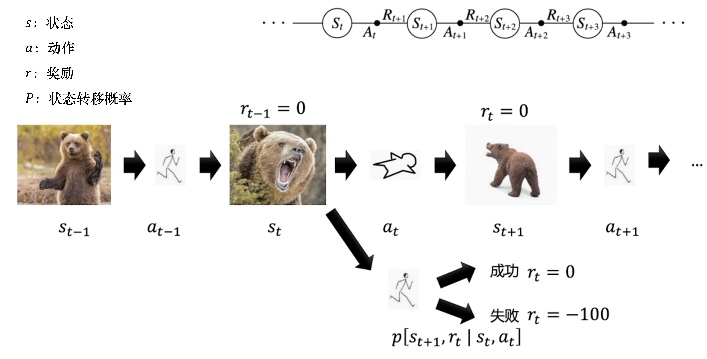

Hình 3.1 Bộ bốn của quá trình quyết định Markov

### 3.1.1 Có mô hình

Như hình 3.2, ta vẽ quan hệ giữa các hành động có thể và các chuyển trạng thái có thể thành dạng cây. Quan hệ giữa chúng là quá trình đi từ $s_t$ đến $a_t$, rồi đến $s_{t+1}$, rồi đến $a_{t+1}$, rồi đến $s_{t+2}$.
Khi tương tác với môi trường, ta chỉ có thể đi một con đường hoàn chỉnh, trong đó sinh ra một chuỗi quá trình ra quyết định, việc ta tương tác với môi trường sinh ra kinh nghiệm (experience). Ta dùng **hàm xác suất (probability function)** $P\left[s_{t+1}, r_{t} \mid s_{t}, a_{t}\right]$ và hàm phần thưởng (reward function) $R\left[s_{t}, a_{t}\right]$ để mô tả môi trường. Hàm xác suất chính là xác suất chuyển trạng thái, nó phản ánh tính ngẫu nhiên của môi trường.

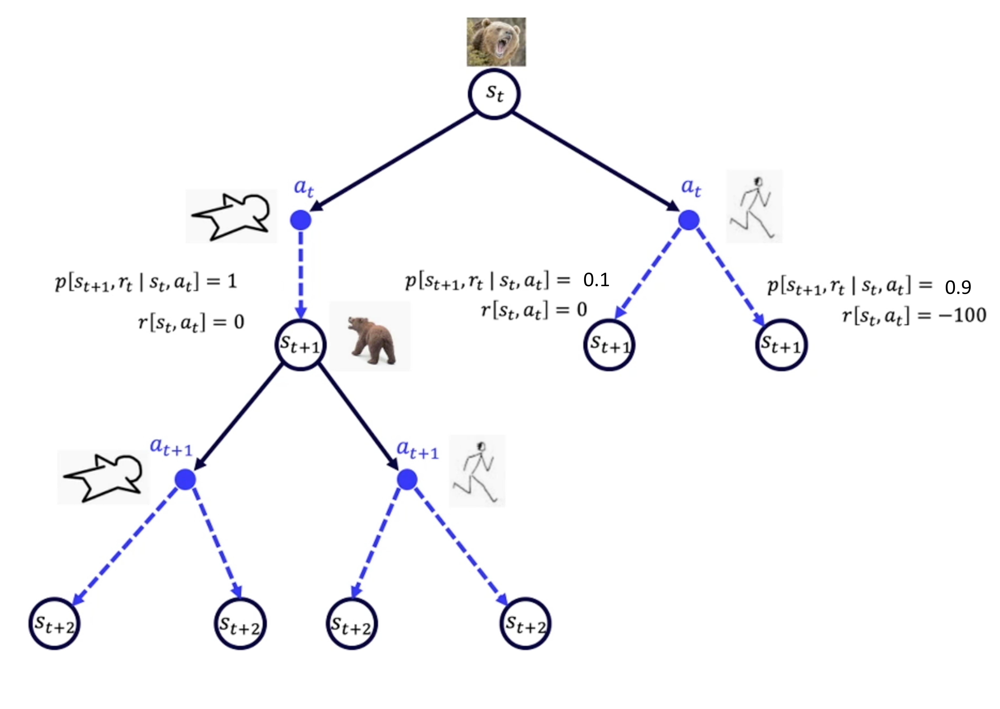

Hình 3.2 Chuyển trạng thái và ra quyết định tuần tự

Nếu ta biết hàm xác suất và hàm phần thưởng, thì quá trình quyết định Markov là đã biết, ta có thể dùng lặp chính sách (policy iteration) và lặp giá trị (value iteration) để tìm chính sách tốt nhất.
Ví dụ, khi con gấu nổi giận, nếu tôi chọn giả chết, giả sử con gấu thấy người giả chết thì chắc chắn sẽ bỏ đi, ta nói xác suất chuyển trạng thái ở đây là 1. Nhưng nếu khi con gấu nổi giận, tôi chọn bỏ chạy, dẫn đến hai khả năng thành công hoặc thất bại, xác suất chuyển sang trường hợp chạy thoát khoảng 0.1, xác suất chạy thất bại khoảng 0.9.

Nếu ta biết xác suất chuyển trạng thái và hàm phần thưởng của môi trường, có thể coi môi trường này là đã biết, vì ta dùng hai hàm này để mô tả môi trường. Nếu môi trường đã biết, thực ra ta có thể dùng thuật toán quy hoạch động (dynamic programming) để tính xem, nếu muốn thoát thân, thì chính sách tốt nhất có xác suất thoát thân lớn nhất là gì.

### 3.1.2 Không mô hình
Rất nhiều thuật toán kinh điển của học tăng cường là không mô hình (model-free), tức là môi trường chưa biết.
Bởi vì trong thế giới thực, khi con người lần đầu gặp gấu, ta hoàn toàn không biết có thoát được hay không, nên các xác suất 0.1, 0.9 đều là xác suất bịa ra. Con gấu rốt cuộc khi nào chuyển hướng sang đâu, ta thường không biết.
Ta ở trong môi trường chưa biết, tức là hàm xác suất và hàm phần thưởng của chuỗi quyết định này là chưa biết, đây chính là khác biệt lớn nhất giữa có mô hình (model-based) và không mô hình.

Như hình 3.3, học tăng cường có thể áp dụng cho môi trường hoàn toàn chưa biết và ngẫu nhiên. Học tăng cường học giống như con người, con người học bằng cách thử các con đường khác nhau, qua việc thử các con đường khác nhau, con người dần dần hiểu được trạng thái nào tốt hơn. Học tăng cường dùng hàm giá trị (value function) $V(S)$ để biểu thị trạng thái tốt hay xấu, dùng hàm Q (Q-function) để đánh giá ở trạng thái nào thực hiện hành động nào thì nhận được phần thưởng lớn nhất, tức là dùng hàm Q để biểu thị giá trị trạng thái-hành động (state-action value).

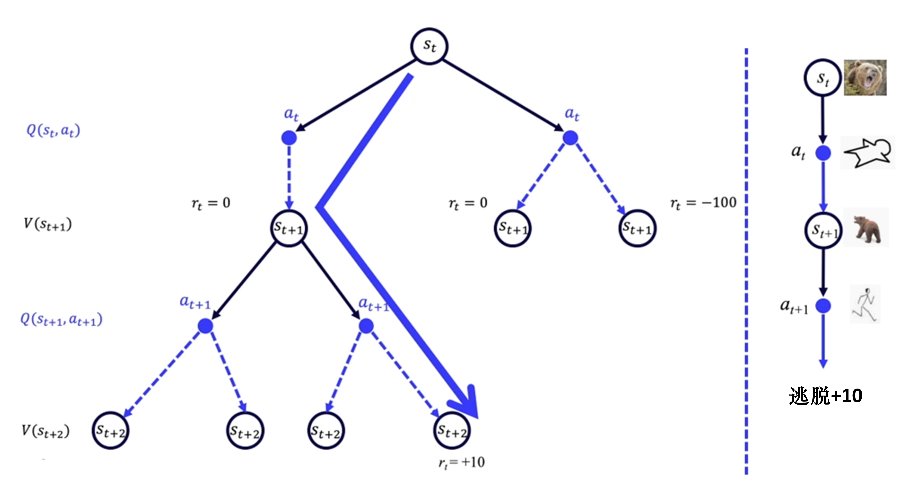

Hình 3.3 Khám phá thử-và-sai không mô hình

### 3.1.3 Khác biệt giữa có mô hình và không mô hình

Như hình 3.4, cả lặp chính sách và lặp giá trị đều cần biết hàm chuyển trạng thái và hàm phần thưởng của môi trường, vì vậy trong quá trình này tác tử không tương tác với môi trường. Trong nhiều bài toán thực tế, mô hình của quá trình quyết định Markov có thể chưa biết, cũng có thể vì mô hình quá lớn nên không thể tính lặp, ví dụ các bài toán như game Atari, cờ vây, điều khiển trực thăng, giao dịch chứng khoán,..., việc chuyển trạng thái trong các bài toán này rất phức tạp.

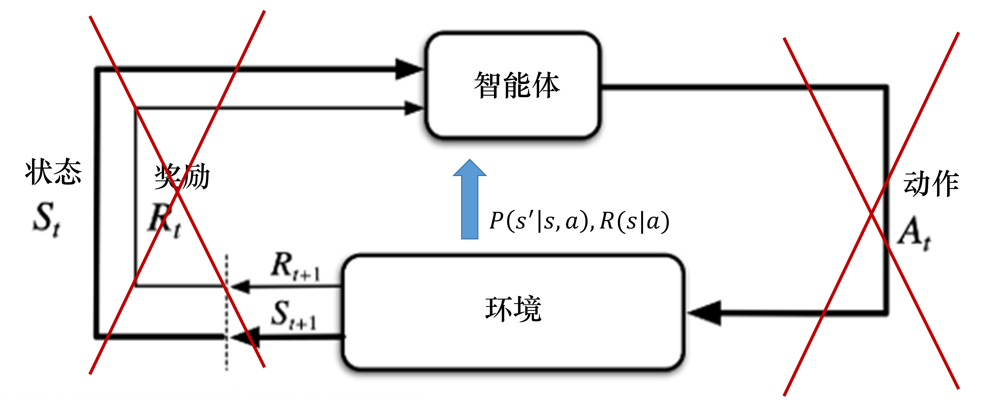

Hình 3.4 Phương pháp học tăng cường có mô hình

Như hình 3.5, khi mô hình của quá trình quyết định Markov chưa biết hoặc mô hình rất lớn, ta có thể dùng phương pháp học tăng cường không mô hình. Phương pháp học tăng cường không mô hình không có được hàm chuyển trạng thái và hàm phần thưởng của môi trường, mà cho tác tử tương tác với môi trường, thu thập lượng lớn dữ liệu quỹ đạo (trajectory), tác tử lấy thông tin từ quỹ đạo để cải thiện chính sách, từ đó nhận được nhiều phần thưởng hơn.

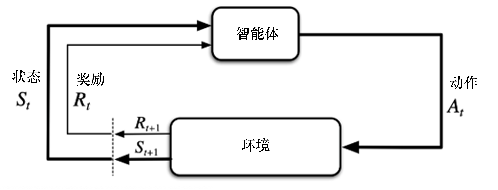

Hình 3.5 Phương pháp học tăng cường không mô hình

## 3.2 Bảng Q

Sau nhiều lần thử đối phó với gấu, ta có thể đưa ra đánh giá về các trạng thái khác nhau của gấu, dùng giá trị trạng thái-hành động để thể hiện một hành động ở một trạng thái nào đó là tốt hay xấu.
Như hình 3.6, nếu **bảng Q (Q-table)** là một bảng đã được huấn luyện xong, bảng này giống như một cuốn cẩm nang sống. Xem cuốn cẩm nang này, ta biết rằng khi gấu nổi giận, giá trị của việc giả chết sẽ cao hơn một chút; khi gấu bỏ đi, ta lén bỏ chạy sẽ dễ thoát hơn.
Ý nghĩa của hàm Q trong bảng này là: sau khi ta chọn một hành động, cuối cùng có thành công hay không, ta cần tính xem ở một trạng thái nào đó chọn một hành động nào đó thì về sau có thể nhận được bao nhiêu tổng phần thưởng. Nếu có thể ước lượng trước độ lớn của tổng phần thưởng tương lai, ta sẽ biết ở trạng thái hiện tại chọn hành động nào có giá trị cao hơn. Ta chọn một hành động nào đó vì như vậy giá trị nhận được trong tương lai sẽ cao hơn. Vì vậy học tăng cường có tính định hướng mục tiêu rất mạnh, phần thưởng do môi trường đưa ra là phản hồi rất quan trọng, nó dựa vào phần thưởng của môi trường để lựa chọn.

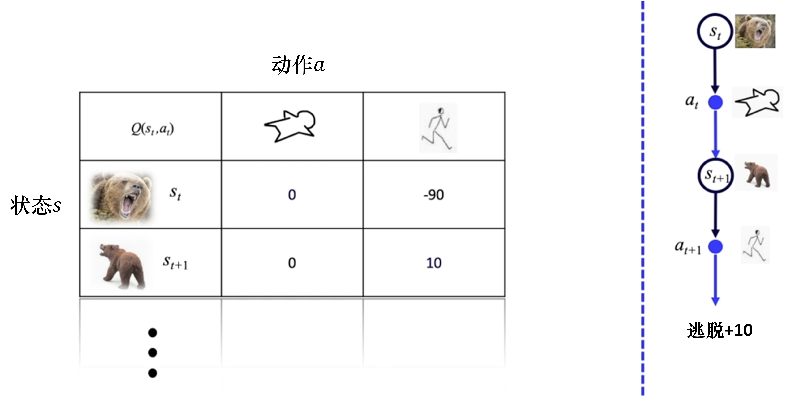

Hình 3.6 Bảng Q

Q: Tại sao ta có thể dùng tổng phần thưởng tương lai để đánh giá hành động hiện tại tốt hay xấu?

A: Ví dụ, như hình 3.7, giả sử một chiếc xe đang trên đường, hiện tại là đèn đỏ, phần thưởng khi ta vượt đèn đỏ ngay sẽ rất thấp, vì điều này vi phạm luật giao thông, phần thưởng ta nhận được là phần thưởng một bước hiện tại. Nhưng nếu xe của ta là xe cứu thương, ta đang chở bệnh nhân, phần thưởng của việc đưa bệnh nhân đến bệnh viện nhanh chóng là rất cao, và càng nhanh phần thưởng càng cao. Trong trường hợp này, có thể ta phải vượt đèn đỏ, vì phần thưởng dài hạn trong tương lai quá cao. Đó là vì trong thế giới thực phần thưởng thường bị trễ, nên học tăng cường cần học phần thưởng dài hạn. Thông thường ta bắt đầu từ trạng thái hiện tại, cộng tất cả các phần thưởng có thể nhận được về sau để tính giá trị Q của hành động hiện tại, giúp giá trị Q thực sự đại diện cho giá trị thực của hành động ở trạng thái hiện tại.

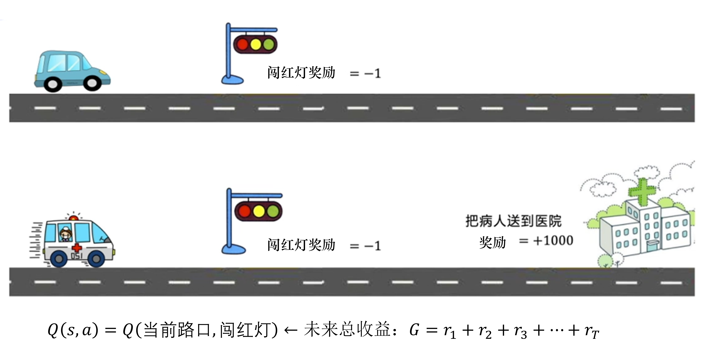

Hình 3.7 Ví dụ tổng phần thưởng tương lai

Nhưng đôi khi nhìn quá xa cũng không tốt. Nếu nhiệm vụ kết thúc rất nhanh, thì xét đến phần thưởng của bước cuối cùng là điều dễ hiểu. Nhưng nếu nhiệm vụ là một nhiệm vụ kéo dài không có điểm kết thúc, tức **nhiệm vụ liên tục (continuing task)**, thì việc cộng toàn bộ phần thưởng tương lai làm giá trị trạng thái hiện tại là rất không hợp lý.
Cổ phiếu là một ví dụ điển hình, như hình 3.8, ta quan tâm đến phần thưởng cổ phiếu tích lũy, nhưng nếu 10 năm sau cổ phiếu mới có một lần tăng giảm mạnh, chắc chắn ta sẽ không xem phần thưởng của 10 năm sau là yếu tố cân nhắc cho hành động hiện tại. Lúc này, ta có thể đưa vào hệ số chiết khấu $\gamma$ để tính tổng phần thưởng tương lai, $\gamma \in [0,1]$, càng về sau $\gamma^n$ càng nhỏ, phần thưởng càng về sau ảnh hưởng đến giá trị hiện tại càng nhỏ.

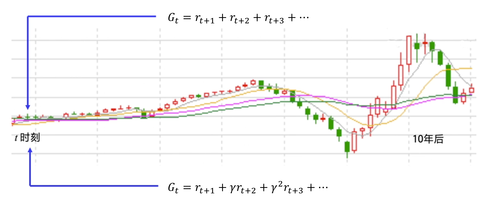

Hình 3.8 Ví dụ cổ phiếu

Bài toán đi bên vách đá (cliff walking) là một bài toán kinh điển của học tăng cường, như hình 3.9,
bài toán yêu cầu tác tử xuất phát từ điểm bắt đầu S, đến đích G, đồng thời tránh rơi xuống vách đá (cliff). Mỗi bước đi bị phạt $-$1 điểm, rơi xuống vách đá bị phạt $-$100 điểm, nhưng trò chơi không kết thúc, tác tử sẽ quay về điểm xuất phát và trò chơi tiếp tục, cho đến khi đến đích thì trò chơi kết thúc. Tác tử cần đến đích càng nhanh càng tốt.
Để đến đích, tác tử có thể đi theo các tuyến đường chẳng hạn như đường màu xanh lam và đường màu đỏ.

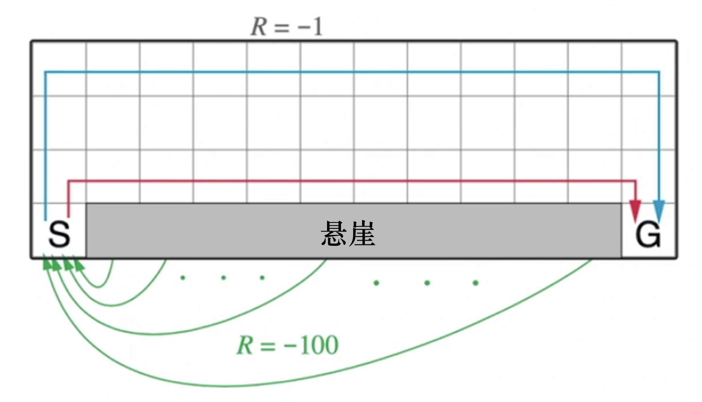

Hình 3.9 Bài toán đi bên vách đá

Trong môi trường của bài toán đi bên vách đá, ta tính giá trị trạng thái-hành động (tổng phần thưởng tương lai) như thế nào? Ta có thể chọn một tuyến đường, tính giá trị của mỗi cặp trạng thái-hành động trên tuyến đường đó. Trong bài toán đi bên vách đá, tác tử mỗi bước đi đều nhận phần thưởng $-$1 điểm, chỉ khi đến đích tác tử mới dừng lại.
* Nếu $\gamma = 0$, như hình 3.10a, ta chỉ xét phần thưởng một bước, có thể coi đây là cách tính thiển cận.
* Nếu $\gamma = 1$, như hình 3.10b, tương đương với việc cộng toàn bộ phần thưởng về sau, có thể coi đây là cách nhìn quá xa. Nếu tác tử không đi đường màu đỏ mà đi đường màu xanh lam, giá trị Q tính được có thể như trong hình. Do đó, ta có thể biết, khi chú rùa nhỏ ở ô $-$12, đi sang phải là $-$11, đi lên là $-$15, nó biết đi sang phải có giá trị lớn hơn, nó sẽ đi sang phải.
* Nếu $\gamma = 0.6$, như hình 3.10c,
	ta không nhìn quá xa, kết quả tính như biểu thức (3.1). Ta có thể dùng công thức $G_{t}=r_{t+1}+\gamma G_{t+1}$ để suy ngược từ sau ra trước.
$$
\begin{array}{l}
G_{13}=0 \\
G_{12}=r_{13}+\gamma G_{13}=-1+0.6 \times 0=-1 \\
G_{11}=r_{12}+\gamma G_{12}=-1+0.6 \times(-1)=-1.6 \\
G_{10}=r_{11}+\gamma G_{11}=-1+0.6 \times(-1.6)=-1.96 \\
G_{9}=r_{10}+\gamma G_{10}=-1+0.6 \times(-1.96)=-2.176 \approx-2.18 \\
G_{8}=r_{9}+\gamma G_{9}=-1+0.6 \times(-2.176)=-2.3056 \approx-2.3 \\
\end{array} 
$$

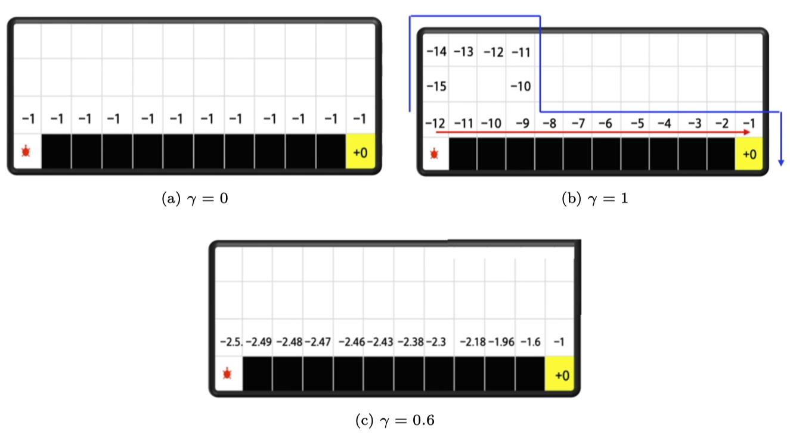

Hình 3.10 Hệ số chiết khấu

Tương tự hình 3.11, cuối cùng thứ ta cần giải chính là một bảng Q, số hàng của nó là số lượng tất cả các trạng thái, thường có thể dùng tọa độ để biểu diễn trạng thái của ô, cũng có thể dùng 1, 2, 3, 4, 5, 6, 7 để biểu diễn các vị trí khác nhau. Các cột của bảng Q biểu thị 4 hành động lên, xuống, trái, phải.
Lúc đầu, bảng Q được khởi tạo toàn bộ bằng 0. Tác tử liên tục tương tác với môi trường để có các quỹ đạo khác nhau, khi số lần tương tác đủ nhiều, ta có thể ước lượng tổng phần thưởng trung bình của mỗi hành động ở mỗi trạng thái, từ đó cập nhật bảng Q. Việc cập nhật bảng Q chính là khái niệm tăng cường (reinforcement) sắp được giới thiệu tiếp theo.

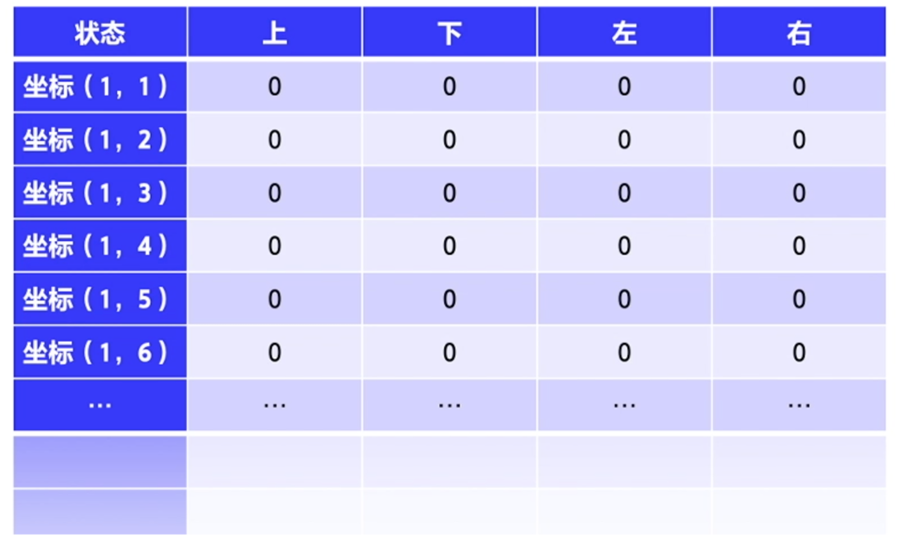

Hình 3.11 Bảng Q

**Tăng cường** nghĩa là ta có thể dùng giá trị của trạng thái tiếp theo để cập nhật giá trị của trạng thái hiện tại, thực chất chính là khái niệm bootstrapping trong học tăng cường. Trong học tăng cường, ta có thể cập nhật bảng Q một lần sau mỗi bước đi, dùng giá trị Q của trạng thái tiếp theo để cập nhật giá trị Q của trạng thái hiện tại, phương pháp cập nhật một bước này được gọi là phương pháp sai phân thời gian (temporal difference, TD).

## 3.3 Dự đoán không mô hình

Trong trường hợp không thể có được mô hình của quá trình quyết định Markov, ta có thể dùng phương pháp Monte Carlo và phương pháp sai phân thời gian để ước lượng giá trị của một chính sách cho trước.

### 3.3.1 Đánh giá chính sách bằng Monte Carlo
Phương pháp **Monte Carlo** là phương pháp dựa trên lấy mẫu (sampling). Cho trước chính sách $\pi$, ta cho tác tử tương tác với môi trường, có thể thu được nhiều quỹ đạo. Mỗi quỹ đạo có một lợi tức (return) tương ứng:

$$
G_{t}=r_{t+1}+\gamma r_{t+2}+\gamma^{2} r_{t+3}+\ldots
$$

Ta tính trung bình lợi tức của tất cả các quỹ đạo, là có thể biết giá trị của trạng thái ứng với một chính sách nào đó, tức là
$$
V_{\pi}(s)=\mathbb{E}_{\tau \sim \pi}\left[G_{t} \mid  s_{t}=s\right]
$$

Mô phỏng Monte Carlo nghĩa là ta có thể lấy mẫu rất nhiều quỹ đạo, tính lợi tức thực của tất cả các quỹ đạo, rồi tính trung bình. Phương pháp Monte Carlo dùng lợi tức trung bình thực nghiệm (empirical mean return) để ước lượng, nó không cần hàm chuyển trạng thái và hàm phần thưởng của quá trình quyết định Markov, và cũng không cần dùng bootstrapping như quy hoạch động. Ngoài ra, phương pháp Monte Carlo có hạn chế nhất định, nó chỉ dùng được trong quá trình quyết định Markov có kết thúc.

Tiếp theo, ta tổng kết phương pháp Monte Carlo. Để ước lượng $V(s)$, ta thực hiện các bước sau.

(1) Trong mỗi tập (episode), nếu ở bước thời gian $t$ trạng thái $s$ được thăm, thì

* Số lần thăm trạng thái $s$, $N(s)$, tăng 1, $N(s)\leftarrow N(s)+1$.
* Tổng lợi tức của trạng thái $s$, $S(s)$, tăng thêm $G_t$, $S(s)\leftarrow S(s)+G_t$.

(2) Giá trị của trạng thái $s$ có thể ước lượng bằng trung bình lợi tức, tức $V(s)=S(s)/N(s)$.

Theo luật số lớn (law of large numbers), chỉ cần ta có đủ nhiều quỹ đạo là có thể tiến tới hàm giá trị ứng với chính sách này. Khi $N(s)\rightarrow \infty$, $V(s) \rightarrow V_{\pi}(s)$.

Giả sử hiện có các mẫu $x_1,x_2,\cdots, x_t$, ta có thể chuyển trung bình thực nghiệm (empirical mean) sang dạng trung bình tăng dần (incremental mean):
$$
\begin{aligned}
	\mu_{t} &=\frac{1}{t} \sum_{j=1}^{t} x_{j} \\
	&=\frac{1}{t}\left(x_{t}+\sum_{j=1}^{t-1} x_{j}\right) \\
	&=\frac{1}{t}\left(x_{t}+(t-1) \mu_{t-1}\right) \\
	&=\frac{1}{t}\left(x_{t}+t \mu_{t-1}-\mu_{t-1}\right) \\
	&=\mu_{t-1}+\frac{1}{t}\left(x_{t}-\mu_{t-1}\right) 
	\end{aligned}
$$
Qua phép biến đổi này, ta có thể liên hệ giá trị trung bình ở thời điểm trước với giá trị trung bình ở thời điểm hiện tại, tức là
$$
	\mu_t = \mu_{t-1}+\frac{1}{t}(x_t-\mu_{t-1})
$$
Trong đó, $x_t- \mu_{t-1}$ là phần dư (residual), $\frac{1}{t}$ tương tự tốc độ học (learning rate).
Khi có $x_t$, ta có thể dùng giá trị ở thời điểm trước để cập nhật giá trị hiện tại.

Ta có thể viết cách cập nhật của phương pháp Monte Carlo thành phương pháp Monte Carlo tăng dần (incremental MC). Ta thu thập dữ liệu, có một quỹ đạo mới $(s_1,a_1,r_1,\dots,s_t)$. Với quỹ đạo này, ta cập nhật theo cách tăng dần:

$$
\begin{array}{l}
N\left(s_{t}\right) \leftarrow N\left(s_{t}\right)+1 \\
V\left(s_{t}\right) \leftarrow V\left(s_{t}\right)+\frac{1}{N\left(s_{t}\right)}\left(G_{t}-V\left(s_{t}\right)\right)
\end{array}	
$$

Ta có thể trực tiếp thay $\frac{1}{N(s_t)}$ bằng $\alpha$ (tốc độ học), tức là
$$
	V\left(s_{t}\right) \leftarrow V\left(s_{t}\right)+\alpha\left(G_{t}-V\left(s_{t}\right)\right)
$$
Trong đó, $\alpha$ đại diện cho tốc độ cập nhật, ta có thể tự thiết lập.

Hãy xem lại khác biệt giữa phương pháp quy hoạch động và phương pháp Monte Carlo. Quy hoạch động cũng là phương pháp thường dùng để ước lượng hàm giá trị. Trong phương pháp quy hoạch động, ta dùng ý tưởng bootstrapping. Bootstrapping là ước lượng một đại lượng dựa trên các đại lượng đã ước lượng trước đó. Ngoài ra, phương pháp quy hoạch động dùng backup kỳ vọng Bellman (Bellman expectation backup), dùng giá trị ở thời điểm trước $V_{i-1}(s')$ để cập nhật giá trị ở thời điểm hiện tại $V_i(s)$, tức là
$$
V_{i}(s) \leftarrow \sum_{a \in A} \pi(a \mid s)\left(R(s, a)+\gamma \sum_{s^{\prime} \in S} P\left(s^{\prime} \mid s, a\right) V_{i-1}\left(s^{\prime}\right)\right)
$$
Lặp liên tục như vậy, cuối cùng sẽ hội tụ. Như hình 3.12, backup kỳ vọng Bellman có hai tầng lấy tổng, tức tổng bên trong và tổng bên ngoài, tính kỳ vọng hai lần để có một lần cập nhật.

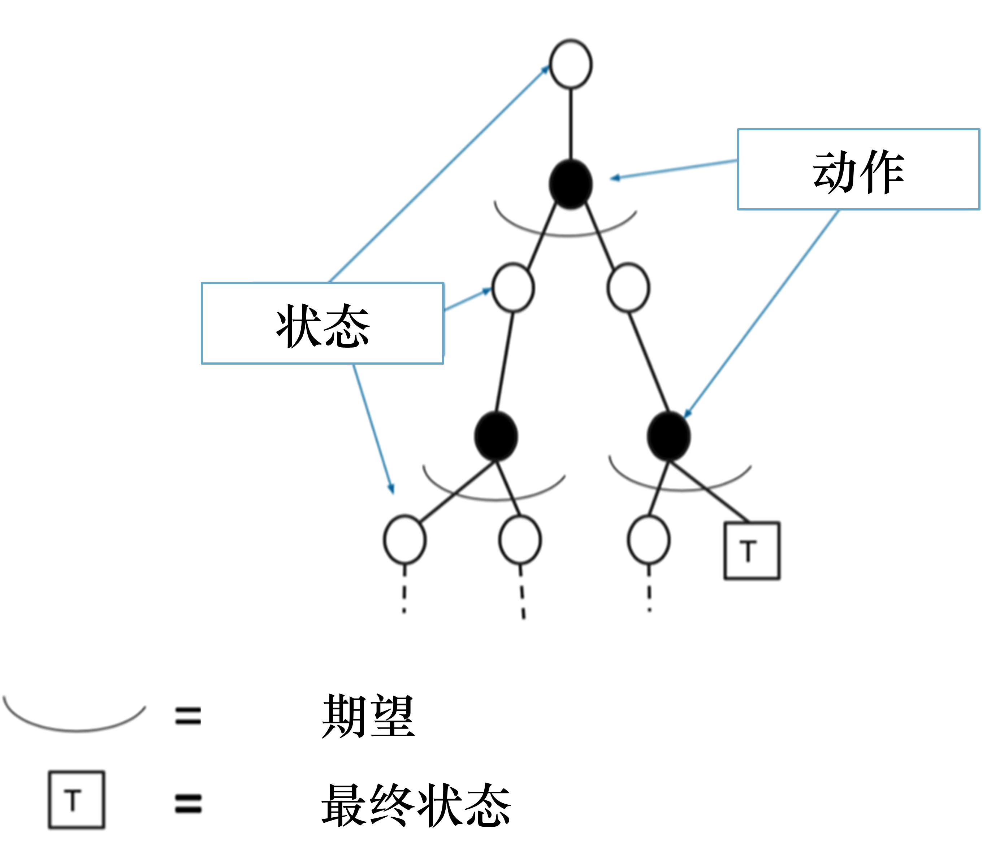

Hình 3.12 Backup kỳ vọng Bellman

Phương pháp Monte Carlo cập nhật bằng lợi tức trung bình thực nghiệm (phần thưởng thực tế nhận được) của một tập, tức là
$$
	V\left(s_{t}\right) \leftarrow V\left(s_{t}\right)+\alpha\left(G_{i, t}-V\left(s_{t}\right)\right)
$$

Như hình 3.13, quỹ đạo ta có được bằng phương pháp Monte Carlo ứng với quỹ đạo màu xanh lam trên cây, các trạng thái trên quỹ đạo đã được xác định, các hành động thực hiện cũng đã được xác định. Hiện tại ta chỉ cập nhật tất cả các trạng thái trên quỹ đạo này, các trạng thái không liên quan đến quỹ đạo này đều không được cập nhật.

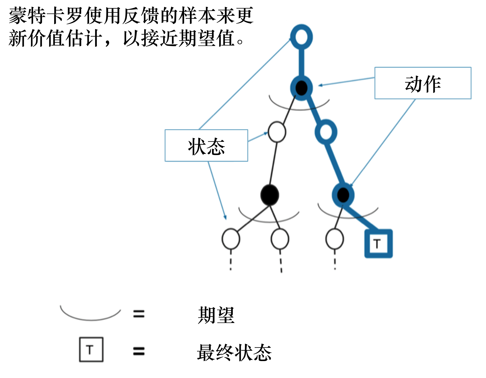

Hình 3.13 Cập nhật bằng phương pháp Monte Carlo

Phương pháp Monte Carlo có một số ưu thế so với phương pháp quy hoạch động. Trước hết, phương pháp Monte Carlo phù hợp với trường hợp môi trường chưa biết, còn quy hoạch động là phương pháp có mô hình.
Phương pháp Monte Carlo chỉ cần cập nhật các trạng thái trên một quỹ đạo, còn phương pháp quy hoạch động cần cập nhật tất cả các trạng thái. Khi số trạng thái rất nhiều (ví dụ 1 triệu, 2 triệu), nếu dùng phương pháp quy hoạch động để lặp thì tốc độ rất chậm. Đây cũng là ưu thế của phương pháp Monte Carlo dựa trên lấy mẫu so với phương pháp quy hoạch động.

### 3.3.2 Sai phân thời gian

Để người đọc hiểu rõ hơn cách cập nhật sai phân thời gian, chúng tôi đưa ra "ý nghĩa vật lý" của nó. Trước tiên hãy tìm hiểu thí nghiệm phản xạ có điều kiện của Pavlov, như hình 3.14, thí nghiệm này nói rằng chú chó sẽ bị kích thích không điều kiện bởi thức ăn trong bát và tiết nước bọt. Lúc đầu chú chó không phản ứng với kích thích trung tính như tiếng chuông, nhưng khi ta kết hợp tiếng chuông với thức ăn, mỗi lần đều rung chuông trước rồi mới cho ăn, sau nhiều lần lặp lại, khi tiếng chuông vang lên, chú chó cũng bắt đầu chảy nước dãi. Miếng thịt trong bát có thể xem là phần thưởng trễ trong học tăng cường, kích thích âm thanh có thể xem là trạng thái trước trạng thái có phần thưởng. Sau nhiều lần lặp lại thí nghiệm, phần thưởng cuối cùng sẽ tăng cường phản xạ có điều kiện của chú chó với âm thanh, khiến chú chó biết âm thanh này nghĩa là có thức ăn, âm thanh này đối với chú chó cũng có giá trị, nghe thấy âm thanh này nó sẽ chảy nước dãi.

Hình 3.14 Khái niệm tăng cường: thí nghiệm phản xạ có điều kiện của Pavlov

Như hình 3.15, hiệu ứng Pavlov cho thấy: khi kích thích trung tính (tiếng chuông) và kích thích không điều kiện (thức ăn) xuất hiện kề nhau lặp đi lặp lại, kích thích trung tính cũng có thể gây ra việc tiết nước bọt vốn do kích thích không điều kiện gây ra, từ đó hình thành kích thích có điều kiện.
Ta gọi sự kết hợp theo thời gian giữa kích thích trung tính và kích thích không điều kiện này là tăng cường (reinforcement), số lần tăng cường càng nhiều, phản xạ có điều kiện càng vững chắc. Chú chó vốn không thấy tiếng chuông có giá trị, sau khi được tăng cường, chú chó sẽ dần nhận ra tiếng chuông cũng có giá trị, nó có thể mang lại thức ăn. Quan trọng hơn, khi một phản xạ có điều kiện đã vững chắc, ta lại kết hợp một kích thích mới khác với phản xạ có điều kiện đó, còn có thể hình thành phản xạ có điều kiện cấp hai, tương tự cũng có thể hình thành phản xạ có điều kiện cấp ba.

Ở con người cũng có thể hình thành phản xạ có điều kiện nhiều cấp, ví dụ, khi gặp gấu có thể theo thứ tự như sau: thấy vết móng gấu trên cây, rồi thấy gấu, đột nhiên gấu nổi giận và lao tới. Sau khi trải qua quá trình này, có thể ban đầu ta chỉ sợ khi thấy gấu, về sau có thể chỉ thấy vết móng gấu trên cây là đã có cảm giác sợ rồi. Sau khi lặp lại thí nghiệm liên tục, giá trị của trạng thái tiếp theo có thể liên tục tăng cường và ảnh hưởng đến giá trị của trạng thái trước đó.

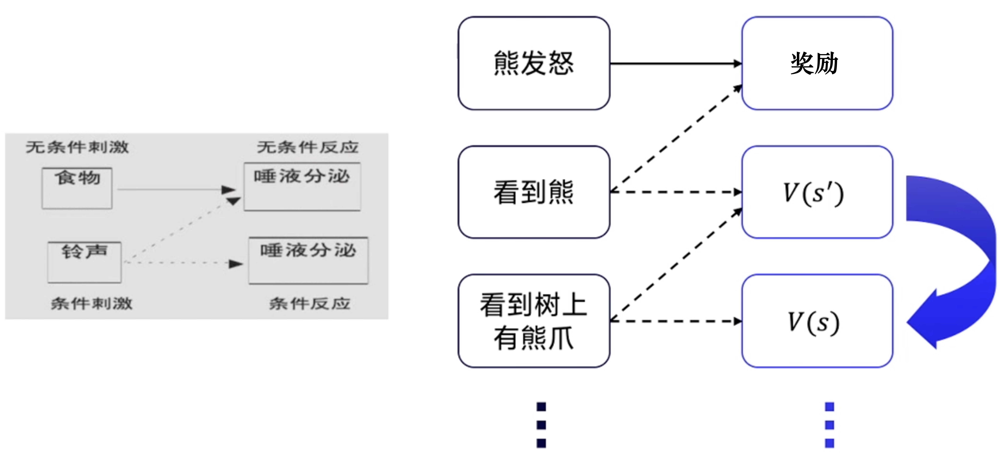

Hình 3.15 Ví dụ tăng cường

Để người đọc cảm nhận trực quan hơn trạng thái tiếp theo ảnh hưởng đến trạng thái trước như thế nào (lặp giá trị trạng thái), chúng tôi giới thiệu [trang minh họa thế giới lưới của học sai phân thời gian](https://cs.stanford.edu/people/karpathy/reinforcejs/gridworld_td.html).
Như hình 3.16, trước tiên ta khởi tạo, rồi bắt đầu quá trình cập nhật bằng phương pháp sai phân thời gian.
Trong quá trình huấn luyện, quả bóng vàng nhỏ liên tục thử-và-sai, trong quá trình khám phá sẽ nhanh chóng phát hiện ra các ô có phần thưởng. Lúc đầu, chỉ những ô có phần thưởng mới có giá trị. Khi quả bóng vàng liên tục đi lặp lại các tuyến đường này, các ô có giá trị dần dần ảnh hưởng đến giá trị của các ô lân cận.
Sau khi huấn luyện lặp lại, trạng thái của các ô xung quanh ô có phần thưởng sẽ dần được tăng cường. Tăng cường nghĩa là sau khi giá trị cuối cùng hội tụ về trường hợp tối ưu, quả bóng vàng sẽ tự động đi về các ô có giá trị cao, và có thể đến được ô nhận phần thưởng.

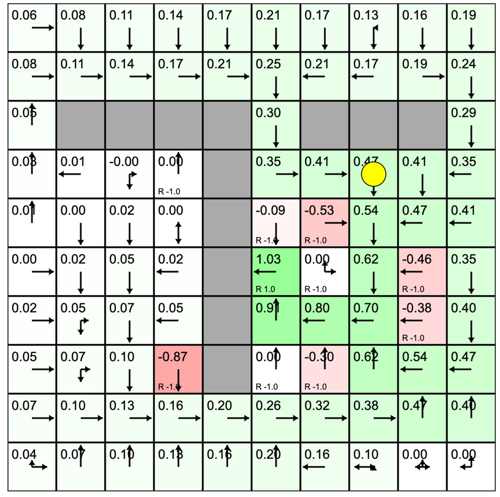

Hình 3.16 Minh họa thế giới lưới của học sai phân thời gian

Dưới đây ta chính thức giới thiệu phương pháp sai phân thời gian.
Sai phân thời gian là phương pháp nằm giữa Monte Carlo và quy hoạch động, nó là không mô hình, không cần ma trận chuyển trạng thái và hàm phần thưởng của quá trình quyết định Markov.
Ngoài ra, phương pháp sai phân thời gian có thể học từ các tập chưa hoàn chỉnh, và kết hợp ý tưởng bootstrapping.

Tiếp theo, ta tổng kết phương pháp sai phân thời gian. Mục đích của phương pháp sai phân thời gian là: với một chính sách $\pi$ cho trước, tính trực tuyến (online) hàm giá trị $V_{\pi}$ của nó, tức là tính từng bước một (step-by-step).
Thuật toán đơn giản nhất là **sai phân thời gian một bước (one-step TD)**, tức TD(0). Mỗi khi đi tiến một bước, ta thực hiện một bước bootstrapping, dùng lợi tức ước lượng (estimated return) $r_{t+1}+\gamma V(s_{t+1})$ thu được để cập nhật giá trị $V(s_t)$ ở thời điểm trước:
$$
  V\left(s_{t}\right) \leftarrow V\left(s_{t}\right)+\alpha\left(r_{t+1}+\gamma V\left(s_{t+1}\right)-V\left(s_{t}\right)\right) \tag{3.1}
$$
Lợi tức ước lượng $r_{t+1}+\gamma V(s_{t+1})$ được gọi là **mục tiêu sai phân thời gian (TD target)**,
mục tiêu sai phân thời gian là tổng phần thưởng tương lai có suy giảm. Mục tiêu sai phân thời gian gồm hai phần:

(1) Phần thưởng thực tế $r_{t+1}$ nhận được sau khi ta đi một bước;

(2) Ta dùng bootstrapping, dựa vào ước lượng trước đó để ước lượng $V(s_{t+1})$, và nhân thêm hệ số chiết khấu, tức $\gamma V(s_{t+1})$.

Mục tiêu sai phân thời gian là một ước lượng vì hai lý do:

(1) Phương pháp sai phân thời gian lấy mẫu giá trị kỳ vọng;

(2) Phương pháp sai phân thời gian dùng $V$ ước lượng hiện tại chứ không phải $V_{\pi}$ thực.

**Sai số sai phân thời gian (TD error)** $\delta=r_{t+1}+\gamma V(s_{t+1})-V(s_t)$.
So sánh với phương pháp Monte Carlo tăng dần, cho trước một tập $i$, ta có thể cập nhật $V(s_t)$ để tiệm cận lợi tức thực $G_t$, công thức cập nhật cụ thể là
$$
V\left(s_{t}\right) \leftarrow V\left(s_{t}\right)+\alpha\left(G_{i, t}-V\left(s_{t}\right)\right)
$$
Biểu thức (3.1) thể hiện khái niệm tăng cường.

Hãy so sánh phương pháp Monte Carlo và phương pháp sai phân thời gian. Trong phương pháp Monte Carlo, $G_{i,t}$ là giá trị thực tế thu được (có thể xem là mục tiêu), vì nó đã chạy hết một quỹ đạo, có thể tính lợi tức thực tế của mỗi trạng thái. Sai phân thời gian không đợi quỹ đạo kết thúc, đi tiến một bước là có thể cập nhật hàm giá trị.
Như hình 3.17, phương pháp sai phân thời gian chỉ thực hiện một bước là giá trị của trạng thái được cập nhật. Phương pháp Monte Carlo phải thực hiện toàn bộ, đến trạng thái kết thúc rồi mới cập nhật giá trị.

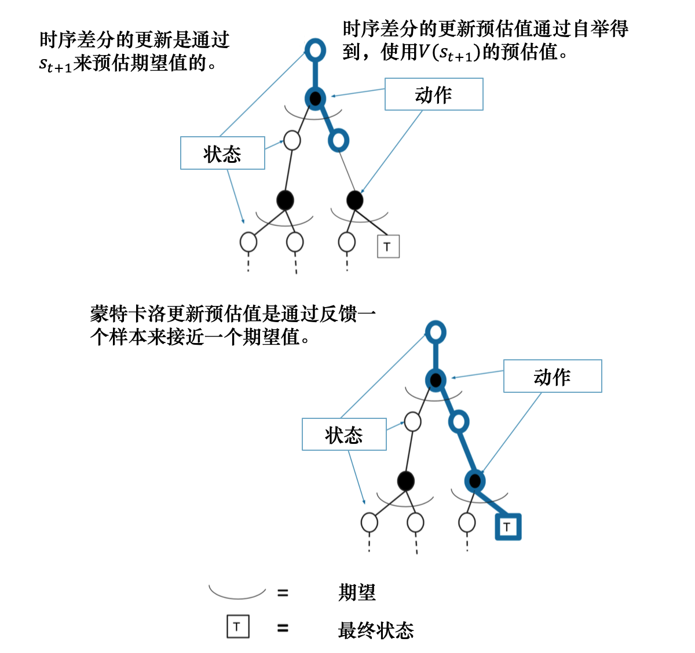

Hình 3.17 Ưu thế của phương pháp sai phân thời gian so với phương pháp Monte Carlo

Tiếp theo, so sánh thêm phương pháp sai phân thời gian và phương pháp Monte Carlo.

(1) Phương pháp sai phân thời gian có thể học trực tuyến (online learning), mỗi bước đi đều có thể cập nhật, hiệu quả cao. Phương pháp Monte Carlo phải đợi trò chơi kết thúc mới có thể học.

(2) Phương pháp sai phân thời gian có thể học từ chuỗi chưa hoàn chỉnh. Phương pháp Monte Carlo chỉ có thể học từ chuỗi hoàn chỉnh.

(3) Phương pháp sai phân thời gian có thể học trong môi trường liên tục (không có kết thúc). Phương pháp Monte Carlo chỉ có thể học trong trường hợp có kết thúc.

(4) Phương pháp sai phân thời gian tận dụng tính chất Markov, trong môi trường Markov có hiệu quả học cao hơn. Phương pháp Monte Carlo không giả định môi trường có tính chất Markov, dùng giá trị lấy mẫu để ước lượng giá trị của một trạng thái, hiệu quả hơn trong môi trường không phải Markov.

Lấy ví dụ để giải thích khác biệt giữa phương pháp sai phân thời gian và phương pháp Monte Carlo.
Phương pháp sai phân thời gian là: trong trường hợp không rõ xác suất chuyển trạng thái Markov, dùng cách lấy mẫu để có chuỗi trạng thái chưa hoàn chỉnh, ước lượng phần thưởng mà một trạng thái có thể nhận được khi chuỗi trạng thái đó hoàn chỉnh, và liên tục cập nhật giá trị thông qua việc lấy mẫu liên tục. Còn Monte Carlo cần trải qua chuỗi trạng thái hoàn chỉnh rồi mới cập nhật giá trị thực của trạng thái.
Ví dụ, ta muốn biết thời gian lái xe đến công ty, mỗi ngày lái xe đi làm là một lần lấy mẫu. Giả sử hôm nay ta bị kẹt xe ở ngã tư A,
phương pháp sai phân thời gian sẽ bắt đầu cập nhật ngay tại ngã tư A thời gian dự kiến đến ngã tư B, ngã tư C $\cdots \cdots$, và thời gian đến công ty;
còn phương pháp Monte Carlo không cập nhật thời gian ngay, mà đợi đến công ty rồi mới cập nhật thời gian đến mỗi ngã tư và đến công ty.
Phương pháp sai phân thời gian có thể bắt đầu học trước khi biết kết quả, so với phương pháp Monte Carlo, nó nhanh và linh hoạt hơn.

Như hình 3.18, ta có thể tổng quát hóa phương pháp sai phân thời gian thêm nữa. Trước đây chỉ đi tiến một bước, tức TD(0).
Ta có thể điều chỉnh số bước (step), trở thành **sai phân thời gian $n$ bước ($n$-step TD)**. Ví dụ TD(2), tức đi tiến hai bước, dùng lợi tức thu được từ hai bước, dùng bootstrapping để cập nhật giá trị của trạng thái.

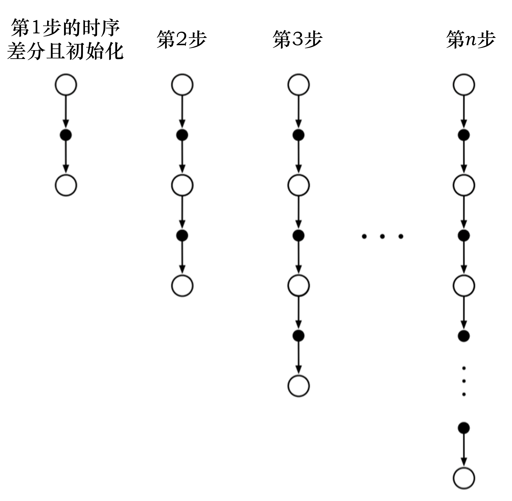

Hình 3.18 Sai phân thời gian $n$ bước

Như vậy ta có thể điều chỉnh phần thưởng thực tế và phần bootstrapping mà thuật toán cần thông qua số bước.

$$
\begin{array}{lcl}
n=1\text{ (TD)} &G_{t}^{(1)}&=r_{t+1}+\gamma V\left(s_{t+1}\right) \\
n=2 &G_{t}^{(2)}&= r_{t+1}+\gamma r_{t+2}+\gamma^{2} V\left(s_{t+2}\right) \\
& &\vdots \\
n=\infty\text{ (MC)} &G_{t}^{\infty}&=r_{t+1}+\gamma r_{t+2}+\ldots+\gamma^{T-t-1} r_{T}
\end{array} \tag{3.2}
$$

Như biểu thức (3.2), bằng cách điều chỉnh số bước, ta có thể cân bằng giữa phương pháp Monte Carlo và phương pháp sai phân thời gian. Nếu $n=\infty$, tức là đợi toàn bộ trò chơi kết thúc rồi mới cập nhật, phương pháp sai phân thời gian trở thành phương pháp Monte Carlo.

Sai phân thời gian $n$ bước có thể viết là

$$
G_{t}^{n}=r_{t+1}+\gamma r_{t+2}+\ldots+\gamma^{n-1} r_{t+n}+\gamma^{n} V\left(s_{t+n}\right)
$$

Sau khi có mục tiêu sai phân thời gian, ta dùng phương pháp học tăng dần (incremental learning) để cập nhật giá trị của trạng thái:

$$
V\left(s_{t}\right) \leftarrow V\left(s_{t}\right)+\alpha\left(G_{t}^{n}-V\left(s_{t}\right)\right)
$$

### 3.3.3 Bootstrapping và lấy mẫu trong phương pháp quy hoạch động, Monte Carlo và sai phân thời gian
Bootstrapping nghĩa là khi cập nhật có dùng ước lượng. Phương pháp Monte Carlo không dùng bootstrapping, vì nó cập nhật dựa trên lợi tức thực tế.
Phương pháp quy hoạch động và phương pháp sai phân thời gian có dùng bootstrapping.

Lấy mẫu nghĩa là khi cập nhật, ta có được một kỳ vọng thông qua lấy mẫu.
Phương pháp Monte Carlo là phương pháp thuần lấy mẫu.
Phương pháp quy hoạch động không dùng lấy mẫu, nó trực tiếp dùng phương trình kỳ vọng Bellman để cập nhật giá trị trạng thái.
Phương pháp sai phân thời gian có dùng lấy mẫu. Mục tiêu sai phân thời gian gồm hai phần, một phần là lấy mẫu, một phần là bootstrapping.

Như hình 3.19, phương pháp quy hoạch động tính trực tiếp kỳ vọng, nó lấy tổng trên tất cả các trạng thái liên quan, tức là
$$
	V\left(s_{t}\right) \leftarrow \mathbb{E}_{\pi}\left[r_{t+1}+\gamma V\left(s_{t+1}\right)\right]
$$

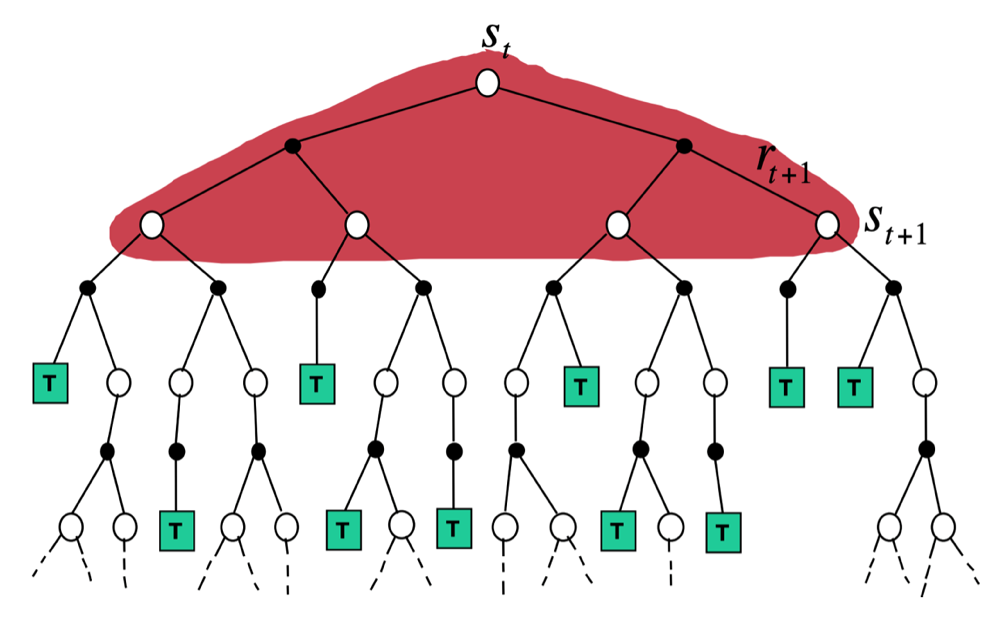

Hình 3.19 Góc nhìn thống nhất: backup của phương pháp quy hoạch động

Như hình 3.20, phương pháp Monte Carlo ở trạng thái hiện tại đi theo một nhánh, cập nhật trên đường đi này, cập nhật tất cả các trạng thái trên đường đi này, tức là
$$
V\left(s_{t}\right) \leftarrow V\left(s_{t}\right)+\alpha\left(G_{t}-V\left(s_{t}\right)\right)
$$

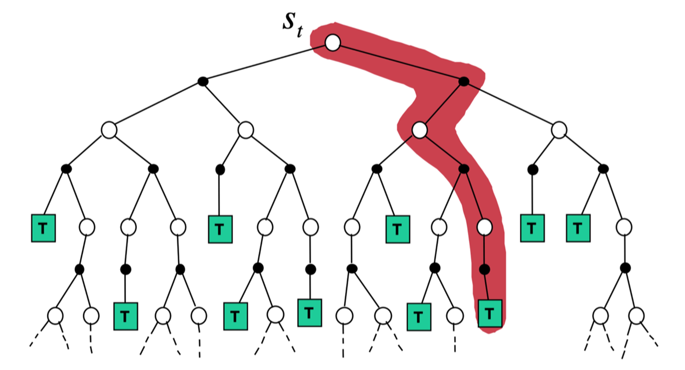

Hình 3.20 Góc nhìn thống nhất: backup Monte Carlo

Như hình 3.21, sai phân thời gian bắt đầu từ trạng thái hiện tại, đi tiến một bước, quan tâm đến các bước rất cục bộ, tức là
$$
	\text{TD}(0): V\left(s_{t}\right) \leftarrow V\left(s_{t}\right)+\alpha\left(r_{t+1}+\gamma V\left(s_{t+1}\right)-V\left(s_{t}\right)\right)
$$

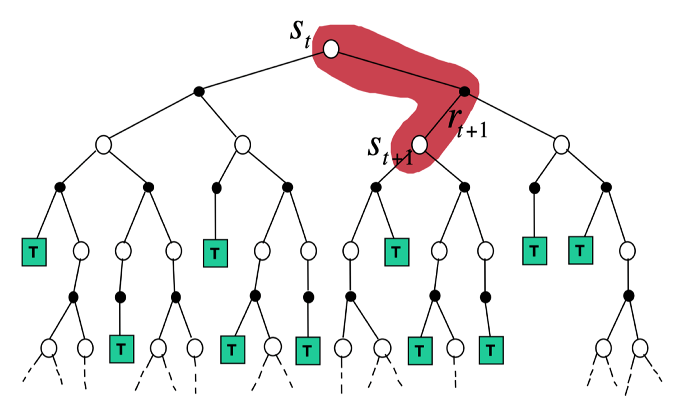

Hình 3.21 Góc nhìn thống nhất: backup của phương pháp sai phân thời gian

Như hình 3.22, nếu phương pháp sai phân thời gian cần cập nhật theo chiều rộng hơn, nó trở thành phương pháp quy hoạch động (vì phương pháp quy hoạch động xét tất cả các trạng thái để cập nhật). Nếu phương pháp sai phân thời gian cần cập nhật theo chiều sâu hơn, nó trở thành phương pháp Monte Carlo. Góc dưới bên phải của hình 3.22 là phương pháp tìm kiếm vét cạn (exhaustive search), phương pháp tìm kiếm vét cạn không chỉ cần thông tin rất sâu mà còn cần thông tin rất rộng.

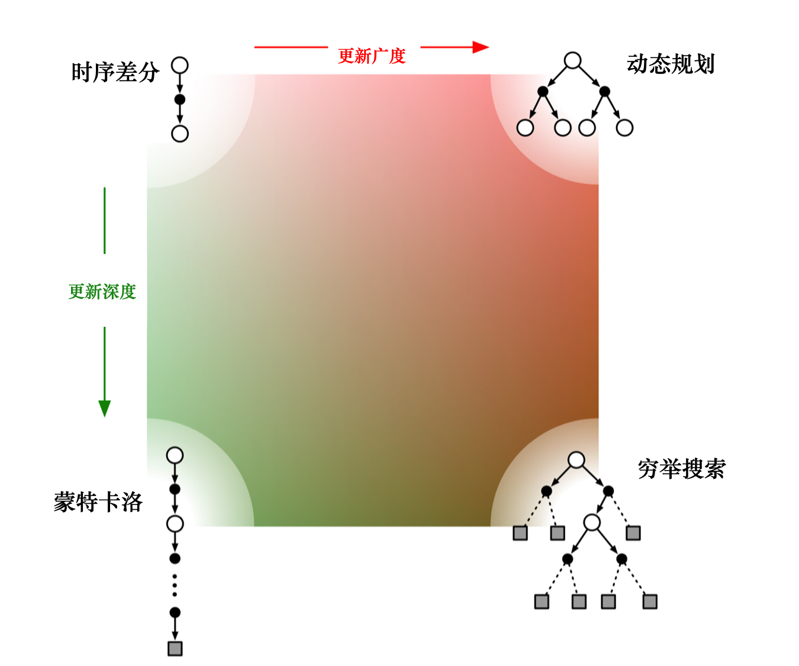

Hình 3.22 Góc nhìn thống nhất của học tăng cường

## 3.4 Điều khiển không mô hình
Trong trường hợp không biết mô hình của quá trình quyết định Markov, làm sao tối ưu hàm giá trị để có chính sách tốt nhất? Ta có thể tổng quát hóa lặp chính sách, để nó tương thích với các phương pháp Monte Carlo và sai phân thời gian, tức **lặp chính sách tổng quát (generalized policy iteration, GPI)** kết hợp phương pháp Monte Carlo và phương pháp sai phân thời gian.

Như hình 3.23, lặp chính sách gồm hai bước. Thứ nhất, ta ước lượng hàm giá trị dựa trên chính sách hiện tại $\pi$ cho trước; thứ hai, sau khi có hàm giá trị ước lượng, ta cải thiện chính sách bằng phương pháp tham lam (greedy), tức là
$$
\pi^{'}=\text{hàm tham lam}(V_{\pi})
$$

Hai bước này là một quá trình lặp xen kẽ.

$$
\pi_{i+1}(s)=\underset{a}{\arg \max } Q_{\pi_{i}}(s, a) \tag{3.3}
$$

Ta có thể tính hàm giá trị hành động của chính sách $\pi$, và có thể dựa vào biểu thức (3.3) để tính chính sách mới $\pi_{i+1}$ cho trạng thái $s \in S$. Nhưng sau khi có hàm giá trị trạng thái, ta không biết hàm phần thưởng $R(s,a)$ và chuyển trạng thái $P(s'|s,a)$, nên không thể ước lượng hàm Q
$$
Q_{\pi_{i}}(s, a)=R(s, a)+\gamma \sum_{s^{\prime} \in S} P\left(s^{\prime} \mid s, a\right) V_{\pi_{i}}\left(s^{\prime}\right)
$$

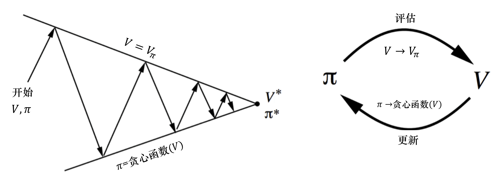

Hình 3.23 Lặp chính sách

Ở đây có một câu hỏi: khi ta không biết hàm phần thưởng và chuyển trạng thái, làm sao tối ưu chính sách?

Như hình 3.24, với tình huống trên, ta đưa vào phương pháp lặp chính sách tổng quát.
Ta sửa phần đánh giá chính sách, dùng phương pháp Monte Carlo thay cho phương pháp quy hoạch động để ước lượng hàm Q. Trước tiên ta đánh giá chính sách, dùng phương pháp Monte Carlo để ước lượng $Q=Q_{\pi}$, rồi cập nhật chính sách, tức là sau khi có hàm Q, ta có thể cải thiện nó bằng phương pháp tham lam:
$$
\pi(s)=\underset{a}{\arg \max} Q(s, a)
$$

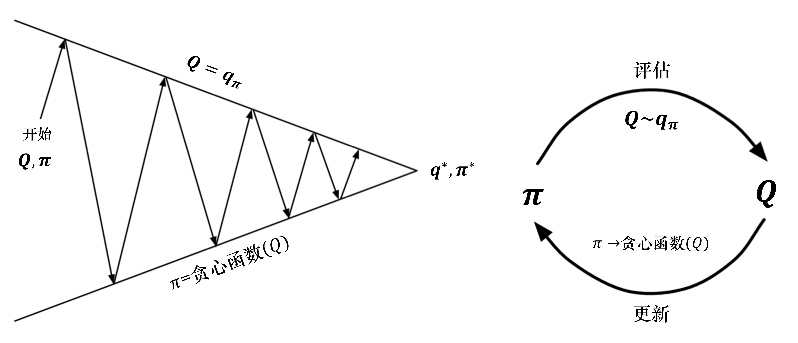

Hình 3.24 Lặp chính sách tổng quát

Hình 3.25 là thuật toán ước lượng hàm Q bằng phương pháp Monte Carlo.
Một giả định đảm bảo lặp chính sách hội tụ là các tập có **khởi đầu khám phá (exploring start)**.
Giả sử mỗi tập đều có một khởi đầu khám phá, khởi đầu khám phá đảm bảo mọi trạng thái và hành động đều có thể được lấy mẫu sau vô hạn bước thực hiện, như vậy mới ước lượng tốt được.
Thuật toán dùng phương pháp Monte Carlo sinh ra nhiều quỹ đạo, mỗi quỹ đạo đều có thể tính được giá trị của nó. Sau đó, ta có thể ước lượng hàm Q bằng cách lấy trung bình. Hàm Q có thể xem là một bảng Q, ta dùng phương pháp lấy mẫu để điền giá trị vào từng ô của bảng, rồi dùng cải thiện chính sách để chọn chính sách tốt hơn.
Cách dùng phương pháp Monte Carlo để điền bảng Q là cốt lõi của thuật toán này.

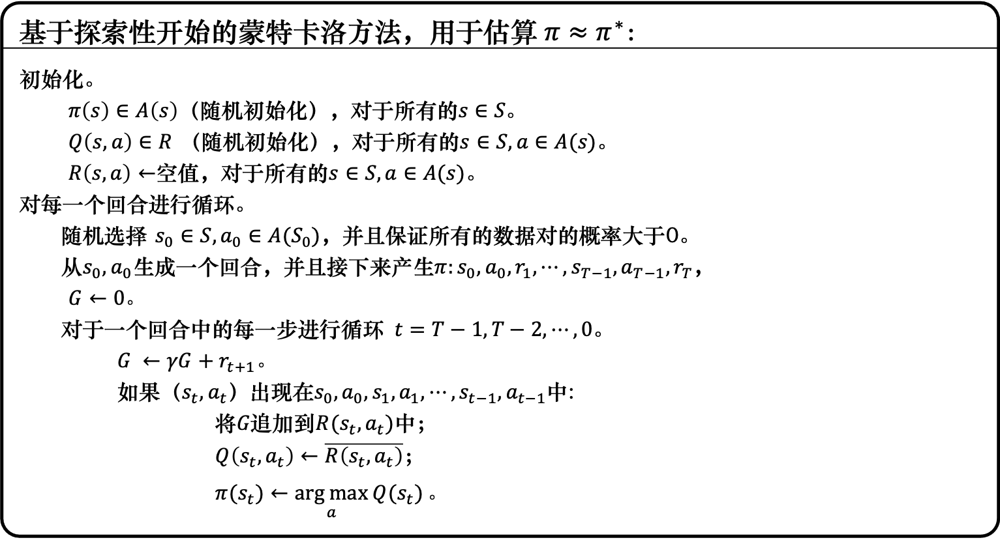

Hình 3.25 Phương pháp Monte Carlo dựa trên khởi đầu khám phá

Bản dịch thuật toán ở hình 3.25:

$$
\begin{array}{l}
\hline
\textbf{Phương pháp Monte Carlo dựa trên khởi đầu khám phá, dùng để ước lượng } \pi \approx \pi^{*} \\
\hline
\text{Khởi tạo:} \\
\quad \pi(s) \in A(s) \text{ (khởi tạo ngẫu nhiên), với mọi } s \in S \\
\quad Q(s,a) \in \mathbb{R} \text{ (khởi tạo ngẫu nhiên), với mọi } s \in S,\ a \in A(s) \\
\quad R(s,a) \leftarrow \text{danh sách rỗng, với mọi } s \in S,\ a \in A(s) \\
\text{Lặp với mỗi tập:} \\
\quad \text{Chọn ngẫu nhiên } s_0 \in S,\ a_0 \in A(s_0) \text{ sao cho mọi cặp đều có xác suất lớn hơn } 0 \\
\quad \text{Từ } s_0, a_0 \text{ sinh một tập theo } \pi:\ s_0, a_0, r_1, \cdots, s_{T-1}, a_{T-1}, r_T \\
\quad G \leftarrow 0 \\
\quad \text{Lặp với mỗi bước của tập, } t = T-1, T-2, \cdots, 0: \\
\qquad G \leftarrow \gamma G + r_{t+1} \\
\qquad \text{Nếu } (s_t, a_t) \text{ \textbf{không} xuất hiện trong } s_0, a_0, s_1, a_1, \cdots, s_{t-1}, a_{t-1}: \\
\qquad\qquad \text{Thêm } G \text{ vào } R(s_t, a_t) \\
\qquad\qquad Q(s_t, a_t) \leftarrow \overline{R(s_t, a_t)} \quad \text{(trung bình của } R(s_t,a_t)\text{)} \\
\qquad\qquad \pi(s_t) \leftarrow \underset{a}{\arg\max}\, Q(s_t, a)
\\ \hline
\end{array}
$$

> **Ghi chú của người dịch:** hình gốc ghi "nếu $(s_t, a_t)$ **xuất hiện** trong …", nhưng đây là Monte Carlo lần thăm đầu tiên (first-visit), nên điều kiện đúng là "nếu $(s_t, a_t)$ **không** xuất hiện ở các bước trước" (giống Sutton & Barto). Bản dịch ở trên đã sửa lại; ngoài ra $A(S_0)$ được viết lại thành $A(s_0)$, $\arg\max_a Q(s_t)$ thành $\arg\max_a Q(s_t, a)$.

Để đảm bảo phương pháp Monte Carlo có đủ khám phá, ta dùng khám phá $\varepsilon$-tham lam ($\varepsilon\text{-greedy}$).
$\varepsilon$-tham lam nghĩa là ta có xác suất $1-\varepsilon$ quyết định hành động theo hàm Q, thường $\varepsilon$ được đặt một giá trị rất nhỏ, $1-\varepsilon$ có thể là 0.9, tức là có xác suất 0.9 quyết định hành động theo hàm Q, nhưng có xác suất 0.1 là ngẫu nhiên. Thông thường khi cài đặt, giá trị $\varepsilon$ sẽ giảm dần theo thời gian. Lúc đầu, vì ta chưa biết hành động nào tốt hơn, nên sẽ dành nhiều thời gian khám phá. Sau đó khi số lần huấn luyện ngày càng nhiều, ta đã khá chắc chắn hành động nào tốt hơn, sẽ giảm khám phá, giảm giá trị $\varepsilon$. Chủ yếu quyết định hành động theo hàm Q, ít quyết định ngẫu nhiên, đây chính là $\varepsilon$-tham lam.

Khi ta dùng phương pháp Monte Carlo và khám phá $\varepsilon$-tham lam, có thể đảm bảo hàm giá trị là đơn điệu, được cải thiện. Với bất kỳ chính sách $\varepsilon$-tham lam $\pi$ nào, chính sách $\varepsilon$-tham lam $\pi^{\prime}$ theo $Q_{\pi}$ đều là một sự cải thiện, tức $V_{\pi}(s) \leqslant V_{\pi^{\prime}}(s)$, chứng minh như sau:

$$
\begin{aligned}
	Q_{\pi}\left(s, \pi^{\prime}(s)\right) &=\sum_{a \in A} \pi^{\prime}(a \mid s) Q_{\pi}(s, a) \\
	&=\frac{\varepsilon}{|A|} \sum_{a \in A} Q_{\pi}(s, a)+(1-\varepsilon) \max _{a} Q_{\pi}(s, a) \\
	& \geqslant \frac{\varepsilon}{|A|} \sum_{a \in A} Q_{\pi}(s, a)+(1-\varepsilon) \sum_{a \in A} \frac{\pi(a \mid s)-\frac{\varepsilon}{|A|}}{1-\varepsilon} Q_{\pi}(s, a) \\
	&=\sum_{a \in A} \pi(a \mid s) Q_{\pi}(s, a)=V_{\pi}(s)
	\end{aligned}
$$

Phương pháp Monte Carlo dựa trên khám phá $\varepsilon$-tham lam được thể hiện ở hình 3.26.

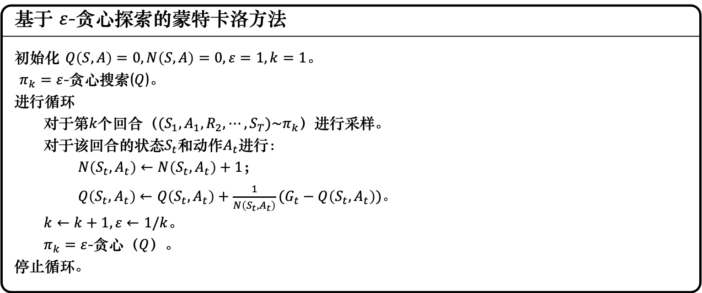

Hình 3.26 Phương pháp Monte Carlo dựa trên khám phá $\varepsilon$-tham lam

Bản dịch thuật toán ở hình 3.26:

$$
\begin{array}{l}
\hline
\textbf{Phương pháp Monte Carlo dựa trên khám phá } \varepsilon\textbf{-tham lam} \\
\hline
\text{Khởi tạo } Q(S,A)=0,\ N(S,A)=0,\ \varepsilon=1,\ k=1 \\
\pi_k = \varepsilon\text{-tham lam}(Q) \\
\text{Lặp:} \\
\quad \text{Lấy mẫu tập thứ } k:\ (S_1, A_1, R_2, \cdots, S_T) \sim \pi_k \\
\quad \text{Với mỗi trạng thái } S_t \text{ và hành động } A_t \text{ trong tập:} \\
\qquad N(S_t, A_t) \leftarrow N(S_t, A_t) + 1 \\
\qquad Q(S_t, A_t) \leftarrow Q(S_t, A_t) + \dfrac{1}{N(S_t, A_t)}\big(G_t - Q(S_t, A_t)\big) \\
\quad k \leftarrow k+1,\ \varepsilon \leftarrow 1/k \\
\quad \pi_k = \varepsilon\text{-tham lam}(Q) \\
\text{Dừng lặp.}
\\ \hline
\end{array}
$$

So với phương pháp Monte Carlo, phương pháp sai phân thời gian có các ưu thế sau: phương sai thấp, có thể học trực tuyến, có thể học từ chuỗi chưa hoàn chỉnh.
Vì vậy ta có thể đưa cả phương pháp sai phân thời gian vào vòng lặp điều khiển (control loop) để ước lượng bảng Q, rồi dùng khám phá $\varepsilon$-tham lam để cải thiện. Như vậy có thể cập nhật giá trị của các trạng thái đã thu thập được ngay khi tập chưa kết thúc.

> Độ chệch (bias): mô tả khoảng cách giữa kỳ vọng của giá trị dự đoán (giá trị ước lượng) và giá trị thực. Độ chệch càng cao thì càng lệch xa dữ liệu thực, như hàng thứ 2 của hình 3.27.
Phương sai (variance): mô tả phạm vi biến động, mức độ phân tán của giá trị dự đoán, tức là khoảng cách đến giá trị kỳ vọng của nó. Phương sai càng cao thì dữ liệu phân bố càng phân tán, như cột bên phải của hình 3.27.

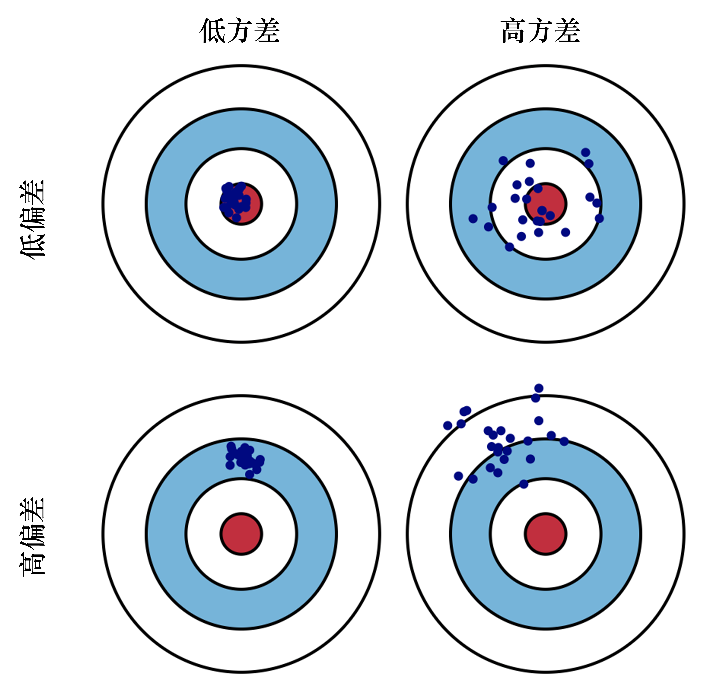

Hình 3.27 Độ chệch-phương sai

### 3.4.1 Sarsa: điều khiển sai phân thời gian on-policy

Phương pháp sai phân thời gian là cho trước một chính sách, rồi ta ước lượng hàm giá trị của nó. Tiếp theo ta cần xét cách dùng khung của phương pháp sai phân thời gian để ước lượng hàm Q, đó chính là thuật toán Sarsa.

Thay đổi mà Sarsa thực hiện rất đơn giản, nó biến quá trình cập nhật $V$ của phương pháp sai phân thời gian thành cập nhật $Q$, tức là
$$
	Q\left(s_{t}, a_{t}\right) \leftarrow Q\left(s_{t}, a_{t}\right)+\alpha\left[r_{t+1}+\gamma Q\left(s_{t+1}, a_{t+1}\right)-Q\left(s_{t}, a_{t}\right)\right] \tag{3.4}
$$

Biểu thức (3.4) nghĩa là ta có thể dùng giá trị Q của bước tiếp theo $Q(s_{t+_1},a_{t+1})$ để cập nhật giá trị Q của bước này $Q(s_t,a_t)$.
Sarsa ước lượng trực tiếp bảng Q, sau khi có bảng Q là có thể cập nhật chính sách.

Để hiểu biểu thức (3.4),
như hình 3.28, trước tiên ta xem $r_{t+1}+\gamma Q\left(s_{t+1}, a_{t+1}\right.)$ là giá trị mục tiêu, tức giá trị mục tiêu mà $Q(s_t,a_t)$ muốn tiệm cận. $r_{t+1}+\gamma Q\left(s_{t+1}, a_{t+1}\right.)$ chính là mục tiêu sai phân thời gian.

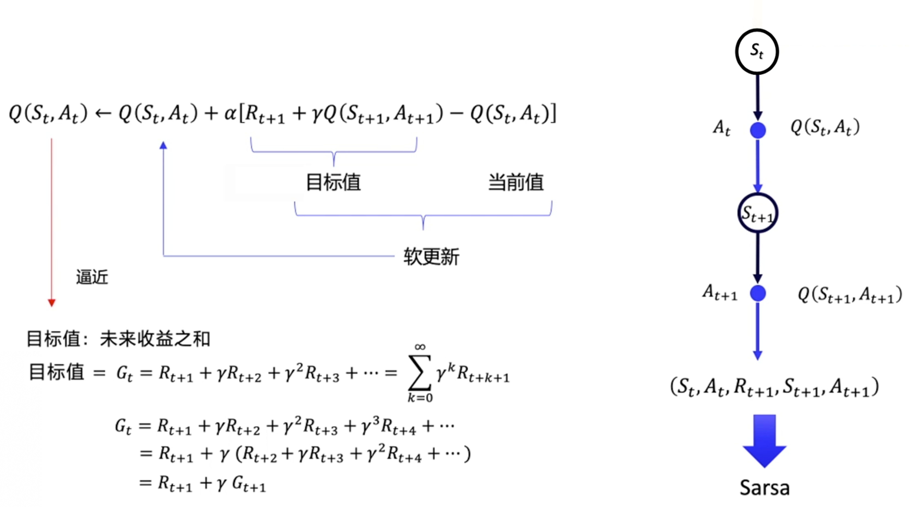

Hình 3.28 Cập nhật một bước của sai phân thời gian

Thứ ta muốn tính chính là $Q(s_t,a_t)$. Vì lúc đầu giá trị Q đều được khởi tạo ngẫu nhiên hoặc khởi tạo bằng 0, nên nó cần liên tục tiệm cận giá trị Q thực lý tưởng của nó (mục tiêu sai phân thời gian), $r_{t+1}+\gamma Q\left(s_{t+1}, a_{t+1}\right)-Q\left(s_{t}, a_{t}\right)$ chính là sai số sai phân thời gian.
Ta dùng $Q(s_t,a_t)$ để tiệm cận $G_t$, thì $Q(s_{t+1},a_{t+1})$ thực chất là xấp xỉ $G_{t+1}$. Ta có thể dùng $Q(s_{t+1},a_{t+1})$ xấp xỉ $G_{t+1}$, xem $r_{t+1}+\gamma Q(s_{t+1},a_{t+1})$ là giá trị mục tiêu.
$Q(s_t,a_t)$ muốn tiệm cận giá trị mục tiêu, ta dùng cách cập nhật mềm (soft update) để tiệm cận. Cập nhật mềm nghĩa là mỗi lần ta chỉ cập nhật một chút xíu, $\alpha$ tương tự tốc độ học. Cuối cùng giá trị Q có thể dần dần tiệm cận giá trị mục tiêu thực. Như vậy công thức cập nhật chỉ cần dùng $s_{t}$, $a_t$ ở thời điểm hiện tại, cùng với $r_{t+1}$, $s_{t+1}$, $a_{t+1}$ thu được.

Vì mỗi lần cập nhật hàm giá trị, thuật toán này cần biết trạng thái hiện tại (state), hành động hiện tại (action), phần thưởng (reward), trạng thái ở bước tiếp theo (state), hành động ở bước tiếp theo (action), tức các giá trị $(s_{t}, a_{t}, r_{t+1}, s_{t+1}, a_{t+1})$, nên nó được đặt tên là thuật toán **Sarsa**. Sau khi đi một bước và có được $(s_{t}, a_{t}, r_{t+1}, s_{t+1}, a_{t+1})$, nó có thể cập nhật một lần.

Như hình 3.29, công thức cập nhật của Sarsa có thể viết là
$$
	Q(S, A) \leftarrow Q(S, A)+\alpha\left(R+\gamma Q\left(S^{\prime}, A^{\prime}\right)-Q(S, A)\right)
$$

Công thức cập nhật của Sarsa tương tự công thức của phương pháp sai phân thời gian. $S'$ chính là $s_{t+1}$. Ta dùng giá trị Q của bước tiếp theo $Q(S',A')$ để cập nhật giá trị Q của bước này $Q(S,A)$, liên tục tăng cường từng giá trị Q.
$$
\begin{array}{lrl}
	{n=1}\text { (Sarsa)} &Q_{t}^{1}&=r_{t+1}+\gamma Q\left(s_{t+1}, a_{t+1}\right) \\
	n=2 &Q_{t}^{2}&=r_{t+1}+\gamma r_{t+2}+\gamma^{2} Q\left(s_{t+2}, a_{t+2}\right) \\
	&&\vdots \\
	n=\infty\text{ (MC)} \quad &Q_{t}^{\infty}&=r_{t+1}+\gamma r_{t+2}+\ldots+\gamma^{T-t-1} r_{T}
	\end{array} \tag{3.5}
$$

Ta xét lợi tức $n$ bước ($n=1,2,\cdots,\infty$), như biểu thức (3.5). Sarsa thuộc nhóm thuật toán cập nhật một bước, mỗi khi thực hiện một hành động là cập nhật giá trị và chính sách một lần. Nếu không cập nhật một bước mà dùng cập nhật $n$ bước hoặc cập nhật theo tập, tức là sau khi thực hiện $n$ bước mới cập nhật giá trị và chính sách, ta sẽ có **Sarsa $n$ bước ($n$-step Sarsa)**.

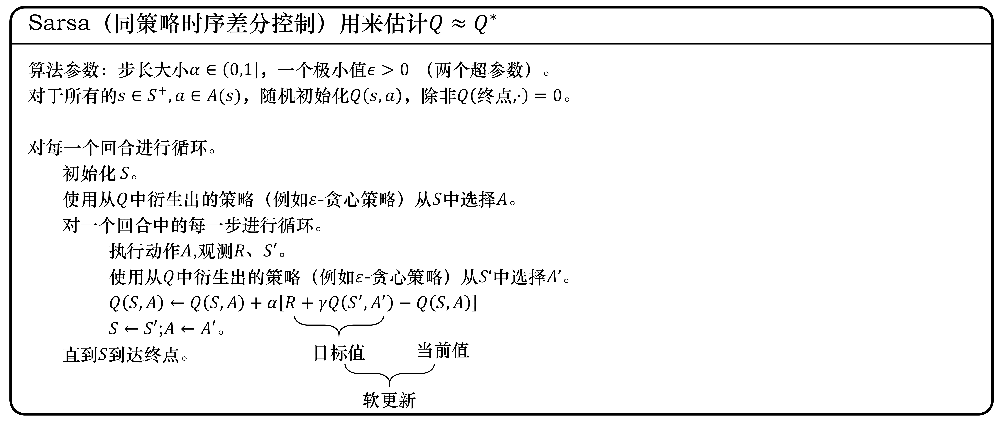

Hình 3.29 Thuật toán Sarsa

Bản dịch thuật toán ở hình 3.29:

$$
\begin{array}{l}
\hline
\textbf{Sarsa (điều khiển sai phân thời gian on-policy) dùng để ước lượng } Q \approx Q^{*} \\
\hline
\text{Tham số: bước cập nhật } \alpha \in (0,1] \text{, một giá trị rất nhỏ } \varepsilon > 0 \text{ (hai siêu tham số)} \\
\text{Với mọi } s \in S^{+},\ a \in A(s) \text{, khởi tạo ngẫu nhiên } Q(s,a) \text{, riêng } Q(\text{trạng thái kết thúc}, \cdot) = 0 \\
\text{Lặp với mỗi tập:} \\
\quad \text{Khởi tạo } S \\
\quad \text{Chọn } A \text{ từ } S \text{ theo chính sách suy ra từ } Q \text{ (ví dụ } \varepsilon\text{-tham lam)} \\
\quad \text{Lặp với mỗi bước của tập:} \\
\qquad \text{Thực hiện hành động } A \text{, quan sát } R, S' \\
\qquad \text{Chọn } A' \text{ từ } S' \text{ theo chính sách suy ra từ } Q \text{ (ví dụ } \varepsilon\text{-tham lam)} \\
\qquad Q(S,A) \leftarrow Q(S,A) + \underbrace{\alpha\big[\underbrace{R + \gamma Q(S',A')}_{\text{giá trị mục tiêu}} - \underbrace{Q(S,A)}_{\text{giá trị hiện tại}}\big]}_{\text{cập nhật mềm (soft update)}} \\
\qquad S \leftarrow S';\ A \leftarrow A' \\
\quad \text{cho đến khi } S \text{ là trạng thái kết thúc}
\\ \hline
\end{array}
$$

Ví dụ Sarsa 2 bước là thực hiện hai bước rồi mới cập nhật giá trị hàm Q.
Với Sarsa, giá trị ở thời điểm $t$ là
$$
	Q_{t}=r_{t+1}+\gamma Q\left(s_{t+1}, a_{t+1}\right)
$$
Còn với Sarsa $n$ bước, lợi tức Q $n$ bước của nó là
$$
	Q_{t}^{n}=r_{t+1}+\gamma r_{t+2}+\ldots+\gamma^{n-1} r_{t+n}+\gamma^{n} Q\left(s_{t+n}, a_{t+n}\right)
$$
Nếu nhân $Q_t^{n}$ với tham số suy giảm của vết đủ điều kiện (decay-rate parameter for eligibility traces) $\lambda$ và lấy tổng, ta sẽ có lợi tức Q của Sarsa($\lambda$)
$$
	Q_{t}^{\lambda}=(1-\lambda) \sum_{n=1}^{\infty} \lambda^{n-1} Q_{t}^{n}
$$
Do đó, quy tắc cập nhật của Sarsa($\lambda$) $n$ bước là
$$
	Q\left(s_{t}, a_{t}\right) \leftarrow Q\left(s_{t}, a_{t}\right)+\alpha\left(Q_{t}^{\lambda}-Q\left(s_{t}, a_{t}\right)\right)
$$
Tóm lại, khác biệt giữa Sarsa và Sarsa($\lambda$) chủ yếu thể hiện ở việc cập nhật giá trị.

Sau khi hiểu công thức cơ bản của cập nhật một bước, việc cài đặt code rất đơn giản. Như hình 3.30, bên phải là môi trường, bên trái là tác tử. Mỗi lần tác tử tương tác với môi trường xong là có thể học một lần, xuất hành động cho môi trường, nhận trạng thái và phần thưởng từ môi trường. Tác tử chủ yếu cài đặt hai phương thức:

(1) Chọn hành động dựa trên bảng Q, xuất hành động;

(2) Lấy các giá trị $(s_{t}, a_{t}, r_{t+1}, s_{t+1}, a_{t+1})$ để cập nhật bảng Q.

Hình 3.30 Sơ đồ cài đặt code Sarsa

### 3.4.2 Q-learning: điều khiển sai phân thời gian off-policy

Sarsa là một thuật toán **on-policy (cùng chính sách)**, nó tối ưu chính sách mà nó thực sự thực thi, nó dùng trực tiếp hành động sẽ thực hiện ở bước tiếp theo để tối ưu bảng Q. Trong quá trình học on-policy chỉ có một chính sách, nó dùng một chính sách để chọn hành động, cũng dùng chính chính sách đó để tối ưu. Vì vậy Sarsa biết hành động bước tiếp theo của nó có thể chạy ra phía vách đá, nên khi tối ưu chính sách của mình, nó sẽ cố gắng tránh xa vách đá một chút. Như vậy sẽ đảm bảo rằng, dù bước tiếp theo có hành động ngẫu nhiên, nó vẫn ở trong vùng an toàn.

Q-learning là một thuật toán **off-policy (khác chính sách)**. Như hình 3.31, trong quá trình học off-policy có hai chính sách khác nhau: **chính sách mục tiêu (target policy)** và **chính sách hành vi (behavior policy)**.
Chính sách mục tiêu là chính sách ta cần học, thường ký hiệu là $\pi$. Chính sách mục tiêu giống như một quân sư chỉ huy chiến thuật ở hậu phương, nó có thể dựa vào kinh nghiệm của mình để học chính sách tối ưu, không cần tương tác với môi trường.
Chính sách hành vi là chính sách khám phá môi trường, thường ký hiệu là $\mu$. Chính sách hành vi có thể mạnh dạn khám phá tất cả các quỹ đạo có thể, thu thập quỹ đạo, thu thập dữ liệu, rồi "đút" dữ liệu thu thập được cho chính sách mục tiêu học. Hơn nữa, dữ liệu "đút" cho chính sách mục tiêu không cần $a_{t+1}$, còn Sarsa thì phải có $a_{t+1}$. Chính sách hành vi giống như một người lính, có thể khám phá mọi hành động, quỹ đạo và kinh nghiệm trong môi trường, rồi giao những kinh nghiệm này cho chính sách mục tiêu học. Ví dụ khi tối ưu chính sách mục tiêu, Q-learning không quan tâm bước tiếp theo ta sẽ khám phá đi đâu, nó chỉ chọn chính sách có phần thưởng lớn nhất.

Hình 3.31 Off-policy

Một ví dụ khác, như hình 3.32, giả sử môi trường là biển cả sóng gió dữ dội, nhưng chính sách học (learning policy) quá "nhát gan", không thể trực tiếp tương tác với môi trường để học, vì vậy ta có chính sách khám phá (exploratory policy). Chính sách khám phá là một tên cướp biển không sợ sóng gió, nó rất liều lĩnh, có thể khám phá trong môi trường. Do đó chính sách khám phá có rất nhiều kinh nghiệm, nó có thể "viết những kinh nghiệm này thành bản thảo", rồi "đút" cho chính sách học. Chính sách học có thể học qua các bản thảo đó.

Hình 3.32 Ví dụ off-policy

Trong quá trình học off-policy, các quỹ đạo đều do chính sách hành vi tương tác với môi trường sinh ra, sau khi sinh ra các quỹ đạo này, ta dùng chúng để cập nhật chính sách mục tiêu $\pi$.
Học off-policy có nhiều lợi ích. Thứ nhất, ta có thể dùng chính sách khám phá để học được chính sách tốt nhất, hiệu quả học cao;
thứ hai, học off-policy cho phép ta học hành động của các tác tử khác, thực hiện học bắt chước (imitation learning), học các quỹ đạo do người hoặc các tác tử khác sinh ra;
cuối cùng, học off-policy cho phép ta tái sử dụng các quỹ đạo do chính sách cũ sinh ra, quá trình khám phá cần rất nhiều tài nguyên tính toán, như vậy có thể tiết kiệm tài nguyên.

Q-learning có hai chính sách: chính sách hành vi và chính sách mục tiêu.
Chính sách mục tiêu $\pi$ dùng trực tiếp chính sách tham lam trên bảng Q, lấy tất cả các trạng thái mà bước tiếp theo có thể đạt được, tức là
$$
	\pi\left(s_{t+1}\right)=\underset{a^{\prime}}{\arg \max}~ Q\left(s_{t+1}, a^{\prime}\right)
$$
Chính sách hành vi $\mu$ có thể là một chính sách ngẫu nhiên, nhưng ta dùng chính sách $\varepsilon$-tham lam, để chính sách hành vi không hoàn toàn ngẫu nhiên, nó được cải thiện dần dựa trên bảng Q.

Ta có thể xây dựng mục tiêu Q-learning, hành động tiếp theo của Q-learning đều được chọn bằng phép arg max, do đó ta có
$$
\begin{aligned}
r_{t+1}+\gamma Q\left(s_{t+1}, A^{\prime}\right) &=r_{t+1}+\gamma Q\left(s_{t+1},\arg \max ~Q\left(s_{t+1}, a^{\prime}\right)\right) \\
&=r_{t+1}+\gamma \max _{a^{\prime}} Q\left(s_{t+1}, a^{\prime}\right)
\end{aligned}	
$$

Tiếp theo ta có thể viết phép cập nhật Q-learning dưới dạng học tăng dần, mục tiêu sai phân thời gian trở thành $r_{t+1}+\gamma \max _{a} Q\left(s_{t+1}, a\right)$, tức là
$$
	Q\left(s_{t}, a_{t}\right) \leftarrow Q\left(s_{t}, a_{t}\right)+\alpha\left[r_{t+1}+\gamma \max _{a} Q\left(s_{t+1}, a\right)-Q\left(s_{t}, a_{t}\right)\right]
$$

Như hình 3.33, ta dùng cách so sánh để hiểu thêm về **Q-learning**. Q-learning là phương pháp học sai phân thời gian off-policy, Sarsa là phương pháp học sai phân thời gian on-policy.
Khi Sarsa cập nhật bảng Q, nó dùng $A'$. Khi ta muốn lấy giá trị Q tiếp theo, $A'$ là hành động chắc chắn sẽ được thực hiện ở bước tiếp theo, hành động này có thể là hành động lấy mẫu bằng phương pháp $\varepsilon$-tham lam, cũng có thể là hành động ứng với giá trị Q lớn nhất, cũng có thể là hành động ngẫu nhiên, nhưng đó là hành động nó thực sự thực hiện.
Nhưng khi Q-learning cập nhật bảng Q, nó dùng hành động ứng với giá trị Q $Q(S',a)$, đó không nhất thiết là hành động thực tế sẽ được thực hiện ở bước tiếp theo, vì hành động thực tế ta sẽ thực hiện ở bước tiếp theo có thể là khám phá.
Hành động tiếp theo mà Q-learning mặc định không được chọn bởi chính sách hành vi, Q-learning trực tiếp nhìn bảng Q, lấy giá trị lớn nhất của nó, nó mặc định $A'$ là hành động được chọn bởi chính sách tốt nhất, vì vậy khi học Q-learning không cần truyền vào $A'$, tức giá trị $a_{t+1}$.

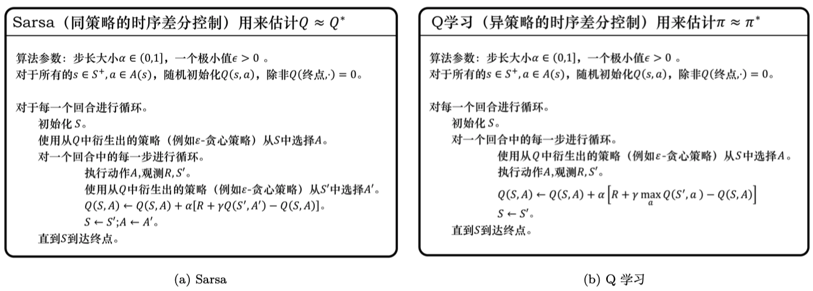

	

Hình 3.33 Mã giả của Sarsa và Q-learning

Bản dịch thuật toán ở hình 3.33 (a) Sarsa:

$$
\begin{array}{l}
\hline
\textbf{Sarsa (điều khiển sai phân thời gian on-policy) dùng để ước lượng } Q \approx Q^{*} \\
\hline
\text{Tham số: bước cập nhật } \alpha \in (0,1] \text{, một giá trị rất nhỏ } \varepsilon > 0  \\
\text{Với mọi } s \in S^{+},\ a \in A(s) \text{, khởi tạo ngẫu nhiên } Q(s,a) \text{, riêng } Q(\text{trạng thái kết thúc}, \cdot) = 0 \\
\text{Lặp với mỗi tập:} \\
\quad \text{Khởi tạo } S \\
\quad \text{Chọn } A \text{ từ } S \text{ theo chính sách suy ra từ } Q \text{ (ví dụ } \varepsilon\text{-tham lam)} \\
\quad \text{Lặp với mỗi bước của tập:} \\
\qquad \text{Thực hiện hành động } A \text{, quan sát } R, S' \\
\qquad \text{Chọn } A' \text{ từ } S' \text{ theo chính sách suy ra từ } Q \text{ (ví dụ } \varepsilon\text{-tham lam)} \\
\qquad Q(S,A) \leftarrow Q(S,A) + \alpha\big[R + \gamma Q(S',A') - Q(S,A)\big] \\
\qquad S \leftarrow S';\ A \leftarrow A' \\
\quad \text{cho đến khi } S \text{ là trạng thái kết thúc}
\\ \hline
\end{array}
$$

Bản dịch thuật toán ở hình 3.33 (b) Q-learning:

$$
\begin{array}{l}
\hline
\textbf{Q-learning (điều khiển sai phân thời gian off-policy) dùng để ước lượng } \pi \approx \pi^{*} \\
\hline
\text{Tham số: bước cập nhật } \alpha \in (0,1] \text{, một giá trị rất nhỏ } \varepsilon > 0 \\
\text{Với mọi } s \in S^{+},\ a \in A(s) \text{, khởi tạo ngẫu nhiên } Q(s,a) \text{, riêng } Q(\text{trạng thái kết thúc}, \cdot) = 0 \\
\text{Lặp với mỗi tập:} \\
\quad \text{Khởi tạo } S \\
\quad \text{Lặp với mỗi bước của tập:} \\
\qquad \text{Chọn } A \text{ từ } S \text{ theo chính sách suy ra từ } Q \text{ (ví dụ } \varepsilon\text{-tham lam)} \\
\qquad \text{Thực hiện hành động } A \text{, quan sát } R, S' \\
\qquad Q(S,A) \leftarrow Q(S,A) + \alpha\Big[R + \gamma \max\limits_{a} Q(S',a) - Q(S,A)\Big] \\
\qquad S \leftarrow S' \\
\quad \text{cho đến khi } S \text{ là trạng thái kết thúc}
\\ \hline
\end{array}
$$

Công thức cập nhật của Sarsa và Q-learning là như nhau, khác biệt chỉ ở phần tính mục tiêu,
Sarsa là $r_{t+1}+\gamma Q(s_{t+1}, a_{t+1})$,
Q-learning là $r_{t+1}+\gamma  \underset{a}{\max} Q\left(s_{t+1}, a\right)$.

Như hình 3.34a, Sarsa dùng chính sách của mình để sinh ra quỹ đạo $S,A,R,S',A'$, rồi dùng $Q(s_{t+1},a_{t+1})$ để cập nhật giá trị Q ban đầu $Q(s_t,a_t)$.
Nhưng Q-learning không cần biết thực tế ta chọn hành động nào, nó mặc định hành động tiếp theo chính là hành động có giá trị Q lớn nhất. Q-learning biết thực tế chính sách hành vi có thể có xác suất 0.1 chọn hành động khác, nhưng Q-learning không lo bị ảnh hưởng bởi khám phá, nó mặc định tối ưu chính sách mục tiêu theo chính sách tốt nhất, vì vậy nó có thể mạnh dạn hơn trong việc tìm đường đi tối ưu, nó tỏ ra mạnh dạn hơn Sarsa nhiều.

Như hình 3.34b, ta phân tích từng bước Q-learning, điểm khác duy nhất giữa Q-learning và Sarsa là không cần biết trước $A_2$ mà vẫn có thể cập nhật $Q(S_1,A_1)$. Trong quá trình huấn luyện một tập, trước khi học Q-learning cũng không cần lấy hành động tiếp theo $A'$, nó chỉ cần $(S,A,R,S')$ phía trước, điều này rất khác với Sarsa.

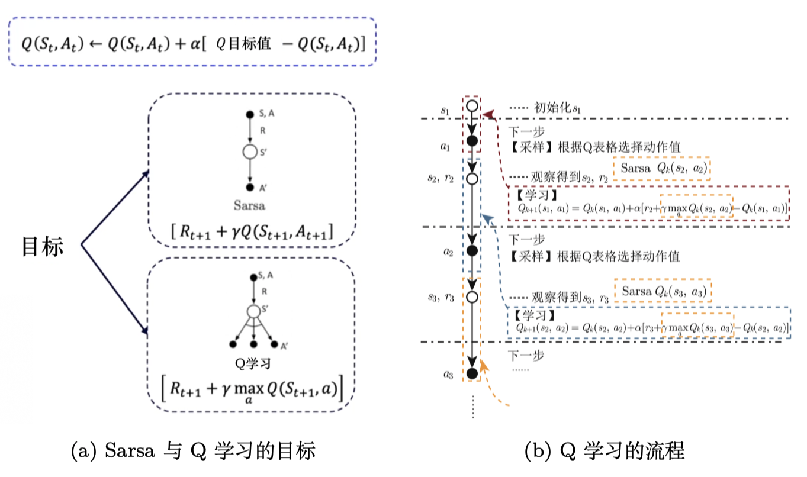

Hình 3.34 Khác biệt giữa Sarsa và Q-learning

### 3.4.3 Khác biệt giữa on-policy và off-policy

Tổng kết khác biệt giữa on-policy và off-policy.
* Sarsa là một thuật toán on-policy điển hình, nó chỉ dùng một chính sách $\pi$, nó không chỉ dùng chính sách $\pi$ để học mà còn dùng chính sách $\pi$ để tương tác với môi trường sinh ra kinh nghiệm.
Nếu chính sách dùng thuật toán $\varepsilon$-tham lam, nó cần cân nhắc cả khám phá, để cân bằng khám phá và khai thác, khi huấn luyện nó tỏ ra hơi "nhát gan". Khi giải bài toán đi bên vách đá, nó sẽ cố gắng tránh xa mép vách đá, đảm bảo rằng dù mình vô tình khám phá một chút, vẫn ở trong vùng an toàn. Ngoài ra, vì dùng thuật toán $\varepsilon$-tham lam, chính sách sẽ liên tục thay đổi (giá trị $\varepsilon$ sẽ liên tục giảm), nên chính sách không ổn định.
* Q-learning là một thuật toán off-policy điển hình, nó có hai chính sách — chính sách mục tiêu và chính sách hành vi, nó tách biệt chính sách mục tiêu và chính sách hành vi. Q-learning có thể mạnh dạn dùng các quỹ đạo kinh nghiệm do chính sách hành vi khám phá được để tối ưu chính sách mục tiêu, từ đó có khả năng khám phá ra chính sách tốt nhất cao hơn. Chính sách hành vi có thể dùng thuật toán $\varepsilon$-tham lam, nhưng chính sách mục tiêu dùng thuật toán tham lam, nó trực tiếp dựa vào dữ liệu do chính sách hành vi thu thập để áp dụng chính sách tốt nhất, vì vậy Q-learning không cần cân nhắc khám phá.

* So sánh công thức cập nhật của Q-learning và Sarsa, ta có thể thấy Sarsa không có phép tối đa hóa chọn giá trị lớn nhất. Do đó, Q-learning là một phương pháp rất liều lĩnh (aggressive), nó muốn mỗi bước đều đạt lợi ích lớn nhất; còn Sarsa thì tương đối bảo thủ hơn, nó sẽ chọn một lộ trình lặp tương đối an toàn.

Tổng kết các phương pháp dạng bảng được thể hiện ở hình 3.35.

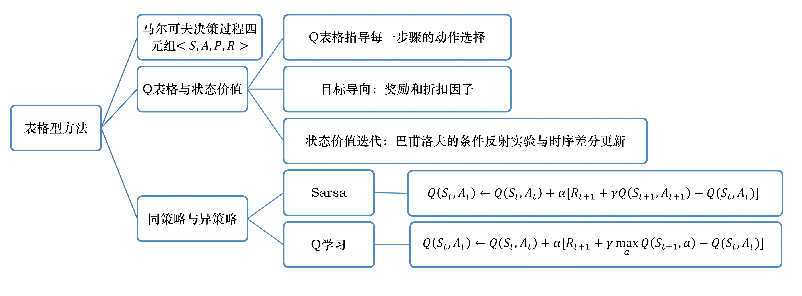

Hình 3.35 Tổng kết các phương pháp dạng bảng

## Tài liệu tham khảo

* [百度强化学习 (Khóa học học tăng cường của Baidu)](https://aistudio.baidu.com/aistudio/education/lessonvideo/460292)

* [强化学习基础 David Silver 笔记 (Ghi chú Cơ bản học tăng cường của David Silver)](https://zhuanlan.zhihu.com/c_135909947)
* [Intro to Reinforcement Learning (强化学习纲要 - Đại cương học tăng cường)](https://github.com/zhoubolei/introRL)
* [Reinforcement Learning: An Introduction (second edition)](https://book.douban.com/subject/30323890/)
* [百面深度学习 (Bách diện học sâu)](https://book.douban.com/subject/35043939/)
* [神经网络与深度学习 (Mạng nơ-ron và học sâu)](https://nndl.github.io/)
* [机器学习 (Học máy)](https://book.douban.com/subject/26708119//)
* [Understanding the Bias-Variance Tradeoff](http://scott.fortmann-roe.com/docs/BiasVariance.html)
