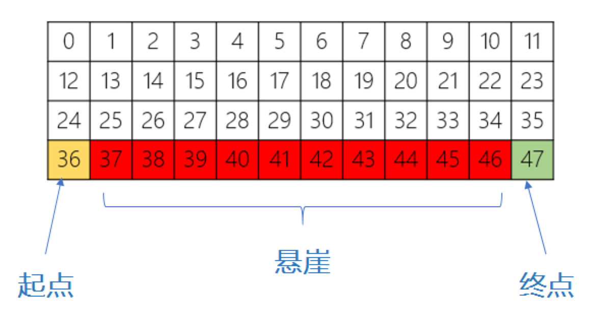
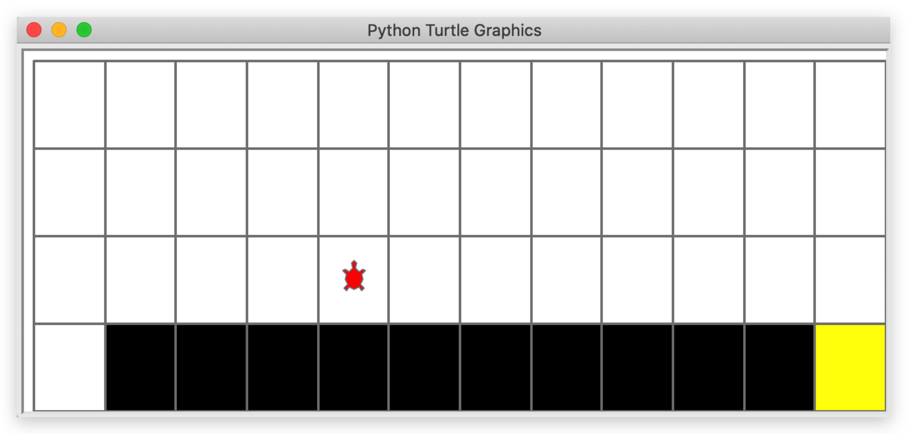
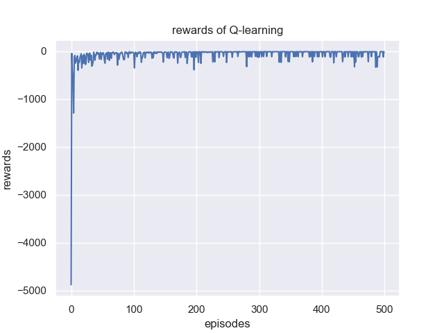
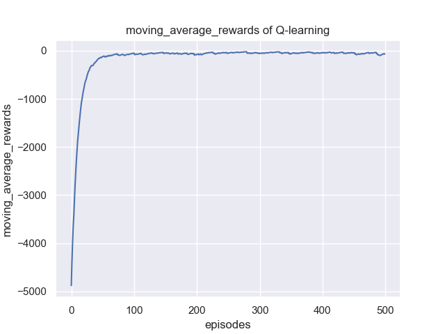

# Dùng Q-learning giải bài toán tìm đường bên vách đá

Học tăng cường cũng có triển vọng ứng dụng lớn trong lập kế hoạch chuyển động (motion planning), cụ thể gồm lập kế hoạch đường đi và ra quyết định, điều phối đơn hàng thông minh,... Dự án lần này trừu tượng hóa và đơn giản hóa bài toán lập kế hoạch chuyển động cho một tác thể đơn lẻ, giúp mọi người bước đầu làm quen với ứng dụng của học tăng cường trong lĩnh vực này. Trong lập kế hoạch chuyển động, thực ra đã có rất nhiều môi trường mô phỏng phù hợp cho học tăng cường, nhỏ thì như mê cung, lớn thì như môi trường lái xe tự động gần với thực tế [CARLA](http://carla.org/), bạn nào quan tâm đến mảng này có thể tìm hiểu thêm. Dự án này dùng môi trường ```CliffWalking-v0``` do gym phát triển, cài đặt trên đó một demo nhập môn Q-learning đơn giản.

## Giới thiệu môi trường CliffWalking-v0

Trước tiên giới thiệu qua môi trường này. Môi trường này có tên là bài toán tìm đường bên vách đá (CliffWalking): trong một lưới 4 x 12, tác tử (agent) lấy vị trí góc dưới bên trái của lưới làm điểm xuất phát, vị trí góc dưới bên phải làm điểm đích, mục tiêu là di chuyển tác tử đến vị trí đích. Mỗi lần tác tử có thể di chuyển một bước theo 4 hướng lên, xuống, trái, phải, mỗi bước di chuyển nhận phần thưởng (reward) -1 đơn vị.



Như hình, phần màu đỏ là vách đá, các con số đại diện cho thông tin vị trí mà tác tử quan sát được, tức observation (quan sát), tổng cộng có 48 giá trị khác nhau từ 0 đến 47. Tác tử khi di chuyển có các ràng buộc sau:

* Tác tử không thể đi ra ngoài lưới, nếu tác tử muốn thực hiện một hành động đi ra ngoài lưới thì ở bước này tác tử không di chuyển, nhưng thao tác này vẫn nhận phần thưởng -1 đơn vị

* Nếu tác tử "rơi xuống vách đá", nó sẽ lập tức quay về vị trí xuất phát và nhận phần thưởng -100 đơn vị

* Khi tác tử di chuyển đến đích, tập (episode) đó kết thúc, tổng phần thưởng của tập là tổng phần thưởng của các bước

Giao diện mô phỏng thực tế như sau:



**Vì từ điểm xuất phát đến đích cần ít nhất 13 bước, mỗi bước nhận reward -1, nên với thuật toán huấn luyện tốt nhất, tổng reward của mỗi episode phải là -13**. Vì vậy mục tiêu của chúng ta là thông qua huấn luyện RL để có được một mô hình, giúp reward của một episode khi kiểm thử đạt khoảng gần -13.

## Giao diện huấn luyện RL cơ bản

Dưới đây là giao diện cơ bản của thuật toán học tăng cường, tức là một quy trình huấn luyện tầng trên hoàn chỉnh: đầu tiên khởi tạo môi trường và tác tử, sau đó trong mỗi episode, trước tiên agent chọn action đưa cho môi trường, rồi môi trường phản hồi trạng thái tiếp theo và reward, rồi agent bắt đầu cập nhật hay học; sau nhiều episode như vậy agent bắt đầu hội tụ và lưu mô hình. Trong đó có thể trực quan hóa sự thay đổi của reward theo từng episode để xem hiệu quả huấn luyện. Ngoài ra vì tính bất ổn định của học tăng cường, ở trạng thái hội tụ cũng có thể có dao động, khi đó có thể dùng reward trung bình trượt (moving average) để làm đường cong mượt hơn, tiện cho việc phân tích.

```python
  '''Khởi tạo môi trường'''  
env = gym.make("CliffWalking-v1")  # 0 up, 1 right, 2 down, 3 left (Gymnasium 1.x: CliffWalking-v1)
env = CliffWalkingWapper(env)
agent = QLearning(
    state_dim=env.observation_space.n,
    action_dim=env.action_space.n,
    learning_rate=cfg.policy_lr,
    gamma=cfg.gamma,)
rewards = []  
ma_rewards = [] # moving average reward
for i_ep in range(cfg.train_eps): # train_eps: số episode huấn luyện tối đa
    ep_reward = 0  # Ghi lại reward của mỗi episode
    state, info = env.reset()  # Đặt lại môi trường, bắt đầu ván mới (tức bắt đầu một episode mới)
    while True:
        action = agent.choose_action(state)  # Chọn một hành động theo thuật toán
        next_state, reward, terminated, truncated, _ = env.step(action)  # Thực hiện một lần tương tác hành động với môi trường
        done = terminated or truncated  # Gymnasium tách done thành terminated và truncated
        agent.update(state, action, reward, next_state, terminated)  # Cập nhật theo thuật toán Q-learning
        state = next_state  # Lưu giá trị quan sát trước đó
        ep_reward += reward
        if done:
            break
    rewards.append(ep_reward)
    if ma_rewards:
        ma_rewards.append(ma_rewards[-1]*0.9+ep_reward*0.1)
    else:
        ma_rewards.append(ep_reward)
    print("Episode:{}/{}: reward:{:.1f}".format(i_ep+1, cfg.train_eps,ep_reward))
```

> **Ghi chú của người dịch:** code trên đã được chuyển từ `gym` sang Gymnasium (`import gymnasium as gym`), xem ghi chú ở mục 1.7.1 chương 1.

## Yêu cầu nhiệm vụ

Dựa trên mục tiêu trên, nhiệm vụ lần này là huấn luyện và vẽ đồ thị đường cong reward cũng như reward sau khi lấy trung bình trượt theo episode, đồng thời ghi lại các siêu tham số (hyperparameter) và viết thành báo cáo, ví dụ như sau:





## Ghi chú

* Chú ý cách dùng chính sách $\varepsilon$-greedy ($\varepsilon$-tham lam), và cách tham số $\varepsilon$ tương ứng suy giảm
* Việc chọn hành động khi huấn luyện mô hình và khi kiểm thử mô hình có chút khác nhau: khi huấn luyện dùng chính sách $\varepsilon$-greedy, còn khi kiểm thử thì chọn trực tiếp hành động ứng với giá trị Q lớn nhất, vì vậy phần chọn hành động của thuật toán sẽ gồm sample (lấy mẫu hành động khi huấn luyện) và predict (chọn hành động khi kiểm thử)

* Hành động ứng với giá trị Q lớn nhất có thể không chỉ có một, khi đó có thể chọn ngẫu nhiên một hành động làm kết quả đầu ra
