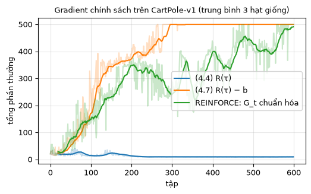
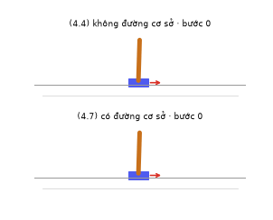

# Chương 4 · Code

> Ghi chú của người dịch: trang này do người dịch biên soạn, không có trong sách gốc. MinRL không có REINFORCE, nên code trên trang được viết thêm *(thêm)* theo cùng phong cách: một vòng lặp ngắn, công thức nằm ngay cạnh dòng code. Notebook `PolicyGradient_vi` của bản gốc EasyRL được trích và nhận xét ở mục 4.
>
> Ký hiệu: theo [chương 4](chapter4/chapter4_vi): $\pi_\theta(a \mid s)$ là chính sách có tham số $\theta$, $R(\tau)$ là tổng phần thưởng của quỹ đạo, $G_t$ là lợi tức từ bước $t$, $b$ là đường cơ sở.

Mỗi khối code đã được chạy sẵn trên CPU. Kết quả, hình vẽ và ảnh động nằm ngay bên dưới. Các khối chạy lần lượt từ trên xuống và dùng chung biến, như các ô của một notebook. Muốn tự chạy, xem [mục 5](#_5-chạy-trên-máy).

## 1. Chính sách là một mạng nơ-ron

<small class="viz-ref">Mục 4.1</small>

Môi trường là CartPole-v1 (xem [trang Code chương 6](chapter6/chapter6_code_vi) để biết chi tiết). Chính sách $\pi_\theta(a \mid s)$ là một mạng nhỏ: nhận 4 số của trạng thái, trả ra 2 logit, rồi qua softmax thành xác suất của hai hành động. Khi huấn luyện, ta **lấy mẫu** hành động theo phân phối đó, không lấy hành động có xác suất lớn nhất. Nhờ vậy tác tử tự khám phá mà không cần $\varepsilon$-tham lam.

Cả ba biến thể dưới đây dùng chung một vòng lặp. Chúng chỉ khác nhau ở **trọng số** $w_t$ nhân với $\nabla \log \pi_\theta(a_t \mid s_t)$:

$$
\nabla \bar R_\theta \approx \frac{1}{N}\sum_{n=1}^{N}\sum_{t=1}^{T_n} w_t^n \, \nabla \log \pi_\theta(a_t^n \mid s_t^n)
$$

| Biến thể | Trọng số $w_t$ | Trong chương |
|---|---|---|
| `"total"` | $R(\tau)$, giống nhau cho mọi bước | công thức (4.4) |
| `"baseline"` | $R(\tau) - b$, với $b$ là trung bình trượt của $R(\tau)$ | mẹo 1, công thức (4.7) |
| `"reinforce"` | $G_t = r_{t+1} + \gamma G_{t+1}$, chuẩn hóa về trung bình 0, độ lệch chuẩn 1 | mẹo 2 và REINFORCE, công thức (4.8) |

<!-- run -->
```python
import numpy as np
import torch
from torch import nn
import gymnasium as gym
import matplotlib.pyplot as plt
from viz import plot_returns, cartpole_gif

torch.set_num_threads(1)

def reinforce(variant, n_episodes=600, gamma=0.99, lr=1e-2, seed=0):
    torch.manual_seed(seed)
    env = gym.make("CartPole-v1")
    policy = nn.Sequential(nn.Linear(4, 64), nn.Tanh(), nn.Linear(64, 2))   # π_θ: 2 logit
    optimizer = torch.optim.Adam(policy.parameters(), lr=lr)
    returns, b = [], 0.0
    for ep in range(n_episodes):
        # 1. Chạy hết một tập bằng chính sách hiện tại (Monte Carlo)
        obs, _ = env.reset(seed=seed * 10_000 + ep)
        log_probs, rewards = [], []
        while True:
            dist = torch.distributions.Categorical(logits=policy(torch.as_tensor(obs)))
            action = dist.sample()                        # lấy mẫu a_t ~ π_θ(·|s_t)
            log_probs.append(dist.log_prob(action))       # log π_θ(a_t|s_t)
            obs, r, terminated, truncated, _ = env.step(int(action))
            rewards.append(r)
            if terminated or truncated:
                break
        R = sum(rewards)                                  # R(τ)
        returns.append(R)

        # 2. Trọng số w_t cho từng bước
        T = len(rewards)
        if variant == "total":                            # (4.4)
            w = torch.full((T,), R)
        elif variant == "baseline":                       # (4.7): R(τ) - b
            w = torch.full((T,), R - b)
            b = 0.9 * b + 0.1 * R                         # b: trung bình trượt của R(τ)
        else:                                             # REINFORCE: G_t, (4.8)
            G, g = np.zeros(T), 0.0
            for t in reversed(range(T)):
                g = rewards[t] + gamma * g                # G_t = r_{t+1} + γ G_{t+1}
                G[t] = g
            w = torch.as_tensor((G - G.mean()) / (G.std() + 1e-8), dtype=torch.float32)

        # 3. Đi lên theo gradient: tối thiểu hóa -Σ w_t log π_θ(a_t|s_t)
        loss = -(torch.stack(log_probs) * w).mean()
        optimizer.zero_grad()
        loss.backward()
        optimizer.step()
    return policy, returns
```

## 2. So sánh ba biến thể

<small class="viz-ref">Mục 4.2 · hình 4.10–4.12</small>

Mỗi biến thể chạy 600 tập với 3 hạt giống khác nhau. Khối dưới in tổng phần thưởng trung bình theo từng đoạn 100 tập, rồi vẽ đường trung bình của 3 hạt giống.

<!-- run -->
```python
curves, policies = {}, {}
for variant in ["total", "baseline", "reinforce"]:
    runs = []
    for seed in range(3):
        policy, rets = reinforce(variant, seed=seed)
        runs.append(rets)
        policies[(variant, seed)] = policy
        blocks = [int(np.mean(rets[i:i + 100])) for i in range(0, 600, 100)]
        print(f"{variant:9s} hạt giống {seed}: trung bình mỗi 100 tập = {blocks}")
    curves[variant] = np.mean(runs, axis=0)

fig, ax = plt.subplots(figsize=(5.8, 3.2))
plot_returns({"(4.4) R(τ)": curves["total"], "(4.7) R(τ) − b": curves["baseline"],
              "REINFORCE: G_t chuẩn hóa": curves["reinforce"]}, ax=ax, k=20,
             title="Gradient chính sách trên CartPole-v1 (trung bình 3 hạt giống)")
```

<!-- output -->
```output
total     hạt giống 0: trung bình mỗi 100 tập = [10, 9, 9, 9, 9, 9]
total     hạt giống 1: trung bình mỗi 100 tập = [17, 12, 9, 9, 9, 9]
total     hạt giống 2: trung bình mỗi 100 tập = [32, 30, 10, 9, 9, 9]
baseline  hạt giống 0: trung bình mỗi 100 tập = [106, 492, 500, 500, 500, 500]
baseline  hạt giống 1: trung bình mỗi 100 tập = [51, 89, 299, 499, 500, 500]
baseline  hạt giống 2: trung bình mỗi 100 tập = [82, 428, 499, 500, 500, 500]
reinforce hạt giống 0: trung bình mỗi 100 tập = [120, 458, 464, 266, 224, 342]
reinforce hạt giống 1: trung bình mỗi 100 tập = [11, 33, 62, 378, 461, 482]
reinforce hạt giống 2: trung bình mỗi 100 tập = [129, 274, 371, 287, 500, 489]
```

<div align=center></div>
<!-- /output -->

Kết quả minh họa rất rõ hai mẹo của mục 4.2:

- **Không có đường cơ sở** (`total`): ở CartPole mọi phần thưởng đều là $+1$, nên $R(\tau) > 0$ với mọi quỹ đạo. Mọi hành động đã lấy mẫu đều được **tăng** xác suất, chỉ là tăng nhiều hay ít. Đây đúng là vấn đề mà mẹo 1 nêu. Trong cả ba lần chạy, sau vài trăm tập gậy chỉ trụ được khoảng 9 bước, còn tệ hơn chính sách ngẫu nhiên (khoảng 22 bước). Mức 9 bước là dấu hiệu của chính sách gần như tất định, lúc nào cũng đẩy về một phía. Một khi xác suất đã dồn hết về một hành động, tác tử không còn lấy mẫu được hành động kia để biết nó tốt hơn, nên không thoát ra được.
- **Có đường cơ sở** (`baseline`): quỹ đạo nào tốt hơn mức trung bình gần đây thì được tăng xác suất, quỹ đạo nào tệ hơn thì bị giảm. Cả ba hạt giống đều đạt 500.
- **REINFORCE với $G_t$ chuẩn hóa**: phép chuẩn hóa cũng đóng vai trò đường cơ sở. Thêm nữa, mỗi hành động chỉ được tính phần thưởng **sau** nó (mẹo 2). Cả ba hạt giống đều học được và có lúc chạm gần 500, nhưng dao động mạnh. Ví dụ, hạt giống 0 lên khoảng 460 ở tập 100–300, rồi tụt về 220–340. Ở bài nhỏ này, đường cơ sở trượt đơn giản lại ổn định hơn. Phương sai lớn là điểm yếu quen thuộc của gradient chính sách Monte Carlo, và là động lực cho nhà phê bình ở chương 9.

Chính sách học được bằng đường cơ sở (hạt giống 0), lấy hành động có xác suất lớn nhất:

<!-- run -->
```python
pg = policies[("baseline", 0)]
act = lambda obs: int(pg(torch.as_tensor(obs)).argmax())
collapsed = policies[("total", 0)]
act_collapsed = lambda obs: int(collapsed(torch.as_tensor(obs)).argmax())
cartpole_gif({"(4.4) không đường cơ sở": act_collapsed, "(4.7) có đường cơ sở": act},
             "cartpole_pg.gif", seed=3)
```

<!-- output -->
<div align=center></div>
<!-- /output -->

## 3. Đọc lại công thức (4.5) trong code

Mục 4.1 nói rằng có thể xem gradient chính sách như một bài toán **phân loại có trọng số**: hàm mất mát là entropy chéo giữa hành động đã lấy mẫu và đầu ra của mạng, nhân thêm trọng số $w_t$. Trong code ở trên, `-(log_probs * w).mean()` chính là entropy chéo có trọng số đó, vì $-\log \pi_\theta(a_t \mid s_t)$ là entropy chéo khi nhãn là $a_t$. Viết bằng hàm có sẵn của PyTorch:

<!-- run -->
```python
logits = torch.tensor([[2.0, 0.5], [0.1, 1.2]])   # đầu ra của mạng cho 2 trạng thái
actions = torch.tensor([0, 0])                     # hành động đã lấy mẫu
w = torch.tensor([1.5, -0.7])                      # trọng số (lợi thế)

loss_pg = -(torch.distributions.Categorical(logits=logits).log_prob(actions) * w).mean()
loss_ce = (nn.functional.cross_entropy(logits, actions, reduction="none") * w).mean()
print(f"-Σ w log π = {loss_pg:.4f},  entropy chéo có trọng số = {loss_ce:.4f}")
```

<!-- output -->
```output
-Σ w log π = -0.3345,  entropy chéo có trọng số = -0.3345
```
<!-- /output -->

## 4. Notebook của EasyRL

Notebook [`PolicyGradient_vi.ipynb`](https://github.com/nmc2004nd/easy-rl-vi/blob/main/notebooks/PolicyGradient_vi.ipynb) ([Colab](https://colab.research.google.com/github/nmc2004nd/easy-rl-vi/blob/main/notebooks/PolicyGradient_vi.ipynb)) cài cùng thuật toán theo một cách khác. Có hai chỗ đáng để ý:

```python
# Trích từ PolicyGradient_vi.ipynb
x = torch.sigmoid(self.fc3(x))        # mạng ra 1 xác suất p, dùng phân phối Bernoulli:
m = Bernoulli(probs)                  # hành động 1 với xác suất p, hành động 0 với xác suất 1 - p
...
for i in reversed(range(len(reward_pool))):
    if reward_pool[i] == 0:           # bộ nhớ gom nhiều tập liền nhau; phần thưởng 0 được dùng
        running_add = 0               # làm dấu "hết tập" để G_t không cộng lẫn sang tập trước
    else:
        running_add = running_add * self.gamma + reward_pool[i]
        reward_pool[i] = running_add
```

- Với 2 hành động, một đầu ra sigmoid và phân phối Bernoulli tương đương với 2 logit và softmax như ở trên.
- Mẹo dùng phần thưởng 0 làm dấu hết tập chỉ đúng vì CartPole không bao giờ cho phần thưởng 0 ở giữa tập. Đổi sang môi trường khác thì phải lưu cờ `done` riêng.
- Sau đó notebook chuẩn hóa `reward_pool`, giống biến thể `reinforce` ở trên.

## 5. Chạy trên máy

```bash
git clone https://github.com/nmc2004nd/easy-rl-vi.git
cd easy-rl-vi/docs/code/py          # chạy từ đây để import được viz
pip install numpy matplotlib pillow gymnasium torch
```

Chép lần lượt các khối code trên trang vào Jupyter rồi chạy theo thứ tự. Mục 2 huấn luyện 9 lần, mất vài phút trên CPU. Kết quả trên trang được dựng bằng `python3 scripts/build_code_pages.py docs/chapter4/chapter4_code_vi.md`.
