# Chương 4 Gradient chính sách
## 4.1 Thuật toán gradient chính sách
Như hình 4.1, học tăng cường có 3 thành phần: **diễn viên (actor)**, **môi trường** và **hàm phần thưởng**. Khi tác tử chơi trò chơi điện tử, diễn viên chịu trách nhiệm điều khiển cần điều khiển (joystick) của trò chơi, ví dụ các thao tác sang trái, sang phải, bắn,...; môi trường chính là máy chơi game, chịu trách nhiệm điều khiển hình ảnh của trò chơi, điều khiển sự di chuyển của quái vật,...; hàm phần thưởng chính là khi ta làm việc gì, xảy ra tình huống gì thì nhận được bao nhiêu điểm, ví dụ đánh bại một con quái vật được 20 điểm,... Khái niệm tương tự áp dụng cho cờ vây cũng vậy: diễn viên chính là AlphaGo, nó phải quyết định đặt quân cờ ở vị trí nào; môi trường chính là đối thủ; hàm phần thưởng chính là luật cờ vây, thắng được một điểm, thua bị trừ một điểm. Trong học tăng cường, môi trường và hàm phần thưởng không phải thứ ta có thể kiểm soát, chúng được cho trước trước khi bắt đầu học. Việc duy nhất ta cần làm là điều chỉnh chính sách bên trong diễn viên, giúp diễn viên nhận được phần thưởng lớn nhất. Chính sách bên trong diễn viên quyết định hành động của diễn viên, tức là cho một đầu vào, nó sẽ đưa ra hành động mà diễn viên nên thực hiện lúc này.

Hình 4.1 Các thành phần của học tăng cường

Chính sách thường được ký hiệu là $\pi$. Giả sử ta dùng học sâu (deep learning) để làm học tăng cường, chính sách chính là một mạng. Trong mạng có một số tham số, ta dùng $\theta$ để đại diện cho tham số của $\pi$. Đầu vào của mạng là những gì tác tử nhìn thấy, nếu cho tác tử chơi trò chơi điện tử thì thứ tác tử nhìn thấy chính là hình ảnh trò chơi. Những gì tác tử nhìn thấy sẽ ảnh hưởng đến hiệu quả huấn luyện. Ví dụ, khi chơi game, có thể ta nghĩ các hình ảnh trò chơi có liên quan trước sau với nhau, nên nên cho chính sách xem tổng hợp tất cả các hình ảnh từ đầu trò chơi đến thời điểm hiện tại. Vì vậy có thể ta nghĩ cần dùng mạng nơ-ron hồi quy (recurrent neural network, RNN) để xử lý, nhưng như vậy sẽ khá khó xử lý. Ta có thể dùng vectơ hoặc ma trận để biểu diễn quan sát của tác tử, và đưa quan sát vào mạng chính sách (policy network), mạng chính sách sẽ đưa ra hành động mà tác tử cần thực hiện. Hình 4.2 là ví dụ cụ thể, chính sách là một mạng; đầu vào là hình ảnh trò chơi, thường được tạo thành từ các điểm ảnh (pixel); đầu ra là các hành động ta có thể thực hiện, có bao nhiêu hành động thì tầng đầu ra có bấy nhiêu nơ-ron. Giả sử hiện tại có 3 hành động có thể thực hiện, tầng đầu ra sẽ có 3 nơ-ron, mỗi nơ-ron ứng với một hành động có thể thực hiện. Đưa một thứ vào, mạng sẽ cho mỗi hành động có thể thực hiện một điểm số. Ta có thể xem điểm số này là xác suất, diễn viên dựa vào phân phối xác suất để quyết định hành động cần thực hiện, ví dụ xác suất 0.7 đi sang trái, xác suất 0.2 đi sang phải, xác suất 0.1 bắn,... Phân phối xác suất khác nhau thì hành động diễn viên thực hiện cũng khác nhau.

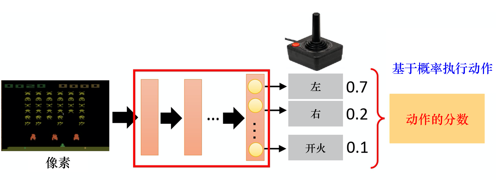

Hình 4.2 Chính sách của diễn viên

Tiếp theo ta dùng một ví dụ để minh họa quá trình tương tác giữa diễn viên và môi trường. Như hình 4.3, đầu tiên diễn viên nhìn thấy hình ảnh ban đầu của một trò chơi điện tử, tiếp theo nó dựa vào mạng bên trong (chính sách bên trong) để quyết định một hành động. Giả sử hành động diễn viên quyết định là sang phải, sau khi quyết định hành động, nó sẽ nhận một phần thưởng, phần thưởng đại diện cho số điểm nó nhận được sau khi thực hiện hành động này.

Ta ký hiệu hình ảnh ban đầu của trò chơi là $s_1$, hành động thực hiện lần đầu là $a_1$, phần thưởng nhận được sau lần thực hiện hành động đầu tiên là $r_1$. Mỗi người có cách ký hiệu khác nhau, có người cho rằng phần thưởng nhận được khi thực hiện $a_1$ ở $s_1$ nên ký hiệu là $r_2$, cả hai cách ký hiệu đều được. Sau khi diễn viên quyết định một hành động, nó sẽ nhìn thấy một hình ảnh trò chơi mới $s_2$. Đưa $s_2$ cho diễn viên, diễn viên quyết định bắn, có thể nó đã đánh bại một con quái vật và được năm điểm. Quá trình này cứ lặp lại liên tục, cho đến khi tại một thời điểm nào đó thực hiện một hành động nào đó, nhận phần thưởng xong, môi trường quyết định trò chơi kết thúc. Ví dụ, nếu trong trò chơi này ta điều khiển phi thuyền vũ trụ đi tiêu diệt quái vật, nếu phi thuyền bị phá hủy hoặc đã tiêu diệt hết quái vật thì trò chơi kết thúc.

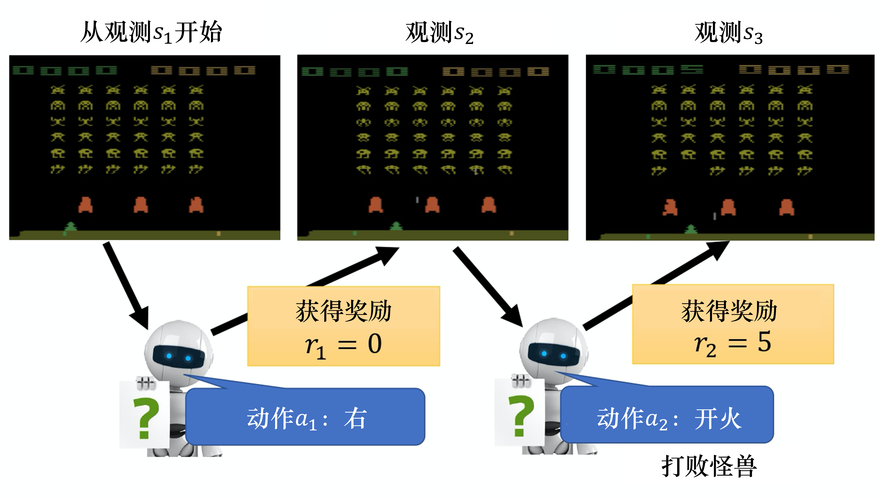

Hình 4.3 Ví dụ chơi trò chơi điện tử
    

Như hình 4.4, một ván chơi được gọi là một tập (episode). Cộng tất cả các phần thưởng nhận được trong ván chơi này lại, chính là **tổng phần thưởng (total reward)**, tức **lợi tức (return)**, ta dùng $R$ để biểu thị. Diễn viên phải tìm cách tối đa hóa phần thưởng mà nó có thể nhận được.

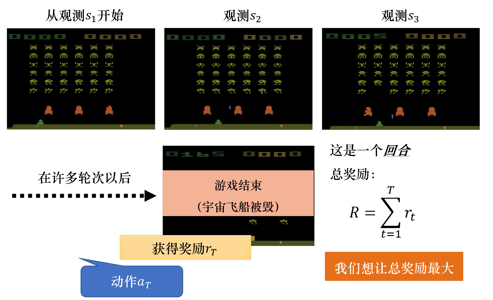

Hình 4.4 Ví dụ về lợi tức

Như hình 4.5, trước hết, môi trường là một hàm, ta có thể xem máy chơi game là một hàm, tuy nó không nhất thiết là mạng nơ-ron, có thể là mô hình dựa trên luật (rule-based), nhưng ta có thể xem nó là một hàm. Hàm này đầu tiên "nhả" ra một trạng thái (hình ảnh trò chơi $s_1$), tiếp đó diễn viên nhìn thấy hình ảnh trò chơi $s_1$ rồi "nhả" ra hành động $a_1$. Môi trường lấy hành động $a_1$ làm đầu vào, lại "nhả" ra hình ảnh trò chơi mới $s_2$. Diễn viên nhìn thấy hình ảnh trò chơi mới $s_2$, lại thực hiện hành động mới $a_2$. Môi trường nhìn thấy $a_2$, lại "nhả" ra $s_3$ ... Quá trình này cứ tiếp tục cho đến khi môi trường thấy nên dừng lại.

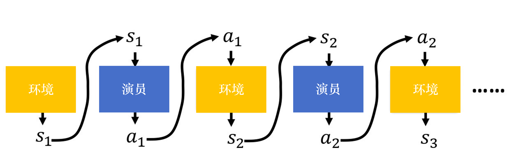

Hình 4.5 Diễn viên và môi trường

Trong một ván chơi, ta kết hợp toàn bộ các $s$ do môi trường đưa ra và các hành động $a$ do diễn viên đưa ra, chính là một quỹ đạo (trajectory), tức là
$$
    \tau=\left\{s_{1}, a_{1}, s_{2}, a_{2}, \cdots, s_{t}, a_{t}\right\}
$$

Cho trước tham số $\theta$ của diễn viên, ta có thể tính xác suất xảy ra một quỹ đạo $\tau$ nào đó là
$$
    \begin{aligned}
        p_{\theta}(\tau)
        &=p\left(s_{1}\right) p_{\theta}\left(a_{1} | s_{1}\right) p\left(s_{2} | s_{1}, a_{1}\right) p_{\theta}\left(a_{2} | s_{2}\right) p\left(s_{3} | s_{2}, a_{2}\right) \cdots \\
        &=p\left(s_{1}\right) \prod_{t=1}^{T} p_{\theta}\left(a_{t} | s_{t}\right) p\left(s_{t+1} | s_{t}, a_{t}\right)
        \end{aligned}
$$

Trước tiên ta tính xác suất môi trường đưa ra $s_1$ là $p(s_1)$, rồi tính xác suất thực hiện $a_1$ dựa trên $s_1$ là $p_{\theta}\left(a_{1} | s_{1}\right)$, $p_{\theta}\left(a_{1} | s_{1}\right)$ được quyết định bởi tham số mạng $\theta$ trong chính sách. Đầu ra của mạng chính sách là một phân phối, diễn viên lấy mẫu theo phân phối này để quyết định hành động thực tế cần thực hiện. Tiếp theo môi trường dựa vào $a_1$ và $s_1$ để sinh ra $s_2$, vì $s_2$ và $s_1$ có liên quan với nhau (hình ảnh trò chơi là liên tục, hình ảnh trò chơi tiếp theo thường có liên quan với hình ảnh trước đó), nên cho trước hình ảnh trò chơi trước $s_1$ và hành động $a_1$ mà diễn viên thực hiện, sẽ sinh ra $s_2$. Khi máy chơi game quyết định đưa ra hình ảnh trò chơi, có thể có xác suất, cũng có thể không có xác suất, điều này phụ thuộc vào môi trường (thiết lập bên trong máy chơi game).

Nếu máy chơi game đưa ra hình ảnh trò chơi mà không có xác suất, mỗi lần hình ảnh trò chơi đều giống nhau, ta chỉ cần tìm ra một con đường là có thể qua màn, trò chơi như vậy không có ý nghĩa. Vì vậy khi đưa ra hình ảnh trò chơi thường có một xác suất nhất định, cho cùng một hình ảnh trước đó, ta thực hiện cùng một hành động, hình ảnh sinh ra lần sau chưa chắc giống nhau. Thực hiện lặp lại như vậy, ta có thể tính được xác suất xuất hiện của một quỹ đạo $\tau$ là bao nhiêu. Xác suất xuất hiện của một quỹ đạo phụ thuộc vào hành động của môi trường và hành động của tác tử. Hành động của môi trường là hành động mà môi trường thực hiện dựa trên tham số bên trong hàm hoặc luật bên trong của nó. $p(s_{t+1}|s_t,a_t)$ đại diện cho môi trường, thường ta không thể kiểm soát môi trường, vì môi trường đã được thiết lập sẵn. Thứ ta có thể kiểm soát là $p_\theta(a_t|s_t)$. Cho trước một $s_t$, $a_t$ mà diễn viên sẽ thực hiện phụ thuộc vào tham số $\theta$ của diễn viên, vì vậy hành động của tác tử là thứ diễn viên có thể kiểm soát. Hành động của diễn viên khác nhau thì mỗi quỹ đạo giống nhau sẽ có xác suất xuất hiện khác nhau.

Trong học tăng cường, ngoài môi trường và diễn viên, còn có hàm phần thưởng. Như hình 4.6, hàm phần thưởng dựa vào hành động thực hiện ở một trạng thái nào đó để quyết định hành động này nhận được bao nhiêu điểm. Đưa $s_1$, $a_1$ vào hàm phần thưởng, nó sẽ đưa ra $r_1$; đưa $s_2$, $a_2$ vào, hàm phần thưởng sẽ đưa ra $r_2$. Ta cộng tất cả các phần thưởng $r$ của quỹ đạo lại, sẽ được $R(\tau)$, nó đại diện cho phần thưởng của một quỹ đạo $\tau$ nào đó.

Trong một tập của một ván chơi nào đó, ta sẽ nhận được $R(\tau)$. Việc ta cần làm là điều chỉnh tham số bên trong $\theta$ của diễn viên, sao cho giá trị $R(\tau)$ càng lớn càng tốt. Nhưng thực tế $R(\tau)$ không chỉ là một số vô hướng (scalar), nó là một biến ngẫu nhiên, vì diễn viên khi cho cùng một trạng thái sẽ thực hiện hành động gì là có tính ngẫu nhiên. Môi trường khi cho cùng một quan sát sẽ thực hiện hành động gì, sinh ra quan sát gì, bản thân cũng có tính ngẫu nhiên, vì vậy $R(\tau)$ là một biến ngẫu nhiên. Thứ ta có thể tính được là giá trị kỳ vọng của $R(\tau)$. Cho trước một bộ tham số $\theta$, ta có thể tính giá trị kỳ vọng của $r_{\theta}$ là
$$
    \bar{R}_{\theta}=\sum_{\tau} R(\tau) p_{\theta}(\tau)
$$
Ta phải vét cạn tất cả các quỹ đạo $\tau$ có thể có, mỗi quỹ đạo $\tau$ đều có một xác suất.

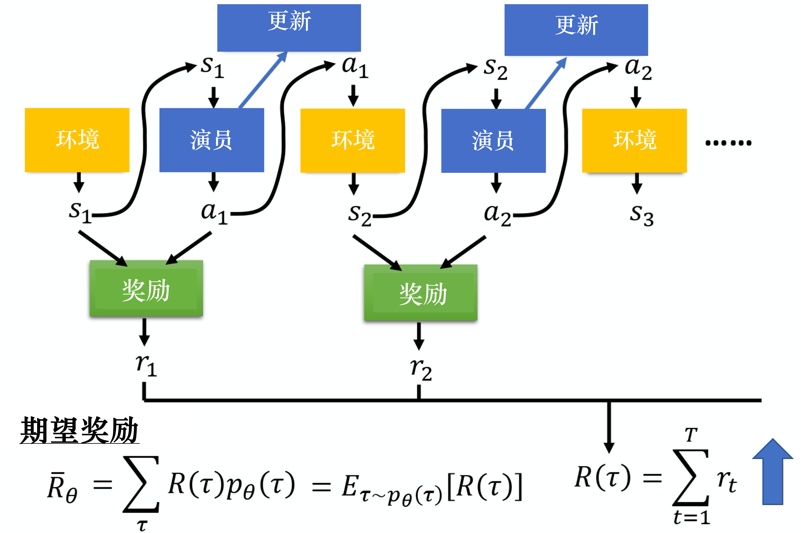

Hình 4.6 Phần thưởng kỳ vọng

Ví dụ mô hình ứng với $\theta$ rất mạnh, nếu có một tập mà $\theta$ chết rất nhanh, vì trường hợp này rất ít khi xảy ra, nên xác suất của quỹ đạo $\tau$ ứng với tập đó rất nhỏ; nếu có một tập mà $\theta$ mãi không chết, vì trường hợp này rất có thể xảy ra, nên xác suất của quỹ đạo $\tau$ ứng với tập đó rất lớn. Ta có thể dựa vào $\theta$ để tính xác suất xuất hiện của một quỹ đạo $\tau$, tiếp theo tính tổng phần thưởng của $\tau$. Lấy xác suất xuất hiện của $\tau$ làm trọng số cho tổng phần thưởng, lấy tổng trên tất cả các $\tau$, chính là giá trị kỳ vọng. Cho trước một tham số, ta có thể tính giá trị kỳ vọng là

$$
    \bar{R}_{\theta}=\sum_{\tau} R(\tau) p_{\theta}(\tau)=\mathbb{E}_{\tau \sim p_{\theta}(\tau)}[R(\tau)]
$$
Lấy mẫu một quỹ đạo $\tau$ từ phân phối $p_{\theta}(\tau)$, tính giá trị kỳ vọng của $R(\tau)$, chính là phần thưởng kỳ vọng (expected reward). Ta cần tối đa hóa phần thưởng kỳ vọng.

Vì ta muốn phần thưởng càng lớn càng tốt, nên có thể dùng **đi lên theo gradient (gradient ascent)** để tối đa hóa phần thưởng kỳ vọng. Để thực hiện gradient ascent, trước tiên ta cần tính gradient của phần thưởng kỳ vọng $\bar{R}_{\theta}$. Ta lấy gradient của $\bar{R}_{\theta}$
$$
    \nabla \bar{R}_{\theta}=\sum_{\tau} R(\tau) \nabla p_{\theta}(\tau)
$$
Trong đó, chỉ có $p_{\theta}(\tau)$ liên quan đến $\theta$.

Hàm phần thưởng $R(\tau)$ không cần khả vi (differentiable), điều này không ảnh hưởng đến việc ta giải các bài toán tiếp theo. Ví dụ, nếu trong mạng đối sinh (generative adversarial network, GAN), $R(\tau)$ là một bộ phân biệt (discriminator), dù nó không khả vi, ta vẫn có thể thực hiện các phép tính tiếp theo.

Ta có thể áp dụng biểu thức (4.1) cho $\nabla p_{\theta}(\tau)$, được $\nabla p_{\theta}(\tau)=p_{\theta}(\tau)  \nabla \log p_{\theta}(\tau)$.
$$
    \nabla f(x)=f(x)\nabla \log f(x) \tag{4.1}
$$

Tiếp theo, ta có
$$
    \frac{\nabla p_{\theta}(\tau)}{p_{\theta}(\tau)}= \nabla \log p_{\theta}(\tau)
$$

Chú ý: biểu thức trên dùng công thức đạo hàm của hàm logarit, đạo hàm của hàm logarit $f(x)=\log x$ là $\frac{1}{x}$.

Như biểu thức (4.2), ta lấy tổng theo $\tau$, lấy $p_{\theta}(\tau)$ làm trọng số cho hai số hạng $R(\tau)$ và $\log p_{\theta}(\tau)$; đã dùng $p_{\theta}(\tau)$ làm trọng số thì chúng có thể được viết dưới dạng kỳ vọng. Tức là ta lấy mẫu $\tau$ từ phân phối $p_{\theta}(\tau)$, tính $R(\tau)$ nhân $\nabla\log p_{\theta}(\tau)$, lấy tổng trên tất cả các $\tau$ có thể có, chính là giá trị kỳ vọng (expected value).
$$
    \begin{aligned}
        \nabla \bar{R}_{\theta}&=\sum_{\tau} R(\tau) \nabla p_{\theta}(\tau)\\&=\sum_{\tau} R(\tau) p_{\theta}(\tau) \frac{\nabla p_{\theta}(\tau)}{p_{\theta}(\tau)} \\&=
        \sum_{\tau} R(\tau) p_{\theta}(\tau) \nabla \log p_{\theta}(\tau) \\
        &=\mathbb{E}_{\tau \sim p_{\theta}(\tau)}\left[R(\tau) \nabla \log p_{\theta}(\tau)\right]
        \end{aligned} \tag{4.2}
$$
Thực tế giá trị kỳ vọng $\mathbb{E}_{\tau \sim p_{\theta}(\tau)}\left[R(\tau) \nabla \log p_{\theta}(\tau)\right]$ không thể tính được, vì vậy ta dùng cách lấy mẫu, lấy mẫu $N$ quỹ đạo $\tau$ và tính giá trị của mỗi quỹ đạo, cộng các giá trị lại là có được gradient, tức là
$$
    \begin{aligned}
        \mathbb{E}_{\tau \sim p_{\theta}(\tau)}\left[R(\tau) \nabla \log p_{\theta}(\tau)\right] &\approx \frac{1}{N} \sum_{n=1}^{N} R\left(\tau^{n}\right) \nabla \log p_{\theta}\left(\tau^{n}\right) \\
        &=\frac{1}{N} \sum_{n=1}^{N} \sum_{t=1}^{T_{n}} R\left(\tau^{n}\right) \nabla \log p_{\theta}\left(a_{t}^{n} \mid s_{t}^{n}\right)
        \end{aligned}
$$
Quá trình tính cụ thể của $\nabla \log p_{\theta}(\tau)$ có thể viết là
$$
    \begin{aligned}
        \nabla \log p_{\theta}(\tau) &= \nabla \left(\log p(s_1)+\sum_{t=1}^{T}\log p_{\theta}(a_t|s_t)+ \sum_{t=1}^{T}\log p(s_{t+1}|s_t,a_t) \right) \\
        &= \nabla \log p(s_1)+ \nabla \sum_{t=1}^{T}\log p_{\theta}(a_t|s_t)+  \nabla \sum_{t=1}^{T}\log p(s_{t+1}|s_t,a_t) \\
        &=\nabla \sum_{t=1}^{T}\log p_{\theta}(a_t|s_t)\\
        &=\sum_{t=1}^{T} \nabla\log p_{\theta}(a_t|s_t)
        \end{aligned}
$$
Chú ý, $p(s_1)$ và $p(s_{t+1}|s_t,a_t)$ đến từ môi trường, $p_\theta(a_t|s_t)$ đến từ tác tử. $p(s_1)$ và $p(s_{t+1}|s_t,a_t)$ do môi trường quyết định, không liên quan đến $\theta$, vì vậy $\nabla \log p(s_1)=0$, $\nabla \sum_{t=1}^{T}\log p(s_{t+1}|s_t,a_t)=0$.

$$
    \begin{aligned}
        \nabla \bar{R}_{\theta}&=\sum_{\tau} R(\tau) \nabla p_{\theta}(\tau)\\&=\sum_{\tau} R(\tau) p_{\theta}(\tau) \frac{\nabla p_{\theta}(\tau)}{p_{\theta}(\tau)} \\&=
        \sum_{\tau} R(\tau) p_{\theta}(\tau) \nabla \log p_{\theta}(\tau) \\
        &=\mathbb{E}_{\tau \sim p_{\theta}(\tau)}\left[R(\tau) \nabla \log p_{\theta}(\tau)\right]\\
        &\approx \frac{1}{N} \sum_{n=1}^{N} R\left(\tau^{n}\right) \nabla \log p_{\theta}\left(\tau^{n}\right) \\
        &=\frac{1}{N} \sum_{n=1}^{N} \sum_{t=1}^{T_{n}} R\left(\tau^{n}\right) \nabla \log p_{\theta}\left(a_{t}^{n} \mid s_{t}^{n}\right)
        \end{aligned} \tag{4.3}
$$

Ta có thể hiểu trực quan biểu thức (4.3) như sau: trong dữ liệu ta lấy mẫu được, ta lấy mẫu được việc ở một trạng thái $s_t$ nào đó thực hiện một hành động $a_t$ nào đó, $(s_t,a_t)$ là một cặp trạng thái và hành động trong toàn bộ quỹ đạo $\tau$. Giả sử ta thực hiện $a_t$ ở $s_t$, cuối cùng phát hiện phần thưởng của $\tau$ là dương, ta sẽ tăng xác suất thực hiện $a_t$ ở $s_t$. Ngược lại, nếu thực hiện $a_t$ ở $s_t$ dẫn đến phần thưởng của $\tau$ trở thành âm, ta sẽ giảm xác suất thực hiện $a_t$ ở $s_t$. Làm thế nào để thực hiện điều này? Ta dùng gradient ascent để cập nhật tham số, ban đầu có một tham số $\theta$, lấy $\theta$ cộng với gradient $\nabla \bar{R}_{\theta}$, tất nhiên ta cần có một tốc độ học (learning rate) $\eta$, tốc độ học cũng cần được điều chỉnh, có thể dùng các phương pháp như Adam, RMSProp để điều chỉnh tốc độ học, tức là
$$
    \theta \leftarrow \theta+\eta \nabla \bar{R}_{\theta}
$$

Ta có thể dùng biểu thức (4.4) để tính gradient. Thực tế để tính gradient, như hình 4.7, trước tiên ta cần thu thập rất nhiều cặp (pair) $s$ và $a$, còn phải biết các $s$ và $a$ này khi tương tác với môi trường sẽ nhận được bao nhiêu phần thưởng. Thu thập các dữ liệu này như thế nào? Ta cần dùng tác tử có tham số $\theta$ để tương tác với môi trường, tức là lấy tác tử đã huấn luyện cho tương tác với môi trường trước, tương tác xong sẽ có được lượng lớn dữ liệu trò chơi, ta sẽ ghi lại rằng trong ván chơi thứ nhất, ta thực hiện hành động $a_1$ ở trạng thái $s_1$, thực hiện hành động $a_2$ ở trạng thái $s_2$.
Bản thân tác tử có tính ngẫu nhiên, ở cùng trạng thái $s_1$, không phải lần nào cũng thực hiện hành động $a_1$, vì vậy ta cần ghi lại: ở trạng thái $s_1^1$ thực hiện $a_1^1$, ở trạng thái $s_2^1$ thực hiện $a_2^1$,..., sau khi toàn bộ ván chơi kết thúc, phần thưởng nhận được là $R(\tau^1)$. Ta sẽ lấy mẫu được một số dữ liệu khác, tức là một ván chơi khác. Trong ván chơi khác này, ở trạng thái $s_1^2$ thực hiện $a_1^2$, ở trạng thái $s_2^2$ thực hiện $a_2^2$, thứ ta lấy mẫu được là $\tau^2$, phần thưởng nhận được là $R(\tau^2)$.

Lúc này ta có thể đưa dữ liệu lấy mẫu được vào biểu thức (4.4) để tính gradient. Tức là lấy từng cặp $s$ và $a$ vào, tính xác suất logarit (log probability) $\log p_{\theta}\left(a_{t}^{n} | s_{t}^{n}\right)$ của việc thực hiện một hành động nào đó ở một trạng thái nào đó. Lấy gradient của xác suất này, nhân trước gradient một trọng số, trọng số chính là phần thưởng của ván chơi đó. Sau khi tính được gradient, ta có thể cập nhật mô hình.

$$
    \nabla \bar{R}_{\theta}=\frac{1}{N} \sum_{n=1}^{N} \sum_{t=1}^{T_{n}} R\left(\tau^{n}\right) \nabla \log p_{\theta}\left(a_{t}^{n} | s_{t}^{n}\right)\tag{4.4}
$$

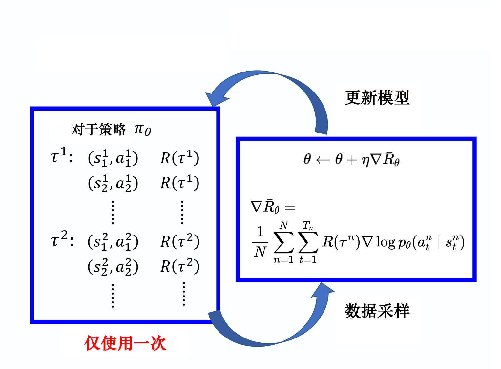

Hình 4.7 Gradient chính sách

Sau khi cập nhật mô hình, ta phải lấy mẫu dữ liệu lại rồi mới cập nhật mô hình tiếp. Chú ý, thông thường dữ liệu lấy mẫu của **gradient chính sách (policy gradient, PG)** chỉ được dùng một lần. Ta lấy mẫu các dữ liệu này, rồi dùng chúng để cập nhật tham số, sau đó bỏ đi các dữ liệu này. Tiếp theo lấy mẫu dữ liệu mới mới có thể cập nhật tham số.

Tiếp theo ta nói về một số chi tiết cài đặt. Như hình 4.8, ta có thể xem học tăng cường như một bài toán phân loại (classification), bài toán phân loại này là đưa vào một hình ảnh, đưa ra một lớp nào đó. Khi giải bài toán phân loại, ta cần thu thập một số dữ liệu huấn luyện, trong dữ liệu phải có các cặp đầu vào và đầu ra. Khi cài đặt, ta xem trạng thái là đầu vào của bộ phân loại, giống như đang giải bài toán phân loại ảnh, chỉ khác là bây giờ lớp không phải là thứ trong ảnh, mà là khi nhìn thấy ảnh này ta cần thực hiện hành động gì, mỗi hành động chính là một lớp. Ví dụ lớp thứ nhất là sang trái, lớp thứ hai là sang phải, lớp thứ ba là bắn.

Khi giải bài toán phân loại, ta cần có đầu vào và đầu ra đúng, cần có dữ liệu huấn luyện. Nhưng trong học tăng cường, ta có được dữ liệu huấn luyện thông qua lấy mẫu. Giả sử trong quá trình lấy mẫu, ở một trạng thái nào đó, ta lấy mẫu được hành động cần thực hiện là $a$, thì ta xem hành động $a$ là đáp án chuẩn (ground truth). Ví dụ, ở một trạng thái nào đó, ta lấy mẫu được hành động sang trái. Vì là lấy mẫu, nên hành động sang trái chưa chắc có xác suất cao nhất. Giả sử ta lấy mẫu được sang trái, khi huấn luyện, cho tác tử điều chỉnh tham số mạng, sao cho nếu thấy trạng thái đó thì ta sang trái. Trong bài toán phân loại thông thường, khi cài đặt phân loại, hàm mục tiêu đều được viết là tối thiểu hóa entropy chéo (cross entropy), tối thiểu hóa entropy chéo chính là tối đa hóa log-likelihood (log likelihood).

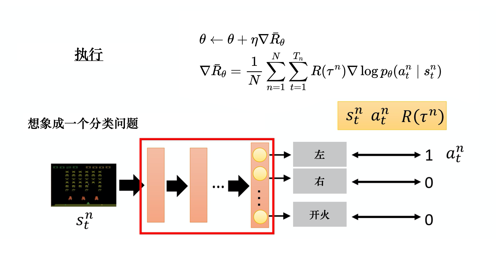

Hình 4.8 Chi tiết cài đặt gradient chính sách

Khi giải bài toán phân loại, hàm mục tiêu chính là đối tượng cần tối đa hóa hoặc tối thiểu hóa, vì hiện tại ta tối đa hóa likelihood, nên thực chất là tối đa hóa, ta cần tối đa hóa
$$
    \frac{1}{N} \sum_{n=1}^{N} \sum_{t=1}^{T_{n}} \log p_{\theta}\left(a_{t}^{n} \mid s_{t}^{n}\right)
$$

Ta có thể gọi các hàm có sẵn trong PyTorch để tự động tính hàm mất mát (loss function) và tính gradient. Đây là bài toán phân loại thông thường, điểm khác duy nhất giữa học tăng cường và bài toán phân loại là phía trước hàm mất mát được nhân một trọng số — tổng phần thưởng $R(\tau)$ nhận được trong toàn bộ ván chơi, chứ không phải phần thưởng nhận được khi thực hiện hành động $a$ ở trạng thái $s$, tức là
$$
    \frac{1}{N} \sum_{n=1}^{N} \sum_{t=1}^{T_{n}} R\left(\tau^{n}\right)  \log p_{\theta}\left(a_{t}^{n} \mid s_{t}^{n}\right) \tag{4.5}
$$

Ta cần gán trọng số $R(\tau)$ cho từng mẫu dữ liệu huấn luyện. Như hình 4.9, ta dùng các framework học sâu như PyTorch hoặc TensorFlow để tính gradient là xong, gần giống bài toán phân loại thông thường.

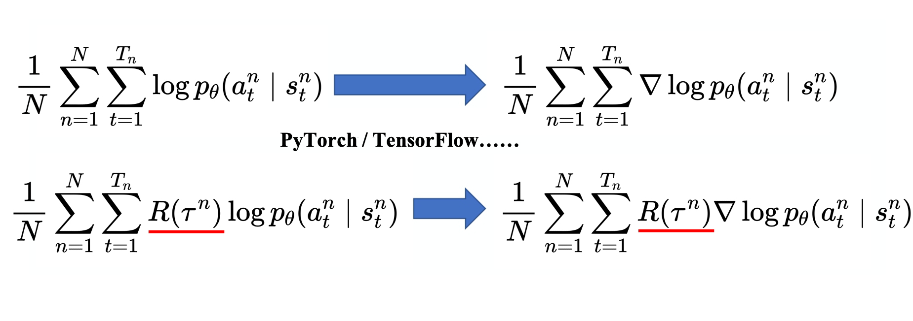

Hình 4.9 Tự động tính gradient

## 4.2 Các mẹo khi cài đặt gradient chính sách
Dưới đây ta giới thiệu một số mẹo có thể dùng khi cài đặt gradient chính sách.
### 4.2.1 Mẹo 1: thêm đường cơ sở
Mẹo thứ nhất: thêm đường cơ sở (baseline). Nếu cho trạng thái $s$ thực hiện hành động $a$, cả ván chơi nhận phần thưởng dương, thì phải tăng xác suất của $(s,a)$. Nếu cho trạng thái $s$ thực hiện hành động $a$, cả ván chơi nhận phần thưởng âm, thì phải giảm xác suất của $(s,a)$. Nhưng trong nhiều trò chơi, phần thưởng luôn dương, thấp nhất là 0. Ví dụ trò chơi bóng bàn (Pong), điểm số từ 0 đến 21, nên $R(\tau)$ luôn dương. Giả sử ta dùng trực tiếp biểu thức (4.5), khi huấn luyện sẽ nói với mô hình rằng bất kể là hành động gì cũng đều nên tăng xác suất của nó.

Tuy $R(\tau)$ luôn dương, nhưng giá trị của nó có lớn có nhỏ, ví dụ khi chơi trò bóng bàn, phần thưởng nhận được luôn dương, nhưng thực hiện một số hành động có thể được 0 điểm, thực hiện một số hành động có thể được 20 điểm.

Như hình 4.10, giả sử ở một trạng thái có 3 hành động a, b, c có thể thực hiện. Theo biểu thức (4.6), ta phải tăng xác suất, xác suất logarit của cả 3 hành động này. Nhưng trọng số $R(\tau)$ phía trước của chúng khác nhau. Trọng số có lớn có nhỏ, trọng số nhỏ thì xác suất của hành động đó được tăng ít; trọng số lớn thì xác suất của hành động đó được tăng nhiều. Vì xác suất logarit là một xác suất, nên tổng xác suất logarit của các hành động a, b, c là 0. Vì vậy hành động được tăng ít, sau khi chuẩn hóa (normalize), xác suất của hành động b lại giảm xuống; chỉ hành động được tăng nhiều thì xác suất mới tăng lên.

> Ghi chú của người dịch: câu "tổng xác suất logarit của a, b, c là 0" được giữ nguyên như bản gốc. Chính xác hơn, tổng **xác suất** của các hành động luôn bằng 1, nên sau khi chuẩn hóa, hành động được tăng ít hơn mức trung bình sẽ bị giảm xác suất.

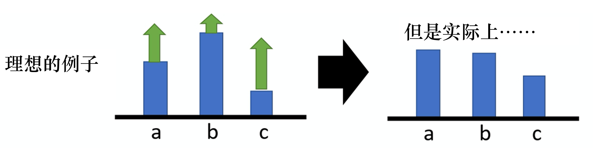

Hình 4.10 Ví dụ về xác suất của hành động

$$
    \nabla \bar{R}_{\theta} \approx \frac{1}{N} \sum_{n=1}^{N} \sum_{t=1}^{T_{n}} R\left(\tau^{n}\right) \nabla \log p_{\theta}\left(a_{t}^{n} \mid s_{t}^{n}\right) \tag{4.6}
$$

Đây là trường hợp lý tưởng, nhưng thực tế ta đang lấy mẫu. Ở đây lẽ ra phải là một kỳ vọng (expectation), lấy tổng trên tất cả các cặp $s$ và $a$ có thể có. Nhưng khi thực sự học, ta chỉ lấy mẫu được một số ít cặp $s$ và $a$. Vì ta lấy mẫu, nên có một số hành động có thể chưa bao giờ được lấy mẫu. Như hình 4.11, ở một trạng thái nào đó, tuy các hành động có thể thực hiện là a, b, c, nhưng có thể ta chỉ lấy mẫu được hành động b hoặc chỉ lấy mẫu được hành động c, không lấy mẫu được hành động a. Nhưng hiện tại phần thưởng của mọi hành động đều dương, nên theo biểu thức (4.6), xác suất thực hiện a, b, c ở trạng thái này đều nên được tăng. Vấn đề ta gặp phải là, vì a không được lấy mẫu, nên nếu xác suất của các hành động khác đều tăng thì xác suất của a sẽ giảm. Vì vậy a chưa chắc là một hành động tồi, nó chỉ không được lấy mẫu. Nhưng vì a không được lấy mẫu nên xác suất của nó bị giảm, điều này rõ ràng có vấn đề. Làm sao giải quyết vấn đề này? Ta mong rằng phần thưởng không phải lúc nào cũng dương.

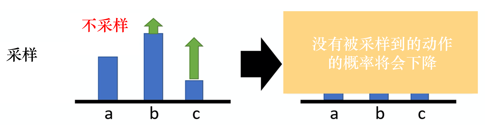

Hình 4.11 Vấn đề khi lấy mẫu hành động

Để giải quyết vấn đề phần thưởng luôn dương, ta có thể trừ phần thưởng đi $b$, tức là
$$
    \nabla \bar{R}_{\theta} \approx \frac{1}{N} \sum_{n=1}^{N} \sum_{t=1}^{T_{n}}\left(R\left(\tau^{n}\right)-b\right) \nabla \log p_{\theta}\left(a_{t}^{n} \mid s_{t}^{n}\right)
$$

Trong đó, $b$ được gọi là đường cơ sở. Bằng cách này, ta có thể làm số hạng $R(\tau)-b$ có cả dương lẫn âm. Nếu tổng phần thưởng ta nhận được $R(\tau)>b$, thì tăng xác suất của $(s,a)$. Nếu $R(\tau)<b$, dù $R(\tau)$ dương nhưng giá trị nhỏ thì cũng không tốt, ta giảm xác suất của $(s,a)$, giảm điểm của việc thực hiện hành động này ở trạng thái này. Thiết lập $b$ như thế nào? Ta có thể lấy kỳ vọng của giá trị $\tau$, tính trung bình của $\tau$, đặt $b \approx E[R(\tau)]$.
Vì vậy khi huấn luyện, ta sẽ liên tục ghi lại giá trị $R(\tau)$, liên tục tính trung bình của $R(\tau)$, dùng giá trị trung bình này làm $b$. Như vậy khi huấn luyện, $R(\tau)-b$ có cả dương lẫn âm, đây là mẹo thứ nhất.

### 4.2.2 Mẹo 2: gán điểm phù hợp

Mẹo thứ hai: gán điểm (credit) phù hợp cho mỗi hành động. Như biểu thức (4.7), chỉ cần trong cùng một tập, trong cùng một ván chơi, tất cả các cặp trạng thái-hành động đều được gán trọng số bằng cùng một số hạng phần thưởng.

$$
    \nabla \bar{R}_{\theta} \approx \frac{1}{N} \sum_{n=1}^{N} \sum_{t=1}^{T_{n}}\left(R\left(\tau^{n}\right)-b\right) \nabla \log p_{\theta}\left(a_{t}^{n} \mid s_{t}^{n}\right) \tag{4.7}
$$
Điều này rõ ràng là không công bằng, vì trong cùng một ván chơi, có thể có hành động tốt, có hành động không tốt. Giả sử kết quả cả ván chơi là tốt, nhưng không có nghĩa mọi hành động trong ván đều tốt. Nếu kết quả cả ván chơi không tốt, cũng không có nghĩa mọi hành động trong ván đều không tốt. Vì vậy ta mong có thể nhân trước mỗi hành động khác nhau một trọng số khác nhau. Trọng số khác nhau của mỗi hành động phản ánh mỗi hành động rốt cuộc là tốt hay không tốt. Ví dụ, như hình 4.12a, giả sử các ván chơi đều rất ngắn, chỉ có 3 ~ 4 lần tương tác, thực hiện $a_1$ ở $s_a$ được 5 điểm, thực hiện $a_2$ ở $s_b$ được 0 điểm, thực hiện $a_3$ ở $s_c$ được $-$2 điểm. Cả ván chơi ta được +3 điểm, vậy được +3 điểm có nghĩa là thực hiện $a_2$ ở $s_b$ là tốt không?
Điều này chưa chắc có nghĩa là thực hiện $a_2$ ở $s_b$ là tốt. Vì điểm dương này chủ yếu đến từ việc thực hiện $a_1$ ở $s_a$, không liên quan gì đến việc thực hiện $a_2$ ở $s_b$, có khi thực hiện $a_2$ ở $s_b$ lại không tốt, vì nó khiến ta tiếp theo đi vào $s_c$, thực hiện $a_3$ và bị trừ điểm. Vì vậy kết quả cả ván chơi là tốt không có nghĩa mọi hành động đều tốt.

Nếu theo cách nói vừa rồi, điểm cả ván chơi là +3, vậy khi huấn luyện, mọi cặp trạng thái-hành động đều được nhân với +3. Trong trường hợp lý tưởng, nếu dữ liệu lấy mẫu đủ nhiều thì có thể giải quyết vấn đề này. Vì giả sử dữ liệu lấy mẫu đủ nhiều, $(s_b,a_2)$ được lấy mẫu rất nhiều lần. Trong một ván chơi nào đó, thực hiện $a_2$ ở $s_b$, ta được +3 điểm. Nhưng trong một ván chơi khác, như hình 4.12b, thực hiện $a_2$ ở $s_b$, ta lại được $-$7 điểm, tại sao lại được $-$7 điểm? Vì trước khi thực hiện $a_2$ ở $s_b$, ta thực hiện $a_2$ ở $s_a$ và được $-$5 điểm, $-$5 điểm cũng không phải do thực hiện $a_2$ ở $s_b$ gây ra. Vì $(s_a,a_2)$ xảy ra trước, nên $(s_a,a_2)$ và $(s_b,a_2)$ không liên quan đến nhau. Vấn đề mà việc thực hiện $a_2$ ở $s_b$ có thể gây ra chỉ là tiếp theo sẽ bị $-$2 điểm, và không liên quan đến $-$5 điểm phía trước. Nhưng giả sử ta lấy mẫu các cặp trạng thái-hành động đủ nhiều lần, gom tất cả điểm số trong các trường hợp như vậy lại, thì có thể đây không phải là vấn đề. Nhưng vấn đề hiện tại là số lần lấy mẫu của ta không đủ nhiều. Khi số lần lấy mẫu không đủ nhiều, ta cần gán điểm hợp lý cho mỗi cặp trạng thái-hành động, để mọi người biết đóng góp hợp lý của nó.

Một cách làm là khi tính phần thưởng của một cặp trạng thái-hành động, không cộng toàn bộ phần thưởng của cả ván chơi, mà chỉ tính phần thưởng nhận được từ sau khi thực hiện hành động đó. Vì những gì xảy ra trong ván chơi trước khi thực hiện hành động này không liên quan đến việc thực hiện hành động này, nên các phần thưởng nhận được trước khi thực hiện hành động này đều không thể tính là đóng góp của hành động này. Ta cộng tất cả phần thưởng xảy ra sau khi thực hiện hành động này, đó mới là đóng góp thực sự của hành động này. Vì vậy trong hình 4.12a, việc thực hiện $a_2$ ở $s_b$, có lẽ điểm thực sự nó mang lại cho ta phải là $-$2 điểm chứ không phải +3 điểm, vì +5 điểm phía trước không phải công của việc thực hiện $a_2$. Thực tế sau khi thực hiện $a_2$, đến khi trò chơi kết thúc, ta chỉ bị trừ 2 điểm, vì vậy điểm phải là $-$2. Tương tự, trong hình 4.12b, thực hiện $a_2$ thực tế không nên bị trừ 7 điểm, vì việc bị trừ 5 điểm trước đó không liên quan đến việc thực hiện $a_2$ ở $s_b$. Thực hiện $a_2$ ở $s_b$ chỉ làm ta bị trừ hai điểm mà thôi.

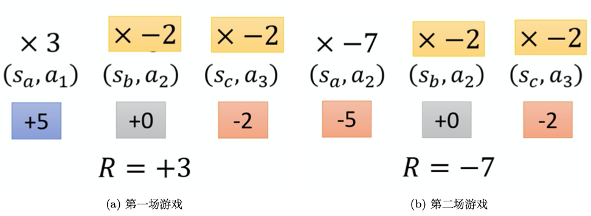

Hình 4.12 Gán điểm phù hợp

Mẹo gán điểm phù hợp này có thể biểu diễn là
$$
    \nabla \bar{R}_{\theta} \approx \frac{1}{N} \sum_{n=1}^{N} \sum_{t=1}^{T_{n}}\left(\sum_{t^{\prime}=t}^{T_{n}} r_{t^{\prime}}^{n}-b\right) \nabla \log p_{\theta}\left(a_{t}^{n} \mid s_{t}^{n}\right)
$$
Trọng số ban đầu là tổng phần thưởng của cả ván chơi, giờ đổi thành bắt đầu từ một thời điểm $t$ nào đó, giả sử hành động này được thực hiện từ thời điểm $t$, thì tổng tất cả phần thưởng từ $t$ đến khi trò chơi kết thúc mới đại diện được cho việc hành động này tốt hay xấu.

Tiến thêm một bước, ta chiết khấu phần thưởng tương lai, tức là
$$
    \nabla \bar{R}_{\theta} \approx \frac{1}{N} \sum_{n=1}^{N} \sum_{t=1}^{T_{n}}\left(\sum_{t^{\prime}=t}^{T_{n}} \gamma^{t^{\prime}-t} r_{t^{\prime}}^{n}-b\right) \nabla \log p_{\theta}\left(a_{t}^{n} \mid s_{t}^{n}\right)
$$
Tại sao phải chiết khấu phần thưởng tương lai? Vì tuy ở một thời điểm nào đó, thực hiện một hành động nào đó sẽ ảnh hưởng đến tất cả các kết quả tiếp theo (có thể hành động thực hiện ở một thời điểm nào đó, các phần thưởng nhận được tiếp theo đều là công của hành động đó), nhưng thông thường, thời gian kéo dài càng lâu, ảnh hưởng của hành động đó càng nhỏ. Ví dụ thực hiện một hành động ở thời điểm thứ 2, thì phần thưởng nhận được ở thời điểm thứ 3 có thể là công của hành động ở thời điểm thứ 2, nhưng phần thưởng nhận được sau thời điểm thứ 100 thì có thể không phải là công của hành động ở thời điểm thứ 2. Thực tế, ta nhân phía trước $R$ một hệ số chiết khấu $\gamma$ ($\gamma \in [0,1] $, thường đặt là 0.9 hoặc 0.99), nếu $\gamma = 0$, nghĩa là ta chỉ quan tâm phần thưởng tức thời; nếu $\gamma = 1$, nghĩa là phần thưởng tương lai tương đương phần thưởng tức thời. Thời điểm $t'$ càng lớn thì phía trước nó càng được nhân $\gamma$ nhiều lần, nghĩa là hiện tại ở một trạng thái $s_t$ nào đó, khi thực hiện một hành động $a_t$ nào đó, điểm thực sự của nó là tổng tất cả phần thưởng sau khi thực hiện hành động này, và còn phải nhân với $\gamma$. Ví dụ, giả sử trò chơi có hai hiệp (round), ở hiệp thứ hai của trò chơi, ta thực hiện $a_t$ ở một $s_t$ nào đó được +1 điểm, thực hiện $a_{t+1}$ ở $s_{t+1}$ được +3 điểm, thực hiện $a_{t+2}$ ở $s_{t+2}$ được $-$5 điểm, hiệp thứ hai kết thúc. Điểm của $a_t$ phải là
$$
1+ \gamma \times 3+\gamma^2 \times(-5)
$$

Thực tế được cài đặt đúng như vậy. $b$ có thể phụ thuộc vào trạng thái (state-dependent), thực tế $b$ thường được ước lượng bởi một mạng, nó là đầu ra của một mạng. Ta gọi số hạng $R-b$ là **hàm lợi thế (advantage function)**, dùng $A^{\theta}(s_t,a_t)$ để biểu thị hàm lợi thế. Hàm lợi thế phụ thuộc vào $s$ và $a$, ta cần tính giá trị của hàm lợi thế khi thực hiện một hành động $a$ nào đó ở một trạng thái $s$ nào đó. Khi tính giá trị hàm lợi thế, ta cần tính $\sum_{t^{\prime}=t}^{T_{n}} r_{t^{\prime}}^{n}$, cần có một mô hình tương tác với môi trường thì mới biết phần thưởng nhận được tiếp theo. Hàm lợi thế $A^{\theta}\left(s_{t}, a_{t}\right)$ có chỉ số trên là $\theta$, $\theta$ đại diện cho việc dùng mô hình $\theta$ tương tác với môi trường. Tổng tất cả $r$ từ thời điểm $t$ đến khi trò chơi kết thúc trừ đi $b$, đó chính là hàm lợi thế. Ý nghĩa của hàm lợi thế là: giả sử ta thực hiện một hành động $a_t$ nào đó ở một trạng thái $s_t$ nào đó, so với các hành động có thể khác, $a_t$ tốt đến mức nào. Hàm lợi thế không quan tâm cái tốt tuyệt đối mà quan tâm cái tốt tương đối, tức **lợi thế tương đối (relative advantage)**. Vì trong hàm lợi thế, ta trừ đi một đường cơ sở $b$, nên hành động này tốt một cách tương đối, không phải tốt tuyệt đối. $A^{\theta}\left(s_{t}, a_{t}\right)$ thường có thể được ước lượng bởi một mạng, mạng này được gọi là nhà phê bình (critic).

## 4.3 REINFORCE: gradient chính sách Monte Carlo

Như hình 4.13, phương pháp Monte Carlo có thể hiểu là sau khi thuật toán hoàn thành một tập, mới dùng dữ liệu của tập đó để học, thực hiện một lần cập nhật. Vì ta đã có dữ liệu của cả tập, nên cũng có được phần thưởng của từng bước, ta có thể tính dễ dàng tổng phần thưởng tương lai của từng bước, tức lợi tức $G_t$. $G_t$ là tổng phần thưởng tương lai, đại diện cho tổng phần thưởng ta có thể nhận được bắt đầu từ bước này. $G_1$ đại diện cho tổng phần thưởng ta có thể nhận được từ bước thứ nhất trở đi. $G_2$ đại diện cho tổng phần thưởng ta có thể nhận được từ bước thứ hai trở đi.

So với phương pháp Monte Carlo cập nhật một lần mỗi tập, phương pháp sai phân thời gian (temporal difference) cập nhật một lần mỗi bước, tức là mỗi bước đi cập nhật một lần, tần suất cập nhật của phương pháp sai phân thời gian cao hơn. Phương pháp sai phân thời gian dùng hàm Q để biểu diễn xấp xỉ tổng phần thưởng tương lai $G_t$.

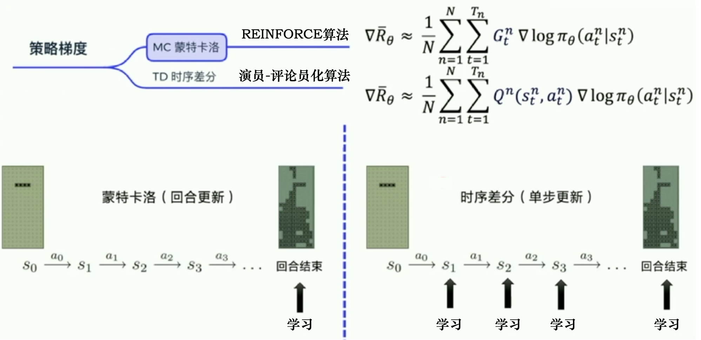

Hình 4.13 Phương pháp Monte Carlo và phương pháp sai phân thời gian

Ta giới thiệu một thuật toán đơn giản nhất và cũng kinh điển nhất trong gradient chính sách: **REINFORCE**. REINFORCE dùng cách cập nhật theo tập, khi xử lý trong code, nó lấy phần thưởng của từng bước trước, rồi tính tổng phần thưởng tương lai $G_t$ của từng bước, đưa từng $G_t$ vào

$$
    \nabla \bar{R}_{\theta} \approx \frac{1}{N} \sum_{n=1}^{N} \sum_{t=1}^{T_{n}} G_{t}^{n} \nabla \log \pi_{\theta}\left(a_{t}^{n} \mid s_{t}^{n}\right)
$$

để tối ưu đầu ra của từng hành động. Vì vậy khi viết code, ta sẽ thiết kế một hàm, đầu vào của hàm này là phần thưởng nhận được ở từng bước, đầu ra là tổng phần thưởng tương lai của từng bước. Vì tổng phần thưởng tương lai có thể viết là
$$
    \begin{aligned}
        G_{t} &=\sum_{k=t+1}^{T} \gamma^{k-t-1} r_{k} \\
        &=r_{t+1}+\gamma G_{t+1}
        \end{aligned} \tag{4.8}
$$
tức là quan hệ giữa tổng phần thưởng tương lai của bước trước và bước sau như biểu thức (4.8), nên khi tính trong code, ta suy ngược từ sau ra trước, suy từng bước về phía trước, tính $G_T$ trước, rồi suy ngược về trước, cho đến khi tính được $G_1$.

Như hình 4.14, mã giả của REINFORCE chủ yếu xem 4 dòng cuối, trước tiên sinh ra dữ liệu của một tập, ví dụ
$$
(s_1,a_1,G_1),(s_2,a_2,G_2),\cdots,(s_T,a_T,G_T)
$$
rồi tính gradient $\nabla \log \pi(a_t|s_t,\theta)$ cho từng hành động. Khi tính trong code, ta cần lấy đầu ra của mạng nơ-ron. Mạng nơ-ron sẽ đưa ra giá trị xác suất ứng với từng hành động (ví dụ 0.2, 0.5, 0.3), sau đó ta còn có thể lấy hành động thực tế $a_t$, chuyển hành động thành vectơ one-hot (ví dụ [0,1,0]) nhân với $\log [0.2,0.5,0.3]$ là có được $\log \pi(a_t|s_t,\theta)$.

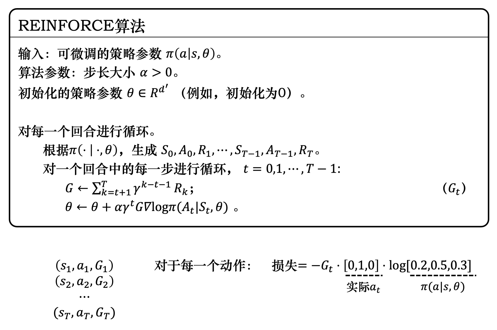

Hình 4.14 Thuật toán REINFORCE

> Mã hóa one-hot (one-hot encoding) thường dùng để xử lý các đặc trưng mà giữa các lớp không có quan hệ lớn nhỏ. Ví dụ nhóm máu, có tổng cộng 4 giá trị (nhóm A, nhóm B, nhóm AB, nhóm O), mã hóa one-hot sẽ biến nhóm máu thành một vectơ thưa 4 chiều, nhóm máu A biểu diễn là (1,0,0,0), nhóm máu B là (0,1,0,0), nhóm máu AB là (0,0,1,0), nhóm máu O là (0,0,0,1).

Như hình 4.15, nhận dạng chữ số viết tay là một bài toán phân loại đa lớp kinh điển, đầu vào là một ảnh chữ số viết tay, sau khi mạng nơ-ron xử lý, đầu ra là xác suất của từng lớp. Ta mong phân phối xác suất đầu ra càng gần phân phối xác suất của giá trị thực càng tốt. Vì giá trị thực chỉ có một chữ số 9, nên nếu ta mã hóa nó dưới dạng vectơ one-hot, cũng có thể hiểu giá trị thực là một phân phối xác suất, xác suất của 9 là 1, xác suất của các chữ số khác là 0. Đầu ra của mạng nơ-ron lúc đầu có thể khá đều, qua quá trình lặp, huấn luyện và tối ưu liên tục, ta mong xác suất đầu ra của 9 có thể cao hơn nhiều so với xác suất đầu ra của các chữ số khác.

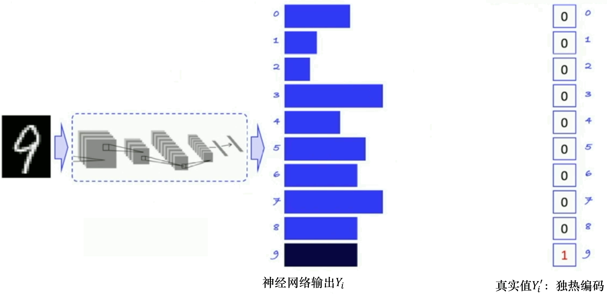

Hình 4.15 Ví dụ học có giám sát: nhận dạng chữ số viết tay

Như hình 4.16, việc ta cần làm là tăng xác suất đầu ra của 9, giảm xác suất đầu ra của các chữ số khác, giúp phân phối xác suất đầu ra của mạng nơ-ron gần hơn với phân phối xác suất của giá trị thực. Ta có thể dùng entropy chéo để biểu thị khoảng cách giữa hai phân phối xác suất.

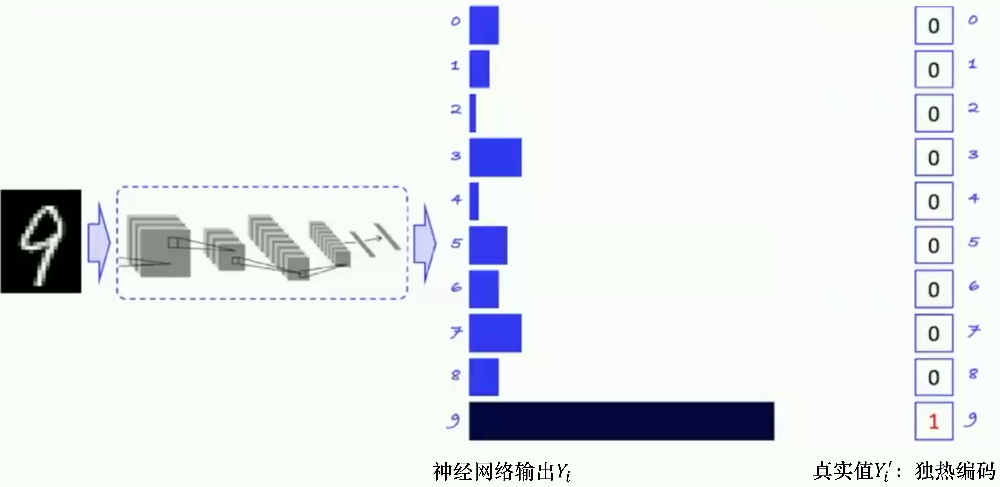

Hình 4.16 Tăng xác suất của chữ số 9

Hãy xem quy trình tối ưu của học có giám sát, tức là làm sao để đầu ra tiệm cận giá trị thực. Như hình 4.17, quy trình tối ưu của học có giám sát là đưa ảnh làm đầu vào cho mạng nơ-ron, mạng nơ-ron sẽ đánh giá chữ số trong ảnh thuộc lớp nào, đưa ra xác suất có thể của tất cả các chữ số, rồi tính entropy chéo, tức khoảng cách $-\sum Y_{i}^{\prime} \cdot \log \left(Y_{i}\right)$ giữa đầu ra $Y_i$ của mạng nơ-ron và giá trị nhãn thực $Y_i'$. Ta mong thu hẹp khoảng cách giữa hai phân phối xác suất này càng nhiều càng tốt, entropy chéo tính được có thể dùng làm hàm mất mát đưa cho bộ tối ưu (optimizer) trong mạng nơ-ron để tối ưu, nhằm tự động cập nhật tham số của mạng nơ-ron.

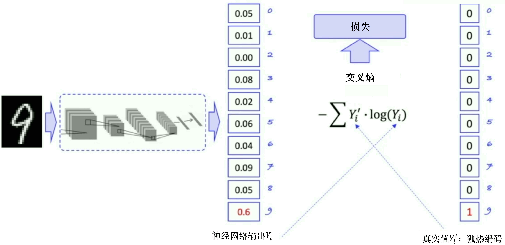

Hình 4.17 Quy trình tối ưu

Tương tự, như hình 4.18, gradient chính sách dự đoán xác suất của hành động nên đưa ra ở mỗi trạng thái, tức là đầu vào là trạng thái $s_t$, đầu ra là xác suất của hành động $a_t$, ví dụ 0.02, 0.08, 0.9. Thực tế hành động đưa ra cho môi trường là chọn ngẫu nhiên một hành động, ví dụ ta chọn hành động sang phải, vectơ one-hot của nó là (0,0,1). Ta đưa đầu ra của mạng nơ-ron và hành động thực tế vào công thức entropy chéo là có thể tìm ra khoảng cách giữa xác suất hành động đầu ra và xác suất hành động thực tế. Nhưng hành động thực tế $a_t$ chỉ là hành động thật mà ta đưa ra, nó chưa chắc là hành động đúng, nó không thể giống như nhận dạng chữ số viết tay mà làm nhãn đúng để hướng dẫn mạng nơ-ron cập nhật theo hướng đúng, vì vậy ta cần nhân thêm một lợi tức phần thưởng $G_t$. $G_t$ tương đương với sự đánh giá cho hành động thật. Nếu $G_t$ càng lớn, tổng phần thưởng tương lai càng lớn, thì cho thấy hành động thật được đưa ra hiện tại càng tốt, hàm mất mát càng cần được coi trọng. Nếu $G_t$ càng nhỏ, cho thấy hành động $a_t$ không tốt lắm, trọng số của hàm mất mát phải nhỏ một chút, mức độ tối ưu cũng phải nhỏ một chút. Qua so sánh với nhận dạng chữ số viết tay, ta biết tại sao hàm mất mát của gradient chính sách được xây dựng như vậy.

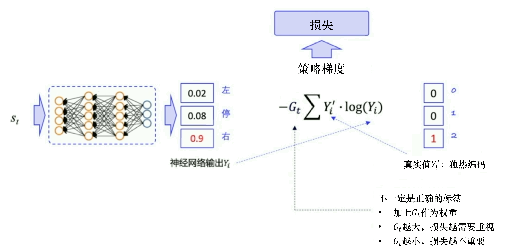

Hình 4.18 Hàm mất mát của gradient chính sách

Như hình 4.19, thực tế khi tính hàm mất mát của gradient chính sách, ta cần lấy vectơ one-hot của hành động thực tế được thực hiện trước, rồi lấy xác suất hành động do mạng nơ-ron dự đoán, nhân chúng với nhau, ta sẽ có $\log \pi(a_t|s_t,\theta)$, đây chính là hàm mất mát ta cần xây dựng. Vì ta có thể lấy được toàn bộ quỹ đạo của cả tập, nên ta có thể tính một hàm mất mát cho mỗi hành động trong quỹ đạo này. Cộng tất cả các hàm mất mát lại, rồi "ném" cho bộ tối ưu Adam để tự động cập nhật tham số là xong.

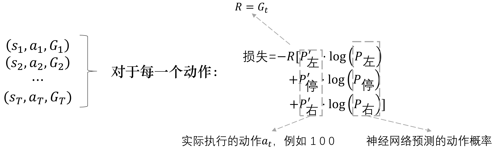

Hình 4.19 Tính hàm mất mát

Hình 4.20 là sơ đồ thuật toán REINFORCE, trước tiên ta cần một mô hình chính sách để đưa ra xác suất hành động, sau khi đưa ra xác suất hành động, dùng hàm **sample()** để có một hành động cụ thể, tương tác với môi trường xong, ta có thể có dữ liệu của cả tập. Có dữ liệu của tập rồi, ta thực hiện hàm **learn()**, trong hàm **learn()**, ta có thể dùng các dữ liệu này để xây dựng hàm mất mát, "ném" cho bộ tối ưu để tối ưu, cập nhật mô hình chính sách của ta.

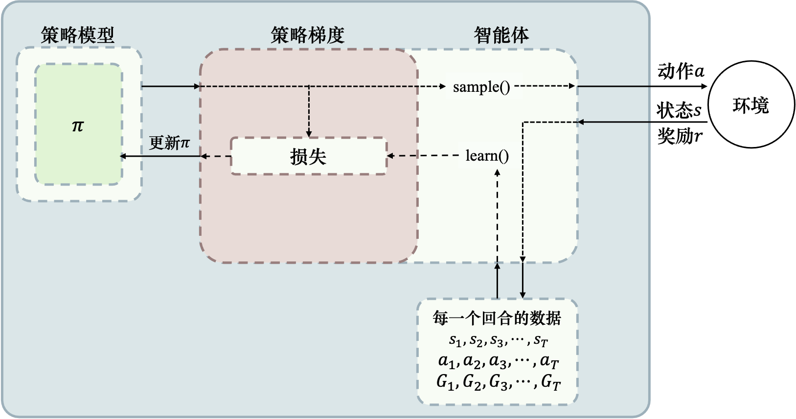

Hình 4.20 Sơ đồ thuật toán REINFORCE

## Tài liệu tham khảo
* [Intro to Reinforcement Learning (强化学习纲要 - Đại cương học tăng cường)](https://github.com/zhoubolei/introRL)
* [神经网络与深度学习 (Mạng nơ-ron và học sâu)](https://nndl.github.io/)
* [百面深度学习 (Bách diện học sâu)](https://book.douban.com/subject/35043939/)
