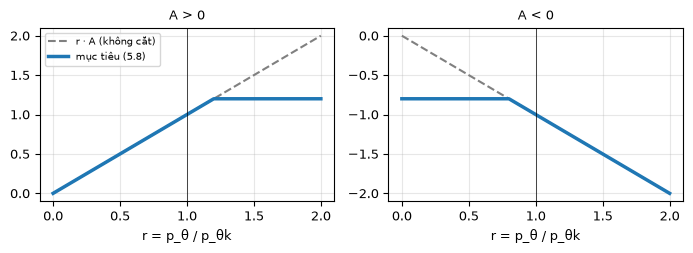
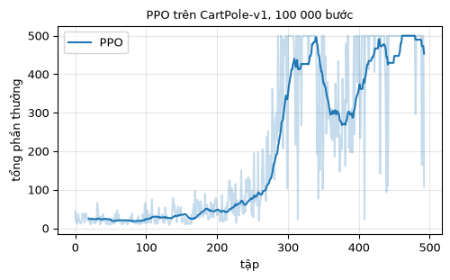
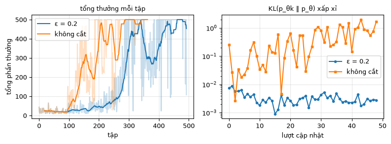

# Chương 5 · Code

> Ghi chú của người dịch: trang này do người dịch biên soạn, không có trong sách gốc. Code PPO lấy từ [MinRL](https://github.com/10-OASIS-01/minrl/tree/ed5eb99) (Yibin Liu, giấy phép MIT, commit `ed5eb99`), chú thích đã dịch sang tiếng Việt. Mục 1 được viết thêm *(thêm)*. Notebook PPO của bản gốc EasyRL được liệt kê ở mục 5.
>
> Ký hiệu: theo [chương 5](chapter5/chapter5_vi): $p_\theta(a \mid s)$ là chính sách đang học, $p_{\theta^k}$ là chính sách đã dùng để thu dữ liệu, $A^{\theta^k}(s,a)$ là lợi thế, $\varepsilon$ là ngưỡng cắt.

Mỗi khối code đã được chạy sẵn trên CPU. Kết quả, hình vẽ và ảnh động nằm ngay bên dưới. Các khối chạy lần lượt từ trên xuống và dùng chung biến, như các ô của một notebook. Muốn tự chạy, xem [mục 6](#_6-chạy-trên-máy).

## 1. Lấy mẫu theo trọng số quan trọng *(thêm)*

<small class="viz-ref">Mục 5.1 · công thức (5.2), (5.3) · hình 5.2</small>

Công thức (5.3) cho phép tính kỳ vọng theo $p$ bằng mẫu lấy từ $q$, chỉ cần nhân thêm trọng số $p(x)/q(x)$. Kỳ vọng thì đúng, nhưng **phương sai** phụ thuộc vào việc $q$ khác $p$ bao nhiêu. Ví dụ ở hình 5.2: $p$ và $q$ là hai phân phối chuẩn, và $f(x)$ đổi dấu ở giữa.

<!-- run -->
```python
import numpy as np
import torch
import gymnasium as gym
import matplotlib.pyplot as plt

rng = np.random.default_rng(0)
f = lambda x: np.tanh(x)                                   # f âm bên trái, dương bên phải
p_pdf = lambda x: np.exp(-0.5 * (x - 1) ** 2) / np.sqrt(2 * np.pi)   # p = N(1, 1)

def estimate(q_mean, n=100, repeats=2000):
    """Ước lượng E_{x~p}[f(x)] bằng n mẫu từ q = N(q_mean, 1), lặp lại nhiều lần để đo phương sai."""
    x = rng.normal(q_mean, 1, size=(repeats, n))
    q_pdf = np.exp(-0.5 * (x - q_mean) ** 2) / np.sqrt(2 * np.pi)
    est = (f(x) * p_pdf(x) / q_pdf).mean(axis=1)            # (5.3)
    return est.mean(), est.std()

truth = f(rng.normal(1, 1, 10**7)).mean()
print(f"Giá trị đúng E_p[f] ≈ {truth:.3f}")
for q_mean in [1.0, 0.0, -1.0, -2.0]:
    m, sd = estimate(q_mean)
    print(f"q = N({q_mean:+.0f}, 1): trung bình các ước lượng = {m:+.3f}, độ lệch chuẩn = {sd:.3f}")
```

<!-- output -->
```output
Giá trị đúng E_p[f] ≈ 0.550
q = N(+1, 1): trung bình các ước lượng = +0.549, độ lệch chuẩn = 0.050
q = N(+0, 1): trung bình các ước lượng = +0.554, độ lệch chuẩn = 0.139
q = N(-1, 1): trung bình các ước lượng = +0.584, độ lệch chuẩn = 0.832
q = N(-2, 1): trung bình các ước lượng = +0.648, độ lệch chuẩn = 4.073
```
<!-- /output -->

Khi $q = p$, đây là Monte Carlo thường (5.2). Khi $q$ càng lệch xa $p$, trung bình các ước lượng vẫn quanh giá trị đúng, nhưng mỗi lần ước lượng dao động ngày càng mạnh. Lý do là vài mẫu hiếm có trọng số $p/q$ rất lớn. PPO đưa ràng buộc vào chính vì vậy: $p_\theta$ không được đi quá xa $p_{\theta^k}$ đã dùng để thu dữ liệu.

## 2. Mục tiêu PPO-clip

<small class="viz-ref">Mục 5.2.2 · công thức (5.8) · hình 5.6</small>

Với tỉ số $r = p_\theta(a \mid s) / p_{\theta^k}(a \mid s)$, số hạng của (5.8) là $\min\big(rA,\ \operatorname{clip}(r, 1-\varepsilon, 1+\varepsilon) A\big)$. Vẽ theo $r$ ta được đúng hình 5.6:

<!-- run -->
```python
eps = 0.2
r = np.linspace(0, 2, 400)
fig, axes = plt.subplots(1, 2, figsize=(7, 2.6))
for ax, A in zip(axes, [1.0, -1.0]):
    ax.plot(r, r * A, "--", color="gray", label="r · A (không cắt)")
    ax.plot(r, np.minimum(r * A, np.clip(r, 1 - eps, 1 + eps) * A), lw=2.5, label="mục tiêu (5.8)")
    ax.axvline(1, color="k", lw=0.5)
    ax.set_title(f"A {'>' if A > 0 else '<'} 0", fontsize=9); ax.set_xlabel("r = p_θ / p_θk")
    ax.grid(alpha=.3)
axes[0].legend(fontsize=7)
plt.tight_layout()
```

<!-- output -->
<div align=center></div>
<!-- /output -->

Khi $A > 0$, ta muốn tăng xác suất của hành động, nhưng lợi ích dừng lại khi $r$ vượt $1+\varepsilon$, nên gradient bằng 0. Khi $A < 0$, ta muốn giảm xác suất, nhưng chỉ tới $1-\varepsilon$. Phép $\min$ chọn số hạng nhỏ hơn, nên mục tiêu luôn là một **chặn dưới bi quan**: những thay đổi làm mục tiêu tệ đi vẫn bị phạt đầy đủ.

## 3. PPO trong MinRL

<small class="viz-ref">Mục 5.2 · công thức (5.5), (5.8)</small>

`PPOAgent` của MinRL xen kẽ hai pha: thu 2048 bước bằng chính sách hiện tại $p_{\theta^k}$, rồi tối ưu (5.8) trên dữ liệu đó trong 10 epoch, mỗi epoch chia thành các lô 64 mẫu. Lợi thế $A^{\theta^k}$ được ước lượng bằng GAE (ước lượng lợi thế tổng quát), dùng một mạng nhà phê bình $V(s)$:

$$
\delta_t = r_t + \gamma V(s_{t+1}) - V(s_t), \qquad \hat A_t = \delta_t + \gamma\lambda\, \hat A_{t+1}
$$

[ppo.py](../code/py/minrl_vi/ppo.py ':include :type=code :fragment=compute_gae')

| Công thức (5.8) | Dòng code trong `update` |
|---|---|
| tỉ số $r = p_\theta / p_{\theta^k}$ | `ratio = (new_log_prob - old_log_probs).exp()` |
| $r A$ | `unclipped = ratio * advantages` |
| $\operatorname{clip}(r, 1-\varepsilon, 1+\varepsilon) A$ | `clipped = ratio.clamp(1 - clip_ratio, 1 + clip_ratio) * advantages` |
| $\min(\cdot,\cdot)$, rồi đổi dấu để tối thiểu hóa | `policy_loss = -torch.minimum(unclipped, clipped).mean()` |
| thêm: hồi quy nhà phê bình và thưởng entropy | `loss = policy_loss + 0.5 * value_loss - 0.01 * entropy` |

[ppo.py](../code/py/minrl_vi/ppo.py ':include :type=code :fragment=update')

<!-- run -->
```python
from minrl_vi.common import seed_everything
from minrl_vi.ppo import PPOAgent
from viz import plot_returns, cartpole_gif

torch.set_num_threads(1)

def evaluate(agent, n=20):
    env_eval, totals = gym.make("CartPole-v1"), []
    for i in range(n):
        obs, _ = env_eval.reset(seed=1000 + i)
        total = 0.0
        while True:
            obs, r, terminated, truncated, _ = env_eval.step(agent.select_action(obs, deterministic=True))
            total += r
            if terminated or truncated:
                break
        totals.append(total)
    return np.mean(totals)

def run(**kw):
    seed_everything(0)
    agent = PPOAgent(gym.make("CartPole-v1"), **kw)
    kl = []                                   # KL xấp xỉ sau mỗi lượt cập nhật
    def watch(agent, row):
        if "approx_kl" in row:
            kl.append(row["approx_kl"])
    history = agent.train(total_timesteps=100_000, seed=0, callback=watch)
    return agent, [h["episode_return"] for h in history], kl

agent, returns, kl = run()
print(f"PPO (ε = 0.2): đánh giá 20 tập = {evaluate(agent):.1f} / 500")
print(f"KL xấp xỉ giữa p_θ và p_θk sau mỗi lượt cập nhật: trung bình {np.mean(kl):.4f}, lớn nhất {np.max(kl):.4f}")
plot_returns({"PPO": returns}, title="PPO trên CartPole-v1, 100 000 bước")
```

<!-- output -->
```output
PPO (ε = 0.2): đánh giá 20 tập = 500.0 / 500
KL xấp xỉ giữa p_θ và p_θk sau mỗi lượt cập nhật: trung bình 0.0033, lớn nhất 0.0087
```

<div align=center></div>
<!-- /output -->

## 4. Bỏ phép cắt thì sao?

Đặt `clip_ratio=10` nghĩa là gần như không bao giờ cắt, `value_clip_ratio` cũng vậy. Mỗi lượt dữ liệu vẫn được dùng lại 10 epoch, nên $p_\theta$ có thể đi rất xa $p_{\theta^k}$. Đó chính là điều mà mục 1 cảnh báo.

<!-- run -->
```python
agent_nc, returns_nc, kl_nc = run(clip_ratio=10.0, value_clip_ratio=10.0)
print(f"Không cắt: đánh giá 20 tập = {evaluate(agent_nc):.1f} / 500")
print(f"KL xấp xỉ: trung bình {np.mean(kl_nc):.4f}, lớn nhất {np.max(kl_nc):.4f}")

fig, axes = plt.subplots(1, 2, figsize=(8, 3))
plot_returns({"ε = 0.2": returns, "không cắt": returns_nc}, ax=axes[0], title="tổng thưởng mỗi tập")
axes[1].semilogy(kl, "o-", ms=3, label="ε = 0.2")
axes[1].semilogy(kl_nc, "s-", ms=3, label="không cắt")
axes[1].set_xlabel("lượt cập nhật"); axes[1].set_title("KL(p_θk ‖ p_θ) xấp xỉ", fontsize=9)
axes[1].legend(); axes[1].grid(alpha=.3)
plt.tight_layout()
```

<!-- output -->
```output
Không cắt: đánh giá 20 tập = 499.4 / 500
KL xấp xỉ: trung bình 0.4669, lớn nhất 1.9790
```

<div align=center></div>
<!-- /output -->

Kết quả có thể làm bạn bất ngờ. Ở lần chạy này, bản không cắt lại học **nhanh hơn**, và cuối cùng vẫn đạt khoảng 500. Hình bên phải cho thấy chỗ khác thật sự. Với $\varepsilon = 0.2$, mỗi lượt cập nhật chỉ làm chính sách đổi rất ít: KL giữa chính sách cũ và mới khoảng 0.003. Bỏ phép cắt, KL thường lớn hơn khoảng 100 lần, có lúc gần 2. Tức là sau một lượt, chính sách mới đã khác hẳn chính sách đã dùng để thu dữ liệu. Ở đường màu cam cũng thấy những cú sụt đột ngột, ví dụ quanh tập 170–250.

CartPole đủ dễ để một bước nhảy lớn thường vẫn rơi vào chỗ tốt. Trên bài khó hơn (điều khiển robot, Atari), những bước nhảy như vậy hay làm chính sách sụp mà không hồi lại được. Đó là lý do PPO giữ $p_\theta$ gần $p_{\theta^k}$. Một lần chạy trên CartPole không đủ để kết luận "cắt tốt hơn" hay "không cắt tốt hơn". Nó chỉ cho thấy phép cắt làm đúng việc nó được thiết kế: chặn độ thay đổi của chính sách.

Chính sách PPO (với phép cắt) sau khi học:

<!-- run -->
```python
cartpole_gif({"PPO": lambda o: agent.select_action(o, deterministic=True)}, "cartpole_ppo.gif", seed=5)
```

<!-- output -->
<div align=center></div>
<!-- /output -->

## 5. Notebook của EasyRL

| Notebook | Nội dung | Mở |
|---|---|---|
| `PPO_vi.ipynb` | PPO-clip trên CartPole-v1, cập nhật theo các lô thu từ nhiều tập | [GitHub](https://github.com/nmc2004nd/easy-rl-vi/blob/main/notebooks/PPO_vi.ipynb) · [Colab](https://colab.research.google.com/github/nmc2004nd/easy-rl-vi/blob/main/notebooks/PPO_vi.ipynb) |

## 6. Chạy trên máy

```bash
git clone https://github.com/nmc2004nd/easy-rl-vi.git
cd easy-rl-vi/docs/code/py          # chạy từ đây để import được minrl_vi, viz
pip install numpy matplotlib pillow gymnasium torch
```

Chép lần lượt các khối code trên trang vào Jupyter rồi chạy theo thứ tự. Mỗi lần huấn luyện 100 000 bước mất khoảng 50 giây trên một nhân CPU. Kết quả trên trang được dựng bằng `python3 scripts/build_code_pages.py docs/chapter5/chapter5_code_vi.md`.
