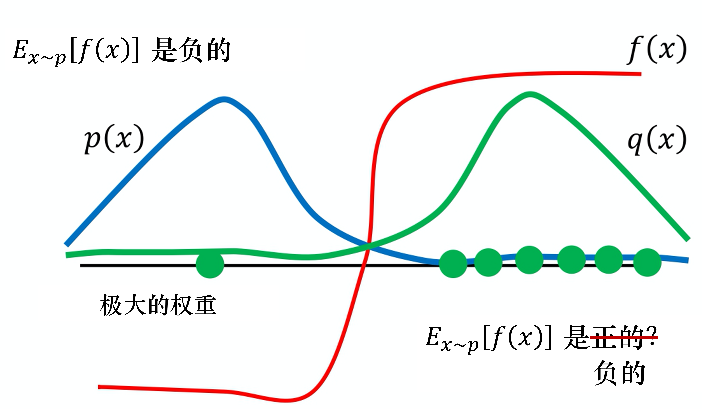
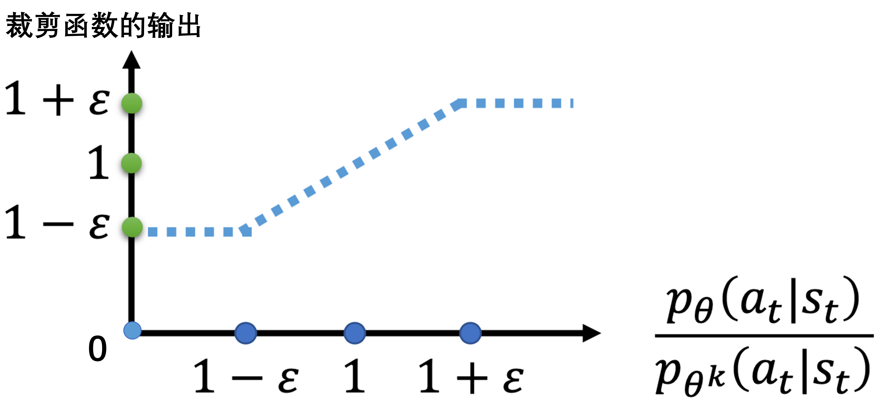
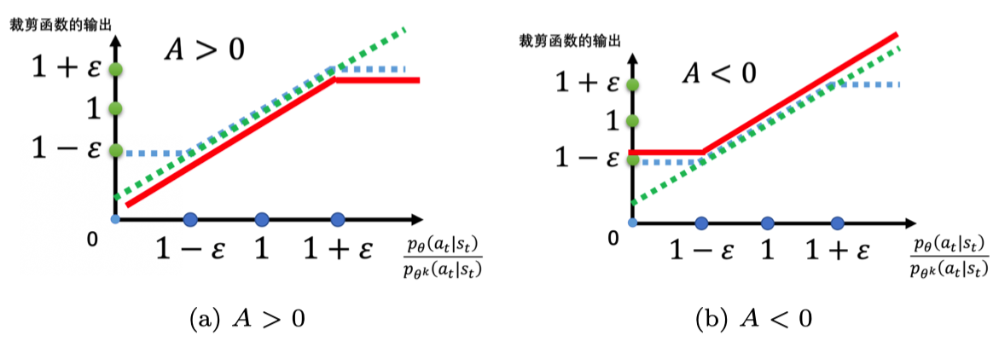
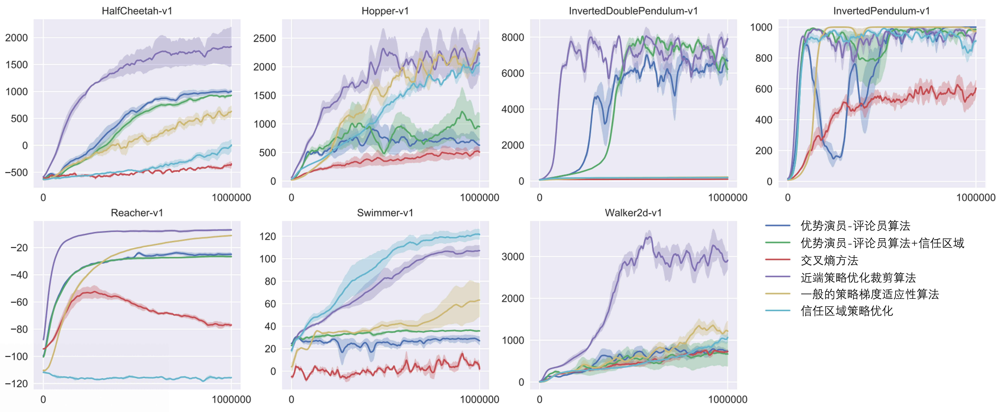

# Chương 5 Thuật toán PPO
## 5.1 Lấy mẫu theo trọng số quan trọng
Trước khi giới thiệu **tối ưu chính sách cận kề (proximal policy optimization, PPO)**, hãy nhắc lại khác biệt giữa hai cách huấn luyện on-policy (cùng chính sách) và off-policy (khác chính sách). Trong học tăng cường, thứ cần học là một tác tử (agent). Nếu tác tử cần học và tác tử tương tác với môi trường là một, ta gọi là on-policy. Nếu tác tử cần học và tác tử tương tác với môi trường không phải là một, ta gọi là off-policy.

Tại sao ta muốn xét off-policy? Hãy nhớ lại gradient chính sách (policy gradient). Gradient chính sách là thuật toán on-policy, vì trong gradient chính sách, ta cần một tác tử, một chính sách và một diễn viên (actor). Diễn viên tương tác với môi trường để thu thập dữ liệu, thu thập rất nhiều quỹ đạo $\tau$, dựa vào dữ liệu thu thập được để cập nhật tham số của chính sách theo công thức gradient chính sách, vì vậy gradient chính sách là một thuật toán on-policy. PPO là một biến thể của gradient chính sách, nó là thuật toán học tăng cường mặc định hiện nay của OpenAI.
$$
    \nabla \bar{R}_{\theta}=\mathbb{E}_{\tau \sim p_{\theta}(\tau)}\left[R(\tau) \nabla \log p_{\theta}(\tau)\right] \tag{5.1}
$$

Vấn đề là $\mathbb{E}_{\tau \sim p_{\theta}(\tau)}$ trong biểu thức (5.1) là kỳ vọng theo các quỹ đạo $\tau$ được lấy mẫu bởi chính sách $\pi_{\theta}$. Một khi tham số được cập nhật, từ $\theta$ thành $\theta'$, xác suất $p_\theta(\tau)$ không còn đúng nữa, dữ liệu lấy mẫu trước đó cũng không dùng được nữa. Vì vậy gradient chính sách là một thuật toán tốn rất nhiều thời gian để lấy mẫu dữ liệu, phần lớn thời gian của nó dành cho việc lấy mẫu. Sau khi tác tử tương tác với môi trường, tiếp theo phải cập nhật tham số. Ta chỉ có thể cập nhật tham số một lần, sau đó phải lấy mẫu lại dữ liệu mới có thể cập nhật tham số lần nữa. Điều này rõ ràng rất tốn thời gian, vì vậy ta muốn chuyển từ on-policy sang off-policy, như vậy có thể dùng một chính sách khác $\pi_{\theta'}$, một diễn viên khác $\theta'$ để tương tác với môi trường ($\theta'$ được cố định), dùng dữ liệu do $\theta'$ lấy mẫu để huấn luyện $\theta$. Giả sử ta có thể dùng dữ liệu do $\theta'$ lấy mẫu để huấn luyện $\theta$, ta có thể dùng dữ liệu do $\theta'$ lấy mẫu nhiều lần, có thể thực hiện gradient ascent (đi lên theo gradient) nhiều lần, có thể cập nhật tham số nhiều lần, mà chỉ cần dùng cùng một lô dữ liệu. Vì giả sử $\theta$ có khả năng học từ dữ liệu do một diễn viên khác $\theta'$ lấy mẫu, nên $\theta'$ chỉ cần lấy mẫu một lần, lấy mẫu nhiều dữ liệu hơn một chút, để $\theta$ cập nhật rất nhiều lần, như vậy sẽ hiệu quả hơn.

Cụ thể làm thế nào? Điều này cần giới thiệu khái niệm **lấy mẫu theo trọng số quan trọng (importance sampling)**.

> Với một biến ngẫu nhiên, ta thường dùng hàm mật độ xác suất (probability density function) để mô tả đặc tính phân phối xác suất của biến đó. Cụ thể, cho một giá trị của biến ngẫu nhiên, có thể dựa vào hàm mật độ xác suất để tính xác suất (mật độ) ứng với giá trị đó. Ngược lại, cũng có thể dựa vào thông tin phân phối xác suất mà hàm mật độ xác suất cung cấp để sinh ra một giá trị của biến ngẫu nhiên, đó chính là lấy mẫu (sampling). Vì vậy, theo một nghĩa nào đó, lấy mẫu là ứng dụng ngược của hàm mật độ xác suất. Khác với việc dựa vào hàm mật độ xác suất để tính giá trị xác suất ứng với điểm mẫu, quá trình lấy mẫu thường không trực tiếp như vậy, thường cần dựa vào đặc điểm cụ thể của phân phối cần lấy mẫu để chọn chiến lược lấy mẫu phù hợp.

Giả sử ta có một hàm $f(x)$, cần tính khi lấy mẫu $x$ từ phân phối $p$, rồi đưa $x$ vào $f$ được $f(x)$. Ta nên tính giá trị kỳ vọng của $f(x)$ như thế nào? Giả sử ta không thể tính tích phân trên phân phối $p$, nhưng có thể lấy mẫu một số dữ liệu $x^i$ từ phân phối $p$. Đưa $x^i$ vào $f(x)$, lấy trung bình là có thể xấp xỉ giá trị kỳ vọng của $f(x)$.

Bây giờ có một vấn đề khác, giả sử ta không thể lấy mẫu dữ liệu từ phân phối $p$, chỉ có thể lấy mẫu dữ liệu $x$ từ một phân phối khác $q$, $q$ có thể là bất kỳ phân phối nào. Nếu ta lấy mẫu $x^i$ từ $q$, thì không thể dùng biểu thức (5.2). Vì biểu thức (5.2) giả định $x$ đều được lấy mẫu từ $p$.
$$
\mathbb{E}_{x \sim p}[f(x)] \approx \frac{1}{N} \sum_{i=1}^N f(x^i) \tag{5.2}
$$

Vì vậy ta thực hiện một phép hiệu chỉnh, giá trị kỳ vọng $\mathbb{E}_{x \sim p}[f(x)]$ chính là $\int f(x) p(x) \mathrm{d}x$, ta biến đổi nó như sau:
$$
    \int f(x) p(x) \mathrm{d}x=\int f(x) \frac{p(x)}{q(x)} q(x) \mathrm{d}x=\mathbb{E}_{x \sim q}[f(x){\frac{p(x)}{q(x)}}]
$$

Ta được
$$
\mathbb{E}_{x \sim p}[f(x)]=\mathbb{E}_{x \sim q}\left[f(x) \frac{p(x)}{q(x)}\right] \tag{5.3}
$$
Ta có thể viết thành kỳ vọng theo các $x$ được lấy mẫu từ $q$. Ta lấy mẫu $x$ từ $q$, rồi tính $f(x) \frac{p(x)}{q(x)}$, rồi lấy kỳ vọng. Vì vậy dù ta không thể lấy mẫu dữ liệu từ $p$, chỉ cần lấy mẫu được dữ liệu từ $q$ là có thể tính giá trị kỳ vọng khi lấy mẫu $x$ từ $p$ rồi đưa vào $f$.

Vì lấy mẫu dữ liệu từ $q$, nên mỗi mẫu dữ liệu lấy từ $q$ đều cần nhân với một **trọng số quan trọng (importance weight)** $\frac{p(x)}{q(x)}$ để hiệu chỉnh sự khác biệt giữa hai phân phối. $q(x)$ có thể là bất kỳ phân phối nào, hạn chế duy nhất là không được có trường hợp xác suất của $q(x)$ bằng 0 trong khi xác suất của $p(x)$ khác 0, nếu không sẽ không xác định. Giả sử khi xác suất của $q(x)$ bằng 0 thì xác suất của $p(x)$ cũng bằng 0, thì $p(x)$ chia $q(x)$ là xác định. Vì vậy lúc này ta có thể dùng importance sampling, chuyển từ lấy mẫu theo $p$ sang lấy mẫu theo $q$.

Importance sampling có một số vấn đề. Tuy ta có thể thay $p$ bằng bất kỳ $q$ nào, nhưng khi cài đặt, khoảng cách giữa $p$ và $q$ không được quá lớn. Khoảng cách quá lớn sẽ có vấn đề. Ví dụ, tuy biểu thức (5.3) đúng (vế trái của biểu thức (5.3) là giá trị kỳ vọng của $f(x)$, phân phối của nó là $p$, vế phải là giá trị kỳ vọng của $f(x) \frac{p(x)}{q(x)}$, phân phối của nó là $q$), nhưng nếu không tính giá trị kỳ vọng mà tính phương sai, thì $\operatorname{Var}_{x \sim p}[f(x)]$ và $\operatorname{Var}_{x \sim q}\left[f(x) \frac{p(x)}{q(x)}\right]$ là khác nhau. Hai biến ngẫu nhiên có trung bình giống nhau không có nghĩa là phương sai của chúng giống nhau.

Ta có thể đưa $f(x)$ và $f(x) \frac{p(x)}{q(x)}$ vào công thức phương sai $\operatorname{Var}[X]=E\left[X^{2}\right]-(E[X])^{2}$, được
$$
    \operatorname{Var}_{x \sim p}[f(x)]=\mathbb{E}_{x \sim p}\left[f(x)^{2}\right]-\left(\mathbb{E}_{x \sim p}[f(x)]\right)^{2}
$$

$$
    \begin{aligned}
        \operatorname{Var}_{x \sim q}\left[f(x) \frac{p(x)}{q(x)}\right] &=\mathbb{E}_{x \sim q}\left[\left(f(x) \frac{p(x)}{q(x)}\right)^{2}\right]-\left(\mathbb{E}_{x \sim q}\left[f(x) \frac{p(x)}{q(x)}\right]\right)^{2} \\
        &=\mathbb{E}_{x \sim p}\left[f(x)^{2} \frac{p(x)}{q(x)}\right]-\left(\mathbb{E}_{x \sim p}[f(x)]\right)^{2}
        \end{aligned}
$$
Khác biệt giữa $\operatorname{Var}_{x \sim p}[f(x)]$ và $\operatorname{Var}_{x \sim q}\left[f(x) \frac{p(x)}{q(x)}\right]$ nằm ở số hạng thứ nhất, số hạng thứ nhất của $\operatorname{Var}_{x \sim q}\left[f(x) \frac{p(x)}{q(x)}\right]$ được nhân thêm $\frac{p(x)}{q(x)}$, nếu $\frac{p(x)}{q(x)}$ chênh lệch rất lớn thì phương sai của $f(x)\frac{p(x)}{q(x)}$ sẽ rất lớn. Vì vậy về lý thuyết giá trị kỳ vọng của chúng như nhau, tức là chỉ cần ta lấy mẫu đủ nhiều lần trên phân phối $p$, lấy mẫu đủ nhiều lần trên phân phối $q$, kết quả thu được sẽ như nhau. Nhưng nếu số lần lấy mẫu không đủ nhiều, vì phương sai của chúng chênh lệch rất lớn, ta có thể thu được kết quả khác nhau rất nhiều.

Ví dụ, khi $p(x)$ và $q(x)$ chênh lệch rất lớn sẽ có vấn đề. Như hình 5.1, giả sử đường màu xanh lam là phân phối $p(x)$, đường màu xanh lá là phân phối $q(x)$, đường màu đỏ là $f(x)$. Nếu ta muốn tính giá trị kỳ vọng của $f(x)$, lấy mẫu từ phân phối $p(x)$, rõ ràng $\mathbb{E}_{x \sim p}[f(x)]$ là âm. Đó là vì ở vùng bên trái xác suất của $p(x)$ rất cao, nên việc lấy mẫu sẽ rơi vào vùng này, mà $f(x)$ ở vùng này là âm, nên về lý thuyết số hạng này tính ra sẽ âm.

Tiếp theo ta đổi sang lấy mẫu từ $q(x)$, vì $q(x)$ có xác suất khá cao ở vùng bên phải, nên nếu số điểm ta lấy mẫu không đủ nhiều, có thể chỉ lấy mẫu được ở bên phải. Nếu ta chỉ lấy mẫu được ở bên phải, có thể $\mathbb{E}_{x \sim q}\left[f(x) \frac{p(x)}{q(x)}\right]$ là dương.
Ta lấy mẫu được các điểm ở đây, tính $f(x) \frac{p(x)}{q(x)}$ của chúng đều dương. Các điểm ta lấy mẫu được đều dương, lấy kỳ vọng xong cũng dương, đó là vì số lần lấy mẫu không đủ nhiều. Giả sử số lần lấy mẫu rất ít, chỉ lấy mẫu được ở bên phải. Bên trái tuy xác suất rất thấp nhưng cũng có thể được lấy mẫu. Giả sử ta khó khăn lắm mới lấy mẫu được một điểm bên trái, vì ở điểm bên trái $p(x)$ và $q(x)$ chênh lệch rất nhiều, ở đây $p(x)$ rất lớn, $q(x)$ rất nhỏ. $f(x)$ khó khăn lắm mới lấy mẫu được một giá trị âm, giá trị âm này sẽ được nhân với một trọng số rất lớn, như vậy có thể cân bằng lại tình huống trước đó toàn lấy mẫu được giá trị dương. Cuối cùng ta tính ra giá trị kỳ vọng của số hạng này rốt cuộc vẫn là âm. Nhưng tiền đề là ta phải lấy mẫu đủ nhiều lần thì điều này mới xảy ra. Nhưng có thể số lần lấy mẫu không đủ nhiều, $\mathbb{E}_{x \sim p}[f(x)]$ và $\mathbb{E}_{x \sim q}\left[f(x) \frac{p(x)}{q(x)}\right]$ có thể chênh lệch rất lớn. Đây chính là vấn đề của importance sampling.

Hình 5.1 Vấn đề của lấy mẫu theo trọng số quan trọng

Việc cần làm bây giờ là dùng importance sampling cho trường hợp off-policy, biến thuật toán huấn luyện on-policy thành thuật toán huấn luyện off-policy.

Biến đổi như thế nào? Như biểu thức (5.4), trước đây ta dùng chính sách $\pi_{\theta}$ tương tác với môi trường, lấy mẫu ra quỹ đạo $\tau$, tính $R(\tau) \nabla \log p_{\theta}(\tau)$. Bây giờ ta không dùng $\theta$ tương tác với môi trường, giả sử có một chính sách khác $\pi_{\theta}'$, nó là một diễn viên khác, công việc của nó là làm mẫu (demonstration).

$$
    \nabla \bar{R}_{\theta}=\mathbb{E}_{\tau \sim p_{\theta^{\prime}(\tau)}}\left[\frac{p_{\theta}(\tau)}{p_{\theta^{\prime}}(\tau)} R(\tau) \nabla \log p_{\theta}(\tau)\right] \tag{5.4}
$$

Công việc của $\theta'$ là làm mẫu cho $\theta$. Nó tương tác với môi trường, cho $\theta$ biết khi nó tương tác với môi trường thì điều gì sẽ xảy ra, từ đó huấn luyện $\theta$. Thứ ta cần huấn luyện là $\theta$, $\theta'$ chỉ chịu trách nhiệm làm mẫu, chịu trách nhiệm tương tác với môi trường. Quỹ đạo $\tau$ hiện tại được lấy mẫu từ $\theta'$, là dùng $\theta'$ tương tác với môi trường. Vì vậy $\tau$ lấy mẫu được là lấy mẫu từ $\theta'$, hai phân phối này khác nhau. Nhưng không sao, giả sử ban đầu ta lấy mẫu từ $p$, nhưng phát hiện không thể lấy mẫu từ $p$, nên ta không dùng $\theta$ tương tác với môi trường, có thể thay $p$ bằng $q$, rồi bổ sung phía sau một trọng số quan trọng. Tương tự, sau khi thay $\theta$ bằng $\theta'$, ta cần bổ sung một trọng số quan trọng $\frac{p_{\theta}(\tau)}{p_{\theta^{\prime}}(\tau)}$. Trọng số quan trọng này chính là xác suất của một quỹ đạo $\tau$ tính bằng $\theta$ chia cho xác suất của quỹ đạo $\tau$ đó tính bằng $\theta'$. Số hạng này rất quan trọng, vì thứ ta cần học là diễn viên $\theta$, mà $\theta$ và $\theta'$ không hoàn toàn giống nhau, tình huống $\theta'$ gặp và tình huống $\theta$ gặp có thể khác nhau, nên ở giữa cần có một số hạng hiệu chỉnh.

Q: Dữ liệu hiện tại được lấy mẫu từ $\theta'$, chuyển từ $\theta$ sang $\theta'$ có lợi ích gì?

A: Vì hiện tại thứ tương tác với môi trường là $\theta'$ chứ không phải $\theta$, nên dữ liệu lấy mẫu không liên quan gì đến bản thân $\theta$. Do đó ta có thể cho $\theta'$ tương tác với môi trường để lấy mẫu lượng lớn dữ liệu, $\theta$ có thể cập nhật tham số nhiều lần, cho đến khi $\theta$ được huấn luyện đến một mức nhất định. Sau khi cập nhật nhiều lần, $\theta'$ mới lấy mẫu lại, đây chính là cái hay của việc chuyển từ on-policy sang off-policy.

Thực tế khi làm gradient chính sách, ta không cho toàn bộ quỹ đạo $\tau$ cùng một điểm số, mà tính riêng từng cặp trạng thái-hành động. Quá trình cập nhật gradient thực tế có thể viết là
$$
    \mathbb{E}_{\left(s_{t}, a_{t}\right) \sim \pi_{\theta}}\left[A^{\theta}\left(s_{t}, a_{t}\right) \nabla \log p_{\theta}\left(a_{t}^{n} | s_{t}^{n}\right)\right]
$$

Ta dùng diễn viên $\theta$ lấy mẫu ra $s_t$ và $a_t$, lấy mẫu ra cặp trạng thái-hành động, ta sẽ tính lợi thế (advantage) $A^{\theta}\left(s_{t}, a_{t}\right)$ của cặp trạng thái-hành động này, tức là nó tốt đến mức nào. $A^{\theta}\left(s_{t}, a_{t}\right)$ là phần thưởng tích lũy trừ đi đường cơ sở (baseline), số hạng này là ước lượng. Nó cần ước lượng việc thực hiện hành động $a_t$ ở trạng thái $s_t$ là tốt hay không tốt. Tiếp theo nhân phía sau với $\nabla \log p_{\theta}\left(a_{t}^{n} | s_{t}^{n}\right)$, tức là nếu $A^{\theta}\left(s_{t}, a_{t}\right)$ dương thì tăng xác suất; nếu âm thì giảm xác suất.

Ta có thể dùng importance sampling để biến on-policy thành off-policy, từ $\theta$ chuyển sang $\theta'$. Vì vậy hiện tại $s_t$, $a_t$ là dữ liệu do $\theta'$ lấy mẫu được sau khi tương tác với môi trường. Nhưng khi huấn luyện, tham số cần điều chỉnh là mô hình $\theta$. Vì $\theta'$ và $\theta$ là các mô hình khác nhau, nên ta cần có một số hạng hiệu chỉnh. Số hạng hiệu chỉnh này chính là dùng kỹ thuật importance sampling, lấy xác suất $s_t$, $a_t$ được lấy mẫu bởi $\theta$ chia cho xác suất $s_t$, $a_t$ được lấy mẫu bởi $\theta'$.

$$
    \mathbb{E}_{\left(s_{t}, a_{t}\right) \sim \pi_{\theta^{\prime}}}\left[\frac{p_{\theta}\left(s_{t}, a_{t}\right)}{p_{\theta^{\prime}}\left(s_{t}, a_{t}\right)} A^{\theta}\left(s_{t}, a_{t}\right) \nabla \log p_{\theta}\left(a_{t}^{n} | s_{t}^{n}\right)\right] 
$$
Trong đó, $A^{\theta}(s_t,a_t)$ có chỉ số trên $\theta$, $\theta$ cho biết $A^{\theta}(s_t,a_t)$ được tính khi diễn viên $\theta$ tương tác với môi trường. Nhưng thực tế khi chuyển từ $\theta$ sang $\theta'$, $A^{\theta}(s_t,a_t)$ nên được đổi thành $A^{\theta'}(s_t,a_t)$, vì sao? Số hạng $A(s_t,a_t)$ muốn ước lượng việc ở một trạng thái nào đó thực hiện một hành động nào đó, tiếp theo sẽ nhận được giá trị phần thưởng tích lũy trừ đi giá trị đường cơ sở. Ta ước lượng $A(s_t,a_t)$ như thế nào? Ta thực hiện hành động $a_t$ ở trạng thái $s_t$, tổng phần thưởng nhận được tiếp theo trừ đi đường cơ sở chính là $A(s_t,a_t)$. Trước đây là $\theta$ tương tác với môi trường, nên thứ ta quan sát được là phần thưởng mà $\theta$ có thể nhận được. Nhưng bây giờ là $\theta'$ tương tác với môi trường, nên lợi thế ta có được là lợi thế được ước lượng dựa trên $\theta'$. Nhưng bây giờ ta tạm không quan tâm nhiều như vậy, cứ giả sử $A^{\theta}(s_t,a_t)$ và $A^{\theta'}(s_t,a_t)$ có thể gần như nhau.

Tiếp theo, ta có thể tách $p_{\theta}\left(s_{t}, a_{t}\right)$ và $p_{\theta'}\left(s_{t}, a_{t}\right)$, tức là
$$
    \begin{aligned}
        p_{\theta}\left(s_{t}, a_{t}\right)&=p_{\theta}\left(a_{t}|s_{t}\right) p_{\theta}(s_t) \\
        p_{\theta'}\left(s_{t}, a_{t}\right)&=p_{\theta'}\left(a_{t}|s_{t}\right) p_{\theta'}(s_t) 
        \end{aligned}
$$

Do đó ta có
$$
    \mathbb{E}_{\left(s_{t}, a_{t}\right) \sim \pi_{\theta^{\prime}}}\left[\frac{p_{\theta}\left(a_{t} | s_{t}\right)}{p_{\theta^{\prime}}\left(a_{t} | s_{t}\right)} \frac{p_{\theta}\left(s_{t}\right)}{p_{\theta^{\prime}}\left(s_{t}\right)} A^{\theta^{\prime}}\left(s_{t}, a_{t}\right) \nabla \log p_{\theta}\left(a_{t}^{n} | s_{t}^{n}\right)\right]
$$

Một việc cần làm ở đây là giả sử xác suất ta nhìn thấy $s_t$ khi mô hình là $\theta$ bằng xác suất ta nhìn thấy $s_t$ khi mô hình là $\theta'$, tức $p_{\theta}(s_t)=p_{\theta'}(s_t)$. Vì $p_{\theta}(s_t)$ và $p_{\theta'}(s_t)$ như nhau, nên ta có
$$
    \mathbb{E}_{\left(s_{t}, a_{t}\right) \sim \pi_{\theta^{\prime}}}\left[\frac{p_{\theta}\left(a_{t} | s_{t}\right)}{p_{\theta^{\prime}}\left(a_{t} | s_{t}\right)} A^{\theta^{\prime}}\left(s_{t}, a_{t}\right) \nabla \log p_{\theta}\left(a_{t}^{n} | s_{t}^{n}\right)\right] \tag{5.5}  
$$

Q: Tại sao ta có thể giả sử $p_{\theta}(s_t)$ và $p_{\theta'}(s_t)$ là như nhau?

A: Vì trạng thái ta nhìn thấy thường không liên quan nhiều đến hành động được thực hiện. Ví dụ khi chơi các game Atari khác nhau, thực ra hình ảnh trò chơi nhìn thấy đều gần giống nhau, nên có lẽ các $\theta$ khác nhau không ảnh hưởng đến $s_t$. Nhưng lý do trực tiếp hơn là $p_{\theta}(s_t)$ rất khó tính, $p_{\theta}(s_t)$ có tham số $\theta$, nó biểu thị việc ta dùng $\theta$ tương tác với môi trường, tính xác suất xuất hiện của $s_t$, mà xác suất này rất khó tính. Đặc biệt nếu đầu vào là hình ảnh, cùng một $s_t$ có thể căn bản không xuất hiện lần thứ hai. Ta hoàn toàn không có cách nào ước lượng $p_{\theta}(s_t)$, nên đành bỏ qua vấn đề này.

Nhưng $p_{\theta}(a_t|s_t)$ rất dễ tính, ta có tham số $\theta$, nó chính là một mạng chính sách (policy network). Ta đưa trạng thái $s_t$ vào mạng chính sách, nó sẽ đưa ra xác suất của mỗi $a_t$. Vì vậy chỉ cần biết tham số của $\theta$ và $\theta'$ là có thể tính $\frac{p_{\theta}\left(a_{t} | s_{t}\right)}{p_{\theta^{\prime}}\left(a_{t} | s_{t}\right)}$.

Biểu thức (5.5) là gradient, ta có thể từ gradient suy ngược ra hàm mục tiêu ban đầu:
$$
    \nabla f(x)=f(x) \nabla \log f(x)
$$
Chú ý, khi lấy gradient theo $\theta$, $p_{\theta^{\prime}}(a_{t} | s_{t})$ và $A^{\theta^{\prime}}\left(s_{t}, a_{t}\right)$ đều là hằng số.

Vì vậy thực tế, khi ta dùng importance sampling, hàm mục tiêu cần tối ưu là
$$
    J^{\theta^{\prime}}(\theta)=\mathbb{E}_{\left(s_{t}, a_{t}\right) \sim \pi_{\theta^{\prime}}}\left[\frac{p_{\theta}\left(a_{t} | s_{t}\right)}{p_{\theta^{\prime}}\left(a_{t} | s_{t}\right)} A^{\theta^{\prime}}\left(s_{t}, a_{t}\right)\right]
$$
Ta ký hiệu nó là $J^{\theta^{\prime}}(\theta)$, vì $\theta$ trong ngoặc của $J^{\theta^{\prime}}(\theta)$ đại diện cho tham số ta cần tối ưu. $\theta'$ nghĩa là ta dùng $\theta'$ làm mẫu, tức là thứ thực sự đang tương tác với môi trường bây giờ là $\theta'$. Vì $\theta$ không tương tác với môi trường, mà là $\theta'$ tương tác với môi trường. Sau đó ta dùng $\theta'$ tương tác với môi trường, lấy mẫu ra $s_t$, $a_t$ rồi tính lợi thế $A^{\theta^{\prime}}\left(s_{t}, a_{t}\right)$ của $s_t$ và $a_t$, rồi nhân nó với $\frac{p_{\theta}\left(a_{t} | s_{t}\right)}{p_{\theta^{\prime}}\left(a_{t} | s_{t}\right)}$. $\frac{p_{\theta}\left(a_{t} | s_{t}\right)}{p_{\theta^{\prime}}\left(a_{t} | s_{t}\right)}$ dễ tính, ta có thể ước lượng $A^{\theta^{\prime}}\left(s_{t}, a_{t}\right)$ từ kết quả lấy mẫu, vì vậy $J^{\theta^{\prime}}(\theta)$ là tính được. Thực tế khi cập nhật tham số, ta cập nhật tham số theo biểu thức (5.5).

## 5.2 Tối ưu chính sách cận kề

Ta có thể dùng importance sampling để chuyển on-policy sang off-policy, nhưng importance sampling có một vấn đề: nếu $p_{\theta}\left(a_{t} | s_{t}\right)$ và $p_{\theta'}\left(a_{t} | s_{t}\right)$ chênh lệch quá nhiều, tức hai phân phối này chênh lệch quá nhiều, kết quả của importance sampling sẽ không tốt.
Làm sao tránh để chúng chênh lệch quá nhiều? Đây chính là việc PPO cần làm.

Như biểu thức (5.6), PPO cần tối ưu hàm mục tiêu $J^{\theta^{\prime}}(\theta)$. Nhưng hàm mục tiêu này lại liên quan đến importance sampling. Khi làm importance sampling, $p_{\theta}\left(a_{t} | s_{t}\right)$ không được chênh lệch quá nhiều với $p_{\theta'}\left(a_{t} | s_{t}\right)$. Mô hình làm mẫu không được chênh lệch quá nhiều với mô hình thực, chênh lệch quá nhiều thì kết quả importance sampling sẽ không tốt. Khi huấn luyện, ta nên thêm một ràng buộc (constraint). Ràng buộc này là độ phân kỳ KL (KL divergence) giữa các hành động do $\theta$ và $\theta'$ đưa ra, số hạng này dùng để đo mức độ tương đồng giữa $\theta$ và $\theta'$. Ta mong rằng trong quá trình huấn luyện, $\theta$ học được và $\theta'$ càng giống nhau càng tốt. Vì nếu $\theta$ và $\theta'$ không giống nhau, kết quả cuối cùng sẽ không tốt. Vì vậy trong PPO có hai số hạng: một số hạng là tối ưu $J^{\theta^{\prime}}(\theta)$ vốn cần tối ưu, số hạng còn lại là một ràng buộc. Ràng buộc này giống như số hạng (term) chính quy hóa (regularization), việc nó làm là mong rằng $\theta$ học được cuối cùng không chênh lệch nhiều với $\theta'$. **Chú ý, tuy mục tiêu tối ưu của PPO có liên quan đến importance sampling, nhưng nó chỉ dùng dữ liệu của chính sách vòng trước $\theta^{\prime}$. Hàm mục tiêu của PPO có thêm ràng buộc độ phân kỳ KL, chính sách hành vi $\theta^{\prime}$ và chính sách mục tiêu $\theta$ rất gần nhau, chính sách hành vi và chính sách mục tiêu của PPO có thể coi là cùng một chính sách, vì vậy PPO là thuật toán on-policy.**

$$
    \begin{aligned}
        &J_{\mathrm{PPO}}^{\theta^{\prime}}(\theta)=J^{\theta^{\prime}}(\theta)-\beta \mathrm{KL}\left(\theta, \theta^{\prime}\right) \\
        &J^{\theta^{\prime}}(\theta)=\mathbb{E}_{\left(s_{t}, a_{t}\right) \sim \pi_{\theta^{\prime}}}\left[\frac{p_{\theta}\left(a_{t} \mid s_{t}\right)}{p_{\theta^{\prime}}\left(a_{t} \mid s_{t}\right)} A^{\theta^{\prime}}\left(s_{t}, a_{t}\right)\right]
        \end{aligned} \tag{5.6}
$$

PPO có một tiền thân: **tối ưu chính sách vùng tin cậy (trust region policy optimization, TRPO)**. TRPO có thể biểu diễn là
$$
    \begin{aligned}
        J_{\mathrm{TRPO}}^{\theta^{\prime}}(\theta)=\mathbb{E}_{\left(s_{t}, a_{t}\right) \sim \pi_{\theta^{\prime}}}\left[\frac{p_{\theta}\left(a_{t} | s_{t}\right)}{p_{\theta^{\prime}}\left(a_{t} | s_{t}\right)} A^{\theta^{\prime}}\left(s_{t}, a_{t}\right)\right],\mathrm{KL}\left(\theta, \theta^{\prime}\right)<\delta
        \end{aligned}
$$

Điểm khác giữa TRPO và PPO là vị trí đặt ràng buộc khác nhau, PPO đặt trực tiếp ràng buộc vào biểu thức cần tối ưu, ta có thể dùng phương pháp gradient ascent để tối đa hóa biểu thức (5.6). Còn TRPO xem độ phân kỳ KL là ràng buộc, nó mong độ phân kỳ KL giữa $\theta$ và $\theta'$ nhỏ hơn $\delta$. Nếu ta dùng tối ưu dựa trên gradient, ràng buộc rất khó xử lý. TRPO rất khó xử lý, vì nó xem ràng buộc độ phân kỳ KL là một ràng buộc bổ sung, không đặt trong mục tiêu (objective), nên rất khó tính. Do đó thông thường ta dùng PPO chứ không dùng TRPO. Hiệu năng của PPO và TRPO gần như nhau, nhưng PPO dễ cài đặt hơn TRPO rất nhiều.

Độ phân kỳ KL rốt cuộc là gì? Ở đây ta trực tiếp xem độ phân kỳ KL là một hàm, đầu vào là $\theta$ và $\theta'$, nhưng không phải xem $\theta$ hoặc $\theta'$ là một phân phối rồi tính khoảng cách giữa hai phân phối. Cái gọi là khoảng cách giữa $\theta$ và $\theta'$ không phải khoảng cách về tham số, mà là khoảng cách về hành vi (behavior). Giả sử ta có hai diễn viên — $\theta$ và $\theta'$, khoảng cách về tham số là tính xem hai bộ tham số này giống nhau đến mức nào. Ở đây không nói về khoảng cách tham số, mà là khoảng cách hành vi của chúng. Trước tiên ta đưa vào một trạng thái $s$, nó sẽ đưa ra một phân phối trên không gian hành động. Giả sử ta có 3 hành động, 3 hành động có thể sẽ đưa ra 3 giá trị. Khoảng cách hành vi (behavior distance) là: cho cùng một trạng thái, khoảng cách giữa các hành động đầu ra. Phân phối của hai hành động này đều là phân phối xác suất, vì vậy ta có thể tính độ phân kỳ KL của hai phân phối xác suất này. Trung bình độ phân kỳ KL của hai phân phối đầu ra ở các trạng thái khác nhau chính là độ phân kỳ KL giữa hai diễn viên mà ta nói đến.

Q: Tại sao không tính trực tiếp khoảng cách giữa $\theta$ và $\theta'$? Tính khoảng cách này thậm chí không cần tính độ phân kỳ KL, chuẩn (norm) L1 và L2 cũng có thể đảm bảo $\theta$ và $\theta'$ rất giống nhau.

A: Khi làm học tăng cường, sở dĩ ta không xét khoảng cách về tham số mà xét khoảng cách về hành động, là vì rất có thể với diễn viên, sự thay đổi của tham số và sự thay đổi của hành động không nhất thiết hoàn toàn nhất quán. Có khi tham số chỉ thay đổi một chút, hành động nó đưa ra có thể đã khác rất nhiều. Hoặc tham số thay đổi rất nhiều, nhưng hành động đưa ra có thể không thay đổi gì. Vì vậy thứ ta thực sự quan tâm là khoảng cách về hành động của diễn viên, chứ không phải khoảng cách về tham số. Do đó khi làm PPO, cái gọi là độ phân kỳ KL không phải là khoảng cách tham số, mà là khoảng cách hành động.

### 5.2.1 PPO phạt (PPO-penalty)

Thuật toán PPO có hai biến thể chính: **PPO phạt (PPO-penalty)** và **PPO cắt (PPO-clip)**.

Hãy xem thuật toán **PPO1**, tức thuật toán PPO phạt. Trước tiên nó khởi tạo tham số chính sách $\theta^0$. Trong mỗi vòng lặp, ta dùng tham số diễn viên $\theta^k$ có được từ vòng lặp huấn luyện trước để tương tác với môi trường, lấy mẫu được lượng lớn cặp trạng thái-hành động. Dựa vào kết quả tương tác của $\theta^k$, ta ước lượng $A^{\theta^{k}}\left(s_{t}, a_{t}\right)$. Ta dùng công thức tối ưu của PPO. Nhưng khác với gradient chính sách ban đầu, gradient chính sách ban đầu chỉ có thể cập nhật tham số một lần, cập nhật xong phải lấy mẫu lại dữ liệu. Nhưng bây giờ thì khác, ta dùng $\theta^k$ tương tác với môi trường, lấy mẫu được bộ dữ liệu này rồi, ta có thể cho $\theta$ cập nhật rất nhiều lần, tìm cách tối đa hóa hàm mục tiêu, như biểu thức (5.7). Ở đây $\theta$ cập nhật nhiều lần cũng không sao, vì ta đã có importance sampling, nên các kinh nghiệm này, các cặp trạng thái-hành động này được lấy mẫu từ $\theta^k$ cũng không sao. $\theta$ có thể cập nhật rất nhiều lần, nó trở nên khác với $\theta^k$ một chút cũng không sao, ta vẫn có thể huấn luyện $\theta$ như thường.

$$
    J_{\mathrm{PPO}}^{\theta^{k}}(\theta)=J^{\theta^{k}}(\theta)-\beta \mathrm{KL}\left(\theta, \theta^{k}\right) \tag{5.7}
$$

Trong bài báo về PPO còn có một **độ phân kỳ KL thích nghi (adaptive KL divergence)**. Ở đây sẽ gặp một vấn đề, đó là $\beta$ nên đặt bằng bao nhiêu. Vấn đề này giống như chính quy hóa, phía trước số hạng chính quy hóa cũng phải nhân một trọng số, nên phía trước độ phân kỳ KL cũng phải nhân một trọng số, nhưng $\beta$ nên đặt bằng bao nhiêu? Ta có một phương pháp điều chỉnh $\beta$ động. Trong phương pháp này, trước tiên ta đặt một giá trị lớn nhất của độ phân kỳ KL có thể chấp nhận. Giả sử sau khi tối ưu biểu thức (5.7), giá trị độ phân kỳ KL quá lớn, điều này cho thấy số hạng phạt phía sau $\beta \mathrm{KL}\left(\theta, \theta^{k}\right)$ không phát huy tác dụng, ta sẽ tăng $\beta$. Ngoài ra, ta đặt một giá trị nhỏ nhất của độ phân kỳ KL. Nếu sau khi tối ưu biểu thức (5.7), độ phân kỳ KL còn nhỏ hơn giá trị nhỏ nhất, cho thấy hiệu quả của số hạng phía sau quá mạnh, ta sợ nó chỉ tối ưu số hạng sau, làm $\theta$ giống hệt $\theta^k$, đây không phải điều ta muốn, nên ta cần giảm $\beta$. $\beta$ có thể điều chỉnh động, do đó ta gọi là **phạt KL thích nghi (adaptive KL penalty)**. Ta có thể tổng kết phạt KL thích nghi:
* Nếu $\mathrm{KL}(\theta,\theta^k)>\mathrm{KL}_{\max}$, tăng $\beta$;
* Nếu $\mathrm{KL}(\theta,\theta^k)<\mathrm{KL}_{\min}$, giảm $\beta$.

PPO phạt có thể biểu diễn là
$$
    \begin{aligned}
        &J_{\text{PPO}}^{\theta^{k}}(\theta)=J^{\theta^{k}}(\theta)-\beta \text{KL}\left(\theta, \theta^{k}\right) \\
        &J^{\theta^{k}}(\theta) \approx \sum_{\left(s_{t}, a_{t}\right)} \frac{p_{\theta}\left(a_{t} \mid s_{t}\right)}{p_{\theta^{k}}\left(a_{t} \mid s_{t}\right)} A^{\theta^{k}}\left(s_{t}, a_{t}\right)
        \end{aligned}
$$

### 5.2.2 PPO cắt (PPO-clip)

Nếu ta thấy tính độ phân kỳ KL quá phức tạp, thì còn có thuật toán **PPO2**, PPO2 tức **PPO cắt**. Trong hàm mục tiêu của PPO cắt không có độ phân kỳ KL, hàm mục tiêu cần tối đa hóa của nó là
$$
    \begin{aligned}
        J_{\mathrm{PPO2}}^{\theta^{k}}(\theta) \approx \sum_{\left(s_{t}, a_{t}\right)} \min &\left(\frac{p_{\theta}\left(a_{t} | s_{t}\right)}{p_{\theta^{k}}\left(a_{t} | s_{t}\right)} A^{\theta^{k}}\left(s_{t}, a_{t}\right),\right.\\
        &\left.\operatorname{clip}\left(\frac{p_{\theta}\left(a_{t} | s_{t}\right)}{p_{\theta^{k}}\left(a_{t} | s_{t}\right)}, 1-\varepsilon, 1+\varepsilon\right) A^{\theta^{k}}\left(s_{t}, a_{t}\right)\right)
        \end{aligned} \tag{5.8}
$$
Trong đó,
* Toán tử (operator) min là chọn số hạng nhỏ hơn giữa số hạng thứ nhất và số hạng thứ hai.
* Phía trước số hạng thứ hai có một hàm cắt (clip), hàm cắt nghĩa là: trong ngoặc có 3 số hạng, nếu số hạng thứ nhất nhỏ hơn số hạng thứ hai thì đưa ra $1-\varepsilon$; nếu số hạng thứ nhất lớn hơn số hạng thứ ba thì đưa ra $1+\varepsilon$.
* $\varepsilon$ là một siêu tham số (hyperparameter), là thứ ta cần điều chỉnh, có thể đặt bằng 0.1 hoặc 0.2.

Giả sử đặt $\varepsilon=0.2$, ta có
$$
    \operatorname{clip}\left(\frac{p_{\theta}\left(a_{t} | s_{t}\right)}{p_{\theta^{k}}\left(a_{t} | s_{t}\right)}, 0.8, 1.2\right)
$$
Nếu $\frac{p_{\theta}\left(a_{t} | s_{t}\right)}{p_{\theta^{k}}\left(a_{t} | s_{t}\right)}$ tính ra nhỏ hơn 0.8 thì đưa ra 0.8; nếu tính ra lớn hơn 1.2 thì đưa ra 1.2.

Trước tiên ta cần hiểu
$$
    \operatorname{clip}\left(\frac{p_{\theta}\left(a_{t} | s_{t}\right)}{p_{\theta^{k}}\left(a_{t} | s_{t}\right)}, 1-\varepsilon, 1+\varepsilon\right)
$$

Trục ngang của hình 5.2 biểu thị $\frac{p_{\theta}\left(a_{t} | s_{t}\right)}{p_{\theta^{k}}\left(a_{t} | s_{t}\right)}$, trục dọc biểu thị đầu ra của hàm cắt.
* Nếu $\frac{p_{\theta}\left(a_{t} | s_{t}\right)}{p_{\theta^{k}}\left(a_{t} | s_{t}\right)}$ lớn hơn $1+\varepsilon$, đầu ra là $1+\varepsilon$;
* Nếu nhỏ hơn $1-\varepsilon$, đầu ra là $1-\varepsilon$;
* Nếu nằm trong khoảng $1-\varepsilon \sim 1+\varepsilon$, đầu ra bằng đầu vào.

Hình 5.2 Hàm cắt

Như hình 5.3a, $\frac{p_{\theta}\left(a_{t} | s_{t}\right)}{p_{\theta^{k}}\left(a_{t} | s_{t}\right)}$ là đường màu xanh lá; $\operatorname{clip}\left(\frac{p_{\theta}\left(a_{t} | s_{t}\right)}{p_{\theta^{k}}\left(a_{t} | s_{t}\right)}, 1-\varepsilon, 1+\varepsilon\right)$ là đường màu xanh lam; giữa đường màu xanh lá và đường màu xanh lam, ta cần lấy kết quả nhỏ nhất. Giả sử số hạng $A$ nhân phía trước lớn hơn 0, lấy kết quả nhỏ nhất, chính là đường màu đỏ này. Như hình 5.3b, nếu $A$ nhỏ hơn 0, sau khi lấy kết quả nhỏ nhất, ta được đường màu đỏ này.

Hình 5.3 Ảnh hưởng của $A$ đến đầu ra của hàm cắt

Tuy biểu thức (5.8) trông hơi phức tạp, nhưng cài đặt lại khá đơn giản, vì việc biểu thức (5.8) muốn làm là mong $p_{\theta}(a_{t} | s_{t})$ và $p_{\theta^k}(a_{t} | s_{t})$ khá gần nhau, tức là mô hình làm mẫu và mô hình thực sự học sau khi tối ưu không chênh lệch quá lớn.

Làm thế nào để nó không chênh lệch quá lớn?
* Nếu $A > 0$, tức là một cặp trạng thái-hành động nào đó là tốt, ta mong tăng xác suất của cặp trạng thái-hành động này. Tức là ta muốn $p_{\theta}(a_{t} | s_{t})$ càng lớn càng tốt, nhưng tỉ số giữa nó và $p_{\theta^k}(a_{t} | s_{t})$ không được vượt quá $1+\varepsilon$. Nếu vượt quá $1+\varepsilon$ thì không còn lợi ích gì nữa. Đường màu đỏ chính là hàm mục tiêu, ta mong giá trị hàm mục tiêu càng lớn càng tốt, ta mong $p_{\theta}(a_{t} | s_{t})$ càng lớn càng tốt. Nhưng chỉ cần $\frac{p_{\theta}\left(a_{t} | s_{t}\right)}{p_{\theta^{k}}\left(a_{t} | s_{t}\right)}$ vượt quá $1+\varepsilon$ là không còn lợi ích gì nữa. Vì vậy khi huấn luyện, khi $p_{\theta}(a_{t} | s_{t})$ được huấn luyện đến mức $\frac{p_{\theta}\left(a_{t} | s_{t}\right)}{p_{\theta^{k}}\left(a_{t} | s_{t}\right)}>1+\varepsilon$, nó sẽ dừng lại. Giả sử $p_{\theta}(a_{t} | s_{t})$ còn nhỏ hơn $p_{\theta^k}(a_{t} | s_{t})$, và lợi thế này là dương. Vì hành động này tốt, ta mong xác suất hành động này được thực hiện càng lớn càng tốt, mong $p_{\theta}(a_{t} | s_{t})$ càng lớn càng tốt. Vì vậy giả sử $p_{\theta}(a_{t} | s_{t})$ còn nhỏ hơn $p_{\theta^k}(a_{t} | s_{t})$, thì cố gắng làm nó lớn lên, nhưng chỉ cần lớn đến $1+\varepsilon$ là được.

* Nếu $A < 0$, tức là một cặp trạng thái-hành động nào đó là không tốt, thì ta mong giảm $p_{\theta}(a_{t} | s_{t})$. Nếu $p_{\theta}(a_{t} | s_{t})$ còn lớn hơn $p_{\theta^k}(a_{t} | s_{t})$, thì ta cố gắng giảm nó, giảm đến khi $\frac{p_{\theta}\left(a_{t} | s_{t}\right)}{p_{\theta^{k}}\left(a_{t} | s_{t}\right)}$ bằng $1-\varepsilon$ thì dừng, lúc này không cần giảm nhỏ hơn nữa.

Lợi ích của cách làm này là ta sẽ không để $p_{\theta}(a_{t} | s_{t})$ và $p_{\theta^k}(a_{t} | s_{t})$ chênh lệch quá lớn. Cài đặt điều này thực ra rất đơn giản.

Hình 5.4 là so sánh giữa PPO và các thuật toán khác. Các thuật toán diễn viên-nhà phê bình lợi thế (advantage actor-critic) và diễn viên-nhà phê bình lợi thế + vùng tin cậy (trust region) là các phương pháp dựa trên diễn viên-nhà phê bình (actor-critic). Thuật toán PPO được biểu diễn bằng đường màu tím, mỗi hình con trong hình 5.4 biểu thị một nhiệm vụ học tăng cường nào đó, trong đa số trường hợp, PPO đều khá tốt, dù không phải tốt nhất thì cũng là tốt thứ hai.

Hình 5.4 So sánh PPO với các thuật toán khác

## Tài liệu tham khảo
* [OpenAI Spinning Up ](https://spinningup.openai.com/en/latest/spinningup/rl_intro.html#)
* [百面机器学习 (Bách diện học máy)](https://book.douban.com/subject/30285146/)
