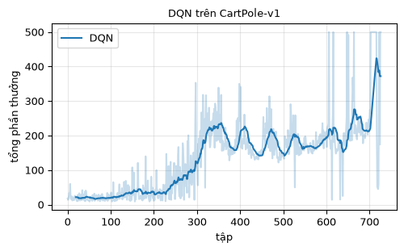
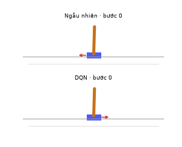
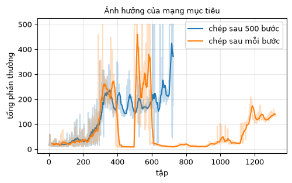

# Chương 6 · Code

> Ghi chú của người dịch: trang này do người dịch biên soạn, không có trong sách gốc. Code DQN lấy từ [MinRL](https://github.com/10-OASIS-01/minrl/tree/ed5eb99) (Yibin Liu, giấy phép MIT, commit `ed5eb99`), chú thích đã dịch sang tiếng Việt. Notebook DQN của bản gốc EasyRL được liệt kê ở mục 5.
>
> Ký hiệu: trang này giữ ký hiệu của [chương 6](chapter6/chapter6_vi): $Q$ là mạng Q, $\hat Q$ là mạng mục tiêu, mục tiêu hồi quy là $y = r + \gamma \max_a \hat Q(s', a)$.

Mỗi khối code đã được chạy sẵn trên CPU. Kết quả, hình vẽ và ảnh động nằm ngay bên dưới. Các khối chạy lần lượt từ trên xuống và dùng chung biến, như các ô của một notebook. Muốn tự chạy, xem [mục 6](#_6-chạy-trên-máy).

## 1. Môi trường CartPole

<small class="viz-ref">Mục 6.6 · dự án 2</small>

Xe đẩy chạy trên ray, trên xe có một cây gậy dựng đứng. Quan sát là 4 số thực: vị trí xe, vận tốc xe, góc gậy và vận tốc góc. Có 2 hành động: đẩy trái (0) hoặc đẩy phải (1). Mỗi bước gậy chưa đổ được $+1$. Tập kết thúc khi gậy nghiêng quá 12° hoặc xe chạy ra ngoài ray, và bị cắt ở bước 500 (`CartPole-v1`). Vì vậy tổng phần thưởng tối đa là 500.

Trạng thái là vector liên tục, không thể lập bảng Q như chương 3. Ta cần một mạng nơ-ron $Q(s, \cdot)$ nhận 4 số và trả ra 2 giá trị, mỗi hành động một giá trị.

<!-- run -->
```python
import numpy as np
import torch
import gymnasium as gym
import matplotlib.pyplot as plt
from minrl_vi.common import seed_everything

torch.set_num_threads(1)
env = gym.make("CartPole-v1")
print("Không gian quan sát:", env.observation_space)
print("Không gian hành động:", env.action_space)

# Chính sách ngẫu nhiên làm mốc so sánh
rng = np.random.default_rng(0)
lengths = []
for i in range(100):
    obs, _ = env.reset(seed=i)
    for t in range(500):
        obs, r, terminated, truncated, _ = env.step(int(rng.integers(2)))
        if terminated or truncated:
            break
    lengths.append(t + 1)
print(f"Chính sách ngẫu nhiên: trung bình {np.mean(lengths):.1f} bước mỗi tập (tối đa 500)")
```

<!-- output -->
```output
Không gian quan sát: Box([-4.8               -inf -0.41887903        -inf], [4.8               inf 0.41887903        inf], (4,), float32)
Không gian hành động: Discrete(2)
Chính sách ngẫu nhiên: trung bình 23.7 bước mỗi tập (tối đa 500)
```
<!-- /output -->

## 2. Ba thành phần của DQN trong MinRL

<small class="viz-ref">Mục 6.3–6.6 · hình 6.14</small>

`DQNAgent` của MinRL dùng đủ ba ý của chương:

| Ý trong chương | Trong code |
|---|---|
| Mạng Q xấp xỉ hàm giá trị hành động (mục 6.2) | `self.q_network = mlp(4, 2, 64, nn.ReLU)`: hai tầng ẩn 64 nơ-ron |
| Khám phá $\varepsilon$-tham lam (mục 6.4) | `select_action`: $\varepsilon$ giảm tuyến tính từ 1 xuống 0.05 trong 20 000 bước đầu |
| Bộ đệm phát lại kinh nghiệm (mục 6.5) | `ReplayBuffer`: lưu 50 000 bước chuyển, mỗi lần học lấy ngẫu nhiên một lô 64 mẫu |
| Mạng mục tiêu $\hat Q$ (mục 6.3) | `self.target_network`, chép từ mạng Q sau mỗi `target_update_freq = 500` bước |
| Mục tiêu $y = r + \gamma \max_a \hat Q(s', a)$ | `target = rewards + gamma * (~terminated) * next_q.max(dim=1).values` |
| Hồi quy $Q(s,a)$ về $y$ | `loss = (weights * td_error.square()).mean()` |

Hàm `train_step`, một lần cập nhật mạng Q (bấm để mở):

[deep_q_learning.py](../code/py/minrl_vi/deep_q_learning.py ':include :type=code :fragment=train_step')

Vòng lặp `train`, đúng thứ tự của hình 6.14: chọn hành động, lưu bước chuyển, lấy lô để học, định kỳ chép sang mạng mục tiêu:

[deep_q_learning.py](../code/py/minrl_vi/deep_q_learning.py ':include :type=code :fragment=train')

Một chi tiết hay bị bỏ qua: khi tập bị **cắt** ở bước 500 (`truncated`), gậy vẫn chưa đổ, nên trạng thái cuối vẫn có giá trị tương lai. Mục tiêu khi đó vẫn cộng $\gamma \max_a \hat Q(s', a)$. Chỉ khi tập **kết thúc thật** (`terminated`, gậy đổ) thì $y = r$.

## 3. Huấn luyện

Dùng đúng cấu hình `configs/cartpole_dqn.yaml` của MinRL, 100 000 bước tương tác:

<!-- run -->
```python
from minrl_vi.deep_q_learning import DQNAgent
from viz import plot_returns

seed_everything(0)
agent = DQNAgent(gym.make("CartPole-v1"), seed=0)       # tham số mặc định = cấu hình của MinRL
history = agent.train(total_timesteps=100_000, seed=0)
returns = [h["episode_return"] for h in history]

def evaluate(act, n=20):
    """Tổng phần thưởng trung bình của n tập, chỉ khai thác (không khám phá)."""
    env_eval, totals = gym.make("CartPole-v1"), []
    for i in range(n):
        obs, _ = env_eval.reset(seed=1000 + i)
        total = 0.0
        while True:
            obs, r, terminated, truncated, _ = env_eval.step(act(obs))
            total += r
            if terminated or truncated:
                break
        totals.append(total)
    return np.mean(totals)

dqn_act = lambda obs: agent.select_action(obs, deterministic=True)
print(f"Số tập huấn luyện: {len(returns)}")
print(f"Đánh giá 20 tập (ε = 0): {evaluate(dqn_act):.1f} / 500")
plot_returns({"DQN": returns}, title="DQN trên CartPole-v1")
```

<!-- output -->
```output
Số tập huấn luyện: 727
Đánh giá 20 tập (ε = 0): 500.0 / 500
```

<div align=center></div>
<!-- /output -->

Đường cong học của DQN thường không đi lên đều. Nó có thể đạt 500 rồi tụt xuống, rồi lại lên. Đây là hiện tượng quen thuộc với DQN: chính sách tham lam thay đổi đột ngột khi thứ tự giữa hai giá trị $Q(s, 0)$ và $Q(s, 1)$ bị đảo, dù các giá trị chỉ thay đổi rất ít.

Ảnh động dưới so sánh chính sách ngẫu nhiên với chính sách tham lam theo mạng Q vừa học, trên cùng một trạng thái ban đầu. Mũi tên đỏ là hướng đẩy ở mỗi bước.

<!-- run -->
```python
from viz import cartpole_gif

rand_rng = np.random.default_rng(1)
cartpole_gif({"Ngẫu nhiên": lambda obs: int(rand_rng.integers(2)), "DQN": dqn_act},
             "cartpole_dqn.gif", seed=7)
```

<!-- output -->
<div align=center></div>
<!-- /output -->

## 4. Bỏ mạng mục tiêu thì sao?

<small class="viz-ref">Mục 6.3</small>

Đặt `target_update_freq=1` nghĩa là chép mạng Q sang mạng mục tiêu sau **mỗi** bước, tức là coi như không có mạng mục tiêu. Mục tiêu $y$ khi đó thay đổi ngay khi $Q$ vừa được cập nhật, giống như đuổi theo một cái đích đang chạy.

<!-- run -->
```python
seed_everything(0)
agent_no_target = DQNAgent(gym.make("CartPole-v1"), seed=0, target_update_freq=1)
returns_no_target = [h["episode_return"] for h in agent_no_target.train(100_000, seed=0)]
print(f"Đánh giá 20 tập, không có mạng mục tiêu: "
      f"{evaluate(lambda o: agent_no_target.select_action(o, deterministic=True)):.1f} / 500")

plot_returns({"chép sau 500 bước": returns, "chép sau mỗi bước": returns_no_target},
             title="Ảnh hưởng của mạng mục tiêu")
```

<!-- output -->
```output
Đánh giá 20 tập, không có mạng mục tiêu: 153.2 / 500
```

<div align=center></div>
<!-- /output -->

Không có mạng mục tiêu, tác tử cũng chạm được mức 500 vài lần, nhưng rồi sụp hẳn: có cả một đoạn dài mỗi tập chỉ trụ được khoảng 10 bước, rồi mới học lại từ đầu. Hai đường cùng dùng 100 000 bước tương tác. Đường màu cam có nhiều tập hơn vì các tập của nó ngắn hơn. Tất nhiên, một lần chạy với một hạt giống chưa đủ để kết luận chắc chắn. MinRL có công cụ chạy nhiều hạt giống (`minrl benchmark`) cho việc đó. Nhưng hình trên đủ để thấy vai trò của mạng mục tiêu là làm cho mục tiêu hồi quy đứng yên trong một khoảng thời gian.

## 5. Notebook của EasyRL

| Notebook | Nội dung | Mở |
|---|---|---|
| `DQN_vi.ipynb` | DQN trên CartPole-v0, viết bằng PyTorch theo khung chung của EasyRL | [GitHub](https://github.com/nmc2004nd/easy-rl-vi/blob/main/notebooks/DQN_vi.ipynb) · [Colab](https://colab.research.google.com/github/nmc2004nd/easy-rl-vi/blob/main/notebooks/DQN_vi.ipynb) |

Dự án 2 của chương 7 ([Dùng DQN giải CartPole-v0](chapter7/project2_vi)) đi qua cùng bài toán theo từng bước.

## 6. Chạy trên máy

```bash
git clone https://github.com/nmc2004nd/easy-rl-vi.git
cd easy-rl-vi/docs/code/py          # chạy từ đây để import được minrl_vi, viz
pip install numpy matplotlib pillow gymnasium torch
```

Chép lần lượt các khối code trên trang vào Jupyter (hoặc một file `.py`) rồi chạy theo thứ tự. Mỗi lần huấn luyện 100 000 bước mất khoảng 40 giây trên một nhân CPU. Kết quả trên trang được dựng bằng `python3 scripts/build_code_pages.py docs/chapter6/chapter6_code_vi.md`.
