# Chương 6 Mạng Q sâu
Các thuật toán học tăng cường truyền thống dùng dạng bảng để lưu hàm giá trị trạng thái $V(s)$ hoặc hàm giá trị hành động $Q(s,a)$, nhưng cách làm này có hạn chế rất lớn. Ví dụ, không gian trạng thái mà các nhiệm vụ học tăng cường trong thực tế phải đối mặt thường là liên tục, có vô số trạng thái, trong trường hợp này không thể dùng bảng để lưu hàm giá trị nữa. Xấp xỉ hàm giá trị dùng một hàm để khớp (fit) trực tiếp hàm giá trị trạng thái hoặc hàm giá trị hành động, giảm yêu cầu về không gian lưu trữ, giải quyết hiệu quả vấn đề này.

Để tính hàm giá trị $Q_{\pi}(s,a)$ trong không gian trạng thái và hành động liên tục, ta có thể dùng một hàm $Q_{\phi}(\boldsymbol{s},\boldsymbol{a})$ để biểu diễn phép tính xấp xỉ, gọi là **xấp xỉ hàm giá trị (value function approximation)**.
$$
    Q_{\phi}(\boldsymbol{s}, \boldsymbol{a}) \approx Q_{\pi}(\boldsymbol{s}, \boldsymbol{a})
$$
Trong đó, $\boldsymbol{s}$, $\boldsymbol{a}$ lần lượt là biểu diễn vectơ của trạng thái $s$ và hành động $a$, hàm $Q_{\phi}(\boldsymbol{s}, \boldsymbol{a})$ thường là một hàm có tham số $\phi$, ví dụ mạng nơ-ron, đầu ra của nó là một số thực, được gọi là **mạng Q (Q-network)**.

Mạng Q sâu (deep Q-network, DQN) là thuật toán Q-learning dựa trên học sâu, chủ yếu kết hợp xấp xỉ hàm giá trị với kỹ thuật mạng nơ-ron, và dùng mạng mục tiêu cùng phát lại kinh nghiệm để huấn luyện mạng. Trong Q-learning, ta dùng bảng để lưu phần thưởng nhận được khi thực hiện hành động $a$ ở mỗi trạng thái $s$, tức hàm giá trị trạng thái-hành động $Q(s,a)$. Tuy nhiên, cách làm này trong các nhiệm vụ có số trạng thái cực lớn thậm chí là liên tục sẽ gặp vấn đề lời nguyền số chiều (curse of dimensionality), thường là không khả thi. Do đó, mạng Q sâu dùng cách biểu diễn xấp xỉ hàm giá trị.

## 6.1 Hàm giá trị trạng thái

Mạng Q sâu là thuật toán dựa trên giá trị (value-based), trong các thuật toán dựa trên giá trị, thứ ta học không phải là chính sách, mà là **nhà phê bình (critic)**. Nhiệm vụ của nhà phê bình là đánh giá hành động hiện tại tốt hay không tốt đến mức nào. Giả sử có một diễn viên (actor), nó cần học một chính sách để có lợi tức càng cao càng tốt. Nhà phê bình đánh giá chính sách $\pi$ của diễn viên tốt hay không tốt, tức là đánh giá chính sách (policy evaluation). Ví dụ, có một loại nhà phê bình gọi là **hàm giá trị trạng thái** $V_{\pi}$. Hàm giá trị trạng thái nghĩa là: giả sử chính sách của diễn viên là $\pi$, dùng $\pi$ tương tác với môi trường, giả sử $\pi$ nhìn thấy một trạng thái $s$ nào đó, ví dụ khi chơi game Atari, trạng thái $s$ là một khung hình nào đó, $\pi$ nhìn thấy một khung hình nào đó, tiếp theo cho đến khi trò chơi kết thúc, phần thưởng tích lũy kỳ vọng là bao nhiêu. Như hình 6.1a, $V_{\pi}$ là một hàm, đưa vào một trạng thái, nó sẽ đưa ra một số vô hướng (scalar). Số vô hướng này đại diện cho việc khi chính sách $\pi$ của diễn viên nhìn thấy trạng thái $s$, dự kiến đến khi trò chơi kết thúc, nó có thể nhận được bao nhiêu phần thưởng. Ví dụ, giả sử ta đang chơi Space Invaders (Kẻ xâm lược không gian), với trạng thái $s$ như hình 6.1b, khung hình trò chơi này, $V_{\pi}(s)$ có thể rất lớn, vì lúc này còn rất nhiều quái vật có thể tiêu diệt, nên ta sẽ được điểm rất cao. Cho đến khi trò chơi kết thúc, ta vẫn còn nhiều điểm có thể nhận được. Trong trường hợp như hình 6.1c, $V_{\pi}(s)$ ta nhận được có thể rất nhỏ, vì số quái vật còn lại không nhiều, và tấm khiên bảo vệ màu đỏ đã biến mất, nên có thể ta sẽ "chết" rất nhanh. Do đó phần thưởng dự kiến nhận được tiếp theo sẽ không lớn.

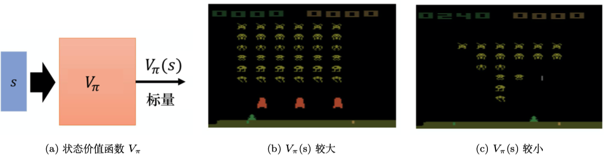

Hình 6.1 Chơi Space Invaders

Ở đây cần nhấn mạnh, nhà phê bình không thể đánh giá một trạng thái tốt hay xấu một cách vô căn cứ, thứ nó đánh giá là khi cho trước một trạng thái nào đó, nếu chính sách của diễn viên tương tác tiếp theo là $\pi$, ta sẽ nhận được bao nhiêu phần thưởng, phần thưởng này chính là giá trị ta đánh giá ra. Vì dù là cùng một trạng thái, $\pi$ tiếp theo khác nhau thì phần thưởng nhận được cũng khác nhau. Ví dụ, trong trường hợp bên trái, giả sử là một $\pi$ bình thường, nó có thể tiêu diệt rất nhiều quái vật; giả sử nó là một $\pi$ rất yếu, nó đứng yên tại chỗ, lập tức bị bắn chết, thì $V_\pi(s)$ ta nhận được vẫn rất nhỏ. Vì vậy giá trị đầu ra của nhà phê bình phụ thuộc vào trạng thái và diễn viên. Nhà phê bình thực ra luôn phải gắn với một diễn viên, nó đo lường một diễn viên nào đó tốt hay xấu, chứ không phải đo lường một trạng thái tốt hay xấu. Ở đây cần nhấn mạnh, đầu ra của nhà phê bình có liên quan đến diễn viên, giá trị của trạng thái thực ra phụ thuộc vào diễn viên, khi diễn viên thay đổi, đầu ra của hàm giá trị trạng thái thực ra cũng sẽ thay đổi theo.

Đo lường hàm giá trị trạng thái $V_{\pi}(s)$ như thế nào? Có hai phương pháp khác nhau: phương pháp dựa trên Monte Carlo và phương pháp dựa trên sai phân thời gian. Phương pháp dựa trên Monte Carlo là cho diễn viên tương tác với môi trường, ta muốn xem diễn viên tốt hay không thì cho diễn viên tương tác với môi trường, để nhà phê bình đánh giá. Nhà phê bình sẽ thống kê: nếu diễn viên nhìn thấy trạng thái $s_a$, phần thưởng tích lũy tiếp theo là bao nhiêu; nếu nó nhìn thấy trạng thái $s_b$, phần thưởng tích lũy tiếp theo là bao nhiêu. Nhưng thực tế, ta không thể nhìn thấy tất cả các trạng thái. Nếu ta chơi game Atari, trạng thái là hình ảnh, thì không thể nhìn thấy tất cả các trạng thái. Vì vậy thực tế $V_{\pi}(s)$ là một mạng. Với một mạng, dù trạng thái đầu vào chưa từng thấy bao giờ, nó cũng có thể tìm cách ước lượng một giá trị. Huấn luyện mạng này như thế nào? Như hình 6.2, nếu ở trạng thái $s_a$, phần thưởng tích lũy tiếp theo là $G_a$. Tức là với hàm giá trị này, nếu đầu vào là trạng thái $s_a$, đầu ra đúng phải là $G_a$; nếu trạng thái đầu vào là $s_b$, đầu ra đúng phải là $G_b$. Vì vậy khi huấn luyện, nó chính là một bài toán hồi quy (regression problem). Đầu ra của mạng là một giá trị, ta mong khi đầu vào là $s_a$, giá trị đầu ra càng gần $G_a$ càng tốt; khi đầu vào là $s_b$, giá trị đầu ra càng gần $G_b$ càng tốt. Tiếp theo tiếp tục huấn luyện mạng, đây là phương pháp dựa trên Monte Carlo.

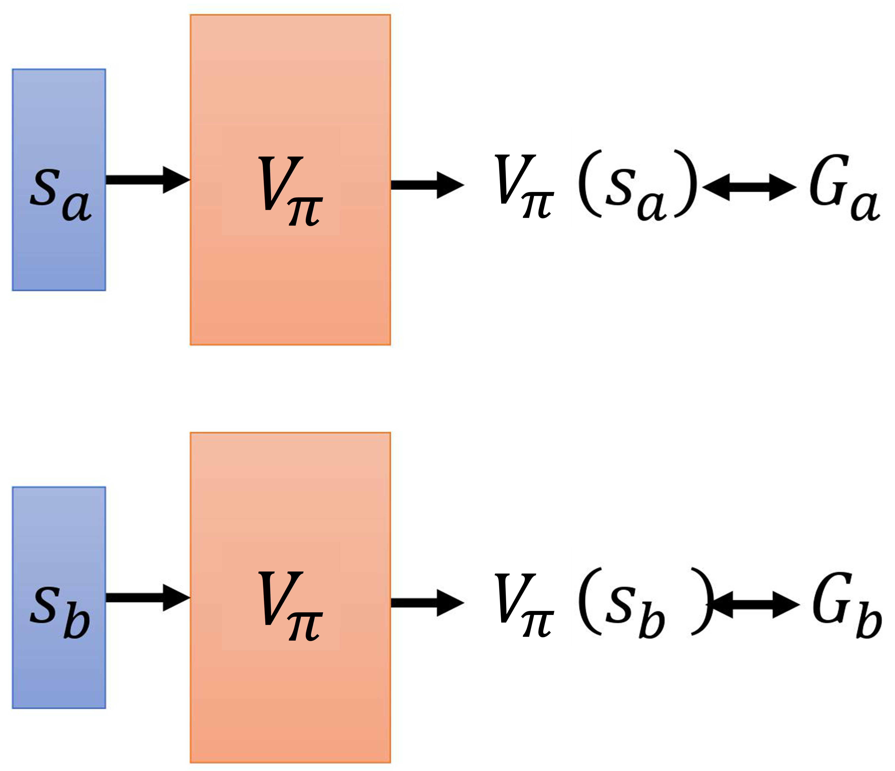

Hình 6.2 Phương pháp dựa trên Monte Carlo

Phương pháp thứ hai là phương pháp **sai phân thời gian**, tức phương pháp dựa trên sai phân thời gian. Trong phương pháp dựa trên Monte Carlo, mỗi lần ta đều phải tính phần thưởng tích lũy, tức là tổng tất cả phần thưởng nhận được từ một trạng thái $s_a$ nào đó cho đến khi trò chơi kết thúc. Nếu ta muốn dùng phương pháp dựa trên Monte Carlo, ta phải chơi ít nhất đến khi trò chơi kết thúc. Nhưng có những trò chơi kéo dài rất lâu, ta phải chơi đến khi trò chơi kết thúc mới cập nhật được mạng, như vậy tốn quá nhiều thời gian, vì vậy ta dùng phương pháp dựa trên sai phân thời gian. Phương pháp dựa trên sai phân thời gian không cần chơi đến khi trò chơi kết thúc, chỉ cần ở một trạng thái $s_t$ nào đó của trò chơi, thực hiện hành động $a_t$ nhận phần thưởng $r_t$, tiếp theo đi vào trạng thái $s_{t+1}$, là có thể dùng phương pháp sai phân thời gian. Ta có thể dùng phương pháp sai phân thời gian theo biểu thức (6.1).
$$
    V_{\pi}\left(s_{t}\right)=V_{\pi}\left(s_{t+1}\right)+r_{t} \tag{6.1}
$$

Giả sử hiện tại ta dùng một chính sách $\pi$ nào đó, ở trạng thái $s_t$, nó sẽ thực hiện hành động $a_t$, nhận phần thưởng $r_t$, tiếp theo đi vào $s_{t+1}$. Giá trị của trạng thái $s_{t+1}$ và giá trị của trạng thái $s_t$ chênh nhau một số hạng $r_t$, đó là vì ta lấy giá trị của $s_{t+1}$ cộng với phần thưởng nhận được $r_t$ là có giá trị của $s_t$. Với biểu thức (6.1), khi huấn luyện, ta không ước lượng trực tiếp $V_{\pi}$, mà mong kết quả $V_{\pi}$ thu được thỏa mãn biểu thức (6.1). Ta huấn luyện như sau, như hình 6.3, ta đưa $s_t$ vào mạng, vì đưa $s_t$ vào mạng sẽ được $V_{\pi}(s_t)$, đưa $s_{t+1}$ vào mạng sẽ được $V_{\pi}(s_{t+1})$, giá trị $V_{\pi}(s_t)$ trừ $V_{\pi}(s_{t+1})$ phải là $r_t$. Ta mong hiệu số của chúng càng gần $r_t$ càng tốt, huấn luyện tiếp, cập nhật tham số của $V_{\pi}$, ta có thể học được hàm $V_{\pi}$.

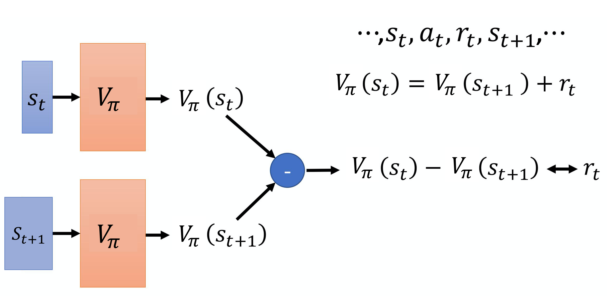

Hình 6.3 Phương pháp dựa trên sai phân thời gian

Phương pháp Monte Carlo và phương pháp sai phân thời gian khác nhau thế nào? Như hình 6.4, vấn đề lớn nhất của phương pháp Monte Carlo là phương sai rất lớn. Vì khi ta chơi game, bản thân trò chơi có tính ngẫu nhiên, nên ta có thể xem $G_a$ là một biến ngẫu nhiên. Vì mỗi lần ta đến $s_a$, $G_a$ cuối cùng nhận được thực ra là khác nhau. Ta nhìn thấy cùng một trạng thái $s_a$, cuối cùng đến khi trò chơi kết thúc, vì bản thân trò chơi có tính ngẫu nhiên, mô hình chơi game cũng có thể có tính ngẫu nhiên, nên $G_a$ ta nhận được mỗi lần là khác nhau, sự khác biệt giữa các lần $G_a$ thực ra sẽ rất lớn. Tại sao lại rất lớn? Vì $G_a$ là tổng phần thưởng của rất nhiều bước khác nhau. Giả sử mỗi bước ta đều nhận một phần thưởng, $G_a$ là tổng phần thưởng của từng bước bắt đầu từ trạng thái $s_a$ cho đến khi trò chơi kết thúc.

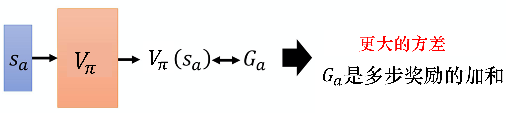

Hình 6.4 Vấn đề của phương pháp Monte Carlo

Qua biểu thức (6.2), ta biết phương sai của $G_a$ so với phần thưởng của một trạng thái nào đó là khá lớn.
$$
    \operatorname{Var}[k X]=k^{2} \operatorname{Var}[X] \tag{6.2}
$$
Trong đó, Var là phương sai (variance).

Nếu dùng phương pháp sai phân thời gian, ta cần tối thiểu hóa
$$
    V_{\pi}\left(s_{t}\right) \longleftrightarrow r+V_{\pi}\left(s_{t+1}\right) \tag{6.3}
$$

Trong đó, $r$ có tính ngẫu nhiên. Vì dù ta thực hiện cùng một hành động ở $s_t$, phần thưởng nhận được cũng chưa chắc giống nhau, nên $r$ là một biến ngẫu nhiên. Nhưng phương sai của $r$ nhỏ hơn $G_a$, vì $G_a$ là tổng của rất nhiều $r$, sai phân thời gian chỉ là một $r$ nào đó mà thôi. Phương sai của $G_a$ sẽ khá lớn, phương sai của $r$ sẽ khá nhỏ. Nhưng ở đây ta sẽ gặp một vấn đề là ước lượng $V_{\pi}$ chưa chắc chính xác. Giả sử ước lượng $V_{\pi}$ không chính xác, kết quả học được bằng biểu thức (6.3) cũng sẽ không chính xác. Vì vậy phương pháp Monte Carlo và phương pháp sai phân thời gian mỗi bên đều có ưu nhược điểm. Thực ra phương pháp sai phân thời gian được dùng khá phổ biến, phương pháp Monte Carlo thực ra ít được dùng hơn.

Hình 6.5 là khác biệt giữa phương pháp sai phân thời gian và phương pháp Monte Carlo. Giả sử có một nhà phê bình nào đó, nó quan sát kết quả của một chính sách $\pi$ nào đó tương tác với môi trường trong 8 tập. Có một chính sách $\pi$ tương tác với môi trường 8 lần, được 8 kết quả chơi game. Tiếp theo nhà phê bình này ước lượng giá trị của các trạng thái.

Trước tiên ta tính giá trị của $s_b$. Trạng thái $s_b$ đều xuất hiện trong cả 8 ván, trong đó có 6 ván nhận phần thưởng 1, có 2 ván nhận phần thưởng 0. Vì vậy nếu ta muốn tính giá trị kỳ vọng, chỉ tính phần thưởng nhận được sau khi tác tử nhìn thấy trạng thái $s_b$. Giá trị kỳ vọng của phần thưởng tích lũy mà tác tử nhận được khi chơi đến khi trò chơi kết thúc là 3/4, quá trình tính là
$$
    \frac{6 \times 1 + 2 \times 0}{8}=\frac{6}{8}=\frac{3}{4}
$$

Nhưng phần thưởng kỳ vọng của $s_a$ rốt cuộc nên là bao nhiêu? Ở đây thực ra có hai đáp án có thể: 0 và 3/4. Tại sao có hai đáp án có thể? Điều này phụ thuộc vào việc ta dùng phương pháp Monte Carlo hay phương pháp sai phân thời gian. Kết quả tính bằng phương pháp Monte Carlo và bằng phương pháp sai phân thời gian là khác nhau.

Nếu ta dùng phương pháp Monte Carlo, $s_a$ chỉ xuất hiện một lần, nhìn thấy trạng thái $s_a$, phần thưởng tích lũy tiếp theo là 0, nên phần thưởng kỳ vọng của $s_a$ là 0. Nhưng phương pháp sai phân thời gian khi tính cần cập nhật
$$
    V_{\pi}\left(s_{a}\right)=V_{\pi}\left(s_{b}\right)+r
$$
Vì sau khi ta nhận phần thưởng $r=0$ ở trạng thái $s_a$, ta đi vào trạng thái $s_b$, nên phần thưởng của trạng thái $s_a$ bằng phần thưởng của trạng thái $s_b$ cộng với phần thưởng $r$ có thể nhận được khi đi từ trạng thái $s_a$ vào trạng thái $s_b$. Mà giá trị phần thưởng $r$ nhận được là 0, phần thưởng kỳ vọng của $s_b$ là 3/4, nên phần thưởng của $s_a$ phải là 3/4.

Kết quả ước lượng bằng phương pháp Monte Carlo và phương pháp sai phân thời gian rất có thể khác nhau. Dù nhà phê bình quan sát cùng một dữ liệu huấn luyện, kết quả ước lượng cuối cùng của nó cũng chưa chắc giống nhau. Tại sao lại như vậy? Kết quả nào đúng hơn? Thực ra đều đúng. Vì trong quỹ đạo thứ nhất, $s_a$ nhận phần thưởng 0 rồi đi vào $s_b$ cũng nhận phần thưởng 0. Ở đây có hai khả năng.

(1) $s_a$ là một trạng thái mang tính dấu hiệu, chỉ cần nhìn thấy $s_a$ thì sau đó $s_b$ sẽ không nhận được phần thưởng, $s_a$ có thể đã ảnh hưởng đến $s_b$. Nếu dùng phương pháp Monte Carlo, nó sẽ xét đến việc $s_a$ ảnh hưởng đến $s_b$. Vì vậy sau khi nhìn thấy $s_a$, tiếp theo $s_b$ không nhận được phần thưởng, phần thưởng kỳ vọng của $s_b$ là 0.

(2) Sau khi nhìn thấy $s_a$, việc phần thưởng của $s_b$ là 0 chỉ là trùng hợp, không phải do $s_a$ gây ra, mà vì $s_b$ đôi khi vẫn nhận phần thưởng 0, đây chỉ đơn thuần là vấn đề "may mắn". Thực ra bình thường phần thưởng kỳ vọng mà $s_b$ nhận được là 3/4, hoàn toàn không liên quan đến $s_a$. Vì vậy giả sử sau $s_a$ sẽ đi vào $s_b$, phần thưởng nhận được tính theo phương pháp sai phân thời gian phải là 3/4.

Các phương pháp khác nhau xét các giả định khác nhau, nên kết quả tính khác nhau.

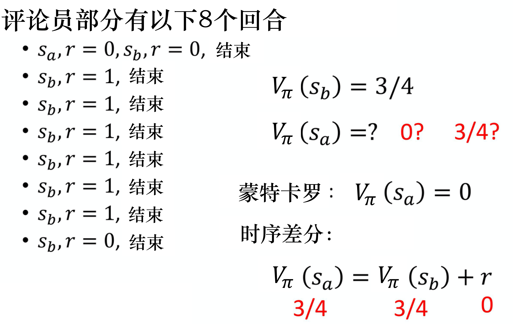

Hình 6.5 Khác biệt giữa phương pháp sai phân thời gian và phương pháp Monte Carlo

## 6.2 Hàm giá trị hành động

Còn một loại nhà phê bình khác gọi là **hàm Q**, nó còn được gọi là hàm giá trị hành động (action-value function). Đầu vào của hàm giá trị trạng thái là một trạng thái, nó dựa vào trạng thái để tính phần thưởng tích lũy kỳ vọng (expected accumulated reward) sau trạng thái này là bao nhiêu. Đầu vào của hàm giá trị hành động là một cặp trạng thái-hành động, nó chỉ việc ở một trạng thái nào đó thực hiện một hành động nào đó, giả sử về sau ta đều dùng chính sách $\pi$, giá trị kỳ vọng của phần thưởng tích lũy nhận được là bao nhiêu.

Hàm Q có một vấn đề cần chú ý là: khi chính sách $\pi$ nhìn thấy trạng thái $s$, hành động nó thực hiện chưa chắc là $a$. Hàm Q giả định ở trạng thái $s$ bắt buộc thực hiện hành động $a$, bất kể chính sách $\pi$ ta đang xét có thực hiện hành động $a$ hay không, điều đó không quan trọng. Ở trạng thái $s$ bắt buộc thực hiện hành động $a$. Tiếp theo đều dùng chính sách $\pi$ chơi tiếp, chỉ ở trạng thái $s$ ta mới bắt buộc phải thực hiện hành động $a$, tiếp theo chuyển sang chế độ tự động, để chính sách $\pi$ chơi tiếp, phần thưởng kỳ vọng nhận được mới là $Q_{\pi}(s,a)$.

Hàm Q có hai cách viết:

(1) Như hình 6.6a, đầu vào là trạng thái và hành động, đầu ra là một số vô hướng. Loại hàm Q này phù hợp với cả hành động liên tục (hành động không thể vét cạn) lẫn hành động rời rạc.

(2) Như hình 6.6b, đầu vào là một trạng thái, đầu ra là nhiều giá trị. Loại hàm Q này chỉ phù hợp với hành động rời rạc. Giả sử hành động là rời rạc, ví dụ hành động chỉ có 3 khả năng: sang trái, sang phải hoặc bắn. 3 giá trị hàm Q đưa ra lần lượt đại diện cho giá trị Q khi $a$ là sang trái, giá trị Q khi $a$ là sang phải, và giá trị Q khi $a$ là bắn.

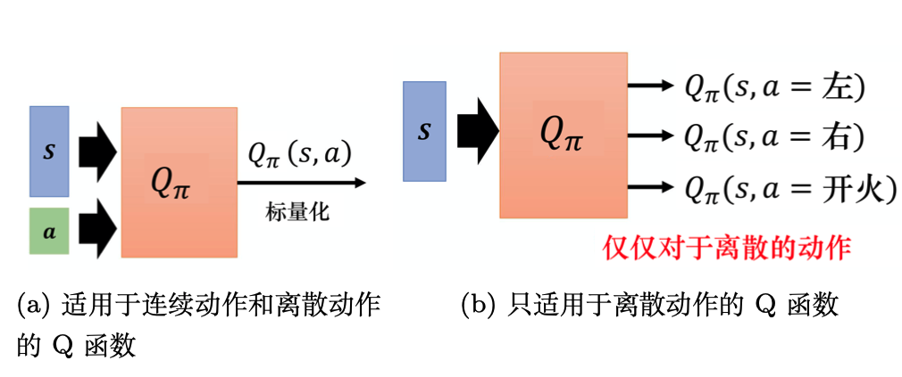

Hình 6.6 Hàm Q

Nếu ta ước lượng hàm Q, kết quả thấy được có thể như hình 6.7. Giả sử ta có 3 hành động: đứng yên, đi lên, đi xuống. Giả sử ở trạng thái thứ nhất, bất kể thực hiện hành động nào, đến khi trò chơi kết thúc, phần thưởng kỳ vọng nhận được đều gần như nhau. Vì khi quả bóng bàn ở vị trí này, dù ta đi xuống, tiếp theo ta vẫn có thể đỡ được bóng, nên bất kể thực hiện hành động nào cũng không chênh lệch quá nhiều. Giả sử ở trạng thái thứ hai, quả bóng bàn đã bật đến vị trí rất gần mép, lúc này ta phải thực hiện hành động đi lên mới đỡ được bóng, mới nhận được phần thưởng dương. Nếu ta đứng yên hoặc đi xuống, tiếp theo đều sẽ bỏ lỡ quả bóng này, phần thưởng nhận được sẽ âm. Giả sử ở trạng thái thứ ba, quả bóng bàn đã rất gần vợt của ta, nên phải thực hiện hành động đi lên. Giả sử ở trạng thái thứ tư, quả bóng bàn đã bị đánh trả lại, lúc này thực hiện hành động nào cũng gần như nhau. Đây là ví dụ về hàm giá trị hành động.

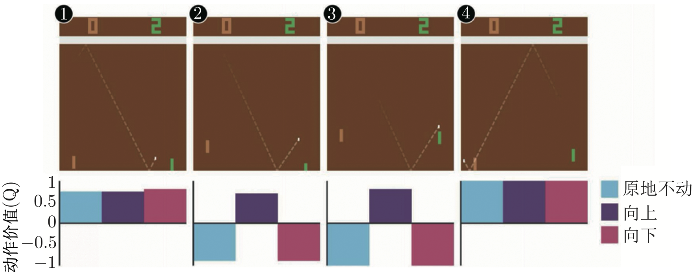

Hình 6.7 Ví dụ bóng bàn

Tuy hàm Q ta học chỉ có thể dùng để đánh giá một chính sách $\pi$ nào đó tốt hay xấu, nhưng chỉ cần có hàm Q, ta có thể làm học tăng cường, có thể quyết định nên thực hiện hành động nào, có thể cải thiện chính sách (policy improvement). Như hình 6.8, giả sử ta có một diễn viên ban đầu, có thể lúc đầu rất kém, ngẫu nhiên cũng không sao. Diễn viên ban đầu được gọi là $\pi$, $\pi$ tương tác với môi trường sẽ thu thập dữ liệu. Tiếp theo ta học giá trị Q của chính sách $\pi$, đo lường việc $\pi$ ở một trạng thái nào đó bắt buộc thực hiện một hành động nào đó thì tiếp theo sẽ nhận được phần thưởng kỳ vọng bao nhiêu, dùng phương pháp sai phân thời gian hay Monte Carlo đều được. Sau khi học được một hàm Q, ta có thể tìm ra một chính sách mới $\pi'$, chính sách $\pi'$ sẽ tốt hơn chính sách ban đầu $\pi$ (lát nữa sẽ định nghĩa thế nào là tốt). Vì vậy giả sử ta có một hàm Q và một chính sách $\pi$ nào đó, dựa vào chính sách $\pi$ học được hàm Q của chính sách $\pi$, tiếp theo có thể tìm ra một chính sách mới $\pi'$, nó sẽ tốt hơn $\pi$. Ta dùng $\pi'$ thay cho $\pi$, rồi học hàm Q của nó, có hàm Q mới rồi lại đi tìm một chính sách tốt hơn. Cứ lặp như vậy, chính sách sẽ ngày càng tốt.

Trước tiên cần định nghĩa thế nào là tốt. $\pi'$ chắc chắn sẽ tốt hơn $\pi$, tốt là gì? Tốt ở đây nghĩa là với mọi trạng thái $s$ có thể có, $V_{\pi^{\prime}}(s) \geqslant V_{\pi}(s)$. Tức là khi ta đến cùng một trạng thái $s$, nếu dùng $\pi$ tiếp tục tương tác với môi trường, phần thưởng ta nhận được chắc chắn nhỏ hơn hoặc bằng phần thưởng nhận được khi dùng $\pi'$ tương tác với môi trường. Vì vậy bất kể ở trạng thái nào, ta dùng $\pi'$ tương tác với môi trường, phần thưởng kỳ vọng nhận được chắc chắn sẽ lớn hơn. Vì vậy $\pi'$ là chính sách tốt hơn $\pi$.

Có hàm Q rồi, ta gọi chính sách quyết định hành động theo biểu thức (6.4) là $\pi'$,
$$
    \pi^{\prime}(s)=\underset{a}{\arg \max} Q_{\pi}(s, a) \tag{6.4}
$$
$\pi'$ chắc chắn tốt hơn $\pi$. Giả sử ta đã học được hàm Q của $\pi$, ở một trạng thái $s$ nào đó, đưa lần lượt tất cả các hành động $a$ có thể có vào hàm Q, xem $a$ nào làm giá trị hàm Q lớn nhất, hành động đó chính là hành động mà $\pi'$ sẽ thực hiện.

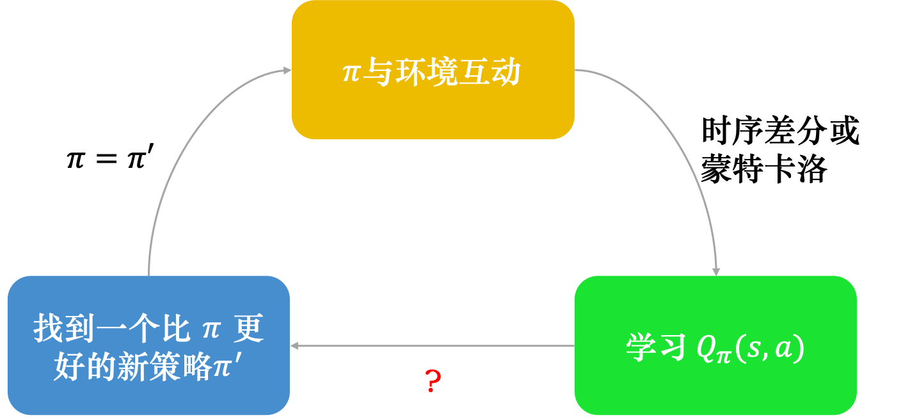

Hình 6.8 Dùng hàm Q để cải thiện chính sách

Ở đây cần chú ý, cho trước trạng thái $s$ và chính sách $\pi$ chưa chắc sẽ thực hiện hành động $a$. Cho trước một trạng thái $s$ nào đó bắt buộc thực hiện hành động $a$, dùng $\pi$ tiếp tục tương tác được phần thưởng kỳ vọng, đó mới là định nghĩa của hàm Q. Vì vậy ở trạng thái $s$ chưa chắc sẽ thực hiện hành động $a$. Hành động $\pi'$ thực hiện ở trạng thái $s$ và hành động $\pi$ thực hiện chưa chắc giống nhau, hành động $\pi'$ thực hiện sẽ giúp nó nhận được phần thưởng lớn hơn. Vì vậy $\pi'$ được suy ra từ hàm Q, không có một mạng nào khác quyết định $\pi'$ tương tác với môi trường thế nào, có hàm Q là tìm ra được $\pi'$. Nhưng ở đây cần giải quyết vấn đề của phép arg max: nếu $a$ là rời rạc, ví dụ $a$ chỉ có 3 lựa chọn, đưa từng hành động vào hàm Q, xem hành động nào có giá trị Q lớn nhất, điều này không có vấn đề gì. Nhưng nếu $a$ là liên tục, giải quyết vấn đề phép arg max là không khả thi.

Tiếp theo giải thích tại sao $\pi'$ được quyết định bởi $Q_{\pi}(s,a)$ chắc chắn sẽ tốt hơn $\pi$. Giả sử có một chính sách $\pi'$, nó được quyết định bởi $Q_{\pi}$. Ta cần chứng minh với mọi trạng thái $s$, có $V_{\pi^{\prime}}(s) \geqslant V_{\pi}(s)$.

Chứng minh thế nào? $V_{\pi}(s)$ có thể viết là
$$
    V_{\pi}(s)=Q_{\pi}(s, \pi(s))
$$

Giả sử ở trạng thái $s$ theo chính sách $\pi$, hành động sẽ thực hiện chính là $\pi(s)$, $Q_{\pi}(s, \pi(s))$ ta tính ra sẽ bằng $V_{\pi}(s)$. Nói chung, $Q_{\pi}(s, \pi(s))$ chưa chắc bằng $V_{\pi}(s)$, vì hành động chưa chắc là $\pi(s)$. Nhưng nếu hành động này là $\pi(s)$, $Q_{\pi}(s, \pi(s))$ bằng $V_{\pi}(s)$.

$Q_{\pi}(s, \pi(s))$ còn thỏa mãn quan hệ sau:
$$
    Q_{\pi}(s, \pi(s)) \leqslant \max _{a} Q_{\pi}(s, a)
$$

Vì $a$ là hành động làm hàm Q đạt giá trị lớn nhất trong tất cả các hành động, nên $Q_{\pi}(s, a)$ chắc chắn lớn hơn hoặc bằng $Q_{\pi}(s, \pi(s))$. $a$ trong $Q_{\pi}(s, a)$ chính là $\pi'(s)$, vì $a$ mà $\pi'(s)$ đưa ra có thể làm $Q_\pi(s,a)$ lớn nhất, nên ta có
$$
    \max _{a} Q_{\pi}(s, a)=Q_{\pi}\left(s, \pi^{\prime}(s)\right)
$$
Do đó
$$
V_{\pi}(s) \leqslant Q_{\pi}\left(s, \pi^{\prime}(s)\right)
$$
Tức là ở một trạng thái nào đó, nếu ta cứ thực hiện theo chính sách $\pi$, phần thưởng nhận được chắc chắn nhỏ hơn hoặc bằng phần thưởng nhận được khi ở trạng thái $s$ cố ý không đi theo hướng $\pi$ chỉ dẫn, mà đi một bước theo hướng của $\pi'$. Nhưng chỉ có bước đầu tiên đi theo hướng $\pi'$, chỉ ở trạng thái $s$ mới đi theo chỉ dẫn của $\pi'$, tiếp theo ta đi theo chỉ dẫn của $\pi$. Tuy chỉ khác nhau một bước, nhưng phần thưởng ta nhận được chắc chắn sẽ lớn hơn phần thưởng nhận được khi hoàn toàn đi theo $\pi$.

Tiếp theo cần chứng minh
$$
    Q_{\pi}\left(s, \pi^{\prime}(s) \right) \leqslant V_{\pi'}(s)
$$

Tức là chỉ khác nhau một bước, ta sẽ nhận được phần thưởng lớn hơn. Nhưng giả sử mỗi bước đều khác, mỗi bước đều theo $\pi'$ chứ không theo $\pi$, phần thưởng nhận được chắc chắn sẽ lớn hơn nữa, tức $Q_{\pi}\left(s, \pi^{\prime}(s)\right)$ nghĩa là ta ở trạng thái $s_t$ thực hiện hành động $a_t$, nhận phần thưởng $r_{t}$, đi vào trạng thái $s_{t+1}$, tức là

$$
    Q_{\pi}\left(s, \pi^{\prime}(s)\right)=\mathbb{E}\left[r_t+V_{\pi}\left(s_{t+1}\right) \mid s_{t}=s, a_{t}=\pi^{\prime}\left(s_{t}\right)\right]
$$

Một số tài liệu cũng nói: ở trạng thái $s_t$ thực hiện hành động $a_t$, nhận phần thưởng $r_{t+1}$. Nhưng ý nghĩa thực ra là như nhau. Ở trạng thái $s$ theo $\pi'$ thực hiện một hành động $a_t$ nào đó, nhận phần thưởng $r_{t}$, đi vào trạng thái $s_{t+1}$, $V_{\pi}\left(s_{t+1}\right)$ là giá trị của trạng thái $s_{t+1}$ được ước lượng theo chính sách $\pi$. Vì ở cùng một trạng thái thực hiện cùng một hành động, phần thưởng nhận được và trạng thái sẽ đi vào chưa chắc giống nhau, nên cần lấy giá trị kỳ vọng.

Vì $V_{\pi}(s) \leqslant Q_{\pi}\left(s, \pi^{\prime}(s)\right)$, tức $V_{\pi}(s_{t+1}) \leqslant Q_{\pi}\left(s_{t+1}, \pi^{\prime}(s_{t+1})\right)$, nên ta có
$$
    \begin{array}{l}
        \mathbb{E}\left[r_{t}+V_{\pi}\left(s_{t+1}\right) | s_{t}=s, a_{t}=\pi^{\prime}\left(s_{t}\right)\right] \\
        \leqslant \mathbb{E}\left[r_{t}+Q_{\pi}\left(s_{t+1}, \pi^{\prime}\left(s_{t+1}\right)\right) | s_{t}=s, a_{t}=\pi^{\prime}\left(s_{t}\right)\right]
        \end{array}
$$

Vì $Q_{\pi}\left(s_{t+1}, \pi^{\prime}\left(s_{t+1}\right)\right) = r_{t+1}+V_{\pi}\left(s_{t+2}\right)$, nên ta có
$$
    \begin{array}{l}
        \mathbb{E}\left[r_{t}+Q_{\pi}\left(s_{t+1}, \pi^{\prime}\left(s_{t+1}\right)\right) | s_{t}=s, a_{t}=\pi^{\prime}\left(s_{t}\right)\right] \\
        =\mathbb{E}\left[r_{t}+r_{t+1}+V_{\pi}\left(s_{t+2}\right) | s_{t}=s, a_{t}=\pi^{\prime}\left(s_{t}\right)\right]
        \end{array} \tag{6.5}
$$

Ta lại thay biểu thức (6.5) vào $V_{\pi}(s) \leqslant Q_{\pi}\left(s, \pi^{\prime}(s)\right)$, tính cho đến khi tập kết thúc, tức là
$$
    \begin{aligned}
        V^{\pi}(s) &\le Q^{\pi}(s,\pi'(s)) \\
        &=E\left[r_{t}+V^{\pi}\left(s_{t+1}\right) | s_{t}=s, a_{t}=\pi^{\prime}\left(s_{t}\right)\right]\\
        &\le E\left[r_{t}+Q^{\pi}\left(s_{t+1}, \pi^{\prime}\left(s_{t+1}\right)\right) | s_{t}=s, a_{t}=\pi^{\prime}\left(s_{t}\right)\right] \\
        &=E\left[r_{t}+r_{t+1}+V^{\pi}\left(s_{t+2}\right) |s_{t}=s, a_{t}=\pi^{\prime}\left(s_{t}\right)\right]  \\
        & \le E\left[r_{t}+r_{t+1}+Q^{\pi}\left(s_{t+2},\pi'(s_{t+2}\right) | s_{t}=s, a_{t}=\pi^{\prime}\left(s_{t}\right)\right] \\
        & = E\left[r_{t}+r_{t+1}+r_{t+2}+V^{\pi}\left(s_{t+3}\right) |s_{t}=s, a_{t}=\pi^{\prime}\left(s_{t}\right)\right] \\
        & \le \cdots\\
        & \le E\left[r_{t}+r_{t+1}+r_{t+2}+\cdots | s_{t}=s, a_{t}=\pi^{\prime}\left(s_{t}\right)\right]  \\
        & = V^{\pi'}(s)
        \end{aligned}
$$

Do đó
$$
    V_{\pi}(s)\leqslant V_{\pi'}(s)
$$

Ta có thể ước lượng hàm Q của một chính sách nào đó, tiếp theo có thể tìm ra một chính sách khác $\pi'$ tốt hơn chính sách ban đầu $\pi$.

## 6.3 Mạng mục tiêu

Tiếp theo nói về một số mẹo chắc chắn sẽ dùng trong mạng Q sâu. Mẹo thứ nhất là **mạng mục tiêu (target network)**. Khi học hàm Q, ta cũng dùng đến khái niệm của phương pháp sai phân thời gian. Giả sử hiện tại ta thu thập được một mẫu dữ liệu, ví dụ ở trạng thái $s_t$ thực hiện hành động $a_t$, nhận phần thưởng $r_t$, đi vào trạng thái $s_{t+1}$. Theo hàm Q, ta biết
$$
Q_{\pi}\left(s_{t}, a_{t}\right) 
=r_{t}+Q_{\pi}\left(s_{t+1}, \pi\left(s_{t+1}\right)\right)
$$
Vì vậy khi học, giá trị hàm Q nhận được khi đầu vào là $s_t$, $a_t$ và giá trị nhận được khi đầu vào là $s_{t+1}$, $\pi (s_{t+1})$, ta mong chúng chênh nhau $r_t$, điều này giống với khái niệm của phương pháp sai phân thời gian. Nhưng thực tế đầu vào như vậy không dễ học, giả sử đây là một bài toán hồi quy, như hình 6.9, $Q_{\pi}\left(s_{t}, a_{t}\right) $ là đầu ra của mạng, $r_{t}+Q_{\pi}\left(s_{t+1}, \pi\left(s_{t+1}\right)\right)$ là mục tiêu, mục tiêu sẽ thay đổi. Tất nhiên nếu ta muốn thực hiện huấn luyện như vậy thực ra cũng không có vấn đề, chỉ là khi làm lan truyền ngược (back propagation), tham số của $Q_{\pi}$ sẽ được cập nhật, ta sẽ cộng hai kết quả cập nhật lại với nhau (vì chúng là cùng một mô hình $Q_{\pi}$, nên hai kết quả cập nhật sẽ được cộng với nhau). Nhưng như vậy sẽ làm việc huấn luyện trở nên kém ổn định, vì giả sử ta xem $Q_{\pi}\left(s_{t}, a_{t}\right) $ là đầu ra của mô hình, xem $r_{t}+Q_{\pi}\left(s_{t+1}, \pi\left(s_{t+1}\right)\right)$ là mục tiêu, thì mục tiêu ta cần khớp liên tục thay đổi, điều này không dễ huấn luyện.

Vì vậy ta sẽ cố định một trong hai mạng Q, thường là cố định mạng Q bên phải trong hình 6.9. Khi huấn luyện, ta chỉ cập nhật tham số của mạng Q bên trái, còn tham số của mạng Q bên phải được cố định. Vì mạng Q bên phải chịu trách nhiệm sinh ra mục tiêu, nên được gọi là mạng mục tiêu. Vì mạng mục tiêu được cố định, nên giá trị mục tiêu $r_{t}+Q_{\pi}\left(s_{t+1}, \pi\left(s_{t+1}\right)\right)$ hiện có cũng cố định. Ta chỉ điều chỉnh tham số của mạng Q bên trái, nó trở thành một bài toán hồi quy. Ta mong giá trị đầu ra của mô hình càng gần mục tiêu càng tốt, như vậy sẽ tối thiểu hóa sai số bình phương trung bình (mean square error) của nó.

Khi cài đặt, ta sẽ cập nhật mạng Q bên trái nhiều lần, rồi mới dùng mạng Q đã cập nhật để thay thế mạng mục tiêu. Nhưng hai mạng này không được cập nhật cùng lúc, cập nhật cùng lúc thì kết quả rất dễ không tốt. Lúc đầu hai mạng này giống nhau, khi huấn luyện, ta cố định mạng Q bên phải, khi làm giảm theo gradient (gradient descent), chỉ điều chỉnh tham số của mạng Q bên trái. Có thể sau 100 lần cập nhật ta mới sao chép tham số sang mạng bên phải, ghi đè tham số của mạng bên phải, giá trị mục tiêu thay đổi. Giống như ta vốn đang làm một bài toán hồi quy, sau khi huấn luyện làm giảm hàm mất mát của bài toán hồi quy này, tiếp theo ta sao chép tham số của mạng bên trái sang mạng bên phải, giá trị mục tiêu thay đổi, tiếp theo phải huấn luyện lại.

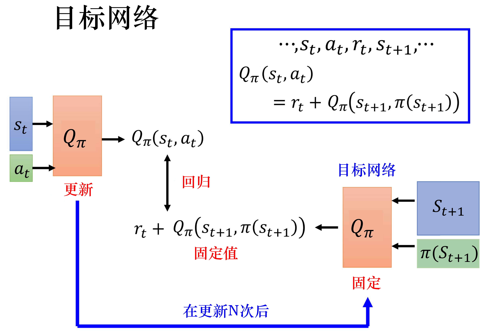

Hình 6.9 Mạng mục tiêu

Như hình 6.10a, ta có thể dùng ví dụ mèo đuổi chuột để hiểu trực quan mục đích của việc cố định mạng mục tiêu. Mèo là ước lượng Q (Q estimation), chuột là mục tiêu Q (Q target). Lúc đầu, mèo cách chuột rất xa, nên ta muốn mèo đuổi kịp chuột. Như hình 6.10b, vì mục tiêu Q cũng liên quan đến tham số mô hình, nên sau mỗi lần tối ưu, mục tiêu Q cũng di chuyển. Điều này dẫn đến một vấn đề, cả mèo và chuột đều đang di chuyển. Như hình 6.10c, mèo và chuột sẽ chạy lung tung trong không gian tối ưu, điều này sinh ra quỹ đạo tối ưu rất kỳ lạ, khiến quá trình huấn luyện rất bất ổn định. Vì vậy ta có thể cố định mạng Q, để chuột di chuyển không thường xuyên như vậy, có thể để nó cứ 5 bước mới di chuyển một lần, còn mèo thì bước nào cũng di chuyển. Nếu chuột cứ 5 lần mới di chuyển một bước, mèo sẽ có đủ thời gian để tiến gần chuột, khoảng cách giữa chúng sẽ ngày càng nhỏ theo quá trình tối ưu, cuối cùng chúng có thể khớp nhau, khớp xong ta sẽ có được một mạng Q tốt nhất.

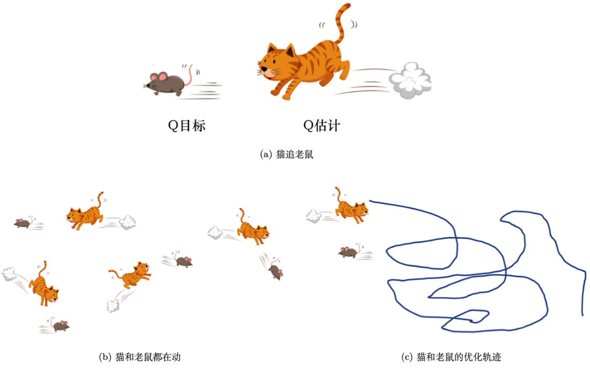

Hình 6.10 Cố định mạng mục tiêu

## 6.4 Khám phá

Mẹo thứ hai là **khám phá (exploration)**. Khi ta dùng hàm Q, chính sách hoàn toàn phụ thuộc vào hàm Q. Cho trước một trạng thái nào đó, ta vét cạn tất cả các hành động, thực hiện hành động làm giá trị Q lớn nhất, tức là
$$
    a=\underset{a}{\arg \max} Q(s, a)
$$
Dùng hàm Q để quyết định hành động khác với dùng gradient chính sách, đầu ra của gradient chính sách là ngẫu nhiên, nó đưa ra một phân phối hành động, ta lấy mẫu theo phân phối hành động này, vì vậy trong gradient chính sách, hành động ta thực hiện mỗi lần là khác nhau, có tính ngẫu nhiên. Với hàm Q, nếu hành động ta thực hiện luôn cố định, vấn đề gặp phải là đây không phải cách thu thập dữ liệu tốt. Giả sử ta cần ước lượng một trạng thái nào đó, có thể thực hiện các hành động $a_{1}$, $a_{2}$, $a_{3}$. Ta muốn ước lượng giá trị Q nhận được khi thực hiện một hành động nào đó ở một trạng thái nào đó, thì nhất định phải từng thực hiện hành động đó ở trạng thái đó mới ước lượng được giá trị của nó. Nếu chưa từng thực hiện hành động đó ở trạng thái đó, ta thực ra không ước lượng được giá trị của nó. Nếu hàm Q là một mạng, vấn đề này có thể không nghiêm trọng như vậy. Nhưng nói chung, giả sử hàm Q là một bảng, với các cặp trạng thái-hành động chưa từng gặp, nó không ước lượng được giá trị. Nếu hàm Q là mạng cũng sẽ có vấn đề tương tự, chỉ là không nghiêm trọng như vậy. Vì vậy giả sử ở một trạng thái nào đó, các hành động $a_{1}$, $a_{2}$, $a_{3}$ đều chưa từng được thực hiện, các giá trị $Q(s,a_{1})$, $Q(s,a_{2})$, $Q(s,a_{3})$ ước lượng ra có thể đều như nhau, đều là một giá trị khởi tạo, ví dụ 0, tức là
$$
    \begin{array}{l}
        Q(s, a_1)=0 \\
        Q(s, a_2)=0 \\
        Q(s, a_3)=0
        \end{array}
$$

Nhưng như hình 6.11, giả sử ta thực hiện hành động $a_{2}$ ở trạng thái $s$, giá trị nó nhận được là phần thưởng dương, $Q(s, a_2)$ sẽ lớn hơn giá trị Q của các hành động khác. Khi thực hiện hành động, giá trị Q của ai lớn nhất thì thực hiện hành động đó, vì vậy về sau sẽ mãi chỉ thực hiện $a_{2}$, các hành động khác sẽ không bao giờ được thực hiện nữa, điều này có vấn đề. Ví dụ ta đi ăn ở một nhà hàng. Giả sử ta gọi một món nào đó, ví dụ gà tiêu cay (椒麻鸡), ta thấy cũng được. Tiếp theo mỗi lần đến ta đều gọi gà tiêu cay, không bao giờ gọi món khác nữa, thì ta sẽ không biết các món khác có ngon hơn gà tiêu cay không, đây là cùng một vấn đề.

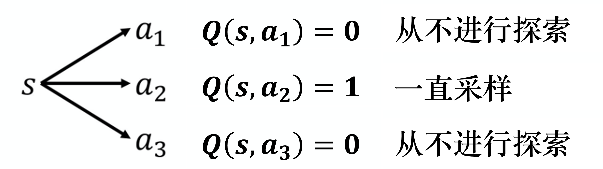

Hình 6.11 Khám phá

Nếu không có khám phá tốt, khi huấn luyện sẽ gặp vấn đề này. Ví dụ, giả sử ta dùng mạng Q sâu để chơi trò chơi trên web slither.io. Ta có một con rắn, nó đi lại trong môi trường, ăn được ngôi sao thì được cộng điểm. Giả sử lúc đầu trò chơi, con rắn đi lên, rồi ăn được ngôi sao, là được điểm, nó biết đi lên có thể nhận được phần thưởng. Tiếp theo nó sẽ không bao giờ thực hiện hành động nào khác ngoài đi lên nữa, về sau mỗi lần trò chơi bắt đầu, nó đều đi lên, rồi trò chơi kết thúc. Vì vậy cần có cơ chế khám phá, để tác tử biết rằng, tuy theo kết quả lấy mẫu trước đó, $a_2$ có vẻ khá tốt, nhưng ít nhất thỉnh thoảng ta cũng nên thử $a_{1}$ và $a_{3}$, biết đâu chúng tốt hơn.

Vấn đề này chính là vấn đề **thế lưỡng nan khám phá-khai thác (exploration-exploitation dilemma)**, có hai phương pháp có thể giải quyết vấn đề này: **$\pmb{\varepsilon}$-tham lam ($\varepsilon$-greedy)** và **khám phá Boltzmann (Boltzmann exploration)**.

$\varepsilon$-tham lam nghĩa là ta có xác suất $1-\varepsilon$ quyết định hành động theo hàm Q, có thể viết là
$$
    a=
    \begin{cases}
        \underset{a}{\arg \max} Q(s, a) & \text {, với xác suất } 1-\varepsilon \\
        \text { ngẫu nhiên} & \text {, trường hợp khác }  
    \end{cases}
$$

Thường đặt $\varepsilon$ là một giá trị rất nhỏ, $1-\varepsilon$ có thể là 0.9, tức là có xác suất 0.9 quyết định hành động theo hàm Q, nhưng có xác suất 0.1 là ngẫu nhiên. Thông thường khi cài đặt, $\varepsilon$ sẽ giảm dần theo thời gian. Lúc đầu, vì chưa biết hành động nào tốt hơn, nên ta sẽ dành khá nhiều công sức để khám phá. Tiếp theo, khi số lần huấn luyện ngày càng nhiều, ta đã khá chắc chắn hành động nào tốt hơn. Ta sẽ giảm khám phá, giảm giá trị $\varepsilon$, chủ yếu quyết định hành động theo hàm Q, ít quyết định hành động ngẫu nhiên hơn, đây chính là $\varepsilon$-tham lam.

Còn một phương pháp gọi là khám phá Boltzmann. Trong khám phá Boltzmann, ta giả sử với mọi $s$, $a$, $Q(s,a) \geqslant 0$, do đó xác suất $a$ được chọn tỉ lệ thuận với $e^{Q(s, a) / T}$, tức là
$$
    \pi(a \mid s)=\frac{\mathrm{e}^{Q(s, a) / T}}{\sum_{a^{\prime} \in A} \mathrm{e}^{Q\left(s, a^{\prime}\right) / T}}
$$
Trong đó, $T>0$ được gọi là hệ số nhiệt độ (temperature). Nếu $T$ rất lớn, mọi hành động gần như được chọn với xác suất bằng nhau (khám phá); nếu $T$ rất nhỏ, hành động có giá trị Q lớn dễ được chọn hơn (khai thác); nếu $T$ tiến tới 0, ta chỉ chọn hành động tối ưu.

## 6.5 Phát lại kinh nghiệm
Mẹo thứ ba là **phát lại kinh nghiệm (experience replay)**. Như hình 6.12, phát lại kinh nghiệm sẽ xây dựng một **bộ đệm phát lại (replay buffer)**, bộ đệm phát lại còn được gọi là **bộ nhớ phát lại (replay memory)**. Bộ đệm phát lại nghĩa là: hiện có một chính sách $\pi$ nào đó tương tác với môi trường, nó sẽ thu thập dữ liệu, ta đặt toàn bộ dữ liệu vào một bộ đệm dữ liệu (buffer), trong bộ đệm dữ liệu lưu rất nhiều dữ liệu. Ví dụ bộ đệm dữ liệu có thể lưu 50.000 mẫu dữ liệu, mỗi mẫu dữ liệu ghi lại rằng trước đây ta ở một trạng thái $s_t$ nào đó, thực hiện một hành động $a_t$ nào đó, nhận phần thưởng $r_t$, đi vào trạng thái $s_{t+1}$. Ta dùng $\pi$ tương tác với môi trường nhiều lần, đặt dữ liệu thu thập được vào bộ đệm phát lại.
Kinh nghiệm trong bộ đệm phát lại có thể đến từ các chính sách khác nhau, mỗi lần ta dùng $\pi$ tương tác với môi trường, có thể chỉ tương tác 10.000 lần, tiếp theo ta đã cập nhật $\pi$. Nhưng bộ đệm phát lại có thể chứa 50.000 mẫu dữ liệu, vì vậy 50.000 mẫu dữ liệu có thể đến từ các chính sách khác nhau. Bộ đệm phát lại chỉ bỏ dữ liệu cũ khi nó đã đầy. Vì vậy trong bộ đệm phát lại thực ra chứa kinh nghiệm của rất nhiều chính sách khác nhau.

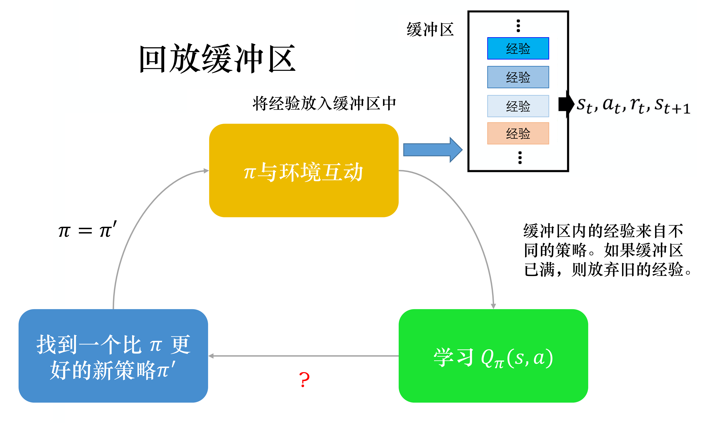

Hình 6.12 Phát lại kinh nghiệm

Như hình 6.13, có bộ đệm phát lại rồi, ta huấn luyện mô hình Q, ước lượng hàm Q như thế nào? Ta sẽ huấn luyện hàm Q theo cách lặp, trong mỗi vòng lặp, chọn ngẫu nhiên một lô (batch) từ bộ đệm phát lại, tức là giống như huấn luyện mạng thông thường, chọn một lô từ tập huấn luyện. Ta lấy mẫu ra lô này, trong đó có một số kinh nghiệm, ta dựa vào các kinh nghiệm này để cập nhật hàm Q. Điều này giống với việc học sai phân thời gian cần có một mạng mục tiêu. Ta lấy mẫu một lô dữ liệu, có được một số kinh nghiệm, rồi cập nhật hàm Q.

Nếu một thuật toán nào đó dùng mẹo phát lại kinh nghiệm, thuật toán đó trở thành một thuật toán off-policy (khác chính sách). Vì vốn dĩ Q cần quan sát kinh nghiệm của $\pi$, nhưng thực tế các kinh nghiệm lưu trong bộ đệm phát lại không phải toàn bộ đến từ $\pi$, có một số là kinh nghiệm do các chính sách khác trong quá khứ để lại. Vì ta không dùng một $\pi$ nào đó để lấp đầy toàn bộ bộ đệm phát lại rồi mới đem đi đo hàm Q, $\pi$ chỉ lấy mẫu một số dữ liệu đặt vào bộ đệm phát lại, tiếp theo để Q đi huấn luyện. Vì vậy khi Q lấy mẫu, nó sẽ lấy mẫu được một số dữ liệu trong quá khứ.

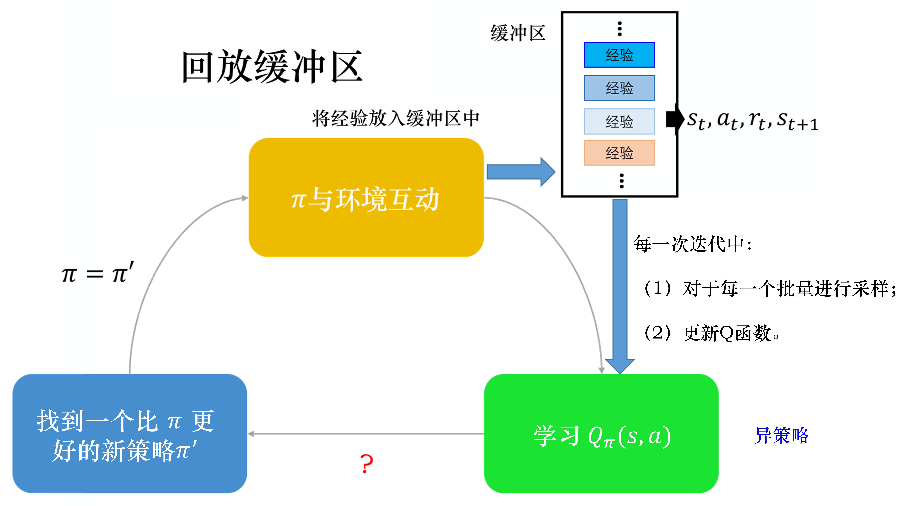

Hình 6.13 Dùng bộ đệm phát lại để huấn luyện hàm Q

Làm như vậy có hai lợi ích. Lợi ích thứ nhất là, khi làm học tăng cường, bước tốn thời gian nhất thường là tương tác với môi trường, huấn luyện mạng lại khá nhanh. Vì ta dùng GPU huấn luyện thực ra rất nhanh, thứ thực sự tốn thời gian thường là tương tác với môi trường. Dùng bộ đệm phát lại có thể giảm số lần tương tác với môi trường, vì khi huấn luyện, kinh nghiệm không cần toàn bộ đến từ một chính sách nào đó. Một số kinh nghiệm do các chính sách trong quá khứ có được có thể được đặt trong bộ đệm phát lại và được dùng rất nhiều lần, được tái sử dụng nhiều lần, như vậy có thể lấy mẫu kinh nghiệm khá hiệu quả. Lợi ích thứ hai là, khi huấn luyện mạng, thực ra ta mong dữ liệu trong một lô càng đa dạng (diverse) càng tốt. Nếu dữ liệu trong lô đều cùng tính chất, ta huấn luyện tiếp thì kết quả huấn luyện dễ không tốt. Nếu trong lô toàn là dữ liệu giống nhau, khi huấn luyện, hiệu năng sẽ khá kém. Ta mong dữ liệu trong lô càng đa dạng càng tốt. Nếu kinh nghiệm trong bộ đệm phát lại đều đến từ các chính sách khác nhau, dữ liệu trong một lô ta lấy mẫu được sẽ khá đa dạng.

Q: Ta quan sát giá trị của $\pi$, phát hiện trong đó lẫn một số kinh nghiệm không phải của $\pi$, điều này có sao không?

A: Không sao. Điều này không phải vì chính sách trong quá khứ rất giống chính sách hiện tại, dù chính sách trong quá khứ không giống chính sách hiện tại lắm, cũng không sao. Nguyên nhân chính là ta không lấy mẫu một quỹ đạo, ta chỉ lấy mẫu một mẫu kinh nghiệm, nên không liên quan gì đến việc có phải off-policy hay không. Dù là off-policy, dù các kinh nghiệm này không đến từ $\pi$, ta vẫn có thể dùng các kinh nghiệm này để ước lượng $Q_{\pi}(s,a)$.

## 6.6 Mạng Q sâu

Hình 6.14 là thuật toán mạng Q sâu thông thường. Thuật toán mạng Q sâu như sau: ta khởi tạo hai mạng — $Q$ và $\hat{Q}$, $\hat{Q}$ bằng $Q$. Lúc đầu mạng mục tiêu $\hat{Q}$ giống với mạng Q ban đầu. Trong mỗi tập, ta dùng diễn viên tương tác với môi trường, trong mỗi lần tương tác, đều có một trạng thái $s_t$, sẽ thực hiện một hành động $a_t$ nào đó.
Làm sao biết thực hiện hành động $a_t$ nào? Ta dựa vào hàm Q hiện tại, nhưng phải có cơ chế khám phá. Ví dụ ta dùng khám phá Boltzmann hoặc khám phá $\varepsilon$-tham lam, tiếp theo nhận phần thưởng $r_t$, đi vào trạng thái $s_{t+1}$. Vì vậy hiện tại thu thập được một mẫu dữ liệu $(s_t$, $a_t$, $r_t$, $s_{t+1})$, ta đặt nó vào bộ đệm phát lại. Nếu bộ đệm phát lại đầy, ta bỏ đi một số dữ liệu cũ. Tiếp theo ta lấy mẫu dữ liệu từ bộ đệm phát lại, lấy được $(s_{i}$, $a_{i}$, $r_{i}$, $s_{i+1})$. Mẫu dữ liệu này chưa chắc là mẫu vừa đặt vào, ta có thể rút được mẫu cũ. Cần chú ý, thứ ta lấy mẫu ra không phải một mẫu dữ liệu, mà là một lô dữ liệu, lấy mẫu ra một số kinh nghiệm.
Tiếp theo là tính mục tiêu. Giả sử ta lấy mẫu ra một mẫu dữ liệu, dựa vào mẫu dữ liệu này để tính mục tiêu. Mục tiêu phải được tính bằng mạng mục tiêu $\hat{Q}$. Mục tiêu là:
$$
    y=r_{i}+\max _{a} \hat{Q}\left(s_{i+1}, a\right)
$$
Trong đó, $a$ là hành động làm giá trị $\hat{Q}$ lớn nhất. Vì hành động $a$ ta sẽ thực hiện ở trạng thái $s_{i+1}$ chính là hành động làm giá trị $\hat{Q}$ lớn nhất. Tiếp theo ta cần cập nhật giá trị Q, xem nó như một bài toán hồi quy. Ta mong $Q(s_i,a_i)$ càng gần mục tiêu càng tốt. Giả sử đã cập nhật một số lần nhất định, ví dụ $C$ lần, đặt $C = 100$, thì ta đặt $\hat{Q}$ bằng $Q$, đây chính là thuật toán mạng Q sâu.

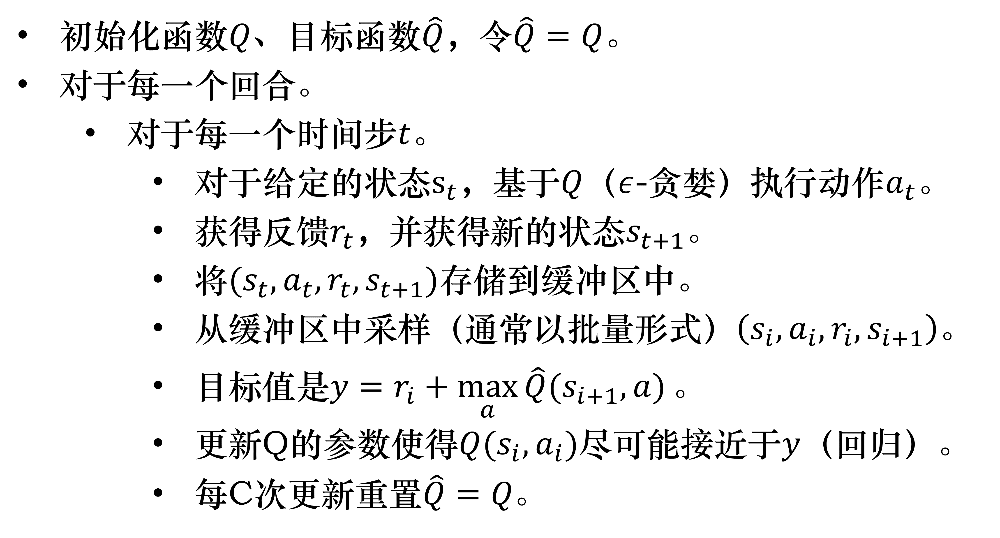

Hình 6.14 Thuật toán mạng Q sâu

Q: Mạng Q sâu và Q-learning khác nhau thế nào?

A: Nhìn chung, giá trị mục tiêu và cách cập nhật giá trị của mạng Q sâu và Q-learning rất giống nhau. Điểm khác chính là: mạng Q sâu kết hợp Q-learning với học sâu, dùng mạng sâu để xấp xỉ hàm giá trị hành động, còn Q-learning thì dùng bảng để lưu trữ; mạng Q sâu dùng phương pháp huấn luyện phát lại kinh nghiệm, lấy mẫu ngẫu nhiên từ dữ liệu lịch sử, còn Q-learning dùng trực tiếp dữ liệu của trạng thái tiếp theo để học.

## Tài liệu tham khảo
* [Intro to Reinforcement Learning (强化学习纲要 - Đại cương học tăng cường)](https://github.com/zhoubolei/introRL)
* [神经网络与深度学习 (Mạng nơ-ron và học sâu)](https://nndl.github.io/)
* [强化学习基础 David Silver 笔记 (Ghi chú Cơ bản học tăng cường của David Silver)](https://zhuanlan.zhihu.com/c_135909947)
* [百面深度学习 (Bách diện học sâu)](https://book.douban.com/subject/35043939/)
* [机器学习(北理工) (Học máy - Đại học Bách khoa Bắc Kinh)](https://www.icourse163.org/course/BIT-1449601164)
* 苗光辉. 面向部分可观测环境的值迭代深度网络模型研究[D].北京理工大学,2018. (Miêu Quang Huy. Nghiên cứu mô hình mạng sâu lặp giá trị cho môi trường quan sát được một phần [Luận văn]. Đại học Bách khoa Bắc Kinh, 2018.)
* [天授文档 (Tài liệu Tianshou)](https://tianshou.readthedocs.io/zh/latest/index.html)
