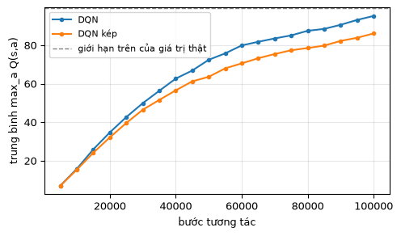
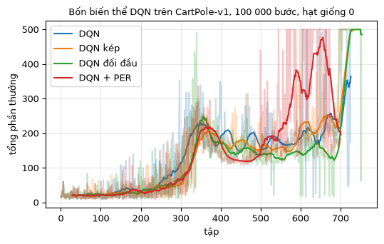
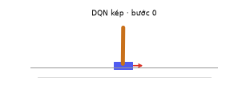

# Chương 7 · Code

> Ghi chú của người dịch: trang này do người dịch biên soạn, không có trong sách gốc. Code dựa trên `DQNAgent` của [MinRL](https://github.com/10-OASIS-01/minrl/tree/ed5eb99) (Yibin Liu, giấy phép MIT, commit `ed5eb99`). Phát lại ưu tiên có sẵn trong MinRL. DQN kép và DQN đối đầu được viết thêm *(thêm)* bằng cách kế thừa lớp đó, để thấy mỗi kỹ thuật chỉ đổi vài dòng. Các notebook của bản gốc EasyRL được liệt kê ở mục 5.
>
> Ký hiệu: theo [chương 7](chapter7/chapter7_vi): $Q$ là mạng Q, $\hat Q$ là mạng mục tiêu.

Mỗi khối code đã được chạy sẵn trên CPU. Kết quả, hình vẽ và ảnh động nằm ngay bên dưới. Các khối chạy lần lượt từ trên xuống và dùng chung biến, như các ô của một notebook. Mã nguồn của `DQNAgent` và giải thích từng thành phần có ở [trang Code của chương 6](chapter6/chapter6_code_vi). Muốn tự chạy, xem [mục 6](#_6-chạy-trên-máy).

## 1. DQN kép

<small class="viz-ref">Mục 7.1 · hình 7.1–7.3</small>

DQN thường dùng **cùng** mạng $\hat Q$ để vừa chọn hành động tốt nhất ở $s'$, vừa đánh giá hành động đó: $y = r + \gamma \max_a \hat Q(s', a)$. Nếu $\hat Q$ ước lượng quá cao một hành động nào đó, phép $\max$ sẽ chọn đúng hành động đó, và sai số dương bị đưa vào mục tiêu. DQN kép tách hai việc này ra:

$$
y = r + \gamma\, \hat Q\big(s', \arg\max_a Q(s', a)\big)
$$

Mạng $Q$ đang học chọn hành động, còn mạng mục tiêu $\hat Q$ cho giá trị. Trong code, chỉ cần đổi đúng một chỗ trong `train_step` của MinRL:

<!-- run -->
```python
import numpy as np
import torch
from torch import nn
import gymnasium as gym
import matplotlib.pyplot as plt
from minrl_vi.common import seed_everything, mlp
from minrl_vi.deep_q_learning import DQNAgent
from viz import plot_returns, cartpole_gif

torch.set_num_threads(1)

class DoubleDQNAgent(DQNAgent):
    def train_step(self, beta=0.4):
        if len(self.replay_buffer) < self.batch_size:
            return {}
        batch, indices, weights = self.replay_buffer.sample(self.batch_size, beta)
        states, actions, rewards, next_states, terminated, _, next_masks = zip(*batch)
        states = torch.as_tensor(np.stack(states))
        next_states = torch.as_tensor(np.stack(next_states))
        masks = torch.as_tensor(np.stack(next_masks))
        with torch.no_grad():
            # --- khác DQN ở đây: mạng Q chọn a*, mạng mục tiêu đánh giá a* ---
            best = self.q_network(next_states).masked_fill(~masks, -torch.inf).argmax(dim=1)
            next_value = self.target_network(next_states).gather(1, best[:, None]).squeeze(1)
            target = (torch.tensor(rewards, dtype=torch.float32)
                      + self.gamma * (~torch.tensor(terminated)) * next_value)
        prediction = self.q_network(states).gather(1, torch.tensor(actions)[:, None]).squeeze(1)
        td_error = target - prediction
        loss = (torch.as_tensor(weights) * td_error.square()).mean()
        self.optimizer.zero_grad()
        loss.backward()
        nn.utils.clip_grad_norm_(self.q_network.parameters(), 10.0)
        self.optimizer.step()
        if self.replay_buffer.prioritized:
            self.replay_buffer.update_priorities(indices, td_error.detach().numpy())
        return {"loss": float(loss.detach()), "td_error": float(td_error.detach().abs().mean())}
```

### Đo độ ước lượng quá cao

Trên CartPole, mỗi bước được $+1$. Với $\gamma = 0.99$, giá trị thật của một trạng thái không thể vượt quá $\sum_{t=0}^{499} 0.99^t = (1 - 0.99^{500}) / 0.01 \approx 99.3$. Ta lấy cố định 500 trạng thái (sinh ra bằng chính sách ngẫu nhiên), và trong lúc huấn luyện, cứ 5000 bước lại đo trung bình $\max_a Q(s, a)$ trên các trạng thái đó.

<!-- run -->
```python
probe_env, probe = gym.make("CartPole-v1"), []
rng = np.random.default_rng(0)
obs, _ = probe_env.reset(seed=0)
while len(probe) < 500:
    probe.append(obs)
    obs, _, terminated, truncated, _ = probe_env.step(int(rng.integers(2)))
    if terminated or truncated:
        obs, _ = probe_env.reset()
probe = torch.as_tensor(np.array(probe, dtype=np.float32))

def run(agent_class, steps=100_000, **kw):
    """Huấn luyện, trả về (tác tử, tổng thưởng từng tập, [(bước, trung bình max Q)])."""
    seed_everything(0)
    agent = agent_class(gym.make("CartPole-v1"), seed=0, **kw)
    q_trace = []
    def watch(agent, row):
        if row["step"] % 5000 == 0:
            with torch.no_grad():
                q_trace.append((row["step"], float(agent.q_network(probe).max(dim=1).values.mean())))
    history = agent.train(steps, seed=0, callback=watch)
    return agent, [h["episode_return"] for h in history], q_trace

def evaluate(agent, n=20):
    env_eval, totals = gym.make("CartPole-v1"), []
    for i in range(n):
        obs, _ = env_eval.reset(seed=1000 + i)
        total = 0.0
        while True:
            obs, r, terminated, truncated, _ = env_eval.step(agent.select_action(obs, deterministic=True))
            total += r
            if terminated or truncated:
                break
        totals.append(total)
    return np.mean(totals)

def true_value(agent, states, gamma=0.99, max_steps=500):
    """Lợi tức chiết khấu thật khi đi theo chính sách tham lam từ từng trạng thái (Monte Carlo)."""
    env_v, values = gym.make("CartPole-v1"), []
    for s in states:
        env_v.reset(seed=0)
        env_v.unwrapped.state = np.array(s, dtype=np.float64)   # đặt CartPole vào đúng trạng thái s
        obs, g, discount = np.array(s, dtype=np.float32), 0.0, 1.0
        for _ in range(max_steps):
            obs, r, terminated, truncated, _ = env_v.step(agent.select_action(obs, deterministic=True))
            g += discount * r
            discount *= gamma
            if terminated:
                break
        values.append(g)
    return np.mean(values)

results = {"DQN": run(DQNAgent), "DQN kép": run(DoubleDQNAgent)}
for name, (agent, rets, trace) in results.items():
    with torch.no_grad():
        q_est = float(agent.q_network(probe[:100]).max(dim=1).values.mean())
    print(f"{name:8s}: đánh giá {evaluate(agent):6.1f} / 500 | trên 100 trạng thái mẫu: "
          f"max Q = {q_est:5.1f}, giá trị thật ≈ {true_value(agent, probe[:100].numpy()):5.1f}")

plt.figure(figsize=(5.5, 3))
for name, (_, _, trace) in results.items():
    steps, q = zip(*trace)
    plt.plot(steps, q, "o-", ms=3, label=name)
plt.axhline(99.3, color="gray", ls="--", lw=1, label="giới hạn trên của giá trị thật")
plt.xlabel("bước tương tác"); plt.ylabel("trung bình max_a Q(s,a)"); plt.legend(fontsize=8); plt.grid(alpha=.3)
```

<!-- output -->
```output
DQN     : đánh giá  500.0 / 500 | trên 100 trạng thái mẫu: max Q =  93.2, giá trị thật ≈  81.3
DQN kép : đánh giá  500.0 / 500 | trên 100 trạng thái mẫu: max Q =  84.0, giá trị thật ≈  82.7
```

<div align=center></div>
<!-- /output -->

Cả hai đều giữ được gậy suốt 500 bước. Khác biệt nằm ở **giá trị Q** mà chúng tin:

- Đường cong của DQN luôn nằm trên DQN kép, và khoảng cách tăng dần theo thời gian.
- Giá trị thật được đo bằng cách đặt CartPole vào từng trạng thái mẫu, đi theo chính sách tham lam và cộng phần thưởng đã chiết khấu. Giá trị thật của hai tác tử gần như bằng nhau (khoảng 81–83). Nhưng mạng Q của DQN cho số lớn hơn giá trị thật khoảng 12, còn DQN kép chỉ lệch khoảng 1.

Đó chính là hiện tượng **ước lượng quá cao** ở hình 7.1–7.2, và DQN kép sửa được gần hết. Trên CartPole, ước lượng quá cao chưa làm hỏng chính sách, vì thứ tự giữa hai hành động vẫn đúng. Ở những bài toán có nhiều hành động hơn, nó gây hại nhiều hơn.

## 2. DQN đối đầu

<small class="viz-ref">Mục 7.2 · hình 7.4–7.7</small>

DQN đối đầu không đổi thuật toán, chỉ đổi **kiến trúc mạng**. Mạng tách làm hai nhánh: nhánh $V(s)$ cho một số, nhánh $A(s, a)$ cho mỗi hành động một số. Sau đó ghép lại, trừ đi trung bình của $A$ để $V$ và $A$ không trôi tự do:

$$
Q(s, a) = V(s) + A(s, a) - \frac{1}{|\mathcal A|}\sum_{a'} A(s, a')
$$

<!-- run -->
```python
class DuelingNet(nn.Module):
    def __init__(self, n_in, n_actions, hidden=64):
        super().__init__()
        self.body = nn.Sequential(nn.Linear(n_in, hidden), nn.ReLU(), nn.Linear(hidden, hidden), nn.ReLU())
        self.value = nn.Linear(hidden, 1)              # nhánh V(s)
        self.advantage = nn.Linear(hidden, n_actions)  # nhánh A(s, a)

    def forward(self, x):
        h = self.body(x)
        a = self.advantage(h)
        return self.value(h) + a - a.mean(dim=-1, keepdim=True)

class DuelingDQNAgent(DQNAgent):
    def __init__(self, env, **kw):
        super().__init__(env, **kw)
        n_in, n_act = self.observations.dimension, self.observations.n_actions
        self.q_network, self.target_network = DuelingNet(n_in, n_act), DuelingNet(n_in, n_act)
        self.target_network.load_state_dict(self.q_network.state_dict())
        self.optimizer = torch.optim.Adam(self.q_network.parameters(), lr=self.config["learning_rate"])

results["DQN đối đầu"] = run(DuelingDQNAgent)
agent, rets, trace = results["DQN đối đầu"]
print(f"DQN đối đầu: đánh giá {evaluate(agent):.1f} / 500")
```

<!-- output -->
```output
DQN đối đầu: đánh giá 500.0 / 500
```
<!-- /output -->

## 3. Phát lại kinh nghiệm ưu tiên

<small class="viz-ref">Mục 7.3 · hình 7.8</small>

Bộ đệm của MinRL có sẵn chế độ ưu tiên (`prioritized=True`). Mỗi bước chuyển $i$ có độ ưu tiên $p_i = |\delta_i|$, với $\delta_i$ là sai số TD lần gần nhất. Bước chuyển được lấy với xác suất $P(i) = p_i^\alpha / \sum_k p_k^\alpha$. Lấy mẫu như vậy làm lệch phân phối dữ liệu, nên mỗi mẫu được nhân với trọng số $w_i = (N \cdot P(i))^{-\beta}$. $\beta$ tăng dần từ 0.4 tới 1 trong quá trình huấn luyện. Mã nguồn `ReplayBuffer` (bấm để mở):

[replay.py](../code/py/minrl_vi/replay.py ':include :type=code :fragment=ReplayBuffer')

<!-- run -->
```python
results["DQN + PER"] = run(DQNAgent, prioritized=True)
agent, rets, trace = results["DQN + PER"]
print(f"DQN + PER: đánh giá {evaluate(agent):.1f} / 500")
```

<!-- output -->
```output
DQN + PER: đánh giá 184.4 / 500
```
<!-- /output -->

## 4. So sánh

<!-- run -->
```python
fig, ax = plt.subplots(figsize=(6, 3.4))
plot_returns({name: r for name, (_, r, _) in results.items()}, ax=ax, k=30,
             title="Bốn biến thể DQN trên CartPole-v1, 100 000 bước, hạt giống 0")
for name, (agent, _, _) in results.items():
    print(f"{name:12s} {evaluate(agent):6.1f} / 500")
```

<!-- output -->
```output
DQN           500.0 / 500
DQN kép       500.0 / 500
DQN đối đầu   500.0 / 500
DQN + PER     184.4 / 500
```

<div align=center></div>
<!-- /output -->

Trong lần chạy này, ba biến thể đầu đều đạt 500. DQN + PER lên tới 500 quanh tập 600 nhưng tụt xuống đúng lúc dừng huấn luyện, nên chỉ đạt 184 khi đánh giá. Đây là **một** lần chạy cho mỗi biến thể, nên chỉ có giá trị minh họa. README của MinRL báo cáo kết quả 5 hạt giống: DQN đạt trung bình $492.3 \pm 15.4$, DQN + PER đạt $476.4 \pm 33.7$. Nghĩa là trên CartPole, PER **không** giúp gì rõ rệt. Các kỹ thuật ở chương này có tác dụng lớn trên bài toán khó như Atari (hình 7.11). Còn trên bài nhỏ, khác biệt giữa các hạt giống thường lớn hơn khác biệt giữa các thuật toán.

Chính sách tham lam của DQN kép sau khi học:

<!-- run -->
```python
double_agent = results["DQN kép"][0]
cartpole_gif({"DQN kép": lambda o: double_agent.select_action(o, deterministic=True)},
             "cartpole_double_dqn.gif", seed=11)
```

<!-- output -->
<div align=center></div>
<!-- /output -->

## 5. Notebook của EasyRL

Mỗi kỹ thuật của chương có một notebook riêng, viết bằng PyTorch trên CartPole:

| Notebook | Kỹ thuật | Mở |
|---|---|---|
| `DoubleDQN_vi.ipynb` | DQN kép (mục 7.1) | [GitHub](https://github.com/nmc2004nd/easy-rl-vi/blob/main/notebooks/DoubleDQN_vi.ipynb) · [Colab](https://colab.research.google.com/github/nmc2004nd/easy-rl-vi/blob/main/notebooks/DoubleDQN_vi.ipynb) |
| `DuelingDQN_vi.ipynb` | DQN đối đầu (mục 7.2) | [GitHub](https://github.com/nmc2004nd/easy-rl-vi/blob/main/notebooks/DuelingDQN_vi.ipynb) · [Colab](https://colab.research.google.com/github/nmc2004nd/easy-rl-vi/blob/main/notebooks/DuelingDQN_vi.ipynb) |
| `PER_DQN_vi.ipynb` | Phát lại kinh nghiệm ưu tiên, dùng cây tổng (sum tree) (mục 7.3) | [GitHub](https://github.com/nmc2004nd/easy-rl-vi/blob/main/notebooks/PER_DQN_vi.ipynb) · [Colab](https://colab.research.google.com/github/nmc2004nd/easy-rl-vi/blob/main/notebooks/PER_DQN_vi.ipynb) |
| `NoisyDQN_vi.ipynb` | Mạng nhiễu (mục 7.5) | [GitHub](https://github.com/nmc2004nd/easy-rl-vi/blob/main/notebooks/NoisyDQN_vi.ipynb) · [Colab](https://colab.research.google.com/github/nmc2004nd/easy-rl-vi/blob/main/notebooks/NoisyDQN_vi.ipynb) |

Bản PER trong MinRL tính xác suất bằng cách duyệt cả bộ đệm, nên mỗi lần lấy mẫu tốn $O(N)$. Notebook `PER_DQN_vi` dùng cây tổng để lấy mẫu trong $O(\log N)$, là cách làm chuẩn khi bộ đệm lớn.

## 6. Chạy trên máy

```bash
git clone https://github.com/nmc2004nd/easy-rl-vi.git
cd easy-rl-vi/docs/code/py          # chạy từ đây để import được minrl_vi, viz
pip install numpy matplotlib pillow gymnasium torch
```

Chép lần lượt các khối code trên trang vào Jupyter rồi chạy theo thứ tự. Mỗi biến thể huấn luyện mất khoảng 40–60 giây trên một nhân CPU. Kết quả trên trang được dựng bằng `python3 scripts/build_code_pages.py docs/chapter7/chapter7_code_vi.md`.
