# Chương 7 Các kỹ thuật nâng cao của mạng Q sâu
## 7.1 Mạng Q sâu kép
Chương này giới thiệu một số kỹ thuật huấn luyện mạng Q sâu (DQN). Kỹ thuật thứ nhất là **mạng Q sâu kép (double DQN, DDQN)**. Tại sao cần DDQN? Vì khi cài đặt, giá trị Q thường bị ước lượng quá cao (overestimate). Như hình 7.1, ở đây có 4 trò chơi nhỏ khác nhau, trục ngang biểu thị số vòng lặp, đường răng cưa màu đỏ thay đổi liên tục biểu thị giá trị Q trung bình mà hàm Q ước lượng cho các trạng thái khác nhau; có rất nhiều trạng thái khác nhau, mỗi trạng thái ta đều lấy mẫu, tính giá trị Q của chúng rồi lấy trung bình. Đường răng cưa màu đỏ này thay đổi trong quá trình huấn luyện, nhưng nó liên tục tăng lên. Vì hàm Q phụ thuộc vào chính sách, trong quá trình học chính sách ngày càng mạnh, giá trị Q ta nhận được sẽ ngày càng lớn. Ở cùng một trạng thái, kỳ vọng phần thưởng ta nhận được sẽ ngày càng lớn, nên nói chung giá trị Q đều tăng lên, nhưng đây là giá trị do mạng Q sâu ước lượng. Tiếp theo ta dùng chính sách để chơi game, chơi rất nhiều lần, ví dụ 1 triệu lần, rồi tính xem ở một trạng thái nào đó, giá trị Q ta nhận được là bao nhiêu. Ta sẽ có phần thưởng tích lũy khi thực hiện một hành động nào đó ở một trạng thái nào đó là bao nhiêu. Giá trị ước lượng lớn hơn giá trị thực rất nhiều, và ở trò chơi nào cũng vậy. Vì vậy phương pháp DDQN có thể giúp giá trị ước lượng gần với giá trị thực hơn.

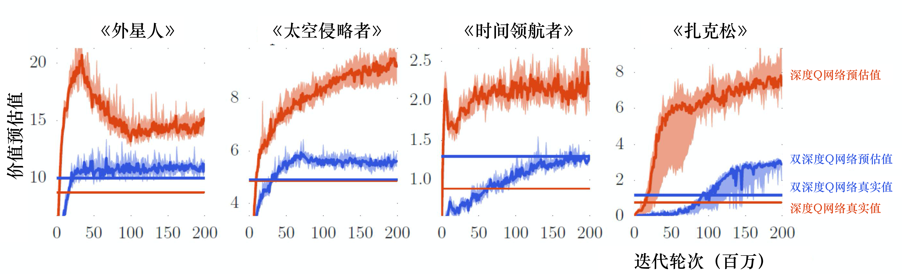

Hình 7.1 Giá trị Q bị ước lượng quá cao

Trong hình 7.1, đường răng cưa màu xanh lam là giá trị Q do mạng Q của DDQN ước lượng, đường không răng cưa màu xanh lam là giá trị Q thực, chúng khá gần nhau. Ta không cần quan tâm giá trị do mạng ước lượng, nó không có nhiều giá trị tham khảo. Giá trị Q thực có được bằng DDQN trong 3 trường hợp của hình 7.1 đều cao hơn mạng Q sâu ban đầu, cho thấy chính sách mà DDQN học được mạnh hơn, nên phần thưởng thực tế nhận được lớn hơn. Tuy mạng Q của mạng Q sâu thông thường ước lượng quá cao phần thưởng mà nó sẽ nhận được, nhưng thực tế phần thưởng nó nhận được lại khá thấp.

Q: Tại sao giá trị Q luôn bị ước lượng quá cao?

A: Vì khi huấn luyện thực tế, như biểu thức (7.1), ta muốn vế trái và vế phải (mục tiêu) càng gần nhau càng tốt. Nhưng giá trị mục tiêu rất dễ bị đặt quá cao, vì khi tính mục tiêu, việc ta thực sự làm là xem $a$ nào có thể cho giá trị Q lớn nhất, rồi cộng nó vào để làm mục tiêu.

$$
    Q\left(s_{t}, a_{t}\right) \longleftrightarrow r_{t}+\max _{a} Q\left(s_{t+1}, a\right) \tag{7.1}
$$

Ví dụ, giả sử hiện có 4 hành động, vốn dĩ giá trị Q của chúng đều gần như nhau, phần thưởng chúng nhận được cũng gần như nhau. Nhưng khi ước lượng, mạng có sai số. Như hình 7.2(a), giả sử hành động thứ nhất bị ước lượng quá cao, màu xanh lá biểu thị lượng bị ước lượng quá cao, tác tử sẽ chọn hành động này, sẽ chọn giá trị Q bị ước lượng quá cao này cộng với $r_t$ làm mục tiêu. Như hình 7.2(b), nếu hành động thứ tư bị ước lượng quá cao, tác tử sẽ chọn hành động thứ tư cộng với $r_t$ làm mục tiêu. Vì vậy tác tử luôn chọn hành động có giá trị Q bị ước lượng quá cao, luôn chọn giá trị Q của hành động có phần thưởng bị ước lượng quá cao làm kết quả lớn nhất rồi cộng $r_t$ làm mục tiêu, nên giá trị mục tiêu luôn quá lớn.

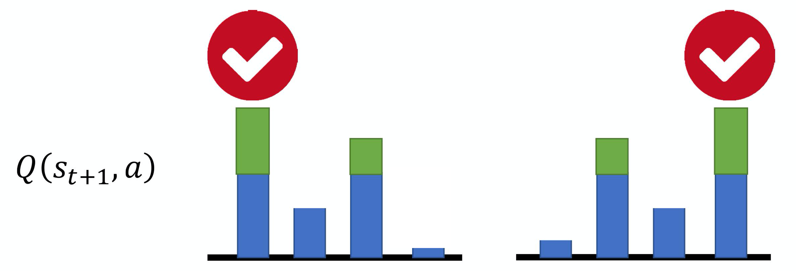

Hình 7.2 Vấn đề giá trị Q bị ước lượng quá cao

Q: Làm sao giải quyết vấn đề giá trị mục tiêu luôn quá lớn?

A: Trong DDQN, hàm Q dùng để chọn hành động và hàm Q dùng để tính giá trị không phải là một. Trong mạng Q sâu ban đầu, ta vét cạn tất cả các $a$, đưa từng $a$ vào hàm Q, xem $a$ nào cho giá trị Q cao nhất, rồi lấy giá trị Q đó cộng $r_t$. Nhưng trong DDQN có hai mạng Q, mạng Q thứ nhất $Q$ quyết định hành động nào có giá trị Q lớn nhất (ta đưa tất cả các $a$ vào hàm Q, xem $a$ nào có giá trị Q lớn nhất). Sau khi quyết định hành động, giá trị Q được tính bằng $Q'$.

Như biểu thức (7.2), giả sử ta có hai hàm Q — $Q$ và $Q'$, nếu $Q$ ước lượng quá cao hành động $a$ mà nó chọn, chỉ cần $Q'$ không ước lượng quá cao giá trị của hành động $a$, giá trị tính ra vẫn là giá trị bình thường. Giả sử $Q'$ ước lượng quá cao giá trị của một hành động nào đó, cũng không có vấn đề gì, vì chỉ cần $Q$ không chọn hành động đó là được, đây chính là chỗ kỳ diệu của DDQN.

$$
Q\left(s_{t}, a_{t}\right) \longleftrightarrow r_{t}+Q^{\prime}\left(s_{t+1}, \arg \max _{a} Q\left(s_{t+1}, a\right)\right) \tag{7.2}
$$

Khi ta tự tay cài đặt, có hai mạng Q: mạng Q được cập nhật và mạng Q mục tiêu. Vì vậy trong DDQN, ta dùng mạng Q được cập nhật tham số để chọn hành động, dùng mạng Q mục tiêu (mạng được cố định) để tính giá trị.

DDQN là thay đổi ít nhất so với mạng Q sâu ban đầu, nó gần như không tăng thêm khối lượng tính toán nào, cũng không cần mạng mới, vì vốn đã có hai mạng. Ta chỉ cần làm một việc: vốn dùng mạng mục tiêu $Q'$ để tìm $a$ làm giá trị Q lớn nhất, nay đổi thành dùng mạng Q còn lại (mạng được cập nhật) để tìm $a$ làm giá trị Q lớn nhất. Nếu chỉ chọn một kỹ thuật, ta thường chọn DDQN, vì nó rất dễ cài đặt.

🎬 Mô phỏng thiên lệch do max: Q-learning và Q-learning kép (bấm để mở)

> Phần bổ sung của người dịch: phiên bản dạng bảng của hình 7.1–7.2 (Sutton & Barto, ví dụ 6.7). Xem từng bước vì sao $\max_b Q(B, b)$ trên các ước lượng nhiễu làm Q-learning tưởng hành động tồi là tốt, và Q-learning kép (ý tưởng gốc của DDQN) tránh được điều đó. [Mở trang riêng](viz/maxbias.html ':ignore :target=_blank').

<iframe class="viz-frame" src="viz/maxbias.html?embed" style="height:2523px" title="Mô phỏng thiên lệch do max" loading="lazy"></iframe>

## 7.2 Mạng Q sâu đối đầu
Kỹ thuật thứ hai là **mạng Q sâu đối đầu (dueling DQN)**, so với mạng Q sâu ban đầu, điểm khác duy nhất của nó là thay đổi kiến trúc mạng. Mạng Q nhận đầu vào là trạng thái, đầu ra là giá trị Q của mỗi hành động. Như hình 7.3, mạng Q sâu ban đầu đưa ra trực tiếp giá trị Q, mạng Q sâu đối đầu không đưa ra trực tiếp giá trị Q, mà chia thành hai nhánh tính toán. Nhánh thứ nhất đưa ra một số vô hướng $V(\boldsymbol{s})$, vì nó liên quan đến đầu vào $\boldsymbol{s}$, nên được gọi là $V(\boldsymbol{s})$. Nhánh thứ hai đưa ra một vectơ $\boldsymbol{A}(\boldsymbol{s},\boldsymbol{a})$, mỗi hành động của nó đều có một giá trị. Ta cộng $V(\boldsymbol{s})$ và $\boldsymbol{A}(\boldsymbol{s},\boldsymbol{a})$ lại là được giá trị Q $\boldsymbol{Q}(\boldsymbol{s},\boldsymbol{a})$.

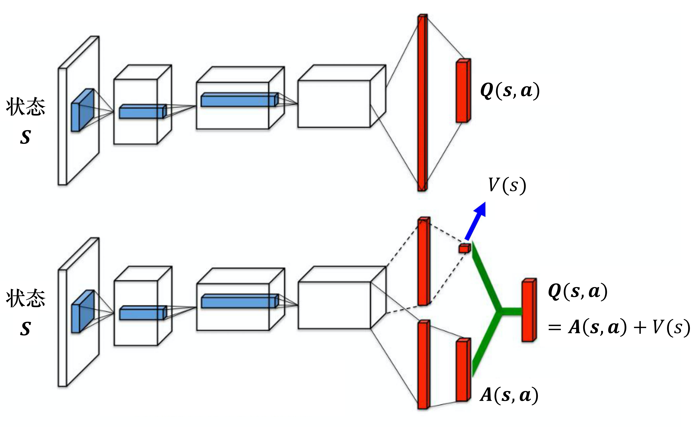

Hình 7.3 Cấu trúc mạng của mạng Q sâu đối đầu

Ta giả sử trạng thái là rời rạc (thực tế trạng thái không rời rạc), để tiện giải thích, ta giả sử chỉ có 4 trạng thái khác nhau, chỉ có 3 hành động khác nhau, nên $\boldsymbol{Q}(\boldsymbol{s},\boldsymbol{a})$ có thể xem là một bảng, như hình 7.4.

Ta biết
$$
\boldsymbol{Q}(\boldsymbol{s},\boldsymbol{a}) = V(\boldsymbol{s}) + \boldsymbol{A}(\boldsymbol{s},\boldsymbol{a})
$$
Trong đó, $V(\boldsymbol{s})$ có một giá trị cho mỗi trạng thái khác nhau. $\boldsymbol{A}(\boldsymbol{s},\boldsymbol{a})$ có một giá trị cho mỗi trạng thái khác nhau và mỗi hành động khác nhau. Ta cộng giá trị của mỗi cột của $V(\boldsymbol{s})$ vào mỗi cột của $\boldsymbol{A}(\boldsymbol{s},\boldsymbol{a})$ là có được giá trị Q, lấy cột thứ nhất làm ví dụ, có 2+1, 2+($-$1), 2+0, được 3, 1, 2, các cột khác tương tự.

Như hình 7.4, giả sử khi huấn luyện mạng, mục tiêu là muốn giá trị ở hàng thứ nhất cột thứ hai của bảng Q trở thành 4, giá trị ở hàng thứ hai cột thứ hai trở thành 0. Nhưng thực tế thứ ta có thể sửa không phải là giá trị Q, mà là giá trị của $V(\boldsymbol{s})$ và $\boldsymbol{A}(\boldsymbol{s},\boldsymbol{a})$. Dựa vào tham số của mạng, sau khi giá trị của $V(\boldsymbol{s})$ và $\boldsymbol{A}(\boldsymbol{s},\boldsymbol{a})$ được đưa ra, chúng được cộng trực tiếp lại, nên thực ra không phải sửa giá trị Q. Khi học mạng, giả sử ta muốn số 3 trong bảng Q tăng 1 thành 4, $-$1 tăng 1 thành 0. Cuối cùng khi huấn luyện mạng, có thể ta không cần sửa giá trị của $\boldsymbol{A}(\boldsymbol{s},\boldsymbol{a})$, chỉ sửa giá trị của $V(\boldsymbol{s})$, đổi giá trị của $V(\boldsymbol{s})$ từ 0 thành 1. Đổi từ 0 thành 1 có lợi ích gì? Vốn chỉ muốn sửa hai giá trị, nhưng giá trị thứ ba trong bảng Q cũng bị sửa: $-$2 thành $-$1. Vì vậy có thể ở một trạng thái nào đó, ta chỉ lấy mẫu được hai hành động này, không lấy mẫu được hành động thứ ba, nhưng vẫn có thể thay đổi giá trị Q của hành động thứ ba. Lợi ích của việc này là ta không cần lấy mẫu tất cả các cặp trạng thái-hành động, có thể ước lượng giá trị Q một cách khá hiệu quả. Vì đôi khi khi cập nhật, ta không nhất thiết cập nhật bảng Q, mà chỉ cập nhật $V(\boldsymbol{s})$, nhưng khi cập nhật $V(\boldsymbol{s})$, chỉ cần sửa giá trị của $V(\boldsymbol{s})$ là giá trị trong bảng Q cũng bị sửa. Mạng Q sâu đối đầu là một phương pháp sử dụng dữ liệu khá hiệu quả.

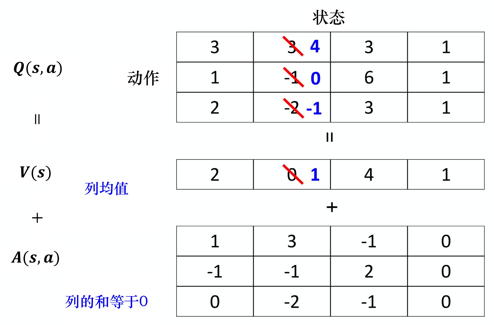

Hình 7.4 Huấn luyện mạng Q sâu đối đầu

Có thể có người cho rằng dùng mạng Q sâu đối đầu sẽ có một vấn đề, kết quả học cuối cùng của mạng Q sâu đối đầu có thể là: tác tử học được $V(\boldsymbol{s})$ bằng 0, $\boldsymbol{A}(\boldsymbol{s},\boldsymbol{a})$ bằng Q, khi đó dùng mạng Q sâu đối đầu chẳng có lợi ích gì, giống hệt mạng Q sâu ban đầu.

Để tránh vấn đề này xảy ra, thực tế ta cần đặt một số ràng buộc cho $\boldsymbol{A}(\boldsymbol{s},\boldsymbol{a})$, làm việc cập nhật $\boldsymbol{A}(\boldsymbol{s},\boldsymbol{a})$ khá phiền phức, để mạng có xu hướng dùng $V(\boldsymbol{s})$ để giải quyết vấn đề.

Ví dụ, ta có các ràng buộc khác nhau, một ràng buộc trực quan nhất là bắt buộc tổng của mỗi cột của $\boldsymbol{A}(\boldsymbol{s},\boldsymbol{a})$ đều bằng 0, nên xem ví dụ tôi đưa ra ở đây, tổng các cột đều bằng 0. Nếu tổng các cột ở đây đều bằng 0, ta có thể xem giá trị của $V(\boldsymbol{s})$ là trung bình của mỗi cột của Q phía trên. Giá trị trung bình này cộng với giá trị của $\boldsymbol{A}(\boldsymbol{s},\boldsymbol{a})$ mới thành giá trị của Q. Vì vậy giả sử khi cập nhật tham số, phải để cả cột được cập nhật cùng lúc, việc cập nhật một cột nào đó của $\boldsymbol{A}(\boldsymbol{s},\boldsymbol{a})$ khá phiền phức, nên ta sẽ không muốn cập nhật một cột nào đó của $\boldsymbol{A}(\boldsymbol{s},\boldsymbol{a})$. Vì tổng của mỗi cột của $\boldsymbol{A}(\boldsymbol{s},\boldsymbol{a})$ đều phải bằng 0, nên ta không thể làm cho các giá trị của một cột nào đó của $\boldsymbol{A}(\boldsymbol{s},\boldsymbol{a})$ đều cộng thêm 1, điều này không làm được, vì ràng buộc của nó là tổng luôn bằng 0, nên không thể đều cộng thêm 1, lúc này sẽ buộc mạng phải cập nhật giá trị của $V(\boldsymbol{s})$, giúp ta có thể sử dụng dữ liệu một cách khá hiệu quả.

Khi cài đặt, ta cần đặt ràng buộc cho $\boldsymbol{A}(\boldsymbol{s},\boldsymbol{a})$ này. Ví dụ, như hình 7.5, giả sử có 3 hành động, vectơ đầu ra là $[7,3,2]^{\mathrm{T}}$, trước khi cộng $\boldsymbol{A}(\boldsymbol{s},\boldsymbol{a})$ với $V(\boldsymbol{s})$, ta chuẩn hóa về trung bình 0 (zero-mean) trước.

Quá trình chuẩn hóa về trung bình 0 như sau:

(1) Tính trung bình (7+3+2)/3=4;

(2) Mỗi phần tử của vectơ $[7,3,2]^{\mathrm{T}}$ đều trừ đi trung bình 4, do đó vectơ sau khi chuẩn hóa về trung bình 0 là $[3,-1,-2]^{\mathrm{T}}$.

> Ghi chú của người dịch: bản gốc viết kết quả là $[3,-1,2]^{\mathrm{T}}$; thực tế $2-4=-2$, nên đúng phải là $[3,-1,-2]^{\mathrm{T}}$ (tổng bằng 0).

Tiếp theo ta cộng thêm 1 vào mỗi phần tử của vectơ $[3,-1,-2]^{\mathrm{T}}$ là có được giá trị Q cuối cùng. Bước chuẩn hóa về trung bình 0 này là một phần của mạng, khi huấn luyện ta cũng dùng lan truyền ngược (back propagation), chỉ là chuẩn hóa về trung bình 0 không có tham số, nó chỉ là một phép toán, có thể đặt nó vào trong mạng, huấn luyện cùng với các phần khác của mạng, như vậy $\boldsymbol{A}(\boldsymbol{s},\boldsymbol{a})$ sẽ có ràng buộc khá lớn, mạng sẽ cho nó một số ưu đãi, để nó có xu hướng cập nhật giá trị của $V(\boldsymbol{s})$, đây chính là mạng Q sâu đối đầu.

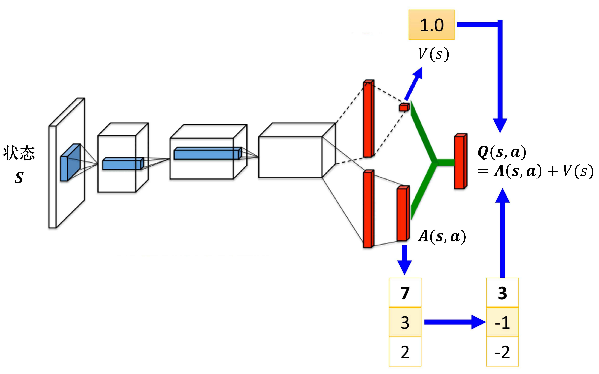

Hình 7.5 Ràng buộc của mạng Q sâu đối đầu

## 7.3 Phát lại kinh nghiệm ưu tiên

Kỹ thuật thứ ba được gọi là **phát lại kinh nghiệm ưu tiên (prioritized experience replay, PER)**. Như hình 7.6, trước đây khi lấy mẫu dữ liệu để huấn luyện mạng Q, ta lấy mẫu dữ liệu một cách đồng đều từ bộ đệm phát lại (replay buffer). Như vậy chưa chắc là tốt nhất, vì có thể một số dữ liệu quan trọng hơn. Giả sử có một số dữ liệu, trước đây ta đã lấy mẫu, phát hiện sai số sai phân thời gian (TD error) của các dữ liệu này đặc biệt lớn (sai số sai phân thời gian là khoảng cách giữa đầu ra của mạng và mục tiêu), điều này cho thấy khi huấn luyện mạng, các dữ liệu này khá khó huấn luyện. Đã khó huấn luyện thì nên cho chúng xác suất được lấy mẫu lớn hơn, tức là cho chúng **quyền ưu tiên (priority)**. Như vậy khi huấn luyện mới xét nhiều hơn đến các dữ liệu khó huấn luyện. Thực tế khi làm PER, ta không chỉ thay đổi quá trình lấy mẫu, mà còn vì thay đổi quá trình lấy mẫu nên thay đổi cả cách cập nhật tham số. Vì vậy PER không chỉ thay đổi phân phối của dữ liệu được lấy mẫu, mà còn thay đổi quá trình huấn luyện.

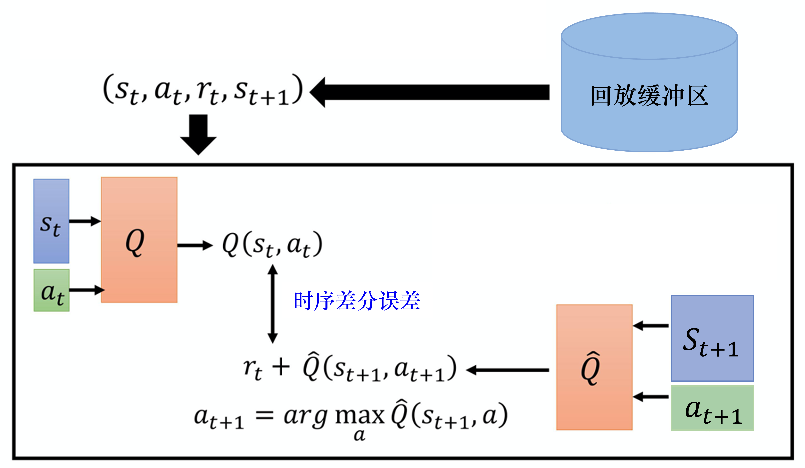

Hình 7.6 Phát lại kinh nghiệm ưu tiên

## 7.4 Cân bằng giữa phương pháp Monte Carlo và phương pháp sai phân thời gian
Phương pháp Monte Carlo và phương pháp sai phân thời gian mỗi bên đều có ưu nhược điểm, do đó ta có thể cân bằng giữa phương pháp Monte Carlo và phương pháp sai phân thời gian, phương pháp này còn được gọi là phương pháp nhiều bước (multi-step). Cách làm của ta như hình 7.7, trong phương pháp sai phân thời gian, ở một trạng thái $s_t$ nào đó thực hiện một hành động $a_t$ nào đó nhận phần thưởng $r_t$, tiếp theo đi vào trạng thái $s_{t+1}$. Nhưng ta có thể không chỉ lưu dữ liệu của một bước, mà có thể lưu dữ liệu của $N$ bước.

Ta ghi lại việc ở $s_t$ thực hiện $a_t$, nhận $r_t$, sẽ đi vào $s_{t+1}$. Ghi lại cho đến sau bước thứ $N$, các kinh nghiệm ở $s_{t+N}$ thực hiện $a_{t+N}$, nhận $r_{t+N}$, đi vào $s_{t+N+1}$, lưu chúng lại. Thực tế khi cập nhật, khi học mạng Q, ta muốn $Q(s_t,a_t)$ càng gần giá trị mục tiêu càng tốt. Thứ $\hat{Q}$ tính không phải của $s_{t+1}$, mà là phần thưởng của $s_{t+N+1}$. Ta đưa trạng thái sau $N$ bước $s_{t+N+1}$ vào $\hat{Q}$ để tính phần thưởng sẽ nhận được sau $N$ bước. Nếu muốn tính giá trị mục tiêu, cần cộng thêm phần thưởng nhiều bước (multi-step) $\sum_{t^{\prime}=t}^{t+N} r_{t^{\prime}}$, phần thưởng nhiều bước là tổng $N+1$ phần thưởng từ thời điểm $t$ đến $t+N$. Ta mong $Q(s_t,a_t)$ và giá trị mục tiêu càng gần càng tốt.

Phương pháp nhiều bước chính là sự kết hợp giữa phương pháp Monte Carlo và phương pháp sai phân thời gian, do đó nó không chỉ có ưu và nhược điểm của phương pháp Monte Carlo, mà còn có ưu và nhược điểm của phương pháp sai phân thời gian. Trước tiên xem ưu điểm của phương pháp nhiều bước: trước đây chỉ lấy mẫu một bước, nên dữ liệu thu được là thật, phần tiếp theo đều do giá trị Q ước lượng. Bây giờ lấy mẫu nhiều bước hơn, lấy mẫu $N$ bước rồi mới ước lượng giá trị, nên ảnh hưởng do phần ước lượng gây ra sẽ nhỏ hơn. Tất nhiên nhược điểm của phương pháp nhiều bước giống với nhược điểm của phương pháp Monte Carlo, vì $r$ có khá nhiều số hạng, nên khi ta cộng $N$ số hạng $r$ lại, phương sai sẽ khá lớn. Nhưng ta có thể điều chỉnh giá trị $N$, để cân bằng giữa phương sai và giá trị Q không chính xác. $N$ là một siêu tham số, ta có thể điều chỉnh nó.

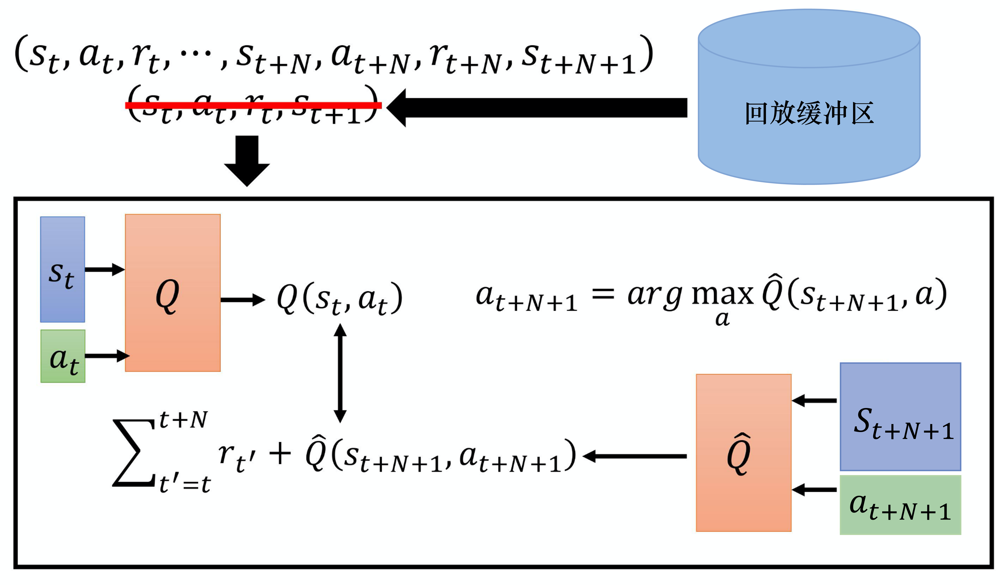

Hình 7.7 Cân bằng giữa phương pháp Monte Carlo và phương pháp sai phân thời gian

## 7.5 Mạng nhiễu

Ta còn có thể cải thiện khám phá. Khám phá kiểu $\varepsilon$-tham lam là thêm nhiễu vào không gian hành động, nhưng có một phương pháp tốt hơn gọi là **mạng nhiễu (noisy net)**, nó thêm nhiễu vào không gian tham số. Mạng nhiễu nghĩa là: mỗi lần khi bắt đầu một tập, khi tác tử sắp tương tác với môi trường, tác tử dùng hàm Q để thực hiện hành động, bên trong hàm Q là một mạng, ta thêm một nhiễu Gauss (Gaussian noise) vào mỗi tham số của mạng, biến hàm Q ban đầu thành $\tilde{Q}$. Vì ta đã dùng $\hat{Q}$ để biểu thị mạng mục tiêu, nên ta dùng $\tilde{Q}$ để biểu thị **hàm Q nhiễu (noisy Q-function)**. Ta thêm một nhiễu Gauss vào mỗi tham số, sẽ có một mạng mới $\tilde{Q}$. Hành động thực hiện khi dùng mạng nhiễu là
$$
    a=\underset{a}{\arg \max} \tilde{Q}(s, a)
$$

Cần chú ý, khi bắt đầu mỗi tập, trước khi tương tác với môi trường, ta lấy mẫu nhiễu. Tiếp theo ta dùng mạng nhiễu cố định để chơi game, đến khi trò chơi kết thúc mới lấy mẫu nhiễu mới, nhiễu không được thay đổi trong một tập. OpenAI và DeepMind gần như cùng lúc đề xuất phương pháp mạng nhiễu gần như giống hệt nhau, và hai bài báo tương ứng đều được công bố ở hội nghị ICLR 2018. Điểm khác là họ dùng các cách thêm nhiễu khác nhau. Phương pháp của OpenAI khá đơn giản, thêm trực tiếp một nhiễu Gauss, tức là thêm một nhiễu Gauss vào mỗi tham số, mỗi trọng số (weight). Phương pháp của DeepMind khá phức tạp, nhiễu trong phương pháp này được điều khiển bởi một bộ tham số, mạng có thể tự quyết định nhiễu thêm vào lớn bao nhiêu. Nhưng khái niệm của hai phương pháp là như nhau, tóm lại, ta thêm một ít nhiễu vào mạng trong hàm Q, làm nó hơi khác đi, tức là khác với hàm Q ban đầu, rồi tương tác với môi trường. Cả hai bài báo đều nhấn mạnh, tuy tham số được thêm nhiễu, nhưng trong cùng một tập tham số là cố định. Khi ta đổi tập, chơi một ván mới, mới lấy mẫu nhiễu lại. Trong cùng một ván chơi là cùng một mạng Q nhiễu chơi ván đó, điều này rất quan trọng. Vì điều này dẫn đến sự khác biệt về bản chất giữa mạng nhiễu với $\varepsilon$-tham lam ban đầu hoặc các phương pháp lấy mẫu trên hành động khác.

Khác biệt về bản chất là gì? Trong các phương pháp lấy mẫu ban đầu, ví dụ $\varepsilon$-tham lam, dù cho cùng một trạng thái, hành động tác tử thực hiện cũng chưa chắc giống nhau. Vì tác tử quyết định hành động bằng cách lấy mẫu, cho cùng một trạng thái, tác tử dựa vào mạng của hàm Q để đưa ra một hành động, hoặc lấy mẫu được ngẫu nhiên để đưa ra một hành động. Vì vậy cho cùng một trạng thái, nếu dùng phương pháp $\varepsilon$-tham lam, tác tử có thể thực hiện các hành động khác nhau. Nhưng thực tế chính sách không như vậy, một chính sách trong thế giới thực, cho cùng một trạng thái, nó nên có cùng một phản ứng. Chứ không phải cho cùng một trạng thái, có lúc nó thực hiện theo hàm Q, có lúc lại ngẫu nhiên, đây là một hành động bất thường, là hành động không xuất hiện trong tình huống thực. Nhưng nếu ta thêm nhiễu vào tham số của mạng hàm Q thì sẽ không xảy ra tình huống này. Vì nếu thêm nhiễu vào tham số của mạng hàm Q, trong toàn bộ quá trình tương tác, trong cùng một tập, tham số mạng của nó luôn cố định, nên khi nhìn thấy trạng thái giống hoặc tương tự sẽ thực hiện cùng một hành động, điều này khá bình thường. Đây được gọi là **khám phá phụ thuộc trạng thái (state-dependent exploration)**, tuy ta vẫn thực hiện việc khám phá, nhưng việc khám phá có liên quan đến trạng thái, nhìn thấy cùng một trạng thái sẽ khám phá theo cùng một cách, còn hành động nhiễu (noisy) chỉ là thử bừa ngẫu nhiên. Nhưng nếu ta thêm nhiễu vào tham số, trong cùng một tập, tham số được cố định, ta thử một cách có hệ thống. Ví dụ, mỗi lần ở một trạng thái nào đó, ta đều thử đi sang trái xem sao. Lần sau khi chơi cùng trò chơi đó, nhìn thấy cùng trạng thái đó, tôi lại thử đi sang phải xem sao, đây là khám phá môi trường một cách có hệ thống.

## 7.6 Hàm Q phân phối
Còn một kỹ thuật gọi là **hàm Q phân phối (distributional Q-function)**. Hàm Q phân phối khá hợp lý, nhưng khó cài đặt. Hàm Q là giá trị kỳ vọng của phần thưởng tích lũy, nên giá trị Q ta tính ra thực chất là một giá trị kỳ vọng. Như hình 7.8, vì môi trường có tính ngẫu nhiên, nên khi thực hiện một hành động nào đó ở một trạng thái nào đó, ta thống kê tất cả các phần thưởng khi trò chơi kết thúc, thu được một phân phối. Có thể xác suất nhận phần thưởng 0 rất cao, xác suất nhận $-$10 khá thấp, xác suất nhận +10 cũng khá thấp, nhưng nó là một phân phối. (Ta tính trung bình của phân phối này mới là giá trị Q này, tính ra là kỳ vọng của phần thưởng tích lũy. Vì vậy phần thưởng tích lũy là một phân phối, lấy kỳ vọng của nó, lấy trung bình của nó, được giá trị Q.) Nhưng các phân phối khác nhau có thể có cùng giá trị trung bình. Có thể phân phối thực là phân phối bên phải trong hình 7.8, giá trị trung bình của nó thực ra giống với giá trị trung bình của phân phối bên trái, nhưng phân phối mà chúng đại diện thực ra là khác nhau. Giả sử ta chỉ dùng kỳ vọng của giá trị Q để đại diện cho toàn bộ phần thưởng, có thể sẽ mất một số thông tin, không thể mô hình hóa phân phối của phần thưởng.

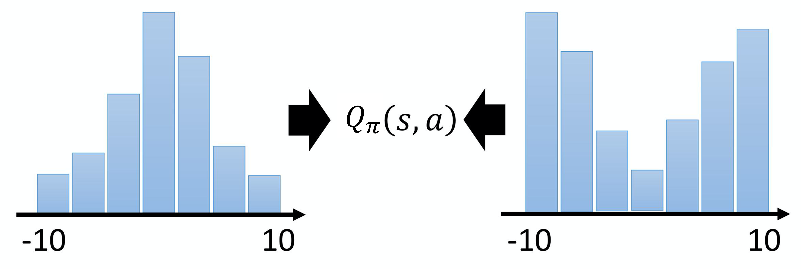

Hình 7.8 Phân phối phần thưởng

Hàm Q phân phối mô hình hóa phân phối (distribution), làm như thế nào? Như hình 7.9a, trong hàm Q ban đầu, giả sử ta chỉ có thể thực hiện 3 hành động $a_1$, $a_2$, $a_3$, ta đưa vào một trạng thái, đầu ra là 3 giá trị. 3 giá trị này lần lượt đại diện cho giá trị Q của 3 hành động, nhưng các giá trị Q này là giá trị kỳ vọng của một phân phối. Vì vậy hàm Q phân phối đưa ra trực tiếp phân phối. Cách làm thực tế như hình 7.9b, giả sử giá trị của phân phối nằm trong một khoảng nào đó, ví dụ $-$10 ~ 10, chia $-$10 ~ 10 thành từng cột (bin). Ví dụ, không gian phần thưởng của mỗi hành động được chia thành 5 cột. Giả sử không gian phần thưởng có thể chia thành 5 cột, đầu ra của hàm Q là dự đoán xác suất phần thưởng nhận được khi ta thực hiện một hành động nào đó ở một trạng thái nào đó rơi vào một cột nào đó. Vì vậy tổng xác suất của các cột màu xanh lá phải bằng 1, chiều cao của nó đại diện cho xác suất phần thưởng rơi vào một cột nào đó khi thực hiện một hành động nào đó ở một trạng thái nào đó. Màu xanh lá đại diện cho hành động $a_1$, màu đỏ đại diện cho hành động $a_2$, màu xanh lam đại diện cho hành động $a_3$. Vì vậy ta có thể dùng hàm Q để ước lượng phân phối của $a_1$, phân phối của $a_2$, phân phối của $a_3$. Thực tế khi kiểm thử, ta chọn hành động có giá trị trung bình lớn nhất để thực hiện.

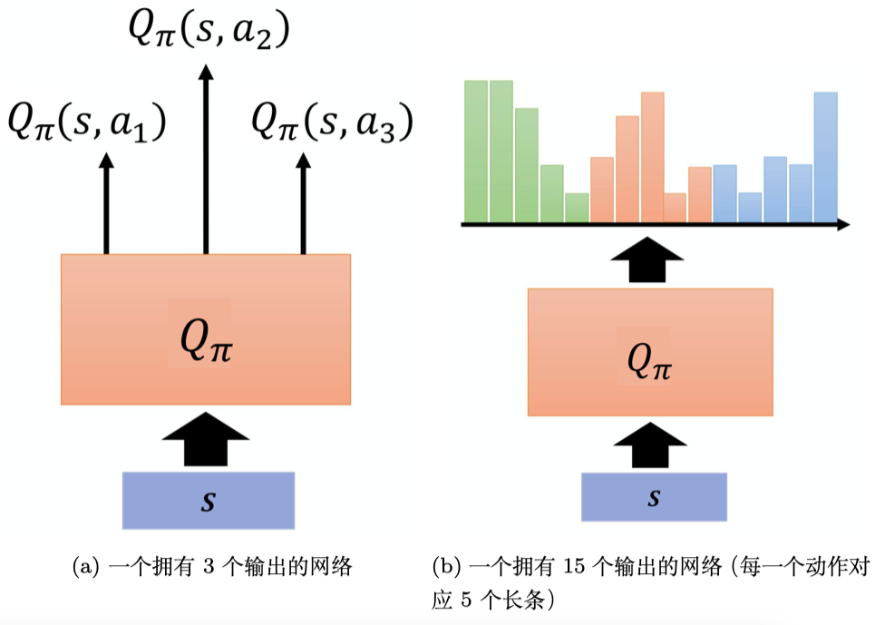

Hình 7.9 Hàm Q phân phối

Ngoài việc chọn hành động có giá trị trung bình lớn nhất, ta còn có thể mô hình hóa phân phối. Ví dụ, ta có thể xét phân phối của hành động, nếu phân phối có phương sai rất lớn, điều này cho thấy thực hiện hành động này tuy trung bình mà nói rất tốt, nhưng có thể rủi ro rất cao, ta có thể huấn luyện một mạng để tránh rủi ro. Trong trường hợp giá trị trung bình của hai hành động gần như nhau, có thể chọn hành động có rủi ro thấp hơn để thực hiện, đây chính là lợi ích của hàm Q phân phối.

## 7.7 Rainbow (cầu vồng)

Kỹ thuật cuối cùng được gọi là **Rainbow (cầu vồng)**, như hình 7.10, giả sử mỗi phương pháp có một màu riêng (nếu mỗi đường đơn sắc đại diện cho việc chỉ dùng một phương pháp nào đó), kết hợp tất cả các màu lại, sẽ thành "cầu vồng", ta tính cả mạng Q sâu ban đầu là một phương pháp, nên có 7 màu. Trục ngang biểu thị số khung hình (frame) trong quá trình huấn luyện, trục dọc biểu thị tổng điểm trung bình khi chơi hơn mười trò chơi nhỏ của Atari, nhưng nó lấy trung vị (median) của điểm số. Tại sao lấy trung vị mà không lấy trung bình trực tiếp? Vì điểm số của các trò chơi nhỏ khác nhau chênh lệch rất lớn, nếu lấy trung bình, một vài trò chơi có thể chi phối kết quả, do đó ta lấy trung vị. Nếu ta dùng mạng Q sâu thông thường (đường màu xám), hiệu năng của mạng Q sâu không tốt lắm. Mạng Q sâu nhiễu (noisy DQN) có hiệu năng tốt hơn DQN rất nhiều. Đường màu tím đại diện cho DDQN, DDQN khá hiệu quả. Mạng Q sâu kép có phát lại kinh nghiệm ưu tiên (prioritized DDQN), mạng Q sâu kép đối đầu (dueling DDQN) và mạng Q sâu phân phối (distributional DQN) hiệu năng cũng khá cao. **Diễn viên-nhà phê bình lợi thế bất đồng bộ (asynchronous advantage actor-critic, A3C)** là phương pháp diễn viên-nhà phê bình (actor-critic), thuật toán A3C còn được dịch là thuật toán đánh giá hành động lợi thế bất đồng bộ, ta sẽ giới thiệu chi tiết thuật toán A3C ở chương 9. Thuật toán A3C đơn thuần có vẻ mạnh hơn mạng Q sâu. Trong hình 7.10 không có phương pháp nhiều bước, đó là vì bên trong thuật toán A3C vốn đã có phương pháp nhiều bước, nên cài đặt thuật toán A3C tương đương với cài đặt phương pháp nhiều bước, ta có thể xem kết quả của thuật toán A3C là kết quả của phương pháp nhiều bước. Bản thân các phương pháp này không xung đột với nhau, ta dùng tất cả các phương pháp thì thành phương pháp bảy sắc, tức phương pháp Rainbow, hiệu năng của phương pháp Rainbow rất tốt.

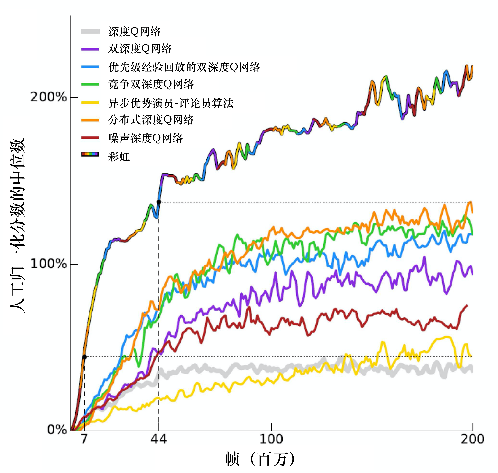

Hình 7.10 Phương pháp Rainbow

Ta kết hợp tất cả các phương pháp lại, hiệu suất của mô hình sẽ tăng rất nhiều, nhưng liệu có phương pháp nào thực ra không có tác dụng không? Ta có thể bỏ đi một phương pháp để đánh giá phương pháp đó có tác dụng hay không. Như hình 7.11, các đường nét đứt là kết quả của phương pháp Rainbow sau khi bỏ đi một phương pháp nào đó, đường nét đứt màu vàng sau khi bỏ phương pháp nhiều bước thì "rơi" rất nhiều. Rainbow là đường nét liền nhiều màu, bỏ phương pháp nhiều bước sẽ "rơi xuống", bỏ phát lại kinh nghiệm ưu tiên sẽ "rơi xuống", bỏ phân phối cũng sẽ "rơi xuống".
Ở đây có một điểm thú vị, lúc đầu, phương pháp huấn luyện phân phối có tốc độ gần giống các phương pháp khác. Nhưng khi ta bỏ phương pháp huấn luyện phân phối, việc huấn luyện không chậm đi, nhưng hiệu năng (performance) cuối cùng sẽ hội tụ ở mức khá kém. Ta bỏ mạng nhiễu thì hiệu năng cũng kém đi một chút, bỏ mạng Q sâu đối đầu thì hiệu năng cũng kém đi một chút, bỏ mạng Q sâu kép thì lại không có khác biệt gì. Vì vậy khi ta kết hợp tất cả các phương pháp, bỏ mạng Q sâu kép có ảnh hưởng khá nhỏ. Khi ta dùng mạng Q sâu phân phối, về bản chất sẽ không ước lượng quá cao phần thưởng. Ta thêm DDQN là để tránh ước lượng quá cao phần thưởng. Nếu ta dùng mạng Q sâu phân phối, có thể sẽ không có kết quả ước lượng quá cao, đa số trường hợp là ước lượng quá thấp phần thưởng, nên chuyển thành DDQN không có tác dụng.

Tại sao mạng Q sâu phân phối không ước lượng quá cao phần thưởng, mà ngược lại sẽ ước lượng quá thấp phần thưởng? Vì mạng Q sâu phân phối đưa ra một khoảng của phân phối, khoảng đầu ra không thể là vô hạn, ta nhất định sẽ đặt một giới hạn, ví dụ khoảng đầu ra lớn nhất là từ $-$10 ~ 10. Giả sử phần thưởng nhận được vượt quá 10, ví dụ 100 thì sao? Ta coi như không thấy việc này, nên các giá trị phần thưởng rất cực đoan, rất lớn sẽ bị bỏ đi, khi dùng mạng Q sâu phân phối, ta sẽ không ước lượng quá cao phần thưởng, mà ngược lại sẽ ước lượng quá thấp phần thưởng.

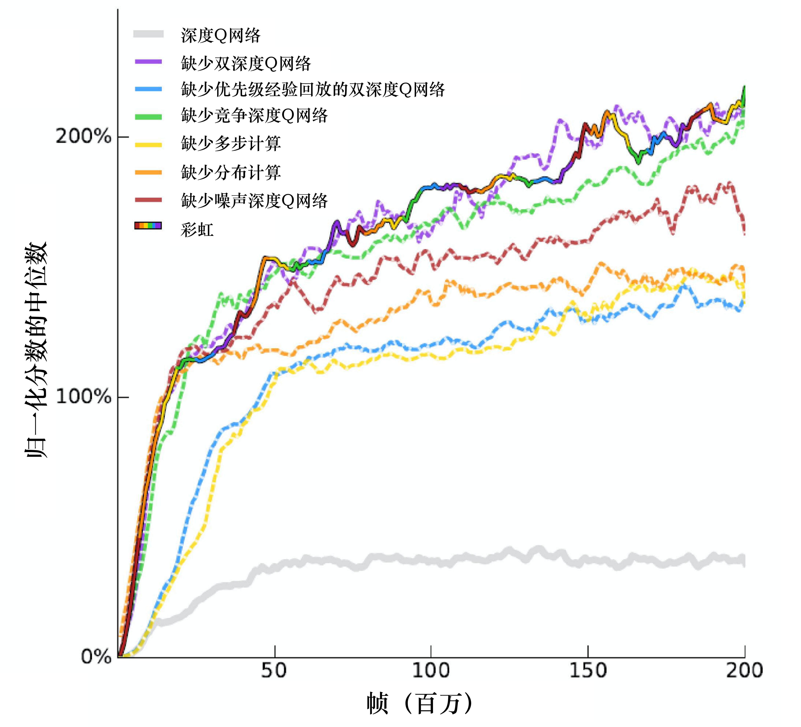

Hình 7.11 Rainbow: bỏ đi một trong các phương pháp

🎬 Mô phỏng Rainbow thu nhỏ trên CartPole (bấm để mở)

> Phần bổ sung của người dịch: bật/tắt DQN kép, đối đầu, phát lại ưu tiên, nhiều bước trên CartPole; đồ thị ước lượng $Q$ so với giá trị thật như hình 7.1, và kết quả bỏ từng thành phần như hình 7.11 (tính sẵn nhiều lần chạy). [Mở trang riêng](viz/rainbow-mini.html ':ignore :target=_blank').

<iframe class="viz-frame" src="viz/rainbow-mini.html?embed" style="height:2658px" title="Mô phỏng Rainbow thu nhỏ" loading="lazy"></iframe>

