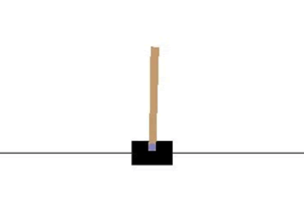
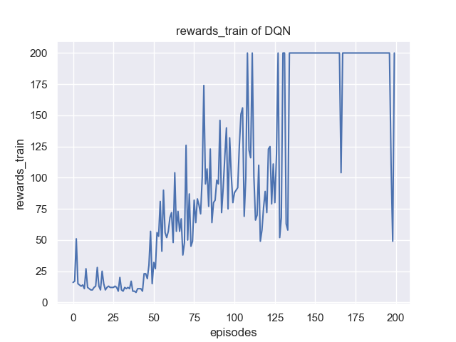
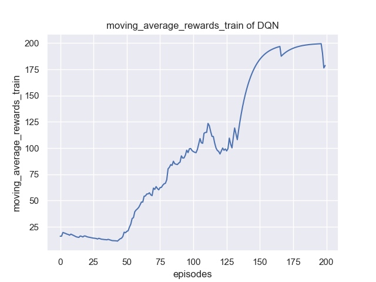
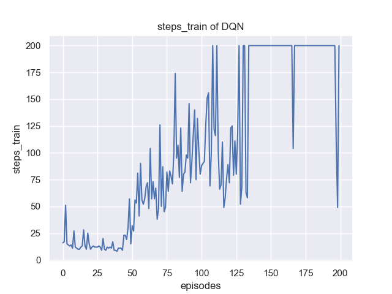
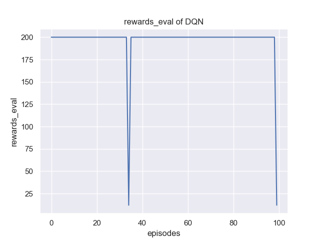
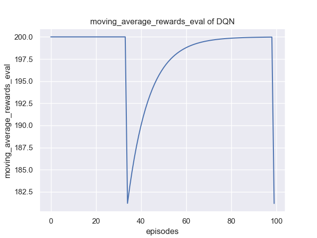
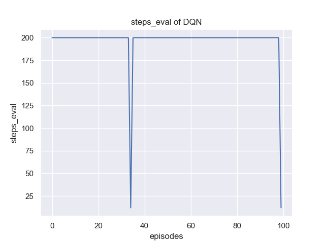
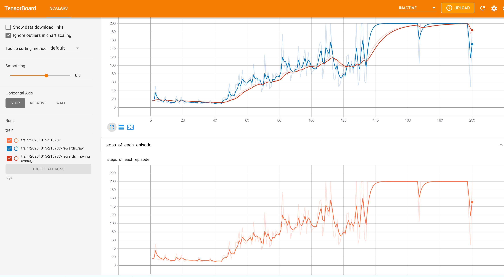

# Dùng DQN giải CartPole-v0

Khuyến nghị dùng Double-DQN (mạng Q sâu kép) để giải, tức là xây dựng hai mạng kết nối đầy đủ (fully connected) có tham số khởi tạo giống nhau là target_net và policy_net.

## CartPole-v0

CartPole-v0 là một môi trường kinh điển trong OpenAI gym, bằng cách đẩy xe sang trái (action=0) hoặc sang phải (action=1) để giữ thăng bằng, nên không gian hành động gồm hai hành động. Mỗi khi thực hiện một step (bước) sẽ nhận reward (phần thưởng) +1, nếu không giữ được thăng bằng thì done bằng true, episode (tập) lần này thất bại.

**Trong trạng thái lý tưởng, mỗi episode ít nhất có thể thực hiện 200 step, tức là tổng reward của mỗi episode ít nhất là 200, số step ít nhất là 200**.



Môi trường được tạo như sau:

```python
env = gym.make('CartPole-v0') 
env.seed(1) # Đặt hạt giống ngẫu nhiên (random seed) cho env
n_states = env.observation_space.shape[0] # Lấy tổng số chiều trạng thái
n_actions = env.action_space.n # Lấy tổng số hành động
```

## Giao diện cơ bản của học tăng cường

```python
rewards = [] # Ghi lại tổng rewards
moving_average_rewards = [] # Ghi lại tổng rewards sau khi xử lý trung bình trượt
ep_steps = []
for i_episode in range(1, cfg.max_episodes+1): # cfg.max_episodes là số episode huấn luyện tối đa
    state = env.reset() # Đặt lại (reset) trạng thái môi trường
    ep_reward = 0
    for i_step in range(1, cfg.max_steps+1): # cfg.max_steps là số bước tối đa của mỗi episode
        action = agent.select_action(state) # Chọn action dựa trên state hiện tại của môi trường
        next_state, reward, done, _ = env.step(action) # Cập nhật tham số môi trường
        ep_reward += reward
        agent.memory.push(state, action, reward, next_state, done) # Lưu các transition như state vào memory
        state = next_state # Chuyển sang trạng thái tiếp theo
        agent.update() # Cập nhật mạng sau mỗi bước
        if done:
            break
    # Cập nhật target network, sao chép toàn bộ weights và biases của DQN
    if i_episode % cfg.target_update == 0: #  cfg.target_update là tần suất cập nhật target_net
        agent.target_net.load_state_dict(agent.policy_net.state_dict())
    print('Episode:', i_episode, ' Reward: %i' %
          int(ep_reward), 'n_steps:', i_step, 'done: ', done,' Explore: %.2f' % agent.epsilon)
    ep_steps.append(i_step)
    rewards.append(ep_reward)
    # Tính reward theo cửa sổ trượt
    if i_episode == 1:
        moving_average_rewards.append(ep_reward)
    else:
        moving_average_rewards.append(
            0.9*moving_average_rewards[-1]+0.1*ep_reward)
```

> Ghi chú của người dịch: chú thích gốc của `cfg.max_steps` viết "补偿" (bù trừ), có lẽ là lỗi gõ của "步长/步数" (số bước); bản dịch ghi theo nghĩa đúng của biến.

## Yêu cầu nhiệm vụ

Huấn luyện và vẽ đồ thị đường cong reward cũng như reward sau khi lấy trung bình trượt theo episode, đồng thời ghi lại các siêu tham số (hyperparameter) và viết thành báo cáo, ví dụ như sau:







Đồng thời cũng có thể vẽ đường cong khi kiểm thử (eval) mô hình:







Cũng có thể dùng [tensorboard](https://pytorch.org/docs/stable/tensorboard.html) để xem kết quả, như sau:


