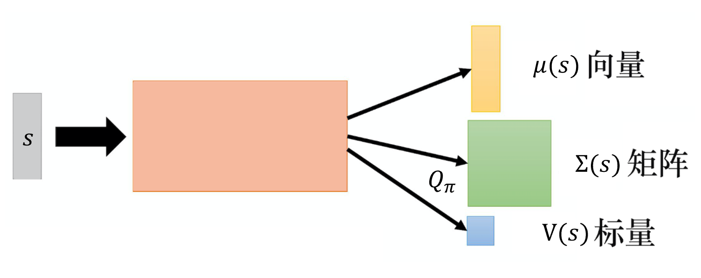
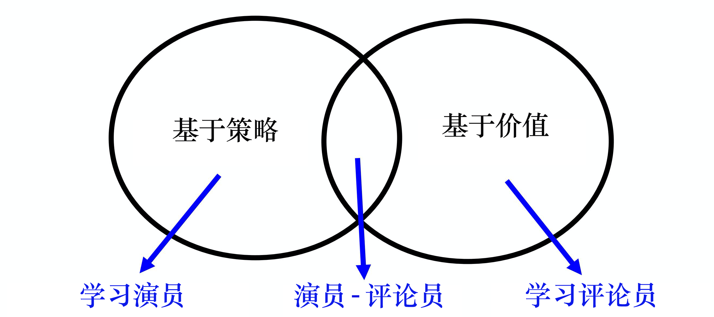

# Chương 8 Mạng Q sâu cho hành động liên tục

So với các phương pháp dựa trên gradient chính sách (policy gradient), mạng Q sâu (DQN) khá ổn định, gradient chính sách thì khá bất ổn định, khi chơi phần lớn các trò chơi không thể dùng gradient chính sách.

Trước khi có tối ưu chính sách cận kề (PPO), ta rất khó làm được việc gì với gradient chính sách. Bài báo sớm nhất của DeepMind dùng học tăng cường sâu để chơi game Atari, thứ được dùng chính là mạng Q sâu. Một lý do khiến mạng Q sâu khá dễ huấn luyện là: trong mạng Q sâu, chỉ cần ta ước lượng được hàm Q, là đảm bảo chắc chắn tìm được một chính sách khá tốt. Tức là chỉ cần ta ước lượng được hàm Q, là đảm bảo có thể cải thiện chính sách. Mà ước lượng hàm Q khá dễ, vì nó chính là một bài toán hồi quy (regression). Trong bài toán hồi quy, ta có thể quan sát xem hàm mất mát của hồi quy có giảm hay không, là có thể biết mô hình học tốt hay không, vì vậy ước lượng hàm Q dễ hơn so với học một chính sách. Chỉ cần ước lượng hàm Q, là có thể đảm bảo bây giờ chắc chắn sẽ có được một chính sách khá tốt, vì vậy nói chung mạng Q sâu khá dễ vận hành.

Nhưng mạng Q sâu thực ra tồn tại một số vấn đề, vấn đề lớn nhất là nó rất khó xử lý hành động liên tục. Nhiều khi hành động là liên tục, ví dụ khi ta chơi game Atari, tác tử chỉ cần quyết định 4 hành động như lên, xuống, trái, phải, loại hành động này là rời rạc. Nhiều khi hành động là liên tục, ví dụ, giả sử tác tử cần lái xe, nó phải quyết định vô lăng quay trái bao nhiêu độ, quay phải bao nhiêu độ, loại hành động này là liên tục. Giả sử tác tử là một robot, trên thân có 50 khớp, mỗi hành động của nó ứng với góc của 50 khớp trên thân, mà các góc này cũng là liên tục. Vì vậy nhiều khi hành động không rời rạc, nó là một vectơ, mỗi chiều của vectơ này đều có một giá trị tương ứng, các giá trị này đều là số thực, nó là liên tục. Nếu hành động là liên tục, ta dùng mạng Q sâu sẽ gặp khó khăn. Vì khi dùng mạng Q sâu, một bước rất quan trọng là ta phải giải được bài toán tối ưu, tức là sau khi ước lượng được hàm Q $Q(s,a)$, ta phải tìm được một $a$ làm cho $Q(s,a)$ lớn nhất, tức là

$$
  a=\underset{a}{\arg \max} Q(s, a)
$$

Giả sử $a$ là rời rạc, tức số khả năng của $a$ là hữu hạn. Ví dụ, trong các trò chơi nhỏ của Atari, $a$ chính là lên, xuống, trái, phải và bắn, nó là hữu hạn, ta có thể đưa từng hành động có thể có vào Q để tính giá trị Q của nó. Nhưng nếu $a$ là liên tục, ta không thể vét cạn tất cả các hành động liên tục có thể có, rồi thử xem hành động liên tục nào làm giá trị Q lớn nhất.

Giải quyết vấn đề này như thế nào? Ta có nhiều phương án khác nhau, dưới đây giới thiệu lần lượt.
## 8.1 Phương án 1: lấy mẫu hành động
Phương án thứ 1 là gì? Ta có thể lấy mẫu ra $N$ hành động $a$ có thể có: $\left\{a_{1}, a_{2}, \cdots, a_{N}\right\}$, đưa lần lượt từng hành động vào hàm Q, xem giá trị Q của cái nào lớn nhất. Phương án này không quá kém hiệu quả, vì khi tính toán ta dùng GPU, đưa cùng lúc $N$ hành động liên tục vào hàm Q, có được cùng lúc $N$ giá trị Q, xem cái nào lớn nhất. Tất nhiên đây không phải là một phương án rất chính xác, vì ta không thể lấy mẫu quá nhiều, nên giá trị Q ước lượng được và hành động được quyết định cuối cùng có thể không thật chính xác.
## 8.2 Phương án 2: gradient ascent
Phương án thứ 2 là gì? Đã là giải một bài toán tối ưu (optimization problem), ta cần tối đa hóa hàm mục tiêu (objective function). Để tối đa hóa hàm mục tiêu, ta có thể dùng đi lên theo gradient (gradient ascent). Ta xem $a$ là tham số, cần tìm một bộ $a$ để tối đa hóa hàm Q, thì dùng gradient ascent để cập nhật giá trị của $a$, cuối cùng xem có tìm được một $a$ tối đa hóa hàm Q (hàm mục tiêu) hay không. Nhưng ta sẽ gặp vấn đề cực đại toàn cục (global maximum), không nhất thiết tìm được kết quả tối ưu, hơn nữa khối lượng tính toán rõ ràng rất lớn, vì phải cập nhật $a$ theo cách lặp, huấn luyện một mạng đã rất tốn thời gian rồi. Nếu ta dùng phương án gradient ascent để xử lý bài toán liên tục, mỗi lần quyết định thực hiện hành động nào, lại phải huấn luyện mạng một lần, rõ ràng khối lượng tính toán rất lớn.

## 8.3 Phương án 3: thiết kế kiến trúc mạng
Phương án thứ 3 là thiết kế đặc biệt kiến trúc mạng, thiết kế đặc biệt hàm Q để việc giải phép arg max trở nên rất dễ.

Như hình 8.1, thông thường trạng thái đầu vào $\boldsymbol{s}$ là hình ảnh, ta có thể dùng vectơ hoặc ma trận để biểu diễn nó. Đưa vào $\boldsymbol{s}$, hàm Q sẽ đưa ra vectơ $\pmb{\mu}(\boldsymbol{s})$, ma trận $\pmb{\varSigma}(\boldsymbol{s})$ và số vô hướng $V(\boldsymbol{s})$. Hàm Q dựa vào đầu vào $\boldsymbol{s}$ và $\boldsymbol{a}$ để quyết định giá trị đầu ra. Cho đến lúc này, hàm Q chỉ có đầu vào $\boldsymbol{s}$, nó chưa có đầu vào $\boldsymbol{a}$, vậy $\boldsymbol{a}$ ở đâu? Tiếp theo ta có thể đưa vào $\boldsymbol{a}$, cho $\boldsymbol{a}$ tương tác với $\pmb{\mu}(\boldsymbol{s})$, $\pmb{\varSigma}(\boldsymbol{s})$ và $V(\boldsymbol{s})$. Hàm Q $Q(\boldsymbol{s},\boldsymbol{a})$ có thể được định nghĩa là
$$
  Q(\boldsymbol{s},\boldsymbol{a})=-(\boldsymbol{a}-\pmb{\mu}(\boldsymbol{s}))^{\mathrm{T}} \pmb{\varSigma}(\boldsymbol{s})(\boldsymbol{a}-\pmb{\mu}(\boldsymbol{s}))+V(\boldsymbol{s})
$$

Chú ý, $\boldsymbol{a}$ bây giờ là hành động liên tục, nên nó là một vectơ. Giả sử ta cần điều khiển robot, mỗi chiều của vectơ $\boldsymbol{a}$ có thể ứng với mỗi khớp của robot, giá trị của nó chính là góc của khớp. Giả sử $\boldsymbol{a}$ và $\pmb{\mu}(\boldsymbol{s})$ là vectơ cột, thì $(\boldsymbol{a}-\pmb{\mu}(\boldsymbol{s}))^{\mathrm{T}}$ là một vectơ hàng. $\pmb{\varSigma}(\boldsymbol{s})$ là một ma trận xác định dương (positive-definite matrix), vì $\pmb{\varSigma}(\boldsymbol{s}) = \boldsymbol{L}\boldsymbol{L}^{\mathrm{T}}$, trong đó $\boldsymbol{L}$ là ma trận tam giác dưới (lower-triangular matrix). $\boldsymbol{a}$-$\pmb{\mu}(\boldsymbol{s})$ cũng là một vectơ cột. Vì vậy giá trị Q, tức $-(\boldsymbol{a}-\pmb{\mu}(\boldsymbol{s}))^{\mathrm{T}} \pmb{\varSigma}(\boldsymbol{s})(\boldsymbol{a}-\pmb{\mu}(\boldsymbol{s}))+V(\boldsymbol{s})$, là số vô hướng.

Ta tìm một $\boldsymbol{a}$ để tối đa hóa giá trị Q như thế nào? Vì $(\boldsymbol{a}-\pmb{\mu}(\boldsymbol{s}))^{\mathrm{T}} \pmb{\varSigma}(\boldsymbol{s})(\boldsymbol{a}-\pmb{\mu}(\boldsymbol{s}))$ chắc chắn dương (không âm), phía trước nó có dấu trừ, giả sử ta không xét dấu trừ, thì giá trị của số hạng thứ nhất $(\boldsymbol{a}-\pmb{\mu}(\boldsymbol{s}))^{\mathrm{T}} \pmb{\varSigma}(\boldsymbol{\boldsymbol{s}})(\boldsymbol{a}-\pmb{\mu}(\boldsymbol{s}))$ càng nhỏ, giá trị Q cuối cùng càng lớn. Vì ta lấy $V(\boldsymbol{s})$ trừ đi số hạng thứ nhất, nên giá trị số hạng thứ nhất càng nhỏ, giá trị Q cuối cùng càng lớn. Làm sao để giá trị số hạng thứ nhất nhỏ nhất? Ta trực tiếp cho $\boldsymbol{a}$ bằng $\pmb{\mu}(\boldsymbol{s})$, làm số hạng thứ nhất bằng 0, là có thể làm giá trị số hạng thứ nhất nhỏ nhất. Do đó, cho $\boldsymbol{a}$ bằng $\pmb{\mu}(\boldsymbol{s})$, ta có thể có được giá trị lớn nhất, việc giải phép arg max trở nên rất dễ. Vì vậy mạng Q sâu cũng có thể dùng trong trường hợp liên tục, chỉ có một số hạn chế: hàm không thể thiết lập tùy ý.

> Nếu ma trận đối xứng cấp $n$ $\boldsymbol{A}$ thỏa mãn $\boldsymbol{x}^\mathrm{T}\boldsymbol{A}\boldsymbol{x}>0$ với mọi vectơ $n$ chiều khác không $\boldsymbol{x}$, thì ma trận $\boldsymbol{A}$ được gọi là ma trận xác định dương.

Hình 8.1 Phương án 3: thiết kế kiến trúc mạng

## 8.4 Phương án 4: không dùng mạng Q sâu

Phương án thứ 4 là không dùng mạng Q sâu, dùng mạng Q sâu để xử lý hành động liên tục khá phiền phức. Như hình 8.2, ta kết hợp phương pháp dựa trên chính sách — PPO và phương pháp dựa trên giá trị — mạng Q sâu lại với nhau, sẽ có được phương pháp diễn viên-nhà phê bình (actor-critic).

Hình 8.2 Phương án 4: không dùng mạng Q sâu

