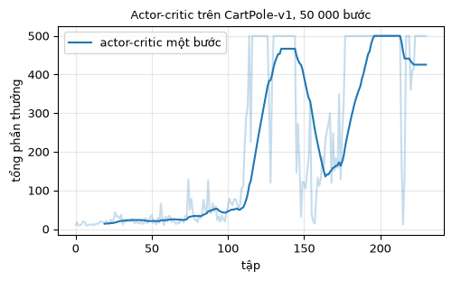
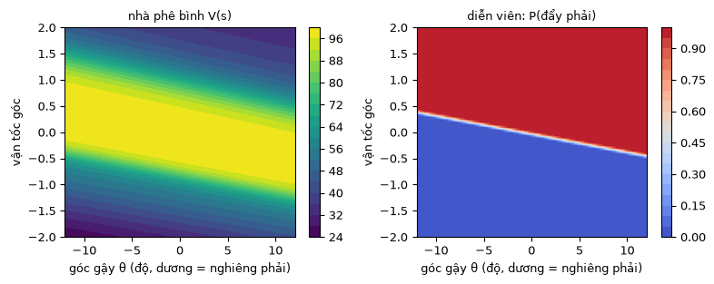
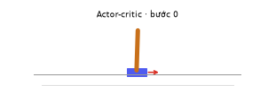

# Chương 9 · Code

> Ghi chú của người dịch: trang này do người dịch biên soạn, không có trong sách gốc. Code diễn viên-nhà phê bình lấy từ [MinRL](https://github.com/10-OASIS-01/minrl/tree/ed5eb99) (Yibin Liu, giấy phép MIT, commit `ed5eb99`), chú thích đã dịch sang tiếng Việt. Notebook A2C của bản gốc EasyRL được giới thiệu ở mục 4.
>
> Ký hiệu: theo [chương 9](chapter9/chapter9_vi): diễn viên là chính sách $\pi_\theta(a \mid s)$, nhà phê bình là hàm giá trị $V(s)$.

Mỗi khối code đã được chạy sẵn trên CPU. Kết quả, hình vẽ và ảnh động nằm ngay bên dưới. Các khối chạy lần lượt từ trên xuống và dùng chung biến, như các ô của một notebook. Muốn tự chạy, xem [mục 5](#_5-chạy-trên-máy).

## 1. Từ REINFORCE tới diễn viên-nhà phê bình

<small class="viz-ref">Mục 9.1–9.3 · công thức (9.1), (9.2) · hình 9.4</small>

REINFORCE ([trang Code chương 4](chapter4/chapter4_code_vi)) phải chờ hết tập mới biết lợi tức $G_t$, và $G_t$ có phương sai lớn. Công thức (9.2) thay $G_t - b$ bằng **sai số TD**, dùng một mạng nhà phê bình $V$:

$$
\nabla \bar R_\theta \approx \frac{1}{N}\sum_{n}\sum_{t}\big(r_t^n + \gamma V(s_{t+1}^n) - V(s_t^n)\big)\, \nabla \log \pi_\theta(a_t^n \mid s_t^n)
$$

`ActorCriticAgent` của MinRL cài đúng công thức này, cập nhật sau **mỗi bước**, không cần chờ hết tập:

| Ý trong chương | Dòng code trong `update` |
|---|---|
| mục tiêu TD $r + \gamma V(s')$ (không tính gradient) | `target = reward + gamma * (not terminated) * next_value` |
| lợi thế $A = r + \gamma V(s') - V(s)$ | `advantage = target - value` |
| diễn viên: $-A \log \pi_\theta(a \mid s)$ | `policy_loss = -log_prob(action) * advantage.detach()` |
| nhà phê bình: hồi quy $V(s)$ về mục tiêu | `value_loss = advantage.square()` |
| mẹo: thưởng entropy để giữ khám phá (mục 9.3) | `loss = policy_loss + 0.5 * value_loss - 0.01 * entropy` |

[actor_critic.py](../code/py/minrl_vi/actor_critic.py ':include :type=code :fragment=update')

Diễn viên và nhà phê bình ở đây là hai mạng riêng. Mục 9.3 gợi ý cho chúng dùng chung các tầng đầu. Đó là một lựa chọn khi cài đặt; MinRL chọn tách riêng cho dễ đọc.

## 2. Huấn luyện trên CartPole

<!-- run -->
```python
import numpy as np
import torch
import gymnasium as gym
import matplotlib.pyplot as plt
from minrl_vi.common import seed_everything
from minrl_vi.actor_critic import ActorCriticAgent
from viz import plot_returns, cartpole_gif

torch.set_num_threads(1)
seed_everything(0)
agent = ActorCriticAgent(gym.make("CartPole-v1"), learning_rate=1e-3)
history = agent.train(total_timesteps=50_000, seed=0)
returns = [h["episode_return"] for h in history]

def evaluate(agent, n=20):
    env_eval, totals = gym.make("CartPole-v1"), []
    for i in range(n):
        obs, _ = env_eval.reset(seed=1000 + i)
        total = 0.0
        while True:
            obs, r, terminated, truncated, _ = env_eval.step(agent.select_action(obs, deterministic=True))
            total += r
            if terminated or truncated:
                break
        totals.append(total)
    return np.mean(totals)

print(f"Số tập: {len(returns)}, đánh giá 20 tập = {evaluate(agent):.1f} / 500")
plot_returns({"actor-critic một bước": returns}, title="Actor-critic trên CartPole-v1, 50 000 bước")
```

<!-- output -->
```output
Số tập: 231, đánh giá 20 tập = 500.0 / 500
```

<div align=center></div>
<!-- /output -->

## 3. Nhà phê bình đã học được gì?

CartPole có 4 biến trạng thái. Ta cố định vị trí và vận tốc của xe bằng 0, rồi vẽ $V(s)$ của nhà phê bình theo **góc gậy** $\theta$ và **vận tốc góc** $\dot\theta$. Đồng thời vẽ hành động mà diễn viên chọn ở mỗi điểm.

<!-- run -->
```python
theta = np.linspace(-0.21, 0.21, 81)          # ±12°: ngoài khoảng này thì tập kết thúc
omega = np.linspace(-2.0, 2.0, 81)
T, W = np.meshgrid(theta, omega)
states = np.stack([np.zeros_like(T), np.zeros_like(T), T, W], axis=-1).reshape(-1, 4)
with torch.no_grad():
    s = torch.as_tensor(states, dtype=torch.float32)
    V = agent.critic(s).squeeze(-1).numpy().reshape(T.shape)
    push_right = agent.actor(s).softmax(-1)[:, 1].numpy().reshape(T.shape)

fig, axes = plt.subplots(1, 2, figsize=(8, 3.2))
im = axes[0].contourf(np.degrees(T), W, V, levels=20, cmap="viridis")
fig.colorbar(im, ax=axes[0]); axes[0].set_title("nhà phê bình V(s)", fontsize=9)
im = axes[1].contourf(np.degrees(T), W, push_right, levels=20, cmap="coolwarm", vmin=0, vmax=1)
fig.colorbar(im, ax=axes[1]); axes[1].set_title("diễn viên: P(đẩy phải)", fontsize=9)
for ax in axes:
    ax.set_xlabel("góc gậy θ (độ, dương = nghiêng phải)"); ax.set_ylabel("vận tốc góc")
plt.tight_layout()
```

<!-- output -->
<div align=center></div>
<!-- /output -->

Hai hình khớp với trực giác:

- **Nhà phê bình** cho giá trị cao ở giữa, nơi gậy gần thẳng và quay chậm. Giá trị giảm ở hai góc, nơi gậy đã nghiêng và còn đang quay thêm về cùng phía. Đó là những trạng thái sắp đổ.
- **Diễn viên** gần như chia mặt phẳng làm hai: gậy nghiêng hoặc đang quay sang phải thì đẩy xe sang phải để "đỡ" gậy, và ngược lại. Ranh giới chỉ nghiêng nhẹ: vận tốc góc quyết định là chính, còn góc gậy chỉ dịch ranh giới lên xuống một chút. Nói cách khác, diễn viên phản ứng chủ yếu theo việc gậy **đang đổ về phía nào**, không phải gậy đang nằm ở đâu.

<!-- run -->
```python
cartpole_gif({"Actor-critic": lambda o: agent.select_action(o, deterministic=True)},
             "cartpole_ac.gif", seed=2)
```

<!-- output -->
<div align=center></div>
<!-- /output -->

## 4. Notebook của EasyRL: A2C với nhiều môi trường song song

Notebook [`A2C_vi.ipynb`](https://github.com/nmc2004nd/easy-rl-vi/blob/main/notebooks/A2C_vi.ipynb) cài **A2C**: nhiều bản sao môi trường chạy song song (`notebooks/common/multiprocessing_env_vi.py`). Mỗi lần cập nhật dùng $n$ bước của tất cả các bản sao, với mục tiêu $n$ bước $r_t + \gamma r_{t+1} + \dots + \gamma^n V(s_{t+n})$. Chạy song song làm dữ liệu trong một lô bớt tương quan với nhau. Đây cũng là ý tưởng của A3C ở mục 9.4, nhưng các bản sao được đồng bộ thay vì bất đồng bộ. Notebook cần file trong `notebooks/common/`, nên hãy clone repo rồi chạy trên máy.

## 5. Chạy trên máy

```bash
git clone https://github.com/nmc2004nd/easy-rl-vi.git
cd easy-rl-vi/docs/code/py          # chạy từ đây để import được minrl_vi, viz
pip install numpy matplotlib pillow gymnasium torch
```

Chép lần lượt các khối code trên trang vào Jupyter rồi chạy theo thứ tự. Huấn luyện mất khoảng một phút trên một nhân CPU. Kết quả trên trang được dựng bằng `python3 scripts/build_code_pages.py docs/chapter9/chapter9_code_vi.md`.
