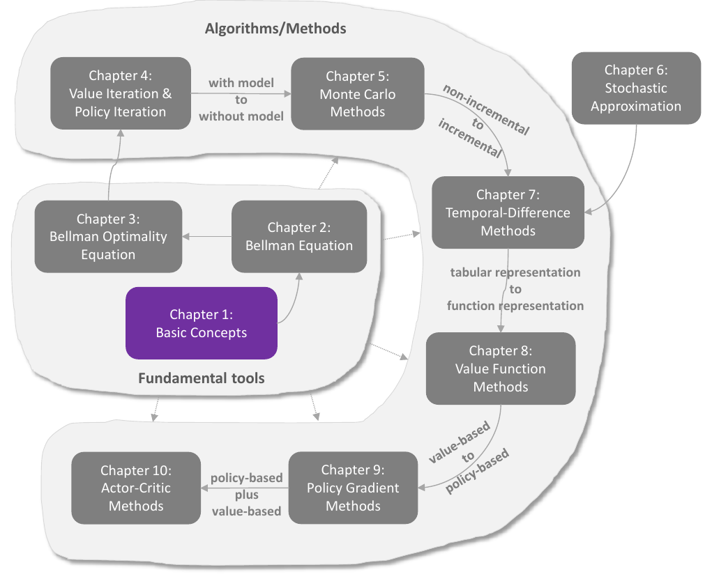

# Hướng dẫn tiếp cận và đọc

> Ghi chú của người biên soạn: trang này tổng hợp lời khuyên đọc của hai tài liệu mà site dựa vào. Đó là phần *Hướng dẫn sử dụng* của Sách Nấm EasyRL, cùng lời tựa và phần *Overview of this Book* trong sách của Shiyu Zhao. Các ý do người biên soạn tự đề xuất được ghi *(gợi ý của người biên soạn)*.

## 1. Hai tài liệu, hai cách tiếp cận

Site gom hai cuốn sách, viết cho hai mục đích khác nhau:

| | Sách Nấm EasyRL | Sách của Shiyu Zhao |
|---|---|---|
| Câu hỏi trả lời | thuật toán **làm gì** và **cài đặt thế nào** | thuật toán **vì sao được thiết kế như vậy** và **vì sao đúng** |
| Nguồn gốc | chương 1–2 theo *Đại cương học tăng cường* (Chu Bác Lỗi); chương 3 và 12 theo khóa thực hành của Lý Khoa Kiêu; chương 4–11 theo khóa *Học tăng cường sâu* của Lý Hoành Nghị (Hung-yi Lee) | giáo trình cao học Zhao dạy từ 2019 |
| Cách trình bày | ví dụ trò chơi, hình minh họa, mã nguồn, bài tập | định nghĩa, định lý, chứng minh; mọi ví dụ dùng chung một thế giới lưới |
| Phần mạnh nhất | học tăng cường sâu: DQN, PPO, DDPG, các mẹo thực hành | phương trình Bellman, tính hội tụ, xấp xỉ ngẫu nhiên |
| Phạm vi | rộng, tới phần thưởng thưa, học bắt chước, các bài báo | hẹp hơn, nhưng chương sau xây trên chương trước |

Hai cuốn bổ sung cho nhau. EasyRL cho bạn trực giác và code chạy được. Zhao lấp các lỗ hổng toán học mà EasyRL thường lướt qua.

## 2. Cần biết gì trước khi đọc

- **Xác suất và đại số tuyến tính.** Zhao nói rõ sách không đòi hỏi kiến thức học tăng cường, nhưng cần nền xác suất và đại số tuyến tính. Ông cũng **khuyên mạnh** bạn đọc nắm chắc xác suất, vì nó cần cho toàn bộ môn học. Phần còn thiếu có thể tra ở [Phụ lục Kiến thức nền toán học](mathrl/appendix_vi).
- **Học sâu cơ bản** cho EasyRL chương 4 trở đi *(gợi ý của người biên soạn)*. Các chương này dùng mạng nơ-ron làm hàm xấp xỉ. Nếu chưa quen, Sách Nấm giới thiệu [giáo trình học sâu của Lý Hoành Nghị (LeeDL-Tutorial)](https://github.com/datawhalechina/leedl-tutorial).
- **Python** để chạy các dự án và [code đi kèm Sách Nấm](https://github.com/datawhalechina/easy-rl/tree/master/notebooks).
- **Ký hiệu.** Hai sách viết ký hiệu hơi khác nhau, ví dụ EasyRL viết $V_\pi$, còn Zhao viết $v_\pi$. Xem [Quy ước ký hiệu](notation_vi) trước khi đọc chéo.

## 3. Bản đồ phụ thuộc của sách Zhao

Theo phần tổng quan của Zhao, mười chương chia làm hai phần, và **nên đọc lần lượt từng chương**, vì chương sau gần như luôn cần chương trước:

Bản đồ 10 chương. Nguồn: Zhao (2025), hình 1.1

- **Công cụ nền tảng (chương 1–3).** Chưa có thuật toán học nào, nhưng mọi thuật toán phía sau đều dựa vào đây.
- **Chuỗi phụ thuộc chính.** Zhao giải thích chuỗi này như sau:
  - muốn hiểu Monte Carlo (chương 5) phải hiểu lặp chính sách;
  - lặp chính sách mở rộng từ lặp giá trị (chương 4);
  - lặp giá trị chính là cách giải phương trình tối ưu Bellman (chương 3);
  - muốn hiểu phương trình tối ưu Bellman phải biết phương trình Bellman (chương 2).

  Bỏ qua một mắt xích thì các chương sau sẽ khó hiểu.
- **Chương 4 là bản lề.** Đây là chương cuối cần mô hình môi trường; từ chương 5 trở đi đều không cần mô hình. Zhao dặn phải hiểu kỹ chương 4 trước khi đi tiếp.
- **Chương 6 lấp khoảng trống giữa chương 5 và 7.** Monte Carlo không tăng dần, còn TD thì tăng dần. Chương 6 không có thuật toán học tăng cường nào, nhưng thiếu nó thì chương 7 trở nên khó hiểu.
- **Chương 8 và 9 trước chương 10.** Diễn viên–nhà phê bình là gradient chính sách (chương 9) kết hợp với xấp xỉ hàm giá trị (chương 8).

Zhao cũng lưu ý: đọc phần tổng quan lần đầu mà gặp nhiều khái niệm chưa hiểu là bình thường. Mục đích của nó là giúp bạn có cái nhìn tổng thể để tự lên kế hoạch học.

## 4. Chọn lộ trình theo mục tiêu

### Lộ trình A: thực hành nhanh (chỉ EasyRL)

Dành cho người muốn sớm cài đặt được thuật toán:

1. [Chương 1](chapter1/chapter1_vi) → [Chương 2](chapter2/chapter2_vi) → [Chương 3](chapter3/chapter3_vi), làm [Dự án 1](chapter3/project1_vi).
2. [Chương 6](chapter6/chapter6_vi) → [Chương 7](chapter7/chapter7_vi), làm [Dự án 2](chapter7/project2_vi), rồi [Chương 8](chapter8/chapter8_vi).
3. [Chương 4](chapter4/chapter4_vi) → [Chương 5](chapter5/chapter5_vi) → [Chương 9](chapter9/chapter9_vi) → [Chương 12](chapter12/chapter12_vi), làm [Dự án 3](chapter12/project3_vi).
4. Mở rộng: [Chương 10](chapter10/chapter10_vi), [11](chapter11/chapter11_vi), rồi các chuyên đề 13–16.

Ở bước 2–3, nhánh dựa trên giá trị (DQN) được đưa lên trước nhánh dựa trên chính sách *(gợi ý của người biên soạn)*. Lý do là DQN nối thẳng từ Q-learning ở chương 3. Bạn vẫn có thể đọc đúng thứ tự 1 → 12 của sách.

### Lộ trình B: hiểu sâu nền tảng (chỉ Zhao)

Dành cho người muốn nắm chắc lý thuyết. Đọc [Giới thiệu](mathrl/README_vi), rồi [chương 1](mathrl/ch01_vi) đến [chương 10](mathrl/ch10_vi) **đúng thứ tự**. Tra [Phụ lục](mathrl/appendix_vi) khi gặp khái niệm xác suất hay hội tụ chưa quen.

### Lộ trình C: kết hợp hai sách (khuyến nghị)

Ở mỗi giai đoạn, đọc EasyRL trước để có trực giác, rồi đọc Zhao để hiểu vì sao nó đúng *(gợi ý của người biên soạn, dựa trên bảng đối chiếu ở trang [Giới thiệu](mathrl/README_vi))*:

| Giai đoạn | Trực giác (EasyRL) | Nền tảng (Zhao) | Thực hành |
|---|---|---|---|
| 1. Khái niệm cơ bản | [Chương 1](chapter1/chapter1_vi) | [Chương 1](mathrl/ch01_vi) | |
| 2. MDP và phương trình Bellman | [Chương 2](chapter2/chapter2_vi) | [Chương 2](mathrl/ch02_vi), [3](mathrl/ch03_vi), [4](mathrl/ch04_vi) | [Mô phỏng chương 2](chapter2/chapter2_viz_vi) |
| 3. Học không mô hình, dạng bảng | [Chương 3](chapter3/chapter3_vi) | [Chương 5](mathrl/ch05_vi), [6](mathrl/ch06_vi), [7](mathrl/ch07_vi) | [Dự án 1](chapter3/project1_vi), [mô phỏng chương 3](chapter3/chapter3_viz_vi) |
| 4. Xấp xỉ hàm giá trị và DQN | [Chương 6](chapter6/chapter6_vi), [7](chapter7/chapter7_vi), [8](chapter8/chapter8_vi) | [Chương 8](mathrl/ch08_vi) | [Dự án 2](chapter7/project2_vi) |
| 5. Gradient chính sách | [Chương 4](chapter4/chapter4_vi), [5](chapter5/chapter5_vi) | [Chương 9](mathrl/ch09_vi) | [Mô phỏng chương 4](chapter4/chapter4_viz_vi) |
| 6. Diễn viên–nhà phê bình | [Chương 9](chapter9/chapter9_vi), [12](chapter12/chapter12_vi) | [Chương 10](mathrl/ch10_vi) | [Dự án 3](chapter12/project3_vi) |
| 7. Mở rộng | [Chương 10](chapter10/chapter10_vi), [11](chapter11/chapter11_vi), chuyên đề 13–16 | | |

Giai đoạn 3 có một chỗ EasyRL không có: **xấp xỉ ngẫu nhiên** ([Zhao chương 6](mathrl/ch06_vi)). Đây là lý do toán học khiến Q-learning và TD hội tụ, nên đừng bỏ qua dù không có chương EasyRL tương ứng.

## 5. Cách đọc một chương

### Chương EasyRL

Mỗi chương EasyRL có một bộ trang đi kèm. Dùng chúng theo thứ tự:

1. **Đọc bài chính** để nắm ý tưởng. Chưa cần hiểu hết mọi công thức.
2. **[Ghi chú trọng tâm](chapter1/chapter1_notes_vi)**: xem lại các ý chính trong vài phút.
3. **[Bài tập](chapter1/chapter1_questions&keywords_vi)**: tự trả lời các câu hỏi và từ khóa trước khi xem đáp án.
4. **[Ôn tập](chapter1/chapter1_review_vi)**: flashcard và quiz. Quay lại sau vài ngày để nhớ lâu.
5. **Mô phỏng** (nếu có, ví dụ [chương 2](chapter2/chapter2_viz_vi)): tự chỉnh tham số và quan sát thuật toán chạy.
6. **Code** (nếu có, ví dụ [chương 3](chapter3/chapter3_code_vi)): đọc code của thuật toán cạnh công thức, kèm kết quả và ảnh động đã chạy sẵn. Chương Zhao cũng có trang Code riêng, ví dụ [chương 4](mathrl/ch04_code_vi).
7. **Dự án và notebook**: chạy lại [notebook đi kèm](https://github.com/nmc2004nd/easy-rl-vi/tree/main/notebooks), đổi thử siêu tham số.

### Chương Zhao

- **Phần nâng cao là tùy chọn.** Zhao đặt các chứng minh và phần toán sâu trong hộp xám, và nói rõ bạn đọc có thể chọn đọc theo hứng thú. Trên site, những phần như vậy được ghi *(phần nâng cao)* ở tiêu đề (ví dụ định lý Dvoretzky ở chương 6). Lần đầu có thể bỏ qua, quay lại sau khi đã nắm ý chính.
- **Tách ý cốt lõi khỏi chi tiết.** Sách cố ý trình bày ý tưởng cốt lõi của thuật toán trước, rồi mới tới các biến thể. Hãy chắc rằng bạn nói lại được ý cốt lõi trước khi sang phần sau.
- **Tự tính lại ví dụ thế giới lưới.** Mọi ví dụ dùng chung một thế giới lưới nhỏ, đủ nhỏ để tính bằng tay. Tự giải phương trình Bellman cho vài ô là cách nhanh nhất để thấm.
- **Đọc mã giả.** Mỗi thuật toán có một khung mã giả. Thử đối chiếu từng dòng với công thức cập nhật trong bài.
- **Mục Hỏi đáp cuối chương** gom những câu hỏi người học hay vướng. Đọc nó như một bài tự kiểm tra.
- **Xem video bài giảng.** Zhao khuyên đọc sách kết hợp với video. Bài giảng tiếng Anh có trên [YouTube](https://www.youtube.com/playlist?list=PLEhdbSEZZbDaFWPX4gehhwB9vJZJ1DNm8), tiếng Trung có trên [Bilibili](https://space.bilibili.com/2044042934). Slide và mã thế giới lưới (Python, MATLAB) có ở [repo của sách](https://github.com/MathFoundationRL/Book-Mathematical-Foundation-of-Reinforcement-Learning).

## 6. Công cụ trên site

- **[Bản đồ kiến thức RL](explorer_vi)**: nhìn toàn cảnh các thuật toán và khái niệm, kèm công thức và liên kết về sách.
- **[Quy ước ký hiệu](notation_vi)**: bảng quy đổi ký hiệu giữa EasyRL và Zhao.
- **Tìm kiếm** (Ctrl K): tra nhanh một thuật toán hoặc thuật ngữ trên cả hai phần.
- **Đánh dấu đã đọc**: chương bạn đọc xong có dấu ✓ trong mục lục. Nút "Đọc tiếp" trên thanh trên cùng đưa bạn về trang đang đọc dở.

## 7. Tài nguyên mở rộng

- [JoyRL](https://github.com/datawhalechina/joyrl): thư viện thuật toán của nhóm tác giả Sách Nấm.
- [Phân tích các bài báo kinh điển](https://github.com/datawhalechina/easy-rl/tree/master/papers) của Sách Nấm.
- [LS-Imagine](https://github.com/qiwang067/LS-Imagine) (học tăng cường chơi Minecraft) và [Awesome Visual RL](https://github.com/qiwang067/awesome-visual-rl) cho người muốn đi tiếp sang nghiên cứu.
