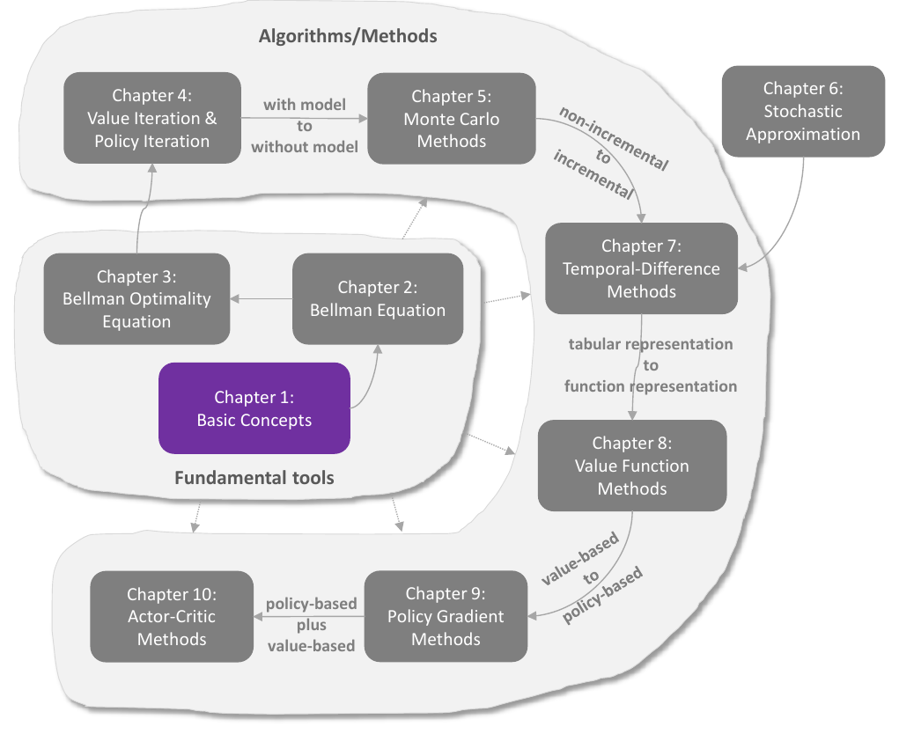

# Nền tảng toán học của học tăng cường

> Ghi chú của người biên soạn: phần này là **bản tổng hợp tiếng Việt** (không phải bản dịch nguyên văn) của cuốn *Mathematical Foundations of Reinforcement Learning* của Shiyu Zhao (Springer và NXB Đại học Thanh Hoa, 2025), có bổ sung từ loạt ghi chú [Reinforcement Learning trên blog lyk-love](https://lyk-love.cn/tags/reinforcement-learning/). Nội dung được diễn giải lại theo cách hiểu của người biên soạn, giữ đầy đủ khái niệm, công thức, chứng minh và ví dụ chính. Hình ảnh được cắt từ bản PDF tác giả công bố trên GitHub và ghi nguồn dưới mỗi hình.

## Vì sao có phần này

Sách Nấm EasyRL đi nhanh từ trực giác đến các thuật toán học sâu (DQN, PPO, DDPG). Sách của Zhao đi theo hướng ngược lại: chậm, chặt chẽ, và trả lời câu hỏi **"vì sao thuật toán đó đúng"**. Hai nguồn bổ sung cho nhau:

| | EasyRL | Zhao |
|---|---|---|
| Mục tiêu | hiểu và cài đặt được thuật toán | hiểu nền tảng toán học của thuật toán |
| Cách trình bày | ví dụ, hình minh họa, mã nguồn | định nghĩa, định lý, chứng minh, ví dụ thế giới lưới |
| Điểm mạnh | học sâu, các mẹo thực hành | phương trình Bellman, tính hội tụ, xấp xỉ ngẫu nhiên |
| Ví dụ xuyên suốt | trò chơi Atari, CartPole, Pendulum | một thế giới lưới (grid world) duy nhất |

Gợi ý cách đọc: đọc một chương EasyRL để có trực giác, rồi đọc chương tương ứng ở đây để hiểu vì sao nó đúng. Bảng đối chiếu ở cuối trang.

## Bản đồ của sách

<div align=center>

</div>
<div align=center>Bản đồ 10 chương của sách. Nguồn: Zhao (2025), hình 1.1</div>

Sách chia làm hai phần:

- **Công cụ nền tảng (chương 1–3):** khái niệm cơ bản, phương trình Bellman, phương trình tối ưu Bellman. Không có thuật toán học nào, nhưng mọi thuật toán phía sau đều dựa trên chúng.
- **Thuật toán (chương 4–10):** đi theo ba bước chuyển lớn:
  1. **có mô hình → không mô hình:** lặp giá trị và lặp chính sách (chương 4) → Monte Carlo (chương 5);
  2. **không tăng dần → tăng dần:** Monte Carlo → xấp xỉ ngẫu nhiên (chương 6) → sai phân thời gian (chương 7);
  3. **dạng bảng → dạng hàm:** sai phân thời gian → phương pháp hàm giá trị (chương 8);
  4. **dựa trên giá trị → dựa trên chính sách:** gradient chính sách (chương 9) → diễn viên-nhà phê bình (chương 10).

## Danh sách chương

| Chương | Nội dung chính | Trạng thái |
|---|---|---|
| [1 Khái niệm cơ bản](mathrl/ch01_vi) | thế giới lưới, trạng thái, hành động, chính sách, phần thưởng, lợi tức, MDP | đã có |
| [2 Giá trị trạng thái và phương trình Bellman](mathrl/ch02_vi) | giá trị trạng thái, phương trình Bellman, dạng ma trận, đánh giá chính sách, giá trị hành động | đã có |
| [3 Giá trị tối ưu và phương trình tối ưu Bellman](mathrl/ch03_vi) | chính sách tối ưu, ánh xạ co, định lý điểm bất động, yếu tố ảnh hưởng chính sách tối ưu | đã có |
| [4 Lặp giá trị và lặp chính sách](mathrl/ch04_vi) | lặp giá trị, lặp chính sách, lặp chính sách cắt cụt | đã có |
| [5 Phương pháp Monte Carlo](mathrl/ch05_vi) | ước lượng trung bình, MC Basic, MC Exploring Starts, MC ε-tham lam, khám phá và khai thác | đã có |
| 6 Xấp xỉ ngẫu nhiên | ước lượng trung bình, Robbins-Monro, SGD | đang biên soạn |
| 7 Phương pháp sai phân thời gian | TD, Sarsa, TD n bước, Q-learning | đang biên soạn |
| 8 Phương pháp hàm giá trị | xấp xỉ hàm, phân phối dừng, DQN | đang biên soạn |
| 9 Phương pháp gradient chính sách | hàm mục tiêu, định lý gradient chính sách, REINFORCE | đang biên soạn |
| 10 Phương pháp diễn viên-nhà phê bình | QAC, A2C, diễn viên-nhà phê bình ngoài chính sách, DPG | đang biên soạn |

## Đối chiếu với EasyRL

| Zhao | EasyRL tương ứng | Mô phỏng có sẵn |
|---|---|---|
| 1 Khái niệm cơ bản | [Chương 1](chapter1/chapter1_vi), [Chương 2](chapter2/chapter2_vi) mục 2.1–2.3 | [Thế giới lưới](chapter2/chapter2_viz_vi) |
| 2 Phương trình Bellman | [Chương 2](chapter2/chapter2_vi) mục 2.2.2, 2.3.3–2.3.4, 2.3.9 | [Mô phỏng chương 2](chapter2/chapter2_viz_vi) |
| 3 Phương trình tối ưu Bellman | [Chương 2](chapter2/chapter2_vi) mục 2.3.10–2.3.12 | |
| 4 Lặp giá trị và lặp chính sách | [Chương 2](chapter2/chapter2_vi) mục 2.3.11–2.3.13 | [Mô phỏng chương 2](chapter2/chapter2_viz_vi) |
| 5 Monte Carlo | [Chương 3](chapter3/chapter3_vi) | [Mô phỏng chương 3](chapter3/chapter3_viz_vi) |
| 6 Xấp xỉ ngẫu nhiên | (không có) | |
| 7 Sai phân thời gian | [Chương 3](chapter3/chapter3_vi) | [Mô phỏng chương 3](chapter3/chapter3_viz_vi) |
| 8 Phương pháp hàm giá trị | [Chương 6](chapter6/chapter6_vi)–[8](chapter8/chapter8_vi) | [Mô phỏng chương 6](chapter6/chapter6_viz_vi) |
| 9 Gradient chính sách | [Chương 4](chapter4/chapter4_vi) | [Mô phỏng chương 4](chapter4/chapter4_viz_vi) |
| 10 Diễn viên-nhà phê bình | [Chương 9](chapter9/chapter9_vi), [Chương 12](chapter12/chapter12_vi) | [Mô phỏng chương 9](chapter9/chapter9_viz_vi) |

## Quy ước ký hiệu

Phần này tuân thủ chặt [chuẩn ký hiệu chung của site](notation_vi), theo đúng sách của Zhao. Năm điều cần nhớ khi đọc:

1. **Chữ hoa nghiêng là biến ngẫu nhiên** ($S_t, A_t, R_{t+1}, G_t$); **chữ thường là giá trị cụ thể** ($s, a, r$).
2. **Chữ hoa nét cong là tập hợp**: $\mathcal S, \mathcal A(s), \mathcal R(s,a)$.
3. **Phần thưởng của bước $t$ mang chỉ số $t+1$**: $S_t \xrightarrow{A_t} S_{t+1}, R_{t+1}$.
4. **Giá trị thật**: $v_\pi, q_\pi, v^{\ast}, q^{\ast}$. **Giá trị ước lượng**: $v_k, q_t, \hat q(s,a,w)$.
5. $\doteq$ là "được định nghĩa là"; $\ge, \le$ giữa vectơ là so sánh từng phần tử.

Đọc chéo với EasyRL thì tra [bảng quy đổi](notation_vi?id=_3-bảng-quy-đổi-từ-easyrl): EasyRL viết $V_\pi, Q_\pi$, và ở chương 4–11 viết $r_t$ cho cái mà chuẩn viết $R_{t+1}$.

## Nguồn và ghi công

- **Sách gốc:** Shiyu Zhao, *Mathematical Foundations of Reinforcement Learning*, Springer Nature Press và Tsinghua University Press, 2025. Tác giả công bố miễn phí bản PDF, slide bài giảng và mã nguồn tại [GitHub MathFoundationRL](https://github.com/MathFoundationRL/Book-Mathematical-Foundation-of-Reinforcement-Learning). Video bài giảng có trên [YouTube](https://www.youtube.com/playlist?list=PLEhdbSEZZbDaFWPX4gehhwB9vJZJ1DNm8) và [Bilibili](https://space.bilibili.com/2044042934).
- **Ghi chú bổ sung:** loạt bài [Reinforcement Learning trên blog lyk-love.cn](https://lyk-love.cn/tags/reinforcement-learning/), giấy phép CC BY-NC-SA 4.0. Các ý lấy từ blog được ghi *(theo lyk-love)*.
- Toàn bộ hình ảnh, ví dụ và cấu trúc chương thuộc về tác giả Shiyu Zhao. Người biên soạn chỉ diễn giải lại bằng tiếng Việt cho mục đích học tập, phi thương mại. Nếu tác giả không đồng ý, xin liên hệ qua [Issues của repo](https://github.com/nmc2004nd/easy-rl-vi/issues) để chỉnh sửa hoặc gỡ bỏ.

```bibtex
@book{zhao2025RLBook,
  title={Mathematical Foundations of Reinforcement Learning},
  author={S. Zhao},
  year={2025},
  publisher={Springer Press}
}
```
