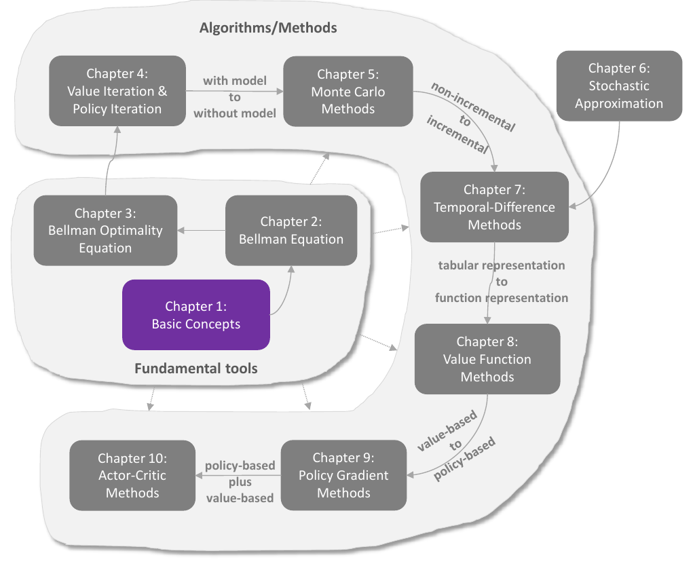
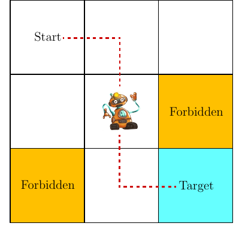
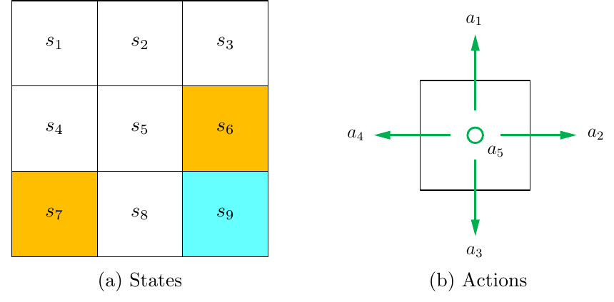
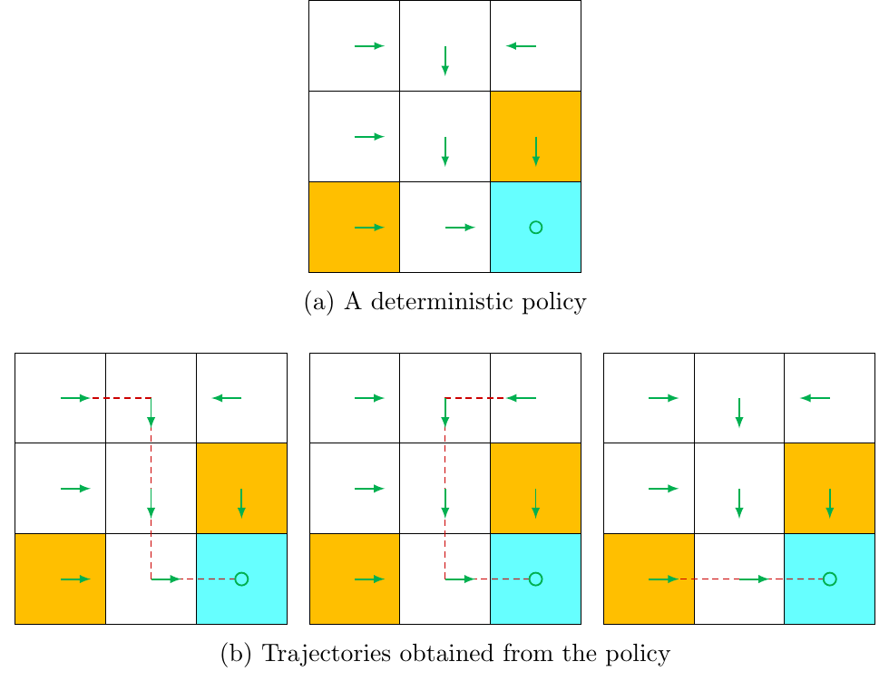
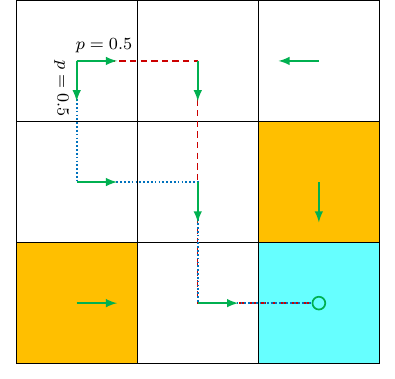
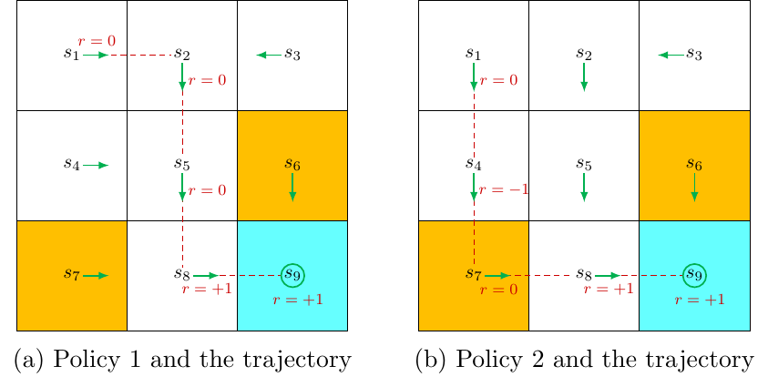
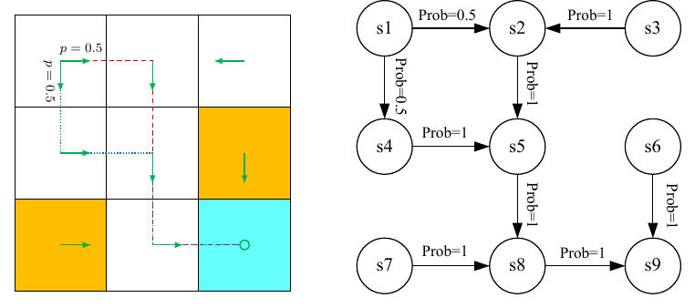

# Chương 1 Khái niệm cơ bản

> Ghi chú của người biên soạn: đây là bản tổng hợp tiếng Việt chương 1 sách *Mathematical Foundations of Reinforcement Learning* (Shiyu Zhao, 2025), có bổ sung từ bài [Basic Concepts in Reinforcement Learning](https://lyk-love.cn/2024/01/03/Basic-Concepts-in-Reinforcement-Learning/) trên blog lyk-love. Xem [giới thiệu phần này](mathrl/README_vi) để biết nguồn, và [Quy ước ký hiệu](notation_vi) cho chuẩn ký hiệu dùng chung. Ý không có trong sách được ghi rõ.

Hình 1.1 Vị trí của chương này trong sách. Nguồn: Zhao (2025)

Chương này giới thiệu những khái niệm sẽ dùng ở mọi chương sau. Cách trình bày: dùng một ví dụ thế giới lưới để giới thiệu từng khái niệm một cách trực quan, rồi gom tất cả vào khung toán học chính thức là **quá trình quyết định Markov (Markov decision process, MDP)**.

## 1.1 Ví dụ thế giới lưới

Một robot di chuyển trong một lưới ô vuông (hình 1.2). Robot được gọi là **tác tử (agent)**. Mỗi bước thời gian, nó đứng ở đúng một ô và có thể đi sang ô kề bên.

- Ô trắng: đi vào bình thường.
- Ô cam: **ô cấm (forbidden)**.
- Ô xanh: **ô đích (target)** mà robot muốn tới.

Hình 1.2 Ví dụ thế giới lưới dùng xuyên suốt sách. Nguồn: Zhao (2025)

**Mục tiêu cuối cùng** của tác tử là tìm một chính sách "tốt": xuất phát từ ô nào cũng tới được đích. "Tốt" ở đây nghĩa là tới đích mà **không đi vào ô cấm, không đi vòng vô ích và không đâm vào biên** của lưới.

Nếu tác tử biết trước bản đồ thì việc tìm đường là tầm thường. Bài toán chỉ trở nên khó khi tác tử **không biết gì về môi trường** và phải tương tác, thử và sai để tìm chính sách tốt. Để mô tả quá trình đó, ta cần các khái niệm dưới đây.

Sách dùng các ví dụ thế giới lưới kiểu này cho mọi chương, vì chúng trực quan và đủ đơn giản để minh họa từng thuật toán.

## 1.2 Trạng thái và hành động

**Trạng thái (state)** mô tả tình trạng của tác tử so với môi trường. Trong thế giới lưới, trạng thái chính là **vị trí** của tác tử. Có 9 ô nên có 9 trạng thái $s_1, s_2, \dots, s_9$ (hình 1.3a). Tập hợp mọi trạng thái là **không gian trạng thái (state space)**:

$$
\mathcal S = \{s_1, \dots, s_9\}.
$$

Ở mỗi trạng thái, tác tử có 5 **hành động (action)**: đi lên, sang phải, xuống, sang trái và đứng yên, ký hiệu lần lượt $a_1, \dots, a_5$ (hình 1.3b). Tập hợp mọi hành động là **không gian hành động (action space)**:

$$
\mathcal A = \{a_1, \dots, a_5\}.
$$

Hình 1.3 (a) Chín trạng thái. (b) Năm hành động ở mỗi trạng thái. Nguồn: Zhao (2025)

Các trạng thái khác nhau có thể có không gian hành động khác nhau. Ví dụ, ở $s_1$, đi lên ($a_1$) hay sang trái ($a_4$) đều đâm vào biên, nên có thể đặt $\mathcal A(s_1) = \{a_2, a_3, a_5\}$. Sách xét trường hợp tổng quát nhất: mọi trạng thái đều có đủ 5 hành động, $\mathcal A(s_i) = \mathcal A$ với mọi $i$.

### Trạng thái và quan sát *(theo lyk-love)*

Nhiều tài liệu dùng thêm từ **quan sát (observation)**:

- **Trạng thái** $s$ là mô tả **đầy đủ** về thế giới; không có thông tin nào bị ẩn.
- **Quan sát** $o$ là mô tả **một phần** của trạng thái, có thể thiếu thông tin.
- Môi trường **quan sát được toàn bộ (fully observed)** nếu tác tử thấy được toàn bộ trạng thái, và **quan sát được một phần (partially observed)** nếu chỉ thấy quan sát.

Trong thực tế, chính sách thường phụ thuộc vào quan sát vì tác tử không biết trạng thái thật, nhưng theo thói quen người ta vẫn viết $\pi(a \mid s)$. Sách của Zhao chỉ xét trường hợp quan sát được toàn bộ.

## 1.3 Chuyển trạng thái

Khi thực hiện một hành động, tác tử có thể chuyển từ trạng thái này sang trạng thái khác. Quá trình đó gọi là **chuyển trạng thái (state transition)**. Ví dụ, đang ở $s_1$ và chọn $a_2$ (sang phải) thì tác tử tới $s_2$:

$$
s_1 \xrightarrow{a_2} s_2.
$$

Có hai trường hợp đặc biệt cần quy ước:

1. **Đi ra ngoài biên**, ví dụ chọn $a_1$ ở $s_1$: tác tử không thể rời khỏi không gian trạng thái nên bị **dội lại**: $s_1 \xrightarrow{a_1} s_1$.
2. **Đi vào ô cấm**, ví dụ chọn $a_2$ ở $s_5$ (ô $s_6$ là ô cấm). Có hai cách mô hình hóa:
   - ô cấm **vẫn vào được** nhưng bị phạt: $s_5 \xrightarrow{a_2} s_6$;
   - ô cấm **không vào được**, ví dụ vì có tường bao quanh: tác tử bị dội lại, $s_5 \xrightarrow{a_2} s_5$.

Chọn cách nào tùy vào môi trường vật lý. **Sách chọn cách thứ nhất**: ô cấm vẫn vào được nhưng bị phạt. Cách này tổng quát và thú vị hơn. Vì đây là bài toán mô phỏng nên ta được phép tự định nghĩa quá trình chuyển; trong ứng dụng thực tế, nó do động lực học của thế giới thật quyết định.

**Biểu diễn bằng bảng.** Mỗi hàng là một trạng thái, mỗi cột là một hành động, mỗi ô là trạng thái kế tiếp:

| | $a_1$ (lên) | $a_2$ (phải) | $a_3$ (xuống) | $a_4$ (trái) | $a_5$ (đứng yên) |
|---|---|---|---|---|---|
| $s_1$ | $s_1$ | $s_2$ | $s_4$ | $s_1$ | $s_1$ |
| $s_2$ | $s_2$ | $s_3$ | $s_5$ | $s_1$ | $s_2$ |
| $s_3$ | $s_3$ | $s_3$ | $s_6$ | $s_2$ | $s_3$ |
| $s_4$ | $s_1$ | $s_5$ | $s_7$ | $s_4$ | $s_4$ |
| $s_5$ | $s_2$ | $s_6$ | $s_8$ | $s_4$ | $s_5$ |
| $s_6$ | $s_3$ | $s_6$ | $s_9$ | $s_5$ | $s_6$ |
| $s_7$ | $s_4$ | $s_8$ | $s_7$ | $s_7$ | $s_7$ |
| $s_8$ | $s_5$ | $s_9$ | $s_8$ | $s_7$ | $s_8$ |
| $s_9$ | $s_6$ | $s_9$ | $s_9$ | $s_8$ | $s_9$ |

Bảng 1.1 Biểu diễn dạng bảng của quá trình chuyển trạng thái

**Biểu diễn bằng xác suất có điều kiện.** Bảng chỉ mô tả được chuyển **tất định**. Cách tổng quát là dùng xác suất có điều kiện $p(s' \mid s, a)$. Ví dụ với $s_1$ và $a_2$:

$$
p(s_1 \mid s_1, a_2) = 0,\quad p(s_2 \mid s_1, a_2) = 1,\quad p(s_3 \mid s_1, a_2) = 0,\quad p(s_4 \mid s_1, a_2) = 0,\quad p(s_5 \mid s_1, a_2) = 0.
$$

Nghĩa là chọn $a_2$ ở $s_1$ thì **chắc chắn** tới $s_2$.

Nói chung, chuyển trạng thái có thể **ngẫu nhiên**. Ví dụ có gió thổi ngẫu nhiên: chọn $a_2$ ở $s_1$ có thể bị thổi xuống $s_5$, khi đó $p(s_5 \mid s_1, a_2) > 0$. Để đơn giản, các ví dụ thế giới lưới trong sách chỉ dùng chuyển tất định.

> Kiến thức xác suất có điều kiện nằm ở phụ lục A của sách. Tác giả khuyên nên nắm chắc lý thuyết xác suất trước khi học học tăng cường.

## 1.4 Chính sách

**Chính sách (policy)** cho tác tử biết phải chọn hành động nào ở mỗi trạng thái. Một cách trực quan, có thể vẽ chính sách bằng các mũi tên (hình 1.4a). Đi theo chính sách từ một trạng thái ban đầu, tác tử sinh ra một **quỹ đạo (trajectory)** (hình 1.4b).

Hình 1.4 (a) Một chính sách tất định vẽ bằng mũi tên. (b) Các quỹ đạo sinh ra từ chính sách đó khi xuất phát ở các trạng thái khác nhau. Nguồn: Zhao (2025)

Về mặt toán học, chính sách là một **phân phối xác suất có điều kiện** $\pi(a \mid s)$ định nghĩa cho từng trạng thái. Với chính sách ở hình 1.4, tại $s_1$:

$$
\pi(a_1 \mid s_1) = 0,\quad \pi(a_2 \mid s_1) = 1,\quad \pi(a_3 \mid s_1) = 0,\quad \pi(a_4 \mid s_1) = 0,\quad \pi(a_5 \mid s_1) = 0.
$$

Đây là **chính sách tất định (deterministic policy)**: ở mỗi trạng thái, một hành động có xác suất 1.

Nói chung chính sách có thể **ngẫu nhiên (stochastic)**. Ở hình 1.5, tại $s_1$ tác tử đi sang phải hoặc đi xuống, mỗi hướng với xác suất 0.5:

$$
\pi(a_1 \mid s_1) = 0,\quad \pi(a_2 \mid s_1) = 0.5,\quad \pi(a_3 \mid s_1) = 0.5,\quad \pi(a_4 \mid s_1) = 0,\quad \pi(a_5 \mid s_1) = 0.
$$

Hình 1.5 Một chính sách ngẫu nhiên: ở s1, tác tử đi phải hoặc xuống với xác suất bằng nhau, 0.5. Nguồn: Zhao (2025)

**Biểu diễn dạng bảng.** Ô ở hàng $i$, cột $j$ là xác suất chọn hành động thứ $j$ ở trạng thái thứ $i$. Bảng dưới đây biểu diễn chính sách ở hình 1.5:

| | $a_1$ (lên) | $a_2$ (phải) | $a_3$ (xuống) | $a_4$ (trái) | $a_5$ (đứng yên) |
|---|---|---|---|---|---|
| $s_1$ | 0 | 0.5 | 0.5 | 0 | 0 |
| $s_2$ | 0 | 0 | 1 | 0 | 0 |
| $s_3$ | 0 | 0 | 0 | 1 | 0 |
| $s_4$ | 0 | 1 | 0 | 0 | 0 |
| $s_5$ | 0 | 0 | 1 | 0 | 0 |
| $s_6$ | 0 | 0 | 1 | 0 | 0 |
| $s_7$ | 0 | 1 | 0 | 0 | 0 |
| $s_8$ | 0 | 1 | 0 | 0 | 0 |
| $s_9$ | 0 | 0 | 0 | 0 | 1 |

Bảng 1.2 Biểu diễn dạng bảng của một chính sách

Cách này gọi là **biểu diễn dạng bảng (tabular representation)**. Chương 8 sẽ giới thiệu cách khác: biểu diễn chính sách bằng **hàm có tham số**.

### Ký hiệu chính sách hay gặp *(theo lyk-love, dựa trên OpenAI Spinning Up)*

| Loại | Ký hiệu chuẩn | Cách dùng | Tài liệu khác hay viết |
|---|---|---|---|
| Tất định | $\mu$ | $a_t = \mu(s_t)$ | |
| Ngẫu nhiên | $\pi$ | $a_t \sim \pi(\cdot \mid s_t)$, với $\sum_{a \in \mathcal A(s)} \pi(a \mid s) = 1$ | |
| Có tham số | $\pi(a \mid s, \theta)$, $\mu(s, \theta)$ | tham số $\theta$ viết sau dấu phẩy | $\pi_\theta(a \mid s)$, $\mu_\theta(s)$ |

Sách của Zhao luôn dùng $\pi$, vì chính sách tất định chỉ là trường hợp đặc biệt của chính sách ngẫu nhiên. Ký hiệu $\mu$ sẽ gặp lại ở thuật toán DPG (chương 10) và [DDPG của EasyRL](chapter12/chapter12_vi) (EasyRL viết $\mu_\theta(s)$). Xem [Quy ước ký hiệu](notation_vi) để biết chuẩn chung của site.

## 1.5 Phần thưởng

**Phần thưởng (reward)** là một trong những khái niệm đặc trưng nhất của học tăng cường.

Sau khi thực hiện một hành động ở một trạng thái, tác tử nhận được phần thưởng $r$ làm phản hồi từ môi trường. Phần thưởng là hàm của trạng thái $s$ và hành động $a$, nên cũng viết là $r(s,a)$. Giá trị của nó có thể dương, âm hoặc bằng 0:

- phần thưởng **dương** khuyến khích tác tử chọn hành động tương ứng;
- phần thưởng **âm** ngăn tác tử chọn hành động đó.

Trong ví dụ thế giới lưới, phần thưởng được thiết kế như sau:

| Tình huống | Phần thưởng |
|---|---|
| cố đi ra ngoài biên | $r_{\text{boundary}} = -1$ |
| cố đi vào ô cấm | $r_{\text{forbidden}} = -1$ |
| tới ô đích | $r_{\text{target}} = +1$ |
| các trường hợp khác | $r_{\text{other}} = 0$ |

**Lưu ý về ô đích $s_9$.** Quá trình không nhất thiết dừng khi tới $s_9$. Ở $s_9$:

- chọn $a_5$ (đứng yên) thì vẫn ở $s_9$ và nhận $r_{\text{target}} = +1$;
- chọn $a_2$ (sang phải) thì cũng vẫn ở $s_9$, nhưng vì đâm vào biên nên nhận $r_{\text{boundary}} = -1$.

**Phần thưởng là giao diện người–máy.** Thông qua phần thưởng, ta hướng dẫn tác tử hành xử như mong muốn. Với thiết kế trên, tác tử sẽ có xu hướng tránh biên và tránh ô cấm. Thiết kế phần thưởng phù hợp là bước quan trọng và không dễ với bài toán phức tạp, vì người thiết kế phải hiểu bài toán. Tuy vậy, cách này thường vẫn dễ hơn nhiều so với giải bài toán bằng các phương pháp khác đòi hỏi chuyên môn sâu.

**Biểu diễn dạng bảng** (phần thưởng nhận được khi chọn hành động ở cột tại trạng thái ở hàng):

| | $a_1$ (lên) | $a_2$ (phải) | $a_3$ (xuống) | $a_4$ (trái) | $a_5$ (đứng yên) |
|---|---|---|---|---|---|
| $s_1$ | $r_{\text{boundary}}$ | 0 | 0 | $r_{\text{boundary}}$ | 0 |
| $s_2$ | $r_{\text{boundary}}$ | 0 | 0 | 0 | 0 |
| $s_3$ | $r_{\text{boundary}}$ | $r_{\text{boundary}}$ | $r_{\text{forbidden}}$ | 0 | 0 |
| $s_4$ | 0 | 0 | $r_{\text{forbidden}}$ | $r_{\text{boundary}}$ | 0 |
| $s_5$ | 0 | $r_{\text{forbidden}}$ | 0 | 0 | 0 |
| $s_6$ | 0 | $r_{\text{boundary}}$ | $r_{\text{target}}$ | 0 | $r_{\text{forbidden}}$ |
| $s_7$ | 0 | 0 | $r_{\text{boundary}}$ | $r_{\text{boundary}}$ | $r_{\text{forbidden}}$ |
| $s_8$ | 0 | $r_{\text{target}}$ | $r_{\text{boundary}}$ | $r_{\text{forbidden}}$ | 0 |
| $s_9$ | $r_{\text{forbidden}}$ | $r_{\text{boundary}}$ | $r_{\text{boundary}}$ | 0 | $r_{\text{target}}$ |

Bảng 1.3 Biểu diễn dạng bảng của quá trình nhận phần thưởng (tất định)

*(ghi chú của người biên soạn)* Để ý: ở $s_6$ và $s_7$ (ô cấm), đứng yên vẫn bị phạt $r_{\text{forbidden}}$, có thể hiểu là tác tử lại "đi vào" ô cấm thêm một lần.

⚠️ **Câu hỏi hay gặp của người mới:** đã có bảng phần thưởng rồi, sao không chọn luôn hành động có phần thưởng lớn nhất ở mỗi trạng thái? **Không được.** Các con số trong bảng là **phần thưởng tức thời (immediate reward)**, chỉ nhận ngay sau một bước. Để biết chính sách nào tốt, phải xét **tổng phần thưởng về lâu dài** (mục 1.6). Hành động có phần thưởng tức thời lớn nhất chưa chắc dẫn tới tổng phần thưởng lớn nhất.

**Biểu diễn bằng xác suất.** Bảng chỉ mô tả được phần thưởng tất định. Cách tổng quát hơn là dùng $p(r \mid s, a)$. Ví dụ tại $s_1$:

$$
p(r = -1 \mid s_1, a_1) = 1,\qquad p(r \ne -1 \mid s_1, a_1) = 0.
$$

Nghĩa là chọn $a_1$ ở $s_1$ thì chắc chắn nhận $r = -1$. Trong ví dụ này phần thưởng là tất định, nhưng nói chung nó có thể ngẫu nhiên. Ví dụ: học chăm thì điểm thi cao hơn (phần thưởng dương), nhưng cao bao nhiêu thì không chắc chắn.

## 1.6 Quỹ đạo, lợi tức và tập

Hình 1.6 Quỹ đạo (nét đứt đỏ) sinh ra khi đi theo hai chính sách khác nhau. Nguồn: Zhao (2025)

**Quỹ đạo (trajectory)** là một chuỗi trạng thái–hành động–phần thưởng. Đi theo chính sách ở hình 1.6a, xuất phát từ $s_1$:

$$
s_1 \xrightarrow[r=0]{a_2} s_2 \xrightarrow[r=0]{a_3} s_5 \xrightarrow[r=0]{a_3} s_8 \xrightarrow[r=1]{a_2} s_9.
$$

**Lợi tức (return)** của quỹ đạo là tổng mọi phần thưởng thu được dọc quỹ đạo:

$$
\text{lợi tức} = 0 + 0 + 0 + 1 = 1. \tag{1.1}
$$

Lợi tức còn gọi là **tổng phần thưởng (total reward)** hay **phần thưởng tích lũy (cumulative reward)**.

### Dùng lợi tức để đánh giá chính sách

Với chính sách ở hình 1.6b, xuất phát từ $s_1$:

$$
s_1 \xrightarrow[r=0]{a_3} s_4 \xrightarrow[r=-1]{a_3} s_7 \xrightarrow[r=0]{a_2} s_8 \xrightarrow[r=+1]{a_2} s_9,
$$

$$
\text{lợi tức} = 0 - 1 + 0 + 1 = 0. \tag{1.2}
$$

So sánh (1.1) và (1.2): chính sách bên trái tốt hơn vì lợi tức lớn hơn. Kết luận toán học này khớp với trực giác: chính sách bên phải đi qua ô cấm.

Lợi tức gồm **phần thưởng tức thời** (nhận ngay sau hành động đầu tiên) và **phần thưởng tương lai** (nhận sau khi rời trạng thái ban đầu). Có thể phần thưởng tức thời âm nhưng phần thưởng tương lai dương. Vì thế, chọn hành động phải dựa vào lợi tức (tổng phần thưởng), không phải phần thưởng tức thời, để tránh quyết định thiển cận.

*(theo lyk-love)* Quỹ đạo phụ thuộc vào chính sách, lợi tức phụ thuộc vào quỹ đạo, nên **lợi tức cũng phụ thuộc vào chính sách**.

### Quỹ đạo vô hạn và lợi tức chiết khấu

Lợi tức ở (1.1) định nghĩa cho quỹ đạo hữu hạn. Nhưng quá trình không nhất thiết dừng ở $s_9$, vì chính sách đã được định nghĩa cả cho $s_9$. Nếu chính sách cho tác tử đứng yên khi tới $s_9$, ta được quỹ đạo vô hạn:

$$
s_1 \xrightarrow[r=0]{a_2} s_2 \xrightarrow[r=0]{a_3} s_5 \xrightarrow[r=0]{a_3} s_8 \xrightarrow[r=1]{a_2} s_9 \xrightarrow[r=1]{a_5} s_9 \xrightarrow[r=1]{a_5} s_9 \cdots
$$

Cộng thẳng các phần thưởng thì **phân kỳ**:

$$
\text{lợi tức} = 0 + 0 + 0 + 1 + 1 + 1 + \cdots = \infty.
$$

Vì vậy cần **lợi tức chiết khấu (discounted return)**: tổng các phần thưởng đã nhân với lũy thừa của **hệ số chiết khấu (discount rate)** $\gamma \in (0,1)$:

$$
\text{lợi tức chiết khấu} = 0 + \gamma \cdot 0 + \gamma^2 \cdot 0 + \gamma^3 \cdot 1 + \gamma^4 \cdot 1 + \gamma^5 \cdot 1 + \cdots \tag{1.3}
$$

Với $\gamma \in (0,1)$, chuỗi này hội tụ:

$$
\text{lợi tức chiết khấu} = \gamma^3 (1 + \gamma + \gamma^2 + \cdots) = \gamma^3 \frac{1}{1-\gamma}.
$$

**Hai tác dụng của hệ số chiết khấu:**

1. Bỏ được điều kiện dừng, cho phép quỹ đạo dài vô hạn.
2. Điều chỉnh mức coi trọng phần thưởng gần và xa:
   - $\gamma$ gần 0: coi trọng phần thưởng **gần**, chính sách **thiển cận**;
   - $\gamma$ gần 1: coi trọng phần thưởng **xa**, chính sách **nhìn xa**, dám chịu phần thưởng âm trước mắt để được lợi về sau.

Điều này sẽ được minh họa bằng ví dụ ở mục 3.5 (chương 3).

### Tập, bài toán có tập và bài toán liên tục

Khi tương tác với môi trường theo một chính sách, tác tử có thể dừng ở một số **trạng thái kết thúc (terminal state)**. Quỹ đạo thu được gọi là một **tập (episode)** hay một **lượt thử (trial)**. *(theo lyk-love)* Cũng hay gọi là một **rollout**.

- Nếu môi trường hoặc chính sách ngẫu nhiên: xuất phát cùng một trạng thái có thể cho các tập khác nhau.
- Nếu mọi thứ tất định: xuất phát cùng một trạng thái luôn cho cùng một tập.

| Loại bài toán | Đặc điểm |
|---|---|
| **Có tập (episodic task)** | có trạng thái kết thúc, mỗi tập thường hữu hạn |
| **Liên tục (continuing task)** | không có trạng thái kết thúc, tương tác kéo dài mãi |

**Thống nhất hai loại.** Có thể chuyển bài toán có tập thành bài toán liên tục bằng cách định nghĩa rõ điều gì xảy ra sau khi tới trạng thái kết thúc. Có hai cách:

1. **Coi trạng thái kết thúc là trạng thái đặc biệt.** Thiết kế không gian hành động hoặc quá trình chuyển sao cho tác tử ở đó mãi mãi. Trạng thái như vậy gọi là **trạng thái hấp thụ (absorbing state)**. Ví dụ với $s_9$: đặt $\mathcal A(s_9) = \{a_5\}$, hoặc giữ $\mathcal A(s_9) = \{a_1, \dots, a_5\}$ nhưng cho $p(s_9 \mid s_9, a_i) = 1$ với mọi $i$.
2. **Coi trạng thái kết thúc là trạng thái bình thường.** Không gian hành động giống các trạng thái khác; tác tử có thể rời đi rồi quay lại. Vì mỗi lần tới $s_9$ đều được $r = 1$, tác tử rồi sẽ học được cách ở lại $s_9$ mãi để gom thêm phần thưởng. Khi đó tập dài vô hạn và phần thưởng ở $s_9$ dương, nên **bắt buộc** dùng chiết khấu để lợi tức không phân kỳ.

**Sách chọn cách thứ hai**: ô đích là trạng thái bình thường với $\mathcal A(s_9) = \{a_1, \dots, a_5\}$.

## 1.7 Quá trình quyết định Markov

Các mục trước giới thiệu khái niệm qua ví dụ. Mục này phát biểu chúng một cách hình thức trong khung **quá trình quyết định Markov (MDP)**, một khung tổng quát để mô tả các hệ động lực ngẫu nhiên. Các thành phần chính:

**Các tập hợp**

- **Không gian trạng thái** $\mathcal S$: tập mọi trạng thái.
- **Không gian hành động** $\mathcal A(s)$: tập hành động gắn với mỗi trạng thái $s \in \mathcal S$.
- **Tập phần thưởng** $\mathcal R(s,a)$: tập phần thưởng gắn với mỗi cặp trạng thái–hành động $(s,a)$.

**Mô hình**

- **Xác suất chuyển trạng thái** $p(s' \mid s, a)$: xác suất tới $s'$ khi chọn $a$ ở $s$, với $\sum_{s' \in \mathcal S} p(s' \mid s, a) = 1$ cho mọi $(s,a)$.
- **Xác suất phần thưởng** $p(r \mid s, a)$: xác suất nhận $r$ khi chọn $a$ ở $s$, với $\sum_{r \in \mathcal R(s,a)} p(r \mid s, a) = 1$ cho mọi $(s,a)$.

**Chính sách** $\pi(a \mid s)$: xác suất chọn $a$ ở $s$, với $\sum_{a \in \mathcal A(s)} \pi(a \mid s) = 1$ cho mọi $s \in \mathcal S$.

**Tính chất Markov (Markov property)**, hay tính "không nhớ" của quá trình ngẫu nhiên:

$$
\begin{aligned}
p(s_{t+1} \mid s_t, a_t, s_{t-1}, a_{t-1}, \dots, s_0, a_0) &= p(s_{t+1} \mid s_t, a_t),\\
p(r_{t+1} \mid s_t, a_t, s_{t-1}, a_{t-1}, \dots, s_0, a_0) &= p(r_{t+1} \mid s_t, a_t),
\end{aligned} \tag{1.4}
$$

trong đó $t$ là bước hiện tại và $t+1$ là bước kế tiếp. Trạng thái và phần thưởng kế tiếp **chỉ phụ thuộc vào trạng thái và hành động hiện tại**, không phụ thuộc vào quá khứ. Tính chất này là chìa khóa để suy ra phương trình Bellman ở [chương 2](mathrl/ch02_vi).

*(theo lyk-love)* Hành động và phần thưởng tự nó không "có" tính chất Markov, nhưng **được định nghĩa** để chỉ phụ thuộc vào hiện tại: $a_t \sim \pi(\cdot \mid s_t)$ không phụ thuộc $s_{t-1}, s_{t-2}, \dots$, còn $r_{t+1}$ chỉ phụ thuộc $(s_t, a_t)$.

**Mô hình, hay động lực học (model, dynamics).** Họ xác suất $p(s' \mid s, a)$ và $p(r \mid s, a)$ với mọi $(s,a)$ được gọi chung là mô hình. Mô hình có thể:

- **dừng (stationary)**, hay bất biến theo thời gian: không đổi theo thời gian;
- **không dừng (nonstationary)**, hay biến thiên theo thời gian: ví dụ trong thế giới lưới, ô cấm lúc xuất hiện lúc biến mất.

Sách chỉ xét mô hình dừng.

### MDP và quá trình Markov

Khác nhau giữa **MDP** và **quá trình Markov (Markov process, MP)**: khi **cố định chính sách**, MDP suy biến thành MP. Ví dụ, thế giới lưới ở hình 1.7 với một chính sách cố định có thể trừu tượng hóa thành một quá trình Markov: mỗi vòng tròn là một trạng thái, mỗi mũi tên là một bước chuyển kèm xác suất.

Hình 1.7 Trừu tượng hóa ví dụ thế giới lưới thành một quá trình Markov. Nguồn: Zhao (2025)

Trong lý thuyết quá trình ngẫu nhiên, quá trình Markov thời gian rời rạc với số trạng thái hữu hạn hoặc đếm được còn gọi là **chuỗi Markov (Markov chain)**. Sách dùng hai tên này thay cho nhau. Sách cũng chủ yếu xét **MDP hữu hạn**: số trạng thái và số hành động đều hữu hạn. Đây là trường hợp đơn giản nhất và cần hiểu thật kỹ.

### Vòng tương tác tác tử–môi trường

Học tăng cường có thể mô tả là một quá trình tương tác giữa tác tử và môi trường:

- **Tác tử** là bên ra quyết định: cảm nhận trạng thái của mình, duy trì chính sách và thực hiện hành động.
- **Môi trường** là mọi thứ bên ngoài tác tử.

Trong thế giới lưới, tác tử là robot, môi trường là lưới. Tác tử quyết định hành động, bộ chấp hành (actuator) thực hiện hành động, trạng thái thay đổi và có phần thưởng. Tác tử diễn giải trạng thái mới và phần thưởng, và vòng lặp khép kín.

### Mục tiêu của học tăng cường *(theo lyk-love)*

Tìm một chính sách đạt lợi tức (chiết khấu) lớn nhất:

$$
G_t = R_{t+1} + \gamma R_{t+2} + \gamma^2 R_{t+3} + \cdots
$$

Chương 2 sẽ làm rõ "lớn nhất" theo nghĩa nào (kỳ vọng của $G_t$, tức giá trị trạng thái), và chương 3 định nghĩa chính xác "chính sách tối ưu".

## 1.8 Tóm tắt

Chương này giới thiệu các khái niệm cơ bản bằng ví dụ thế giới lưới, rồi hình thức hóa chúng trong khung MDP.

| Khái niệm | Ký hiệu | Ý nghĩa |
|---|---|---|
| Trạng thái | $s \in \mathcal S$ | tình trạng của tác tử so với môi trường |
| Hành động | $a \in \mathcal A(s)$ | lựa chọn của tác tử tại một trạng thái |
| Chuyển trạng thái | $p(s' \mid s,a)$ | trạng thái kế tiếp sau khi chọn $a$ ở $s$ |
| Chính sách | $\pi(a \mid s)$ | phân phối chọn hành động tại mỗi trạng thái |
| Phần thưởng | $p(r \mid s,a)$, $r(s,a)$ | phản hồi tức thời từ môi trường |
| Quỹ đạo | | chuỗi trạng thái–hành động–phần thưởng |
| Lợi tức (chiết khấu) | $\sum_k \gamma^k r_{t+k+1}$ | tổng phần thưởng (chiết khấu) dọc quỹ đạo |
| Tập | | quỹ đạo kết thúc ở trạng thái kết thúc |
| Mô hình | $p(s' \mid s,a)$, $p(r \mid s,a)$ | động lực học của môi trường |
| Tính chất Markov | (1.4) | tương lai chỉ phụ thuộc hiện tại |

Muốn tìm hiểu thêm về MDP, sách gợi ý: Pinsky và Karlin, *An Introduction to Stochastic Modeling* (1998); Puterman, *Markov Decision Processes: Discrete Stochastic Dynamic Programming* (2014).

## 1.9 Hỏi đáp

**Hỏi: Có thể đặt tất cả phần thưởng đều âm, hoặc đều dương không?**

Đáp: Được. Điều quyết định khuyến khích hay ngăn cản là **giá trị tương đối** giữa các phần thưởng, không phải giá trị tuyệt đối. Ví dụ, cộng $-2$ vào mọi phần thưởng của chương này:

| | ban đầu | sau khi cộng $-2$ |
|---|---|---|
| $r_{\text{boundary}}$ | $-1$ | $-3$ |
| $r_{\text{forbidden}}$ | $-1$ | $-3$ |
| $r_{\text{target}}$ | $+1$ | $-1$ |
| $r_{\text{other}}$ | $0$ | $-2$ |

Dù mọi phần thưởng đều âm, chính sách tối ưu **không đổi**, vì chính sách tối ưu bất biến dưới phép biến đổi affine của phần thưởng. Chi tiết ở mục 3.5.

**Hỏi: Phần thưởng có phải là hàm của trạng thái kế tiếp không?**

Đáp: Chương này nói $r$ chỉ phụ thuộc $s$ và $a$, không phụ thuộc trạng thái kế tiếp $s'$. Điều này có vẻ ngược trực giác, vì nhiều khi chính $s'$ quyết định phần thưởng (ví dụ, phần thưởng dương khi $s'$ là ô đích). Thực ra $r$ phụ thuộc cả $s$, $a$ và $s'$. Nhưng vì $s'$ lại phụ thuộc $s$ và $a$, ta có thể lấy trung bình theo $s'$ để viết $r$ như hàm của $(s,a)$:

$$
p(r \mid s, a) = \sum_{s'} p(r \mid s, a, s')\, p(s' \mid s, a).
$$

Viết như vậy thì phương trình Bellman ở chương 2 dễ thiết lập hơn.

### Bổ sung: hai cách phân loại thuật toán dễ lẫn *(theo lyk-love)*

| Trục phân loại | Câu hỏi | Hai loại |
|---|---|---|
| **Trực tuyến / ngoại tuyến** (online / offline) | Trong lúc huấn luyện, tác tử có được tương tác với môi trường để thu dữ liệu mới không? | trực tuyến: có; ngoại tuyến: chỉ học từ một tập dữ liệu cố định |
| **Theo chính sách / ngoài chính sách** (on-policy / off-policy) | Chính sách hành vi $\pi_b$ (sinh dữ liệu) có trùng chính sách mục tiêu $\pi$ (cần đánh giá hoặc cải thiện) không? | theo chính sách: $\pi_b = \pi$; ngoài chính sách: $\pi_b \ne \pi$ |

Ví dụ: Sarsa là thuật toán theo chính sách vì mục tiêu TD dùng hành động kế tiếp thực sự được lấy mẫu, $r_{t+1} + \gamma\, q_t(s_{t+1}, a_{t+1})$. Q-learning là thuật toán ngoài chính sách vì dùng hành động tốt nhất, $r_{t+1} + \gamma \max_{a} q_t(s_{t+1}, a)$. Ở đây $q_t$ là **ước lượng** giá trị hành động tại bước $t$, khác với giá trị thật $q_\pi$.

⚠️ **Ngoài chính sách không có nghĩa là ngoại tuyến.** Hai trục này độc lập với nhau. Q-learning thường là **trực tuyến, ngoài chính sách**. Chương 7 sẽ phân tích kỹ.

## Đọc tiếp

- [Chương 2 Giá trị trạng thái và phương trình Bellman](mathrl/ch02_vi)
- Đối chiếu với EasyRL: [Chương 1 Cơ bản về học tăng cường](chapter1/chapter1_vi) (tác tử, môi trường, khám phá và khai thác) và [Chương 2 mục 2.1–2.3](chapter2/chapter2_vi) (quá trình Markov, MRP, MDP).
- Thử tương tác: [mô phỏng thế giới lưới của chương 2](chapter2/chapter2_viz_vi).
