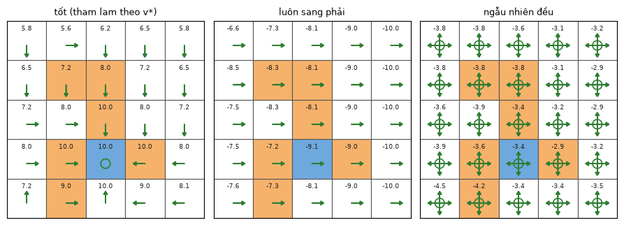
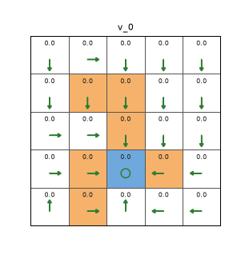

# Chương 2 · Code

> Ghi chú của người biên soạn: trang này không có trong sách. Nó giải phương trình Bellman của [chương 2](mathrl/ch02_vi) bằng numpy trên lưới 5×5, theo đúng ký hiệu của sách. Ví dụ 4 trạng thái ở hình 2.6 đã có ở mục "Kiểm tra bằng mã" trong chương. Ký hiệu theo [Quy ước ký hiệu](notation_vi).

Mỗi khối code đã được chạy sẵn. Kết quả, hình và ảnh động nằm ngay bên dưới. Các khối chạy lần lượt từ trên xuống và dùng chung biến, như notebook. Muốn tự chạy, xem [mục 5](#_5-chạy-trên-máy).

## 1. Từ chính sách tới $r_\pi$ và $P_\pi$

<small class="viz-ref">Mục 2.6 · công thức (2.10)</small>

Một chính sách ngẫu nhiên là ma trận `pi[s, a]` $= \pi(a \mid s)$, mỗi hàng cộng lại bằng 1. Từ mô hình (`P`, `R` của `make_grid`) và chính sách, ta dựng hai đại lượng của dạng ma trận–vectơ:

$$
r_\pi(s) = \sum_a \pi(a \mid s)\, r(s,a), \qquad [P_\pi]_{ss'} = \sum_a \pi(a \mid s)\, p(s' \mid s, a)
$$

<!-- run -->
```python
import numpy as np
import matplotlib.pyplot as plt
from zhao_grid import make_grid, value_iteration, plot_grid
from viz import save_gif

P, R = make_grid()                         # r_boundary = r_forbidden = -1, r_target = 1
gamma, n_s, n_a = 0.9, 25, 5

def model_of(pi):
    r_pi = (pi * R).sum(axis=1)                       # r_π(s) = Σ_a π(a|s) r(s,a)
    P_pi = np.einsum("sa,sat->st", pi, P)             # P_π[s, s'] = Σ_a π(a|s) p(s'|s,a)
    return r_pi, P_pi

def deterministic(actions):
    """Chính sách tất định từ mảng chỉ số hành động."""
    return np.eye(n_a)[np.asarray(actions)]

_, a_star = value_iteration(P, R, gamma)
policies = {
    "tốt (tham lam theo v*)": deterministic(a_star),
    "luôn sang phải": deterministic(np.full(n_s, 1)),
    "ngẫu nhiên đều": np.full((n_s, n_a), 1 / n_a),
}
r_pi, P_pi = model_of(policies["ngẫu nhiên đều"])
print("Mỗi hàng của P_π cộng lại bằng 1:", np.allclose(P_pi.sum(axis=1), 1))
print("r_π của 5 ô hàng đầu (chính sách đều):", r_pi[:5].round(2))
```

<!-- output -->
```output
Mỗi hàng của P_π cộng lại bằng 1: True
r_π của 5 ô hàng đầu (chính sách đều): [-0.4 -0.4 -0.4 -0.2 -0.4]
```
<!-- /output -->

## 2. Nghiệm dạng đóng: so sánh các chính sách

<small class="viz-ref">Mục 2.7.1, 2.7.3 · hình 2.7</small>

$v_\pi = (I - \gamma P_\pi)^{-1} r_\pi$. Trên máy tính nên giải hệ tuyến tính thay vì tính nghịch đảo:

<!-- run -->
```python
def evaluate(pi):
    r_pi, P_pi = model_of(pi)
    return np.linalg.solve(np.eye(n_s) - gamma * P_pi, r_pi)

fig, axes = plt.subplots(1, 3, figsize=(9, 3.3))
for ax, (name, pi) in zip(axes, policies.items()):
    v = evaluate(pi)
    plot_grid(v, pi, title=name, ax=ax)
    print(f"{name:24s}: v trung bình = {v.mean():6.2f}")
plt.tight_layout()
```

<!-- output -->
```output
tốt (tham lam theo v*)  : v trung bình =   7.80
luôn sang phải          : v trung bình =  -8.49
ngẫu nhiên đều          : v trung bình =  -3.52
```

<div align=center></div>
<!-- /output -->

Giống hình 2.7: chính sách tốt có giá trị dương ở mọi ô, cao nhất quanh đích. Chính sách "luôn sang phải" có giá trị âm ở **mọi** ô, kể cả ô đích: từ đích nó bước ra ngoài, rồi trôi dần sang cột phải và đâm biên mãi mãi, nên các ô ở cột phải có giá trị $-1/(1-0.9) = -10$. Ô bên trái đích là ô cấm, nên không có ô nào đi thẳng được vào đích mà không bị phạt trước. Chính sách đều có giá trị âm hầu khắp nơi, vì thường xuyên đâm biên và vào ô cấm.

## 3. Nghiệm lặp

<small class="viz-ref">Mục 2.7.2 · công thức (2.11)</small>

Lặp $v_{k+1} = r_\pi + \gamma P_\pi v_k$ từ $v_0 = 0$. Ảnh động vẽ $v_k$ của chính sách tốt sau từng vòng. Phần thưởng của ô đích lan ra dần: sau $k$ vòng, chỉ những ô cách đích không quá $k$ bước mới "biết" tới phần thưởng đó.

<!-- run -->
```python
pi_good = policies["tốt (tham lam theo v*)"]
r_pi, P_pi = model_of(pi_good)
v_exact = evaluate(pi_good)
v, history = np.zeros(n_s), []
for k in range(60):
    history.append((k, v.copy()))
    v = r_pi + gamma * P_pi @ v                       # (2.11)
errors = [np.abs(vk - v_exact).max() for _, vk in history]
print("‖v_k − v_π‖∞ tại k = 0, 10, 20, 40:", [round(float(errors[k]), 3) for k in (0, 10, 20, 40)])
print("Tỉ số giữa hai sai số liên tiếp (về sau):", round(errors[41] / errors[40], 3), "= γ")

frames = history[:15] + history[15::5]
def draw(fig, i):
    k, vk = frames[i]
    plot_grid(vk, pi_good, title=f"v_{k}", ax=fig.add_subplot(1, 1, 1))

save_gif(draw, len(frames), "bellman_iterative.gif", fps=2, figsize=(3.4, 3.6), dpi=90)
```

<!-- output -->
```output
‖v_k − v_π‖∞ tại k = 0, 10, 20, 40: [10.0, 3.487, 1.216, 0.148]
Tỉ số giữa hai sai số liên tiếp (về sau): 0.9 = γ
```

<div align=center></div>
<!-- /output -->

Sai số giảm đúng theo cấp số nhân với công bội $\gamma$. Đây là nội dung của chứng minh hội tụ ở mục 2.7.2: phép lặp là một ánh xạ co với hệ số $\gamma$.

## 4. Từ giá trị trạng thái tới giá trị hành động

<small class="viz-ref">Mục 2.8 · công thức (2.13), (2.14)</small>

Có $v_\pi$ thì có ngay $q_\pi(s,a) = r(s,a) + \gamma \sum_{s'} p(s' \mid s,a)\, v_\pi(s')$, và ngược lại $v_\pi(s) = \sum_a \pi(a \mid s)\, q_\pi(s,a)$. Ta kiểm tra cả hai chiều, và xem $q_\pi$ tại ô cấm ngay trên ô đích (hàng 2, cột 2) dưới chính sách đều:

<!-- run -->
```python
pi_u = policies["ngẫu nhiên đều"]
v_u = evaluate(pi_u)
q_u = R + gamma * P @ v_u                             # (2.14) cho mọi (s, a) cùng lúc
print("v_π(s) = Σ_a π(a|s) q_π(s,a) với mọi s:", np.allclose((pi_u * q_u).sum(axis=1), v_u))

s = 2 * 5 + 2
for name, q in zip(["lên", "phải", "xuống", "trái", "đứng yên"], q_u[s]):
    print(f"q_π(s, {name:8s}) = {q:6.2f}")
print(f"v_π(s) = {v_u[s]:.2f}")
```

<!-- output -->
```output
v_π(s) = Σ_a π(a|s) q_π(s,a) với mọi s: True
q_π(s, lên     ) =  -4.42
q_π(s, phải    ) =  -2.87
q_π(s, xuống   ) =  -2.06
q_π(s, trái    ) =  -3.51
q_π(s, đứng yên) =  -4.04
v_π(s) = -3.38
```
<!-- /output -->

Dù chính sách đều đang chọn bừa, $q_\pi$ đã chỉ ra hành động "xuống" (vào đích) tốt nhất. Chọn tham lam theo $q_\pi$ là ý tưởng cải thiện chính sách ở chương 3 và 4.

## 5. Chạy trên máy

```bash
git clone https://github.com/nmc2004nd/easy-rl-vi.git
cd easy-rl-vi/docs/code/py          # chạy từ đây để import được zhao_grid, viz
pip install numpy matplotlib pillow
```

Chép lần lượt các khối code vào Jupyter rồi chạy theo thứ tự. Kết quả trên trang được dựng bằng `python3 scripts/build_code_pages.py docs/mathrl/ch02_code_vi.md`.
