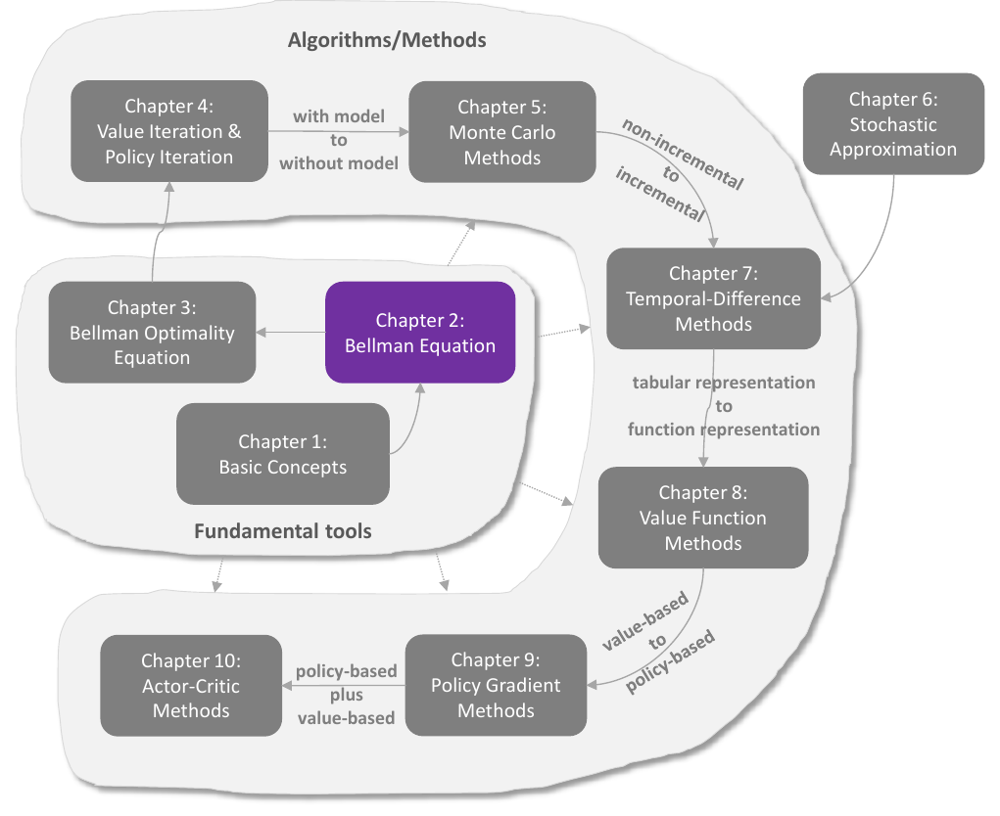
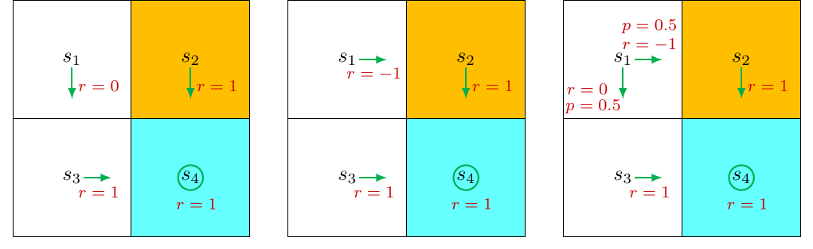
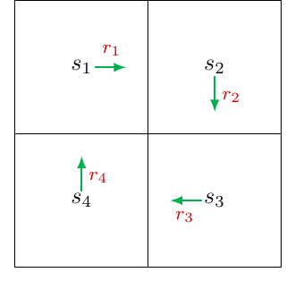
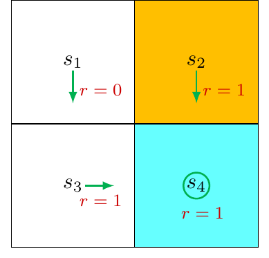
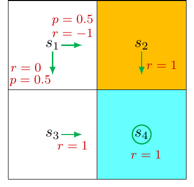
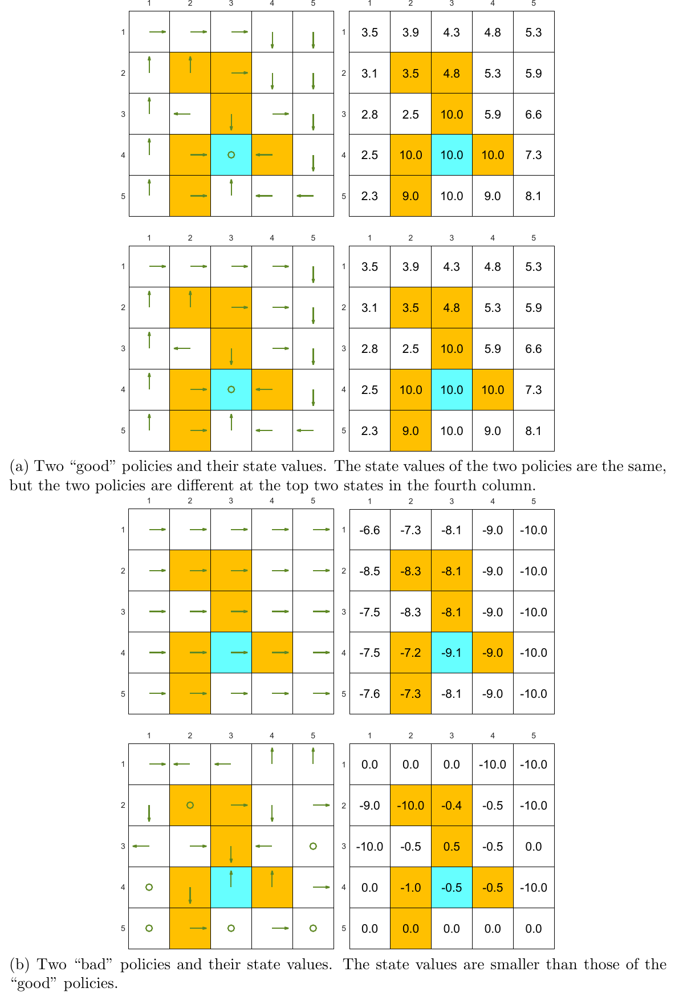
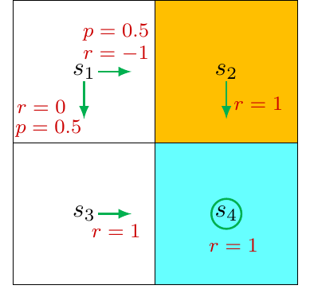

# Chương 2 Giá trị trạng thái và phương trình Bellman

> Ghi chú của người biên soạn: đây là bản tổng hợp tiếng Việt chương 2 sách *Mathematical Foundations of Reinforcement Learning* (Shiyu Zhao, 2025), có bổ sung từ các bài [Bellman Equation](https://lyk-love.cn/2024/01/03/Bellman-Equation/), [Bellman Equation: The Matrix-Vector Form](https://lyk-love.cn/2024/01/03/Bellman-Equation-The-Matrix-Vector-Form/) và [Action Value](https://lyk-love.cn/2024/01/06/Action-Value/) trên blog lyk-love. Xem [giới thiệu phần này](mathrl/README_vi) để biết nguồn, và [Quy ước ký hiệu](notation_vi) cho chuẩn ký hiệu dùng chung. Ý không có trong sách được ghi rõ.

<div align=center>

</div>
<div align=center>Hình 2.1 Vị trí của chương này trong sách. Nguồn: Zhao (2025)</div>

Chương này giới thiệu một **khái niệm cốt lõi** và một **công cụ quan trọng**:

- **Khái niệm:** **giá trị trạng thái (state value)**, tức phần thưởng trung bình mà tác tử thu được nếu đi theo một chính sách cho trước. Giá trị trạng thái càng lớn thì chính sách càng tốt, nên nó là thước đo để đánh giá chính sách.
- **Công cụ:** **phương trình Bellman (Bellman equation)**, mô tả quan hệ giữa giá trị của mọi trạng thái. Giải phương trình Bellman ta được các giá trị trạng thái. Quá trình này gọi là **đánh giá chính sách (policy evaluation)**, một khái niệm nền tảng của học tăng cường.

Cuối chương giới thiệu thêm khái niệm **giá trị hành động (action value)**.

**Lộ trình của chương:**

| Mục | Câu hỏi được trả lời |
|---|---|
| 2.1–2.2 | Vì sao lợi tức quan trọng, và tính nó thế nào? (ý tưởng tự cập nhật) |
| 2.3 | Giá trị trạng thái là gì? |
| 2.4–2.5 | Phương trình Bellman là gì, suy ra thế nào, dùng ra sao? |
| 2.6 | Viết phương trình Bellman dưới dạng ma trận–vectơ |
| 2.7 | Giải phương trình Bellman: nghiệm đóng và nghiệm lặp |
| 2.8 | Giá trị hành động và phương trình Bellman theo giá trị hành động |

## 2.1 Ví dụ dẫn nhập 1: vì sao lợi tức quan trọng?

Chương 1 đã giới thiệu lợi tức. Thực ra lợi tức đóng vai trò nền tảng vì nó **đánh giá được chính sách tốt hay xấu**. Xét ba chính sách ở hình 2.2; chúng chỉ khác nhau ở $s_1$.

<div align=center>

</div>
<div align=center>Hình 2.2 Ba chính sách khác nhau ở s1. Ô cam là ô cấm, ô xanh là ô đích. Nguồn: Zhao (2025)</div>

**Theo trực giác:**

- Chính sách bên trái **tốt nhất**: từ $s_1$ đi xuống, tránh được ô cấm.
- Chính sách ở giữa **kém nhất**: từ $s_1$ đi thẳng vào ô cấm.
- Chính sách bên phải **ở giữa**: có xác suất 0.5 đi vào ô cấm.

Có thể mô tả trực giác này bằng toán học không? Có, dựa vào lợi tức. Giả sử tác tử xuất phát từ $s_1$, hệ số chiết khấu $\gamma \in (0,1)$.

**Chính sách 1.** Quỹ đạo $s_1 \to s_3 \to s_4 \to s_4 \cdots$, lợi tức chiết khấu:

$$
\text{lợi tức}_1 = 0 + \gamma \cdot 1 + \gamma^2 \cdot 1 + \cdots = \gamma(1 + \gamma + \gamma^2 + \cdots) = \frac{\gamma}{1-\gamma}.
$$

**Chính sách 2.** Quỹ đạo $s_1 \to s_2 \to s_4 \to s_4 \cdots$:

$$
\text{lợi tức}_2 = -1 + \gamma \cdot 1 + \gamma^2 \cdot 1 + \cdots = -1 + \frac{\gamma}{1-\gamma}.
$$

**Chính sách 3.** Có hai quỹ đạo, mỗi quỹ đạo với xác suất 0.5: $s_1 \to s_3 \to s_4 \cdots$ và $s_1 \to s_2 \to s_4 \cdots$. Lợi tức trung bình:

$$
\text{lợi tức}_3 = 0.5\left(-1 + \frac{\gamma}{1-\gamma}\right) + 0.5\left(\frac{\gamma}{1-\gamma}\right) = -0.5 + \frac{\gamma}{1-\gamma}.
$$

So sánh ba kết quả, với **mọi** giá trị $\gamma$:

$$
\text{lợi tức}_1 > \text{lợi tức}_3 > \text{lợi tức}_2. \tag{2.1}
$$

Kết luận toán học khớp với trực giác: chính sách 1 tốt nhất, chính sách 2 kém nhất. Ví dụ này cho thấy **có thể dùng lợi tức để đánh giá chính sách**: chính sách cho lợi tức lớn hơn thì tốt hơn.

Lưu ý: $\text{lợi tức}_3$ không đúng là một lợi tức theo định nghĩa, vì nó là một **giá trị trung bình** (kỳ vọng). Về sau sẽ thấy rằng nó chính là một **giá trị trạng thái**.

## 2.2 Ví dụ dẫn nhập 2: tính lợi tức thế nào?

Có hai cách tính lợi tức khi đi theo một chính sách cho trước. Xét ví dụ ở hình 2.3: bốn trạng thái nối thành vòng, không có ô đích hay ô cấm. Gọi $v_i$ là lợi tức khi xuất phát từ $s_i$, $i = 1, 2, 3, 4$.

<div align=center>

</div>
<div align=center>Hình 2.3 Ví dụ minh họa cách tính lợi tức. Nguồn: Zhao (2025)</div>

**Cách 1: theo định nghĩa.** Lợi tức là tổng chiết khấu của mọi phần thưởng dọc quỹ đạo:

$$
\begin{aligned}
v_1 &= r_1 + \gamma r_2 + \gamma^2 r_3 + \cdots,\\
v_2 &= r_2 + \gamma r_3 + \gamma^2 r_4 + \cdots,\\
v_3 &= r_3 + \gamma r_4 + \gamma^2 r_1 + \cdots,\\
v_4 &= r_4 + \gamma r_1 + \gamma^2 r_2 + \cdots.
\end{aligned} \tag{2.2}
$$

**Cách 2: tự cập nhật (bootstrapping).** Cách này quan trọng hơn. Nhìn vào (2.2), có thể viết lại:

$$
\begin{aligned}
v_1 &= r_1 + \gamma(r_2 + \gamma r_3 + \cdots) = r_1 + \gamma v_2,\\
v_2 &= r_2 + \gamma(r_3 + \gamma r_4 + \cdots) = r_2 + \gamma v_3,\\
v_3 &= r_3 + \gamma(r_4 + \gamma r_1 + \cdots) = r_3 + \gamma v_4,\\
v_4 &= r_4 + \gamma(r_1 + \gamma r_2 + \cdots) = r_4 + \gamma v_1.
\end{aligned} \tag{2.3}
$$

Các lợi tức **phụ thuộc lẫn nhau**: $v_1$ phụ thuộc $v_2$, $v_2$ phụ thuộc $v_3$, $v_3$ phụ thuộc $v_4$, và $v_4$ lại phụ thuộc $v_1$. Đó là ý tưởng **tự cập nhật**: tính một đại lượng từ chính nó.

Thoạt nhìn, tự cập nhật giống một vòng lặp vô tận: muốn tính một ẩn lại cần một ẩn khác. Nhưng nhìn theo góc độ toán học thì rất rõ ràng. Gom (2.3) thành một phương trình ma trận–vectơ tuyến tính:

$$
\underbrace{\begin{bmatrix} v_1 \\ v_2 \\ v_3 \\ v_4 \end{bmatrix}}_{v}
= \begin{bmatrix} r_1 \\ r_2 \\ r_3 \\ r_4 \end{bmatrix} + \begin{bmatrix} \gamma v_2 \\ \gamma v_3 \\ \gamma v_4 \\ \gamma v_1 \end{bmatrix}
= \underbrace{\begin{bmatrix} r_1 \\ r_2 \\ r_3 \\ r_4 \end{bmatrix}}_{r} +
\gamma \underbrace{\begin{bmatrix} 0 & 1 & 0 & 0 \\ 0 & 0 & 1 & 0 \\ 0 & 0 & 0 & 1 \\ 1 & 0 & 0 & 0 \end{bmatrix}}_{P}
\underbrace{\begin{bmatrix} v_1 \\ v_2 \\ v_3 \\ v_4 \end{bmatrix}}_{v},
$$

viết gọn là

$$
v = r + \gamma P v.
$$

Do đó $v = (I - \gamma P)^{-1} r$, với $I$ là ma trận đơn vị. Ma trận $I - \gamma P$ có luôn khả nghịch không? Có; mục 2.7.1 sẽ chứng minh.

Thực ra (2.3) chính là **phương trình Bellman** của ví dụ đơn giản này. Nó thể hiện ý tưởng cốt lõi của phương trình Bellman: **lợi tức khi xuất phát từ một trạng thái phụ thuộc vào lợi tức khi xuất phát từ các trạng thái khác**. Các mục sau sẽ hình thức hóa ý tưởng này cho trường hợp tổng quát.

## 2.3 Giá trị trạng thái

Lợi tức đánh giá được chính sách, nhưng **không áp dụng trực tiếp cho hệ ngẫu nhiên**: xuất phát từ cùng một trạng thái có thể thu được những lợi tức khác nhau. Vì vậy cần khái niệm giá trị trạng thái.

**Ký hiệu.** Xét các bước thời gian $t = 0, 1, 2, \dots$ Tại bước $t$, tác tử ở trạng thái $S_t$ và chọn hành động $A_t$ theo chính sách $\pi$. Trạng thái kế tiếp là $S_{t+1}$, phần thưởng tức thời là $R_{t+1}$:

$$
S_t \xrightarrow{A_t} S_{t+1}, R_{t+1}.
$$

$S_t, S_{t+1}, A_t, R_{t+1}$ **đều là biến ngẫu nhiên**, với $S_t, S_{t+1} \in \mathcal S$, $A_t \in \mathcal A(S_t)$ và $R_{t+1} \in \mathcal R(S_t, A_t)$.

Bắt đầu từ $t$, ta được một quỹ đạo trạng thái–hành động–phần thưởng:

$$
S_t \xrightarrow{A_t} S_{t+1}, R_{t+1} \xrightarrow{A_{t+1}} S_{t+2}, R_{t+2} \xrightarrow{A_{t+2}} S_{t+3}, R_{t+3} \cdots
$$

Lợi tức chiết khấu dọc quỹ đạo này là

$$
G_t \doteq R_{t+1} + \gamma R_{t+2} + \gamma^2 R_{t+3} + \cdots
$$

$G_t$ là biến ngẫu nhiên vì $R_{t+1}, R_{t+2}, \dots$ đều là biến ngẫu nhiên. Do đó có thể lấy **kỳ vọng** (giá trị trung bình) của nó:

$$
\boxed{v_\pi(s) \doteq \mathbb E[G_t \mid S_t = s]}
$$

$v_\pi(s)$ gọi là **hàm giá trị trạng thái (state-value function)**, hay gọn là **giá trị trạng thái** của $s$.

**Ba nhận xét quan trọng:**

| | Lý do |
|---|---|
| $v_\pi(s)$ **phụ thuộc** $s$ | định nghĩa là kỳ vọng có điều kiện, với điều kiện xuất phát tại $S_t = s$ |
| $v_\pi(s)$ **phụ thuộc** $\pi$ | quỹ đạo được sinh ra theo chính sách $\pi$; chính sách khác thì giá trị có thể khác |
| $v_\pi(s)$ **không phụ thuộc** $t$ | $t$ chỉ là bước hiện tại khi tác tử di chuyển; khi chính sách đã cho, giá trị đã được xác định |

**Quan hệ giữa giá trị trạng thái và lợi tức:**

- Nếu **cả chính sách lẫn mô hình đều tất định**: từ một trạng thái luôn sinh ra cùng một quỹ đạo, nên lợi tức đúng bằng giá trị trạng thái.
- Nếu **chính sách hoặc mô hình ngẫu nhiên**: từ cùng một trạng thái có thể sinh ra nhiều quỹ đạo với lợi tức khác nhau, và giá trị trạng thái là **trung bình** của các lợi tức đó.

Dùng giá trị trạng thái để đánh giá chính sách là cách làm hình thức hơn so với dùng lợi tức: **chính sách cho giá trị trạng thái lớn hơn thì tốt hơn**. Vì thế giá trị trạng thái là khái niệm cốt lõi của học tăng cường. Câu hỏi tiếp theo là tính nó thế nào; mục sau trả lời.

## 2.4 Phương trình Bellman

Phương trình Bellman là công cụ toán học để phân tích giá trị trạng thái. Nói gọn: **phương trình Bellman là một hệ phương trình tuyến tính mô tả quan hệ giữa giá trị của mọi trạng thái.**

### Suy ra phương trình

**Bước 1: tách lợi tức.** $G_t$ viết lại được thành

$$
G_t = R_{t+1} + \gamma R_{t+2} + \gamma^2 R_{t+3} + \cdots = R_{t+1} + \gamma(R_{t+2} + \gamma R_{t+3} + \cdots) = R_{t+1} + \gamma G_{t+1},
$$

với $G_{t+1} = R_{t+2} + \gamma R_{t+3} + \cdots$. Đẳng thức này nối $G_t$ với $G_{t+1}$. Thay vào định nghĩa giá trị trạng thái:

$$
\begin{aligned}
v_\pi(s) &= \mathbb E[G_t \mid S_t = s]\\
&= \mathbb E[R_{t+1} + \gamma G_{t+1} \mid S_t = s]\\
&= \mathbb E[R_{t+1} \mid S_t = s] + \gamma\, \mathbb E[G_{t+1} \mid S_t = s].
\end{aligned} \tag{2.4}
$$

**Bước 2: số hạng thứ nhất, trung bình phần thưởng tức thời.** Dùng luật kỳ vọng toàn phần (phụ lục A của sách):

$$
\mathbb E[R_{t+1} \mid S_t = s] = \sum_{a \in \mathcal A} \pi(a \mid s)\, \mathbb E[R_{t+1} \mid S_t = s, A_t = a] = \sum_{a \in \mathcal A} \pi(a \mid s) \sum_{r \in \mathcal R} p(r \mid s, a)\, r. \tag{2.5}
$$

Ở đây $\mathcal A$ và $\mathcal R$ là tập hành động và tập phần thưởng có thể. Đúng ra $\mathcal A$ phụ thuộc $s$ (viết $\mathcal A(s)$) và $\mathcal R$ phụ thuộc $(s,a)$. Sách bỏ sự phụ thuộc này trong ký hiệu cho gọn; các kết luận vẫn đúng khi có phụ thuộc.

> **Giải thích chi tiết hơn** *(theo lyk-love)*. Theo định nghĩa kỳ vọng, $\mathbb E[R_{t+1} \mid S_t = s] = \sum_r p(r \mid s)\, r$. Theo công thức xác suất biên, $p(r \mid s) = \sum_a p(r, a \mid s)$. Theo quy tắc nhân xác suất, $p(r, a \mid s) = p(r \mid s, a)\, p(a \mid s)$, mà trong học tăng cường $p(a \mid s)$ chính là $\pi(a \mid s)$. Vậy
> $$\mathbb E[R_{t+1} \mid S_t = s] = \sum_r \sum_a \pi(a \mid s)\, p(r \mid s, a)\, r = \sum_a \pi(a \mid s) \sum_r p(r \mid s, a)\, r.$$

**Bước 3: số hạng thứ hai, trung bình phần thưởng tương lai.**

$$
\begin{aligned}
\mathbb E[G_{t+1} \mid S_t = s] &= \sum_{s' \in \mathcal S} \mathbb E[G_{t+1} \mid S_t = s, S_{t+1} = s']\, p(s' \mid s)\\
&= \sum_{s' \in \mathcal S} \mathbb E[G_{t+1} \mid S_{t+1} = s']\, p(s' \mid s) \qquad \text{(do tính chất Markov)}\\
&= \sum_{s' \in \mathcal S} v_\pi(s')\, p(s' \mid s)\\
&= \sum_{s' \in \mathcal S} v_\pi(s') \sum_{a \in \mathcal A} p(s' \mid s, a)\, \pi(a \mid s).
\end{aligned} \tag{2.6}
$$

- Dòng 1: luật kỳ vọng toàn phần, lấy điều kiện theo trạng thái kế tiếp.
- Dòng 2: **tính chất Markov**. Phần thưởng tương lai chỉ phụ thuộc trạng thái hiện tại $S_{t+1}$, không phụ thuộc trạng thái trước đó $S_t$, nên $\mathbb E[G_{t+1} \mid S_t = s, S_{t+1} = s'] = \mathbb E[G_{t+1} \mid S_{t+1} = s']$.
- Dòng 3: đó chính là định nghĩa của $v_\pi(s')$.
- Dòng 4: $p(s' \mid s) = \sum_a p(s' \mid s, a)\, \pi(a \mid s)$ theo công thức xác suất toàn phần.

**Bước 4: ghép lại.** Thay (2.5) và (2.6) vào (2.4):

$$
\begin{aligned}
v_\pi(s) &= \mathbb E[R_{t+1} \mid S_t = s] + \gamma\, \mathbb E[G_{t+1} \mid S_t = s]\\
&= \underbrace{\sum_{a \in \mathcal A} \pi(a \mid s) \sum_{r \in \mathcal R} p(r \mid s, a)\, r}_{\text{trung bình phần thưởng tức thời}} + \underbrace{\gamma \sum_{a \in \mathcal A} \pi(a \mid s) \sum_{s' \in \mathcal S} p(s' \mid s, a)\, v_\pi(s')}_{\text{trung bình phần thưởng tương lai}}\\
&= \sum_{a \in \mathcal A} \pi(a \mid s) \left[\sum_{r \in \mathcal R} p(r \mid s, a)\, r + \gamma \sum_{s' \in \mathcal S} p(s' \mid s, a)\, v_\pi(s')\right], \quad \text{với mọi } s \in \mathcal S.
\end{aligned} \tag{2.7}
$$

Đây là **phương trình Bellman**, mô tả quan hệ giữa các giá trị trạng thái. Nó là công cụ nền tảng để thiết kế và phân tích các thuật toán học tăng cường.

### Đọc hiểu phương trình Bellman

Phương trình thoạt nhìn phức tạp nhưng có cấu trúc rõ ràng:

| Thành phần | Vai trò |
|---|---|
| $v_\pi(s)$, $v_\pi(s')$ | **ẩn số** cần tính |
| $\pi(a \mid s)$ | chính sách **cho trước** |
| $p(r \mid s, a)$, $p(s' \mid s, a)$ | **mô hình** của hệ thống |

- **$v_\pi(s)$ phụ thuộc ẩn số khác $v_\pi(s')$, vậy tính kiểu gì?** Người mới hay bối rối ở đây. Cần nhớ: phương trình Bellman không phải **một** phương trình mà là **một hệ phương trình**, mỗi trạng thái một phương trình. Gom chúng lại thì cách giải trở nên rõ ràng (mục 2.7).
- **Giải phương trình Bellman chính là đánh giá chính sách.** Giá trị trạng thái dùng để đánh giá chính sách, nên tìm giá trị trạng thái từ phương trình Bellman là quá trình **đánh giá chính sách**, một bước quan trọng trong rất nhiều thuật toán ở các chương sau.
- **Mô hình.** Mục 2.7 sẽ giải khi **biết** mô hình. Các chương sau sẽ giải khi **không biết** mô hình, bằng các thuật toán không mô hình (model-free).

### Các dạng tương đương

Tài liệu khác có thể viết phương trình Bellman theo dạng khác. Hai dạng tương đương hay gặp:

**Dạng 1: dùng xác suất đồng thời $p(s', r \mid s, a)$.** Theo công thức xác suất toàn phần:

$$
p(s' \mid s, a) = \sum_{r \in \mathcal R} p(s', r \mid s, a), \qquad p(r \mid s, a) = \sum_{s' \in \mathcal S} p(s', r \mid s, a).
$$

Thay vào (2.7):

$$
v_\pi(s) = \sum_{a \in \mathcal A} \pi(a \mid s) \sum_{s' \in \mathcal S} \sum_{r \in \mathcal R} p(s', r \mid s, a)\left[r + \gamma v_\pi(s')\right].
$$

Đây là dạng dùng trong sách của Sutton và Barto.

**Dạng 2: phần thưởng chỉ phụ thuộc trạng thái kế tiếp.** Một số bài toán có phần thưởng $r(s')$ chỉ phụ thuộc $s'$. Khi đó $p(r(s') \mid s, a) = p(s' \mid s, a)$, và (2.7) trở thành

$$
v_\pi(s) = \sum_{a \in \mathcal A} \pi(a \mid s) \sum_{s' \in \mathcal S} p(s' \mid s, a)\left[r(s') + \gamma v_\pi(s')\right].
$$

*(ghi chú của người biên soạn)* EasyRL gọi (2.7) là **phương trình kỳ vọng Bellman (Bellman expectation equation)** để phân biệt với phương trình tối ưu Bellman ở chương 3. Xem [EasyRL chương 2](chapter2/chapter2_vi), mục 2.3.4.

## 2.5 Ví dụ minh họa phương trình Bellman

Hai ví dụ dưới đây cho thấy cách viết phương trình Bellman và giải từng bước. Nên đọc kỹ để hiểu phương trình Bellman.

### Ví dụ 1: chính sách tất định

<div align=center>

</div>
<div align=center>Hình 2.4 Ví dụ phương trình Bellman với chính sách tất định. Nguồn: Zhao (2025)</div>

**Xét $s_1$.** Theo chính sách:

- xác suất chọn hành động: $\pi(a = a_3 \mid s_1) = 1$ và $\pi(a \ne a_3 \mid s_1) = 0$;
- xác suất chuyển trạng thái: $p(s' = s_3 \mid s_1, a_3) = 1$ và $p(s' \ne s_3 \mid s_1, a_3) = 0$;
- xác suất phần thưởng: $p(r = 0 \mid s_1, a_3) = 1$ và $p(r \ne 0 \mid s_1, a_3) = 0$.

Thay vào (2.7):

$$
v_\pi(s_1) = 0 + \gamma v_\pi(s_3).
$$

Dù (2.7) trông phức tạp, phương trình cho một trạng thái cụ thể lại rất đơn giản. Tương tự:

$$
\begin{aligned}
v_\pi(s_2) &= 1 + \gamma v_\pi(s_4),\\
v_\pi(s_3) &= 1 + \gamma v_\pi(s_4),\\
v_\pi(s_4) &= 1 + \gamma v_\pi(s_4).
\end{aligned}
$$

Hệ này đơn giản nên giải tay được. Giải từ dưới lên:

$$
v_\pi(s_4) = \frac{1}{1-\gamma},\qquad v_\pi(s_3) = \frac{1}{1-\gamma},\qquad v_\pi(s_2) = \frac{1}{1-\gamma},\qquad v_\pi(s_1) = \frac{\gamma}{1-\gamma}.
$$

Với $\gamma = 0.9$:

$$
v_\pi(s_4) = \frac{1}{1-0.9} = 10,\quad v_\pi(s_3) = 10,\quad v_\pi(s_2) = 10,\quad v_\pi(s_1) = \frac{0.9}{1-0.9} = 9.
$$

### Ví dụ 2: chính sách ngẫu nhiên

<div align=center>

</div>
<div align=center>Hình 2.5 Ví dụ phương trình Bellman với chính sách ngẫu nhiên. Nguồn: Zhao (2025)</div>

**Xét $s_1$.** Đi sang phải và đi xuống đều có xác suất 0.5:

- chính sách: $\pi(a = a_2 \mid s_1) = 0.5$ và $\pi(a = a_3 \mid s_1) = 0.5$;
- chuyển trạng thái tất định: $p(s' = s_3 \mid s_1, a_3) = 1$ và $p(s' = s_2 \mid s_1, a_2) = 1$;
- phần thưởng tất định: $p(r = 0 \mid s_1, a_3) = 1$ và $p(r = -1 \mid s_1, a_2) = 1$ (đi sang phải là vào ô cấm).

Thay vào (2.7):

$$
v_\pi(s_1) = 0.5\left[0 + \gamma v_\pi(s_3)\right] + 0.5\left[-1 + \gamma v_\pi(s_2)\right].
$$

Các trạng thái khác giống ví dụ 1:

$$
v_\pi(s_2) = 1 + \gamma v_\pi(s_4),\qquad v_\pi(s_3) = 1 + \gamma v_\pi(s_4),\qquad v_\pi(s_4) = 1 + \gamma v_\pi(s_4).
$$

Giải tay:

$$
\begin{aligned}
v_\pi(s_4) = v_\pi(s_3) = v_\pi(s_2) &= \frac{1}{1-\gamma},\\
v_\pi(s_1) &= 0.5\left[0 + \gamma v_\pi(s_3)\right] + 0.5\left[-1 + \gamma v_\pi(s_2)\right] = -0.5 + \frac{\gamma}{1-\gamma}.
\end{aligned}
$$

Với $\gamma = 0.9$: $v_\pi(s_4) = v_\pi(s_3) = v_\pi(s_2) = 10$ và $v_\pi(s_1) = -0.5 + 9 = 8.5$.

### So sánh hai chính sách

Gọi chính sách ở hình 2.4 là $\pi_1$, ở hình 2.5 là $\pi_2$:

$$
v_{\pi_1}(s_i) \ge v_{\pi_2}(s_i), \qquad i = 1, 2, 3, 4.
$$

Chính sách ở hình 2.4 tốt hơn vì có giá trị trạng thái lớn hơn. Kết luận này khớp với trực giác: chính sách thứ nhất tránh được ô cấm khi xuất phát từ $s_1$. Hai ví dụ cho thấy **có thể dùng giá trị trạng thái để đánh giá chính sách**.

*(ghi chú của người biên soạn)* Để ý $v_{\pi_1}(s_1) = \text{lợi tức}_1$ và $v_{\pi_2}(s_1) = \text{lợi tức}_3$ ở mục 2.1. Đúng như đã báo trước: "lợi tức trung bình" của chính sách ngẫu nhiên chính là giá trị trạng thái.

## 2.6 Dạng ma trận–vectơ của phương trình Bellman

Phương trình (2.7) ở **dạng từng phần tử (elementwise)**: mỗi trạng thái một phương trình. Gom tất cả lại thành **dạng ma trận–vectơ** gọn hơn; dạng này sẽ được dùng thường xuyên để phân tích phương trình Bellman.

**Bước 1: viết gọn (2.7).**

$$
v_\pi(s) = r_\pi(s) + \gamma \sum_{s' \in \mathcal S} p_\pi(s' \mid s)\, v_\pi(s'), \tag{2.8}
$$

với

$$
r_\pi(s) \doteq \sum_{a \in \mathcal A} \pi(a \mid s) \sum_{r \in \mathcal R} p(r \mid s, a)\, r, \qquad p_\pi(s' \mid s) \doteq \sum_{a \in \mathcal A} \pi(a \mid s)\, p(s' \mid s, a).
$$

- $r_\pi(s)$: **trung bình phần thưởng tức thời** tại $s$ khi đi theo $\pi$.
- $p_\pi(s' \mid s)$: **xác suất chuyển** từ $s$ sang $s'$ khi đi theo $\pi$.

**Bước 2: đánh số trạng thái.** Đặt các trạng thái là $s_i$, $i = 1, \dots, n$, với $n = |\mathcal S|$. Với trạng thái $s_i$, (2.8) thành

$$
v_\pi(s_i) = r_\pi(s_i) + \gamma \sum_{s_j \in \mathcal S} p_\pi(s_j \mid s_i)\, v_\pi(s_j). \tag{2.9}
$$

**Bước 3: gom thành vectơ.** Đặt

- $v_\pi = [v_\pi(s_1), \dots, v_\pi(s_n)]^T \in \mathbb R^n$,
- $r_\pi = [r_\pi(s_1), \dots, r_\pi(s_n)]^T \in \mathbb R^n$,
- $P_\pi \in \mathbb R^{n \times n}$ với $[P_\pi]_{ij} = p_\pi(s_j \mid s_i)$, gọi là **ma trận chuyển trạng thái**.

Khi đó (2.9) viết thành

$$
\boxed{v_\pi = r_\pi + \gamma P_\pi v_\pi} \tag{2.10}
$$

trong đó $v_\pi$ là ẩn cần tìm, còn $r_\pi$ và $P_\pi$ đã biết.

### Tính chất của $P_\pi$

1. **Không âm:** mọi phần tử đều $\ge 0$, ký hiệu $P_\pi \ge 0$ (với $0$ là ma trận không có kích thước phù hợp). Trong sách, $\ge$ và $\le$ giữa hai ma trận hay vectơ là so sánh **từng phần tử**.
2. **Ma trận ngẫu nhiên (stochastic matrix):** tổng mỗi hàng bằng 1, ký hiệu $P_\pi \mathbf 1 = \mathbf 1$, với $\mathbf 1 = [1, \dots, 1]^T$.

### Ví dụ

Với 4 trạng thái như hình 2.6, dạng ma trận–vectơ là

$$
\underbrace{\begin{bmatrix} v_\pi(s_1) \\ v_\pi(s_2) \\ v_\pi(s_3) \\ v_\pi(s_4) \end{bmatrix}}_{v_\pi}
= \underbrace{\begin{bmatrix} r_\pi(s_1) \\ r_\pi(s_2) \\ r_\pi(s_3) \\ r_\pi(s_4) \end{bmatrix}}_{r_\pi} +
\gamma \underbrace{\begin{bmatrix}
p_\pi(s_1 \mid s_1) & p_\pi(s_2 \mid s_1) & p_\pi(s_3 \mid s_1) & p_\pi(s_4 \mid s_1)\\
p_\pi(s_1 \mid s_2) & p_\pi(s_2 \mid s_2) & p_\pi(s_3 \mid s_2) & p_\pi(s_4 \mid s_2)\\
p_\pi(s_1 \mid s_3) & p_\pi(s_2 \mid s_3) & p_\pi(s_3 \mid s_3) & p_\pi(s_4 \mid s_3)\\
p_\pi(s_1 \mid s_4) & p_\pi(s_2 \mid s_4) & p_\pi(s_3 \mid s_4) & p_\pi(s_4 \mid s_4)
\end{bmatrix}}_{P_\pi}
\underbrace{\begin{bmatrix} v_\pi(s_1) \\ v_\pi(s_2) \\ v_\pi(s_3) \\ v_\pi(s_4) \end{bmatrix}}_{v_\pi}.
$$

<div align=center>

</div>
<div align=center>Hình 2.6 Ví dụ dạng ma trận–vectơ của phương trình Bellman. Nguồn: Zhao (2025)</div>

Thay số cho chính sách ở hình 2.6:

$$
\begin{bmatrix} v_\pi(s_1) \\ v_\pi(s_2) \\ v_\pi(s_3) \\ v_\pi(s_4) \end{bmatrix}
= \begin{bmatrix} 0.5(0) + 0.5(-1) \\ 1 \\ 1 \\ 1 \end{bmatrix} +
\gamma \begin{bmatrix} 0 & 0.5 & 0.5 & 0 \\ 0 & 0 & 0 & 1 \\ 0 & 0 & 0 & 1 \\ 0 & 0 & 0 & 1 \end{bmatrix}
\begin{bmatrix} v_\pi(s_1) \\ v_\pi(s_2) \\ v_\pi(s_3) \\ v_\pi(s_4) \end{bmatrix}.
$$

Dễ thấy $P_\pi$ thỏa $P_\pi \mathbf 1 = \mathbf 1$.

*(theo lyk-love)* Với chính sách tất định ở hình 2.4 thì

$$
r_\pi = \begin{bmatrix} 0 \\ 1 \\ 1 \\ 1 \end{bmatrix}, \qquad
P_\pi = \begin{bmatrix} 0 & 0 & 1 & 0 \\ 0 & 0 & 0 & 1 \\ 0 & 0 & 0 & 1 \\ 0 & 0 & 0 & 1 \end{bmatrix}.
$$

## 2.7 Giải giá trị trạng thái từ phương trình Bellman

Tính giá trị trạng thái của một chính sách cho trước là bài toán nền tảng của học tăng cường, thường gọi là **đánh giá chính sách**. Mục này trình bày hai cách giải.

### 2.7.1 Nghiệm dạng đóng

Vì $v_\pi = r_\pi + \gamma P_\pi v_\pi$ là phương trình tuyến tính, chuyển vế được $(I - \gamma P_\pi) v_\pi = r_\pi$, nên

$$
\boxed{v_\pi = (I - \gamma P_\pi)^{-1} r_\pi}
$$

**Ba tính chất của $(I - \gamma P_\pi)^{-1}$:**

**(1) $I - \gamma P_\pi$ khả nghịch.** Chứng minh bằng **định lý đường tròn Gershgorin**: mọi trị riêng của một ma trận nằm trong ít nhất một đường tròn Gershgorin của nó. Đường tròn thứ $i$ của $I - \gamma P_\pi$ có

- tâm $[I - \gamma P_\pi]_{ii} = 1 - \gamma p_\pi(s_i \mid s_i)$,
- bán kính $\sum_{j \ne i} \left|[I - \gamma P_\pi]_{ij}\right| = \sum_{j \ne i} \gamma p_\pi(s_j \mid s_i)$.

Vì $\gamma < 1$, bán kính nhỏ hơn độ lớn của tâm:

$$
\sum_{j \ne i} \gamma p_\pi(s_j \mid s_i) < 1 - \gamma p_\pi(s_i \mid s_i).
$$

*(ghi chú của người biên soạn: kiểm tra trực tiếp)* Do tổng mỗi hàng của $P_\pi$ bằng 1 nên $\sum_{j \ne i} p_\pi(s_j \mid s_i) = 1 - p_\pi(s_i \mid s_i)$. Hiệu giữa tâm và bán kính là $\left[1 - \gamma p_\pi(s_i \mid s_i)\right] - \gamma\left[1 - p_\pi(s_i \mid s_i)\right] = 1 - \gamma > 0$.

Do đó không đường tròn nào chứa gốc tọa độ, nên không trị riêng nào của $I - \gamma P_\pi$ bằng 0, tức là ma trận khả nghịch.

**(2) $(I - \gamma P_\pi)^{-1} \ge I$:** mọi phần tử của $(I - \gamma P_\pi)^{-1}$ không âm, và không nhỏ hơn phần tử tương ứng của ma trận đơn vị. Lý do: $P_\pi$ có các phần tử không âm, nên khai triển chuỗi Neumann cho

$$
(I - \gamma P_\pi)^{-1} = I + \gamma P_\pi + \gamma^2 P_\pi^2 + \cdots \ge I \ge 0.
$$

**(3) Tính đơn điệu.** Với mọi vectơ $r \ge 0$: $(I - \gamma P_\pi)^{-1} r \ge r \ge 0$. Điều này suy ra từ tính chất (2), vì $\left[(I - \gamma P_\pi)^{-1} - I\right] r \ge 0$. Hệ quả: nếu $r_1 \ge r_2$ thì $(I - \gamma P_\pi)^{-1} r_1 \ge (I - \gamma P_\pi)^{-1} r_2$. Nói cách khác, phần thưởng tức thời lớn hơn ở mọi trạng thái thì giá trị trạng thái cũng lớn hơn ở mọi trạng thái.

### 2.7.2 Nghiệm lặp

Nghiệm dạng đóng hữu ích cho phân tích lý thuyết nhưng **không thực dụng**: nó đòi nghịch đảo ma trận, mà việc đó cũng phải dùng thuật toán số khác, và tốn kém khi số trạng thái lớn. Thay vào đó, có thể giải trực tiếp phương trình Bellman bằng thuật toán lặp:

$$
v_{k+1} = r_\pi + \gamma P_\pi v_k, \qquad k = 0, 1, 2, \dots \tag{2.11}
$$

Thuật toán sinh ra dãy $\{v_0, v_1, v_2, \dots\}$, với $v_0 \in \mathbb R^n$ là một giá trị đoán ban đầu bất kỳ của $v_\pi$. Ta có

$$
v_k \to v_\pi = (I - \gamma P_\pi)^{-1} r_\pi \quad \text{khi } k \to \infty. \tag{2.12}
$$

> **Hộp 2.1: Chứng minh hội tụ của (2.12)**
>
> Đặt sai số $\delta_k = v_k - v_\pi$. Chỉ cần chứng minh $\delta_k \to 0$.
>
> Thay $v_{k+1} = \delta_{k+1} + v_\pi$ và $v_k = \delta_k + v_\pi$ vào $v_{k+1} = r_\pi + \gamma P_\pi v_k$:
> $$\delta_{k+1} + v_\pi = r_\pi + \gamma P_\pi (\delta_k + v_\pi).$$
> Viết lại:
> $$\delta_{k+1} = -v_\pi + r_\pi + \gamma P_\pi \delta_k + \gamma P_\pi v_\pi = \gamma P_\pi \delta_k - v_\pi + (r_\pi + \gamma P_\pi v_\pi) = \gamma P_\pi \delta_k,$$
> vì $r_\pi + \gamma P_\pi v_\pi = v_\pi$ theo phương trình Bellman. Do đó
> $$\delta_{k+1} = \gamma P_\pi \delta_k = \gamma^2 P_\pi^2 \delta_{k-1} = \cdots = \gamma^{k+1} P_\pi^{k+1} \delta_0.$$
> Mọi phần tử của $P_\pi$ không âm và không lớn hơn 1, nên $0 \le P_\pi^k \le 1$ với mọi $k$: mọi phần tử của $P_\pi^k$ không vượt quá 1. *(theo lyk-love)* Lý do: $P_\pi^k$ vẫn là ma trận ngẫu nhiên, vì $P_\pi^k \mathbf 1 = \mathbf 1$. Mặt khác, $\gamma < 1$ nên $\gamma^k \to 0$. Vậy $\delta_{k+1} = \gamma^{k+1} P_\pi^{k+1} \delta_0 \to 0$ khi $k \to \infty$. $\blacksquare$

*(ghi chú của người biên soạn)* Thuật toán (2.11) chính là **đánh giá chính sách lặp (iterative policy evaluation)** ở [EasyRL chương 2](chapter2/chapter2_vi), mục 2.3.9. Nó cũng là bước con trong lặp chính sách (chương 4).

### Kiểm tra bằng mã *(ghi chú của người biên soạn)*

Đoạn mã dưới giải ví dụ ở hình 2.6 bằng cả hai cách, với $\gamma = 0.9$:

```python
import numpy as np

gamma = 0.9
r_pi = np.array([0.5 * 0 + 0.5 * (-1), 1, 1, 1])
P_pi = np.array([[0, 0.5, 0.5, 0],
                 [0, 0,   0,   1],
                 [0, 0,   0,   1],
                 [0, 0,   0,   1]])

# Cách 1: nghiệm dạng đóng (giải hệ tuyến tính thay vì nghịch đảo trực tiếp)
v_closed = np.linalg.solve(np.eye(4) - gamma * P_pi, r_pi)

# Cách 2: lặp v_{k+1} = r_pi + gamma * P_pi v_k
v = np.zeros(4)
for k in range(200):
    v = r_pi + gamma * P_pi @ v

print(v_closed)  # [ 8.5 10.  10.  10. ]
print(v)         # [ 8.5 10.  10.  10. ]
```

Kết quả khớp với lời giải tay ở mục 2.5.

### 2.7.3 Ví dụ minh họa

Áp dụng thuật toán (2.11) cho thế giới lưới 5×5 ở hình 2.7. Ô cam là ô cấm, ô xanh là ô đích. Phần thưởng: $r_{\text{boundary}} = r_{\text{forbidden}} = -1$, $r_{\text{target}} = 1$; hệ số chiết khấu $\gamma = 0.9$.

<div align=center>

</div>
<div align=center>Hình 2.7 Các chính sách và giá trị trạng thái tương ứng. (a) Hai chính sách "tốt": giá trị trạng thái giống hệt nhau, dù hai chính sách khác nhau ở hai trạng thái trên cùng của cột thứ tư. (b) Hai chính sách "tồi": giá trị trạng thái nhỏ hơn nhiều so với chính sách tốt. Nguồn: Zhao (2025)</div>

**Nhận xét:**

- **Hình 2.7a:** hai chính sách "tốt" có **cùng** giá trị trạng thái nhưng khác nhau ở hai trạng thái trên cùng của cột thứ tư. Vậy **các chính sách khác nhau có thể có cùng giá trị trạng thái**.
- **Hình 2.7b:** hai chính sách "tồi", vì hành động ở nhiều trạng thái rõ ràng vô lý theo trực giác. Giá trị trạng thái tính được xác nhận trực giác đó: các giá trị đều âm và nhỏ hơn nhiều so với chính sách tốt ở hình 2.7a.

## 2.8 Từ giá trị trạng thái đến giá trị hành động

Giá trị trạng thái cho biết "giá trị" của một trạng thái. **Giá trị hành động (action value)** cho biết "giá trị" của việc **chọn một hành động tại một trạng thái**. Khái niệm này quan trọng, nhưng được để ở cuối chương vì nó dựa nhiều vào giá trị trạng thái. Cần hiểu giá trị trạng thái thật kỹ trước.

Giá trị hành động của cặp trạng thái–hành động $(s,a)$ được định nghĩa là

$$
\boxed{q_\pi(s, a) \doteq \mathbb E[G_t \mid S_t = s, A_t = a]}
$$

tức là **lợi tức kỳ vọng thu được sau khi chọn hành động $a$ tại trạng thái $s$** (rồi đi theo $\pi$). Lưu ý $q_\pi(s,a)$ phụ thuộc vào **cặp** $(s,a)$ chứ không chỉ vào hành động. Nói chặt chẽ thì nên gọi là giá trị trạng thái–hành động, nhưng theo thói quen người ta gọi gọn là giá trị hành động.

| | Giá trị trạng thái $v_\pi(s)$ | Giá trị hành động $q_\pi(s,a)$ |
|---|---|---|
| Định nghĩa | $\mathbb E[G_t \mid S_t = s]$ | $\mathbb E[G_t \mid S_t = s, A_t = a]$ |
| Ý nghĩa | lợi tức trung bình khi **xuất phát từ** $s$ | lợi tức trung bình khi **xuất phát từ** $s$ **và chọn** $a$ trước |
| Phụ thuộc | $s$ và $\pi$ | $(s,a)$ và $\pi$ |

### Quan hệ giữa giá trị trạng thái và giá trị hành động

**Chiều thứ nhất: từ $q$ ra $v$.** Theo tính chất của kỳ vọng có điều kiện:

$$
\underbrace{\mathbb E[G_t \mid S_t = s]}_{v_\pi(s)} = \sum_{a \in \mathcal A} \underbrace{\mathbb E[G_t \mid S_t = s, A_t = a]}_{q_\pi(s,a)}\, \pi(a \mid s).
$$

Suy ra

$$
\boxed{v_\pi(s) = \sum_{a \in \mathcal A} \pi(a \mid s)\, q_\pi(s, a)} \tag{2.13}
$$

**Giá trị trạng thái là kỳ vọng (theo chính sách) của các giá trị hành động tại trạng thái đó.**

**Chiều thứ hai: từ $v$ ra $q$.** So sánh (2.13) với phương trình Bellman

$$
v_\pi(s) = \sum_{a \in \mathcal A} \pi(a \mid s)\Bigg[\underbrace{\sum_{r \in \mathcal R} p(r \mid s, a)\, r + \gamma \sum_{s' \in \mathcal S} p(s' \mid s, a)\, v_\pi(s')}_{q_\pi(s,a)}\Bigg],
$$

ta được

$$
\boxed{q_\pi(s, a) = \sum_{r \in \mathcal R} p(r \mid s, a)\, r + \gamma \sum_{s' \in \mathcal S} p(s' \mid s, a)\, v_\pi(s')} \tag{2.14}
$$

Giá trị hành động gồm hai phần: trung bình phần thưởng tức thời, và trung bình (chiết khấu) phần thưởng tương lai.

(2.13) và (2.14) là **hai mặt của cùng một đồng xu**:

| Phương trình | Chiều | Cần biết mô hình? |
|---|---|---|
| (2.13) | từ giá trị hành động suy ra giá trị trạng thái | không, chỉ cần $\pi$ |
| (2.14) | từ giá trị trạng thái suy ra giá trị hành động | có, cần $p(r \mid s,a)$ và $p(s' \mid s,a)$ |

*(ghi chú của người biên soạn)* Cột cuối giải thích vì sao các thuật toán không mô hình (Sarsa, Q-learning, DQN) học trực tiếp $q$ thay vì $v$: muốn chọn hành động từ $v$ thì phải dùng (2.14), tức cần mô hình. Có $q$ thì chọn thẳng $\arg\max_a q(s,a)$.

### 2.8.1 Ví dụ minh họa

<div align=center>

</div>
<div align=center>Hình 2.8 Ví dụ minh họa cách tính giá trị hành động. Nguồn: Zhao (2025)</div>

Xét chính sách ngẫu nhiên ở hình 2.8; chỉ xét các hành động tại $s_1$ (các trạng thái khác làm tương tự). Giá trị hành động của $(s_1, a_2)$:

$$
q_\pi(s_1, a_2) = -1 + \gamma v_\pi(s_2),
$$

với $s_2$ là trạng thái kế tiếp. Tương tự:

$$
q_\pi(s_1, a_3) = 0 + \gamma v_\pi(s_3).
$$

⚠️ **Lỗi người mới hay mắc: giá trị của những hành động mà chính sách không chọn.** Chính sách ở hình 2.8 chỉ chọn $a_2$ hoặc $a_3$, không bao giờ chọn $a_1, a_4, a_5$. Có người lập luận: chính sách không chọn $a_1, a_4, a_5$ nên không cần tính giá trị của chúng, hoặc cứ đặt $q_\pi(s_1, a_1) = q_\pi(s_1, a_4) = q_\pi(s_1, a_5) = 0$. **Điều này sai**, vì hai lý do:

**Lý do 1: hành động không được chọn vẫn có giá trị hành động.** Có thể tính bằng cách hình dung điều gì xảy ra nếu chọn hành động đó. Chọn $a_1$ (đi lên) ở $s_1$: tác tử bị dội lại $s_1$, nhận phần thưởng tức thời $-1$, rồi tiếp tục đi theo $\pi$ từ $s_1$, nên phần thưởng tương lai là $\gamma v_\pi(s_1)$. Vậy

$$
q_\pi(s_1, a_1) = -1 + \gamma v_\pi(s_1).
$$

Tương tự với $a_4$ và $a_5$:

$$
q_\pi(s_1, a_4) = -1 + \gamma v_\pi(s_1), \qquad q_\pi(s_1, a_5) = 0 + \gamma v_\pi(s_1).
$$

**Lý do 2: vì sao phải quan tâm tới những hành động chính sách không chọn?** Chính sách không chọn một hành động **không có nghĩa** hành động đó tồi. Có thể chính chính sách mới là tồi, nên bỏ lỡ hành động tốt nhất. Mục đích của học tăng cường là **tìm chính sách tối ưu**, nên phải **liên tục khám phá mọi hành động** để tìm hành động tốt hơn ở mỗi trạng thái.

Cuối cùng, sau khi có các giá trị hành động, có thể tính lại giá trị trạng thái theo (2.13):

$$
v_\pi(s_1) = 0.5\, q_\pi(s_1, a_2) + 0.5\, q_\pi(s_1, a_3) = 0.5\left[0 + \gamma v_\pi(s_3)\right] + 0.5\left[-1 + \gamma v_\pi(s_2)\right],
$$

khớp với ví dụ 2 ở mục 2.5.

*(ghi chú của người biên soạn)* Với $\gamma = 0.9$ và $v_\pi = [8.5, 10, 10, 10]$ đã tính ở mục 2.5, giá trị các hành động tại $s_1$ là:

| Hành động | $q_\pi(s_1, \cdot)$ | Giá trị số |
|---|---|---|
| $a_1$ (lên, đâm biên) | $-1 + 0.9 \times 8.5$ | $6.65$ |
| $a_2$ (phải, vào ô cấm) | $-1 + 0.9 \times 10$ | $8.0$ |
| $a_3$ (xuống) | $0 + 0.9 \times 10$ | $9.0$ |
| $a_4$ (trái, đâm biên) | $-1 + 0.9 \times 8.5$ | $6.65$ |
| $a_5$ (đứng yên) | $0 + 0.9 \times 8.5$ | $7.65$ |

Kiểm tra (2.13): $0.5 \times 8.0 + 0.5 \times 9.0 = 8.5 = v_\pi(s_1)$. Bảng cũng cho thấy $a_3$ có giá trị cao nhất; nếu luôn chọn $a_3$ ở $s_1$, ta được chính sách tốt hơn. Đó chính là ý tưởng **cải thiện chính sách** sẽ gặp ở chương 3 và 4.

### 2.8.2 Phương trình Bellman theo giá trị hành động

Phương trình Bellman ở trên định nghĩa theo giá trị trạng thái. Có thể viết nó theo giá trị hành động: thay (2.13) vào (2.14):

$$
q_\pi(s, a) = \sum_{r \in \mathcal R} p(r \mid s, a)\, r + \gamma \sum_{s' \in \mathcal S} p(s' \mid s, a) \sum_{a' \in \mathcal A(s')} \pi(a' \mid s')\, q_\pi(s', a').
$$

Đây là một phương trình cho giá trị hành động, đúng với mọi cặp trạng thái–hành động. Gom lại thành dạng ma trận–vectơ:

$$
q_\pi = \tilde r + \gamma P \Pi q_\pi, \tag{2.15}
$$

trong đó:

| Ký hiệu | Kích thước | Ý nghĩa |
|---|---|---|
| $q_\pi$ | $\lvert\mathcal S\rvert \lvert\mathcal A\rvert$ | vectơ giá trị hành động, đánh chỉ số theo cặp $(s,a)$: $[q_\pi]_{(s,a)} = q_\pi(s,a)$ |
| $\tilde r$ | $\lvert\mathcal S\rvert \lvert\mathcal A\rvert$ | vectơ phần thưởng tức thời: $[\tilde r]_{(s,a)} = \sum_{r} p(r \mid s,a)\, r$ |
| $P$ | $\lvert\mathcal S\rvert \lvert\mathcal A\rvert \times \lvert\mathcal S\rvert$ | ma trận xác suất chuyển, hàng theo $(s,a)$, cột theo $s'$: $[P]_{(s,a),s'} = p(s' \mid s,a)$ |
| $\Pi$ | $\lvert\mathcal S\rvert \times \lvert\mathcal S\rvert \lvert\mathcal A\rvert$ | ma trận khối đường chéo, mỗi khối là một vectơ $1 \times \lvert\mathcal A\rvert$: $\Pi_{s',(s',a')} = \pi(a' \mid s')$, các phần tử khác bằng 0 |

So với phương trình theo giá trị trạng thái, phương trình (2.15) có điểm đặc biệt: $\tilde r$ và $P$ **không phụ thuộc chính sách**, chỉ do mô hình quyết định; chính sách nằm gọn trong $\Pi$. Có thể kiểm chứng rằng (2.15) cũng là một **ánh xạ co (contraction mapping)**, có nghiệm duy nhất và giải được bằng phép lặp. Chi tiết xem Bertsekas và Tsitsiklis, *Neuro-Dynamic Programming* (1996).

*(ghi chú của người biên soạn)* Phương trình này là nền của Sarsa (chương 7): Sarsa là cách giải (2.15) **không cần mô hình**, bằng cách thay kỳ vọng bằng mẫu.

## 2.9 Tóm tắt

- **Khái niệm quan trọng nhất của chương là giá trị trạng thái**: lợi tức kỳ vọng mà tác tử thu được khi xuất phát từ một trạng thái.
- **Giá trị của các trạng thái liên hệ với nhau**: giá trị của $s$ phụ thuộc giá trị của một số trạng thái khác, mà các trạng thái đó lại có thể phụ thuộc giá trị của chính $s$. Đây có lẽ là điểm khó hiểu nhất với người mới. Nó gắn với **tự cập nhật** (tính một đại lượng từ chính nó). Tự cập nhật có vẻ khó hiểu theo trực giác, nhưng sẽ rõ ràng khi nhìn vào **dạng ma trận–vectơ**: phương trình Bellman chỉ là một hệ phương trình tuyến tính.
- Giá trị trạng thái đánh giá được chính sách, nên **giải phương trình Bellman để tìm giá trị trạng thái của một chính sách gọi là đánh giá chính sách**. Đây là bước quan trọng trong rất nhiều thuật toán phía sau.
- **Giá trị hành động** mô tả giá trị của việc chọn một hành động tại một trạng thái. Khi tìm chính sách tối ưu, giá trị hành động đóng vai trò **trực tiếp** hơn giá trị trạng thái.
- Phương trình Bellman không chỉ có trong học tăng cường; nó xuất hiện ở lý thuyết điều khiển, vận trù học và nhiều lĩnh vực khác, với các dạng khác nhau. Sách nghiên cứu nó trong MDP rời rạc. Xem thêm Puterman (2014).

**Bảng công thức của chương:**

| Tên | Công thức |
|---|---|
| Lợi tức chiết khấu | $G_t = R_{t+1} + \gamma G_{t+1}$ |
| Giá trị trạng thái | $v_\pi(s) = \mathbb E[G_t \mid S_t = s]$ |
| Phương trình Bellman (từng phần tử) | $v_\pi(s) = \sum_a \pi(a \mid s)\left[\sum_r p(r \mid s,a)\, r + \gamma \sum_{s'} p(s' \mid s,a)\, v_\pi(s')\right]$ |
| Phương trình Bellman (ma trận) | $v_\pi = r_\pi + \gamma P_\pi v_\pi$ |
| Nghiệm dạng đóng | $v_\pi = (I - \gamma P_\pi)^{-1} r_\pi$ |
| Nghiệm lặp | $v_{k+1} = r_\pi + \gamma P_\pi v_k \to v_\pi$ |
| Giá trị hành động | $q_\pi(s,a) = \mathbb E[G_t \mid S_t = s, A_t = a]$ |
| Từ $q$ ra $v$ | $v_\pi(s) = \sum_a \pi(a \mid s)\, q_\pi(s,a)$ |
| Từ $v$ ra $q$ | $q_\pi(s,a) = \sum_r p(r \mid s,a)\, r + \gamma \sum_{s'} p(s' \mid s,a)\, v_\pi(s')$ |
| Phương trình Bellman theo $q$ (ma trận) | $q_\pi = \tilde r + \gamma P \Pi q_\pi$ |

## 2.10 Hỏi đáp

**Hỏi: Quan hệ giữa giá trị trạng thái và lợi tức là gì?**
Đáp: Giá trị của một trạng thái là trung bình các lợi tức thu được khi tác tử xuất phát từ trạng thái đó.

**Hỏi: Vì sao cần quan tâm đến giá trị trạng thái?**
Đáp: Vì nó đánh giá được chính sách. Thực ra, chính sách tối ưu được định nghĩa dựa trên giá trị trạng thái; chương 3 sẽ làm rõ.

**Hỏi: Vì sao cần quan tâm đến phương trình Bellman?**
Đáp: Nó mô tả quan hệ giữa giá trị của mọi trạng thái, và là công cụ để phân tích giá trị trạng thái.

**Hỏi: Vì sao giải phương trình Bellman lại gọi là đánh giá chính sách?**
Đáp: Giải phương trình Bellman cho ra giá trị trạng thái. Giá trị trạng thái dùng để đánh giá chính sách, nên giải phương trình Bellman chính là đánh giá chính sách tương ứng.

**Hỏi: Vì sao phải học dạng ma trận–vectơ của phương trình Bellman?**
Đáp: Phương trình Bellman là một hệ phương trình tuyến tính, mỗi trạng thái một phương trình. Muốn giải được giá trị trạng thái phải gom tất cả lại. Dạng ma trận–vectơ là cách viết gọn của hệ đó.

**Hỏi: Quan hệ giữa giá trị trạng thái và giá trị hành động là gì?**
Đáp: Một mặt, giá trị trạng thái là trung bình các giá trị hành động tại trạng thái đó. Mặt khác, giá trị hành động phụ thuộc giá trị của các trạng thái kế tiếp mà tác tử có thể tới sau khi chọn hành động.

**Hỏi: Vì sao phải quan tâm tới giá trị của những hành động mà chính sách không chọn?**
Đáp: Chính sách không chọn một hành động không có nghĩa hành động đó tồi. Ngược lại, có thể chính sách đang tồi và bỏ lỡ hành động tốt nhất. Để tìm chính sách tốt hơn, phải tiếp tục khám phá các hành động khác nhau, kể cả những hành động chính sách hiện tại không chọn.

## Đọc tiếp

- Quay lại [Chương 1 Khái niệm cơ bản](mathrl/ch01_vi) · [Giới thiệu phần này](mathrl/README_vi)
- Chương 3 Giá trị tối ưu và phương trình tối ưu Bellman *(đang biên soạn)*
- Đối chiếu với EasyRL: [Chương 2 Quá trình quyết định Markov](chapter2/chapter2_vi) (MRP, phương trình kỳ vọng Bellman, đánh giá chính sách) và [ghi chú trọng tâm chương 2](chapter2/chapter2_notes_vi).
- Thử tương tác: [mô phỏng chương 2](chapter2/chapter2_viz_vi), gồm đánh giá chính sách trên thế giới lưới.
