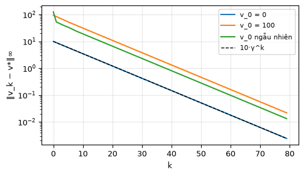
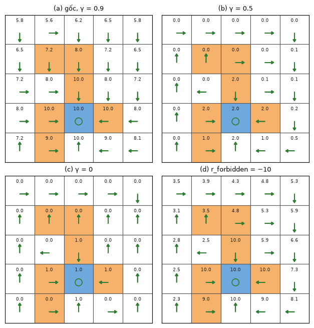
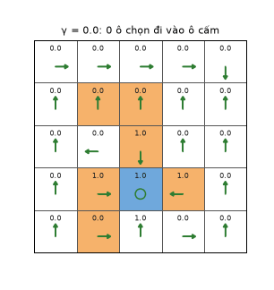

# Chương 3 · Code

> Ghi chú của người biên soạn: trang này không có trong sách. Nó giải phương trình tối ưu Bellman (BOE) của [chương 3](mathrl/ch03_vi) bằng phép lặp ở định lý 3.3, rồi thử ảnh hưởng của $\gamma$ và của phần thưởng lên chính sách tối ưu. Hàm `make_grid` và `value_iteration` lấy từ mục "Kiểm tra bằng mã" trong chương, đã nạp sẵn trong mô-đun `zhao_grid`. Ký hiệu theo [Quy ước ký hiệu](notation_vi).

Mỗi khối code đã được chạy sẵn. Kết quả, hình và ảnh động nằm ngay bên dưới. Các khối chạy lần lượt từ trên xuống và dùng chung biến, như notebook. Muốn tự chạy, xem [mục 5](#_5-chạy-trên-máy).

## 1. Giải BOE bằng phép lặp co

<small class="viz-ref">Mục 3.3.3, 3.4 · định lý 3.3</small>

Vế phải của BOE, $f(v) = \max_\pi (r_\pi + \gamma P_\pi v)$, là một ánh xạ co với hệ số $\gamma$. Vì vậy phép lặp $v_{k+1} = f(v_k)$ hội tụ về $v^{\ast}$ từ **bất kỳ** điểm xuất phát nào, và sai số giảm ít nhất theo $\gamma^k$. Ta kiểm tra bằng ba điểm xuất phát rất khác nhau:

<!-- run -->
```python
import numpy as np
import matplotlib.pyplot as plt
from zhao_grid import make_grid, value_iteration, plot_grid, print_policy
from viz import save_gif

P, R = make_grid()
gamma = 0.9
f = lambda v: (R + gamma * P @ v).max(axis=1)        # vế phải của BOE
v_star, pi_star = value_iteration(P, R, gamma, tol=1e-12)

plt.figure(figsize=(5.5, 3))
for name, v in [("v_0 = 0", np.zeros(25)), ("v_0 = 100", np.full(25, 100.0)),
                ("v_0 ngẫu nhiên", np.random.default_rng(0).normal(0, 50, 25))]:
    errors = []
    for k in range(80):
        errors.append(np.abs(v - v_star).max())
        v = f(v)
    plt.semilogy(errors, label=name)
plt.semilogy(10 * gamma ** np.arange(80), "k--", lw=1, label="10·γ^k")
plt.xlabel("k"); plt.ylabel("‖v_k − v*‖∞"); plt.legend(fontsize=8); plt.grid(alpha=.3)
```

<!-- output -->
<div align=center></div>
<!-- /output -->

Cả ba đường đều đi xuống song song với $\gamma^k$, và cùng về một điểm $v^{\ast}$. Đây là nội dung của định lý ánh xạ co: điểm bất động tồn tại, duy nhất, và phép lặp hội tụ về nó với tốc độ cấp số nhân.

## 2. Hình 3.4: bốn thiết lập

<small class="viz-ref">Mục 3.5 · hình 3.4</small>

<!-- run -->
```python
settings = [("(a) gốc, γ = 0.9", {}, 0.9),
            ("(b) γ = 0.5", {}, 0.5),
            ("(c) γ = 0", {}, 0.0),
            ("(d) r_forbidden = −10", {"r_forbidden": -10}, 0.9)]
fig, axes = plt.subplots(2, 2, figsize=(6.4, 6.6))
for ax, (title, kw, g) in zip(axes.flat, settings):
    P_, R_ = make_grid(**kw)
    v, pi = value_iteration(P_, R_, g, tol=1e-10)
    plot_grid(v, pi, title=title, ax=ax)
plt.tight_layout()
```

<!-- output -->
<div align=center></div>
<!-- /output -->

Bốn hình khớp với hình 3.4. Khi $\gamma = 0.9$, chính sách dám đi xuyên ô cấm để tới đích nhanh hơn. Khi $\gamma = 0.5$, nó trở nên thiển cận và tránh ô cấm. Khi $\gamma = 0$, nhiều ô không đi về đích nữa. Khi phạt ô cấm nặng hơn ($-10$), chính sách tránh mọi ô cấm.

## 3. Quét $\gamma$ từ 0 tới 0.95

<small class="viz-ref">Mục 3.5 · ảnh hưởng của hệ số chiết khấu</small>

Ảnh động dưới giải BOE với $\gamma$ tăng dần. Mỗi khung in số ô mà chính sách tối ưu đi **vào** ô cấm.

<!-- run -->
```python
from zhao_grid import FORBIDDEN
next_state = P.argmax(axis=2)
forbidden_idx = {i * 5 + j for i, j in FORBIDDEN}

frames = []
for g in [0.0, 0.1, 0.2, 0.3, 0.4, 0.5, 0.6, 0.7, 0.8, 0.85, 0.9, 0.95]:
    v, pi = value_iteration(P, R, g, tol=1e-10)
    into_forbidden = sum(next_state[s, pi[s]] in forbidden_idx for s in range(25) if s not in forbidden_idx)
    frames.append((g, v, pi, into_forbidden))
    print(f"γ = {g:4}: số ô (ngoài ô cấm) có hành động tối ưu đi vào ô cấm = {into_forbidden}")

def draw(fig, i):
    g, v, pi, n = frames[i]
    plot_grid(v, pi, title=f"γ = {g}: {n} ô chọn đi vào ô cấm", ax=fig.add_subplot(1, 1, 1))

save_gif(draw, len(frames), "gamma_sweep.gif", fps=1.2, figsize=(3.4, 3.6), dpi=90, hold_last=2)
```

<!-- output -->
```output
γ =  0.0: số ô (ngoài ô cấm) có hành động tối ưu đi vào ô cấm = 0
γ =  0.1: số ô (ngoài ô cấm) có hành động tối ưu đi vào ô cấm = 0
γ =  0.2: số ô (ngoài ô cấm) có hành động tối ưu đi vào ô cấm = 0
γ =  0.3: số ô (ngoài ô cấm) có hành động tối ưu đi vào ô cấm = 0
γ =  0.4: số ô (ngoài ô cấm) có hành động tối ưu đi vào ô cấm = 0
γ =  0.5: số ô (ngoài ô cấm) có hành động tối ưu đi vào ô cấm = 0
γ =  0.6: số ô (ngoài ô cấm) có hành động tối ưu đi vào ô cấm = 3
γ =  0.7: số ô (ngoài ô cấm) có hành động tối ưu đi vào ô cấm = 4
γ =  0.8: số ô (ngoài ô cấm) có hành động tối ưu đi vào ô cấm = 4
γ = 0.85: số ô (ngoài ô cấm) có hành động tối ưu đi vào ô cấm = 5
γ =  0.9: số ô (ngoài ô cấm) có hành động tối ưu đi vào ô cấm = 5
γ = 0.95: số ô (ngoài ô cấm) có hành động tối ưu đi vào ô cấm = 5
```

<div align=center></div>
<!-- /output -->

Có một ngưỡng rõ ràng nằm giữa $\gamma = 0.5$ và $0.6$. Dưới ngưỡng, không ô nào chịu bước vào ô cấm: mất ngay $1$ điểm không đáng để đổi lấy phần thưởng ở xa, vốn đã bị chiết khấu mạnh. Trên ngưỡng, phần thưởng $+1$ mỗi bước ở đích, cộng dồn mãi về sau, đủ lớn để bù cái giá $-1$ của một lần đi tắt qua ô cấm. Số ô chọn đi tắt tăng dần rồi đứng ở 5.

## 4. Phần thưởng: biến đổi affine và đường vòng

<small class="viz-ref">Mục 3.5 · định lý 3.6 · hình 3.5</small>

**Biến đổi affine.** Định lý 3.6 nói rằng đổi mọi phần thưởng $r \to \alpha r + \beta$ với $\alpha > 0$ thì $v^{\ast}$ đổi thành $\alpha v^{\ast} + \frac{\beta}{1-\gamma}\mathbf 1$, còn chính sách tối ưu giữ nguyên. Với $\alpha < 0$ thì không:

<!-- run -->
```python
base = dict(r_boundary=-1, r_forbidden=-1, r_target=1, r_other=0)
for alpha, beta in [(1, -2), (3, 5), (0.1, 0), (-1, 0)]:
    P_, R_ = make_grid(**{k: alpha * r + beta for k, r in base.items()})
    v2, pi2 = value_iteration(P_, R_, gamma, tol=1e-12)
    predicted = alpha * v_star + beta / (1 - gamma)
    same_policy = np.allclose((R_ + gamma * P_ @ v2)[np.arange(25), pi_star], v2)  # π* vẫn tối ưu?
    print(f"α = {alpha:4}, β = {beta:3}: v' = αv* + β/(1−γ)? {np.allclose(v2, predicted)}, "
          f"π* vẫn tối ưu? {same_policy}")
```

<!-- output -->
```output
α =    1, β =  -2: v' = αv* + β/(1−γ)? True, π* vẫn tối ưu? True
α =    3, β =   5: v' = αv* + β/(1−γ)? True, π* vẫn tối ưu? True
α =  0.1, β =   0: v' = αv* + β/(1−γ)? True, π* vẫn tối ưu? True
α =   -1, β =   0: v' = αv* + β/(1−γ)? False, π* vẫn tối ưu? False
```
<!-- /output -->

Ở dòng cuối, nhân với $-1$ biến bài toán "tới đích" thành "tránh đích", nên cả $v'$ lẫn chính sách đều đổi. Cột "π* vẫn tối ưu" so **giá trị** chứ không so chỉ số hành động, vì có ô có nhiều hành động cùng tối ưu.

**Không cần phạt mỗi bước.** Theo mục "Tránh đi vòng vô ích", chiết khấu tự nó đã làm chính sách tối ưu đi đường ngắn nhất, dù $r_{\text{other}} = 0$. Ta kiểm tra trên lưới 5×5: từ mỗi ô, đếm số bước tới đích khi đi theo $\pi^{\ast}$, và so với đường ngắn nhất không đi vào ô cấm (tìm bằng BFS).

<!-- run -->
```python
from collections import deque
goal = 3 * 5 + 2

def steps_to_goal(pi, s, limit=50):
    for t in range(limit):
        if s == goal:
            return t
        s = next_state[s, pi[s]]
    return None

def shortest_safe(s):
    """BFS trên lưới, không đi vào ô cấm (trừ khi xuất phát từ ô cấm)."""
    seen, queue = {s}, deque([(s, 0)])
    while queue:
        u, d = queue.popleft()
        if u == goal:
            return d
        for a in range(4):
            w = next_state[u, a]
            if w not in seen and (w not in forbidden_idx or w == goal):
                seen.add(w); queue.append((w, d + 1))

P10, R10 = make_grid(r_forbidden=-10)          # phạt ô cấm nặng để π* không đi xuyên ô cấm
_, pi10 = value_iteration(P10, R10, gamma, tol=1e-12)
diff = [(s, steps_to_goal(pi10, s), shortest_safe(s)) for s in range(25) if s not in forbidden_idx]
print("Số ô mà π* đi đúng đường ngắn nhất (không qua ô cấm):",
      sum(a == b for _, a, b in diff), "/", len(diff))
```

<!-- output -->
```output
Số ô mà π* đi đúng đường ngắn nhất (không qua ô cấm): 19 / 19
```
<!-- /output -->

## 5. Chạy trên máy

```bash
git clone https://github.com/nmc2004nd/easy-rl-vi.git
cd easy-rl-vi/docs/code/py          # chạy từ đây để import được zhao_grid, viz
pip install numpy matplotlib pillow
```

Chép lần lượt các khối code vào Jupyter rồi chạy theo thứ tự. Kết quả trên trang được dựng bằng `python3 scripts/build_code_pages.py docs/mathrl/ch03_code_vi.md`.
