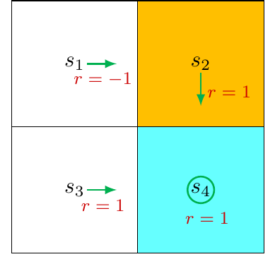
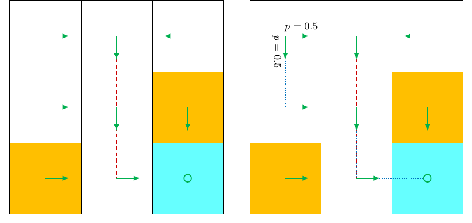
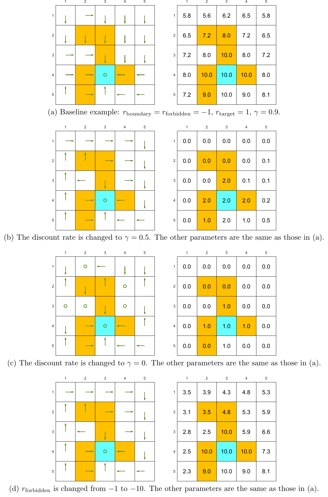
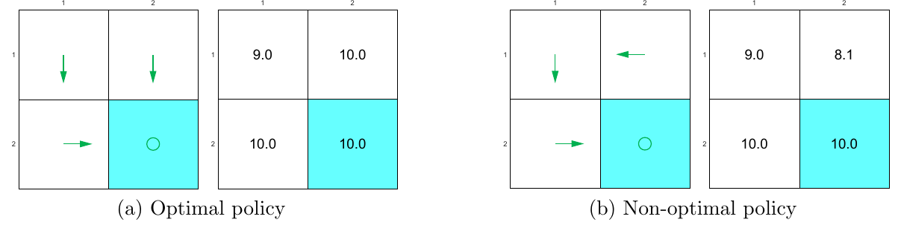

# Chương 3 Giá trị trạng thái tối ưu và phương trình tối ưu Bellman

> Ghi chú của người biên soạn: đây là bản tổng hợp tiếng Việt chương 3 sách *Mathematical Foundations of Reinforcement Learning* (Shiyu Zhao, 2025), có bổ sung từ bài [Bellman Optimality Equation](https://lyk-love.cn/2024/01/07/Bellman-Optimality-Equation/) trên blog lyk-love. Xem [giới thiệu phần này](mathrl/README_vi) để biết nguồn, và [Quy ước ký hiệu](notation_vi) cho chuẩn ký hiệu dùng chung. Ý không có trong sách được ghi rõ.

<div align=center>

</div>
<div align=center>Hình 3.1 Vị trí của chương này trong sách. Nguồn: Zhao (2025)</div>

Mục tiêu cuối cùng của học tăng cường là **tìm chính sách tối ưu**, nên trước hết phải định nghĩa chính sách tối ưu là gì. Chương này giới thiệu:

- **khái niệm cốt lõi:** **giá trị trạng thái tối ưu (optimal state value)**, dùng để định nghĩa chính sách tối ưu;
- **công cụ quan trọng:** **phương trình tối ưu Bellman (Bellman optimality equation, BOE)**, giải ra được giá trị trạng thái tối ưu và chính sách tối ưu.

**Quan hệ với các chương xung quanh:**

| Chương | Nội dung |
|---|---|
| 2 | phương trình Bellman của **một chính sách cho trước** |
| 3 (chương này) | phương trình tối ưu Bellman: một phương trình Bellman **đặc biệt**, ứng với chính sách tối ưu |
| 4 | **lặp giá trị**: chính là thuật toán giải phương trình tối ưu Bellman của chương này |

Chương này nặng toán hơn các chương trước một chút. Nhưng rất đáng, vì nó trả lời rõ ràng nhiều câu hỏi nền tảng.

## 3.1 Ví dụ dẫn nhập: cải thiện chính sách thế nào?

<div align=center>

</div>
<div align=center>Hình 3.2 Ví dụ minh họa cải thiện chính sách. Ô cam là ô cấm, ô xanh là ô đích. Nguồn: Zhao (2025)</div>

Chính sách ở hình 3.2 chưa tốt vì ở $s_1$ nó chọn $a_2$ (sang phải), đi vào ô cấm. Làm sao cải thiện nó? Câu trả lời nằm ở giá trị trạng thái và giá trị hành động.

**Theo trực giác:** đổi sang chọn $a_3$ (đi xuống) ở $s_1$ sẽ tốt hơn, vì tránh được ô cấm.

**Theo toán học:** trực giác trên có thể hiện thực hóa bằng cách tính giá trị trạng thái và giá trị hành động.

**Bước 1: tính giá trị trạng thái của chính sách đang có.** Phương trình Bellman:

$$
\begin{aligned}
v_\pi(s_1) &= -1 + \gamma v_\pi(s_2),\\
v_\pi(s_2) &= +1 + \gamma v_\pi(s_4),\\
v_\pi(s_3) &= +1 + \gamma v_\pi(s_4),\\
v_\pi(s_4) &= +1 + \gamma v_\pi(s_4).
\end{aligned}
$$

Với $\gamma = 0.9$, giải được $v_\pi(s_4) = v_\pi(s_3) = v_\pi(s_2) = 10$ và $v_\pi(s_1) = 8$.

**Bước 2: tính giá trị hành động tại $s_1$.**

$$
\begin{aligned}
q_\pi(s_1, a_1) &= -1 + \gamma v_\pi(s_1) = 6.2,\\
q_\pi(s_1, a_2) &= -1 + \gamma v_\pi(s_2) = 8,\\
q_\pi(s_1, a_3) &= 0 + \gamma v_\pi(s_3) = 9,\\
q_\pi(s_1, a_4) &= -1 + \gamma v_\pi(s_1) = 6.2,\\
q_\pi(s_1, a_5) &= 0 + \gamma v_\pi(s_1) = 7.2.
\end{aligned}
$$

Hành động $a_3$ có giá trị hành động lớn nhất: $q_\pi(s_1, a_3) \ge q_\pi(s_1, a_i)$ với mọi $i \ne 3$. Vậy có thể cập nhật chính sách để chọn $a_3$ ở $s_1$.

**Bài học:** cập nhật chính sách để **chọn hành động có giá trị hành động lớn nhất** thì được chính sách tốt hơn. Đây là ý tưởng cơ bản của rất nhiều thuật toán học tăng cường.

Ví dụ này rất đơn giản vì chính sách chỉ tồi ở đúng một trạng thái $s_1$. Nếu chính sách tồi ở nhiều trạng thái, chọn hành động có giá trị lớn nhất có còn cho chính sách tốt hơn không? Chính sách tối ưu có luôn tồn tại không? Nó trông như thế nào? Chương này sẽ trả lời tất cả.

## 3.2 Giá trị trạng thái tối ưu và chính sách tối ưu

Để định nghĩa chính sách tối ưu, ta dựa vào giá trị trạng thái. Xét hai chính sách $\pi_1$ và $\pi_2$. Nếu giá trị trạng thái của $\pi_1$ không nhỏ hơn của $\pi_2$ **ở mọi trạng thái**:

$$
v_{\pi_1}(s) \ge v_{\pi_2}(s), \qquad \text{với mọi } s \in \mathcal S,
$$

thì $\pi_1$ được gọi là **tốt hơn** $\pi_2$. Một chính sách tốt hơn mọi chính sách khác thì là chính sách tối ưu.

> **Định nghĩa 3.1 (Chính sách tối ưu và giá trị trạng thái tối ưu).** Chính sách $\pi^{\ast}$ là **tối ưu** nếu $v_{\pi^{\ast}}(s) \ge v_\pi(s)$ với mọi $s \in \mathcal S$ và với mọi chính sách $\pi$ khác. Giá trị trạng thái của $\pi^{\ast}$ gọi là **giá trị trạng thái tối ưu**.

Nghĩa là chính sách tối ưu có giá trị trạng thái lớn nhất **ở mọi trạng thái cùng lúc**, so với mọi chính sách khác. *(ghi chú của người biên soạn)* Đây là một yêu cầu rất mạnh: không có gì bảo đảm trước rằng một chính sách lại thắng mọi chính sách khác ở **tất cả** các trạng thái. Vì vậy câu hỏi "có tồn tại không" là thật sự cần thiết.

Định nghĩa này dẫn tới bốn câu hỏi:

| Câu hỏi | Nội dung | Trả lời ở |
|---|---|---|
| **Tồn tại** | Chính sách tối ưu có tồn tại không? | Định lý 3.3, 3.4 |
| **Duy nhất** | Chính sách tối ưu có duy nhất không? | mục 3.4 |
| **Ngẫu nhiên hay tất định** | Chính sách tối ưu là ngẫu nhiên hay tất định? | Định lý 3.5 |
| **Thuật toán** | Tìm chính sách tối ưu và giá trị tối ưu thế nào? | Định lý 3.3, chương 4 |

Phải trả lời rõ các câu hỏi này mới hiểu thấu chính sách tối ưu. Ví dụ, nếu chính sách tối ưu không tồn tại thì chẳng cần thiết kế thuật toán để tìm nó.

## 3.3 Phương trình tối ưu Bellman

Công cụ để phân tích chính sách tối ưu và giá trị trạng thái tối ưu là **phương trình tối ưu Bellman (BOE)**. Với mọi $s \in \mathcal S$, dạng từng phần tử của BOE là

$$
\begin{aligned}
v(s) &= \max_{\pi(s) \in \Pi(s)} \sum_{a \in \mathcal A} \pi(a \mid s) \left( \sum_{r \in \mathcal R} p(r \mid s, a)\, r + \gamma \sum_{s' \in \mathcal S} p(s' \mid s, a)\, v(s') \right)\\
&= \max_{\pi(s) \in \Pi(s)} \sum_{a \in \mathcal A} \pi(a \mid s)\, q(s, a),
\end{aligned} \tag{3.1}
$$

trong đó $v(s)$ và $v(s')$ là các ẩn cần giải, và

$$
q(s, a) \doteq \sum_{r \in \mathcal R} p(r \mid s, a)\, r + \gamma \sum_{s' \in \mathcal S} p(s' \mid s, a)\, v(s').
$$

Ở đây $\pi(s)$ ký hiệu chính sách tại trạng thái $s$ (tức phân phối $\pi(\cdot \mid s)$), và $\Pi(s)$ là tập mọi chính sách có thể có tại $s$.

**So với phương trình Bellman (2.7)**, BOE chỉ thêm phép $\max$ theo chính sách. *(ghi chú của người biên soạn)* Phương trình Bellman cho **một** chính sách cố định; BOE đòi chính sách ở vế phải phải là **tốt nhất** ứng với chính $v$ đang tìm.

BOE là công cụ đẹp và mạnh, nhưng không dễ hiểu:

- Nó có **hai ẩn**: $v(s)$ và $\pi(a \mid s)$. Người mới sẽ thắc mắc làm sao giải hai ẩn từ một phương trình.
- Thực ra BOE là một phương trình Bellman **đặc biệt**, nhưng nhìn biểu thức thì khó nhận ra.

Cần trả lời bốn câu hỏi về BOE:

| Câu hỏi | Nội dung |
|---|---|
| **Tồn tại** | Phương trình có nghiệm không? |
| **Duy nhất** | Nghiệm có duy nhất không? |
| **Thuật toán** | Giải phương trình thế nào? |
| **Tính tối ưu** | Nghiệm liên quan thế nào tới chính sách tối ưu? |

Trả lời xong bốn câu này thì sẽ hiểu rõ giá trị trạng thái tối ưu và chính sách tối ưu.

### 3.3.1 Cực đại hóa vế phải của BOE

Hai ẩn $v(s)$ và $\pi(a \mid s)$ có thể giải **lần lượt từng ẩn một**. Ví dụ sau minh họa ý tưởng.

> **Ví dụ 3.1.** Hai ẩn $x, y \in \mathbb R$ thỏa
> $$x = \max_{y \in \mathbb R}\, (2x - 1 - y^2).$$
> **Bước 1: giải $y$ ở vế phải.** Dù $x$ bằng bao nhiêu, ta luôn có $\max_y (2x - 1 - y^2) = 2x - 1$, đạt được khi $y = 0$.
> **Bước 2: giải $x$.** Khi $y = 0$, phương trình thành $x = 2x - 1$, nên $x = 1$.
> Vậy nghiệm là $y = 0$, $x = 1$.

Áp dụng vào BOE. Viết gọn (3.1):

$$
v(s) = \max_{\pi(s) \in \Pi(s)} \sum_{a \in \mathcal A} \pi(a \mid s)\, q(s, a), \qquad s \in \mathcal S.
$$

Theo ví dụ 3.1, trước hết giải $\pi$ tối ưu ở vế phải. Làm thế nào? Ví dụ sau cho thấy ý tưởng.

> **Ví dụ 3.2.** Cho $q_1, q_2, q_3 \in \mathbb R$. Tìm $c_1, c_2, c_3$ để cực đại hóa
> $$\sum_{i=1}^3 c_i q_i = c_1 q_1 + c_2 q_2 + c_3 q_3, \qquad \text{với } c_1 + c_2 + c_3 = 1 \text{ và } c_1, c_2, c_3 \ge 0.$$
> Không mất tổng quát, giả sử $q_3 \ge q_1, q_2$. Khi đó nghiệm tối ưu là $c_3^{\ast} = 1$, $c_1^{\ast} = c_2^{\ast} = 0$, vì với mọi $c_1, c_2, c_3$:
> $$q_3 = (c_1 + c_2 + c_3)\, q_3 = c_1 q_3 + c_2 q_3 + c_3 q_3 \ge c_1 q_1 + c_2 q_2 + c_3 q_3.$$

Tổng quát hóa: vì $\sum_a \pi(a \mid s) = 1$ nên

$$
\sum_{a \in \mathcal A} \pi(a \mid s)\, q(s, a) \le \sum_{a \in \mathcal A} \pi(a \mid s) \max_{a \in \mathcal A} q(s, a) = \max_{a \in \mathcal A} q(s, a),
$$

và dấu bằng xảy ra khi

$$
\pi(a \mid s) = \begin{cases} 1, & a = a^{\ast},\\ 0, & a \ne a^{\ast}, \end{cases}
$$

với $a^{\ast} = \arg\max_a q(s, a)$.

**Tóm lại:** chính sách tối ưu $\pi(s)$ ở vế phải là chính sách **chọn hành động có $q(s,a)$ lớn nhất**. Trung bình có trọng số không bao giờ vượt quá phần tử lớn nhất, nên dồn hết xác suất vào phần tử lớn nhất là tốt nhất.

### 3.3.2 Dạng ma trận–vectơ của BOE

BOE là một hệ phương trình, mỗi trạng thái một phương trình. Gom lại được dạng ma trận–vectơ gọn, sẽ dùng nhiều trong chương này:

$$
v = \max_{\pi \in \Pi}\, (r_\pi + \gamma P_\pi v), \tag{3.2}
$$

với $v \in \mathbb R^{\lvert\mathcal S\rvert}$, và $\max_\pi$ lấy **theo từng phần tử**. Cấu trúc của $r_\pi$ và $P_\pi$ giống hệt trong dạng ma trận–vectơ của phương trình Bellman thường:

$$
[r_\pi]_s \doteq \sum_{a \in \mathcal A} \pi(a \mid s) \sum_{r \in \mathcal R} p(r \mid s, a)\, r, \qquad [P_\pi]_{s,s'} = p(s' \mid s) \doteq \sum_{a \in \mathcal A} \pi(a \mid s)\, p(s' \mid s, a).
$$

Vì $\pi$ tối ưu do $v$ quyết định, vế phải của (3.2) là một hàm của $v$:

$$
f(v) \doteq \max_{\pi \in \Pi}\, (r_\pi + \gamma P_\pi v).
$$

Khi đó BOE viết gọn thành

$$
v = f(v). \tag{3.3}
$$

Đây là một **phương trình phi tuyến** (do phép $\max$). Phần còn lại của mục này trình bày cách giải nó.

*(ghi chú của người biên soạn, giải đáp một thắc mắc trong bài của lyk-love)* "$\max_\pi$ lấy theo từng phần tử" là hợp lệ vì chính sách tại các trạng thái khác nhau **độc lập với nhau**: hàng $s$ của $r_\pi + \gamma P_\pi v$ chỉ phụ thuộc $\pi(\cdot \mid s)$. Vì thế có thể chọn $\pi(\cdot \mid s)$ tốt nhất cho từng hàng riêng rẽ, và cùng một chính sách $\pi$ đạt cực đại ở mọi hàng một lúc. Nói cách khác, dạng ma trận (3.2) và dạng từng phần tử (3.1) là một.

### 3.3.3 Định lý ánh xạ co

BOE có dạng phương trình phi tuyến $v = f(v)$. Công cụ để phân tích nó là **định lý ánh xạ co (contraction mapping theorem)**, còn gọi là **định lý điểm bất động (fixed-point theorem)**. Đây là công cụ mạnh để phân tích các phương trình phi tuyến tổng quát, và là chìa khóa để phân tích BOE. Ai đã biết định lý này có thể bỏ qua mục này.

**Hai khái niệm.** Xét hàm $f: \mathbb R^d \to \mathbb R^d$.

- **Điểm bất động (fixed point):** $x^{\ast}$ là điểm bất động nếu $f(x^{\ast}) = x^{\ast}$. Ảnh của $x^{\ast}$ qua $f$ chính là nó, nên gọi là "bất động".
- **Ánh xạ co (contraction mapping)**, hay hàm co: $f$ là ánh xạ co nếu tồn tại $\gamma \in (0,1)$ sao cho
$$\|f(x_1) - f(x_2)\| \le \gamma \|x_1 - x_2\| \qquad \text{với mọi } x_1, x_2 \in \mathbb R^d.$$
Trong sách, $\|\cdot\|$ là một chuẩn (norm) của vectơ hoặc ma trận.

Nói nôm na *(ghi chú của người biên soạn)*: ánh xạ co kéo mọi cặp điểm lại gần nhau hơn, ít nhất theo tỉ lệ $\gamma$.

> **Ví dụ 3.3.** Ba ví dụ về điểm bất động và ánh xạ co.
>
> - **$x = f(x) = 0.5x$, $x \in \mathbb R$.** $x = 0$ là điểm bất động vì $0 = 0.5 \cdot 0$. $f$ là ánh xạ co vì $\|0.5x_1 - 0.5x_2\| = 0.5\|x_1 - x_2\| \le \gamma \|x_1 - x_2\|$ với mọi $\gamma \in [0.5, 1)$.
> - **$x = f(x) = Ax$, với $x \in \mathbb R^n$, $A \in \mathbb R^{n \times n}$ và $\|A\| \le \gamma < 1$.** $x = 0$ là điểm bất động vì $0 = A0$. $f$ là ánh xạ co vì $\|Ax_1 - Ax_2\| = \|A(x_1 - x_2)\| \le \|A\|\|x_1 - x_2\| \le \gamma \|x_1 - x_2\|$.
> - **$x = f(x) = 0.5 \sin x$, $x \in \mathbb R$.** $x = 0$ là điểm bất động vì $0 = 0.5 \sin 0$. Theo định lý giá trị trung bình,
> $$\left\lvert \frac{0.5 \sin x_1 - 0.5 \sin x_2}{x_1 - x_2} \right\rvert = \lvert 0.5 \cos x_3 \rvert \le 0.5, \qquad x_3 \in [x_1, x_2],$$
> nên $\lvert 0.5 \sin x_1 - 0.5 \sin x_2 \rvert \le 0.5 \lvert x_1 - x_2 \rvert$, và $f$ là ánh xạ co.

Quan hệ giữa điểm bất động và tính co được nêu trong định lý kinh điển sau.

> **Định lý 3.1 (Định lý ánh xạ co).** Với mọi phương trình dạng $x = f(x)$, trong đó $x$ và $f(x)$ là vectơ thực, nếu $f$ là ánh xạ co thì:
>
> - **Tồn tại:** có một điểm bất động $x^{\ast}$ thỏa $f(x^{\ast}) = x^{\ast}$.
> - **Duy nhất:** điểm bất động $x^{\ast}$ là duy nhất.
> - **Thuật toán:** xét quá trình lặp $x_{k+1} = f(x_k)$, $k = 0, 1, 2, \dots$ Khi đó $x_k \to x^{\ast}$ khi $k \to \infty$, **với mọi giá trị đoán ban đầu** $x_0$. Hơn nữa, tốc độ hội tụ là **hàm mũ** (rất nhanh).

Định lý không chỉ cho biết phương trình phi tuyến có nghiệm hay không, mà còn **chỉ ra luôn thuật toán số để giải**.

> **Ví dụ 3.4.** Quay lại ba phương trình $x = 0.5x$, $x = Ax$ và $x = 0.5 \sin x$. Vế phải đều là ánh xạ co, nên theo định lý ánh xạ co, mỗi phương trình có đúng một điểm bất động, dễ kiểm tra là $x^{\ast} = 0$. Có thể giải lặp bằng
> $$x_{k+1} = 0.5 x_k, \qquad x_{k+1} = A x_k, \qquad x_{k+1} = 0.5 \sin x_k,$$
> với bất kỳ giá trị đoán ban đầu $x_0$ nào.

> **Hộp 3.1: Chứng minh định lý ánh xạ co**
>
> **Phần 1: dãy $\{x_k\}$ với $x_k = f(x_{k-1})$ hội tụ.**
>
> Chứng minh dựa vào **dãy Cauchy**. Dãy $x_1, x_2, \dots$ là dãy Cauchy nếu với mọi $\varepsilon > 0$ nhỏ tùy ý, tồn tại $N$ sao cho $\|x_m - x_n\| < \varepsilon$ với mọi $m, n > N$. Trực quan: kể từ một chỉ số hữu hạn $N$ nào đó, mọi phần tử đều rất gần nhau. Dãy Cauchy quan trọng vì nó **chắc chắn hội tụ** tới một giới hạn.
>
> Lưu ý: **mọi** cặp $m, n > N$ đều phải thỏa $\|x_m - x_n\| < \varepsilon$. Chỉ có $x_{n+1} - x_n \to 0$ thì **chưa đủ**. Ví dụ $x_n = \sqrt n$ thỏa $x_{n+1} - x_n \to 0$ nhưng rõ ràng phân kỳ.
>
> Vì $f$ là ánh xạ co: $\|x_{k+1} - x_k\| = \|f(x_k) - f(x_{k-1})\| \le \gamma \|x_k - x_{k-1}\|$. Lặp lại:
> $$\|x_{k+1} - x_k\| \le \gamma \|x_k - x_{k-1}\| \le \gamma^2 \|x_{k-1} - x_{k-2}\| \le \cdots \le \gamma^k \|x_1 - x_0\|.$$
> Do $\gamma < 1$, $\|x_{k+1} - x_k\|$ tiến về 0 theo hàm mũ. Nhưng như đã nói, điều này chưa đủ; cần xét $\|x_m - x_n\|$ với mọi $m > n$:
> $$\begin{aligned}
> \|x_m - x_n\| &= \|x_m - x_{m-1} + x_{m-1} - \cdots - x_{n+1} + x_{n+1} - x_n\|\\
> &\le \|x_m - x_{m-1}\| + \cdots + \|x_{n+1} - x_n\|\\
> &\le \gamma^{m-1}\|x_1 - x_0\| + \cdots + \gamma^n \|x_1 - x_0\|\\
> &= \gamma^n (\gamma^{m-1-n} + \cdots + 1)\, \|x_1 - x_0\|\\
> &\le \gamma^n (1 + \gamma + \gamma^2 + \cdots)\, \|x_1 - x_0\| = \frac{\gamma^n}{1-\gamma}\|x_1 - x_0\|.
> \end{aligned} \tag{3.4}$$
> Vậy với mọi $\varepsilon$ luôn tìm được $N$ để $\|x_m - x_n\| < \varepsilon$ với mọi $m, n > N$. Dãy là dãy Cauchy nên hội tụ tới một giới hạn, ký hiệu $x^{\ast} = \lim_{k\to\infty} x_k$.
>
> **Phần 2: giới hạn $x^{\ast}$ là điểm bất động.** Vì $\|f(x_k) - x_k\| = \|x_{k+1} - x_k\| \le \gamma^k \|x_1 - x_0\|$ tiến về 0 theo hàm mũ, qua giới hạn ta có $f(x^{\ast}) = x^{\ast}$.
>
> **Phần 3: điểm bất động là duy nhất.** Giả sử có điểm bất động khác $x'$ với $f(x') = x'$. Khi đó
> $$\|x' - x^{\ast}\| = \|f(x') - f(x^{\ast})\| \le \gamma \|x' - x^{\ast}\|.$$
> Vì $\gamma < 1$, bất đẳng thức chỉ đúng khi $\|x' - x^{\ast}\| = 0$, tức $x' = x^{\ast}$.
>
> **Phần 4: $x_k$ hội tụ tới $x^{\ast}$ theo hàm mũ.** Theo (3.4), $\|x_m - x_n\| \le \frac{\gamma^n}{1-\gamma}\|x_1 - x_0\|$. Cho $m \to \infty$:
> $$\|x^{\ast} - x_n\| = \lim_{m\to\infty}\|x_m - x_n\| \le \frac{\gamma^n}{1-\gamma}\|x_1 - x_0\|.$$
> Vì $\gamma < 1$, sai số tiến về 0 theo hàm mũ khi $n \to \infty$. $\blacksquare$

*(ghi chú của người biên soạn)* Phần 4 còn cho một **ước lượng số vòng lặp**: muốn sai số dưới $\varepsilon$ thì chỉ cần $n \ge \log\!\big(\varepsilon(1-\gamma)/\|x_1 - x_0\|\big) / \log\gamma$. Với $\gamma$ gần 1, $\log\gamma \approx -(1-\gamma)$ rất nhỏ, nên số vòng lặp tăng mạnh. Đây là lý do lặp giá trị chậm khi $\gamma$ gần 1.

### 3.3.4 Tính co của vế phải BOE

Bây giờ chứng minh rằng $f(v)$ trong BOE (3.3) là ánh xạ co, để áp dụng được định lý ánh xạ co.

> **Định lý 3.2 (Tính co của $f(v)$).** Hàm $f(v)$ ở vế phải BOE (3.3) là một ánh xạ co. Cụ thể, với mọi $v_1, v_2 \in \mathbb R^{\lvert\mathcal S\rvert}$:
> $$\|f(v_1) - f(v_2)\|_\infty \le \gamma \|v_1 - v_2\|_\infty,$$
> với $\gamma \in (0,1)$ là hệ số chiết khấu và $\|\cdot\|_\infty$ là **chuẩn cực đại (maximum norm)**: giá trị tuyệt đối lớn nhất trong các phần tử của vectơ.

Định lý này quan trọng vì nhờ nó ta dùng được định lý ánh xạ co mạnh mẽ để phân tích BOE. *(ghi chú của người biên soạn)* Để ý hệ số co chính là hệ số chiết khấu $\gamma$: chiết khấu không chỉ để lợi tức hữu hạn mà còn bảo đảm BOE có nghiệm duy nhất.

> **Hộp 3.2: Chứng minh định lý 3.2**
>
> Xét hai vectơ bất kỳ $v_1, v_2 \in \mathbb R^{\lvert\mathcal S\rvert}$. Đặt $\pi_1^{\ast} \doteq \arg\max_\pi (r_\pi + \gamma P_\pi v_1)$ và $\pi_2^{\ast} \doteq \arg\max_\pi (r_\pi + \gamma P_\pi v_2)$. Khi đó
> $$\begin{aligned}
> f(v_1) &= \max_\pi (r_\pi + \gamma P_\pi v_1) = r_{\pi_1^{\ast}} + \gamma P_{\pi_1^{\ast}} v_1 \ge r_{\pi_2^{\ast}} + \gamma P_{\pi_2^{\ast}} v_1,\\
> f(v_2) &= \max_\pi (r_\pi + \gamma P_\pi v_2) = r_{\pi_2^{\ast}} + \gamma P_{\pi_2^{\ast}} v_2 \ge r_{\pi_1^{\ast}} + \gamma P_{\pi_1^{\ast}} v_2,
> \end{aligned}$$
> với $\ge$ so sánh từng phần tử. Do đó
> $$\begin{aligned}
> f(v_1) - f(v_2) &= r_{\pi_1^{\ast}} + \gamma P_{\pi_1^{\ast}} v_1 - (r_{\pi_2^{\ast}} + \gamma P_{\pi_2^{\ast}} v_2)\\
> &\le r_{\pi_1^{\ast}} + \gamma P_{\pi_1^{\ast}} v_1 - (r_{\pi_1^{\ast}} + \gamma P_{\pi_1^{\ast}} v_2) = \gamma P_{\pi_1^{\ast}}(v_1 - v_2).
> \end{aligned}$$
> Tương tự, $f(v_2) - f(v_1) \le \gamma P_{\pi_2^{\ast}}(v_2 - v_1)$. Vậy
> $$\gamma P_{\pi_2^{\ast}}(v_1 - v_2) \le f(v_1) - f(v_2) \le \gamma P_{\pi_1^{\ast}}(v_1 - v_2).$$
> Đặt
> $$z \doteq \max\left\{\lvert\gamma P_{\pi_2^{\ast}}(v_1 - v_2)\rvert,\ \lvert\gamma P_{\pi_1^{\ast}}(v_1 - v_2)\rvert\right\} \in \mathbb R^{\lvert\mathcal S\rvert},$$
> trong đó $\max$, $\lvert\cdot\rvert$ và $\ge$ đều tính theo từng phần tử; theo định nghĩa $z \ge 0$.
>
> **Một mặt**, dễ thấy
> $$-z \le \gamma P_{\pi_2^{\ast}}(v_1 - v_2) \le f(v_1) - f(v_2) \le \gamma P_{\pi_1^{\ast}}(v_1 - v_2) \le z,$$
> nên $\lvert f(v_1) - f(v_2)\rvert \le z$, suy ra
> $$\|f(v_1) - f(v_2)\|_\infty \le \|z\|_\infty. \tag{3.5}$$
> **Mặt khác**, gọi $z_i$ là phần tử thứ $i$ của $z$, và $p_i^T$, $q_i^T$ lần lượt là hàng thứ $i$ của $P_{\pi_1^{\ast}}$ và $P_{\pi_2^{\ast}}$. Khi đó
> $$z_i = \max\{\gamma\lvert p_i^T(v_1 - v_2)\rvert,\ \gamma\lvert q_i^T(v_1 - v_2)\rvert\}.$$
> Vì $p_i$ có mọi phần tử không âm và tổng bằng 1:
> $$\lvert p_i^T(v_1 - v_2)\rvert \le p_i^T\lvert v_1 - v_2\rvert \le \|v_1 - v_2\|_\infty.$$
> Tương tự $\lvert q_i^T(v_1 - v_2)\rvert \le \|v_1 - v_2\|_\infty$. Vậy $z_i \le \gamma\|v_1 - v_2\|_\infty$, nên $\|z\|_\infty = \max_i \lvert z_i\rvert \le \gamma\|v_1 - v_2\|_\infty$.
>
> Thay vào (3.5): $\|f(v_1) - f(v_2)\|_\infty \le \gamma\|v_1 - v_2\|_\infty$. $\blacksquare$

*(ghi chú của người biên soạn)* Ý then chốt của chứng minh: mỗi hàng của ma trận chuyển là một **phân phối xác suất**, nên nhân với nó chỉ là lấy **trung bình có trọng số**, và trung bình không bao giờ vượt quá phần tử lớn nhất. Đó là lý do chuẩn cực đại $\|\cdot\|_\infty$ là chuẩn "đúng" ở đây.

## 3.4 Giải chính sách tối ưu từ BOE

Đã đủ công cụ để giải BOE, thu được giá trị trạng thái tối ưu $v^{\ast}$ và chính sách tối ưu $\pi^{\ast}$.

### Giải $v^{\ast}$

Nếu $v^{\ast}$ là nghiệm của BOE thì $v^{\ast} = \max_{\pi \in \Pi}(r_\pi + \gamma P_\pi v^{\ast})$, tức $v^{\ast} = f(v^{\ast})$: $v^{\ast}$ là một điểm bất động. Áp dụng định lý ánh xạ co:

> **Định lý 3.3 (Tồn tại, duy nhất và thuật toán).** Với BOE $v = f(v) = \max_{\pi\in\Pi}(r_\pi + \gamma P_\pi v)$, luôn tồn tại một nghiệm duy nhất $v^{\ast}$, giải được bằng phép lặp
> $$v_{k+1} = f(v_k) = \max_{\pi\in\Pi}(r_\pi + \gamma P_\pi v_k), \qquad k = 0, 1, 2, \dots$$
> Với mọi giá trị đoán ban đầu $v_0$, $v_k$ hội tụ tới $v^{\ast}$ theo hàm mũ khi $k \to \infty$.

Chứng minh suy ra trực tiếp từ định lý ánh xạ co, vì $f(v)$ là ánh xạ co. Định lý này trả lời ba câu hỏi nền tảng:

- **$v^{\ast}$ tồn tại:** BOE luôn có nghiệm.
- **$v^{\ast}$ duy nhất:** nghiệm luôn duy nhất.
- **Thuật toán giải $v^{\ast}$:** phép lặp ở định lý 3.3. Thuật toán này có tên riêng là **lặp giá trị (value iteration)**; cách cài đặt chi tiết ở [chương 4](mathrl/ch04_vi). Chương này tập trung vào tính chất nền tảng của BOE.

### Giải $\pi^{\ast}$

Có $v^{\ast}$ rồi thì dễ dàng tìm $\pi^{\ast}$ bằng cách giải

$$
\pi^{\ast} = \arg\max_{\pi\in\Pi}\, (r_\pi + \gamma P_\pi v^{\ast}). \tag{3.6}
$$

Giá trị cụ thể của $\pi^{\ast}$ cho ở định lý 3.5. Thay (3.6) vào BOE:

$$
v^{\ast} = r_{\pi^{\ast}} + \gamma P_{\pi^{\ast}} v^{\ast}.
$$

Đây đúng là phương trình Bellman của $\pi^{\ast}$. Vậy **$v^{\ast} = v_{\pi^{\ast}}$ là giá trị trạng thái của $\pi^{\ast}$**, và **BOE là một phương trình Bellman đặc biệt, ứng với chính sách $\pi^{\ast}$**.

### Nghiệm có thật sự tối ưu?

Đến đây ta giải được $v^{\ast}$ và $\pi^{\ast}$, nhưng chưa rõ chúng có tối ưu theo định nghĩa 3.1 không. Định lý sau khẳng định điều đó.

> **Định lý 3.4 (Tính tối ưu của $v^{\ast}$ và $\pi^{\ast}$).** Nghiệm $v^{\ast}$ là giá trị trạng thái tối ưu và $\pi^{\ast}$ là một chính sách tối ưu. Tức là với mọi chính sách $\pi$:
> $$v^{\ast} = v_{\pi^{\ast}} \ge v_\pi,$$
> trong đó $v_\pi$ là giá trị trạng thái của $\pi$ và $\ge$ so sánh từng phần tử.

Giờ đã rõ **vì sao phải học BOE**: nghiệm của nó chính là giá trị trạng thái tối ưu và chính sách tối ưu.

> **Hộp 3.3: Chứng minh định lý 3.4**
>
> Với mọi chính sách $\pi$: $v_\pi = r_\pi + \gamma P_\pi v_\pi$. Vì
> $$v^{\ast} = \max_\pi (r_\pi + \gamma P_\pi v^{\ast}) = r_{\pi^{\ast}} + \gamma P_{\pi^{\ast}} v^{\ast} \ge r_\pi + \gamma P_\pi v^{\ast},$$
> nên
> $$v^{\ast} - v_\pi \ge (r_\pi + \gamma P_\pi v^{\ast}) - (r_\pi + \gamma P_\pi v_\pi) = \gamma P_\pi (v^{\ast} - v_\pi).$$
> Áp dụng lặp lại bất đẳng thức trên (được phép vì $P_\pi \ge 0$ giữ nguyên chiều bất đẳng thức):
> $$v^{\ast} - v_\pi \ge \gamma P_\pi (v^{\ast} - v_\pi) \ge \gamma^2 P_\pi^2 (v^{\ast} - v_\pi) \ge \cdots \ge \gamma^n P_\pi^n (v^{\ast} - v_\pi).$$
> Suy ra
> $$v^{\ast} - v_\pi \ge \lim_{n\to\infty} \gamma^n P_\pi^n (v^{\ast} - v_\pi) = 0,$$
> vì $\gamma < 1$ và $P_\pi^n$ là ma trận không âm có mọi phần tử không vượt quá 1 (do $P_\pi^n \mathbf 1 = \mathbf 1$). Vậy $v^{\ast} \ge v_\pi$ với mọi $\pi$. $\blacksquare$

### Chính sách tối ưu trông như thế nào?

> **Định lý 3.5 (Chính sách tham lam tối ưu).** Với mọi $s \in \mathcal S$, chính sách tham lam tất định
> $$\pi^{\ast}(a \mid s) = \begin{cases} 1, & a = a^{\ast}(s),\\ 0, & a \ne a^{\ast}(s), \end{cases} \tag{3.7}$$
> là một chính sách tối ưu giải BOE. Ở đây $a^{\ast}(s) = \arg\max_a q^{\ast}(s, a)$, với
> $$q^{\ast}(s, a) \doteq \sum_{r \in \mathcal R} p(r \mid s, a)\, r + \gamma \sum_{s' \in \mathcal S} p(s' \mid s, a)\, v^{\ast}(s').$$

(Ghi chú của người biên soạn: bản PDF viết $\arg\max_a q^{\ast}(a, s)$; ở đây sửa thành $q^{\ast}(s,a)$ cho thống nhất thứ tự đối số.)

> **Hộp 3.4: Chứng minh định lý 3.5**
>
> Dạng ma trận–vectơ của chính sách tối ưu là $\pi^{\ast} = \arg\max_\pi (r_\pi + \gamma P_\pi v^{\ast})$. Dạng từng phần tử:
> $$\pi^{\ast}(s) = \arg\max_{\pi\in\Pi} \sum_{a\in\mathcal A} \pi(a \mid s) \underbrace{\left(\sum_{r\in\mathcal R} p(r \mid s,a)\, r + \gamma \sum_{s'\in\mathcal S} p(s' \mid s,a)\, v^{\ast}(s')\right)}_{q^{\ast}(s,a)}, \qquad s \in \mathcal S.$$
> Theo mục 3.3.1, $\sum_a \pi(a \mid s)\, q^{\ast}(s,a)$ đạt cực đại khi $\pi(s)$ chọn hành động có $q^{\ast}(s,a)$ lớn nhất. $\blacksquare$

Chính sách (3.7) gọi là **tham lam (greedy)** vì nó chọn hành động có $q^{\ast}(s,a)$ lớn nhất. *(ghi chú của người biên soạn)* $q^{\ast}(s,a)$ chính là giá trị hành động tối ưu, tức $q_{\pi^{\ast}}(s,a)$, theo công thức (2.14) áp dụng cho $\pi^{\ast}$.

### Hai tính chất của chính sách tối ưu

- **Không nhất thiết duy nhất.** Giá trị $v^{\ast}$ là duy nhất, nhưng chính sách tối ưu ứng với $v^{\ast}$ có thể không duy nhất. Dễ kiểm chứng bằng phản ví dụ: hai chính sách ở hình 3.3 khác nhau nhưng đều tối ưu.
- **Có thể ngẫu nhiên hoặc tất định.** Chính sách tối ưu có thể là ngẫu nhiên hoặc tất định (hình 3.3). Nhưng chắc chắn **luôn tồn tại một chính sách tối ưu tất định**, theo định lý 3.5.

<div align=center>

</div>
<div align=center>Hình 3.3 Chính sách tối ưu có thể không duy nhất: hai chính sách khác nhau nhưng đều tối ưu. Chính sách bên phải là ngẫu nhiên. Nguồn: Zhao (2025)</div>

*(ghi chú của người biên soạn)* Khi nào có nhiều chính sách tối ưu? Khi ở một trạng thái có **nhiều hành động cùng đạt** $\max_a q^{\ast}(s,a)$. Mọi cách chia xác suất giữa các hành động hòa nhau đó đều tối ưu, nên khi đó có vô số chính sách tối ưu.

### Ví dụ giải tay BOE *(theo lyk-love, dựa trên slide bài giảng của Zhao)*

Xét ba trạng thái xếp thành một hàng $s_1, s_2, s_3$; ô đích là $s_2$. Mỗi trạng thái có ba hành động: $a_\ell$ (sang trái), $a_0$ (đứng yên), $a_r$ (sang phải). Phần thưởng: vào ô đích $+1$, cố đi ra ngoài biên $-1$, còn lại $0$. Chọn $\gamma = 0.9$.

Bảng $q(s,a)$ theo $v$:

| | $a_\ell$ | $a_0$ | $a_r$ |
|---|---|---|---|
| $s_1$ | $-1 + \gamma v(s_1)$ | $0 + \gamma v(s_1)$ | $1 + \gamma v(s_2)$ |
| $s_2$ | $0 + \gamma v(s_1)$ | $1 + \gamma v(s_2)$ | $0 + \gamma v(s_3)$ |
| $s_3$ | $1 + \gamma v(s_2)$ | $0 + \gamma v(s_3)$ | $-1 + \gamma v(s_3)$ |

**$k = 0$.** Chọn $v_0(s_1) = v_0(s_2) = v_0(s_3) = 0$. Bảng $q_0$:

| | $a_\ell$ | $a_0$ | $a_r$ |
|---|---|---|---|
| $s_1$ | $-1$ | $0$ | $1$ |
| $s_2$ | $0$ | $1$ | $0$ |
| $s_3$ | $1$ | $0$ | $-1$ |

Chính sách tham lam: $\pi(a_r \mid s_1) = 1$, $\pi(a_0 \mid s_2) = 1$, $\pi(a_\ell \mid s_3) = 1$. Giá trị mới $v_1(s) = \max_a q_0(s,a)$: $v_1(s_1) = v_1(s_2) = v_1(s_3) = 1$.

**$k = 1$.** Bảng $q_1$:

| | $a_\ell$ | $a_0$ | $a_r$ |
|---|---|---|---|
| $s_1$ | $-0.1$ | $0.9$ | $1.9$ |
| $s_2$ | $0.9$ | $1.9$ | $0.9$ |
| $s_3$ | $1.9$ | $0.9$ | $-0.1$ |

Chính sách tham lam không đổi, và nó đã là tối ưu: luôn đi về phía ô đích rồi đứng yên ở đó. Tiếp tục lặp $k = 2, 3, \dots$ cho tới khi giá trị gần như không đổi. *(ghi chú của người biên soạn)* Giá trị hội tụ về $v^{\ast}(s_1) = v^{\ast}(s_2) = v^{\ast}(s_3) = 1/(1-\gamma) = 10$: ở $s_2$ đứng yên mãi được $1 + \gamma + \gamma^2 + \cdots$; ở $s_1$ và $s_3$ bước một bước vào đích được $+1$ rồi đứng yên, tổng cũng bằng $10$.

## 3.5 Các yếu tố ảnh hưởng đến chính sách tối ưu

Dùng BOE để xem những gì ảnh hưởng tới chính sách tối ưu. Nhìn vào dạng từng phần tử:

$$
v(s) = \max_{\pi(s)\in\Pi(s)} \sum_{a\in\mathcal A} \pi(a \mid s) \left(\sum_{r\in\mathcal R} p(r \mid s,a)\, r + \gamma \sum_{s'\in\mathcal S} p(s' \mid s,a)\, v(s')\right), \qquad s \in \mathcal S,
$$

giá trị tối ưu và chính sách tối ưu do ba thứ quyết định:

1. phần thưởng tức thời $r$;
2. hệ số chiết khấu $\gamma$;
3. mô hình hệ thống $p(s' \mid s,a)$, $p(r \mid s,a)$.

Mô hình đã cố định, nên ta xem chính sách tối ưu thay đổi thế nào khi đổi $r$ và $\gamma$. Mọi chính sách tối ưu trong mục này đều tính bằng thuật toán ở định lý 3.3 (lặp giá trị, chi tiết ở chương 4).

<div align=center>

</div>
<div align=center>Hình 3.4 Chính sách tối ưu và giá trị trạng thái tối ưu với các tham số khác nhau. (a) Ví dụ gốc: phạt biên = phạt ô cấm = −1, thưởng đích = 1, γ = 0.9. (b) γ = 0.5. (c) γ = 0. (d) Phạt ô cấm đổi từ −1 thành −10. Các tham số khác giữ như (a). Nguồn: Zhao (2025)</div>

### Ví dụ gốc (hình 3.4a)

Phần thưởng: $r_{\text{boundary}} = r_{\text{forbidden}} = -1$, $r_{\text{target}} = 1$, và mỗi bước di chuyển khác được $r_{\text{other}} = 0$. Hệ số chiết khấu $\gamma = 0.9$.

Điều thú vị: tác tử **không ngại đi xuyên ô cấm** để tới đích. Ví dụ, xuất phát ở ô (hàng 4, cột 1), có hai lựa chọn:

- tránh mọi ô cấm, đi một đường dài tới đích;
- đi xuyên ô cấm.

Dù bị phạt khi vào ô cấm, lợi tức tích lũy của đường thứ hai vẫn lớn hơn. Chính sách tối ưu **nhìn xa** vì $\gamma$ khá lớn.

### Ảnh hưởng của hệ số chiết khấu

- **$\gamma = 0.5$ (hình 3.4b):** tác tử **không dám mạo hiểm** nữa; nó đi đường dài và tránh mọi ô cấm. Chính sách trở nên **thiển cận** vì $\gamma$ nhỏ.
- **$\gamma = 0$ (hình 3.4c), trường hợp cực đoan:** tác tử **không tới được đích** từ nhiều trạng thái. Chính sách thiển cận tột độ: chỉ chọn hành động có **phần thưởng tức thời** lớn nhất, không quan tâm tổng phần thưởng.

**Phân bố không gian của giá trị:** ở mọi hình con của hình 3.4, trạng thái càng **gần đích** thì giá trị càng **lớn**. Lý do là chiết khấu: trạng thái phải đi đường dài mới tới đích thì phần thưởng dương bị chiết khấu nhiều hơn.

### Ảnh hưởng của giá trị phần thưởng

Muốn **cấm hẳn** tác tử vào ô cấm thì tăng mức phạt. Ví dụ, đổi $r_{\text{forbidden}}$ từ $-1$ thành $-10$, chính sách tối ưu tránh được mọi ô cấm (hình 3.4d).

*(ghi chú của người biên soạn)* Để ý hình 3.4d có giá trị trạng thái giống hệt chính sách "tốt" ở hình 2.7a. Nghĩa là chính sách tốt ở chương 2 thật ra là tối ưu cho thiết lập $r_{\text{forbidden}} = -10$.

Nhưng **đổi phần thưởng không phải lúc nào cũng đổi chính sách tối ưu**. Một sự thật quan trọng: chính sách tối ưu **bất biến dưới phép biến đổi affine** của phần thưởng. Nói cách khác, nhân mọi phần thưởng với cùng một số dương, hoặc cộng cùng một số vào mọi phần thưởng, thì chính sách tối ưu không đổi.

> **Định lý 3.6 (Tính bất biến của chính sách tối ưu).** Xét một MDP có giá trị trạng thái tối ưu $v^{\ast} \in \mathbb R^{\lvert\mathcal S\rvert}$ thỏa $v^{\ast} = \max_{\pi\in\Pi}(r_\pi + \gamma P_\pi v^{\ast})$. Nếu mọi phần thưởng $r \in \mathcal R$ được biến đổi affine thành $\alpha r + \beta$, với $\alpha, \beta \in \mathbb R$ và $\alpha > 0$, thì giá trị trạng thái tối ưu mới $v'$ cũng là biến đổi affine của $v^{\ast}$:
> $$v' = \alpha v^{\ast} + \frac{\beta}{1-\gamma}\mathbf 1, \tag{3.8}$$
> với $\gamma \in (0,1)$ là hệ số chiết khấu và $\mathbf 1 = [1, \dots, 1]^T$. Do đó chính sách tối ưu suy ra từ $v'$ bất biến dưới phép biến đổi affine của phần thưởng.

> **Hộp 3.5: Chứng minh định lý 3.6**
>
> Với mọi chính sách $\pi$, đặt $r_\pi = [\dots, r_\pi(s), \dots]^T$ với $r_\pi(s) = \sum_a \pi(a \mid s) \sum_r p(r \mid s,a)\, r$.
>
> Nếu $r \to \alpha r + \beta$ thì $r_\pi(s) \to \alpha r_\pi(s) + \beta$, nên $r_\pi \to \alpha r_\pi + \beta\mathbf 1$. Khi đó BOE thành
> $$v' = \max_{\pi\in\Pi}(\alpha r_\pi + \beta\mathbf 1 + \gamma P_\pi v'). \tag{3.9}$$
> Ta chứng minh $v' = \alpha v^{\ast} + c\mathbf 1$ với $c = \beta/(1-\gamma)$ là nghiệm của (3.9). Thay vào:
> $$\alpha v^{\ast} + c\mathbf 1 = \max_{\pi\in\Pi}\big(\alpha r_\pi + \beta\mathbf 1 + \gamma P_\pi(\alpha v^{\ast} + c\mathbf 1)\big) = \max_{\pi\in\Pi}(\alpha r_\pi + \beta\mathbf 1 + \alpha\gamma P_\pi v^{\ast} + c\gamma\mathbf 1),$$
> trong đó đẳng thức cuối dùng $P_\pi\mathbf 1 = \mathbf 1$. Sắp xếp lại:
> $$\alpha v^{\ast} = \max_{\pi\in\Pi}(\alpha r_\pi + \alpha\gamma P_\pi v^{\ast}) + \beta\mathbf 1 + c\gamma\mathbf 1 - c\mathbf 1.$$
> Vì $\alpha > 0$ nên $\max_\pi(\alpha r_\pi + \alpha\gamma P_\pi v^{\ast}) = \alpha\max_\pi(r_\pi + \gamma P_\pi v^{\ast}) = \alpha v^{\ast}$, nên phương trình tương đương với
> $$\beta\mathbf 1 + c\gamma\mathbf 1 - c\mathbf 1 = 0.$$
> Với $c = \beta/(1-\gamma)$ thì đẳng thức này đúng, nên $v' = \alpha v^{\ast} + c\mathbf 1$ là nghiệm của (3.9). Vì (3.9) là một BOE nên đây cũng là nghiệm duy nhất. Cuối cùng, $v'$ là biến đổi affine của $v^{\ast}$ nên **thứ tự tương đối giữa các giá trị hành động giữ nguyên**, và chính sách tham lam tối ưu suy ra từ $v'$ trùng với chính sách suy ra từ $v^{\ast}$. $\blacksquare$

*(ghi chú của người biên soạn)* Điều kiện $\alpha > 0$ là bắt buộc: nhân với số âm sẽ đảo thứ tự, biến "tốt nhất" thành "tệ nhất". Muốn tìm hiểu khi nào sửa phần thưởng (không nhất thiết affine) vẫn giữ chính sách tối ưu, sách gợi ý bài báo kinh điển về **reward shaping** của Ng, Harada và Russell (1999).

### Tránh đi vòng vô ích

Trong thiết lập phần thưởng, mỗi bước di chuyển thông thường được $r_{\text{other}} = 0$. Vì $0$ không phải là phạt, liệu chính sách tối ưu có đi vòng vô ích trước khi tới đích không? Có nên đặt $r_{\text{other}}$ âm để thúc tác tử tới đích nhanh nhất?

<div align=center>

</div>
<div align=center>Hình 3.5 Nhờ chiết khấu, chính sách tối ưu không đi vòng vô ích. (a) Chính sách tối ưu. (b) Chính sách không tối ưu. Nguồn: Zhao (2025)</div>

Ở hình 3.5, ô dưới–phải là đích. Hai chính sách chỉ khác nhau ở $s_2$:

- chính sách (a): ở $s_2$ đi xuống, quỹ đạo $s_2 \to s_4$;
- chính sách (b): ở $s_2$ đi sang trái, quỹ đạo $s_2 \to s_1 \to s_3 \to s_4$, tức **đi vòng**.

Nếu chỉ nhìn phần thưởng tức thời thì đi vòng không sao, vì không bị phạt bước nào. Nhưng nhìn **lợi tức chiết khấu** thì khác:

$$
\text{chính sách (a): } \text{lợi tức} = 1 + \gamma\cdot 1 + \gamma^2\cdot 1 + \cdots = \frac{1}{1-\gamma} = 10,
$$

$$
\text{chính sách (b): } \text{lợi tức} = 0 + \gamma\cdot 0 + \gamma^2\cdot 1 + \gamma^3\cdot 1 + \cdots = \frac{\gamma^2}{1-\gamma} = 8.1.
$$

Quỹ đạo càng ngắn thì lợi tức càng lớn. Dù phần thưởng từng bước không khuyến khích tới đích nhanh, **hệ số chiết khấu thì có**.

⚠️ **Hiểu lầm hay gặp:** người mới thường nghĩ phải cộng thêm một phần thưởng âm (ví dụ $-1$) cho mọi bước để thúc tác tử tới đích nhanh. Điều này không cần thiết, vì hai lẽ:

1. Cộng cùng một số vào **mọi** phần thưởng là phép biến đổi affine, **không đổi** chính sách tối ưu (định lý 3.6).
2. Nhờ chiết khấu, chính sách tối ưu vốn đã không đi vòng vô ích, dù đi vòng không bị phạt tức thời.

## 3.6 Tóm tắt

- **Khái niệm cốt lõi:** chính sách tối ưu và giá trị trạng thái tối ưu. Một chính sách là tối ưu nếu giá trị trạng thái của nó không nhỏ hơn của mọi chính sách khác, ở mọi trạng thái. Giá trị trạng thái của chính sách tối ưu là giá trị trạng thái tối ưu.
- **Công cụ cốt lõi:** BOE. Nó là phương trình phi tuyến có **tính co** rất đẹp, nên áp dụng được định lý ánh xạ co. Nghiệm của BOE chính là giá trị trạng thái tối ưu và chính sách tối ưu; đó là lý do phải học BOE.
- Định lý 3.3 gợi ý một thuật toán lặp giải BOE; đó chính là **lặp giá trị** ở chương 4. Xem thêm Puterman (2014).

**Bảng trả lời các câu hỏi nền tảng:**

| Câu hỏi | Trả lời | Cơ sở |
|---|---|---|
| Chính sách tối ưu có tồn tại? | Có, luôn tồn tại | định lý 3.3, 3.4 |
| $v^{\ast}$ có duy nhất? | Có | định lý 3.3 |
| $\pi^{\ast}$ có duy nhất? | Không nhất thiết | hình 3.3 |
| $\pi^{\ast}$ ngẫu nhiên hay tất định? | Có thể cả hai; luôn có một $\pi^{\ast}$ tất định, tham lam | định lý 3.5 |
| Tìm $v^{\ast}$, $\pi^{\ast}$ thế nào? | Lặp $v_{k+1} = f(v_k)$, rồi chọn tham lam theo $q^{\ast}$ | định lý 3.3, chương 4 |

**Bảng công thức:**

| Tên | Công thức |
|---|---|
| BOE (từng phần tử) | $v(s) = \max_{\pi(s)} \sum_a \pi(a \mid s)\, q(s,a)$ |
| BOE (ma trận) | $v = \max_\pi (r_\pi + \gamma P_\pi v) \doteq f(v)$ |
| Tính co | $\lVert f(v_1) - f(v_2)\rVert_\infty \le \gamma \lVert v_1 - v_2\rVert_\infty$ |
| Lặp giá trị | $v_{k+1} = f(v_k) \to v^{\ast}$ |
| Chính sách tối ưu | $\pi^{\ast}(a \mid s) = 1$ nếu $a = \arg\max_a q^{\ast}(s,a)$ |
| Bất biến affine | $r \to \alpha r + \beta$ ($\alpha > 0$) thì $v^{\ast} \to \alpha v^{\ast} + \frac{\beta}{1-\gamma}\mathbf 1$, $\pi^{\ast}$ không đổi |

### Kiểm tra bằng mã *(ghi chú của người biên soạn)*

Đoạn mã dưới tái tạo đúng số liệu cả bốn hình con của hình 3.4 bằng phép lặp ở định lý 3.3. Ô được đánh số (hàng, cột) từ 0.

```python
import numpy as np

def make_grid(r_boundary=-1, r_forbidden=-1, r_target=1, r_other=0):
    """Thế giới lưới 5x5 của sách (hình 2.7, 3.4)."""
    n_rows, n_cols = 5, 5
    forbidden = {(1, 1), (1, 2), (2, 2), (3, 1), (3, 3), (4, 1)}
    target = (3, 2)
    moves = [(-1, 0), (0, 1), (1, 0), (0, -1), (0, 0)]  # a1 lên, a2 phải, a3 xuống, a4 trái, a5 đứng yên
    n_s, n_a = n_rows * n_cols, len(moves)
    P = np.zeros((n_s, n_a, n_s))   # P[s, a, s'] = p(s'|s,a)
    R = np.zeros((n_s, n_a))        # R[s, a] = r(s,a)
    for i in range(n_rows):
        for j in range(n_cols):
            s = i * n_cols + j
            for a, (di, dj) in enumerate(moves):
                ni, nj = i + di, j + dj
                if not (0 <= ni < n_rows and 0 <= nj < n_cols):   # đâm biên: dội lại
                    ni, nj, r = i, j, r_boundary
                elif (ni, nj) == target:
                    r = r_target
                elif (ni, nj) in forbidden:
                    r = r_forbidden
                else:
                    r = r_other
                P[s, a, ni * n_cols + nj] = 1.0
                R[s, a] = r
    return P, R

def value_iteration(P, R, gamma, tol=1e-6):
    v = np.zeros(P.shape[0])
    while True:
        q = R + gamma * P @ v          # q_k(s,a) = r(s,a) + γ Σ_s' p(s'|s,a) v_k(s')
        v_new = q.max(axis=1)          # v_{k+1}(s) = max_a q_k(s,a)
        if np.abs(v_new - v).max() < tol:
            return v_new, q.argmax(axis=1)
        v = v_new

P, R = make_grid()
v, pi = value_iteration(P, R, gamma=0.9)
print(v.reshape(5, 5).round(1))
# [[ 5.8  5.6  6.2  6.5  5.8]
#  [ 6.5  7.2  8.   7.2  6.5]
#  [ 7.2  8.  10.   8.   7.2]
#  [ 8.  10.  10.  10.   8. ]
#  [ 7.2  9.  10.   9.   8.1]]
```

Đổi `gamma=0.5`, `gamma=0` hoặc `make_grid(r_forbidden=-10)` sẽ ra đúng số liệu ở hình 3.4b, c, d. Có thể thử thêm định lý 3.6: `make_grid(-3, -3, -1, -2)` (cộng $-2$ vào mọi phần thưởng) cho cùng chính sách `pi`, và giá trị mới bằng giá trị cũ cộng $-2/(1-0.9) = -20$.

## 3.7 Hỏi đáp

**Hỏi: Định nghĩa chính sách tối ưu là gì?**
Đáp: Một chính sách là tối ưu nếu giá trị trạng thái của nó không nhỏ hơn của mọi chính sách khác. Lưu ý: định nghĩa này chỉ áp dụng cho các thuật toán học tăng cường **dạng bảng**. Khi giá trị hoặc chính sách được xấp xỉ bằng hàm, phải dùng thước đo khác để định nghĩa chính sách tối ưu; chương 8 và 9 sẽ làm rõ.

**Hỏi: Vì sao phương trình tối ưu Bellman quan trọng?**
Đáp: Vì nó mô tả cả chính sách tối ưu lẫn giá trị trạng thái tối ưu. Giải nó được một chính sách tối ưu và giá trị trạng thái tối ưu tương ứng.

**Hỏi: Phương trình tối ưu Bellman có phải là một phương trình Bellman không?**
Đáp: Có. Nó là một phương trình Bellman đặc biệt, ứng với chính sách tối ưu.

**Hỏi: Nghiệm của phương trình tối ưu Bellman có duy nhất không?**
Đáp: Phương trình có hai ẩn: một giá trị và một chính sách. Nghiệm giá trị (giá trị trạng thái tối ưu) là duy nhất. Nghiệm chính sách (chính sách tối ưu) có thể không duy nhất.

**Hỏi: Tính chất then chốt nào giúp phân tích nghiệm của phương trình tối ưu Bellman?**
Đáp: Vế phải là một ánh xạ co. Nhờ vậy áp dụng được định lý ánh xạ co.

**Hỏi: Chính sách tối ưu có tồn tại không?**
Đáp: Có, luôn tồn tại, theo phân tích BOE.

**Hỏi: Chính sách tối ưu có duy nhất không?**
Đáp: Không. Có thể có nhiều, thậm chí vô số chính sách tối ưu có cùng giá trị trạng thái tối ưu.

**Hỏi: Chính sách tối ưu là ngẫu nhiên hay tất định?**
Đáp: Có thể là cả hai. Điều tốt là luôn tồn tại chính sách tối ưu tham lam tất định.

**Hỏi: Làm sao tìm một chính sách tối ưu?**
Đáp: Giải BOE bằng thuật toán lặp ở định lý 3.3. Cách cài đặt chi tiết ở chương 4. Mọi thuật toán học tăng cường trong sách đều nhằm tìm chính sách tối ưu trong các bối cảnh khác nhau.

**Hỏi: Giảm hệ số chiết khấu thì chính sách tối ưu thay đổi thế nào?**
Đáp: Chính sách trở nên thiển cận hơn: tác tử không dám mạo hiểm, kể cả khi mạo hiểm sẽ đem lại tổng phần thưởng lớn hơn về sau.

**Hỏi: Đặt hệ số chiết khấu bằng 0 thì sao?**
Đáp: Chính sách tối ưu thiển cận tột độ: tác tử chọn hành động có phần thưởng tức thời lớn nhất, dù về lâu dài hành động đó không tốt.

**Hỏi: Tăng mọi phần thưởng thêm cùng một lượng thì giá trị trạng thái tối ưu có đổi không? Chính sách tối ưu có đổi không?**
Đáp: Đó là biến đổi affine của phần thưởng, nên chính sách tối ưu không đổi. Nhưng giá trị trạng thái tối ưu sẽ tăng, theo (3.8).

**Hỏi: Muốn chính sách tối ưu không đi vòng vô ích, có nên thêm phần thưởng âm cho mọi bước để tác tử tới đích nhanh nhất không?**
Đáp: Không cần. Thứ nhất, thêm cùng một phần thưởng âm cho mọi bước là biến đổi affine, không đổi chính sách tối ưu. Thứ hai, hệ số chiết khấu tự động khuyến khích tác tử tới đích nhanh, vì đi vòng làm quỹ đạo dài hơn và giảm lợi tức chiết khấu.

## Đọc tiếp

- Quay lại [Chương 2 Giá trị trạng thái và phương trình Bellman](mathrl/ch02_vi) · Tiếp theo [Chương 4 Lặp giá trị và lặp chính sách](mathrl/ch04_vi)
- Đối chiếu với EasyRL: [Chương 2](chapter2/chapter2_vi), mục 2.3.10 (chính sách tối ưu, hàm giá trị tối ưu) và 2.3.11–2.3.12 (phương trình tối ưu Bellman xuất hiện cùng lặp chính sách, lặp giá trị). EasyRL viết $V^{\ast}$, $Q^{\ast}$ cho $v^{\ast}$, $q^{\ast}$.
- Thử tương tác: [mô phỏng chương 2](chapter2/chapter2_viz_vi) có lặp giá trị trên thế giới lưới.
