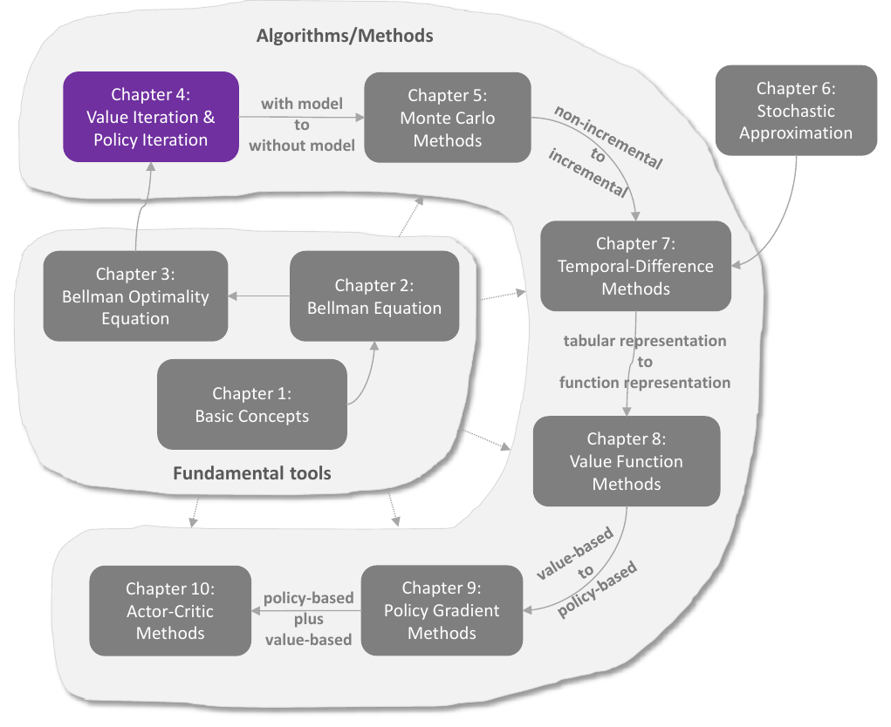
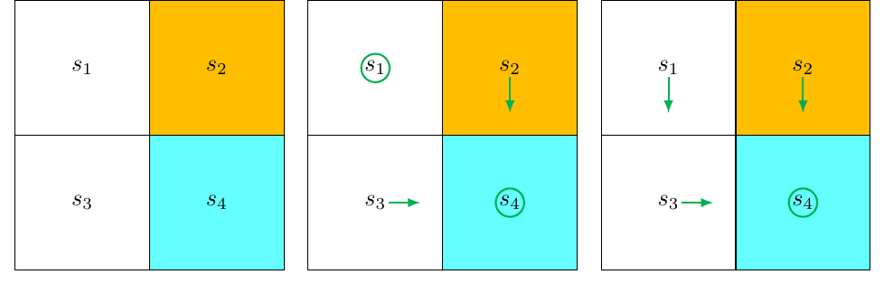
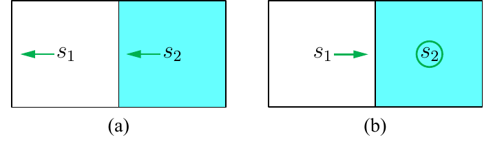
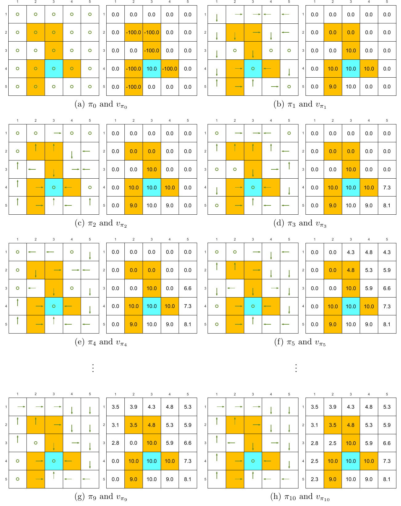
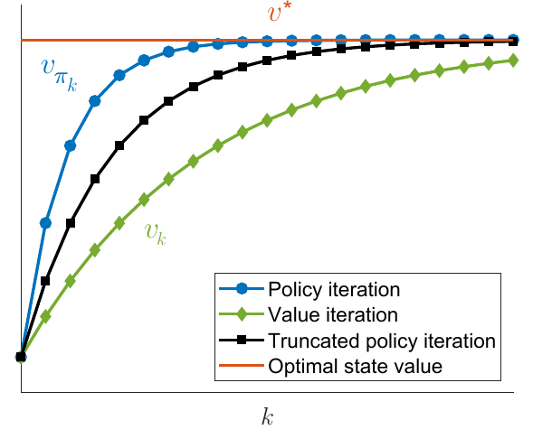

# Chương 4 Lặp giá trị và lặp chính sách

> Ghi chú của người biên soạn: đây là bản tổng hợp tiếng Việt chương 4 sách *Mathematical Foundations of Reinforcement Learning* (Shiyu Zhao, 2025), có bổ sung từ bài [Value Iteration and Policy Iteration](https://lyk-love.cn/2024/01/08/Value-Iteration-and-Policy-Iteration/) trên blog lyk-love. Xem [giới thiệu phần này](mathrl/README_vi) để biết nguồn, và [Quy ước ký hiệu](notation_vi) cho chuẩn ký hiệu dùng chung. Ý không có trong sách được ghi rõ.

<div align=center>

</div>
<div align=center>Hình 4.1 Vị trí của chương này trong sách. Nguồn: Zhao (2025)</div>

Sau ba chương chuẩn bị, giờ là lúc giới thiệu những **thuật toán đầu tiên tìm được chính sách tối ưu**. Chương này có ba thuật toán liên hệ chặt với nhau:

| Thuật toán | Ý chính |
|---|---|
| **Lặp giá trị (value iteration)** | đúng là thuật toán mà định lý ánh xạ co gợi ý để giải phương trình tối ưu Bellman ([chương 3](mathrl/ch03_vi)); chương này tập trung vào chi tiết cài đặt |
| **Lặp chính sách (policy iteration)** | ý tưởng của nó được dùng rộng rãi khắp học tăng cường |
| **Lặp chính sách cắt cụt (truncated policy iteration)** | thuật toán hợp nhất, nhận hai thuật toán trên làm trường hợp đặc biệt |

Ba thuật toán này gọi là thuật toán **quy hoạch động (dynamic programming)**: chúng **cần biết mô hình** của hệ thống. Chúng là nền móng của các thuật toán không mô hình ở các chương sau. Ví dụ, thuật toán Monte Carlo ở chương 5 có được ngay bằng cách mở rộng lặp chính sách của chương này.

## 4.1 Lặp giá trị

Lặp giá trị chính là thuật toán do định lý ánh xạ co gợi ý để giải phương trình tối ưu Bellman (định lý 3.3):

$$
v_{k+1} = \max_{\pi\in\Pi}\, (r_\pi + \gamma P_\pi v_k), \qquad k = 0, 1, 2, \dots
$$

Định lý 3.3 bảo đảm $v_k$ và $\pi_k$ lần lượt hội tụ tới giá trị trạng thái tối ưu và một chính sách tối ưu khi $k \to \infty$.

Mỗi vòng lặp có **hai bước**:

**Bước 1: cập nhật chính sách (policy update).** Tìm chính sách giải bài toán tối ưu

$$
\pi_{k+1} = \arg\max_\pi\, (r_\pi + \gamma P_\pi v_k),
$$

với $v_k$ có từ vòng trước.

**Bước 2: cập nhật giá trị (value update).** Tính giá trị mới

$$
v_{k+1} = r_{\pi_{k+1}} + \gamma P_{\pi_{k+1}} v_k, \tag{4.1}
$$

và $v_{k+1}$ sẽ dùng ở vòng sau.

Dạng ma trận–vectơ trên hữu ích để hiểu ý tưởng cốt lõi. Để cài đặt thì cần xem dạng từng phần tử.

### 4.1.1 Dạng từng phần tử và cài đặt

Xét vòng lặp $k$ và một trạng thái $s$.

**Cập nhật chính sách.** Dạng từng phần tử của $\pi_{k+1} = \arg\max_\pi (r_\pi + \gamma P_\pi v_k)$ là

$$
\pi_{k+1}(s) = \arg\max_\pi \sum_a \pi(a \mid s) \underbrace{\left(\sum_r p(r \mid s,a)\, r + \gamma \sum_{s'} p(s' \mid s,a)\, v_k(s')\right)}_{q_k(s,a)}, \qquad s \in \mathcal S.
$$

Theo mục 3.3.1, chính sách giải bài toán này là

$$
\pi_{k+1}(a \mid s) = \begin{cases} 1, & a = a_k^{\ast}(s),\\ 0, & a \ne a_k^{\ast}(s), \end{cases} \tag{4.2}
$$

với $a_k^{\ast}(s) = \arg\max_a q_k(s,a)$. Nếu có nhiều hành động cùng đạt cực đại thì chọn hành động nào cũng được, không ảnh hưởng tới sự hội tụ. Chính sách mới chọn hành động có $q_k(s,a)$ lớn nhất nên gọi là chính sách **tham lam (greedy)**.

**Cập nhật giá trị.** Dạng từng phần tử của $v_{k+1} = r_{\pi_{k+1}} + \gamma P_{\pi_{k+1}} v_k$ là

$$
v_{k+1}(s) = \sum_a \pi_{k+1}(a \mid s) \underbrace{\left(\sum_r p(r \mid s,a)\, r + \gamma \sum_{s'} p(s' \mid s,a)\, v_k(s')\right)}_{q_k(s,a)}, \qquad s \in \mathcal S.
$$

Thay (4.2) vào, được gọn:

$$
v_{k+1}(s) = \max_a q_k(s,a).
$$

**Tóm lại**, mỗi vòng lặp là chuỗi:

$$
v_k(s) \to q_k(s,a) \to \text{chính sách tham lam mới } \pi_{k+1}(s) \to \text{giá trị mới } v_{k+1}(s) = \max_a q_k(s,a).
$$

**Thuật toán 4.1: Lặp giá trị**

```
Khởi tạo: biết mô hình p(r|s,a) và p(s'|s,a) với mọi (s,a). Chọn giá trị đoán ban đầu v_0.
Mục tiêu: tìm giá trị trạng thái tối ưu và một chính sách tối ưu giải phương trình tối ưu Bellman.

Trong khi v_k chưa hội tụ (‖v_k − v_{k−1}‖ còn lớn hơn một ngưỡng nhỏ cho trước), ở vòng thứ k:
    Với mỗi trạng thái s ∈ S:
        Với mỗi hành động a ∈ A(s):
            Giá trị q:  q_k(s,a) = Σ_r p(r|s,a) r + γ Σ_s' p(s'|s,a) v_k(s')
        Hành động có giá trị lớn nhất:  a*_k(s) = argmax_a q_k(s,a)
        Cập nhật chính sách:  π_{k+1}(a|s) = 1 nếu a = a*_k(s), ngược lại = 0
        Cập nhật giá trị:     v_{k+1}(s) = max_a q_k(s,a)
```

⚠️ **Dễ nhầm: $v_k$ có phải là giá trị trạng thái không?** **Không.** Dù $v_k$ rốt cuộc hội tụ tới giá trị trạng thái tối ưu, nó **không** được bảo đảm thỏa phương trình Bellman của bất kỳ chính sách nào. Chẳng hạn, nói chung $v_k \ne r_{\pi_{k+1}} + \gamma P_{\pi_{k+1}} v_k$ và $v_k \ne r_{\pi_k} + \gamma P_{\pi_k} v_k$. Nó chỉ là **giá trị trung gian** do thuật toán sinh ra. Vì $v_k$ không phải giá trị trạng thái nên $q_k$ cũng **không phải** giá trị hành động. Đây là lý do chuẩn ký hiệu viết $v_k$, $q_k$ (chỉ số vòng lặp) thay vì $v_\pi$, $q_\pi$.

### 4.1.2 Ví dụ minh họa

Xét lưới 2×2 có một ô cấm (hình 4.2). Ô đích là $s_4$. Phần thưởng $r_{\text{boundary}} = r_{\text{forbidden}} = -1$, $r_{\text{target}} = 1$; hệ số chiết khấu $\gamma = 0.9$.

<div align=center>

</div>
<div align=center>Hình 4.2 Ví dụ minh họa lặp giá trị. Trái: bản đồ. Giữa: chính sách π1. Phải: chính sách π2 (đã tối ưu). Nguồn: Zhao (2025)</div>

Biểu thức $q(s,a)$ của từng cặp trạng thái–hành động:

| | $a_1$ (lên) | $a_2$ (phải) | $a_3$ (xuống) | $a_4$ (trái) | $a_5$ (đứng yên) |
|---|---|---|---|---|---|
| $s_1$ | $-1 + \gamma v(s_1)$ | $-1 + \gamma v(s_2)$ | $0 + \gamma v(s_3)$ | $-1 + \gamma v(s_1)$ | $0 + \gamma v(s_1)$ |
| $s_2$ | $-1 + \gamma v(s_2)$ | $-1 + \gamma v(s_2)$ | $1 + \gamma v(s_4)$ | $0 + \gamma v(s_1)$ | $-1 + \gamma v(s_2)$ |
| $s_3$ | $0 + \gamma v(s_1)$ | $1 + \gamma v(s_4)$ | $-1 + \gamma v(s_3)$ | $-1 + \gamma v(s_3)$ | $0 + \gamma v(s_3)$ |
| $s_4$ | $-1 + \gamma v(s_2)$ | $-1 + \gamma v(s_4)$ | $-1 + \gamma v(s_4)$ | $0 + \gamma v(s_3)$ | $1 + \gamma v(s_4)$ |

<div align=center>Bảng 4.1 Biểu thức q(s,a) cho ví dụ ở hình 4.2</div>

**$k = 0$.**

- Chọn giá trị ban đầu $v_0(s_1) = v_0(s_2) = v_0(s_3) = v_0(s_4) = 0$.
- **Tính $q$:** thay $v_0$ vào bảng 4.1:

| | $a_1$ | $a_2$ | $a_3$ | $a_4$ | $a_5$ |
|---|---|---|---|---|---|
| $s_1$ | $-1$ | $-1$ | $0$ | $-1$ | $0$ |
| $s_2$ | $-1$ | $-1$ | $1$ | $0$ | $-1$ |
| $s_3$ | $0$ | $1$ | $-1$ | $-1$ | $0$ |
| $s_4$ | $-1$ | $-1$ | $-1$ | $0$ | $1$ |

<div align=center>Bảng 4.2 Giá trị q(s,a) ở k = 0</div>

- **Cập nhật chính sách:** chọn hành động có $q$ lớn nhất ở mỗi trạng thái:
$$\pi_1(a_5 \mid s_1) = 1,\quad \pi_1(a_3 \mid s_2) = 1,\quad \pi_1(a_2 \mid s_3) = 1,\quad \pi_1(a_5 \mid s_4) = 1.$$
Chính sách này (hình giữa) chưa tối ưu vì nó đứng yên ở $s_1$. Lưu ý $q(s_1, a_5)$ và $q(s_1, a_3)$ bằng nhau, chọn hành động nào cũng được.
- **Cập nhật giá trị:** lấy $q$ lớn nhất ở mỗi trạng thái:
$$v_1(s_1) = 0,\quad v_1(s_2) = 1,\quad v_1(s_3) = 1,\quad v_1(s_4) = 1.$$

**$k = 1$.**

- **Tính $q$:** thay $v_1$ vào bảng 4.1:

| | $a_1$ | $a_2$ | $a_3$ | $a_4$ | $a_5$ |
|---|---|---|---|---|---|
| $s_1$ | $-1 + \gamma 0$ | $-1 + \gamma 1$ | $0 + \gamma 1$ | $-1 + \gamma 0$ | $0 + \gamma 0$ |
| $s_2$ | $-1 + \gamma 1$ | $-1 + \gamma 1$ | $1 + \gamma 1$ | $0 + \gamma 0$ | $-1 + \gamma 1$ |
| $s_3$ | $0 + \gamma 0$ | $1 + \gamma 1$ | $-1 + \gamma 1$ | $-1 + \gamma 1$ | $0 + \gamma 1$ |
| $s_4$ | $-1 + \gamma 1$ | $-1 + \gamma 1$ | $-1 + \gamma 1$ | $0 + \gamma 1$ | $1 + \gamma 1$ |

<div align=center>Bảng 4.3 Giá trị q(s,a) ở k = 1</div>

- **Cập nhật chính sách:**
$$\pi_2(a_3 \mid s_1) = 1,\quad \pi_2(a_3 \mid s_2) = 1,\quad \pi_2(a_2 \mid s_3) = 1,\quad \pi_2(a_5 \mid s_4) = 1.$$
Chính sách này được vẽ ở hình bên phải.
- **Cập nhật giá trị:**
$$v_2(s_1) = \gamma,\quad v_2(s_2) = 1 + \gamma,\quad v_2(s_3) = 1 + \gamma,\quad v_2(s_4) = 1 + \gamma.$$

**$k = 2, 3, 4, \dots$** Chính sách $\pi_2$ đã tối ưu, nên trong ví dụ đơn giản này chỉ cần hai vòng lặp để có chính sách tối ưu. Với ví dụ phức tạp hơn thì phải lặp tới khi $v_k$ hội tụ, ví dụ khi $\|v_{k+1} - v_k\|$ nhỏ hơn một ngưỡng cho trước.

*(ghi chú của người biên soạn)* Chính sách thường hội tụ **sớm hơn nhiều** so với giá trị: ở đây $\pi_2$ đã tối ưu nhưng $v_2(s_4) = 1.9$ còn xa $v^{\ast}(s_4) = 10$. Chỉ cần thứ tự giữa các $q_k(s,\cdot)$ đúng là đủ để chọn đúng hành động. Đây là gợi ý dẫn tới lặp chính sách cắt cụt ở mục 4.3.

## 4.2 Lặp chính sách

Lặp chính sách **không** giải trực tiếp phương trình tối ưu Bellman. Tuy vậy nó liên hệ chặt với lặp giá trị (sẽ thấy ở mục 4.3), và ý tưởng của nó rất quan trọng vì được dùng rộng rãi trong học tăng cường.

### 4.2.1 Phân tích thuật toán

Mỗi vòng lặp có hai bước:

**Bước 1: đánh giá chính sách (policy evaluation).** Đúng như tên gọi, bước này đánh giá chính sách hiện có bằng cách tính giá trị trạng thái của nó, tức giải phương trình Bellman

$$
v_{\pi_k} = r_{\pi_k} + \gamma P_{\pi_k} v_{\pi_k}, \tag{4.3}
$$

với $\pi_k$ là chính sách có từ vòng trước. $r_{\pi_k}$ và $P_{\pi_k}$ lấy được từ mô hình hệ thống.

**Bước 2: cải thiện chính sách (policy improvement).** Có $v_{\pi_k}$ rồi thì tính chính sách mới:

$$
\pi_{k+1} = \arg\max_\pi\, (r_\pi + \gamma P_\pi v_{\pi_k}).
$$

Mô tả này dẫn tới ba câu hỏi:

1. Ở bước đánh giá chính sách, giải $v_{\pi_k}$ thế nào?
2. Ở bước cải thiện chính sách, vì sao $\pi_{k+1}$ tốt hơn $\pi_k$?
3. Vì sao thuật toán rốt cuộc hội tụ tới chính sách tối ưu?

#### Câu hỏi 1: tính $v_{\pi_k}$ thế nào?

Chương 2 đã giới thiệu hai cách giải phương trình Bellman (4.3):

- **Nghiệm dạng đóng:** $v_{\pi_k} = (I - \gamma P_{\pi_k})^{-1} r_{\pi_k}$. Hữu ích cho phân tích lý thuyết, nhưng cài đặt kém hiệu quả vì phải nghịch đảo ma trận.
- **Nghiệm lặp:** dễ cài đặt,
$$v_{\pi_k}^{(j+1)} = r_{\pi_k} + \gamma P_{\pi_k} v_{\pi_k}^{(j)}, \qquad j = 0, 1, 2, \dots \tag{4.4}$$
với $v_{\pi_k}^{(j)}$ là ước lượng thứ $j$ của $v_{\pi_k}$. Xuất phát từ bất kỳ $v_{\pi_k}^{(0)}$ nào, bảo đảm $v_{\pi_k}^{(j)} \to v_{\pi_k}$ khi $j \to \infty$ (mục 2.7).

Điều thú vị: lặp chính sách là một thuật toán lặp **chứa bên trong một thuật toán lặp khác** (4.4) ở bước đánh giá chính sách.

Về lý thuyết, vòng lặp bên trong cần **vô hạn** bước ($j \to \infty$) mới hội tụ đúng tới $v_{\pi_k}$, điều không thể làm được. Trong thực tế, vòng lặp dừng khi thỏa một tiêu chí, ví dụ $\|v_{\pi_k}^{(j+1)} - v_{\pi_k}^{(j)}\|$ nhỏ hơn ngưỡng cho trước, hoặc $j$ vượt quá một số cho trước. Khi đó ta chỉ có giá trị **không chính xác** của $v_{\pi_k}$ để dùng ở bước cải thiện chính sách. Như vậy có gây vấn đề không? **Không.** Lý do sẽ rõ khi giới thiệu lặp chính sách cắt cụt ở mục 4.3.

#### Câu hỏi 2: vì sao $\pi_{k+1}$ tốt hơn $\pi_k$?

> **Bổ đề 4.1 (Cải thiện chính sách).** Nếu $\pi_{k+1} = \arg\max_\pi (r_\pi + \gamma P_\pi v_{\pi_k})$ thì $v_{\pi_{k+1}} \ge v_{\pi_k}$.

Ở đây $v_{\pi_{k+1}} \ge v_{\pi_k}$ nghĩa là $v_{\pi_{k+1}}(s) \ge v_{\pi_k}(s)$ với mọi $s$.

> **Hộp 4.1: Chứng minh bổ đề 4.1**
>
> $v_{\pi_{k+1}}$ và $v_{\pi_k}$ là giá trị trạng thái nên thỏa phương trình Bellman:
> $$v_{\pi_{k+1}} = r_{\pi_{k+1}} + \gamma P_{\pi_{k+1}} v_{\pi_{k+1}}, \qquad v_{\pi_k} = r_{\pi_k} + \gamma P_{\pi_k} v_{\pi_k}.$$
> Vì $\pi_{k+1} = \arg\max_\pi (r_\pi + \gamma P_\pi v_{\pi_k})$ nên
> $$r_{\pi_{k+1}} + \gamma P_{\pi_{k+1}} v_{\pi_k} \ge r_{\pi_k} + \gamma P_{\pi_k} v_{\pi_k}.$$
> Suy ra
> $$\begin{aligned}
> v_{\pi_k} - v_{\pi_{k+1}} &= (r_{\pi_k} + \gamma P_{\pi_k} v_{\pi_k}) - (r_{\pi_{k+1}} + \gamma P_{\pi_{k+1}} v_{\pi_{k+1}})\\
> &\le (r_{\pi_{k+1}} + \gamma P_{\pi_{k+1}} v_{\pi_k}) - (r_{\pi_{k+1}} + \gamma P_{\pi_{k+1}} v_{\pi_{k+1}})\\
> &= \gamma P_{\pi_{k+1}} (v_{\pi_k} - v_{\pi_{k+1}}).
> \end{aligned}$$
> Do đó
> $$v_{\pi_k} - v_{\pi_{k+1}} \le \gamma^2 P_{\pi_{k+1}}^2 (v_{\pi_k} - v_{\pi_{k+1}}) \le \cdots \le \gamma^n P_{\pi_{k+1}}^n (v_{\pi_k} - v_{\pi_{k+1}}) \le \lim_{n\to\infty} \gamma^n P_{\pi_{k+1}}^n (v_{\pi_k} - v_{\pi_{k+1}}) = 0.$$
> Giới hạn bằng 0 vì $\gamma^n \to 0$ và $P_{\pi_{k+1}}^n$ là **ma trận ngẫu nhiên** không âm với mọi $n$ (ma trận không âm có tổng mỗi hàng bằng 1). Vậy $v_{\pi_{k+1}} \ge v_{\pi_k}$. $\blacksquare$

*(ghi chú của người biên soạn)* Ý trực giác: chọn tham lam theo $q_{\pi_k}$ tức là "ở bước đầu, làm điều tốt nhất có thể biết dựa trên $v_{\pi_k}$, rồi sau đó đi theo $\pi_k$". Làm thế ít nhất không tệ hơn đi theo $\pi_k$ ngay từ đầu. Và nếu bước đầu đã tốt hơn thì làm như vậy ở mọi bước càng tốt hơn. Đó cũng là ví dụ dẫn nhập ở mục 3.1.

#### Câu hỏi 3: vì sao rốt cuộc tìm được chính sách tối ưu?

Lặp chính sách sinh ra hai dãy: dãy chính sách $\{\pi_0, \pi_1, \dots, \pi_k, \dots\}$ và dãy giá trị trạng thái $\{v_{\pi_0}, v_{\pi_1}, \dots, v_{\pi_k}, \dots\}$. Gọi $v^{\ast}$ là giá trị trạng thái tối ưu, thì $v_{\pi_k} \le v^{\ast}$ với mọi $k$. Theo bổ đề 4.1, chính sách liên tục được cải thiện, nên

$$
v_{\pi_0} \le v_{\pi_1} \le v_{\pi_2} \le \cdots \le v_{\pi_k} \le \cdots \le v^{\ast}.
$$

Dãy $v_{\pi_k}$ **không giảm** và **bị chặn trên** bởi $v^{\ast}$, nên theo **định lý hội tụ đơn điệu** (phụ lục C của sách), $v_{\pi_k}$ hội tụ tới một giá trị $v_\infty$ khi $k \to \infty$. Phân tích sau cho thấy $v_\infty = v^{\ast}$.

> **Định lý 4.1 (Sự hội tụ của lặp chính sách).** Dãy giá trị trạng thái $\{v_{\pi_k}\}_{k=0}^\infty$ do lặp chính sách sinh ra hội tụ tới giá trị trạng thái tối ưu $v^{\ast}$. Do đó dãy chính sách $\{\pi_k\}_{k=0}^\infty$ hội tụ tới một chính sách tối ưu.

Chứng minh dưới đây không chỉ cho thấy sự hội tụ, mà còn hé lộ quan hệ giữa lặp chính sách và lặp giá trị. Nói nôm na: nếu cùng xuất phát từ một điểm, **lặp chính sách hội tụ nhanh hơn lặp giá trị**, nhờ các vòng lặp bổ sung ở bước đánh giá chính sách.

> **Hộp 4.2: Chứng minh định lý 4.1**
>
> Ý tưởng: chứng minh lặp chính sách hội tụ **nhanh hơn** lặp giá trị.
>
> Xét thêm dãy $\{v_k\}_{k=0}^\infty$ sinh bởi
> $$v_{k+1} = f(v_k) = \max_\pi (r_\pi + \gamma P_\pi v_k).$$
> Đây chính là lặp giá trị, và ta đã biết $v_k \to v^{\ast}$ với mọi $v_0$.
>
> Với $k = 0$, luôn chọn được $v_0$ sao cho $v_{\pi_0} \ge v_0$ (ví dụ chọn $v_0$ rất âm). Ta chứng minh bằng quy nạp rằng $v_k \le v_{\pi_k} \le v^{\ast}$ với mọi $k$.
>
> Giả sử $v_{\pi_k} \ge v_k$ với một $k \ge 0$. Với $k+1$:
> $$\begin{aligned}
> v_{\pi_{k+1}} - v_{k+1} &= (r_{\pi_{k+1}} + \gamma P_{\pi_{k+1}} v_{\pi_{k+1}}) - \max_\pi (r_\pi + \gamma P_\pi v_k)\\
> &\ge (r_{\pi_{k+1}} + \gamma P_{\pi_{k+1}} v_{\pi_k}) - \max_\pi (r_\pi + \gamma P_\pi v_k)\\
> &\qquad \text{(vì } v_{\pi_{k+1}} \ge v_{\pi_k} \text{ theo bổ đề 4.1 và } P_{\pi_{k+1}} \ge 0\text{)}\\
> &= (r_{\pi_{k+1}} + \gamma P_{\pi_{k+1}} v_{\pi_k}) - (r_{\pi_k'} + \gamma P_{\pi_k'} v_k)\\
> &\qquad \text{(đặt } \pi_k' = \arg\max_\pi (r_\pi + \gamma P_\pi v_k)\text{)}\\
> &\ge (r_{\pi_k'} + \gamma P_{\pi_k'} v_{\pi_k}) - (r_{\pi_k'} + \gamma P_{\pi_k'} v_k)\\
> &\qquad \text{(vì } \pi_{k+1} = \arg\max_\pi (r_\pi + \gamma P_\pi v_{\pi_k})\text{)}\\
> &= \gamma P_{\pi_k'} (v_{\pi_k} - v_k).
> \end{aligned}$$
> Vì $v_{\pi_k} - v_k \ge 0$ và $P_{\pi_k'}$ không âm nên $P_{\pi_k'}(v_{\pi_k} - v_k) \ge 0$, do đó $v_{\pi_{k+1}} - v_{k+1} \ge 0$.
>
> Theo quy nạp, $v_k \le v_{\pi_k} \le v^{\ast}$ với mọi $k \ge 0$. Vì $v_k \to v^{\ast}$, theo nguyên lý kẹp, $v_{\pi_k}$ cũng hội tụ tới $v^{\ast}$. $\blacksquare$

### 4.2.2 Dạng từng phần tử và cài đặt

**Đánh giá chính sách.** Giải $v_{\pi_k} = r_{\pi_k} + \gamma P_{\pi_k} v_{\pi_k}$ bằng thuật toán lặp (4.4). Dạng từng phần tử:

$$
v_{\pi_k}^{(j+1)}(s) = \sum_a \pi_k(a \mid s) \left(\sum_r p(r \mid s,a)\, r + \gamma \sum_{s'} p(s' \mid s,a)\, v_{\pi_k}^{(j)}(s')\right), \qquad s \in \mathcal S,
$$

với $j = 0, 1, 2, \dots$

**Cải thiện chính sách.** Dạng từng phần tử của $\pi_{k+1} = \arg\max_\pi (r_\pi + \gamma P_\pi v_{\pi_k})$:

$$
\pi_{k+1}(s) = \arg\max_\pi \sum_a \pi(a \mid s) \underbrace{\left(\sum_r p(r \mid s,a)\, r + \gamma \sum_{s'} p(s' \mid s,a)\, v_{\pi_k}(s')\right)}_{q_{\pi_k}(s,a)}, \qquad s \in \mathcal S,
$$

với $q_{\pi_k}(s,a)$ là giá trị hành động của chính sách $\pi_k$. *(Khác với lặp giá trị, ở đây $v_{\pi_k}$ là giá trị trạng thái thật nên $q_{\pi_k}$ là giá trị hành động thật.)* Đặt $a_k^{\ast}(s) = \arg\max_a q_{\pi_k}(s,a)$; chính sách tham lam là

$$
\pi_{k+1}(a \mid s) = \begin{cases} 1, & a = a_k^{\ast}(s),\\ 0, & a \ne a_k^{\ast}(s). \end{cases}
$$

**Thuật toán 4.2: Lặp chính sách**

```
Khởi tạo: biết mô hình p(r|s,a) và p(s'|s,a) với mọi (s,a). Chọn chính sách ban đầu π_0.
Mục tiêu: tìm giá trị trạng thái tối ưu và một chính sách tối ưu.

Trong khi v_{π_k} chưa hội tụ, ở vòng thứ k:
    Đánh giá chính sách:
        Khởi tạo: giá trị đoán ban đầu tùy ý v_{π_k}^(0)
        Trong khi v_{π_k}^(j) chưa hội tụ, ở vòng thứ j:
            Với mỗi trạng thái s ∈ S:
                v_{π_k}^(j+1)(s) = Σ_a π_k(a|s) [ Σ_r p(r|s,a) r + γ Σ_s' p(s'|s,a) v_{π_k}^(j)(s') ]
    Cải thiện chính sách:
        Với mỗi trạng thái s ∈ S:
            Với mỗi hành động a ∈ A(s):
                q_{π_k}(s,a) = Σ_r p(r|s,a) r + γ Σ_s' p(s'|s,a) v_{π_k}(s')
            a*_k(s) = argmax_a q_{π_k}(s,a)
            π_{k+1}(a|s) = 1 nếu a = a*_k(s), ngược lại = 0
```

### 4.2.3 Ví dụ minh họa

#### Ví dụ đơn giản

Xét ví dụ ở hình 4.3: hai trạng thái, ba hành động $\mathcal A = \{a_\ell, a_0, a_r\}$, lần lượt là sang trái, đứng yên, sang phải. Ô đích là $s_2$. Phần thưởng $r_{\text{boundary}} = -1$, $r_{\text{target}} = 1$; $\gamma = 0.9$.

<div align=center>

</div>
<div align=center>Hình 4.3 Ví dụ minh họa lặp chính sách. (a) Chính sách ban đầu π0. (b) Chính sách π1 sau một vòng lặp (đã tối ưu). Nguồn: Zhao (2025)</div>

Với $k = 0$, bắt đầu từ chính sách ở hình 4.3a: ở cả hai trạng thái đều đi sang trái. Chính sách này không tốt vì không đi về phía đích.

**Đánh giá chính sách.** Giải phương trình Bellman:

$$
v_{\pi_0}(s_1) = -1 + \gamma v_{\pi_0}(s_1), \qquad v_{\pi_0}(s_2) = 0 + \gamma v_{\pi_0}(s_1).
$$

Phương trình đơn giản nên giải tay được: $v_{\pi_0}(s_1) = -10$, $v_{\pi_0}(s_2) = -9$.

Trong thực tế, giải bằng thuật toán lặp (4.4). Ví dụ chọn $v_{\pi_0}^{(0)}(s_1) = v_{\pi_0}^{(0)}(s_2) = 0$:

$$
\begin{aligned}
v_{\pi_0}^{(1)}(s_1) &= -1 + \gamma v_{\pi_0}^{(0)}(s_1) = -1, & v_{\pi_0}^{(1)}(s_2) &= 0 + \gamma v_{\pi_0}^{(0)}(s_1) = 0,\\
v_{\pi_0}^{(2)}(s_1) &= -1 + \gamma v_{\pi_0}^{(1)}(s_1) = -1.9, & v_{\pi_0}^{(2)}(s_2) &= 0 + \gamma v_{\pi_0}^{(1)}(s_1) = -0.9,\\
v_{\pi_0}^{(3)}(s_1) &= -1 + \gamma v_{\pi_0}^{(2)}(s_1) = -2.71, & v_{\pi_0}^{(3)}(s_2) &= 0 + \gamma v_{\pi_0}^{(2)}(s_1) = -1.71,
\end{aligned}
$$

và cứ thế. Lặp thêm sẽ thấy xu hướng $v_{\pi_0}^{(j)}(s_1) \to -10$ và $v_{\pi_0}^{(j)}(s_2) \to -9$.

**Cải thiện chính sách.** Mấu chốt là tính $q_{\pi_0}(s,a)$ cho từng cặp trạng thái–hành động:

| $q_{\pi_k}(s,a)$ | $a_\ell$ | $a_0$ | $a_r$ |
|---|---|---|---|
| $s_1$ | $-1 + \gamma v_{\pi_k}(s_1)$ | $0 + \gamma v_{\pi_k}(s_1)$ | $1 + \gamma v_{\pi_k}(s_2)$ |
| $s_2$ | $0 + \gamma v_{\pi_k}(s_1)$ | $1 + \gamma v_{\pi_k}(s_2)$ | $-1 + \gamma v_{\pi_k}(s_2)$ |

<div align=center>Bảng 4.4 Biểu thức q(s,a) cho ví dụ ở hình 4.3</div>

Thay $v_{\pi_0}(s_1) = -10$, $v_{\pi_0}(s_2) = -9$:

| $q_{\pi_0}(s,a)$ | $a_\ell$ | $a_0$ | $a_r$ |
|---|---|---|---|
| $s_1$ | $-10$ | $-9$ | $-7.1$ |
| $s_2$ | $-9$ | $-7.1$ | $-9.1$ |

<div align=center>Bảng 4.5 Giá trị q(s,a) ở k = 0</div>

Chọn $q_{\pi_0}$ lớn nhất, được chính sách cải thiện $\pi_1(a_r \mid s_1) = 1$, $\pi_1(a_0 \mid s_2) = 1$ (hình 4.3b). Chính sách này đã tối ưu.

Trong ví dụ đơn giản này, **một vòng lặp là đủ** tìm ra chính sách tối ưu. Ví dụ phức tạp hơn cần nhiều vòng hơn.

*(ghi chú của người biên soạn)* Để ý: dù $v_{\pi_0}$ toàn âm (chính sách tồi), bảng $q_{\pi_0}$ vẫn xếp đúng thứ tự hành động. Cải thiện chính sách chỉ cần **so sánh**, không cần giá trị "đẹp".

#### Ví dụ phức tạp hơn

Hình 4.4 minh họa lặp chính sách trên lưới 5×5. Phần thưởng $r_{\text{boundary}} = -1$, $r_{\text{forbidden}} = -10$, $r_{\text{target}} = 1$; $\gamma = 0.9$. Xuất phát từ một chính sách ngẫu nhiên (hình 4.4a), thuật toán hội tụ tới chính sách tối ưu (hình 4.4h).

<div align=center>

</div>
<div align=center>Hình 4.4 Quá trình tiến hóa của các chính sách do lặp chính sách sinh ra, từ π0 (a) tới π10 (h); mỗi hình con gồm chính sách và giá trị trạng thái của nó. Nguồn: Zhao (2025)</div>

Có hai hiện tượng thú vị:

1. **Trạng thái gần đích tìm được chính sách tối ưu trước.** Chỉ khi các trạng thái gần đã tìm được đường tới đích, các trạng thái xa mới tìm được đường đi qua các trạng thái gần đó để tới đích. Thông tin "lan" dần từ đích ra ngoài.
2. **Trạng thái càng gần đích thì giá trị càng lớn.** Tác tử xuất phát xa phải đi nhiều bước mới nhận phần thưởng dương, và phần thưởng đó bị chiết khấu mạnh.

*(ghi chú của người biên soạn)* Ở hình 4.4a, chính sách ban đầu cho một số ô đứng yên trong ô cấm, nên giá trị ở đó là $-10/(1-0.9) = -100$. Hình 4.4h có đúng giá trị như hình 3.4d, vì cùng thiết lập $r_{\text{forbidden}} = -10$: hai thuật toán khác nhau cho cùng một $v^{\ast}$, đúng như lý thuyết dự đoán.

## 4.3 Lặp chính sách cắt cụt

Giờ giới thiệu một thuật toán tổng quát hơn: **lặp chính sách cắt cụt**. Sẽ thấy rằng lặp giá trị và lặp chính sách là **hai trường hợp đặc biệt** của nó.

### 4.3.1 So sánh lặp giá trị và lặp chính sách

Liệt kê các bước của hai thuật toán:

**Lặp chính sách:** chọn chính sách ban đầu tùy ý $\pi_0$. Ở vòng $k$:

- Bước 1, **đánh giá chính sách (PE)**: cho $\pi_k$, giải $v_{\pi_k}$ từ $v_{\pi_k} = r_{\pi_k} + \gamma P_{\pi_k} v_{\pi_k}$.
- Bước 2, **cải thiện chính sách (PI)**: cho $v_{\pi_k}$, giải $\pi_{k+1} = \arg\max_\pi (r_\pi + \gamma P_\pi v_{\pi_k})$.

**Lặp giá trị:** chọn giá trị ban đầu tùy ý $v_0$. Ở vòng $k$:

- Bước 1, **cập nhật chính sách (PU)**: cho $v_k$, giải $\pi_{k+1} = \arg\max_\pi (r_\pi + \gamma P_\pi v_k)$.
- Bước 2, **cập nhật giá trị (VU)**: cho $\pi_{k+1}$, tính $v_{k+1} = r_{\pi_{k+1}} + \gamma P_{\pi_{k+1}} v_k$.

Sơ đồ hai thuật toán:

$$
\begin{aligned}
&\text{Lặp chính sách:} && \pi_0 \xrightarrow{\text{PE}} v_{\pi_0} \xrightarrow{\text{PI}} \pi_1 \xrightarrow{\text{PE}} v_{\pi_1} \xrightarrow{\text{PI}} \pi_2 \xrightarrow{\text{PE}} v_{\pi_2} \xrightarrow{\text{PI}} \cdots\\
&\text{Lặp giá trị:} && \qquad\quad\ v_0 \xrightarrow{\text{PU}} \pi_1' \xrightarrow{\text{VU}} v_1 \xrightarrow{\text{PU}} \pi_2' \xrightarrow{\text{VU}} v_2 \xrightarrow{\text{PU}} \cdots
\end{aligned}
$$

Hai quy trình rất giống nhau. Để thấy khác biệt, xét kỹ bước giá trị khi hai thuật toán **cùng điều kiện ban đầu** $v_0 = v_{\pi_0}$:

| Bước | Lặp chính sách | Lặp giá trị | Nhận xét |
|---|---|---|---|
| 1) Chính sách | $\pi_0$ | (không có) | |
| 2) Giá trị | $v_{\pi_0} = r_{\pi_0} + \gamma P_{\pi_0} v_{\pi_0}$ | $v_0 \doteq v_{\pi_0}$ | |
| 3) Chính sách | $\pi_1 = \arg\max_\pi (r_\pi + \gamma P_\pi v_{\pi_0})$ | $\pi_1 = \arg\max_\pi (r_\pi + \gamma P_\pi v_0)$ | hai chính sách giống nhau |
| 4) Giá trị | $v_{\pi_1} = r_{\pi_1} + \gamma P_{\pi_1} v_{\pi_1}$ | $v_1 = r_{\pi_1} + \gamma P_{\pi_1} v_0$ | $v_{\pi_1} \ge v_1$ vì $v_{\pi_1} \ge v_{\pi_0}$ |
| 5) Chính sách | $\pi_2 = \arg\max_\pi (r_\pi + \gamma P_\pi v_{\pi_1})$ | $\pi_2' = \arg\max_\pi (r_\pi + \gamma P_\pi v_1)$ | |
| ⋮ | ⋮ | ⋮ | ⋮ |

<div align=center>Bảng 4.6 So sánh các bước của lặp chính sách và lặp giá trị</div>

Ba bước đầu cho kết quả giống nhau vì $v_0 = v_{\pi_0}$. Khác biệt xuất hiện ở **bước 4**:

- lặp giá trị tính $v_1 = r_{\pi_1} + \gamma P_{\pi_1} v_0$: **một phép tính**;
- lặp chính sách giải $v_{\pi_1} = r_{\pi_1} + \gamma P_{\pi_1} v_{\pi_1}$: cần **vô hạn** vòng lặp.

Viết tường minh quá trình lặp giải $v_{\pi_1}$ ở bước 4, với $v_{\pi_1}^{(0)} = v_0$, mọi thứ trở nên rõ ràng:

$$
\begin{aligned}
v_{\pi_1}^{(0)} &= v_0\\
v_{\pi_1}^{(1)} &= r_{\pi_1} + \gamma P_{\pi_1} v_{\pi_1}^{(0)} &&\longrightarrow\ v_1 \quad \text{(lặp giá trị)}\\
v_{\pi_1}^{(2)} &= r_{\pi_1} + \gamma P_{\pi_1} v_{\pi_1}^{(1)}\\
&\ \ \vdots\\
v_{\pi_1}^{(j)} &= r_{\pi_1} + \gamma P_{\pi_1} v_{\pi_1}^{(j-1)} &&\longrightarrow\ \bar v_1 \quad \text{(lặp chính sách cắt cụt)}\\
&\ \ \vdots\\
v_{\pi_1}^{(\infty)} &= r_{\pi_1} + \gamma P_{\pi_1} v_{\pi_1}^{(\infty)} &&\longrightarrow\ v_{\pi_1} \quad \text{(lặp chính sách)}
\end{aligned}
$$

Nhận xét:

- Chạy vòng lặp **một lần**: $v_{\pi_1}^{(1)}$ chính là $v_1$ của **lặp giá trị**.
- Chạy **vô hạn** lần: $v_{\pi_1}^{(\infty)}$ chính là $v_{\pi_1}$ của **lặp chính sách**.
- Chạy **hữu hạn** lần (ký hiệu $j_{\text{truncate}}$): thuật toán gọi là **lặp chính sách cắt cụt**. "Cắt cụt" vì các vòng từ $j_{\text{truncate}}$ tới $\infty$ bị cắt bỏ.

Vậy lặp giá trị và lặp chính sách là **hai thái cực** của lặp chính sách cắt cụt: lặp giá trị dừng ở $j_{\text{truncate}} = 1$, lặp chính sách dừng ở $j_{\text{truncate}} = \infty$.

⚠️ So sánh trên dựa vào điều kiện $v_{\pi_1}^{(0)} = v_0 = v_{\pi_0}$. Không có điều kiện này thì không so sánh trực tiếp hai thuật toán được.

### 4.3.2 Thuật toán lặp chính sách cắt cụt

Nói gọn: lặp chính sách cắt cụt **giống hệt lặp chính sách, chỉ khác là bước đánh giá chính sách chạy hữu hạn vòng**.

**Thuật toán 4.3: Lặp chính sách cắt cụt**

```
Khởi tạo: biết mô hình p(r|s,a) và p(s'|s,a) với mọi (s,a). Chọn chính sách ban đầu π_0.
Mục tiêu: tìm giá trị trạng thái tối ưu và một chính sách tối ưu.

Trong khi v_k chưa hội tụ, ở vòng thứ k:
    Đánh giá chính sách:
        Khởi tạo: chọn v_k^(0) = v_{k−1}. Số vòng tối đa là j_truncate.
        Trong khi j < j_truncate:
            Với mỗi trạng thái s ∈ S:
                v_k^(j+1)(s) = Σ_a π_k(a|s) [ Σ_r p(r|s,a) r + γ Σ_s' p(s'|s,a) v_k^(j)(s') ]
        Đặt v_k = v_k^(j_truncate)
    Cải thiện chính sách:
        Với mỗi trạng thái s ∈ S:
            Với mỗi hành động a ∈ A(s):
                q_k(s,a) = Σ_r p(r|s,a) r + γ Σ_s' p(s'|s,a) v_k(s')
            a*_k(s) = argmax_a q_k(s,a)
            π_{k+1}(a|s) = 1 nếu a = a*_k(s), ngược lại = 0
```

Lưu ý: $v_k$ và $v_k^{(j)}$ trong thuật toán **không phải** giá trị trạng thái, mà là xấp xỉ của giá trị trạng thái thật, vì bước đánh giá chỉ chạy hữu hạn vòng.

**Nếu $v_k \ne v_{\pi_k}$ thì thuật toán còn tìm được chính sách tối ưu không?** Có. Trực giác: lặp chính sách cắt cụt nằm **giữa** lặp giá trị và lặp chính sách.

- Nó hội tụ **nhanh hơn lặp giá trị**, vì mỗi bước đánh giá chạy nhiều hơn một vòng.
- Nó hội tụ **chậm hơn lặp chính sách**, vì chỉ chạy hữu hạn vòng.

<div align=center>

</div>
<div align=center>Hình 4.5 Minh họa quan hệ giữa lặp giá trị, lặp chính sách và lặp chính sách cắt cụt: cả ba đều tiến tới giá trị trạng thái tối ưu v*, với tốc độ khác nhau. Nguồn: Zhao (2025)</div>

Phân tích sau ủng hộ trực giác đó.

> **Mệnh đề 4.1 (Cải thiện giá trị).** Xét thuật toán lặp ở bước đánh giá chính sách:
> $$v_{\pi_k}^{(j+1)} = r_{\pi_k} + \gamma P_{\pi_k} v_{\pi_k}^{(j)}, \qquad j = 0, 1, 2, \dots$$
> Nếu chọn giá trị đoán ban đầu $v_{\pi_k}^{(0)} = v_{\pi_{k-1}}$ thì
> $$v_{\pi_k}^{(j+1)} \ge v_{\pi_k}^{(j)} \qquad \text{với } j = 0, 1, 2, \dots$$

> **Hộp 4.3: Chứng minh mệnh đề 4.1**
>
> Thứ nhất, vì $v_{\pi_k}^{(j)} = r_{\pi_k} + \gamma P_{\pi_k} v_{\pi_k}^{(j-1)}$ và $v_{\pi_k}^{(j+1)} = r_{\pi_k} + \gamma P_{\pi_k} v_{\pi_k}^{(j)}$ nên
> $$v_{\pi_k}^{(j+1)} - v_{\pi_k}^{(j)} = \gamma P_{\pi_k} (v_{\pi_k}^{(j)} - v_{\pi_k}^{(j-1)}) = \cdots = \gamma^j P_{\pi_k}^j (v_{\pi_k}^{(1)} - v_{\pi_k}^{(0)}). \tag{4.5}$$
> Thứ hai, vì $v_{\pi_k}^{(0)} = v_{\pi_{k-1}}$:
> $$v_{\pi_k}^{(1)} = r_{\pi_k} + \gamma P_{\pi_k} v_{\pi_k}^{(0)} = r_{\pi_k} + \gamma P_{\pi_k} v_{\pi_{k-1}} \ge r_{\pi_{k-1}} + \gamma P_{\pi_{k-1}} v_{\pi_{k-1}} = v_{\pi_{k-1}} = v_{\pi_k}^{(0)},$$
> trong đó bất đẳng thức đúng vì $\pi_k = \arg\max_\pi (r_\pi + \gamma P_\pi v_{\pi_{k-1}})$. Thay $v_{\pi_k}^{(1)} \ge v_{\pi_k}^{(0)}$ vào (4.5), và vì $\gamma^j P_{\pi_k}^j \ge 0$, được $v_{\pi_k}^{(j+1)} \ge v_{\pi_k}^{(j)}$. $\blacksquare$

Ý nghĩa: mỗi vòng đánh giá thêm chỉ làm giá trị **tăng lên** (tiến gần $v^{\ast}$ hơn), nên chạy thêm vài vòng có ích.

Mệnh đề 4.1 cần giả thiết $v_{\pi_k}^{(0)} = v_{\pi_{k-1}}$, nhưng trong thực tế ta không có $v_{\pi_{k-1}}$, chỉ có $v_{k-1}$. Dù vậy, mệnh đề vẫn làm sáng tỏ sự hội tụ của lặp chính sách cắt cụt. Phân tích sâu hơn có ở Puterman (2014), mục 6.5.

**Ưu điểm của lặp chính sách cắt cụt:**

- so với **lặp chính sách**: chỉ cần hữu hạn vòng ở bước đánh giá, nên **tiết kiệm tính toán** hơn;
- so với **lặp giá trị**: chạy thêm vài vòng ở bước đánh giá giúp **hội tụ nhanh hơn**.

### Kiểm tra bằng số *(ghi chú của người biên soạn)*

Chạy lặp chính sách cắt cụt trên lưới 5×5 ở hình 3.4a ($\gamma = 0.9$), xuất phát từ chính sách "luôn đi lên" và $v = 0$, với các $j_{\text{truncate}}$ khác nhau. Bảng ghi sai số $\lVert v_k - v^{\ast}\rVert_\infty$ sau $k$ vòng lặp ngoài:

| $j_{\text{truncate}}$ | $k = 1$ | $k = 5$ | $k = 10$ | $k = 20$ | $k = 40$ |
|---|---|---|---|---|---|
| 1 (lặp giá trị) | 11.000 | 6.634 | 3.917 | 1.366 | 0.166 |
| 3 | 11.900 | 6.480 | 0.839 | 0.036 | 0.000 |
| 10 | 15.703 | 6.525 | 0.002 | 0.000 | 0.000 |
| 100 (gần lặp chính sách) | 19.190 | 6.480 | 0.000 | 0.000 | 0.000 |

Đúng như hình 4.5: $j_{\text{truncate}}$ càng lớn thì càng ít vòng lặp ngoài, nhưng mỗi vòng đắt hơn. Chỉ $j_{\text{truncate}} = 3$ đã nhanh hơn lặp giá trị rất nhiều. Ở $k = 1$ sai số lại lớn hơn khi $j_{\text{truncate}}$ lớn, vì khi đó đánh giá kỹ hơn chính sách ban đầu rất tồi, nên giá trị bị kéo xuống thấp; điều này không mâu thuẫn với mệnh đề 4.1, vốn giả thiết khởi tạo từ $v_{\pi_{k-1}}$.

```python
import numpy as np
# make_grid, value_iteration: xem mục "Kiểm tra bằng mã" ở chương 3

def truncated_policy_iteration(P, R, gamma, j_truncate, n_iter=60):
    """j_truncate = 1: lặp giá trị; j_truncate lớn: gần lặp chính sách."""
    n_s = P.shape[0]
    v = np.zeros(n_s)
    pi = np.zeros(n_s, dtype=int)                  # chính sách ban đầu: luôn chọn a1 (đi lên)
    history = []
    for k in range(n_iter):
        # Đánh giá chính sách, cắt cụt sau j_truncate bước, khởi tạo từ v của vòng trước
        P_pi, r_pi = P[np.arange(n_s), pi], R[np.arange(n_s), pi]
        for _ in range(j_truncate):
            v = r_pi + gamma * P_pi @ v
        history.append(v.copy())
        # Cải thiện chính sách: tham lam theo q
        pi = (R + gamma * P @ v).argmax(axis=1)
    return v, pi, history

P, R = make_grid()
v_star, _ = value_iteration(P, R, 0.9, tol=1e-10)
for j in [1, 3, 10, 100]:
    _, _, h = truncated_policy_iteration(P, R, 0.9, j)
    print(j, [round(np.abs(h[k - 1] - v_star).max(), 3) for k in (1, 5, 10, 20, 40)])
```

## 4.4 Tóm tắt

Chương này giới thiệu ba thuật toán tìm chính sách tối ưu:

| Thuật toán | Hai bước mỗi vòng | Giá trị trung gian có phải giá trị trạng thái? | Ghi chú |
|---|---|---|---|
| **Lặp giá trị** | cập nhật chính sách, cập nhật giá trị | không | chính là thuật toán giải BOE do định lý ánh xạ co gợi ý |
| **Lặp chính sách** | đánh giá chính sách, cải thiện chính sách | có | phức tạp hơn một chút; chứa một vòng lặp bên trong |
| **Lặp chính sách cắt cụt** | đánh giá chính sách (hữu hạn bước), cải thiện chính sách | không (chỉ là xấp xỉ) | nhận hai thuật toán kia làm trường hợp cực biên |

**Điểm chung:** mỗi vòng lặp đều có hai bước: một bước **cập nhật giá trị**, một bước **cập nhật chính sách**. Ý tưởng hai bước tương tác qua lại này có mặt khắp học tăng cường, và được gọi là **lặp chính sách tổng quát (generalized policy iteration, GPI)** (Sutton và Barto, 2018).

Cuối cùng, các thuật toán của chương này **cần mô hình**. Từ chương 5, sách học các thuật toán **không mô hình**, và sẽ thấy chúng có được bằng cách mở rộng các thuật toán của chương này.

### Tóm tắt bằng sơ đồ *(ghi chú của người biên soạn)*

| Thuật toán | Đánh giá chính sách | Chi phí mỗi vòng | Số vòng cần |
|---|---|---|---|
| Lặp giá trị | 1 bước Bellman | rẻ nhất | nhiều nhất |
| Lặp chính sách cắt cụt | $j_{\text{truncate}}$ bước Bellman | trung bình | trung bình |
| Lặp chính sách | giải trọn phương trình Bellman | đắt nhất | ít nhất |

## 4.5 Hỏi đáp

**Hỏi: Lặp giá trị có chắc chắn tìm được chính sách tối ưu không?**
Đáp: Có. Lặp giá trị chính là thuật toán do định lý ánh xạ co gợi ý để giải phương trình tối ưu Bellman ở chương 3; sự hội tụ được định lý ánh xạ co bảo đảm.

**Hỏi: Giá trị trung gian của lặp giá trị có phải giá trị trạng thái không?**
Đáp: Không. Chúng không được bảo đảm thỏa phương trình Bellman của bất kỳ chính sách nào.

**Hỏi: Lặp chính sách gồm những bước nào?**
Đáp: Mỗi vòng có hai bước: đánh giá chính sách và cải thiện chính sách. Bước đánh giá giải phương trình Bellman để có giá trị trạng thái của chính sách hiện tại. Bước cải thiện cập nhật chính sách sao cho chính sách mới có giá trị trạng thái lớn hơn.

**Hỏi: Lặp chính sách có chứa một thuật toán lặp khác bên trong không?**
Đáp: Có. Ở bước đánh giá chính sách cần một thuật toán lặp để giải phương trình Bellman của chính sách hiện tại.

**Hỏi: Giá trị trung gian của lặp chính sách có phải giá trị trạng thái không?**
Đáp: Có, vì chúng là nghiệm của phương trình Bellman của chính sách hiện tại.

**Hỏi: Lặp chính sách có chắc chắn tìm được chính sách tối ưu không?**
Đáp: Có. Chương này đã chứng minh chặt chẽ sự hội tụ của nó.

**Hỏi: Quan hệ giữa lặp chính sách cắt cụt và lặp chính sách?**
Đáp: Đúng như tên gọi, lặp chính sách cắt cụt có được từ lặp chính sách bằng cách chỉ chạy hữu hạn vòng ở bước đánh giá chính sách.

**Hỏi: Quan hệ giữa lặp chính sách cắt cụt và lặp giá trị?**
Đáp: Lặp giá trị là một trường hợp cực biên của lặp chính sách cắt cụt, trong đó bước đánh giá chính sách chỉ chạy một vòng.

**Hỏi: Giá trị trung gian của lặp chính sách cắt cụt có phải giá trị trạng thái không?**
Đáp: Không. Chỉ khi chạy vô hạn vòng ở bước đánh giá mới có giá trị trạng thái thật. Chạy hữu hạn vòng chỉ được xấp xỉ.

**Hỏi: Nên chạy bao nhiêu vòng ở bước đánh giá của lặp chính sách cắt cụt?**
Đáp: Nguyên tắc chung: vài vòng, đừng quá nhiều. Vài vòng giúp tăng tốc hội tụ tổng thể, nhưng chạy quá nhiều không tăng tốc thêm đáng kể.

**Hỏi: Lặp chính sách tổng quát là gì?**
Đáp: Không phải một thuật toán cụ thể, mà là ý tưởng chung về sự tương tác giữa cập nhật giá trị và cập nhật chính sách. Ý tưởng này bắt nguồn từ lặp chính sách. Hầu hết các thuật toán học tăng cường trong sách đều thuộc phạm vi lặp chính sách tổng quát.

**Hỏi: Học tăng cường dựa trên mô hình và không mô hình là gì?**
Đáp: Các thuật toán của chương này tìm được chính sách tối ưu, nhưng thường được gọi là thuật toán **quy hoạch động** chứ không phải thuật toán học tăng cường, vì chúng cần mô hình hệ thống. Thuật toán học tăng cường chia hai loại:

- **Dựa trên mô hình (model-based):** "dựa trên mô hình" **không** có nghĩa là được cho sẵn mô hình. Nó nghĩa là dùng dữ liệu để **ước lượng** mô hình, rồi dùng mô hình đó trong quá trình học.
- **Không mô hình (model-free):** không ước lượng mô hình trong quá trình học.

## Đọc tiếp

- Quay lại [Chương 3 Giá trị trạng thái tối ưu và phương trình tối ưu Bellman](mathrl/ch03_vi) · Chương 5 Phương pháp Monte Carlo *(đang biên soạn)*
- Đối chiếu với EasyRL: [Chương 2](chapter2/chapter2_vi), mục 2.3.11 (lặp chính sách), 2.3.12 (lặp giá trị), 2.3.13 (so sánh hai thuật toán). EasyRL không có lặp chính sách cắt cụt.
- Thử tương tác: [mô phỏng chương 2](chapter2/chapter2_viz_vi) có lặp chính sách và lặp giá trị trên thế giới lưới.
