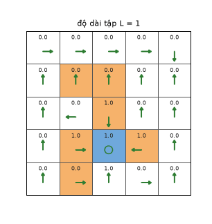
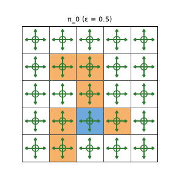

# Chương 5 · Code

> Ghi chú của người biên soạn: trang này không có trong sách. Nó cài đặt các thuật toán Monte Carlo của [chương 5](mathrl/ch05_vi) bằng numpy, theo đúng ký hiệu của sách, chạy trên lưới 5×5. Phần kiểm chứng hình 5.6 (giá trị của các chính sách ε-tham lam) đã có ở mục "Kiểm tra bằng mã" trong chương, nên không lặp lại ở đây. Ký hiệu theo [Quy ước ký hiệu](notation_vi).

Mỗi khối code đã được chạy sẵn. Kết quả, hình và ảnh động nằm ngay bên dưới. Các khối chạy lần lượt từ trên xuống và dùng chung biến, như notebook. Muốn tự chạy, xem [mục 5](#_5-chạy-trên-máy).

## 1. Mô hình chỉ dùng để sinh mẫu

Các thuật toán Monte Carlo **không** dùng `P` và `R` để tính toán. Chúng chỉ tương tác: ở $s$ chọn $a$, nhận $r$ và $s'$. Lưới của sách là tất định, nên ta biến mô hình thành một "môi trường" bằng hai bảng tra `next_state[s, a]` và `R[s, a]`. Thuật toán chỉ được gọi hàm `step`.

<!-- run -->
```python
import numpy as np
import matplotlib.pyplot as plt
from zhao_grid import make_grid, value_iteration, plot_grid, print_policy
from viz import save_gif

P, R = make_grid(r_forbidden=-10)          # thiết lập của hình 5.4: r_boundary = -1, r_forbidden = -10
gamma = 0.9
n_s, n_a = R.shape
next_state = P.argmax(axis=2)              # lưới tất định: s' = next_state[s, a]

def step(s, a):
    """Môi trường: trả về (r, s'). Thuật toán Monte Carlo chỉ được dùng hàm này."""
    return R[s, a], next_state[s, a]

v_star, pi_star = value_iteration(P, R, gamma, tol=1e-10)   # chỉ để đối chiếu, thuật toán không dùng
print("v* (để đối chiếu):\n", v_star.reshape(5, 5).round(1))
```

<!-- output -->
```output
v* (để đối chiếu):
 [[ 3.5  3.9  4.3  4.8  5.3]
 [ 3.1  3.5  4.8  5.3  5.9]
 [ 2.8  2.5 10.   5.9  6.6]
 [ 2.5 10.  10.  10.   7.3]
 [ 2.3  9.  10.   9.   8.1]]
```
<!-- /output -->

## 2. MC Basic và độ dài tập

<small class="viz-ref">Mục 5.2 · thuật toán 5.1 · hình 5.4</small>

MC Basic là lặp chính sách, chỉ khác ở bước đánh giá: thay vì giải phương trình Bellman, nó ước lượng $q_{\pi_k}(s,a)$ bằng **lợi tức của các tập bắt đầu từ** $(s,a)$. Lưới và chính sách đều tất định, nên mỗi cặp $(s,a)$ chỉ cần một tập (thêm tập nữa cũng ra cùng một lợi tức). Mỗi tập bị cắt sau `L` bước.

<!-- run -->
```python
def mc_basic(L, n_iter=20):
    pi = np.zeros(n_s, dtype=int)                       # π_0: luôn chọn a1 (đi lên)
    for k in range(n_iter):
        q = np.zeros((n_s, n_a))
        for s0 in range(n_s):
            for a0 in range(n_a):
                # Đánh giá: một tập dài L bước, bắt đầu từ (s0, a0), sau đó đi theo π_k
                s, a, g = s0, a0, 0.0
                for t in range(L):
                    r, s = step(s, a)
                    g += gamma ** t * r
                    a = pi[s]
                q[s0, a0] = g                           # q_{π_k}(s0, a0) ≈ lợi tức của tập
        new_pi = q.argmax(axis=1)                       # Cải thiện: tham lam theo q
        if np.array_equal(new_pi, pi):
            break
        pi = new_pi
    return pi, q[np.arange(n_s), pi]                    # chính sách và giá trị ước lượng của nó

frames = []
for L in [1, 2, 3, 4, 14, 15, 30, 100]:
    pi_L, v_L = mc_basic(L)
    frames.append((L, pi_L, v_L))
    print(f"L = {L:3d}: số ô có chính sách khác π* = {(pi_L != pi_star).sum():2d}, "
          f"v(ô trên–trái) = {v_L[0]:6.2f}")

def draw(fig, i):
    L, pi_L, v_L = frames[i]
    plot_grid(v_L, pi_L, title=f"độ dài tập L = {L}", ax=fig.add_subplot(1, 1, 1))

save_gif(draw, len(frames), "mc_basic_episode_length.gif", fps=1, figsize=(3.4, 3.6), dpi=90, hold_last=2)
```

<!-- output -->
```output
L =   1: số ô có chính sách khác π* =  8, v(ô trên–trái) =   0.00
L =   2: số ô có chính sách khác π* =  7, v(ô trên–trái) =   0.00
L =   3: số ô có chính sách khác π* =  6, v(ô trên–trái) =   0.00
L =   4: số ô có chính sách khác π* =  5, v(ô trên–trái) =   0.00
L =  14: số ô có chính sách khác π* =  0, v(ô trên–trái) =   1.20
L =  15: số ô có chính sách khác π* =  0, v(ô trên–trái) =   1.43
L =  30: số ô có chính sách khác π* =  0, v(ô trên–trái) =   3.06
L = 100: số ô có chính sách khác π* =  0, v(ô trên–trái) =   3.49
```

<div align=center></div>
<!-- /output -->

"Số ô khác $\pi^{\ast}$" có thể lớn hơn 0 ngay cả khi chính sách đã tối ưu, vì ở vài ô có nhiều hành động cùng tối ưu. Điều đáng xem là ảnh động, đúng như hình 5.4 và phân tích trong mục 5.2.3:

- Với $L = 1, 2$, chỉ các ô **sát đích** mới "thấy" được phần thưởng dương. Các ô khác có giá trị 0 và chính sách gần như tùy ý.
- $L$ càng tăng, vùng có giá trị khác 0 càng lan rộng ra từ ô đích. Ô trên–trái cần đi ít nhất 7 bước mới tới đích, nên chỉ khi $L$ đủ lớn thì giá trị của nó mới khác 0.
- Với $L$ lớn (30, 100), chính sách và giá trị gần với nghiệm tối ưu.

Đây là tình huống **phần thưởng thưa**: không có phần thưởng dương nào trước khi tới đích, nên tập ngắn không mang thông tin gì.

## 3. MC ε-tham lam: một tập rất dài là đủ

<small class="viz-ref">Mục 5.4 · thuật toán 5.3 · hình 5.5</small>

Không cần khởi đầu khám phá nữa. Mỗi vòng lặp chỉ sinh **một tập** theo chính sách ε-tham lam hiện tại, dài 1 000 000 bước. Mọi lần thăm $(s,a)$ trong tập (mọi lần thăm, every-visit) đều góp một mẫu lợi tức. Cuối vòng, chính sách được cải thiện thành ε-tham lam theo $q$:

$$
\pi_{k+1}(a \mid s) = \begin{cases} 1 - \dfrac{|\mathcal A(s)| - 1}{|\mathcal A(s)|}\varepsilon, & a = a_k^{\ast}(s) \\[2mm] \dfrac{\varepsilon}{|\mathcal A(s)|}, & a \ne a_k^{\ast}(s) \end{cases}
$$

<!-- run -->
```python
def eps_greedy(q, eps):
    pi = np.full((n_s, n_a), eps / n_a)
    pi[np.arange(n_s), q.argmax(axis=1)] += 1 - eps
    return pi

def best_eps_greedy(eps):
    """Chỉ để đối chiếu (dùng mô hình): chính sách tối ưu trong lớp ε-tham lam,
    tìm bằng lặp chính sách giới hạn trong các chính sách ε-tham lam."""
    pi = np.full((n_s, n_a), 1 / n_a)
    for _ in range(100):
        P_pi, r_pi = np.einsum("sa,sat->st", pi, P), (pi * R).sum(axis=1)
        v = np.linalg.solve(np.eye(n_s) - gamma * P_pi, r_pi)
        new = eps_greedy(R + gamma * P @ v, eps)
        if np.allclose(new, pi):
            break
        pi = new
    return pi.argmax(axis=1)

def mc_eps_greedy(eps, n_iter=3, T=1_000_000, seed=0):
    rng = np.random.default_rng(seed)
    pi = np.full((n_s, n_a), 1 / n_a)                   # π_0: chính sách đều (hình 5.5a)
    history = [pi]
    for k in range(n_iter):
        # Sinh một tập dài T bước theo π_k, xuất phát ngẫu nhiên
        s = rng.integers(n_s)
        u = rng.random(T)                               # lấy mẫu hành động nhanh bằng CDF
        cdf = pi.cumsum(axis=1)
        states, actions, rewards = np.empty(T, int), np.empty(T, int), np.empty(T)
        for t in range(T):
            a = min(int(np.searchsorted(cdf[s], u[t])), n_a - 1)
            states[t], actions[t] = s, a
            rewards[t], s = step(s, a)
        # Quét ngược: g ← γ g + r, cộng dồn vào (s_t, a_t) mỗi lần thăm
        returns_sum, counts, g = np.zeros((n_s, n_a)), np.zeros((n_s, n_a)), 0.0
        for t in range(T - 1, -1, -1):
            g = gamma * g + rewards[t]
            returns_sum[states[t], actions[t]] += g
            counts[states[t], actions[t]] += 1
        q = returns_sum / np.maximum(counts, 1)
        pi = eps_greedy(q, eps)                         # cải thiện: ε-tham lam theo q
        history.append(pi)
        print(f"vòng {k + 1}: số cặp (s,a) chưa được thăm = {(counts == 0).sum()}, "
              f"số ô có hành động tham lam khác π*_ε = {(q.argmax(1) != target).sum()}, "
              f"khác π* (tham lam tối ưu) = {(q.argmax(1) != pi_star).sum()}")
    return history

target = best_eps_greedy(0.5)        # π*_ε: chính sách ε-tham lam tối ưu (hành động tham lam của nó)
hist = mc_eps_greedy(eps=0.5)

def draw_eps(fig, k):
    plot_grid(None, hist[k], title=f"π_{k} (ε = 0.5)", ax=fig.add_subplot(1, 1, 1))

save_gif(draw_eps, len(hist), "mc_eps_greedy.gif", fps=0.7, figsize=(3.2, 3.4), dpi=90, hold_last=1)
```

<!-- output -->
```output
vòng 1: số cặp (s,a) chưa được thăm = 0, số ô có hành động tham lam khác π*_ε = 1, khác π* (tham lam tối ưu) = 15
vòng 2: số cặp (s,a) chưa được thăm = 0, số ô có hành động tham lam khác π*_ε = 3, khác π* (tham lam tối ưu) = 17
vòng 3: số cặp (s,a) chưa được thăm = 0, số ô có hành động tham lam khác π*_ε = 1, khác π* (tham lam tối ưu) = 15
```

<div align=center></div>
<!-- /output -->

Mũi tên dài là hành động tham lam (xác suất $1 - 0.4 = 0.6$), bốn mũi tên ngắn là các hành động còn lại (xác suất $0.1$ mỗi hành động). Kết quả khớp với mục 5.4.3 và 5.5:

- Ngay sau vòng đầu, hành động tham lam chỉ lệch 1–3 ô so với $\pi^{\ast}_\varepsilon$, chính sách tối ưu trong lớp ε-tham lam với $\varepsilon = 0.5$. Mấy ô lệch là những ô có vài hành động gần như ngang nhau, nên nhiễu Monte Carlo đủ để đảo thứ tự.
- Nhưng so với chính sách tham lam tối ưu $\pi^{\ast}$, có tới 15–17 ô khác nhau. Đây không phải lỗi của thuật toán. Như mục 5.5 giải thích, với $\varepsilon \ge 0.2$, chính sách ε-tham lam tối ưu **không còn nhất quán** với $\pi^{\ast}$: tác tử sẽ chọn bừa với xác suất lớn, nên một hành động đưa nó tới sát ô cấm (phạt $-10$) trở nên rủi ro hơn nhiều so với khi đi theo chính sách tham lam.

Đổi `eps=0.5` thành `0.1` và chạy lại, bạn sẽ thấy cái giá của việc khám phá ít: nhiều cặp $(s,a)$ được thăm rất ít lần, nên ước lượng của chúng nhiễu hơn.

## 4. Đối chiếu với MinRL

`MonteCarloEvaluator` của MinRL ([trang Code chương 3 của EasyRL](chapter3/chapter3_code_vi?id=_22-monte-carlo)) làm phần **đánh giá** của Monte Carlo: ước lượng $V_\pi$ bằng trung bình cộng dồn của lợi tức, lần thăm đầu hoặc mọi lần thăm. Thuật toán ở trang này đi thêm một bước: ước lượng $q$ rồi cải thiện chính sách, tức là **điều khiển**. Một khác biệt nữa: lưới của MinRL có ô kết thúc, nên mỗi tập tự kết thúc. Lưới của sách không có ô kết thúc, nên phải tự cắt tập sau `L` hay `T` bước.

## 5. Chạy trên máy

```bash
git clone https://github.com/nmc2004nd/easy-rl-vi.git
cd easy-rl-vi/docs/code/py          # chạy từ đây để import được zhao_grid, viz
pip install numpy matplotlib pillow
```

Chép lần lượt các khối code vào Jupyter rồi chạy theo thứ tự. Mục 3 sinh 3 tập, mỗi tập một triệu bước, nên mất khoảng nửa phút. Kết quả trên trang được dựng bằng `python3 scripts/build_code_pages.py docs/mathrl/ch05_code_vi.md`.
