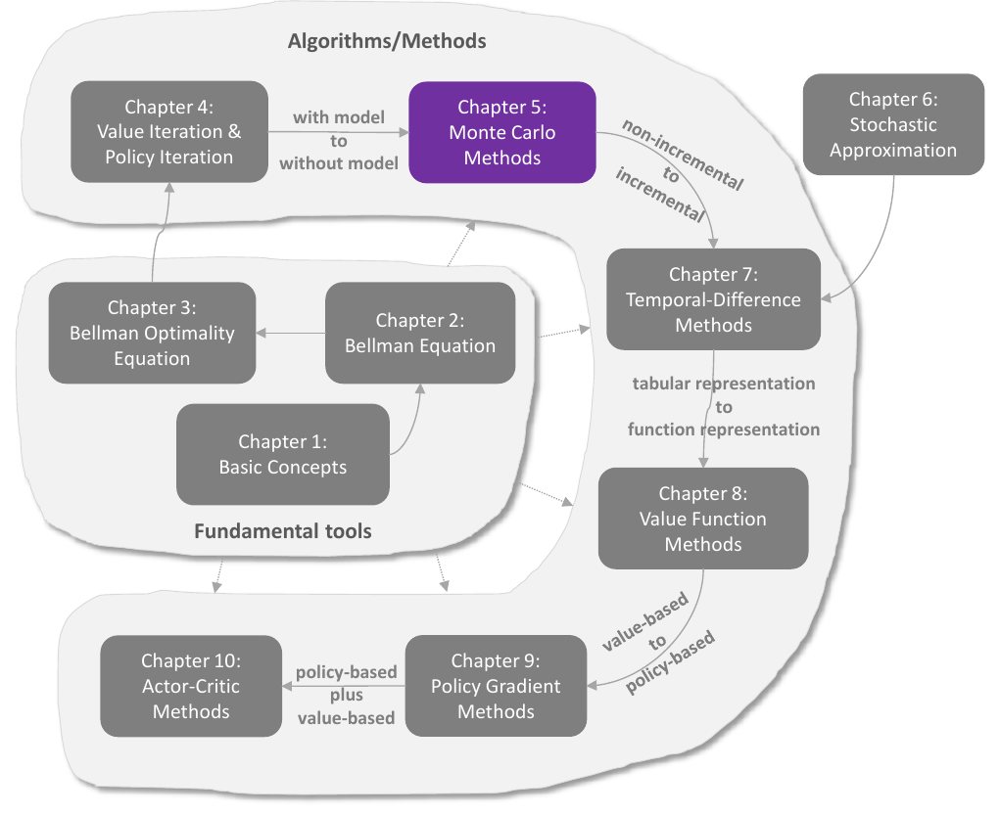
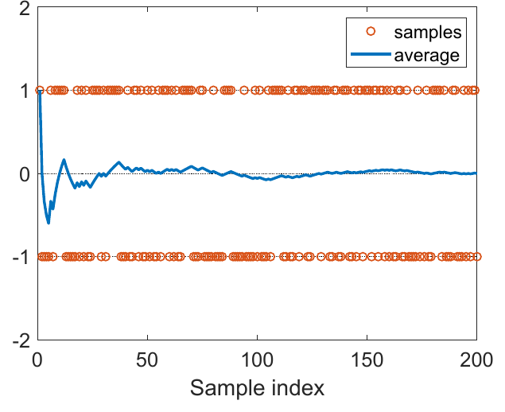
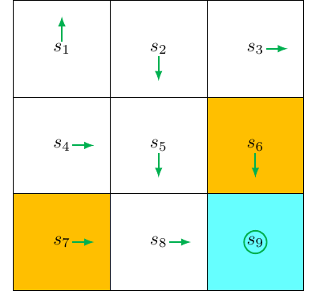
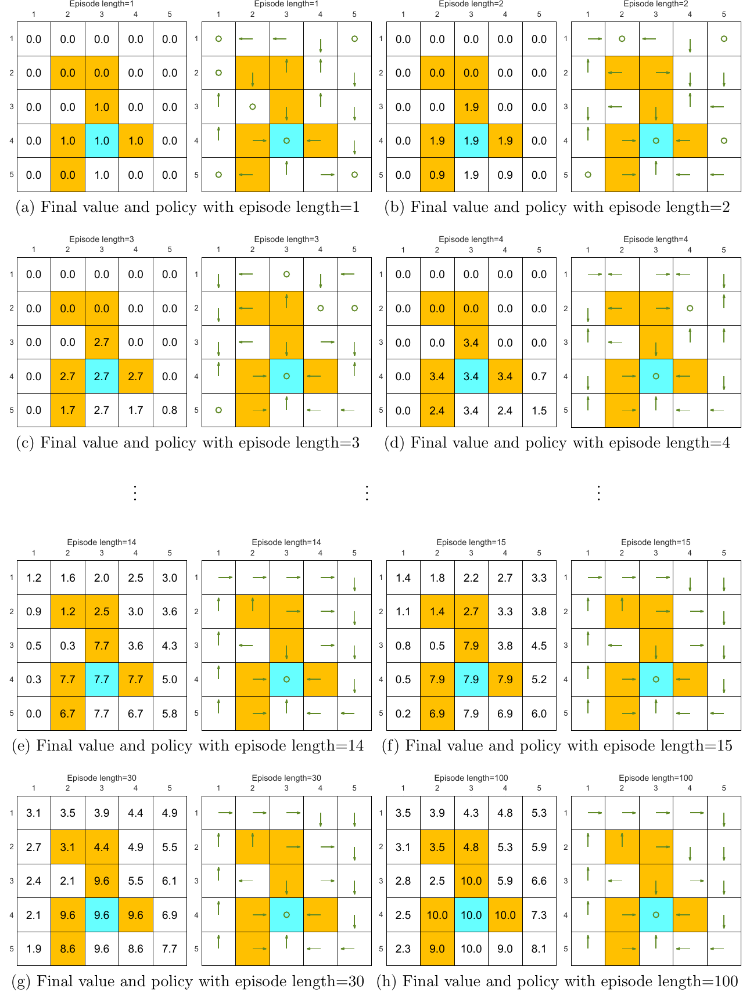
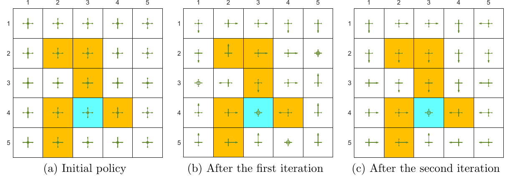
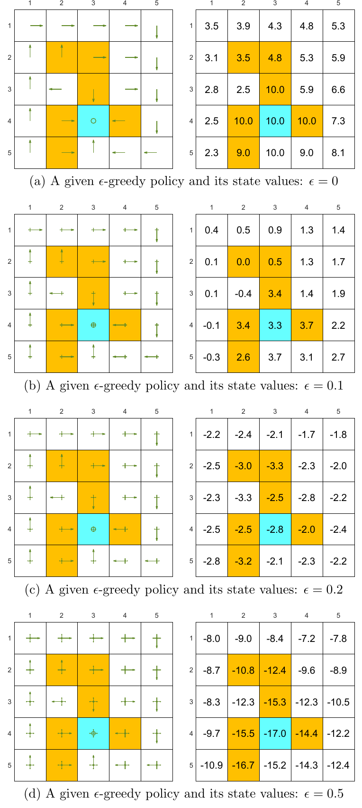
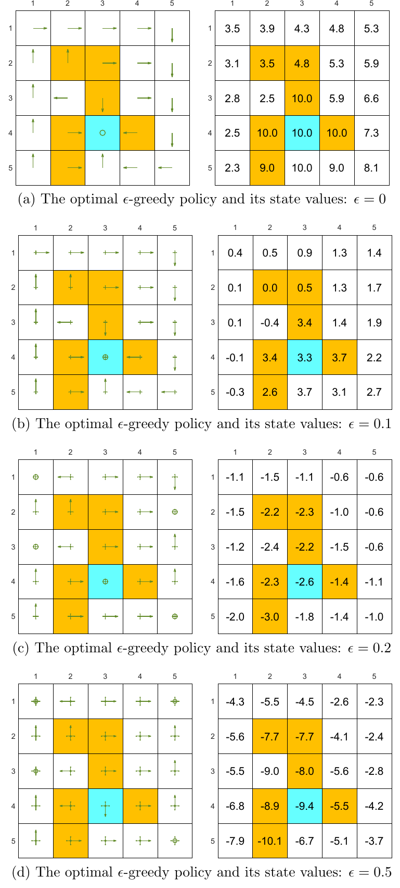
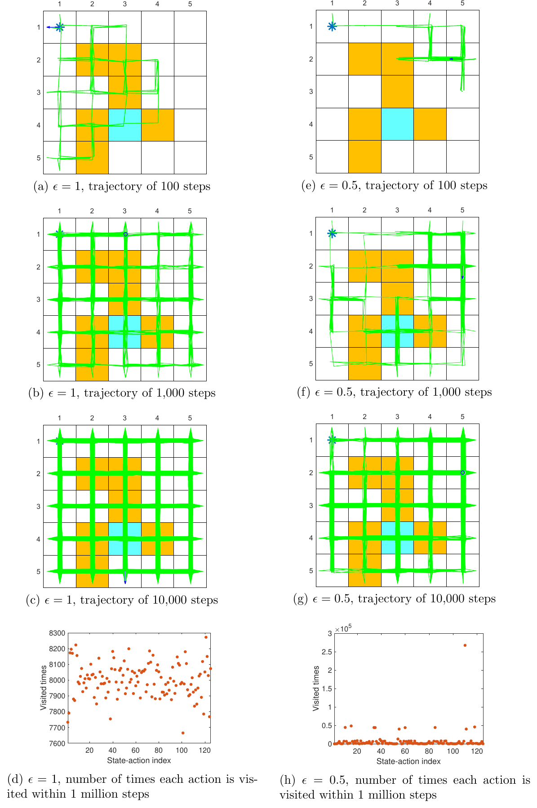

# Chương 5 Phương pháp Monte Carlo

> Ghi chú của người biên soạn: đây là bản tổng hợp tiếng Việt chương 5 sách *Mathematical Foundations of Reinforcement Learning* (Shiyu Zhao, 2025), có bổ sung từ các bài [Mean Estimation Algorithms](https://lyk-love.cn/2024/01/27/Mean-Estimation-Algorithms/) và [The MC Basic Algorithm](https://lyk-love.cn/2024/01/27/The-MC-Basic-Algorithm/) trên blog lyk-love. Xem [giới thiệu phần này](mathrl/README_vi) để biết nguồn, và [Quy ước ký hiệu](notation_vi) cho chuẩn ký hiệu dùng chung. Ý không có trong sách được ghi rõ.

<div align=center>

</div>
<div align=center>Hình 5.1 Vị trí của chương này trong sách. Nguồn: Zhao (2025)</div>

Chương 4 tìm chính sách tối ưu **dựa trên mô hình**. Chương này bắt đầu giới thiệu các thuật toán học tăng cường **không mô hình (model-free)**: không giả định biết mô hình hệ thống.

Trước hết phải lấp một khoảng trống: **không có mô hình thì tìm chính sách tối ưu bằng cách nào?** Triết lý rất đơn giản:

> Không có mô hình thì phải có dữ liệu. Không có dữ liệu thì phải có mô hình. Không có cả hai thì không thể tìm chính sách tối ưu.

"Dữ liệu" trong học tăng cường thường là **kinh nghiệm tương tác** của tác tử với môi trường.

**Lộ trình của chương:**

| Mục | Nội dung |
|---|---|
| 5.1 | Bài toán **ước lượng trung bình**: ý tưởng học từ dữ liệu thay vì từ mô hình |
| 5.2 | **MC Basic**: thuật toán Monte Carlo đơn giản nhất, có được bằng cách sửa lặp chính sách |
| 5.3 | **MC Exploring Starts**: dùng mẫu và cập nhật chính sách hiệu quả hơn |
| 5.4 | **MC ε-tham lam**: bỏ được điều kiện "khởi đầu khám phá" |
| 5.5 | Đánh đổi giữa **khám phá và khai thác** của chính sách ε-tham lam |

## 5.1 Ví dụ dẫn nhập: ước lượng trung bình

Bài toán ước lượng trung bình cho thấy cách học từ dữ liệu thay vì từ mô hình. Nó giải được bằng **phương pháp Monte Carlo (MC)**: một họ kỹ thuật rộng dùng mẫu ngẫu nhiên để giải bài toán ước lượng.

**Vì sao quan tâm tới ước lượng trung bình?** Vì giá trị trạng thái và giá trị hành động **đều được định nghĩa là trung bình của lợi tức**. Ước lượng một giá trị trạng thái hay giá trị hành động thực chất là một bài toán ước lượng trung bình.

Xét biến ngẫu nhiên $X$ nhận giá trị trong một tập hữu hạn các số thực $\mathcal X$. Nhiệm vụ: tính kỳ vọng $\mathbb E[X]$. Có hai cách:

**Cách 1: dựa trên mô hình.** "Mô hình" ở đây là phân phối xác suất của $X$. Biết mô hình thì tính thẳng theo định nghĩa:

$$
\mathbb E[X] = \sum_{x \in \mathcal X} p(x)\, x.
$$

Sách dùng các từ "kỳ vọng", "trung bình", "giá trị trung bình" thay cho nhau.

**Cách 2: không mô hình.** Không biết phân phối của $X$, nhưng có các mẫu $\{x_1, x_2, \dots, x_n\}$. Khi đó xấp xỉ

$$
\mathbb E[X] \approx \bar x = \frac{1}{n}\sum_{j=1}^n x_j.
$$

$n$ nhỏ thì xấp xỉ có thể chưa chính xác, nhưng $n$ càng lớn thì càng chính xác, và khi $n \to \infty$ thì $\bar x \to \mathbb E[X]$. Điều này được bảo đảm bởi **luật số lớn**: trung bình của rất nhiều mẫu thì gần kỳ vọng.

**Ví dụ tung đồng xu.** Gọi $X = 1$ nếu ra mặt ngửa, $X = -1$ nếu ra mặt sấp, với phân phối thật $p(X = 1) = 0.5$, $p(X = -1) = 0.5$.

- Biết phân phối: $\mathbb E[X] = 0.5 \cdot 1 + 0.5 \cdot (-1) = 0$.
- Không biết phân phối: tung nhiều lần, ghi lại kết quả $\{x_i\}_{i=1}^n$ rồi lấy trung bình. Như hình 5.2, ước lượng ngày càng chính xác khi số mẫu tăng.

<div align=center>

</div>
<div align=center>Hình 5.2 Minh họa luật số lớn: mẫu lấy đều từ {+1, −1}; trung bình mẫu dần hội tụ về 0, đúng bằng kỳ vọng. Nguồn: Zhao (2025)</div>

⚠️ **Các mẫu phải độc lập và cùng phân phối (i.i.d.).** Nếu các mẫu tương quan với nhau thì có thể không ước lượng đúng được. Trường hợp cực đoan: mọi mẫu đều bằng mẫu đầu tiên; khi đó trung bình luôn bằng mẫu đầu tiên, dù lấy bao nhiêu mẫu.

> **Hộp 5.1: Luật số lớn**
>
> Với biến ngẫu nhiên $X$, giả sử $\{x_i\}_{i=1}^n$ là các mẫu i.i.d. Đặt $\bar x = \frac1n\sum_{i=1}^n x_i$. Khi đó
> $$\mathbb E[\bar x] = \mathbb E[X], \qquad \operatorname{var}[\bar x] = \frac1n \operatorname{var}[X].$$
> Nghĩa là $\bar x$ là ước lượng **không chệch** của $\mathbb E[X]$, và phương sai của nó giảm về 0 khi $n \to \infty$.
>
> **Chứng minh.** Thứ nhất, $\mathbb E[\bar x] = \mathbb E\left[\sum_{i=1}^n x_i/n\right] = \sum_{i=1}^n \mathbb E[x_i]/n = \mathbb E[X]$, vì các mẫu cùng phân phối nên $\mathbb E[x_i] = \mathbb E[X]$.
>
> Thứ hai, $\operatorname{var}[\bar x] = \operatorname{var}\left[\sum_{i=1}^n x_i/n\right] = \sum_{i=1}^n \operatorname{var}[x_i]/n^2 = (n \cdot \operatorname{var}[X])/n^2 = \operatorname{var}[X]/n$. Đẳng thức thứ hai dùng tính **độc lập** (phương sai của tổng bằng tổng phương sai), đẳng thức thứ ba dùng tính **cùng phân phối**. $\blacksquare$

*(ghi chú của người biên soạn)* Hệ quả thực hành: độ lệch chuẩn của ước lượng giảm theo $1/\sqrt n$. Muốn sai số giảm 10 lần thì cần **gấp 100 lần** số mẫu. Đây là lý do các phương pháp Monte Carlo thường "đói dữ liệu".

## 5.2 MC Basic: thuật toán Monte Carlo đơn giản nhất

Thuật toán đầu tiên có được bằng cách **thay bước đánh giá chính sách dựa trên mô hình** trong lặp chính sách (mục 4.2) **bằng một bước ước lượng Monte Carlo không mô hình**.

### 5.2.1 Biến lặp chính sách thành không mô hình

Mỗi vòng lặp chính sách có hai bước: đánh giá chính sách (giải $v_{\pi_k} = r_{\pi_k} + \gamma P_{\pi_k} v_{\pi_k}$) và cải thiện chính sách (tính chính sách tham lam $\pi_{k+1} = \arg\max_\pi (r_\pi + \gamma P_\pi v_{\pi_k})$). Dạng từng phần tử của bước cải thiện là

$$
\begin{aligned}
\pi_{k+1}(s) &= \arg\max_\pi \sum_a \pi(a \mid s)\left[\sum_r p(r \mid s,a)\, r + \gamma \sum_{s'} p(s' \mid s,a)\, v_{\pi_k}(s')\right]\\
&= \arg\max_\pi \sum_a \pi(a \mid s)\, q_{\pi_k}(s,a), \qquad s \in \mathcal S.
\end{aligned}
$$

**Giá trị hành động là cốt lõi của cả hai bước**: bước 1 tính giá trị trạng thái chỉ để từ đó tính giá trị hành động; bước 2 sinh chính sách mới từ giá trị hành động. Có hai cách tính giá trị hành động:

**Cách 1: dựa trên mô hình** (cách của lặp chính sách). Giải phương trình Bellman để có $v_{\pi_k}$, rồi tính

$$
q_{\pi_k}(s,a) = \sum_r p(r \mid s,a)\, r + \gamma \sum_{s'} p(s' \mid s,a)\, v_{\pi_k}(s'). \tag{5.1}
$$

Cách này cần biết mô hình $\{p(r \mid s,a), p(s' \mid s,a)\}$.

**Cách 2: không mô hình.** Nhớ lại định nghĩa giá trị hành động:

$$
q_{\pi_k}(s,a) = \mathbb E[G_t \mid S_t = s, A_t = a] = \mathbb E[R_{t+1} + \gamma R_{t+2} + \gamma^2 R_{t+3} + \cdots \mid S_t = s, A_t = a],
$$

tức lợi tức kỳ vọng khi xuất phát từ $(s,a)$. Đây là một **kỳ vọng**, nên ước lượng được bằng Monte Carlo như mục 5.1. Xuất phát từ $(s,a)$, tác tử tương tác với môi trường theo chính sách $\pi_k$ và thu được $n$ tập. Gọi lợi tức của tập thứ $i$ là $g_{\pi_k}^{(i)}(s,a)$; khi đó

$$
q_{\pi_k}(s,a) = \mathbb E[G_t \mid S_t = s, A_t = a] \approx \frac1n \sum_{i=1}^n g_{\pi_k}^{(i)}(s,a). \tag{5.2}
$$

Theo luật số lớn, $n$ đủ lớn thì xấp xỉ đủ chính xác.

> **Ý tưởng nền tảng của học tăng cường dựa trên Monte Carlo:** dùng phương pháp không mô hình (5.2) để ước lượng giá trị hành động, thay cho phương pháp dựa trên mô hình trong lặp chính sách.

### 5.2.2 Thuật toán MC Basic

Bắt đầu từ chính sách $\pi_0$, ở vòng lặp thứ $k$ ($k = 0, 1, 2, \dots$):

- **Bước 1: đánh giá chính sách.** Ước lượng $q_{\pi_k}(s,a)$ cho mọi $(s,a)$. Cụ thể, với mỗi $(s,a)$, thu thập đủ nhiều tập và lấy trung bình lợi tức, ký hiệu $q_k(s,a)$, làm xấp xỉ của $q_{\pi_k}(s,a)$.
- **Bước 2: cải thiện chính sách.** Giải $\pi_{k+1}(s) = \arg\max_\pi \sum_a \pi(a \mid s)\, q_k(s,a)$ cho mọi $s$. Chính sách tham lam tối ưu là $\pi_{k+1}(a_k^{\ast} \mid s) = 1$ với $a_k^{\ast} = \arg\max_a q_k(s,a)$.

**Thuật toán 5.1: MC Basic** (biến thể không mô hình của lặp chính sách)

```
Input:  chính sách ban đầu π_0                   # KHÔNG cần mô hình
Output: một chính sách tối ưu π*

for k = 0, 1, 2, … do
    for each s ∈ S do
        for each a ∈ A(s) do
            G ← { lợi tức của N tập bắt đầu từ (s,a), sau đó đi theo π_k }
            # đánh giá chính sách: q_k ≈ q_{π_k}
            q_k(s,a) ← mean(G)
        end for
        a*_k(s) ← argmax_a q_k(s,a)
        π_{k+1}(a|s) ← 1 if a = a*_k(s) else 0   # cải thiện chính sách
    end for
end for
```

MC Basic **rất giống lặp chính sách**. Khác biệt duy nhất: nó tính giá trị hành động **trực tiếp từ mẫu kinh nghiệm**, còn lặp chính sách tính giá trị trạng thái trước rồi dùng mô hình để tính giá trị hành động.

⚠️ **Thuật toán không mô hình phải ước lượng thẳng giá trị hành động.** Nếu chỉ ước lượng giá trị trạng thái thì vẫn phải dùng mô hình, qua (5.1), để tính giá trị hành động. *(theo lyk-love)* Đây là câu trả lời cho câu hỏi "sao không ước lượng $v$ cho gọn": có $v$ rồi vẫn phải tính $q$ ở bước cải thiện, nên tính thẳng $q$.

**Sự hội tụ.** Lặp chính sách hội tụ, nên MC Basic cũng hội tụ khi có đủ mẫu: với mỗi $(s,a)$, nếu có đủ nhiều tập bắt đầu từ $(s,a)$ thì trung bình lợi tức xấp xỉ chính xác giá trị hành động. Trong thực tế thường không có đủ tập cho mọi $(s,a)$, nên xấp xỉ có thể không chính xác. Dù vậy thuật toán thường vẫn chạy được, giống như lặp chính sách cắt cụt, nơi giá trị hành động cũng không được tính chính xác.

**MC Basic quá đơn giản để dùng thực tế** vì hiệu quả mẫu thấp. Nó được giới thiệu để người đọc nắm ý tưởng cốt lõi của học tăng cường dựa trên Monte Carlo. Cần hiểu kỹ nó trước khi học các thuật toán phức tạp và hiệu quả hơn ở sau, vốn có được bằng cách mở rộng MC Basic.

### 5.2.3 Ví dụ minh họa

#### Ví dụ đơn giản: cài đặt từng bước

<div align=center>

</div>
<div align=center>Hình 5.3 Ví dụ minh họa MC Basic: chính sách ban đầu π0. Nguồn: Zhao (2025)</div>

Phần thưởng $r_{\text{boundary}} = r_{\text{forbidden}} = -1$, $r_{\text{target}} = 1$; $\gamma = 0.9$. Chính sách ban đầu $\pi_0$ ở hình 5.3 chưa tối ưu tại $s_1$ và $s_3$.

Lẽ ra phải tính mọi giá trị hành động, nhưng để gọn chỉ xét $s_1$. Ở $s_1$ có 5 hành động; với mỗi hành động cần nhiều tập đủ dài. Nhưng ví dụ này **tất định** cả về chính sách lẫn mô hình, nên chạy nhiều lần vẫn ra cùng một quỹ đạo: **mỗi giá trị hành động chỉ cần một tập**.

Đi theo $\pi_0$, xuất phát lần lượt từ $(s_1, a_1), \dots, (s_1, a_5)$:

| Xuất phát | Tập | Giá trị hành động (lợi tức chiết khấu) |
|---|---|---|
| $(s_1, a_1)$ | $s_1 \xrightarrow{a_1} s_1 \xrightarrow{a_1} s_1 \xrightarrow{a_1} \cdots$ | $q_{\pi_0}(s_1,a_1) = -1 + \gamma(-1) + \gamma^2(-1) + \cdots = \dfrac{-1}{1-\gamma}$ |
| $(s_1, a_2)$ | $s_1 \xrightarrow{a_2} s_2 \xrightarrow{a_3} s_5 \xrightarrow{a_3} \cdots$ | $q_{\pi_0}(s_1,a_2) = 0 + \gamma 0 + \gamma^2 0 + \gamma^3(1) + \gamma^4(1) + \cdots = \dfrac{\gamma^3}{1-\gamma}$ |
| $(s_1, a_3)$ | $s_1 \xrightarrow{a_3} s_4 \xrightarrow{a_2} s_5 \xrightarrow{a_3} \cdots$ | $q_{\pi_0}(s_1,a_3) = 0 + \gamma 0 + \gamma^2 0 + \gamma^3(1) + \gamma^4(1) + \cdots = \dfrac{\gamma^3}{1-\gamma}$ |
| $(s_1, a_4)$ | $s_1 \xrightarrow{a_4} s_1 \xrightarrow{a_1} s_1 \xrightarrow{a_1} \cdots$ | $q_{\pi_0}(s_1,a_4) = -1 + \gamma(-1) + \gamma^2(-1) + \cdots = \dfrac{-1}{1-\gamma}$ |
| $(s_1, a_5)$ | $s_1 \xrightarrow{a_5} s_1 \xrightarrow{a_1} s_1 \xrightarrow{a_1} \cdots$ | $q_{\pi_0}(s_1,a_5) = 0 + \gamma(-1) + \gamma^2(-1) + \cdots = \dfrac{-\gamma}{1-\gamma}$ |

So sánh năm giá trị:

$$
q_{\pi_0}(s_1, a_2) = q_{\pi_0}(s_1, a_3) = \frac{\gamma^3}{1-\gamma} > 0
$$

là lớn nhất. Chính sách mới: $\pi_1(a_2 \mid s_1) = 1$ hoặc $\pi_1(a_3 \mid s_1) = 1$. Theo trực giác, chính sách cải thiện (chọn $a_2$ hoặc $a_3$ ở $s_1$) là tối ưu. Trong ví dụ đơn giản này chỉ **một vòng lặp** đã có chính sách tối ưu, vì chính sách ban đầu chỉ chưa tối ưu ở $s_1$ và $s_3$. Nếu chính sách tồi ở nhiều trạng thái hơn thì cần nhiều vòng hơn.

*(ghi chú của người biên soạn)* Với $\gamma = 0.9$: $q_{\pi_0}(s_1, a_1) = q_{\pi_0}(s_1, a_4) = -10$, $q_{\pi_0}(s_1, a_2) = q_{\pi_0}(s_1, a_3) = 7.29$, $q_{\pi_0}(s_1, a_5) = -9$. Để ý: $\pi_0$ đi lên ($a_1$) ở $s_1$, nên bốn trong năm tập (bắt đầu bằng $a_2$ đến $a_5$) mở đầu bằng một hành động mà $\pi_0$ **không bao giờ chọn** ở $s_1$. Nếu chỉ đi theo $\pi_0$ thì không bao giờ thấy được các hành động tốt $a_2$, $a_3$; đó chính là lý do phải "khởi đầu" từ mọi cặp $(s,a)$.

#### Ví dụ đầy đủ: độ dài tập và phần thưởng thưa

Lưới 5×5 (hình 5.4), phần thưởng $r_{\text{boundary}} = -1$, $r_{\text{forbidden}} = -10$, $r_{\text{target}} = 1$; $\gamma = 0.9$.

<div align=center>

</div>
<div align=center>Hình 5.4 Chính sách và giá trị trạng thái do MC Basic tìm được với các độ dài tập khác nhau: 1, 2, 3, 4, 14, 15, 30, 100. Chỉ khi mỗi tập đủ dài thì giá trị trạng thái mới ước lượng chính xác. Nguồn: Zhao (2025)</div>

**Độ dài tập ảnh hưởng mạnh tới chính sách cuối cùng.**

- Tập quá ngắn: cả chính sách lẫn giá trị đều không tối ưu (hình 5.4a–d).
- Cực đoan, độ dài 1: chỉ các trạng thái kề đích có giá trị khác 0; mọi trạng thái khác bằng 0 vì tập quá ngắn, không tới được đích hay nhận phần thưởng dương (hình 5.4a).
- Độ dài tăng dần: chính sách và giá trị tiến dần tới tối ưu (hình 5.4h).

**Một mẫu hình không gian:** trạng thái càng gần đích thì có giá trị khác 0 càng sớm. Lý do: từ một trạng thái, tác tử phải đi ít nhất một số bước nhất định mới tới đích và nhận phần thưởng dương. Nếu tập ngắn hơn số bước tối thiểu đó thì lợi tức chắc chắn bằng 0, giá trị ước lượng cũng vậy. Trong ví dụ này độ dài tập phải **ít nhất 15**: đó là số bước tối thiểu để tới đích từ ô dưới–trái.

Tập phải đủ dài, nhưng **không cần dài vô hạn**. Ở hình 5.4g, độ dài 30 đã đủ để tìm ra chính sách tối ưu, dù giá trị ước lượng chưa tối ưu.

**Phần thưởng thưa (sparse reward).** Phân tích trên liên quan tới một vấn đề thiết kế phần thưởng quan trọng: **không nhận được phần thưởng dương nào trừ khi tới đích**. Phần thưởng thưa đòi hỏi các tập dài, đủ để tới đích; điều này khó khi không gian trạng thái lớn, nên hiệu quả học bị giảm. Một cách đơn giản: thiết kế **phần thưởng không thưa**. Ví dụ, cho tác tử một phần thưởng dương nhỏ khi tới các trạng thái gần đích, tạo ra một "trường hút" quanh đích để tác tử dễ tìm đích hơn. *(ghi chú của người biên soạn)* Chủ đề này được bàn kỹ ở [EasyRL chương 10 Phần thưởng thưa](chapter10/chapter10_vi) (định hình phần thưởng, sự tò mò, học theo giáo trình).

## 5.3 MC Exploring Starts

Mở rộng MC Basic để có một thuật toán phức tạp hơn một chút nhưng **hiệu quả mẫu** hơn.

### 5.3.1 Dùng mẫu hiệu quả hơn

Giả sử có một tập do chính sách $\pi$ sinh ra:

$$
s_1 \xrightarrow{a_2} s_2 \xrightarrow{a_4} s_1 \xrightarrow{a_2} s_2 \xrightarrow{a_3} s_5 \xrightarrow{a_1} \cdots \tag{5.3}
$$

(chỉ số dưới ở đây là chỉ số trạng thái hay hành động, không phải bước thời gian). Mỗi lần một cặp trạng thái–hành động xuất hiện trong tập gọi là một **lần thăm (visit)** cặp đó. Có nhiều chiến lược dùng các lần thăm:

- **Thăm ban đầu (initial visit):** một tập chỉ dùng để ước lượng giá trị của **cặp xuất phát**. Với (5.3), chỉ ước lượng $(s_1, a_2)$. MC Basic dùng chiến lược này. Nó **lãng phí**, vì tập còn thăm nhiều cặp khác như $(s_2, a_4)$, $(s_2, a_3)$, $(s_5, a_1)$, mà các lần thăm này cũng dùng được.

Thật vậy, có thể tách tập (5.3) thành nhiều **tập con**:

$$
\begin{aligned}
&s_1 \xrightarrow{a_2} s_2 \xrightarrow{a_4} s_1 \xrightarrow{a_2} s_2 \xrightarrow{a_3} s_5 \xrightarrow{a_1} \cdots && \text{[tập gốc]}\\
&\qquad\ \ s_2 \xrightarrow{a_4} s_1 \xrightarrow{a_2} s_2 \xrightarrow{a_3} s_5 \xrightarrow{a_1} \cdots && \text{[tập con bắt đầu từ } (s_2, a_4)\text{]}\\
&\qquad\qquad\quad\ s_1 \xrightarrow{a_2} s_2 \xrightarrow{a_3} s_5 \xrightarrow{a_1} \cdots && \text{[tập con bắt đầu từ } (s_1, a_2)\text{]}\\
&\qquad\qquad\qquad\qquad\ \ s_2 \xrightarrow{a_3} s_5 \xrightarrow{a_1} \cdots && \text{[tập con bắt đầu từ } (s_2, a_3)\text{]}\\
&\qquad\qquad\qquad\qquad\qquad\quad\ s_5 \xrightarrow{a_1} \cdots && \text{[tập con bắt đầu từ } (s_5, a_1)\text{]}
\end{aligned}
$$

Quỹ đạo sau mỗi lần thăm có thể coi là một tập mới, dùng để ước lượng thêm giá trị hành động. Mẫu trong tập được dùng hiệu quả hơn.

Hơn nữa, một cặp có thể được thăm **nhiều lần** trong một tập. Ví dụ $(s_1, a_2)$ được thăm hai lần trong (5.3).

| Chiến lược | Cách dùng |
|---|---|
| **Thăm lần đầu (first-visit)** | chỉ tính lần thăm **đầu tiên** của mỗi cặp trong tập |
| **Thăm mọi lần (every-visit)** | tính **mọi** lần thăm của mỗi cặp |

Về hiệu quả dùng mẫu, **thăm mọi lần là tốt nhất**. Nếu một tập đủ dài để thăm mọi cặp nhiều lần, thì riêng tập đó có thể đủ để ước lượng mọi giá trị hành động. Nhược điểm: các mẫu thu được bằng thăm mọi lần **tương quan với nhau**, vì quỹ đạo từ lần thăm thứ hai chỉ là một phần của quỹ đạo từ lần thăm thứ nhất. Tuy vậy, nếu hai lần thăm cách xa nhau trong quỹ đạo thì tương quan không mạnh.

### 5.3.2 Cập nhật chính sách hiệu quả hơn

Khía cạnh thứ hai: **khi nào cập nhật chính sách**. Có hai chiến lược:

1. Ở bước đánh giá, thu thập **mọi** tập bắt đầu từ cùng một cặp rồi lấy trung bình lợi tức. MC Basic dùng cách này. Nhược điểm: phải chờ thu đủ mọi tập mới cập nhật được.
2. Dùng lợi tức của **một tập** để xấp xỉ giá trị hành động tương ứng. Nhận được một tập là có ngay một ước lượng thô, và chính sách được cải thiện **theo từng tập**.

Lợi tức của một tập không xấp xỉ chính xác giá trị hành động, vậy chiến lược 2 có ổn không? Có. Nó thuộc phạm vi **lặp chính sách tổng quát** ở chương 4: vẫn cập nhật chính sách được kể cả khi ước lượng giá trị chưa chính xác.

### 5.3.3 Mô tả thuật toán

Kết hợp hai kỹ thuật trên vào MC Basic, được thuật toán **MC Exploring Starts**, dùng chiến lược thăm mọi lần.

**Thuật toán 5.2: MC Exploring Starts** (biến thể hiệu quả của MC Basic)

```
Input:  chính sách ban đầu π(a|s);
        q(s,a) tùy ý;
        Returns(s,a) ← 0, Num(s,a) ← 0 với mọi (s,a)
Output: một chính sách tối ưu π*

for each episode do
    # khởi đầu khám phá
    (s_0, a_0) ← chọn sao cho mọi cặp (s,a) đều có xác suất > 0
    # sinh tập độ dài T
    s_0, a_0, r_1, …, s_{T−1}, a_{T−1}, r_T ← rollout(π, s_0, a_0)
    g ← 0
    for t = T−1, T−2, …, 0 do   # đi ngược từ cuối tập
        g ← γ·g + r_{t+1}
        Returns(s_t,a_t) ← Returns(s_t,a_t) + g
        Num(s_t,a_t) ← Num(s_t,a_t) + 1
        # đánh giá chính sách
        q(s_t,a_t) ← Returns(s_t,a_t) / Num(s_t,a_t)
        # cải thiện chính sách
        π(a|s_t) ← 1 if a = argmax_a' q(s_t,a') else 0
    end for
end for
```

Một điểm thú vị: khi tính lợi tức chiết khấu từ mỗi cặp, thuật toán **đi ngược từ cuối tập về đầu** ($g \leftarrow \gamma g + r_{t+1}$). Cách này hiệu quả hơn nhưng cũng làm thuật toán phức tạp hơn; vì thế MC Basic, không có các kỹ thuật này, được giới thiệu trước để làm lộ ý tưởng cốt lõi.

*(ghi chú của người biên soạn)* Đi ngược giúp tính lợi tức của **mọi** bước chỉ trong một lượt $O(T)$, nhờ đệ quy $G_t = R_{t+1} + \gamma G_{t+1}$ ở chương 2. Đi xuôi thì phải tính lại tổng cho từng bước, tốn $O(T^2)$.

**Điều kiện khởi đầu khám phá (exploring starts)** đòi hỏi có đủ nhiều tập bắt đầu từ **mọi** cặp trạng thái–hành động. Chỉ khi mọi cặp được khám phá tốt mới ước lượng chính xác giá trị hành động (theo luật số lớn) và tìm được chính sách tối ưu. Nếu một hành động không được khám phá đủ, giá trị của nó có thể bị ước lượng sai, và chính sách có thể không chọn nó dù nó thật sự là hành động tốt nhất.

Cả MC Basic lẫn MC Exploring Starts đều cần điều kiện này. Nhưng nó **khó đáp ứng** trong nhiều ứng dụng, nhất là khi tương tác vật lý với môi trường (ví dụ không thể đặt robot vào trạng thái tùy ý). Có bỏ được điều kiện này không? Có, như mục sau.

## 5.4 MC ε-tham lam: học không cần khởi đầu khám phá

Bỏ điều kiện khởi đầu khám phá khỏi MC Exploring Starts. Điều kiện này thực chất đòi mọi cặp trạng thái–hành động được thăm đủ nhiều lần, và điều đó cũng đạt được bằng **chính sách mềm**.

### 5.4.1 Chính sách ε-tham lam

Một chính sách là **mềm (soft)** nếu ở mọi trạng thái nó chọn **mọi** hành động với xác suất dương. Xét trường hợp cực đoan chỉ có **một tập duy nhất**: với chính sách mềm, một tập đủ dài có thể thăm mọi cặp nhiều lần (xem hình 5.8). Không cần sinh thật nhiều tập bắt đầu từ các cặp khác nhau, nên bỏ được điều kiện khởi đầu khám phá.

Một loại chính sách mềm phổ biến là **chính sách ε-tham lam (ε-greedy)**: chính sách ngẫu nhiên có xác suất cao hơn chọn **hành động tham lam** (hành động có giá trị hành động lớn nhất), và cùng một xác suất dương nhỏ chọn mỗi hành động khác. Với $\varepsilon \in [0,1]$:

$$
\pi(a \mid s) = \begin{cases}
1 - \dfrac{\varepsilon}{\lvert\mathcal A(s)\rvert}\big(\lvert\mathcal A(s)\rvert - 1\big), & \text{hành động tham lam},\\[2mm]
\dfrac{\varepsilon}{\lvert\mathcal A(s)\rvert}, & \text{mỗi hành động khác},
\end{cases}
$$

trong đó $\lvert\mathcal A(s)\rvert$ là số hành động tại $s$.

- $\varepsilon = 0$: ε-tham lam trở thành tham lam.
- $\varepsilon = 1$: mọi hành động có cùng xác suất $1/\lvert\mathcal A(s)\rvert$ (chính sách đều).

Xác suất chọn hành động tham lam luôn **không nhỏ hơn** xác suất chọn mỗi hành động khác, vì với mọi $\varepsilon \in [0,1]$:

$$
1 - \frac{\varepsilon}{\lvert\mathcal A(s)\rvert}\big(\lvert\mathcal A(s)\rvert - 1\big) = 1 - \varepsilon + \frac{\varepsilon}{\lvert\mathcal A(s)\rvert} \ge \frac{\varepsilon}{\lvert\mathcal A(s)\rvert}.
$$

**Lấy mẫu hành động theo chính sách ε-tham lam.** Sinh một số ngẫu nhiên $x$ đều trong $[0,1]$.

- Nếu $x \ge \varepsilon$: chọn hành động tham lam.
- Nếu $x < \varepsilon$: chọn ngẫu nhiên một hành động trong $\mathcal A(s)$ với xác suất $1/\lvert\mathcal A(s)\rvert$ (có thể lại chọn trúng hành động tham lam).

Tổng xác suất chọn hành động tham lam là $1 - \varepsilon + \varepsilon/\lvert\mathcal A(s)\rvert$, mỗi hành động khác là $\varepsilon/\lvert\mathcal A(s)\rvert$, đúng như công thức.

*(ghi chú của người biên soạn)* Ví dụ với $\lvert\mathcal A(s)\rvert = 5$ và $\varepsilon = 0.1$: hành động tham lam có xác suất $0.92$, mỗi hành động khác $0.02$. Cách nói quen thuộc "với xác suất $1-\varepsilon$ chọn theo hàm Q, với xác suất $\varepsilon$ chọn ngẫu nhiên" (như [EasyRL chương 3](chapter3/chapter3_vi)) chính là quy trình lấy mẫu ở trên. Vì lúc chọn ngẫu nhiên vẫn có thể trúng hành động tham lam, xác suất thật của hành động tham lam là $1-\varepsilon+\varepsilon/\lvert\mathcal A(s)\rvert$, không phải đúng $1-\varepsilon$.

### 5.4.2 Mô tả thuật toán

Để đưa chính sách ε-tham lam vào học Monte Carlo, chỉ cần đổi bước cải thiện chính sách từ tham lam sang ε-tham lam.

Bước cải thiện chính sách trong MC Basic hay MC Exploring Starts giải

$$
\pi_{k+1}(s) = \arg\max_{\pi\in\Pi} \sum_a \pi(a \mid s)\, q_{\pi_k}(s,a), \tag{5.4}
$$

với $\Pi$ là tập mọi chính sách. Nghiệm của (5.4) là chính sách tham lam: $\pi_{k+1}(a \mid s) = 1$ nếu $a = a_k^{\ast}$, bằng 0 nếu ngược lại, với $a_k^{\ast} = \arg\max_a q_{\pi_k}(s,a)$.

Giờ đổi bước cải thiện thành giải

$$
\pi_{k+1}(s) = \arg\max_{\pi\in\Pi_\varepsilon} \sum_a \pi(a \mid s)\, q_{\pi_k}(s,a), \tag{5.5}
$$

với $\Pi_\varepsilon$ là tập **mọi chính sách ε-tham lam** với một giá trị $\varepsilon$ cho trước. Như vậy chính sách bị **buộc** phải là ε-tham lam. Nghiệm của (5.5):

$$
\pi_{k+1}(a \mid s) = \begin{cases}
1 - \dfrac{\lvert\mathcal A(s)\rvert - 1}{\lvert\mathcal A(s)\rvert}\,\varepsilon, & a = a_k^{\ast},\\[2mm]
\dfrac{1}{\lvert\mathcal A(s)\rvert}\,\varepsilon, & a \ne a_k^{\ast}.
\end{cases}
$$

Với thay đổi này ta có thuật toán **MC ε-tham lam (MC ε-Greedy)**, cũng dùng chiến lược thăm mọi lần.

**Thuật toán 5.3: MC ε-tham lam** (biến thể của MC Exploring Starts)

```
Input:  chính sách ban đầu π(a|s);
        q(s,a) tùy ý;
        Returns(s,a) ← 0, Num(s,a) ← 0 với mọi (s,a);
        ε ∈ (0,1]
Output: một chính sách ε-tham lam tối ưu (trong Π_ε)

for each episode do
    # KHÔNG cần khởi đầu khám phá
    (s_0, a_0) ← chọn tùy ý
    s_0, a_0, r_1, …, s_{T−1}, a_{T−1}, r_T ← rollout(π, s_0, a_0)
    g ← 0
    for t = T−1, T−2, …, 0 do
        g ← γ·g + r_{t+1}
        Returns(s_t,a_t) ← Returns(s_t,a_t) + g
        Num(s_t,a_t) ← Num(s_t,a_t) + 1
        # đánh giá chính sách
        q(s_t,a_t) ← Returns(s_t,a_t) / Num(s_t,a_t)
        a* ← argmax_a q(s_t,a)
        # cải thiện: ε-tham lam
        for each a ∈ A(s_t) do
            if a = a* then π(a|s_t) ← 1 − ε·(|A(s_t)|−1)/|A(s_t)|
            else           π(a|s_t) ← ε/|A(s_t)|
        end for
    end for
end for
```

**Thay tham lam bằng ε-tham lam thì còn bảo đảm tìm được chính sách tối ưu không?** Câu trả lời là **vừa có vừa không**.

- **Có:** khi có đủ mẫu, thuật toán hội tụ tới một chính sách ε-tham lam **tối ưu trong tập $\Pi_\varepsilon$**.
- **Không:** chính sách đó chỉ tối ưu trong $\Pi_\varepsilon$, có thể **không** tối ưu trong $\Pi$.

Tuy vậy, nếu $\varepsilon$ đủ nhỏ thì chính sách tối ưu trong $\Pi_\varepsilon$ gần với chính sách tối ưu trong $\Pi$.

### 5.4.3 Ví dụ minh họa

Lưới ở hình 5.5; mục tiêu là tìm chính sách tối ưu cho **mọi** trạng thái. Mỗi vòng lặp của MC ε-tham lam chỉ sinh **một tập duy nhất dài một triệu bước** (cố ý xét trường hợp cực đoan). Phần thưởng $r_{\text{boundary}} = r_{\text{forbidden}} = -1$, $r_{\text{target}} = 1$; $\gamma = 0.9$.

<div align=center>

</div>
<div align=center>Hình 5.5 Quá trình tiến hóa của MC ε-tham lam dựa trên một tập duy nhất mỗi vòng. (a) Chính sách ban đầu. (b) Sau vòng thứ nhất. (c) Sau vòng thứ hai. Nguồn: Zhao (2025)</div>

Chính sách ban đầu là chính sách đều: mọi hành động có xác suất 0.2. Sau **hai vòng lặp** đã có chính sách ε-tham lam tối ưu với $\varepsilon = 0.5$. Dù mỗi vòng chỉ dùng một tập, chính sách vẫn cải thiện dần, vì mọi cặp trạng thái–hành động đều được thăm và giá trị của chúng được ước lượng chính xác.

## 5.5 Khám phá và khai thác của chính sách ε-tham lam

**Khám phá và khai thác (exploration and exploitation)** là một sự đánh đổi nền tảng của học tăng cường.

- **Khám phá:** chính sách thử càng nhiều hành động càng tốt, để mọi hành động được thăm và đánh giá tốt.
- **Khai thác:** chính sách cải thiện nên chọn hành động tham lam, có giá trị hành động lớn nhất.

Nhưng giá trị hành động hiện tại có thể chưa chính xác vì khám phá chưa đủ, nên **vừa khai thác vừa phải tiếp tục khám phá** để không bỏ lỡ hành động tối ưu.

Chính sách ε-tham lam là một cách cân bằng hai điều đó:

- nó có xác suất cao hơn chọn hành động tham lam, nên **khai thác** được giá trị đã ước lượng;
- nó vẫn có cơ hội chọn hành động khác, nên **tiếp tục khám phá**.

Chính sách ε-tham lam không chỉ dùng trong Monte Carlo mà còn trong các thuật toán khác như sai phân thời gian ở chương 7.

Khai thác gắn với **tính tối ưu**, vì chính sách tối ưu phải tham lam. Ý tưởng cốt lõi của ε-tham lam là **tăng khám phá bằng cách hy sinh tính tối ưu / khai thác**:

| Muốn | Thì |
|---|---|
| tăng khai thác và tính tối ưu | **giảm** $\varepsilon$ |
| tăng khám phá | **tăng** $\varepsilon$ |

Các ví dụ dưới đây dùng lưới 5×5, phần thưởng $r_{\text{boundary}} = -1$, $r_{\text{forbidden}} = -10$, $r_{\text{target}} = 1$; $\gamma = 0.9$.

### Tính tối ưu của chính sách ε-tham lam

**Tính tối ưu giảm khi $\varepsilon$ tăng.**

**Thứ nhất**, hình 5.6a là một chính sách tham lam tối ưu và giá trị trạng thái tối ưu. Hình 5.6b–d là giá trị trạng thái của các chính sách ε-tham lam **nhất quán** với nó. Hai chính sách ε-tham lam gọi là nhất quán nếu hành động có xác suất lớn nhất của chúng trùng nhau.

<div align=center>

</div>
<div align=center>Hình 5.6 Giá trị trạng thái của một số chính sách ε-tham lam nhất quán với nhau (hành động có xác suất lớn nhất giống nhau), với ε = 0; 0.1; 0.2; 0.5. ε càng tăng, giá trị trạng thái càng giảm, tức tính tối ưu càng kém. Nguồn: Zhao (2025)</div>

Khi $\varepsilon$ tăng, giá trị trạng thái **giảm**: tính tối ưu kém đi. Đáng chú ý, khi $\varepsilon = 0.5$, ô đích lại có giá trị **nhỏ nhất**. Lý do: $\varepsilon$ lớn thì tác tử xuất phát từ ô đích có xác suất cao đi vào các ô cấm xung quanh và nhận phần thưởng âm.

**Thứ hai**, hình 5.7 là các chính sách ε-tham lam **tối ưu** (tối ưu trong $\Pi_\varepsilon$).

<div align=center>

</div>
<div align=center>Hình 5.7 Chính sách ε-tham lam tối ưu và giá trị trạng thái tương ứng với các giá trị ε khác nhau. Các chính sách này tối ưu trong số mọi chính sách ε-tham lam cùng ε. Khi ε tăng, chúng không còn nhất quán với chính sách tối ưu ở (a). Nguồn: Zhao (2025)</div>

- $\varepsilon = 0$: chính sách tham lam, tối ưu trong mọi chính sách.
- $\varepsilon = 0.1$: chính sách ε-tham lam tối ưu **nhất quán** với chính sách tham lam tối ưu.
- $\varepsilon = 0.2$ trở lên: chính sách ε-tham lam tối ưu **không còn nhất quán** với chính sách tham lam tối ưu.

Vậy muốn có chính sách ε-tham lam nhất quán với chính sách tham lam tối ưu thì $\varepsilon$ phải đủ nhỏ.

**Vì sao $\varepsilon$ lớn làm mất tính nhất quán?** Xét ô đích. Khi tham lam, chính sách tối ưu ở ô đích là **đứng yên** để nhận phần thưởng dương. Nhưng khi $\varepsilon$ lớn, đứng yên ở đích vẫn có xác suất cao "trượt" vào các ô cấm xung quanh và nhận phần thưởng âm. Vì thế chính sách tối ưu ở ô đích lại là **rời khỏi** đích thay vì đứng yên.

### Khả năng khám phá của chính sách ε-tham lam

**Khả năng khám phá mạnh khi $\varepsilon$ lớn.**

<div align=center>

</div>
<div align=center>Hình 5.8 Khả năng khám phá của chính sách ε-tham lam. Trái (a–d): ε = 1, quỹ đạo 100, 1.000, 10.000 bước và số lần thăm mỗi cặp trong 1 triệu bước. Phải (e–h): ε = 0.5, tương tự. Nguồn: Zhao (2025)</div>

- **$\varepsilon = 1$** (hình 5.5a): mỗi hành động ở mỗi trạng thái có xác suất 0.2, khả năng khám phá mạnh. Một tập xuất phát từ $(s_1, a_1)$ (hình 5.8a–c), nếu đủ dài, sẽ thăm mọi cặp trạng thái–hành động nhiều lần. Số lần thăm các cặp gần như **đều nhau** (hình 5.8d).
- **$\varepsilon = 0.5$** (hình 5.6d): khả năng khám phá yếu hơn. Một tập đủ dài vẫn thăm được mọi hành động, nhưng phân bố số lần thăm có thể **cực kỳ lệch**: trong một triệu bước, vài hành động được thăm hơn 250.000 lần, còn phần lớn hành động chỉ được thăm vài trăm, thậm chí vài chục lần (hình 5.8h).

Khả năng khám phá giảm khi $\varepsilon$ giảm. Một kỹ thuật hữu ích: **ban đầu đặt $\varepsilon$ lớn** để tăng khám phá, rồi **giảm dần** để bảo đảm tính tối ưu của chính sách cuối cùng.

### Kiểm tra bằng mã *(ghi chú của người biên soạn)*

Đoạn mã dưới tính giá trị trạng thái của các chính sách ε-tham lam nhất quán với chính sách tối ưu, tức tái tạo hình 5.6. Dùng lại `make_grid` và `value_iteration` ở [chương 3](mathrl/ch03_vi), và giải phương trình Bellman dạng đóng như chương 2.

```python
import numpy as np
# make_grid, value_iteration: xem mục "Kiểm tra bằng mã" ở chương 3

P, R = make_grid(r_forbidden=-10)                   # thiết lập của hình 5.6
gamma = 0.9
n_s, n_a = R.shape
_, greedy = value_iteration(P, R, gamma, tol=1e-12) # chính sách tham lam tối ưu

def eps_greedy(greedy, eps):
    pi = np.full((n_s, n_a), eps / n_a)
    pi[np.arange(n_s), greedy] += 1 - eps           # hành động tham lam: 1 − ε + ε/|A|
    return pi

def evaluate(pi):
    """Giải v = r_π + γ P_π v (chương 2)."""
    r_pi = (pi * R).sum(axis=1)
    P_pi = np.einsum('sa,sat->st', pi, P)
    return np.linalg.solve(np.eye(n_s) - gamma * P_pi, r_pi)

for eps in [0.0, 0.1, 0.2, 0.5]:
    print(eps, evaluate(eps_greedy(greedy, eps)).reshape(5, 5).round(1), sep="\n")
```

Kết quả khớp với hình 5.6 ở gần như mọi ô; ví dụ hàng đầu với $\varepsilon = 0.1$ là `0.4 0.5 0.9 1.3 1.4`, với $\varepsilon = 0.2$ là `-2.2 -2.4 -2.1 -1.7 -1.8`. Vài ô lệch 0.1–0.2 (ví dụ ô hàng 5, cột 2 với $\varepsilon = 0.1$ ra 2.8 thay vì 2.6), vì ở một số trạng thái có nhiều hành động tối ưu ngang nhau và `argmax` chọn khác với chính sách vẽ trong sách. Điều này minh họa luôn ý ở mục 3.4: chính sách tối ưu không duy nhất, và các chính sách tham lam tối ưu khác nhau có thể cho ra các phiên bản ε-tham lam có giá trị khác nhau.

## 5.6 Tóm tắt

Đây là những thuật toán học tăng cường **không mô hình** đầu tiên trong sách. Chương mở đầu bằng ý tưởng ước lượng Monte Carlo qua bài toán ước lượng trung bình, rồi giới thiệu ba thuật toán:

| Thuật toán | Có được từ | Cải tiến chính | Cần khởi đầu khám phá? |
|---|---|---|---|
| **MC Basic** | lặp chính sách | thay đánh giá chính sách dựa trên mô hình bằng ước lượng Monte Carlo; đủ mẫu thì hội tụ tới chính sách và giá trị tối ưu | có |
| **MC Exploring Starts** | MC Basic | dùng chiến lược thăm lần đầu hoặc thăm mọi lần; cập nhật chính sách theo từng tập | có |
| **MC ε-tham lam** | MC Exploring Starts | cải thiện chính sách theo ε-tham lam thay vì tham lam, tăng khả năng khám phá | **không** |

Cuối cùng, chương bàn về đánh đổi khám phá–khai thác qua tính chất của chính sách ε-tham lam: $\varepsilon$ tăng thì khám phá tăng, khai thác hành động tham lam giảm; $\varepsilon$ giảm thì khai thác tốt hơn nhưng khám phá yếu đi.

## 5.7 Hỏi đáp

**Hỏi: Ước lượng Monte Carlo là gì?**
Đáp: Một họ kỹ thuật rộng dùng mẫu ngẫu nhiên để giải các bài toán xấp xỉ.

**Hỏi: Bài toán ước lượng trung bình là gì?**
Đáp: Tính kỳ vọng của một biến ngẫu nhiên dựa trên các mẫu ngẫu nhiên.

**Hỏi: Giải bài toán ước lượng trung bình thế nào?**
Đáp: Có hai cách. Biết phân phối xác suất thì tính theo định nghĩa kỳ vọng. Không biết phân phối thì dùng ước lượng Monte Carlo; xấp xỉ chính xác khi số mẫu lớn.

**Hỏi: Vì sao ước lượng trung bình quan trọng với học tăng cường?**
Đáp: Giá trị trạng thái và giá trị hành động đều được định nghĩa là kỳ vọng của lợi tức. Ước lượng chúng về bản chất là ước lượng trung bình.

**Hỏi: Ý tưởng cốt lõi của học tăng cường không mô hình dựa trên Monte Carlo là gì?**
Đáp: Biến lặp chính sách thành thuật toán không mô hình: thay bước đánh giá chính sách dựa trên mô hình bằng bước đánh giá chính sách dựa trên Monte Carlo.

**Hỏi: Thăm ban đầu, thăm lần đầu và thăm mọi lần là gì?**
Đáp: Các chiến lược dùng mẫu trong một tập. Thăm ban đầu dùng cả tập để ước lượng giá trị của cặp xuất phát. Thăm lần đầu và thăm mọi lần dùng mẫu tốt hơn: mỗi lần một cặp được thăm thì phần còn lại của tập dùng để ước lượng giá trị của cặp đó; nếu tính mọi lần thăm thì là thăm mọi lần, chỉ tính lần đầu thì là thăm lần đầu.

**Hỏi: Khởi đầu khám phá là gì? Vì sao quan trọng?**
Đáp: Đòi hỏi sinh vô hạn (hoặc đủ nhiều) tập bắt đầu từ mọi cặp trạng thái–hành động. Về lý thuyết, nó cần để tìm chính sách tối ưu: chỉ khi mọi giá trị hành động được khám phá tốt mới đánh giá chính xác mọi hành động và chọn đúng hành động tối ưu.

**Hỏi: Ý tưởng để tránh khởi đầu khám phá là gì?**
Đáp: Làm cho chính sách mềm. Chính sách mềm là ngẫu nhiên, nên một tập có thể thăm nhiều cặp trạng thái–hành động; không cần nhiều tập bắt đầu từ mọi cặp.

**Hỏi: Chính sách ε-tham lam có thể tối ưu không?**
Đáp: Vừa có vừa không. Có: đủ mẫu thì MC ε-tham lam hội tụ tới một chính sách ε-tham lam tối ưu. Không: chính sách đó chỉ tối ưu trong số các chính sách ε-tham lam (cùng ε).

**Hỏi: Có thể dùng một tập để thăm mọi cặp trạng thái–hành động không?**
Đáp: Có, nếu chính sách mềm (ví dụ ε-tham lam) và tập đủ dài.

**Hỏi: Quan hệ giữa MC Basic, MC Exploring Starts và MC ε-tham lam?**
Đáp: MC Basic là thuật toán đơn giản nhất, quan trọng vì nó làm lộ ý tưởng nền tảng của học tăng cường không mô hình dựa trên Monte Carlo. MC Exploring Starts là biến thể của MC Basic, điều chỉnh cách dùng mẫu. MC ε-tham lam là biến thể của MC Exploring Starts, bỏ yêu cầu khởi đầu khám phá. Ý tưởng cơ bản đơn giản; độ phức tạp chỉ xuất hiện khi muốn hiệu năng tốt hơn. Nên tách ý tưởng cốt lõi khỏi các chi tiết phức tạp có thể làm người mới rối.

## Đọc tiếp

- Quay lại [Chương 4 Lặp giá trị và lặp chính sách](mathrl/ch04_vi) · Chương 6 Xấp xỉ ngẫu nhiên *(đang biên soạn)*
- Đối chiếu với EasyRL: [Chương 3 Phương pháp dạng bảng](chapter3/chapter3_vi), phần Monte Carlo và ε-tham lam.
- Thử tương tác: [mô phỏng chương 3](chapter3/chapter3_viz_vi) có điều khiển Monte Carlo trên thế giới lưới.
