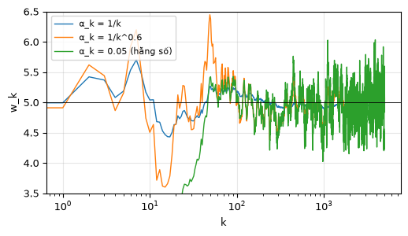
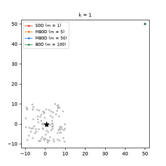
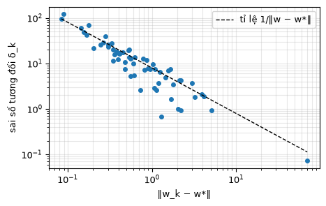

# Chương 6 · Code

> Ghi chú của người biên soạn: trang này không có trong sách. Nó chạy các thuật toán xấp xỉ ngẫu nhiên của [chương 6](mathrl/ch06_vi) (ước lượng trung bình cộng dồn, Robbins-Monro, SGD, BGD và MBGD) bằng numpy. Thí nghiệm RM với $g(w) = \tanh(w-1)$ và $g(w) = w^3 - 5$ đã có ở mục "Kiểm tra bằng mã" trong chương. Ký hiệu theo [Quy ước ký hiệu](notation_vi).

Mỗi khối code đã được chạy sẵn. Kết quả, hình và ảnh động nằm ngay bên dưới. Các khối chạy lần lượt từ trên xuống và dùng chung biến, như notebook. Muốn tự chạy, xem [mục 4](#_4-chạy-trên-máy).

## 1. Ước lượng trung bình cộng dồn và chọn bước

<small class="viz-ref">Mục 6.1, 6.2.2 · công thức (6.2), (6.3)</small>

$w_{k+1} = w_k - \alpha_k (w_k - x_k)$. Với $\alpha_k = 1/k$, $w_{k+1}$ đúng bằng trung bình cộng của $k$ mẫu đầu. Đây cũng là thuật toán RM giải $g(w) = w - \mathbb E[X] = 0$. Ta thử ba cách chọn $\alpha_k$:

<!-- run -->
```python
import numpy as np
import matplotlib.pyplot as plt
from viz import save_gif

rng = np.random.default_rng(0)
x = rng.normal(5.0, 2.0, size=5000)          # E[X] = 5

def incremental(x, step):
    w, path = 0.0, []
    for k, xk in enumerate(x, start=1):
        w -= step(k) * (w - xk)              # (6.3)
        path.append(w)
    return np.array(path)

steps = {"α_k = 1/k": lambda k: 1 / k,
         "α_k = 1/k^0.6": lambda k: 1 / k ** 0.6,
         "α_k = 0.05 (hằng số)": lambda k: 0.05}
plt.figure(figsize=(5.8, 3))
for name, step in steps.items():
    path = incremental(x, step)
    plt.plot(path, lw=1, label=name)
    print(f"{name:22s}: w_5000 = {path[-1]:.3f}, độ dao động 1000 bước cuối (độ lệch chuẩn) = {path[-1000:].std():.4f}")
print(f"Trung bình mẫu đúng: {x.mean():.3f}")
plt.axhline(5, color="k", lw=0.6); plt.ylim(3.5, 6.5); plt.xscale("log")
plt.xlabel("k"); plt.ylabel("w_k"); plt.legend(fontsize=8); plt.grid(alpha=.3)
```

<!-- output -->
```output
α_k = 1/k             : w_5000 = 4.991, độ dao động 1000 bước cuối (độ lệch chuẩn) = 0.0069
α_k = 1/k^0.6         : w_5000 = 5.044, độ dao động 1000 bước cuối (độ lệch chuẩn) = 0.0735
α_k = 0.05 (hằng số)  : w_5000 = 4.841, độ dao động 1000 bước cuối (độ lệch chuẩn) = 0.3157
Trung bình mẫu đúng: 4.991
```

<div align=center></div>
<!-- /output -->

- $\alpha_k = 1/k$ cho đúng trung bình mẫu ở mọi bước.
- $\alpha_k = 1/k^{0.6}$ cũng thỏa hai điều kiện $\sum_k \alpha_k = \infty$, $\sum_k \alpha_k^2 < \infty$ của định lý 6.1, nên vẫn hội tụ. Nó quên mẫu cũ nhanh hơn, nên ở cuối vẫn dao động nhiều gấp khoảng 10 lần so với $1/k$ (độ lệch chuẩn 0.07 so với 0.007).
- $\alpha_k$ hằng số **vi phạm** điều kiện $\sum_k \alpha_k^2 < \infty$. Ước lượng không hội tụ hẳn, mà mãi dao động quanh giá trị đúng, với độ lệch chuẩn khoảng 0.3. Đổi lại, nó theo kịp nếu trung bình thay đổi theo thời gian. Đó là lý do trong thực hành học tăng cường, người ta vẫn hay dùng $\alpha$ hằng số nhỏ.

## 2. SGD, MBGD và BGD

<small class="viz-ref">Mục 6.4.4 · hình 6.5</small>

Thiết lập của hình 6.5: $X \in \mathbb R^2$ phân phối đều trong hình vuông cạnh 20 tâm ở gốc, nên $\mathbb E[X] = 0$. Có 100 mẫu cố định, và ta cực tiểu $J(w) = \frac{1}{2n}\sum_i \lVert w - x_i \rVert^2$, nghiệm là trung bình mẫu $\bar x$. Xuất phát từ $w_1 = (50, 50)$, rất xa nghiệm, với $\alpha_k = 1/k$. MBGD lấy mỗi lần $m$ mẫu từ 100 mẫu (có hoàn lại).

<!-- run -->
```python
samples = rng.uniform(-10, 10, size=(100, 2))
x_bar = samples.mean(axis=0)

def run(m, n_iter=60, seed=1):
    r = np.random.default_rng(seed)
    w, path = np.array([50.0, 50.0]), []
    for k in range(1, n_iter + 1):
        path.append(w.copy())
        batch = samples[r.integers(100, size=m)] if m < 100 else samples   # m = 100: dùng hết (BGD)
        w = w - (1 / k) * (w - batch.mean(axis=0))
    return np.array(path)

paths = {"SGD (m = 1)": run(1), "MBGD (m = 5)": run(5), "MBGD (m = 50)": run(50), "BGD (m = 100)": run(100)}
for name, p in paths.items():
    print(f"{name:14s}: ‖w_k − x̄‖ tại k = 2, 5, 20, 60: "
          f"{[round(float(np.linalg.norm(p[k - 1] - x_bar)), 2) for k in (2, 5, 20, 60)]}")

colors = {"SGD (m = 1)": "#d93025", "MBGD (m = 5)": "#e8710a", "MBGD (m = 50)": "#1a73e8", "BGD (m = 100)": "#188038"}
def draw(fig, i):
    ax = fig.add_subplot(1, 1, 1)
    ax.scatter(*samples.T, s=6, color="#bbb")
    for name, p in paths.items():
        ax.plot(*p[: i + 1].T, "-o", ms=2.5, lw=1, color=colors[name], label=name)
    ax.plot(*x_bar, "k*", ms=10)
    ax.set_xlim(-12, 52); ax.set_ylim(-12, 52); ax.set_aspect("equal")
    ax.set_title(f"k = {i + 1}", fontsize=9); ax.legend(fontsize=7, loc="upper left")

save_gif(draw, 30, "sgd_paths.gif", fps=3, figsize=(4.2, 4.2), dpi=80)
```

<!-- output -->
```output
SGD (m = 1)   : ‖w_k − x̄‖ tại k = 2, 5, 20, 60: [5.12, 2.98, 0.62, 0.26]
MBGD (m = 5)  : ‖w_k − x̄‖ tại k = 2, 5, 20, 60: [3.94, 0.45, 0.3, 0.57]
MBGD (m = 50) : ‖w_k − x̄‖ tại k = 2, 5, 20, 60: [0.09, 0.27, 0.17, 0.16]
BGD (m = 100) : ‖w_k − x̄‖ tại k = 2, 5, 20, 60: [0.0, 0.0, 0.0, 0.0]
```

<div align=center></div>
<!-- /output -->

BGD dùng cả 100 mẫu, nên ngay sau bước đầu ($\alpha_1 = 1$) đã nhảy thẳng tới $\bar x$. SGD và MBGD cũng lao về phía nghiệm rất nhanh lúc đầu, rồi mới lắc lư khi tới gần. MBGD với $m$ lớn lắc ít hơn, vì trung bình của một lô ít nhiễu hơn một mẫu đơn lẻ.

## 3. Mẫu hình hội tụ của SGD

<small class="viz-ref">Mục 6.4.2 · công thức (6.15)</small>

Mục 6.4.2 chứng minh rằng sai số tương đối của gradient ngẫu nhiên, $\delta_k$, tỉ lệ nghịch với $\lVert w_k - w^{\ast} \rVert$. Khi còn xa nghiệm, gradient ngẫu nhiên gần như trùng hướng gradient thật, và SGD đi như GD. Khi tới gần, nhiễu lấn át. Ta đo trực tiếp $\delta_k$ dọc theo quỹ đạo SGD ở trên:

<!-- run -->
```python
p = paths["SGD (m = 1)"]
r = np.random.default_rng(1)
dist, delta = [], []
for k in range(len(p)):
    w = p[k]
    true_grad = w - x_bar                          # ∇J(w) = w − x̄
    stoch_grad = w - samples[r.integers(100)]      # gradient tại một mẫu
    dist.append(np.linalg.norm(w - x_bar))
    delta.append(np.linalg.norm(stoch_grad - true_grad) / np.linalg.norm(true_grad))

plt.figure(figsize=(5, 3))
plt.loglog(dist, delta, "o", ms=4)
d = np.logspace(np.log10(min(dist)), np.log10(max(dist)))
plt.loglog(d, 8 / d, "k--", lw=1, label="tỉ lệ 1/‖w − w*‖")
plt.xlabel("‖w_k − w*‖"); plt.ylabel("sai số tương đối δ_k"); plt.legend(); plt.grid(alpha=.3, which="both")
```

<!-- output -->
<div align=center></div>
<!-- /output -->

Các điểm nằm dọc theo một đường song song với $1/\lVert w - w^{\ast}\rVert$, đúng như bất đẳng thức suy ra từ (6.15). Ở xa nghiệm, $\delta_k$ nhỏ hơn nhiều so với 1. Ở gần nghiệm, $\delta_k$ lớn hơn 1, tức nhiễu còn lớn hơn cả bản thân gradient.

## 4. Chạy trên máy

```bash
git clone https://github.com/nmc2004nd/easy-rl-vi.git
cd easy-rl-vi/docs/code/py          # chạy từ đây để import được viz
pip install numpy matplotlib pillow
```

Chép lần lượt các khối code vào Jupyter rồi chạy theo thứ tự. Kết quả trên trang được dựng bằng `python3 scripts/build_code_pages.py docs/mathrl/ch06_code_vi.md`.
