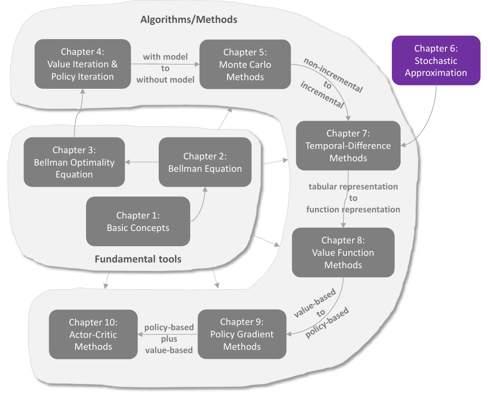
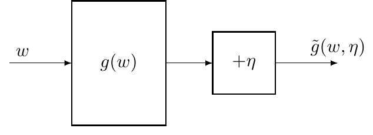
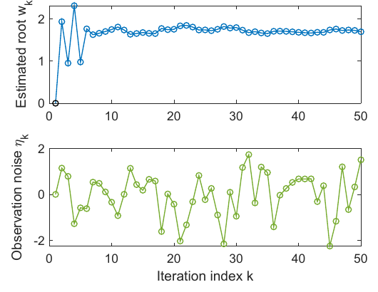
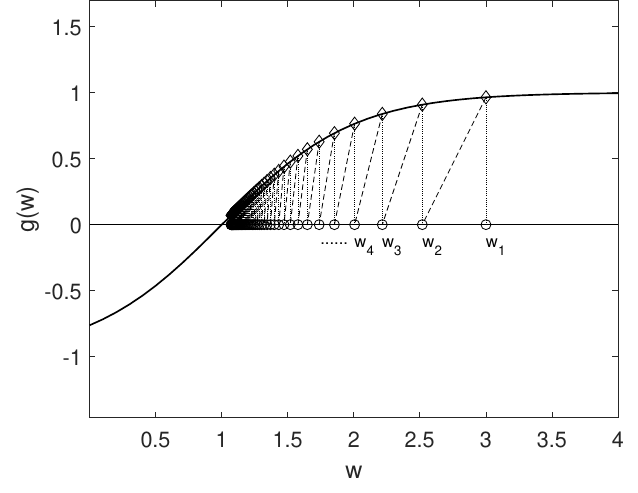
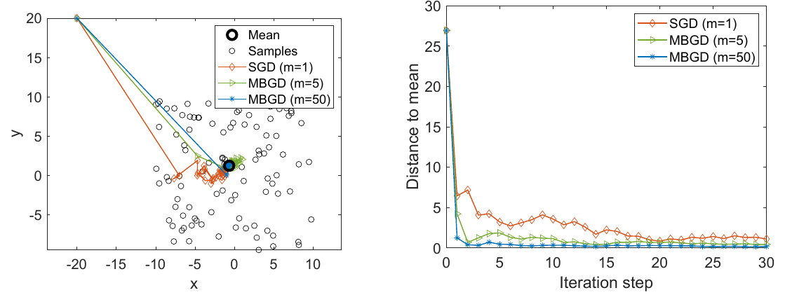

# Chương 6 Xấp xỉ ngẫu nhiên

> Ghi chú của người biên soạn: đây là bản tổng hợp tiếng Việt chương 6 sách *Mathematical Foundations of Reinforcement Learning* (Shiyu Zhao, 2025), có bổ sung từ các bài [Robbins-Monro Algorithm](https://lyk-love.cn/2024/04/20/Robbins-Monro-Algorithm/) và [Stochastic Gradient Descent](https://lyk-love.cn/2024/04/20/Stochastic-Gradient-Descent/) trên blog lyk-love. Xem [giới thiệu phần này](mathrl/README_vi) để biết nguồn, và [Quy ước ký hiệu](notation_vi) cho chuẩn ký hiệu dùng chung. Ý không có trong sách được ghi rõ.

<div align=center>

</div>
<div align=center>Hình 6.1 Vị trí của chương này trong sách. Nguồn: Zhao (2025)</div>

Chương 5 giới thiệu lớp thuật toán không mô hình đầu tiên, dựa trên ước lượng Monte Carlo. Chương 7 sẽ giới thiệu lớp thứ hai: **học sai phân thời gian (temporal-difference, TD)**. Nhưng trước đó cần **tạm dừng** để chuẩn bị, vì thuật toán TD rất khác những gì đã học. Nhiều người lần đầu thấy thuật toán TD đều thắc mắc nó được thiết kế ra sao và vì sao lại chạy được.

Thực ra có một **khoảng trống kiến thức**:

| Đã học (chương 4–5) | Sắp học (chương 7 trở đi) |
|---|---|
| thuật toán **không tăng dần (non-incremental)**: thu đủ dữ liệu rồi mới tính | thuật toán **tăng dần (incremental)**: có mẫu nào cập nhật ngay mẫu đó |

Chương này lấp khoảng trống đó bằng kiến thức cơ bản về **xấp xỉ ngẫu nhiên (stochastic approximation)**. Chương không giới thiệu thuật toán học tăng cường nào, nhưng đặt nền móng cần thiết cho các chương sau. Chương 7 sẽ cho thấy **thuật toán TD là những thuật toán xấp xỉ ngẫu nhiên đặc biệt**. Thuật toán **giảm gradient ngẫu nhiên (SGD)** nổi tiếng trong học máy cũng được giới thiệu ở đây.

**Bức tranh của chương** *(ghi chú của người biên soạn)*:

$$
\text{ước lượng trung bình (lặp)} \ \subset\ \text{SGD} \ \subset\ \text{Robbins-Monro} \quad\xrightarrow{\ \text{chương 7}\ }\quad \text{TD, Sarsa, Q-learning}
$$

## 6.1 Ví dụ dẫn nhập: ước lượng trung bình

Xem cách biến một thuật toán không tăng dần thành tăng dần qua bài toán ước lượng trung bình.

Biến ngẫu nhiên $X$ nhận giá trị trong tập hữu hạn $\mathcal X$; mục tiêu là ước lượng $\mathbb E[X]$. Có dãy mẫu i.i.d. $\{x_i\}_{i=1}^n$. Kỳ vọng xấp xỉ bằng

$$
\mathbb E[X] \approx \bar x \doteq \frac1n \sum_{i=1}^n x_i. \tag{6.1}
$$

Đây là ý tưởng của ước lượng Monte Carlo (chương 5); theo luật số lớn, $\bar x \to \mathbb E[X]$ khi $n \to \infty$.

Có hai cách tính $\bar x$:

- **Không tăng dần:** thu đủ mọi mẫu rồi mới lấy trung bình. Nếu số mẫu lớn, có thể phải chờ rất lâu.
- **Tăng dần:** tính trung bình dần dần, có mẫu nào cập nhật ngay.

Cụ thể, đặt

$$
w_{k+1} \doteq \frac1k \sum_{i=1}^k x_i, \quad k = 1, 2, \dots \qquad\text{nên}\qquad w_k = \frac{1}{k-1}\sum_{i=1}^{k-1} x_i, \quad k = 2, 3, \dots
$$

Khi đó $w_{k+1}$ biểu diễn được qua $w_k$:

$$
w_{k+1} = \frac1k \sum_{i=1}^k x_i = \frac1k\left(\sum_{i=1}^{k-1} x_i + x_k\right) = \frac1k\big((k-1)w_k + x_k\big) = w_k - \frac1k (w_k - x_k).
$$

Ta có **thuật toán tăng dần**:

$$
w_{k+1} = w_k - \frac1k (w_k - x_k). \tag{6.2}
$$

Kiểm tra:

$$
\begin{aligned}
w_1 &= x_1,\\
w_2 &= w_1 - \tfrac11 (w_1 - x_1) = x_1,\\
w_3 &= w_2 - \tfrac12 (w_2 - x_2) = x_1 - \tfrac12 (x_1 - x_2) = \tfrac12 (x_1 + x_2),\\
w_4 &= w_3 - \tfrac13 (w_3 - x_3) = \tfrac13 (x_1 + x_2 + x_3),\\
&\ \ \vdots\\
w_{k+1} &= \frac1k \sum_{i=1}^k x_i.
\end{aligned} \tag{6.3}
$$

**Ưu điểm của (6.2):** mỗi lần nhận một mẫu là có ngay trung bình mới, dùng làm xấp xỉ cho $\bar x$ và do đó cho $\mathbb E[X]$. Lúc đầu ít mẫu nên chưa chính xác, nhưng "có còn hơn không"; càng nhiều mẫu thì càng chính xác dần, theo luật số lớn.

Cũng có thể định nghĩa $w_{k+1} = \frac{1}{1+k}\sum_{i=1}^{k+1} x_i$ và $w_k = \frac1k \sum_{i=1}^k x_i$; không khác gì đáng kể, và thuật toán lặp tương ứng là $w_{k+1} = w_k - \frac{1}{1+k}(w_k - x_{k+1})$.

**Dạng tổng quát hơn.** Thay hệ số $1/k$ bằng một hệ số dương $\alpha_k > 0$:

$$
w_{k+1} = w_k - \alpha_k (w_k - x_k). \tag{6.4}
$$

Thuật toán này quan trọng và dùng nhiều trong chương. Vì không biết $\alpha_k$ cụ thể nên không có biểu thức tường minh của $w_k$ như (6.3). Nhưng mục sau sẽ chứng minh rằng nếu $\{\alpha_k\}$ thỏa vài điều kiện nhẹ thì $w_k \to \mathbb E[X]$. Chương 7 sẽ thấy thuật toán TD có biểu thức tương tự nhưng phức tạp hơn.

*(ghi chú của người biên soạn)* Đọc (6.4) theo kiểu "ước lượng mới = ước lượng cũ + bước học × (mẫu mới − ước lượng cũ)". Cấu trúc "**cũ + α × (mục tiêu − cũ)**" này sẽ gặp lại ở mọi thuật toán TD; khác biệt chỉ nằm ở "mục tiêu" là gì.

## 6.2 Thuật toán Robbins-Monro

**Xấp xỉ ngẫu nhiên** là một họ rộng các thuật toán lặp ngẫu nhiên để giải bài toán **tìm nghiệm** hoặc **tối ưu**. So với nhiều thuật toán tìm nghiệm khác như các phương pháp dựa trên gradient, xấp xỉ ngẫu nhiên mạnh ở chỗ **không cần biểu thức của hàm mục tiêu hay đạo hàm của nó**.

**Thuật toán Robbins-Monro (RM)** là công trình tiên phong của lĩnh vực này. Thuật toán SGD nổi tiếng là một dạng đặc biệt của RM (mục 6.4).

### Bài toán

Tìm nghiệm của phương trình

$$
g(w) = 0,
$$

với ẩn $w \in \mathbb R$ và hàm $g: \mathbb R \to \mathbb R$. Nhiều bài toán đưa được về dạng tìm nghiệm:

- **Tối ưu:** cực tiểu hóa $J(w)$ tương đương giải $g(w) \doteq \nabla_w J(w) = 0$.
- **Phương trình $g(w) = c$** với $c$ hằng: viết lại $g(w) - c$ thành hàm mới.

Nếu biết biểu thức của $g$ hay đạo hàm của nó thì có nhiều thuật toán số. Nhưng ở đây **không biết biểu thức của $g$**; ví dụ $g$ là một mạng nơ-ron với cấu trúc và tham số không rõ. Hơn nữa, chỉ quan sát được **giá trị có nhiễu** của $g(w)$:

$$
\tilde g(w, \eta) = g(w) + \eta,
$$

với $\eta \in \mathbb R$ là sai số quan sát, không nhất thiết là phân phối chuẩn. Tóm lại, đây là một **hộp đen**: chỉ biết đầu vào $w$ và đầu ra có nhiễu $\tilde g(w, \eta)$ (hình 6.2). Mục tiêu: giải $g(w) = 0$ chỉ bằng $w$ và $\tilde g$.

<div align=center>

</div>
<div align=center>Hình 6.2 Bài toán giải g(w) = 0 chỉ từ đầu vào w và đầu ra có nhiễu g̃. Nguồn: Zhao (2025)</div>

### Thuật toán

Thuật toán RM giải $g(w) = 0$:

$$
\boxed{w_{k+1} = w_k - a_k \tilde g(w_k, \eta_k), \qquad k = 1, 2, 3, \dots} \tag{6.5}
$$

với $w_k$ là ước lượng thứ $k$ của nghiệm, $\tilde g(w_k, \eta_k)$ là quan sát có nhiễu thứ $k$, và $a_k$ là hệ số dương. Thuật toán RM **không cần bất kỳ thông tin nào về hàm**, chỉ cần đầu vào và đầu ra.

**Ví dụ.** Xét $g(w) = w^3 - 5$, nghiệm đúng $5^{1/3} \approx 1.71$. Chỉ quan sát được $w$ và $\tilde g(w) = g(w) + \eta$, với $\eta$ i.i.d. theo phân phối chuẩn tắc (trung bình 0, độ lệch chuẩn 1). Giá trị ban đầu $w_1 = 0$, hệ số $a_k = 1/k$. Hình 6.3 cho thấy dù quan sát bị nhiễu $\eta_k$ làm hỏng, ước lượng $w_k$ vẫn hội tụ tới nghiệm đúng. Lưu ý với riêng hàm $g(w) = w^3 - 5$, **giá trị ban đầu $w_1$ phải được chọn phù hợp** mới hội tụ; mục 6.2.1 nêu điều kiện để RM hội tụ với **mọi** giá trị ban đầu.

<div align=center>

</div>
<div align=center>Hình 6.3 Ví dụ minh họa thuật toán RM với g(w) = w³ − 5. Trên: ước lượng nghiệm w_k. Dưới: nhiễu quan sát η_k. Nguồn: Zhao (2025)</div>

### 6.2.1 Tính chất hội tụ

**Vì sao RM tìm được nghiệm?** Xét ví dụ ở hình 6.4: $g(w) = \tanh(w - 1)$, nghiệm đúng $w^{\ast} = 1$. Chạy RM với $w_1 = 3$, $a_k = 1/k$. Để dễ thấy lý do hội tụ, tạm đặt $\eta_k \equiv 0$, nên $\tilde g(w_k, \eta_k) = g(w_k)$ và thuật toán là $w_{k+1} = w_k - a_k g(w_k)$.

<div align=center>

</div>
<div align=center>Hình 6.4 Minh họa sự hội tụ của thuật toán RM với g(w) = tanh(w − 1). Nguồn: Zhao (2025)</div>

Ví dụ đơn giản này cho thấy vì sao RM hội tụ:

- Khi $w_k > w^{\ast}$: $g(w_k) > 0$, nên $w_{k+1} = w_k - a_k g(w_k) < w_k$. Nếu $a_k g(w_k)$ đủ nhỏ thì $w^{\ast} < w_{k+1} < w_k$: $w_{k+1}$ gần $w^{\ast}$ hơn $w_k$.
- Khi $w_k < w^{\ast}$: $g(w_k) < 0$, nên $w_{k+1} > w_k$. Nếu $\lvert a_k g(w_k)\rvert$ đủ nhỏ thì $w^{\ast} > w_{k+1} > w_k$: $w_{k+1}$ gần $w^{\ast}$ hơn $w_k$.

Trường hợp nào thì $w_{k+1}$ cũng gần $w^{\ast}$ hơn $w_k$, nên trực giác cho thấy $w_k$ hội tụ tới $w^{\ast}$.

Ví dụ trên đơn giản vì giả sử không có nhiễu. Khi có sai số quan sát ngẫu nhiên thì phân tích hội tụ không còn tầm thường. Kết quả chặt chẽ như sau.

> **Định lý 6.1 (Định lý Robbins-Monro).** Trong thuật toán RM (6.5), nếu
>
> (a) $0 < c_1 \le \nabla_w g(w) \le c_2$ với mọi $w$;
>
> (b) $\sum_{k=1}^\infty a_k = \infty$ và $\sum_{k=1}^\infty a_k^2 < \infty$;
>
> (c) $\mathbb E[\eta_k \mid \mathcal H_k] = 0$ và $\mathbb E[\eta_k^2 \mid \mathcal H_k] < \infty$;
>
> với $\mathcal H_k = \{w_k, w_{k-1}, \dots\}$, thì $w_k$ **hội tụ hầu chắc chắn** tới nghiệm $w^{\ast}$ thỏa $g(w^{\ast}) = 0$.

Chứng minh để ở mục 6.3.3. Định lý dựa trên khái niệm **hội tụ hầu chắc chắn (almost sure convergence)**, giới thiệu ở phụ lục B của sách. *(ghi chú của người biên soạn)* Nói nôm na: với xác suất 1, dãy $w_k$ hội tụ; có thể có những dãy "xui" không hội tụ, nhưng tổng xác suất của chúng bằng 0.

**Giải thích ba điều kiện:**

**Điều kiện (a)** về hàm $g$:

- $0 < c_1 \le \nabla_w g(w)$ nghĩa là $g$ **tăng đơn điệu**, bảo đảm nghiệm của $g(w) = 0$ tồn tại và duy nhất. Nếu $g$ giảm đơn điệu thì xét $-g$ thay thế.
- Áp dụng cho tối ưu: nếu $g(w) \doteq \nabla_w J(w)$ thì "$g$ tăng đơn điệu" nghĩa là $J$ **lồi**, một giả thiết phổ biến trong tối ưu.
- $\nabla_w g(w) \le c_2$ nghĩa là gradient của $g$ **bị chặn trên**. Ví dụ $g(w) = \tanh(w - 1)$ thỏa điều kiện này, nhưng $g(w) = w^3 - 5$ thì **không**.

**Điều kiện (b)** về hệ số $\{a_k\}$: hay gặp trong học tăng cường, phân tích kỹ ngay dưới đây.

**Điều kiện (c)** về nhiễu: khá nhẹ, không đòi nhiễu là phân phối chuẩn. Trường hợp đặc biệt quan trọng: $\{\eta_k\}$ là dãy i.i.d. với $\mathbb E[\eta_k] = 0$ và $\mathbb E[\eta_k^2] < \infty$. Khi đó điều kiện (c) đúng vì $\eta_k$ độc lập với $\mathcal H_k$, nên $\mathbb E[\eta_k \mid \mathcal H_k] = \mathbb E[\eta_k] = 0$ và $\mathbb E[\eta_k^2 \mid \mathcal H_k] = \mathbb E[\eta_k^2]$.

#### Vì sao điều kiện (b) quan trọng?

**Thứ nhất, $\sum_{k=1}^\infty a_k^2 < \infty$ nghĩa là $a_k \to 0$.** Vì sao cần? Giả sử quan sát $\tilde g(w_k, \eta_k)$ luôn bị chặn. Vì

$$
w_{k+1} - w_k = -a_k \tilde g(w_k, \eta_k),
$$

nếu $a_k \to 0$ thì $a_k \tilde g(w_k, \eta_k) \to 0$, nên $w_{k+1} - w_k \to 0$: $w_{k+1}$ và $w_k$ tiến lại gần nhau. Ngược lại, nếu $a_k$ không hội tụ về 0 thì $w_k$ có thể **dao động mãi** khi $k \to \infty$.

**Thứ hai, $\sum_{k=1}^\infty a_k = \infty$ nghĩa là $a_k$ không được về 0 quá nhanh.** Vì sao cần? Cộng vế theo vế các đẳng thức $w_2 - w_1 = -a_1 \tilde g(w_1, \eta_1)$, $w_3 - w_2 = -a_2 \tilde g(w_2, \eta_2)$, $w_4 - w_3 = -a_3 \tilde g(w_3, \eta_3)$, … được

$$
w_1 - w_\infty = \sum_{k=1}^\infty a_k \tilde g(w_k, \eta_k).
$$

Nếu $\sum_{k=1}^\infty a_k < \infty$ thì $\left\lvert\sum_{k=1}^\infty a_k \tilde g(w_k, \eta_k)\right\rvert$ cũng bị chặn. Gọi $b$ là cận trên hữu hạn:

$$
\lvert w_1 - w_\infty\rvert = \left\lvert\sum_{k=1}^\infty a_k \tilde g(w_k, \eta_k)\right\rvert \le b. \tag{6.6}
$$

Nếu chọn $w_1$ ở xa $w^{\ast}$ đến mức $\lvert w_1 - w^{\ast}\rvert > b$ thì theo (6.6) **không thể** có $w_\infty = w^{\ast}$: thuật toán "hết đà" trước khi tới nghiệm. Vì vậy cần $\sum_{k=1}^\infty a_k = \infty$ để hội tụ với **mọi** giá trị ban đầu.

#### Dãy nào thỏa điều kiện (b)?

Một dãy điển hình là

$$
a_k = \frac1k.
$$

**Một mặt**,

$$
\lim_{n\to\infty}\left(\sum_{k=1}^n \frac1k - \ln n\right) = \kappa,
$$

với $\kappa \approx 0.577$ là **hằng số Euler-Mascheroni**. Vì $\ln n \to \infty$ nên $\sum_{k=1}^\infty \frac1k = \infty$. Tổng $H_n = \sum_{k=1}^n \frac1k$ gọi là **số điều hòa (harmonic number)** trong lý thuyết số.

**Mặt khác**,

$$
\sum_{k=1}^\infty \frac{1}{k^2} = \frac{\pi^2}{6} < \infty.
$$

Việc tính giá trị của tổng này gọi là **bài toán Basel**.

Vậy dãy $\{a_k = 1/k\}$ thỏa điều kiện (b). Các biến thể nhỏ như $a_k = 1/(k+1)$ hay $a_k = c_k/k$ với $c_k$ bị chặn cũng thỏa.

**Trong thực tế**, $a_k$ thường được chọn là **một hằng số đủ nhỏ**. Khi đó điều kiện (b) không còn đúng, vì $\sum a_k^2 = \infty$, nhưng thuật toán vẫn hội tụ **theo một nghĩa nào đó** (H.-F. Chen, *Stochastic Approximation and Its Applications*, 2006, mục 1.5). Ngoài ra, $g(w) = w^3 - 5$ ở hình 6.3 không thỏa điều kiện (a), nhưng RM vẫn tìm được nghiệm nếu giá trị ban đầu được chọn thích hợp (không phải tùy ý).

*(ghi chú của người biên soạn)* Nhìn theo kiểu "hằng số nhỏ": điều kiện $\sum a_k^2 < \infty$ để dập tắt nhiễu. Bước học hằng số không dập tắt hẳn nhiễu, nên ước lượng cuối cùng sẽ **dao động nhẹ quanh** nghiệm thay vì hội tụ đúng, với biên độ tỉ lệ với bước học. Đổi lại, bước học hằng số **theo kịp được mục tiêu thay đổi**; điều này rất quan trọng trong học tăng cường, nơi chính sách liên tục thay đổi (xem hỏi đáp ở chương 7).

### 6.2.2 Áp dụng cho ước lượng trung bình

Dùng định lý RM để phân tích thuật toán ước lượng trung bình (6.4):

$$
w_{k+1} = w_k + \alpha_k (x_k - w_k).
$$

Khi $\alpha_k = 1/k$ có biểu thức tường minh $w_{k+1} = \frac1k \sum_{i=1}^k x_i$. Nhưng với $\alpha_k$ tổng quát thì không có, và phân tích hội tụ không tầm thường. Ta chứng minh nó là một thuật toán RM đặc biệt, nên hội tụ.

Định nghĩa

$$
g(w) \doteq w - \mathbb E[X].
$$

Bài toán tìm $\mathbb E[X]$ thành bài toán tìm nghiệm $g(w) = 0$. Với một giá trị $w$, quan sát có nhiễu thu được là $\tilde g \doteq w - x$, với $x$ là một mẫu của $X$. Viết lại:

$$
\begin{aligned}
\tilde g(w, \eta) &= w - x\\
&= w - x + \mathbb E[X] - \mathbb E[X]\\
&= (w - \mathbb E[X]) + (\mathbb E[X] - x) \doteq g(w) + \eta,
\end{aligned}
$$

với $\eta \doteq \mathbb E[X] - x$. Thuật toán RM giải bài toán này là

$$
w_{k+1} = w_k - \alpha_k \tilde g(w_k, \eta_k) = w_k - \alpha_k (w_k - x_k),
$$

đúng là (6.4). Theo định lý 6.1, $w_k$ hội tụ hầu chắc chắn tới $\mathbb E[X]$ nếu $\sum_k \alpha_k = \infty$, $\sum_k \alpha_k^2 < \infty$ và $\{x_k\}$ i.i.d. Đáng chú ý, sự hội tụ **không cần giả thiết gì về phân phối của $X$**.

*(ghi chú của người biên soạn)* Kiểm tra ba điều kiện: $\nabla_w g(w) = 1$ nên (a) đúng với $c_1 = c_2 = 1$; (c) đúng vì $\mathbb E[\eta_k] = \mathbb E[X] - \mathbb E[x_k] = 0$ và $\mathbb E[\eta_k^2] = \operatorname{var}[X]$ hữu hạn.

## 6.3 Định lý hội tụ Dvoretzky *(phần nâng cao)*

> Mục này hơi nặng toán. Ai quan tâm tới phân tích hội tụ của thuật toán ngẫu nhiên nên đọc; nếu không có thể bỏ qua và chuyển sang mục 6.4.

Đến giờ, sự hội tụ của RM vẫn chưa được chứng minh. Công cụ là **định lý Dvoretzky**, một kết quả kinh điển của xấp xỉ ngẫu nhiên, dùng được để phân tích sự hội tụ của RM và của nhiều thuật toán học tăng cường.

> **Định lý 6.2 (Định lý Dvoretzky).** Xét quá trình ngẫu nhiên
> $$\Delta_{k+1} = (1 - \alpha_k)\Delta_k + \beta_k \eta_k,$$
> trong đó $\{\alpha_k\}_{k=1}^\infty$, $\{\beta_k\}_{k=1}^\infty$, $\{\eta_k\}_{k=1}^\infty$ là các dãy ngẫu nhiên, với $\alpha_k \ge 0$, $\beta_k \ge 0$ với mọi $k$. Khi đó $\Delta_k$ **hội tụ hầu chắc chắn về 0** nếu:
>
> (a) $\sum_{k=1}^\infty \alpha_k = \infty$, $\sum_{k=1}^\infty \alpha_k^2 < \infty$ và $\sum_{k=1}^\infty \beta_k^2 < \infty$, đều hầu chắc chắn;
>
> (b) $\mathbb E[\eta_k \mid \mathcal H_k] = 0$ và $\mathbb E[\eta_k^2 \mid \mathcal H_k] \le C$ hầu chắc chắn;
>
> với $\mathcal H_k = \{\Delta_k, \Delta_{k-1}, \dots, \eta_{k-1}, \dots, \alpha_{k-1}, \dots, \beta_{k-1}, \dots\}$.

**Vài lưu ý:**

- Trong RM, dãy hệ số $\{\alpha_k\}$ là **tất định**. Định lý Dvoretzky cho phép $\{\alpha_k\}$, $\{\beta_k\}$ là **biến ngẫu nhiên** phụ thuộc $\mathcal H_k$. Vì vậy nó hữu ích khi $\alpha_k$ hay $\beta_k$ là hàm của $\Delta_k$.
- Điều kiện (a) phát biểu "đều hầu chắc chắn" vì $\alpha_k$, $\beta_k$ có thể là biến ngẫu nhiên, nên giới hạn của chúng phải hiểu theo nghĩa ngẫu nhiên. Điều kiện (b) cũng "hầu chắc chắn" vì $\mathcal H_k$ là dãy biến ngẫu nhiên, nên $\mathbb E[\eta_k \mid \mathcal H_k]$ và $\mathbb E[\eta_k^2 \mid \mathcal H_k]$ cũng là biến ngẫu nhiên.
- Phát biểu này hơi khác bản gốc ở chỗ **không** đòi $\sum_k \beta_k = \infty$. Khi $\sum_k \beta_k < \infty$, kể cả cực đoan $\beta_k = 0$ với mọi $k$, dãy vẫn hội tụ.

*(ghi chú của người biên soạn)* Đọc định lý theo trực giác: $\Delta_k$ là **sai số**. Mỗi bước, sai số bị "co" một phần $(1-\alpha_k)$, rồi bị cộng thêm nhiễu $\beta_k\eta_k$. Muốn sai số về 0 thì: tổng lượng co phải vô hạn ($\sum\alpha_k = \infty$), còn tổng "năng lượng" nhiễu phải hữu hạn ($\sum\beta_k^2 < \infty$) và nhiễu không có xu hướng ($\mathbb E[\eta_k \mid \mathcal H_k] = 0$).

### 6.3.1 Chứng minh định lý Dvoretzky

Chứng minh gốc của Dvoretzky có từ năm 1956. Dưới đây là một chứng minh dựa trên **tựa martingale (quasimartingale)**; với kết quả hội tụ của tựa martingale (phụ lục C của sách), chứng minh khá gọn.

> **Chứng minh.** Đặt $h_k \doteq \Delta_k^2$. Khi đó
> $$\begin{aligned}
> h_{k+1} - h_k &= \Delta_{k+1}^2 - \Delta_k^2 = (\Delta_{k+1} - \Delta_k)(\Delta_{k+1} + \Delta_k)\\
> &= (-\alpha_k\Delta_k + \beta_k\eta_k)\big[(2 - \alpha_k)\Delta_k + \beta_k\eta_k\big]\\
> &= -\alpha_k(2 - \alpha_k)\Delta_k^2 + \beta_k^2\eta_k^2 + 2(1 - \alpha_k)\beta_k\eta_k\Delta_k.
> \end{aligned}$$
> Lấy kỳ vọng có điều kiện hai vế:
> $$\mathbb E[h_{k+1} - h_k \mid \mathcal H_k] = \mathbb E[-\alpha_k(2-\alpha_k)\Delta_k^2 \mid \mathcal H_k] + \mathbb E[\beta_k^2\eta_k^2 \mid \mathcal H_k] + \mathbb E[2(1-\alpha_k)\beta_k\eta_k\Delta_k \mid \mathcal H_k]. \tag{6.7}$$
> Thứ nhất, $\Delta_k$ nằm trong $\mathcal H_k$ nên được đưa ra ngoài kỳ vọng. Thứ hai, xét trường hợp đơn giản $\alpha_k$, $\beta_k$ được xác định bởi $\mathcal H_k$ (đúng khi chúng là hàm của $\Delta_k$ hoặc là dãy tất định); khi đó chúng cũng được đưa ra ngoài. Do đó (6.7) thành
> $$\mathbb E[h_{k+1} - h_k \mid \mathcal H_k] = -\alpha_k(2-\alpha_k)\Delta_k^2 + \beta_k^2\,\mathbb E[\eta_k^2 \mid \mathcal H_k] + 2(1-\alpha_k)\beta_k\Delta_k\,\mathbb E[\eta_k \mid \mathcal H_k]. \tag{6.8}$$
> - Số hạng thứ nhất: vì $\sum_k \alpha_k^2 < \infty$ kéo theo $\alpha_k \to 0$ hầu chắc chắn, có $n$ hữu hạn để $\alpha_k \le 1$ với mọi $k \ge n$. Không mất tổng quát, xét $\alpha_k \le 1$; khi đó $-\alpha_k(2-\alpha_k)\Delta_k^2 \le 0$.
> - Số hạng thứ hai: $\beta_k^2\,\mathbb E[\eta_k^2 \mid \mathcal H_k] \le \beta_k^2 C$ theo giả thiết.
> - Số hạng thứ ba bằng 0 vì $\mathbb E[\eta_k \mid \mathcal H_k] = 0$.
>
> Vậy
> $$\mathbb E[h_{k+1} - h_k \mid \mathcal H_k] = -\alpha_k(2-\alpha_k)\Delta_k^2 + \beta_k^2\,\mathbb E[\eta_k^2 \mid \mathcal H_k] \le \beta_k^2 C, \tag{6.9}$$
> nên $\sum_{k=1}^\infty \mathbb E[h_{k+1} - h_k \mid \mathcal H_k] \le \sum_{k=1}^\infty \beta_k^2 C < \infty$, do $\sum_k \beta_k^2 < \infty$. Theo định lý hội tụ tựa martingale, **$h_k$ hội tụ hầu chắc chắn**.
>
> Còn phải xác định $\Delta_k$ hội tụ về đâu. Từ (6.9):
> $$\sum_{k=1}^\infty \alpha_k(2-\alpha_k)\Delta_k^2 = \sum_{k=1}^\infty \beta_k^2\,\mathbb E[\eta_k^2 \mid \mathcal H_k] - \sum_{k=1}^\infty \mathbb E[h_{k+1} - h_k \mid \mathcal H_k].$$
> Số hạng thứ nhất vế phải bị chặn theo giả thiết. Số hạng thứ hai cũng bị chặn vì $h_k$ hội tụ nên $h_{k+1} - h_k$ khả tổng. Vậy vế trái bị chặn. Vì xét $\alpha_k \le 1$:
> $$\infty > \sum_{k=1}^\infty \alpha_k(2-\alpha_k)\Delta_k^2 \ge \sum_{k=1}^\infty \alpha_k\Delta_k^2 \ge 0.$$
> Do đó $\sum_k \alpha_k\Delta_k^2$ bị chặn. Mà $\sum_k \alpha_k = \infty$, nên bắt buộc $\Delta_k \to 0$ hầu chắc chắn. $\blacksquare$

*(ghi chú của người biên soạn)* Bước cuối dùng một lập luận hay gặp: nếu $\sum \alpha_k = \infty$ mà $\sum \alpha_k \Delta_k^2 < \infty$ thì $\Delta_k^2$ không thể giữ trên một mức dương nào đó mãi. Kết hợp với việc $h_k = \Delta_k^2$ đã hội tụ, giới hạn chỉ có thể là 0.

### 6.3.2 Áp dụng cho ước lượng trung bình

Sự hội tụ của ước lượng trung bình $w_{k+1} = w_k + \alpha_k(x_k - w_k)$ đã chứng minh bằng định lý RM; cũng có thể chứng minh trực tiếp bằng định lý Dvoretzky.

> **Chứng minh.** Đặt $w^{\ast} = \mathbb E[X]$. Viết lại thuật toán:
> $$w_{k+1} - w^{\ast} = w_k - w^{\ast} + \alpha_k(x_k - w^{\ast} + w^{\ast} - w_k).$$
> Đặt $\Delta \doteq w - w^{\ast}$:
> $$\Delta_{k+1} = \Delta_k + \alpha_k(x_k - w^{\ast} - \Delta_k) = (1 - \alpha_k)\Delta_k + \alpha_k\underbrace{(x_k - w^{\ast})}_{\eta_k}.$$
> Vì $\{x_k\}$ i.i.d., $\mathbb E[x_k \mid \mathcal H_k] = \mathbb E[x_k] = w^{\ast}$. Do đó $\mathbb E[\eta_k \mid \mathcal H_k] = 0$ và $\mathbb E[\eta_k^2 \mid \mathcal H_k] = \mathbb E[x_k^2] - (w^{\ast})^2$ bị chặn nếu phương sai của $x_k$ hữu hạn. Theo định lý Dvoretzky (với $\beta_k = \alpha_k$), $\Delta_k \to 0$, tức $w_k \to w^{\ast} = \mathbb E[X]$ hầu chắc chắn. $\blacksquare$

### 6.3.3 Chứng minh định lý Robbins-Monro

> **Chứng minh.** RM tìm nghiệm của $g(w) = 0$; gọi nghiệm là $w^{\ast}$, $g(w^{\ast}) = 0$. Thuật toán:
> $$w_{k+1} = w_k - a_k\tilde g(w_k, \eta_k) = w_k - a_k[g(w_k) + \eta_k].$$
> Nên
> $$w_{k+1} - w^{\ast} = w_k - w^{\ast} - a_k[g(w_k) - g(w^{\ast}) + \eta_k].$$
> Theo định lý giá trị trung bình, $g(w_k) - g(w^{\ast}) = \nabla_w g(w_k')(w_k - w^{\ast})$ với $w_k' \in [w_k, w^{\ast}]$. Đặt $\Delta_k \doteq w_k - w^{\ast}$:
> $$\begin{aligned}
> \Delta_{k+1} &= \Delta_k - a_k[\nabla_w g(w_k')(w_k - w^{\ast}) + \eta_k]\\
> &= \Delta_k - a_k\nabla_w g(w_k')\Delta_k + a_k(-\eta_k)\\
> &= \big[1 - \underbrace{a_k\nabla_w g(w_k')}_{\alpha_k}\big]\Delta_k + a_k(-\eta_k).
> \end{aligned}$$
> Vì $0 < c_1 \le \nabla_w g(w) \le c_2$ nên $c_1 a_k \le \alpha_k \le c_2 a_k$. Từ $\sum_k a_k = \infty$ và $\sum_k a_k^2 < \infty$ suy ra $\sum_k \alpha_k = \infty$ và $\sum_k \alpha_k^2 < \infty$. Mọi điều kiện của định lý Dvoretzky đều thỏa (với $\beta_k = a_k$ và nhiễu $-\eta_k$), nên $\Delta_k \to 0$ hầu chắc chắn. $\blacksquare$

Chứng minh này cho thấy sức mạnh của định lý Dvoretzky: $\alpha_k = a_k\nabla_w g(w_k')$ là một dãy **ngẫu nhiên** phụ thuộc $w_k$, không phải tất định, và định lý vẫn áp dụng được. *(ghi chú của người biên soạn)* Cũng thấy rõ vai trò của điều kiện (a): cận dưới $c_1$ bảo đảm $\sum\alpha_k = \infty$ (không "hết đà"), cận trên $c_2$ bảo đảm $\sum\alpha_k^2 < \infty$ (không dao động). Với $g(w) = w^3 - 5$, $\nabla_w g = 3w^2$ không bị chặn trên: khi $w_k$ lớn thì bước nhảy quá đà và thuật toán có thể phân kỳ.

### 6.3.4 Mở rộng định lý Dvoretzky

Mở rộng định lý Dvoretzky để xử lý **nhiều biến**. Định lý tổng quát này (Jaakkola, Jordan và Singh, 1994) dùng được để phân tích sự hội tụ của các thuật toán lặp ngẫu nhiên như **Q-learning**.

> **Định lý 6.3.** Xét một tập hữu hạn $\mathcal S$ các số thực. Với quá trình ngẫu nhiên
> $$\Delta_{k+1}(s) = (1 - \alpha_k(s))\Delta_k(s) + \beta_k(s)\eta_k(s),$$
> $\Delta_k(s)$ hội tụ hầu chắc chắn về 0 với mọi $s \in \mathcal S$ nếu với mọi $s \in \mathcal S$:
>
> (a) $\sum_k \alpha_k(s) = \infty$, $\sum_k \alpha_k^2(s) < \infty$, $\sum_k \beta_k^2(s) < \infty$, và $\mathbb E[\beta_k(s) \mid \mathcal H_k] \le \mathbb E[\alpha_k(s) \mid \mathcal H_k]$, đều hầu chắc chắn;
>
> (b) $\lVert\mathbb E[\eta_k(s) \mid \mathcal H_k]\rVert_\infty \le \gamma\lVert\Delta_k\rVert_\infty$, với $\gamma \in (0,1)$;
>
> (c) $\operatorname{var}[\eta_k(s) \mid \mathcal H_k] \le C(1 + \lVert\Delta_k(s)\rVert_\infty)^2$, với $C$ là hằng số.
>
> Ở đây $\mathcal H_k = \{\Delta_k, \Delta_{k-1}, \dots, \eta_{k-1}, \dots, \alpha_{k-1}, \dots, \beta_{k-1}, \dots\}$ là thông tin lịch sử, và $\lVert\cdot\rVert_\infty$ là chuẩn cực đại.

Chứng minh dựa trên định lý Dvoretzky; chi tiết xem tài liệu gốc.

**Lưu ý:**

- Biến $s$ có thể coi là một **chỉ số**; trong học tăng cường, nó là một **trạng thái** hoặc một **cặp trạng thái–hành động**. Chuẩn cực đại ở đây lấy trên **tập** chỉ số: $\lVert\mathbb E[\eta_k(s) \mid \mathcal H_k]\rVert_\infty \doteq \max_{s\in\mathcal S}\lvert\mathbb E[\eta_k(s) \mid \mathcal H_k]\rvert$ và $\lVert\Delta_k(s)\rVert_\infty \doteq \max_{s\in\mathcal S}\lvert\Delta_k(s)\rvert$.
- Định lý này **tổng quát hơn** định lý Dvoretzky ở hai điểm:
  - xử lý được **nhiều biến** nhờ chuẩn cực đại; quan trọng vì bài toán học tăng cường có nhiều trạng thái;
  - định lý Dvoretzky đòi $\mathbb E[\eta_k \mid \mathcal H_k] = 0$ và $\operatorname{var}[\eta_k \mid \mathcal H_k] \le C$, còn định lý này chỉ đòi kỳ vọng và phương sai **bị chặn bởi sai số** $\Delta_k$.
- Sự hội tụ của $\Delta(s)$ với **mọi** $s$ đòi các điều kiện đúng với **mọi** $s$. Khi dùng định lý để chứng minh hội tụ của thuật toán học tăng cường, phải kiểm tra điều kiện cho **mọi** trạng thái (hoặc cặp trạng thái–hành động).

*(ghi chú của người biên soạn)* Điều kiện (b) chính là **tính co** của chương 3 trong một dạng mới: nhiễu được phép có "xu hướng", miễn là xu hướng đó nhỏ hơn sai số hiện tại theo tỉ lệ $\gamma < 1$. Chương 7 sẽ dùng đúng định lý này để chứng minh TD hội tụ, với $\gamma$ chính là hệ số chiết khấu.

## 6.4 Giảm gradient ngẫu nhiên

Mục này giới thiệu **giảm gradient ngẫu nhiên (stochastic gradient descent, SGD)**, dùng rộng rãi trong học máy. Sẽ thấy rằng **SGD là một thuật toán RM đặc biệt**, và **ước lượng trung bình là một thuật toán SGD đặc biệt**.

Xét bài toán tối ưu

$$
\min_w J(w) = \mathbb E[f(w, X)], \tag{6.10}
$$

với $w$ là tham số cần tối ưu và $X$ là biến ngẫu nhiên; kỳ vọng lấy theo $X$. $w$ và $X$ có thể là vô hướng hoặc vectơ; $f(\cdot)$ là hàm vô hướng.

**Cách 1: giảm gradient (GD).** Gradient của $\mathbb E[f(w, X)]$ là $\nabla_w\mathbb E[f(w, X)] = \mathbb E[\nabla_w f(w, X)]$, nên

$$
w_{k+1} = w_k - \alpha_k\nabla_w J(w_k) = w_k - \alpha_k\,\mathbb E[\nabla_w f(w_k, X)]. \tag{6.11}
$$

Thuật toán tìm được nghiệm tối ưu $w^{\ast}$ dưới vài điều kiện nhẹ như $f$ lồi (phụ lục D của sách). Nhưng nó cần **kỳ vọng** $\mathbb E[\nabla_w f(w_k, X)]$, mà phân phối của $X$ thường không biết.

**Cách 2: thay kỳ vọng bằng trung bình mẫu.** Thu nhiều mẫu i.i.d. $\{x_i\}_{i=1}^n$ của $X$:

$$
\mathbb E[\nabla_w f(w_k, X)] \approx \frac1n\sum_{i=1}^n \nabla_w f(w_k, x_i), \qquad\text{nên}\qquad w_{k+1} = w_k - \frac{\alpha_k}{n}\sum_{i=1}^n \nabla_w f(w_k, x_i). \tag{6.12}
$$

Vấn đề: mỗi vòng lặp cần **mọi** mẫu.

**Cách 3: SGD.** Nếu mẫu đến lần lượt từng cái, tốt hơn là cập nhật $w$ mỗi khi có một mẫu:

$$
\boxed{w_{k+1} = w_k - \alpha_k\nabla_w f(w_k, x_k)} \tag{6.13}
$$

với $x_k$ là mẫu thu được ở bước $k$. Đây là thuật toán **giảm gradient ngẫu nhiên** nổi tiếng; "ngẫu nhiên" vì nó dựa trên các mẫu ngẫu nhiên $\{x_k\}$.

So với GD (6.11), SGD thay **gradient thật** $\mathbb E[\nabla_w f(w, X)]$ bằng **gradient ngẫu nhiên** $\nabla_w f(w_k, x_k)$. Vì $\nabla_w f(w_k, x_k) \ne \mathbb E[\nabla_w f(w, X)]$, thay như vậy có còn bảo đảm $w_k \to w^{\ast}$? **Có.** Giải thích trực quan (chứng minh chặt ở mục 6.4.5):

$$
\nabla_w f(w_k, x_k) = \mathbb E[\nabla_w f(w_k, X)] + \underbrace{\big(\nabla_w f(w_k, x_k) - \mathbb E[\nabla_w f(w_k, X)]\big)}_{\doteq\ \eta_k},
$$

nên SGD viết lại được thành

$$
w_{k+1} = w_k - \alpha_k\,\mathbb E[\nabla_w f(w_k, X)] - \alpha_k\eta_k.
$$

Tức SGD **giống hệt GD, chỉ thêm một số hạng nhiễu** $\alpha_k\eta_k$. Vì $\{x_k\}$ i.i.d., $\mathbb E_{x_k}[\nabla_w f(w_k, x_k)] = \mathbb E_X[\nabla_w f(w_k, X)]$, nên

$$
\mathbb E[\eta_k] = \mathbb E\big[\nabla_w f(w_k, x_k) - \mathbb E[\nabla_w f(w_k, X)]\big] = \mathbb E_{x_k}[\nabla_w f(w_k, x_k)] - \mathbb E_X[\nabla_w f(w_k, X)] = 0.
$$

Nhiễu có **trung bình bằng 0**, nên trực giác cho thấy nó không phá hỏng sự hội tụ.

### 6.4.1 Áp dụng cho ước lượng trung bình

Thuật toán ước lượng trung bình (6.4) là một thuật toán SGD đặc biệt. Viết bài toán ước lượng trung bình thành bài toán tối ưu:

$$
\min_w J(w) = \mathbb E\left[\frac12\lVert w - X\rVert^2\right] \doteq \mathbb E[f(w, X)], \tag{6.14}
$$

với $f(w, X) = \lVert w - X\rVert^2/2$ và $\nabla_w f(w, X) = w - X$. Giải $\nabla_w J(w) = 0$ được nghiệm tối ưu $w^{\ast} = \mathbb E[X]$. Vậy bài toán tối ưu này tương đương bài toán ước lượng trung bình.

- **GD:** $w_{k+1} = w_k - \alpha_k\nabla_w J(w_k) = w_k - \alpha_k\mathbb E[\nabla_w f(w_k, X)] = w_k - \alpha_k\mathbb E[w_k - X]$. Không dùng được, vì $\mathbb E[w_k - X]$, tức $\mathbb E[X]$, là chính thứ cần tìm.
- **SGD:** $w_{k+1} = w_k - \alpha_k\nabla_w f(w_k, x_k) = w_k - \alpha_k(w_k - x_k)$, với $x_k$ là mẫu ở bước $k$. Đây **đúng là** thuật toán ước lượng trung bình (6.4).

Vậy (6.4) là thuật toán SGD thiết kế riêng cho bài toán ước lượng trung bình.

### 6.4.2 Mẫu hình hội tụ của SGD

Gradient ngẫu nhiên là ngẫu nhiên, vậy SGD có hội tụ chậm hay hỗn loạn không? May là nói chung SGD hội tụ hiệu quả. Một **mẫu hình hội tụ thú vị**: khi ước lượng $w_k$ **ở xa** nghiệm $w^{\ast}$, SGD hành xử **giống GD thường**; chỉ khi $w_k$ **gần** $w^{\ast}$ thì sự hội tụ mới **ngẫu nhiên hơn**.

**Phân tích.** Sai số tương đối giữa gradient ngẫu nhiên và gradient thật:

$$
\delta_k \doteq \frac{\lvert\nabla_w f(w_k, x_k) - \mathbb E[\nabla_w f(w_k, X)]\rvert}{\lvert\mathbb E[\nabla_w f(w_k, X)]\rvert}.
$$

Để đơn giản, xét $w$ và $\nabla_w f(w, x)$ vô hướng. Vì $w^{\ast}$ là nghiệm tối ưu, $\mathbb E[\nabla_w f(w^{\ast}, X)] = 0$. Nên

$$
\delta_k = \frac{\lvert\nabla_w f(w_k, x_k) - \mathbb E[\nabla_w f(w_k, X)]\rvert}{\lvert\mathbb E[\nabla_w f(w_k, X)] - \mathbb E[\nabla_w f(w^{\ast}, X)]\rvert} = \frac{\lvert\nabla_w f(w_k, x_k) - \mathbb E[\nabla_w f(w_k, X)]\rvert}{\lvert\mathbb E[\nabla^2_w f(\tilde w_k, X)(w_k - w^{\ast})]\rvert}, \tag{6.15}
$$

đẳng thức cuối theo định lý giá trị trung bình, với $\tilde w_k \in [w_k, w^{\ast}]$. Giả sử $f$ lồi chặt: $\nabla_w^2 f \ge c > 0$ với mọi $w$, $X$. Khi đó mẫu số

$$
\big\lvert\mathbb E[\nabla^2_w f(\tilde w_k, X)(w_k - w^{\ast})]\big\rvert = \big\lvert\mathbb E[\nabla^2_w f(\tilde w_k, X)]\big\rvert\,\lvert w_k - w^{\ast}\rvert \ge c\,\lvert w_k - w^{\ast}\rvert.
$$

Thay vào (6.15):

$$
\delta_k \le \frac{\overbrace{\lvert\nabla_w f(w_k, x_k)}^{\text{gradient ngẫu nhiên}} - \overbrace{\mathbb E[\nabla_w f(w_k, X)]\rvert}^{\text{gradient thật}}}{\underbrace{c\,\lvert w_k - w^{\ast}\rvert}_{\text{khoảng cách tới nghiệm}}}.
$$

Sai số tương đối $\delta_k$ **tỉ lệ nghịch** với $\lvert w_k - w^{\ast}\rvert$:

- $\lvert w_k - w^{\ast}\rvert$ lớn thì $\delta_k$ nhỏ: SGD hành xử như GD, $w_k$ tiến nhanh tới $w^{\ast}$;
- $w_k$ gần $w^{\ast}$ thì $\delta_k$ có thể lớn: sự hội tụ ngẫu nhiên hơn.

**Ví dụ: ước lượng trung bình (6.14)** với $w$ và $X$ vô hướng. Có $f(w, X) = \lvert w - X\rvert^2/2$, nên $\nabla_w f(w, x_k) = w - x_k$ và $\mathbb E[\nabla_w f(w, x_k)] = w - \mathbb E[X] = w - w^{\ast}$. Sai số tương đối:

$$
\delta_k = \frac{\lvert(w_k - x_k) - (w_k - \mathbb E[X])\rvert}{\lvert w_k - w^{\ast}\rvert} = \frac{\lvert\mathbb E[X] - x_k\rvert}{\lvert w_k - w^{\ast}\rvert}.
$$

Biểu thức cho thấy rõ $\delta_k$ tỉ lệ nghịch với $\lvert w_k - w^{\ast}\rvert$: $w_k$ xa $w^{\ast}$ thì sai số tương đối nhỏ, SGD giống GD. Ngoài ra $\delta_k$ tỉ lệ với $\lvert\mathbb E[X] - x_k\rvert$, nên trung bình của $\delta_k$ tỉ lệ với độ phân tán (phương sai) của $X$.

<div align=center>

</div>
<div align=center>Hình 6.5 Minh họa giảm gradient ngẫu nhiên và giảm gradient lô nhỏ. X ∈ ℝ² phân phối đều trong hình vuông cạnh 20 tâm ở gốc tọa độ, nên E[X] = 0; ước lượng dựa trên 100 mẫu i.i.d. Trái: quỹ đạo ước lượng. Phải: khoảng cách tới trung bình theo số bước. Nguồn: Zhao (2025)</div>

Kết quả mô phỏng ở hình 6.5: $X \in \mathbb R^2$ là một vị trí ngẫu nhiên trên mặt phẳng, phân phối đều trong hình vuông tâm ở gốc, nên $\mathbb E[X] = 0$. Dù giá trị đoán ban đầu ở rất xa, ước lượng SGD nhanh chóng tiến tới vùng lân cận gốc tọa độ; khi đã gần gốc thì quá trình hội tụ có phần ngẫu nhiên.

### 6.4.3 Dạng tất định của SGD

Dạng (6.13) có biến ngẫu nhiên. Ta hay gặp một dạng **tất định**, không có biến ngẫu nhiên nào. Cho tập số thực $\{x_i\}_{i=1}^n$, với $x_i$ không nhất thiết là mẫu của biến ngẫu nhiên nào. Bài toán là cực tiểu hóa trung bình:

$$
\min_w J(w) = \frac1n\sum_{i=1}^n f(w, x_i),
$$

với $f(w, x_i)$ là hàm có tham số $w$. GD giải bài toán này:

$$
w_{k+1} = w_k - \alpha_k\nabla_w J(w_k) = w_k - \alpha_k\frac1n\sum_{i=1}^n\nabla_w f(w_k, x_i).
$$

Nếu tập $\{x_i\}$ lớn và mỗi lần chỉ lấy được một số, ta cập nhật tăng dần:

$$
w_{k+1} = w_k - \alpha_k\nabla_w f(w_k, x_k), \tag{6.16}
$$

với $x_k$ là số lấy ở bước $k$, **không phải** phần tử thứ $k$ của tập.

(6.16) rất giống SGD nhưng cách đặt bài toán khác tinh tế: không có biến ngẫu nhiên hay kỳ vọng. Nhiều câu hỏi nảy ra: đây có phải SGD không? Nên dùng tập $\{x_i\}$ thế nào: sắp xếp theo thứ tự rồi lần lượt, hay lấy ngẫu nhiên?

**Trả lời:** dù không có biến ngẫu nhiên, ta có thể **chuyển dạng tất định sang dạng ngẫu nhiên** bằng cách đưa vào một biến ngẫu nhiên. Gọi $X$ là biến ngẫu nhiên trên tập $\{x_i\}_{i=1}^n$ với phân phối đều $p(X = x_i) = 1/n$. Khi đó bài toán tất định trở thành bài toán ngẫu nhiên:

$$
\min_w J(w) = \frac1n\sum_{i=1}^n f(w, x_i) = \mathbb E[f(w, X)].
$$

Đẳng thức cuối là **chính xác**, không phải xấp xỉ. Vậy (6.16) **là SGD**, và ước lượng hội tụ nếu $x_k$ được **lấy đều và độc lập** từ $\{x_i\}_{i=1}^n$. Lưu ý $x_k$ có thể lặp lại cùng một số vì lấy ngẫu nhiên.

*(ghi chú của người biên soạn)* Đây chính là cách huấn luyện mạng nơ-ron trên một tập dữ liệu cố định. Trong thực hành người ta thường xáo trộn dữ liệu rồi duyệt hết một lượt (epoch), tức **lấy không hoàn lại**; cách này hơi khác giả thiết "lấy độc lập có hoàn lại" ở trên nhưng thường hoạt động tốt không kém.

### 6.4.4 BGD, SGD và GD lô nhỏ

SGD dùng một mẫu mỗi vòng lặp. **Giảm gradient lô nhỏ (mini-batch gradient descent, MBGD)** dùng vài mẫu mỗi vòng. Dùng **mọi** mẫu mỗi vòng thì gọi là **giảm gradient theo lô (batch gradient descent, BGD)**.

Cho tập mẫu ngẫu nhiên $\{x_i\}_{i=1}^n$ của $X$, cần cực tiểu hóa $J(w) = \mathbb E[f(w, X)]$:

$$
\begin{aligned}
w_{k+1} &= w_k - \alpha_k\frac1n\sum_{i=1}^n\nabla_w f(w_k, x_i), && \text{(BGD)}\\
w_{k+1} &= w_k - \alpha_k\frac1m\sum_{j\in\mathcal I_k}\nabla_w f(w_k, x_j), && \text{(MBGD)}\\
w_{k+1} &= w_k - \alpha_k\nabla_w f(w_k, x_k). && \text{(SGD)}
\end{aligned}
$$

- **BGD:** dùng mọi mẫu mỗi vòng. $n$ lớn thì $(1/n)\sum_{i=1}^n\nabla_w f(w_k, x_i)$ gần gradient thật.
- **MBGD:** $\mathcal I_k$ là một tập con của $\{1, \dots, n\}$ lấy ở bước $k$, kích thước $\lvert\mathcal I_k\rvert = m$; các mẫu trong $\mathcal I_k$ cũng giả sử i.i.d.
- **SGD:** $x_k$ lấy ngẫu nhiên từ $\{x_i\}_{i=1}^n$ ở bước $k$.

**MBGD là phiên bản trung gian giữa SGD và BGD.**

| So với | MBGD |
|---|---|
| SGD | ít ngẫu nhiên hơn, vì dùng nhiều mẫu thay vì một |
| BGD | linh hoạt hơn, vì không cần mọi mẫu mỗi vòng |

- $m = 1$: MBGD thành SGD.
- $m = n$: MBGD **chưa chắc** thành BGD, vì MBGD dùng $n$ mẫu **lấy ngẫu nhiên**, có thể trùng nhau và không phủ hết $n$ số trong $\{x_i\}$; còn BGD dùng đúng cả $n$ số.

Nói chung MBGD **hội tụ nhanh hơn** SGD: SGD dùng $\nabla_w f(w_k, x_k)$ để xấp xỉ gradient thật, còn MBGD dùng $(1/m)\sum_{j\in\mathcal I_k}\nabla_w f(w_k, x_j)$, gần gradient thật hơn vì sự ngẫu nhiên được lấy trung bình bớt. Chứng minh hội tụ của MBGD tương tự SGD.

**Ví dụ ước lượng trung bình.** Cho các số $\{x_i\}_{i=1}^n$, cần tính $\bar x = \sum_{i=1}^n x_i/n$. Tương đương bài toán tối ưu

$$
\min_w J(w) = \frac{1}{2n}\sum_{i=1}^n\lVert w - x_i\rVert^2,
$$

nghiệm tối ưu $w^{\ast} = \bar x$. Ba thuật toán:

$$
\begin{aligned}
w_{k+1} &= w_k - \alpha_k\frac1n\sum_{i=1}^n(w_k - x_i) = w_k - \alpha_k(w_k - \bar x), && \text{(BGD)}\\
w_{k+1} &= w_k - \alpha_k\frac1m\sum_{j\in\mathcal I_k}(w_k - x_j) = w_k - \alpha_k\big(w_k - \bar x_k^{(m)}\big), && \text{(MBGD)}\\
w_{k+1} &= w_k - \alpha_k(w_k - x_k), && \text{(SGD)}
\end{aligned}
$$

với $\bar x_k^{(m)} = \sum_{j\in\mathcal I_k}x_j/m$. Nếu $\alpha_k = 1/k$, giải được tường minh (tương tự (6.3)):

$$
w_{k+1} = \frac1k\sum_{j=1}^k\bar x = \bar x \quad\text{(BGD)}, \qquad
w_{k+1} = \frac1k\sum_{j=1}^k\bar x_j^{(m)} \quad\text{(MBGD)}, \qquad
w_{k+1} = \frac1k\sum_{j=1}^k x_j \quad\text{(SGD)}.
$$

Ước lượng của BGD ở mỗi bước **đúng bằng** nghiệm tối ưu $w^{\ast} = \bar x$. MBGD hội tụ tới trung bình nhanh hơn SGD vì $\bar x_k^{(m)}$ đã là một trung bình.

Mô phỏng ở hình 6.5 với $\alpha_k = 1/k$: mọi MBGD với các kích thước lô khác nhau đều hội tụ tới trung bình. Trường hợp $m = 50$ nhanh nhất, SGD ($m = 1$) chậm nhất, đúng như phân tích. Dù vậy tốc độ hội tụ của SGD vẫn nhanh, nhất là khi $w_k$ còn xa $w^{\ast}$.

### 6.4.5 Sự hội tụ của SGD

> **Định lý 6.4 (Sự hội tụ của SGD).** Với thuật toán SGD (6.13), nếu
>
> (a) $0 < c_1 \le \nabla_w^2 f(w, X) \le c_2$;
>
> (b) $\sum_{k=1}^\infty a_k = \infty$ và $\sum_{k=1}^\infty a_k^2 < \infty$;
>
> (c) $\{x_k\}_{k=1}^\infty$ i.i.d.;
>
> thì $w_k$ hội tụ hầu chắc chắn tới nghiệm của $\nabla_w\mathbb E[f(w, X)] = 0$.

**Giải thích ba điều kiện:**

- **(a)** về tính lồi của $f$: độ cong của $f$ bị chặn trên và dưới. Ở đây $w$ vô hướng nên $\nabla_w^2 f(w, X)$ cũng vô hướng; khi $w$ là vectơ, $\nabla_w^2 f(w, X)$ là **ma trận Hessian** quen thuộc.
- **(b)** giống điều kiện của RM; thật vậy SGD là một thuật toán RM đặc biệt (hộp 6.1). Trong thực tế $a_k$ thường là hằng số nhỏ; khi đó (b) không đúng nhưng thuật toán vẫn hội tụ theo một nghĩa nào đó.
- **(c)** là yêu cầu phổ biến.

> **Hộp 6.1: Chứng minh định lý 6.4**
>
> Ta chứng minh SGD là một thuật toán RM đặc biệt; khi đó sự hội tụ của SGD suy ra từ định lý RM.
>
> Bài toán SGD giải là cực tiểu hóa $J(w) = \mathbb E[f(w, X)]$, chuyển được thành bài toán tìm nghiệm $\nabla_w J(w) = \mathbb E[\nabla_w f(w, X)] = 0$. Đặt
> $$g(w) = \nabla_w J(w) = \mathbb E[\nabla_w f(w, X)].$$
> SGD tìm nghiệm của $g(w) = 0$, đúng là bài toán của RM. Đại lượng đo được là $\tilde g = \nabla_w f(w, x)$, với $x$ là một mẫu của $X$. Viết lại:
> $$\tilde g(w, \eta) = \nabla_w f(w, x) = \mathbb E[\nabla_w f(w, X)] + \underbrace{\nabla_w f(w, x) - \mathbb E[\nabla_w f(w, X)]}_{\eta}.$$
> Thuật toán RM giải $g(w) = 0$ là
> $$w_{k+1} = w_k - a_k\tilde g(w_k, \eta_k) = w_k - a_k\nabla_w f(w_k, x_k),$$
> chính là SGD (6.13). Vậy SGD là RM đặc biệt. Kiểm tra ba điều kiện của định lý 6.1:
>
> - Vì $\nabla_w g(w) = \nabla_w\mathbb E[\nabla_w f(w, X)] = \mathbb E[\nabla_w^2 f(w, X)]$, từ $c_1 \le \nabla_w^2 f(w, X) \le c_2$ suy ra $c_1 \le \nabla_w g(w) \le c_2$: điều kiện thứ nhất đúng.
> - Điều kiện thứ hai giống điều kiện thứ hai của định lý này.
> - Điều kiện thứ ba đòi $\mathbb E[\eta_k \mid \mathcal H_k] = 0$ và $\mathbb E[\eta_k^2 \mid \mathcal H_k] < \infty$. Vì $\{x_k\}$ i.i.d., $\mathbb E_{x_k}[\nabla_w f(w, x_k)] = \mathbb E[\nabla_w f(w, X)]$ với mọi $k$. Do đó
> $$\mathbb E[\eta_k \mid \mathcal H_k] = \mathbb E\big[\nabla_w f(w_k, x_k) - \mathbb E[\nabla_w f(w_k, X)] \mid \mathcal H_k\big].$$
> Vì $\mathcal H_k = \{w_k, w_{k-1}, \dots\}$ và $x_k$ độc lập với $\mathcal H_k$, số hạng thứ nhất bằng $\mathbb E_{x_k}[\nabla_w f(w_k, x_k)]$. Số hạng thứ hai bằng $\mathbb E[\nabla_w f(w_k, X)]$ vì nó là hàm của $w_k$. Vậy
> $$\mathbb E[\eta_k \mid \mathcal H_k] = \mathbb E_{x_k}[\nabla_w f(w_k, x_k)] - \mathbb E[\nabla_w f(w_k, X)] = 0.$$
> Tương tự, $\mathbb E[\eta_k^2 \mid \mathcal H_k] < \infty$ nếu $\lvert\nabla_w f(w, x)\rvert < \infty$ với mọi $w$ và mọi $x$.
>
> Cả ba điều kiện của định lý 6.1 đều thỏa, nên SGD hội tụ. $\blacksquare$

### Kiểm tra bằng mã *(ghi chú của người biên soạn)*

Chạy thuật toán RM với nhiễu chuẩn tắc trên hai ví dụ của mục 6.2:

```python
import numpy as np

def robbins_monro(g, w1, n_iter, a0=1.0, noise_std=1.0, seed=0):
    """w_{k+1} = w_k - a_k * g~(w_k, η_k), với a_k = a0/k và g~ = g(w) + η."""
    rng = np.random.default_rng(seed)
    w = w1
    for k in range(1, n_iter + 1):
        w = w - (a0 / k) * (g(w) + noise_std * rng.standard_normal())
        if abs(w) > 1e6:
            return float("inf")                      # phân kỳ
    return w

# g(w) = tanh(w - 1): thỏa cả ba điều kiện của định lý 6.1, nghiệm w* = 1
print(robbins_monro(lambda w: np.tanh(w - 1), w1=3.0, n_iter=5000))       # 1.0048
# g(w) = w^3 - 5: vi phạm điều kiện (a), nghiệm w* = 5^(1/3) ≈ 1.71
print(robbins_monro(lambda w: w**3 - 5, w1=0.0, n_iter=2000, a0=1.0))     # inf
print(robbins_monro(lambda w: w**3 - 5, w1=0.0, n_iter=2000, a0=0.1))     # 1.7077
```

Kết quả đáng chú ý: với $g(w) = w^3 - 5$, $w_1 = 0$ và $a_k = 1/k$ như mô tả của hình 6.3, thuật toán **phân kỳ ở 199 trên 200 lần chạy** với các seed khác nhau. Lý do: bước đầu $w_2 = 0 - 1\cdot(-5 + \eta_1) \approx 5$, rồi $g(5) = 120$ khiến $w_3 \approx 5 - 60 = -55$, và từ đó văng ra xa. Đổi thành $a_k = 0.1/k$ thì hội tụ cả 200 lần về khoảng $1.71$. Điều này minh họa đúng lời sách: $g(w) = w^3 - 5$ không thỏa điều kiện (a) (đạo hàm $3w^2$ không bị chặn), nên sự hội tụ **phụ thuộc mạnh** vào giá trị ban đầu và hệ số. Nhiều khả năng hình 6.3 được vẽ với một thiết lập hơi khác so với mô tả trong văn bản.

## 6.5 Tóm tắt

Chương này không giới thiệu thuật toán học tăng cường mới, mà giới thiệu kiến thức nền về xấp xỉ ngẫu nhiên:

| Thuật toán | Giải bài toán | Quan hệ |
|---|---|---|
| **Robbins-Monro** | tìm nghiệm $g(w) = 0$ chỉ từ quan sát có nhiễu | tổng quát nhất; không cần biểu thức hàm hay đạo hàm |
| **SGD** | cực tiểu hóa $\mathbb E[f(w, X)]$ chỉ từ mẫu | RM đặc biệt với $g = \nabla_w J$ |
| **Ước lượng trung bình (6.4)** | tìm $\mathbb E[X]$ | SGD đặc biệt với $f = \lVert w - X\rVert^2/2$ |

- So với nhiều thuật toán tìm nghiệm khác, RM **không cần biểu thức** của hàm mục tiêu hay đạo hàm.
- Thuật toán ước lượng trung bình (6.4) là **thuật toán lặp ngẫu nhiên đầu tiên** trong sách. Chương 7 sẽ thấy các thuật toán TD có biểu thức tương tự.
- Tên gọi "xấp xỉ ngẫu nhiên" được Robbins và Monro dùng lần đầu năm 1951.

**Bảng công thức:**

| Tên | Công thức |
|---|---|
| Ước lượng trung bình tăng dần | $w_{k+1} = w_k - \alpha_k(w_k - x_k)$ |
| Robbins-Monro | $w_{k+1} = w_k - a_k\tilde g(w_k, \eta_k)$ |
| Điều kiện hệ số | $\sum_k a_k = \infty$, $\sum_k a_k^2 < \infty$ (ví dụ $a_k = 1/k$) |
| Dvoretzky | $\Delta_{k+1} = (1-\alpha_k)\Delta_k + \beta_k\eta_k \to 0$ |
| SGD | $w_{k+1} = w_k - \alpha_k\nabla_w f(w_k, x_k)$ |
| MBGD | $w_{k+1} = w_k - \alpha_k\frac1m\sum_{j\in\mathcal I_k}\nabla_w f(w_k, x_j)$ |

## 6.6 Hỏi đáp

**Hỏi: Xấp xỉ ngẫu nhiên là gì?**
Đáp: Một họ rộng các thuật toán lặp ngẫu nhiên để giải bài toán tìm nghiệm hoặc tối ưu.

**Hỏi: Vì sao cần học xấp xỉ ngẫu nhiên?**
Đáp: Vì các thuật toán học tăng cường sai phân thời gian ở chương 7 có thể coi là thuật toán xấp xỉ ngẫu nhiên. Có kiến thức của chương này, gặp các thuật toán đó lần đầu sẽ không thấy đột ngột.

**Hỏi: Vì sao chương này bàn nhiều về bài toán ước lượng trung bình?**
Đáp: Vì giá trị trạng thái và giá trị hành động được định nghĩa là trung bình của các biến ngẫu nhiên. Các thuật toán TD ở chương 7 tương tự các thuật toán xấp xỉ ngẫu nhiên cho ước lượng trung bình.

**Hỏi: Ưu điểm của RM so với các thuật toán tìm nghiệm khác?**
Đáp: RM không cần biểu thức của hàm mục tiêu hay đạo hàm. Nó là kỹ thuật hộp đen, chỉ cần đầu vào và đầu ra của hàm. SGD nổi tiếng là một dạng đặc biệt của RM.

**Hỏi: Ý tưởng cơ bản của SGD là gì?**
Đáp: SGD giải bài toán tối ưu có biến ngẫu nhiên. Khi không biết phân phối của biến ngẫu nhiên, SGD giải được bài toán chỉ bằng mẫu. Về toán học, SGD có được bằng cách thay gradient thật (một kỳ vọng) trong thuật toán giảm gradient bằng một gradient ngẫu nhiên.

**Hỏi: SGD có hội tụ nhanh không?**
Đáp: SGD có một mẫu hình hội tụ thú vị: khi ước lượng còn xa nghiệm thì hội tụ nhanh; khi đã gần nghiệm thì tính ngẫu nhiên của gradient ngẫu nhiên trở nên đáng kể, và tốc độ hội tụ giảm.

**Hỏi: MBGD là gì? Ưu điểm so với SGD và BGD?**
Đáp: MBGD là phiên bản trung gian giữa SGD và BGD. So với SGD, nó ít ngẫu nhiên hơn vì dùng nhiều mẫu thay vì một. So với BGD, nó không cần dùng mọi mẫu, nên linh hoạt hơn.

## Đọc tiếp

- Quay lại [Chương 5 Phương pháp Monte Carlo](mathrl/ch05_vi) · Tiếp theo [Chương 7 Phương pháp sai phân thời gian](mathrl/ch07_vi)
- EasyRL không có chương tương ứng. Kiến thức SGD được dùng ngầm ở mọi chương học sâu ([DQN chương 6](chapter6/chapter6_vi), [gradient chính sách chương 4](chapter4/chapter4_vi)).
