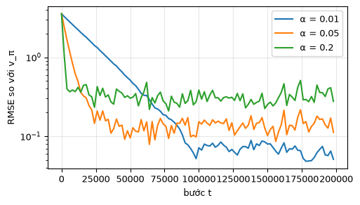
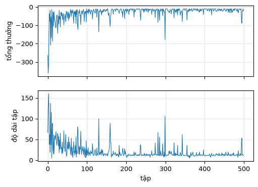
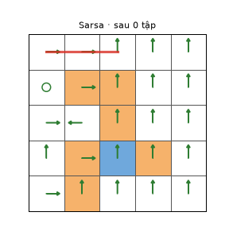
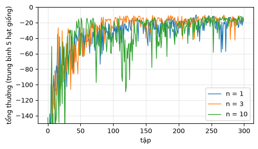
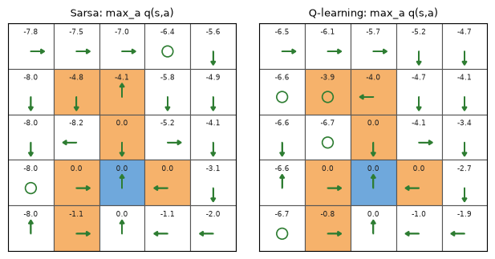

# Chương 7 · Code

> Ghi chú của người biên soạn: trang này không có trong sách. Nó cài đặt các thuật toán TD của [chương 7](mathrl/ch07_vi) bằng numpy trên lưới 5×5: TD cho giá trị trạng thái, Sarsa, Sarsa $n$ bước và Q-learning. Thí nghiệm Q-learning **ngoài chính sách** (hình 7.4, 7.5) đã có ở mục "Kiểm tra bằng mã" trong chương, nên không lặp lại ở đây. Ký hiệu theo [Quy ước ký hiệu](notation_vi).

Mỗi khối code đã được chạy sẵn. Kết quả, hình và ảnh động nằm ngay bên dưới. Các khối chạy lần lượt từ trên xuống và dùng chung biến, như notebook. Muốn tự chạy, xem [mục 6](#_6-chạy-trên-máy).

## 1. TD cho giá trị trạng thái

<small class="viz-ref">Mục 7.1 · công thức (7.1)</small>

Đánh giá chính sách đều $\pi(a \mid s) = 0.2$ trên lưới của hình 3.4a ($\gamma = 0.9$), chỉ từ **một tập rất dài** sinh bởi chính sách đó. Mỗi bước cập nhật đúng một ô:

$$
v_{t+1}(s_t) = v_t(s_t) - \alpha_t(s_t)\Big[v_t(s_t) - \big(r_{t+1} + \gamma\, v_t(s_{t+1})\big)\Big]
$$

<!-- run -->
```python
import numpy as np
import matplotlib.pyplot as plt
from zhao_grid import make_grid, value_iteration, plot_grid, print_policy
from viz import save_gif

P, R = make_grid()                         # r_boundary = r_forbidden = -1, r_target = 1
gamma, n_s, n_a = 0.9, 25, 5
next_state = P.argmax(axis=2)              # lưới tất định: s' = next_state[s, a]

# Giá trị thật v_π của chính sách đều (giải phương trình Bellman, chỉ để đối chiếu)
pi_u = np.full((n_s, n_a), 1 / n_a)
P_pi, r_pi = np.einsum("sa,sat->st", pi_u, P), (pi_u * R).sum(axis=1)
v_true = np.linalg.solve(np.eye(n_s) - gamma * P_pi, r_pi)

def td0(alpha, T=200_000, seed=0):
    rng = np.random.default_rng(seed)
    v, s, err = np.zeros(n_s), 0, []
    actions = rng.integers(n_a, size=T)                     # chính sách đều
    for t in range(T):
        a = actions[t]
        r, s2 = R[s, a], next_state[s, a]
        v[s] -= alpha * (v[s] - (r + gamma * v[s2]))         # (7.1)
        s = s2
        if t % 2000 == 0:
            err.append(np.sqrt(np.mean((v - v_true) ** 2)))
    return v, err

plt.figure(figsize=(5.5, 3))
for alpha in [0.01, 0.05, 0.2]:
    v_td, err = td0(alpha)
    plt.semilogy(np.arange(len(err)) * 2000, err, label=f"α = {alpha}")
    print(f"α = {alpha:4}: RMSE cuối = {err[-1]:.3f}")
plt.xlabel("bước t"); plt.ylabel("RMSE so với v_π"); plt.legend(); plt.grid(alpha=.3)
```

<!-- output -->
```output
α = 0.01: RMSE cuối = 0.051
α = 0.05: RMSE cuối = 0.112
α =  0.2: RMSE cuối = 0.277
```

<div align=center></div>
<!-- /output -->

$\alpha$ lớn thì học nhanh lúc đầu nhưng dừng ở mức nhiễu cao, $\alpha$ nhỏ thì ngược lại. Đây là lý do định lý 7.1 đòi hỏi $\sum_t \alpha_t = \infty$ và $\sum_t \alpha_t^2 < \infty$: muốn hội tụ chính xác thì $\alpha_t$ phải giảm dần về 0, nhưng không được giảm quá nhanh.

## 2. Sarsa: tìm đường từ ô trên–trái

<small class="viz-ref">Mục 7.2.2 · thuật toán 7.1 · hình 7.2</small>

Thiết lập đúng như hình 7.2: mọi tập bắt đầu ở ô trên–trái và kết thúc khi tới đích. Phần thưởng $r_{\text{target}} = 0$, $r_{\text{forbidden}} = r_{\text{boundary}} = -10$, $r_{\text{other}} = -1$; $\alpha = 0.1$, $\varepsilon = 0.1$, $\gamma = 0.9$. Mỗi bước $-1$ nghĩa là "tới đích càng nhanh càng tốt".

<!-- run -->
```python
P2, R2 = make_grid(r_boundary=-10, r_forbidden=-10, r_target=0, r_other=-1)
ns2 = P2.argmax(axis=2)
start, goal = 0, 3 * 5 + 2                  # ô (0,0) và ô đích (3,2)

def eps_greedy_action(q_s, eps, rng):
    if rng.random() < eps:
        return int(rng.integers(n_a))
    best = np.flatnonzero(q_s == q_s.max())
    return int(rng.choice(best))

def greedy_path(q, max_len=30):
    """Đi theo hành động tham lam từ ô xuất phát; dừng khi tới đích hoặc quay lại ô cũ (vòng lặp)."""
    s, path = start, [start]
    while s != goal and len(path) <= max_len:
        s = int(ns2[s, int(q[s].argmax())])
        if s in path:
            return path + [s]          # vòng lặp: chính sách tham lam không tới đích
        path.append(s)
    return path

def sarsa(n_episodes=500, alpha=0.1, eps=0.1, seed=0, snap_every=None):
    rng = np.random.default_rng(seed)
    q = np.zeros((n_s, n_a))
    lengths, totals, snaps = [], [], []
    for ep in range(n_episodes):
        s = start
        a = eps_greedy_action(q[s], eps, rng)
        total, steps = 0.0, 0
        while s != goal:
            r, s2 = R2[s, a], ns2[s, a]
            a2 = eps_greedy_action(q[s2], eps, rng)
            target = r + gamma * q[s2, a2] * (s2 != goal)        # q của ô đích coi như 0
            q[s, a] -= alpha * (q[s, a] - target)                # thuật toán 7.1
            s, a = s2, a2
            total += r
            steps += 1
        lengths.append(steps); totals.append(total)
        if snap_every and ep % snap_every == 0:
            snaps.append((ep, q.copy()))
    return q, lengths, totals, snaps

q_sarsa, lengths, totals, snaps = sarsa(snap_every=10)
fig, axes = plt.subplots(2, 1, figsize=(5.5, 4), sharex=True)
axes[0].plot(totals, lw=0.8); axes[0].set_ylabel("tổng thưởng")
axes[1].plot(lengths, lw=0.8); axes[1].set_ylabel("độ dài tập"); axes[1].set_xlabel("tập")
for ax in axes: ax.grid(alpha=.3)
print("Đường tham lam cuối cùng:", greedy_path(q_sarsa))
print("q(s3, ·) với 5 hành động lên, phải, xuống, trái, đứng yên:", q_sarsa[3].round(2))
print("Độ dài trung bình 50 tập cuối:", np.mean(lengths[-50:]))
```

<!-- output -->
```output
Đường tham lam cuối cùng: [0, 1, 2, 3, 3]
q(s3, ·) với 5 hành động lên, phải, xuống, trái, đứng yên: [-12.81  -6.59  -6.46  -6.48  -6.37]
Độ dài trung bình 50 tập cuối: 14.42
```

<div align=center></div>
<!-- /output -->

Hai đồ thị giống hình 7.2: các tập đầu rất dài và tổng thưởng rất âm, vì tác tử đi lang thang và đâm vào biên, ô cấm. Sau vài chục tập, độ dài giảm xuống quanh mức của đường ngắn nhất. Nó không giảm hẳn về mức đó, vì vẫn còn 10% hành động ngẫu nhiên. Nhưng đường tham lam cuối cùng lại kẹt ở ô $s_3$ (hàng 0, cột 3). Lý do là ở ô đó, $q(s_3, \text{đứng yên}) \approx -6.37$ nhỉnh hơn $q(s_3, \text{xuống}) \approx -6.46$ một chút. Ở trạng thái hội tụ, đứng yên phải tệ hơn, vì nó tốn thêm một bước $-1$ mà vẫn ở chỗ cũ. Nhưng với $\alpha = 0.1$ cố định và $\varepsilon = 0.1$, các ước lượng vẫn còn nhiễu, và hai giá trị gần nhau đủ để đổi chỗ. Trong lúc học, chính sách ε-tham lam vẫn thoát ra được nhờ hành động ngẫu nhiên, nên độ dài tập vẫn ngắn. Sách cũng nhấn mạnh điều này ở mục 7.2.2: Sarsa trong ví dụ này chỉ nhắm tới **một** trạng thái xuất phát, và không bảo đảm chính sách tốt ở mọi nơi.

Ảnh động dưới vẽ đường tham lam (theo $q$ hiện tại) sau mỗi 10 tập:

<!-- run -->
```python
def draw(fig, i):
    ep, q = snaps[i]
    ax = fig.add_subplot(1, 1, 1)
    plot_grid(None, q.argmax(axis=1), ax=ax, title=f"Sarsa · sau {ep} tập")
    path = greedy_path(q)
    rc = [divmod(s, 5) for s in path]
    ax.plot([c + 0.5 for r, c in rc], [4 - r + 0.5 for r, c in rc], color="#d93025", lw=2.5, alpha=0.8)

save_gif(draw, len(snaps), "sarsa_path.gif", fps=4, figsize=(3.2, 3.4), dpi=90)
```

<!-- output -->
<div align=center></div>
<!-- /output -->

## 3. Sarsa $n$ bước

<small class="viz-ref">Mục 7.3 · công thức (7.10)</small>

Mục tiêu $n$ bước dùng $n$ phần thưởng thật rồi mới bootstrap: $r_{t+1} + \gamma r_{t+2} + \dots + \gamma^{n-1} r_{t+n} + \gamma^n q_t(s_{t+n}, a_{t+n})$. $n = 1$ là Sarsa, $n \to \infty$ là Monte Carlo. Cài đặt dưới giữ một cửa sổ trượt $n$ bước gần nhất. Khi tập kết thúc, các bước còn lại trong cửa sổ được cập nhật bằng lợi tức thật.

<!-- run -->
```python
def n_step_sarsa(n, n_episodes=300, alpha=0.1, eps=0.1, seed=0):
    rng = np.random.default_rng(seed)
    q = np.zeros((n_s, n_a))
    totals = []
    for ep in range(n_episodes):
        s = start
        a = eps_greedy_action(q[s], eps, rng)
        traj = []                                    # (s, a, r) của tập hiện tại
        while True:
            r, s2 = R2[s, a], ns2[s, a]
            traj.append((s, a, r))
            done = s2 == goal
            a2 = None if done else eps_greedy_action(q[s2], eps, rng)
            tau = len(traj) - n                      # bước được cập nhật lúc này
            if tau >= 0:
                g = sum(gamma ** i * traj[tau + i][2] for i in range(n))
                if not done:
                    g += gamma ** n * q[s2, a2]
                q[traj[tau][0], traj[tau][1]] -= alpha * (q[traj[tau][0], traj[tau][1]] - g)
            if done:
                for k in range(max(0, len(traj) - n + 1), len(traj)):   # các bước còn lại: lợi tức thật
                    g = sum(gamma ** i * traj[k + i][2] for i in range(len(traj) - k))
                    q[traj[k][0], traj[k][1]] -= alpha * (q[traj[k][0], traj[k][1]] - g)
                break
            s, a = s2, a2
        totals.append(sum(x[2] for x in traj))
    return q, totals

plt.figure(figsize=(5.5, 3))
for n in [1, 3, 10]:
    curves = [n_step_sarsa(n, seed=sd)[1] for sd in range(5)]
    mean_curve = np.mean(curves, axis=0)
    plt.plot(mean_curve, lw=1, label=f"n = {n}")
    print(f"n = {n:2d}: tổng thưởng trung bình 20 tập đầu = {mean_curve[:20].mean():7.1f}, "
          f"50 tập cuối = {mean_curve[-50:].mean():6.1f}")
plt.ylim(-150, 0); plt.xlabel("tập"); plt.ylabel("tổng thưởng (trung bình 5 hạt giống)")
plt.legend(); plt.grid(alpha=.3)
```

<!-- output -->
```output
n =  1: tổng thưởng trung bình 20 tập đầu =  -119.1, 50 tập cuối =  -21.7
n =  3: tổng thưởng trung bình 20 tập đầu =  -132.3, 50 tập cuối =  -16.9
n = 10: tổng thưởng trung bình 20 tập đầu =  -165.0, 50 tập cuối =  -17.7
```

<div align=center></div>
<!-- /output -->

Đúng với sự đánh đổi ở bảng so sánh của mục 7.3. Ở 20 tập đầu, $n$ càng lớn thì tổng thưởng càng tệ ($-119$, $-132$, $-165$): mục tiêu $n$ bước gom nhiều phần thưởng ngẫu nhiên hơn, nên phương sai lớn hơn. Ở 50 tập cuối, $n = 3$ và $n = 10$ lại tốt hơn $n = 1$ ($-17$ so với $-22$): thông tin về phần thưởng lan ngược nhanh hơn, mỗi lần cập nhật đi được $n$ bước thay vì một bước, và ít bị chệch hơn vì ít dựa vào $q$ ước lượng. Ở đây $n = 3$ và $n = 10$ cho kết quả cuối gần như nhau.

## 4. Q-learning theo chính sách

<small class="viz-ref">Mục 7.4 · thuật toán 7.2</small>

Cùng thiết lập, chỉ đổi mục tiêu: $r + \gamma \max_a q(s', a)$ thay cho $r + \gamma q(s', a')$. Hành vi vẫn là ε-tham lam theo $q$ hiện tại, nên đây là cách dùng Q-learning **theo chính sách** (bản ngoài chính sách có ở mục kiểm tra bằng mã của chương 7).

<!-- run -->
```python
def q_learning(n_episodes=500, alpha=0.1, eps=0.1, seed=0):
    rng = np.random.default_rng(seed)
    q = np.zeros((n_s, n_a))
    lengths = []
    for ep in range(n_episodes):
        s, steps = start, 0
        while s != goal:
            a = eps_greedy_action(q[s], eps, rng)
            r, s2 = R2[s, a], ns2[s, a]
            target = r + gamma * q[s2].max() * (s2 != goal)      # khác Sarsa đúng ở dòng này
            q[s, a] -= alpha * (q[s, a] - target)
            s, steps = s2, steps + 1
        lengths.append(steps)
    return q, lengths

q_ql, lengths_ql = q_learning()
print("Q-learning, đường tham lam:", greedy_path(q_ql))
print("Sarsa,      đường tham lam:", greedy_path(q_sarsa))
print(f"Độ dài trung bình 50 tập cuối: Q-learning {np.mean(lengths_ql[-50:]):.1f}, Sarsa {np.mean(lengths[-50:]):.1f}")

fig, axes = plt.subplots(1, 2, figsize=(6.4, 3.2))
for ax, (name, q) in zip(axes, [("Sarsa", q_sarsa), ("Q-learning", q_ql)]):
    plot_grid(q.max(axis=1), q.argmax(axis=1), ax=ax, title=f"{name}: max_a q(s,a)")
plt.tight_layout()
```

<!-- output -->
```output
Q-learning, đường tham lam: [0, 1, 2, 3, 8, 13, 14, 19, 24, 23, 22, 17]
Sarsa,      đường tham lam: [0, 1, 2, 3, 3]
Độ dài trung bình 50 tập cuối: Q-learning 12.6, Sarsa 14.4
```

<div align=center></div>
<!-- /output -->

Ô trên–trái cách ô đích 5 bước nếu đi xuyên ô cấm, nhưng mỗi lần vào ô cấm bị $-10$. Đường tham lam của Q-learning đi dọc hàng trên tới cột 3, xuống hai ô, tạt sang cột phải để tránh ô cấm (3,3), xuống tới hàng dưới cùng, rồi đi vào đích từ phía dưới. Đường đó dài 11 bước và không chạm ô cấm nào. Mục tiêu của Q-learning dùng $\max_a q(s', a)$ nên học thẳng giá trị của chính sách tham lam. Sarsa thì học giá trị của chính sách ε-tham lam mà nó đang thực thi, và ở đây nó còn để lại chỗ kẹt ở $s_3$ như đã thấy ở mục 2. Trong lúc học, độ dài tập trung bình của Q-learning cũng ngắn hơn.

## 5. Đối chiếu với code của EasyRL

[Trang Code chương 3 của EasyRL](chapter3/chapter3_code_vi?id=_3-sarsa-và-q-learning-trên-bài-toán-vách-đá) chạy đúng hai thuật toán này trên bài toán vách đá. Ở đó phép cập nhật được viết dạng $q \leftarrow q + \alpha(\text{mục tiêu} - q)$, còn sách của Zhao viết $q \leftarrow q - \alpha(q - \text{mục tiêu})$. Hai cách viết là một. Cách viết của Zhao nhấn mạnh rằng đây là thuật toán Robbins-Monro giải phương trình $q - \text{mục tiêu} = 0$ (chương 6).

## 6. Chạy trên máy

```bash
git clone https://github.com/nmc2004nd/easy-rl-vi.git
cd easy-rl-vi/docs/code/py          # chạy từ đây để import được zhao_grid, viz
pip install numpy matplotlib pillow
```

Chép lần lượt các khối code vào Jupyter rồi chạy theo thứ tự. Kết quả trên trang được dựng bằng `python3 scripts/build_code_pages.py docs/mathrl/ch07_code_vi.md`.
