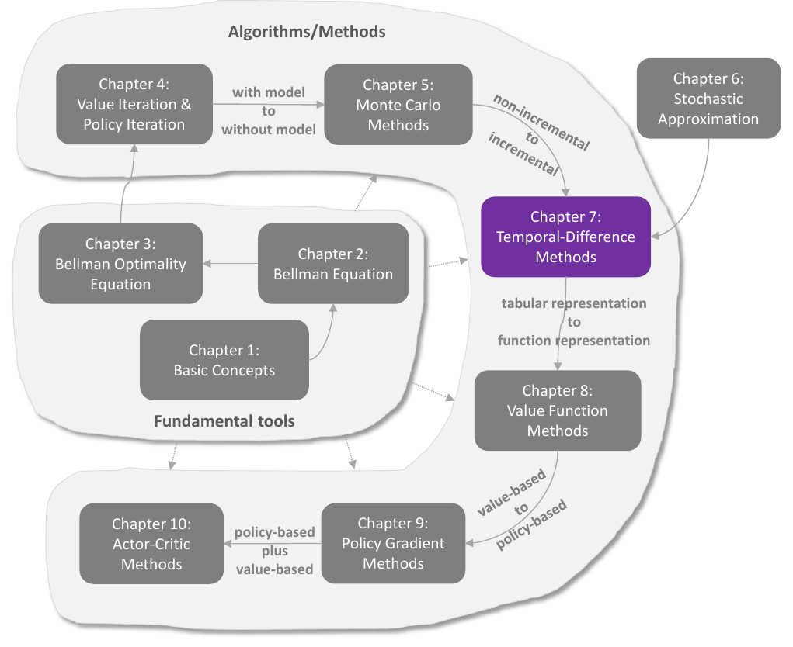
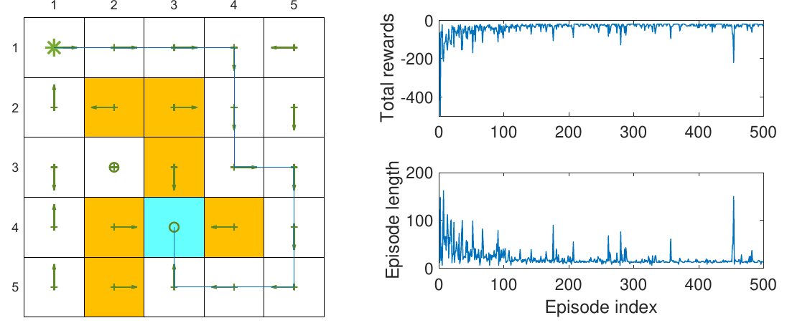
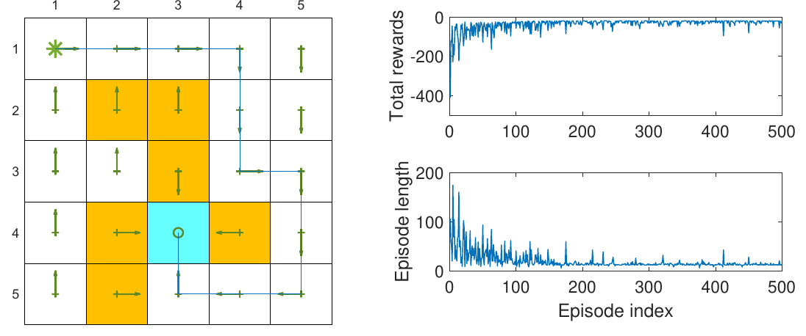
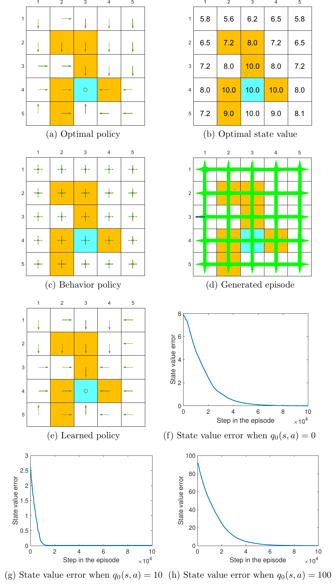
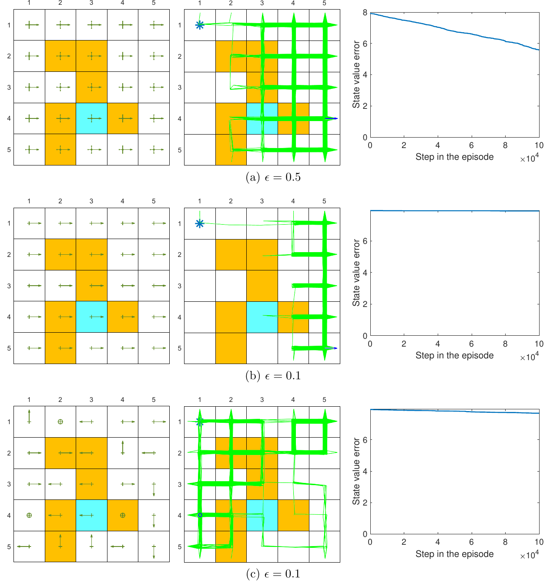

# Chương 7 Phương pháp sai phân thời gian

> Ghi chú của người biên soạn: đây là bản tổng hợp tiếng Việt chương 7 sách *Mathematical Foundations of Reinforcement Learning* (Shiyu Zhao, 2025), có bổ sung từ các bài [Temporal-Difference Methods](https://lyk-love.cn/2024/06/22/Temporal-Difference-Methods/) và [Q-Learning](https://lyk-love.cn/2024/06/22/Q-Learning/) trên blog lyk-love. Xem [giới thiệu phần này](mathrl/README_vi) để biết nguồn, và [Quy ước ký hiệu](notation_vi) cho chuẩn ký hiệu dùng chung. Ý không có trong sách được ghi rõ.

<div align=center>

</div>
<div align=center>Hình 7.1 Vị trí của chương này trong sách. Nguồn: Zhao (2025)</div>

Chương này giới thiệu các phương pháp **sai phân thời gian (temporal-difference, TD)**. Giống Monte Carlo (MC), học TD cũng **không mô hình**, nhưng có một số ưu điểm nhờ dạng **tăng dần** của nó. Với chuẩn bị ở chương 6, các thuật toán TD sẽ không còn đáng sợ: **thuật toán TD chính là thuật toán ngẫu nhiên đặc biệt để giải phương trình Bellman hoặc phương trình tối ưu Bellman.**

**Bản đồ các thuật toán trong chương:**

| Mục | Thuật toán | Ước lượng gì | Giải phương trình nào |
|---|---|---|---|
| 7.1 | **TD** (theo nghĩa hẹp) | giá trị trạng thái của một chính sách cho trước | Bellman |
| 7.2 | **Sarsa** | giá trị hành động của một chính sách cho trước; kết hợp cải thiện chính sách để tìm chính sách tối ưu | Bellman (theo $q$) |
| 7.3 | **Sarsa n bước** | như Sarsa; nhận Sarsa và MC làm hai trường hợp đặc biệt | Bellman (theo $q$) |
| 7.4 | **Q-learning** | giá trị hành động **tối ưu** | **tối ưu** Bellman |
| 7.5 | góc nhìn thống nhất | so sánh mọi thuật toán TD và MC | |

Nên hiểu kỹ thuật toán cơ bản ở mục 7.1 trước khi học các thuật toán khác.

## 7.1 Học TD giá trị trạng thái

"Học TD" thường chỉ cả một họ thuật toán học tăng cường; mọi thuật toán trong chương này đều thuộc họ đó. Nhưng ở mục này, học TD chỉ riêng một **thuật toán kinh điển để ước lượng giá trị trạng thái**.

### 7.1.1 Mô tả thuật toán

Cho chính sách $\pi$, mục tiêu là ước lượng $v_\pi(s)$ với mọi $s \in \mathcal S$. Giả sử có các mẫu kinh nghiệm $(s_0, r_1, s_1, \dots, s_t, r_{t+1}, s_{t+1}, \dots)$ sinh ra theo $\pi$, với $t$ là bước thời gian. Thuật toán TD ước lượng giá trị trạng thái từ các mẫu đó:

$$
v_{t+1}(s_t) = v_t(s_t) - \alpha_t(s_t)\Big[v_t(s_t) - \big(r_{t+1} + \gamma v_t(s_{t+1})\big)\Big], \tag{7.1}
$$

$$
v_{t+1}(s) = v_t(s), \qquad \text{với mọi } s \ne s_t, \tag{7.2}
$$

với $t = 0, 1, 2, \dots$ Ở đây $v_t(s_t)$ là ước lượng của $v_\pi(s_t)$ tại thời điểm $t$, và $\alpha_t(s_t)$ là **tốc độ học** của $s_t$ tại thời điểm $t$.

Tại thời điểm $t$, **chỉ giá trị của trạng thái được thăm $s_t$ được cập nhật**; các trạng thái khác giữ nguyên, như (7.2). Phương trình (7.2) thường bị lược bỏ cho gọn, nhưng cần nhớ, vì thiếu nó thì thuật toán không đầy đủ về mặt toán học.

**Vì sao thuật toán được thiết kế như vậy?** Nó là một thuật toán xấp xỉ ngẫu nhiên đặc biệt để **giải phương trình Bellman**. Nhớ lại định nghĩa giá trị trạng thái:

$$
v_\pi(s) = \mathbb E\big[R_{t+1} + \gamma G_{t+1} \mid S_t = s\big], \qquad s \in \mathcal S. \tag{7.3}
$$

Viết lại (7.3):

$$
v_\pi(s) = \mathbb E\big[R_{t+1} + \gamma v_\pi(S_{t+1}) \mid S_t = s\big], \qquad s \in \mathcal S, \tag{7.4}
$$

vì $\mathbb E[G_{t+1} \mid S_t = s] = \sum_a \pi(a \mid s)\sum_{s'} p(s' \mid s,a)\, v_\pi(s') = \mathbb E[v_\pi(S_{t+1}) \mid S_t = s]$. Phương trình (7.4) là một cách viết khác của phương trình Bellman, đôi khi gọi là **phương trình kỳ vọng Bellman (Bellman expectation equation)**.

Thuật toán TD có được bằng cách **áp dụng thuật toán Robbins-Monro** (chương 6) để giải (7.4).

> **Hộp 7.1: Suy ra thuật toán TD**
>
> Với trạng thái $s_t$, định nghĩa
> $$g(v_\pi(s_t)) \doteq v_\pi(s_t) - \mathbb E\big[R_{t+1} + \gamma v_\pi(S_{t+1}) \mid S_t = s_t\big].$$
> Khi đó (7.4) tương đương $g(v_\pi(s_t)) = 0$. Mục tiêu: giải phương trình này để có $v_\pi(s_t)$ bằng RM.
>
> Có được $r_{t+1}$ và $s_{t+1}$, là mẫu của $R_{t+1}$ và $S_{t+1}$, nên quan sát có nhiễu của $g(v_\pi(s_t))$ là
> $$\begin{aligned}
> \tilde g(v_\pi(s_t)) &= v_\pi(s_t) - \big(r_{t+1} + \gamma v_\pi(s_{t+1})\big)\\
> &= \underbrace{v_\pi(s_t) - \mathbb E\big[R_{t+1} + \gamma v_\pi(S_{t+1}) \mid S_t = s_t\big]}_{g(v_\pi(s_t))} + \underbrace{\mathbb E\big[R_{t+1} + \gamma v_\pi(S_{t+1}) \mid S_t = s_t\big] - \big(r_{t+1} + \gamma v_\pi(s_{t+1})\big)}_{\eta}.
> \end{aligned}$$
> Vậy thuật toán RM (mục 6.2) giải $g(v_\pi(s_t)) = 0$ là
> $$v_{t+1}(s_t) = v_t(s_t) - \alpha_t(s_t)\,\tilde g(v_t(s_t)) = v_t(s_t) - \alpha_t(s_t)\Big[v_t(s_t) - \big(r_{t+1} + \gamma v_\pi(s_{t+1})\big)\Big], \tag{7.5}$$
> với $v_t(s_t)$ là ước lượng của $v_\pi(s_t)$ tại thời điểm $t$, và $\alpha_t(s_t)$ là tốc độ học.
>
> (7.5) giống (7.1), chỉ khác: vế phải (7.5) có $v_\pi(s_{t+1})$, còn (7.1) có $v_t(s_{t+1})$. Lý do: (7.5) chỉ ước lượng giá trị của $s_t$, **giả sử giá trị các trạng thái khác đã biết**. Muốn ước lượng giá trị mọi trạng thái thì phải thay $v_\pi(s_{t+1})$ bằng ước lượng $v_t(s_{t+1})$, và khi đó (7.5) trùng (7.1). Thay như vậy có còn bảo đảm hội tụ? Có; định lý 7.1 sẽ chứng minh.

### 7.1.2 Phân tích tính chất

**Thứ nhất**, xem kỹ biểu thức (7.1):

$$
\underbrace{v_{t+1}(s_t)}_{\text{ước lượng mới}} = \underbrace{v_t(s_t)}_{\text{ước lượng hiện tại}} - \alpha_t(s_t)\overbrace{\Big[v_t(s_t) - \underbrace{\big(r_{t+1} + \gamma v_t(s_{t+1})\big)}_{\text{mục tiêu TD } \bar v_t}\Big]}^{\text{sai số TD } \delta_t}, \tag{7.6}
$$

trong đó

$$
\bar v_t \doteq r_{t+1} + \gamma v_t(s_{t+1})
$$

gọi là **mục tiêu TD (TD target)**, và

$$
\delta_t \doteq v(s_t) - \bar v_t = v_t(s_t) - \big(r_{t+1} + \gamma v_t(s_{t+1})\big)
$$

gọi là **sai số TD (TD error)**. Ước lượng mới $v_{t+1}(s_t)$ là kết hợp của ước lượng hiện tại $v_t(s_t)$ và sai số TD $\delta_t$.

*(ghi chú của người biên soạn)* Sách định nghĩa $\delta_t = v_t(s_t) - \bar v_t$. Nhiều tài liệu khác (Sutton và Barto, EasyRL) định nghĩa ngược dấu, $\delta_t = \bar v_t - v_t(s_t)$, và viết cập nhật là $v \leftarrow v + \alpha\delta_t$. Hai cách tương đương; chỉ cần để ý dấu khi đọc chéo.

**Vì sao $\bar v_t$ gọi là mục tiêu TD?** Vì $\bar v_t$ là giá trị mà thuật toán cố **kéo $v(s_t)$ về phía đó**. Trừ $\bar v_t$ hai vế của (7.6):

$$
\begin{aligned}
v_{t+1}(s_t) - \bar v_t &= v_t(s_t) - \bar v_t - \alpha_t(s_t)\big[v_t(s_t) - \bar v_t\big]\\
&= \big[1 - \alpha_t(s_t)\big]\big[v_t(s_t) - \bar v_t\big].
\end{aligned}
$$

Lấy giá trị tuyệt đối:

$$
\lvert v_{t+1}(s_t) - \bar v_t\rvert = \lvert 1 - \alpha_t(s_t)\rvert\,\lvert v_t(s_t) - \bar v_t\rvert.
$$

Vì $\alpha_t(s_t)$ là số dương nhỏ, $0 < 1 - \alpha_t(s_t) < 1$, nên

$$
\lvert v_{t+1}(s_t) - \bar v_t\rvert < \lvert v_t(s_t) - \bar v_t\rvert.
$$

Giá trị mới **gần $\bar v_t$ hơn** giá trị cũ: thuật toán kéo $v_t(s_t)$ về phía $\bar v_t$. Đó là lý do $\bar v_t$ gọi là mục tiêu TD.

**Ý nghĩa của sai số TD là gì?**

- Gọi là "sai phân thời gian" vì $\delta_t = v_t(s_t) - (r_{t+1} + \gamma v_t(s_{t+1}))$ phản ánh độ chênh giữa **hai bước thời gian** $t$ và $t+1$.
- Quan trọng hơn: khi ước lượng đã chính xác, sai số TD **bằng 0 theo kỳ vọng**. Thật vậy, khi $v_t = v_\pi$:
$$\begin{aligned}
\mathbb E[\delta_t \mid S_t = s_t] &= \mathbb E\big[v_\pi(S_t) - (R_{t+1} + \gamma v_\pi(S_{t+1})) \mid S_t = s_t\big]\\
&= v_\pi(s_t) - \mathbb E\big[R_{t+1} + \gamma v_\pi(S_{t+1}) \mid S_t = s_t\big] = 0 \qquad \text{(theo (7.3))}.
\end{aligned}$$
Vậy sai số TD không chỉ phản ánh độ chênh giữa hai bước thời gian, mà còn phản ánh **độ chênh giữa ước lượng $v_t$ và giá trị thật $v_\pi$**.
- Ở mức trừu tượng hơn, sai số TD là **thông tin mới (innovation)** thu được từ mẫu kinh nghiệm $(s_t, r_{t+1}, s_{t+1})$. Ý tưởng nền tảng của học TD là **sửa ước lượng hiện tại dựa trên thông tin mới**. Khái niệm "innovation" là nền tảng của nhiều bài toán ước lượng như lọc Kalman.

**Thứ hai**, thuật toán TD (7.1) **chỉ ước lượng được giá trị trạng thái** của một chính sách cho trước. Muốn tìm chính sách tối ưu, vẫn phải tính tiếp giá trị hành động rồi cải thiện chính sách (mục 7.2). Dù vậy, thuật toán ở mục này rất cơ bản và quan trọng để hiểu các thuật toán khác.

**Thứ ba**, TD và MC đều không mô hình; ưu nhược điểm của chúng là gì?

| Học TD | Học MC |
|---|---|
| **Tăng dần:** cập nhật giá trị trạng thái hoặc hành động **ngay** khi nhận một mẫu kinh nghiệm. | **Không tăng dần:** phải chờ thu xong cả tập, vì phải tính lợi tức chiết khấu của tập. |
| **Bài toán liên tục:** nhờ tăng dần nên xử lý được cả bài toán có tập lẫn bài toán liên tục, vốn có thể không có trạng thái kết thúc. | **Bài toán có tập:** vì không tăng dần nên chỉ xử lý được bài toán có tập, nơi các tập kết thúc sau hữu hạn bước. |
| **Tự cập nhật (bootstrapping):** cập nhật một giá trị dựa vào ước lượng trước đó của giá trị; vì vậy cần giá trị đoán ban đầu. | **Không tự cập nhật:** ước lượng trực tiếp giá trị, không cần giá trị đoán ban đầu. |
| **Phương sai ước lượng thấp:** ít biến ngẫu nhiên hơn. Ví dụ, ước lượng $q_\pi(s_t, a_t)$, Sarsa chỉ cần mẫu của ba biến ngẫu nhiên $R_{t+1}, S_{t+1}, A_{t+1}$. | **Phương sai ước lượng cao:** nhiều biến ngẫu nhiên. Ví dụ, ước lượng $q_\pi(s_t, a_t)$ cần mẫu của $R_{t+1} + \gamma R_{t+2} + \gamma^2 R_{t+3} + \cdots$. Nếu mỗi tập dài $L$ và mỗi trạng thái có $\lvert\mathcal A\rvert$ hành động thì có $\lvert\mathcal A\rvert^L$ tập khả dĩ theo một chính sách mềm; chỉ dùng vài tập để ước lượng thì phương sai cao là phải. |

<div align=center>Bảng 7.1 So sánh học TD và học MC</div>

*(ghi chú của người biên soạn)* Bảng thiếu một mặt: TD có **độ chệch (bias)** vì mục tiêu dùng ước lượng $v_t(s_{t+1})$ có thể còn sai, còn MC **không chệch** vì dùng lợi tức thật. Đây là đánh đổi chệch–phương sai kinh điển; mục 7.3 sẽ thấy Sarsa n bước điều chỉnh đúng đánh đổi này.

### 7.1.3 Phân tích hội tụ

> **Định lý 7.1 (Sự hội tụ của học TD).** Cho chính sách $\pi$, với thuật toán TD (7.1), $v_t(s)$ hội tụ hầu chắc chắn tới $v_\pi(s)$ khi $t \to \infty$ với mọi $s \in \mathcal S$, nếu $\sum_t \alpha_t(s) = \infty$ và $\sum_t \alpha_t^2(s) < \infty$ với mọi $s \in \mathcal S$.

**Lưu ý về $\alpha_t$:**

- **Với mọi** $s$, điều kiện $\sum_t \alpha_t(s) = \infty$ và $\sum_t \alpha_t^2(s) < \infty$ đều phải đúng. Tại thời điểm $t$, $\alpha_t(s) > 0$ nếu $s$ đang được thăm, ngược lại $\alpha_t(s) = 0$. Vậy $\sum_t \alpha_t(s) = \infty$ đòi hỏi trạng thái $s$ được **thăm vô hạn (hoặc đủ nhiều) lần**. Điều này cần khởi đầu khám phá hoặc một chính sách có tính khám phá, để mọi cặp trạng thái–hành động có thể được thăm nhiều lần.
- Trong thực tế, tốc độ học thường là **một hằng số dương nhỏ**. Khi đó $\sum_t \alpha_t^2(s) < \infty$ không còn đúng. Với $\alpha$ hằng số, vẫn chứng minh được thuật toán hội tụ **theo nghĩa kỳ vọng** (H.-F. Chen, mục 1.5).

> **Hộp 7.2: Chứng minh định lý 7.1**
>
> Dựa trên định lý 6.3 (chương 6). Trước hết dựng một quá trình ngẫu nhiên có dạng như trong định lý 6.3. Xét một trạng thái bất kỳ $s \in \mathcal S$. Tại thời điểm $t$, theo (7.1):
> $$v_{t+1}(s) = v_t(s) - \alpha_t(s)\Big[v_t(s) - \big(r_{t+1} + \gamma v_t(s_{t+1})\big)\Big], \qquad \text{nếu } s = s_t, \tag{7.7}$$
> hoặc
> $$v_{t+1}(s) = v_t(s), \qquad \text{nếu } s \ne s_t. \tag{7.8}$$
> Định nghĩa sai số ước lượng $\Delta_t(s) \doteq v_t(s) - v_\pi(s)$. Trừ $v_\pi(s)$ hai vế của (7.7):
> $$\Delta_{t+1}(s) = (1 - \alpha_t(s))\Delta_t(s) + \alpha_t(s)\underbrace{\big(r_{t+1} + \gamma v_t(s_{t+1}) - v_\pi(s)\big)}_{\eta_t(s)}, \qquad s = s_t. \tag{7.9}$$
> Trừ $v_\pi(s)$ hai vế của (7.8):
> $$\Delta_{t+1}(s) = \Delta_t(s) = (1 - \alpha_t(s))\Delta_t(s) + \alpha_t(s)\eta_t(s), \qquad s \ne s_t,$$
> giống (7.9) nhưng với $\alpha_t(s) = 0$ và $\eta_t(s) = 0$. Vậy dù $s = s_t$ hay không, ta có dạng thống nhất
> $$\Delta_{t+1}(s) = (1 - \alpha_t(s))\Delta_t(s) + \alpha_t(s)\eta_t(s),$$
> chính là quá trình trong định lý 6.3. Cần chứng minh ba điều kiện của định lý 6.3 đúng.
>
> **Điều kiện thứ nhất** đúng theo giả thiết của định lý 7.1.
>
> **Điều kiện thứ hai:** $\lVert\mathbb E[\eta_t(s) \mid \mathcal H_t]\rVert_\infty \le \gamma\lVert\Delta_t(s)\rVert_\infty$ với mọi $s$. Do tính Markov, $\eta_t(s) = r_{t+1} + \gamma v_t(s_{t+1}) - v_\pi(s)$ (hoặc $\eta_t(s) = 0$) không phụ thuộc lịch sử khi đã biết $s$, nên $\mathbb E[\eta_t(s) \mid \mathcal H_t] = \mathbb E[\eta_t(s)]$.
>
> - Với $s \ne s_t$: $\eta_t(s) = 0$, nên hiển nhiên
> $$\lvert\mathbb E[\eta_t(s)]\rvert = 0 \le \gamma\lVert\Delta_t(s)\rVert_\infty. \tag{7.10}$$
> - Với $s = s_t$:
> $$\mathbb E[\eta_t(s)] = \mathbb E[\eta_t(s_t)] = \mathbb E[r_{t+1} + \gamma v_t(s_{t+1}) - v_\pi(s_t) \mid s_t] = \mathbb E[r_{t+1} + \gamma v_t(s_{t+1}) \mid s_t] - v_\pi(s_t).$$
> Vì $v_\pi(s_t) = \mathbb E[r_{t+1} + \gamma v_\pi(s_{t+1}) \mid s_t]$, suy ra
> $$\mathbb E[\eta_t(s)] = \gamma\,\mathbb E[v_t(s_{t+1}) - v_\pi(s_{t+1}) \mid s_t] = \gamma\sum_{s'\in\mathcal S} p(s' \mid s_t)\big[v_t(s') - v_\pi(s')\big].$$
> Do đó
> $$\begin{aligned}
> \lvert\mathbb E[\eta_t(s)]\rvert &= \gamma\left\lvert\sum_{s'\in\mathcal S} p(s' \mid s_t)\big[v_t(s') - v_\pi(s')\big]\right\rvert \le \gamma\sum_{s'\in\mathcal S} p(s' \mid s_t)\max_{s'\in\mathcal S}\lvert v_t(s') - v_\pi(s')\rvert\\
> &= \gamma\max_{s'\in\mathcal S}\lvert v_t(s') - v_\pi(s')\rvert = \gamma\lVert v_t(s') - v_\pi(s')\rVert_\infty = \gamma\lVert\Delta_t(s)\rVert_\infty.
> \end{aligned} \tag{7.11}$$
>
> Từ (7.10) và (7.11), $\lvert\mathbb E[\eta_t(s)]\rvert \le \gamma\lVert\Delta_t(s)\rVert_\infty$ với mọi $s$, nên $\lVert\mathbb E[\eta_t(s)]\rVert_\infty \le \gamma\lVert\Delta_t(s)\rVert_\infty$: đúng điều kiện thứ hai.
>
> **Điều kiện thứ ba:** $\operatorname{var}[\eta_t(s) \mid \mathcal H_t] = \operatorname{var}[r_{t+1} + \gamma v_t(s_{t+1}) - v_\pi(s_t) \mid s_t] = \operatorname{var}[r_{t+1} + \gamma v_t(s_{t+1}) \mid s_t]$ khi $s = s_t$, và bằng 0 khi $s \ne s_t$. Vì $r_{t+1}$ bị chặn, điều kiện thứ ba chứng minh được không khó. $\blacksquare$

*(ghi chú của người biên soạn)* Để ý (7.11) dùng đúng lập luận "trung bình có trọng số không vượt quá phần tử lớn nhất" của tính co ở chương 3 (hộp 3.2), và hệ số co lại chính là $\gamma$.

## 7.2 Học TD giá trị hành động: Sarsa

Thuật toán TD ở mục 7.1 chỉ ước lượng được giá trị trạng thái. Mục này giới thiệu **Sarsa**, ước lượng **trực tiếp giá trị hành động**. Điều này quan trọng vì có thể kết hợp với bước cải thiện chính sách để học chính sách tối ưu.

### 7.2.1 Mô tả thuật toán

Cho chính sách $\pi$, mục tiêu là ước lượng giá trị hành động. Giả sử có các mẫu sinh ra theo $\pi$: $(s_0, a_0, r_1, s_1, a_1, \dots, s_t, a_t, r_{t+1}, s_{t+1}, a_{t+1}, \dots)$. Thuật toán Sarsa:

$$
\begin{aligned}
q_{t+1}(s_t, a_t) &= q_t(s_t, a_t) - \alpha_t(s_t, a_t)\Big[q_t(s_t, a_t) - \big(r_{t+1} + \gamma q_t(s_{t+1}, a_{t+1})\big)\Big],\\
q_{t+1}(s, a) &= q_t(s, a), \qquad \text{với mọi } (s, a) \ne (s_t, a_t),
\end{aligned} \tag{7.12}
$$

với $t = 0, 1, 2, \dots$ và $\alpha_t(s_t, a_t)$ là tốc độ học. $q_t(s_t, a_t)$ là ước lượng của $q_\pi(s_t, a_t)$. Tại thời điểm $t$ chỉ giá trị $q$ của $(s_t, a_t)$ được cập nhật.

**Vì sao gọi là "Sarsa"?** Vì mỗi vòng lặp cần bộ $(s_t, a_t, r_{t+1}, s_{t+1}, a_{t+1})$: **S**tate–**A**ction–**R**eward–**S**tate–**A**ction. Thuật toán được đề xuất bởi Rummery và Niranjan (1994), tên gọi do Sutton và Barto đặt.

**Vì sao thiết kế như vậy?** Sarsa giống thuật toán TD (7.1); thực ra có được ngay từ TD bằng cách **thay ước lượng giá trị trạng thái bằng ước lượng giá trị hành động**.

**Về mặt toán học Sarsa làm gì?** Giống TD (7.1), Sarsa là thuật toán xấp xỉ ngẫu nhiên giải **phương trình Bellman của một chính sách cho trước**:

$$
q_\pi(s, a) = \mathbb E\big[R + \gamma q_\pi(S', A') \mid s, a\big], \qquad \text{với mọi } (s, a). \tag{7.13}
$$

Đây là phương trình Bellman viết theo giá trị hành động.

> **Hộp 7.3: (7.13) là phương trình Bellman**
>
> Theo mục 2.8.2, phương trình Bellman theo giá trị hành động là
> $$\begin{aligned}
> q_\pi(s, a) &= \sum_r r\,p(r \mid s, a) + \gamma\sum_{s'}\sum_{a'} q_\pi(s', a')\,p(s' \mid s, a)\,\pi(a' \mid s')\\
> &= \sum_r r\,p(r \mid s, a) + \gamma\sum_{s'} p(s' \mid s, a)\sum_{a'} q_\pi(s', a')\,\pi(a' \mid s').
> \end{aligned} \tag{7.14}$$
> Vì
> $$p(s', a' \mid s, a) = p(s' \mid s, a)\,p(a' \mid s', s, a) = p(s' \mid s, a)\,p(a' \mid s') \doteq p(s' \mid s, a)\,\pi(a' \mid s')$$
> (đẳng thức thứ hai do độc lập có điều kiện: hành động kế tiếp chỉ phụ thuộc trạng thái kế tiếp), (7.14) viết lại được thành
> $$q_\pi(s, a) = \sum_r r\,p(r \mid s, a) + \gamma\sum_{s'}\sum_{a'} q_\pi(s', a')\,p(s', a' \mid s, a).$$
> Theo định nghĩa kỳ vọng, phương trình này tương đương (7.13). $\blacksquare$

**Sarsa có hội tụ không?** Sarsa là phiên bản giá trị hành động của TD (7.1), nên kết quả hội tụ tương tự định lý 7.1:

> **Định lý 7.2 (Sự hội tụ của Sarsa).** Cho chính sách $\pi$, với Sarsa (7.12), $q_t(s, a)$ hội tụ hầu chắc chắn tới giá trị hành động $q_\pi(s, a)$ khi $t \to \infty$ với mọi $(s, a)$, nếu $\sum_t \alpha_t(s, a) = \infty$ và $\sum_t \alpha_t^2(s, a) < \infty$ với mọi $(s, a)$.

Chứng minh tương tự định lý 7.1. Điều kiện phải đúng với **mọi** $(s, a)$; đặc biệt $\sum_t \alpha_t(s, a) = \infty$ đòi hỏi mọi cặp trạng thái–hành động được thăm vô hạn (hoặc đủ nhiều) lần.

### 7.2.2 Học chính sách tối ưu bằng Sarsa

Sarsa (7.12) chỉ ước lượng giá trị hành động của một chính sách cho trước. Để tìm chính sách tối ưu, kết hợp nó với bước cải thiện chính sách. Kết hợp này cũng thường gọi là Sarsa.

**Thuật toán 7.1: Học chính sách tối ưu bằng Sarsa**

```
Input:  α > 0;
        ε ∈ (0,1);
        q_0(s,a) tùy ý;
        π_0 ← ε-greedy(q_0);
        trạng thái xuất phát s_0
Output: chính sách đưa tác tử từ s_0 tới đích

for each episode do
    s ← s_0;  a ~ π(·|s)
    while s không phải trạng thái đích do
        # tương tác với môi trường
        r, s' ← env.step(s, a)
        # Sarsa cần cả a' của chính sách hiện tại
        a' ~ π(·|s')
        y ← r + γ·q(s',a')   # mục tiêu TD của Sarsa
        q(s,a) ← q(s,a) − α·[ q(s,a) − y ]
        # cập nhật chính sách ngay tại s
        π(·|s) ← ε-greedy(q(s,·))
        s ← s';  a ← a'
    end while
end for
```

Mỗi vòng lặp có hai bước:

1. **Cập nhật giá trị $q$** của cặp được thăm. Bước này chỉ cập nhật **một** cặp trạng thái–hành động được thăm tại thời điểm $t$.
2. **Cập nhật chính sách** tại $s_t$ thành ε-tham lam, **ngay lập tức**.

Như vậy ta **không đánh giá chính sách đủ tốt** trước khi cập nhật nó; đây là ý tưởng **lặp chính sách tổng quát**. Sau khi cập nhật, chính sách được dùng ngay để sinh mẫu kinh nghiệm tiếp theo; vì thế nó phải là ε-tham lam, tức có tính khám phá.

**Ví dụ mô phỏng (hình 7.2).** Khác mọi nhiệm vụ trước đó trong sách, ở đây mục tiêu là tìm **đường đi tối ưu từ một trạng thái xuất phát cụ thể tới đích**, không phải tìm chính sách tối ưu cho mọi trạng thái. Kiểu nhiệm vụ này hay gặp trong thực tế: điểm xuất phát (ví dụ nhà) và đích (ví dụ nơi làm việc) cố định, chỉ cần tìm đường tối ưu nối chúng. Nhiệm vụ tương đối đơn giản vì chỉ cần khám phá các trạng thái gần đường đi, không cần khám phá mọi trạng thái. Nhưng nếu không khám phá hết thì đường tìm được có thể chỉ **tối ưu cục bộ**, không tối ưu toàn cục.

<div align=center>

</div>
<div align=center>Hình 7.2 Ví dụ minh họa Sarsa. Mọi tập bắt đầu từ ô trên–trái và kết thúc khi tới đích (ô xanh). Phần thưởng: đích 0, ô cấm và biên −10, bước thường −1; α = 0.1, ε = 0.1. Trái: chính sách cuối cùng. Phải: tổng phần thưởng và độ dài của từng tập. Nguồn: Zhao (2025)</div>

- **Thiết lập:** mọi tập bắt đầu từ ô trên–trái, kết thúc ở đích. Phần thưởng $r_{\text{target}} = 0$, $r_{\text{forbidden}} = r_{\text{boundary}} = -10$, $r_{\text{other}} = -1$. $\alpha_t(s, a) = 0.1$ với mọi $t$ và $\varepsilon = 0.1$. Giá trị ban đầu $q_0(s, a) = 0$; chính sách ban đầu đều, $\pi_0(a \mid s) = 0.2$.
- **Chính sách học được** (trái): dẫn được từ điểm xuất phát tới đích. Nhưng chính sách ở một số trạng thái khác có thể chưa tối ưu, vì các trạng thái đó không được khám phá tốt.
- **Tổng phần thưởng mỗi tập** (phải trên; tổng không chiết khấu các phần thưởng tức thời): tăng dần. Lúc đầu chính sách tồi nên hay nhận phần thưởng âm; chính sách tốt dần thì tổng phần thưởng tăng.
- **Độ dài mỗi tập** (phải dưới): giảm dần. Chính sách ban đầu tồi, đi vòng nhiều trước khi tới đích; chính sách tốt dần thì quỹ đạo ngắn dần. Đáng chú ý, đôi khi độ dài **tăng đột ngột** (ví dụ tập thứ 460) và tổng phần thưởng cũng giảm mạnh. Lý do: chính sách là ε-tham lam, vẫn có xác suất chọn hành động không tối ưu. Một cách khắc phục là dùng **ε giảm dần** về 0.

*(ghi chú của người biên soạn)* Để ý cách đặt phần thưởng ở ví dụ này: mỗi bước $-1$ và đích $0$. Với bài toán có tập kết thúc ở đích, phạt mỗi bước tương đương "càng nhanh tới đích càng tốt". Điều này không mâu thuẫn với mục 3.5: ở đó đích là trạng thái bình thường, tác tử ở lại mãi để nhận thưởng; ở đây tập **dừng** khi tới đích, nên cộng một hằng số vào mọi phần thưởng **không còn** là biến đổi affine vô hại (nó thưởng hoặc phạt độ dài tập).

> **Hộp 7.4: Expected Sarsa**
>
> Cho chính sách $\pi$, có thể đánh giá giá trị hành động bằng **Expected Sarsa**, một biến thể của Sarsa:
> $$\begin{aligned}
> q_{t+1}(s_t, a_t) &= q_t(s_t, a_t) - \alpha_t(s_t, a_t)\Big[q_t(s_t, a_t) - \big(r_{t+1} + \gamma\,\mathbb E[q_t(s_{t+1}, A)]\big)\Big],\\
> q_{t+1}(s, a) &= q_t(s, a), \qquad \text{với mọi } (s, a) \ne (s_t, a_t),
> \end{aligned}$$
> trong đó
> $$\mathbb E[q_t(s_{t+1}, A)] = \sum_a \pi_t(a \mid s_{t+1})\,q_t(s_{t+1}, a) \doteq v_t(s_{t+1})$$
> là kỳ vọng của $q_t(s_{t+1}, a)$ theo chính sách $\pi_t$.
>
> Expected Sarsa chỉ khác Sarsa ở **mục tiêu TD**: $r_{t+1} + \gamma\,\mathbb E[q_t(s_{t+1}, A)]$ thay vì $r_{t+1} + \gamma q_t(s_{t+1}, a_{t+1})$. Tính kỳ vọng làm tăng chi phí tính toán một chút, nhưng có lợi vì **giảm phương sai**: số biến ngẫu nhiên giảm từ $\{s_t, a_t, r_{t+1}, s_{t+1}, a_{t+1}\}$ xuống $\{s_t, a_t, r_{t+1}, s_{t+1}\}$.
>
> Giống TD (7.1), Expected Sarsa là thuật toán xấp xỉ ngẫu nhiên giải
> $$q_\pi(s, a) = \mathbb E\Big[R_{t+1} + \gamma\,\mathbb E\big[q_\pi(S_{t+1}, A_{t+1}) \mid S_{t+1}\big] \,\Big|\, S_t = s, A_t = a\Big], \qquad \text{với mọi } s, a. \tag{7.15}$$
> Phương trình trông lạ nhưng thật ra là một cách viết khác của phương trình Bellman. Thay
> $$\mathbb E\big[q_\pi(S_{t+1}, A_{t+1}) \mid S_{t+1}\big] = \sum_{A'} q_\pi(S_{t+1}, A')\,\pi(A' \mid S_{t+1}) = v_\pi(S_{t+1})$$
> vào (7.15) được $q_\pi(s, a) = \mathbb E\big[R_{t+1} + \gamma v_\pi(S_{t+1}) \mid S_t = s, A_t = a\big]$, rõ ràng là phương trình Bellman.

## 7.3 Học TD giá trị hành động: Sarsa n bước

**Sarsa n bước** mở rộng Sarsa. Sẽ thấy Sarsa và học MC là **hai trường hợp cực biên** của Sarsa n bước.

Nhớ lại định nghĩa giá trị hành động:

$$
q_\pi(s, a) = \mathbb E[G_t \mid S_t = s, A_t = a], \tag{7.16}
$$

với $G_t = R_{t+1} + \gamma R_{t+2} + \gamma^2 R_{t+3} + \cdots$. Thực ra $G_t$ phân rã được theo nhiều cách:

$$
\begin{aligned}
\text{Sarsa} \longleftarrow\quad & G_t^{(1)} = R_{t+1} + \gamma q_\pi(S_{t+1}, A_{t+1}),\\
& G_t^{(2)} = R_{t+1} + \gamma R_{t+2} + \gamma^2 q_\pi(S_{t+2}, A_{t+2}),\\
& \ \ \vdots\\
\text{Sarsa n bước} \longleftarrow\quad & G_t^{(n)} = R_{t+1} + \gamma R_{t+2} + \cdots + \gamma^n q_\pi(S_{t+n}, A_{t+n}),\\
& \ \ \vdots\\
\text{MC} \longleftarrow\quad & G_t^{(\infty)} = R_{t+1} + \gamma R_{t+2} + \gamma^2 R_{t+3} + \gamma^3 R_{t+4} + \cdots
\end{aligned}
$$

Lưu ý $G_t = G_t^{(1)} = G_t^{(2)} = G_t^{(n)} = G_t^{(\infty)}$ **theo kỳ vọng có điều kiện**; chỉ số trên chỉ để chỉ các cấu trúc phân rã khác nhau của $G_t$. *(ghi chú của người biên soạn: chính xác hơn, $\mathbb E[G_t^{(n)} \mid S_t = s, A_t = a] = q_\pi(s,a)$ với mọi $n$; về từng mẫu thì chúng là các biến ngẫu nhiên khác nhau.)*

Thay các phân rã khác nhau của $G_t^{(n)}$ vào $q_\pi(s, a)$ ở (7.16) cho các thuật toán khác nhau.

**Khi $n = 1$:**

$$
q_\pi(s, a) = \mathbb E[G_t^{(1)} \mid s, a] = \mathbb E[R_{t+1} + \gamma q_\pi(S_{t+1}, A_{t+1}) \mid s, a].
$$

Thuật toán xấp xỉ ngẫu nhiên giải phương trình này:

$$
q_{t+1}(s_t, a_t) = q_t(s_t, a_t) - \alpha_t(s_t, a_t)\Big[q_t(s_t, a_t) - \big(r_{t+1} + \gamma q_t(s_{t+1}, a_{t+1})\big)\Big],
$$

chính là Sarsa (7.12).

**Khi $n = \infty$:**

$$
q_\pi(s, a) = \mathbb E[G_t^{(\infty)} \mid s, a] = \mathbb E[R_{t+1} + \gamma R_{t+2} + \gamma^2 R_{t+3} + \cdots \mid s, a].
$$

Thuật toán giải phương trình này:

$$
q_{t+1}(s_t, a_t) = g_t \doteq r_{t+1} + \gamma r_{t+2} + \gamma^2 r_{t+3} + \cdots,
$$

với $g_t$ là một mẫu của $G_t$. Đây chính là **học MC**: xấp xỉ giá trị hành động của $(s_t, a_t)$ bằng lợi tức chiết khấu của một tập bắt đầu từ $(s_t, a_t)$.

**Với $n$ tổng quát:**

$$
q_\pi(s, a) = \mathbb E[G_t^{(n)} \mid s, a] = \mathbb E[R_{t+1} + \gamma R_{t+2} + \cdots + \gamma^n q_\pi(S_{t+n}, A_{t+n}) \mid s, a].
$$

Thuật toán giải phương trình này:

$$
q_{t+1}(s_t, a_t) = q_t(s_t, a_t) - \alpha_t(s_t, a_t)\Big[q_t(s_t, a_t) - \big(r_{t+1} + \gamma r_{t+2} + \cdots + \gamma^n q_t(s_{t+n}, a_{t+n})\big)\Big]. \tag{7.17}
$$

Thuật toán này gọi là **Sarsa n bước**. Nó tổng quát vì trở thành Sarsa (một bước) khi $n = 1$, và thành học MC khi $n = \infty$ (với $\alpha_t = 1$).

**Cài đặt.** (7.17) cần mẫu $(s_t, a_t, r_{t+1}, s_{t+1}, a_{t+1}, \dots, r_{t+n}, s_{t+n}, a_{t+n})$. Tại thời điểm $t$ chưa có $(r_{t+n}, s_{t+n}, a_{t+n})$, nên phải **chờ tới thời điểm $t + n$** mới cập nhật được $q$ của $(s_t, a_t)$. Viết lại (7.17):

$$
q_{t+n}(s_t, a_t) = q_{t+n-1}(s_t, a_t) - \alpha_{t+n-1}(s_t, a_t)\Big[q_{t+n-1}(s_t, a_t) - \big(r_{t+1} + \gamma r_{t+2} + \cdots + \gamma^n q_{t+n-1}(s_{t+n}, a_{t+n})\big)\Big],
$$

với $q_{t+n}(s_t, a_t)$ là ước lượng của $q_\pi(s_t, a_t)$ tại thời điểm $t + n$.

**Hiệu năng.** Vì nhận Sarsa và MC làm hai cực biên, hiệu năng của Sarsa n bước nằm giữa hai thuật toán đó:

| $n$ | Gần với | Phương sai | Độ chệch |
|---|---|---|---|
| lớn | học MC | tương đối cao | nhỏ |
| nhỏ | Sarsa | thấp | tương đối lớn |

Cuối cùng, Sarsa n bước ở đây chỉ dùng để **đánh giá chính sách**. Muốn học chính sách tối ưu phải kết hợp với bước cải thiện chính sách; cách làm tương tự Sarsa. Phân tích chi tiết về TD nhiều bước xem Sutton và Barto, chương 7.

### Bổ sung: λ-return *(theo lyk-love)*

Thay vì chọn một độ dài $n$ cố định, có thể **trộn** mọi mục tiêu n bước với trọng số giảm theo hàm mũ. Đó là **λ-return**. Viết cho giá trị trạng thái, với mục tiêu TD n bước
$$\bar v_t^{(n)} = \sum_{k=0}^{n-1}\gamma^k r_{t+k+1} + \gamma^n v_t(s_{t+n}),$$
λ-return là
$$G_t^\lambda = (1-\lambda)\sum_{n=1}^\infty \lambda^{n-1}\,\bar v_t^{(n)}, \qquad \lambda \in [0, 1].$$

| $\lambda$ | Hành vi |
|---|---|
| $0$ | chỉ dùng mục tiêu TD một bước |
| gần $1$ | các mục tiêu dài được trọng số lớn hơn |
| $1$ | (bài toán có tập) tiến tới lợi tức Monte Carlo |

Trong bài toán hữu hạn bước (một đoạn quỹ đạo dài $H$), λ-return hay được viết đệ quy:

$$
\Lambda_t = r_{t+1} + \gamma(1 - d_{t+1})\Big[(1-\lambda)\,v_t(s_{t+1}) + \lambda\,\Lambda_{t+1}\Big], \qquad \Lambda_H = v_t(s_H),
$$

với $d_{t+1}$ là cờ kết thúc (tập dừng thì không tự cập nhật nữa). Phần tương lai của mục tiêu là hỗn hợp của một lần tự cập nhật ngay $v_t(s_{t+1})$ và một lợi tức dài hơn $\Lambda_{t+1}$. Dạng này dùng trong các tác tử **mô hình thế giới** hiện đại: các phương pháp kiểu Dreamer huấn luyện critic trên quỹ đạo "tưởng tượng" trong mô hình thế giới với mục tiêu λ-return, còn TD-MPC lập kế hoạch ngắn hạn bằng mô hình rồi dùng một hàm giá trị học bằng TD làm giá trị cuối. Xem thêm [EasyRL chuyên đề: Bản chất của mô hình thế giới](chapter16/chapter16_vi) và [LS-Imagine (Minecraft)](chapter14/ls-imagine_vi). Sách của Zhao nhắc tới TD(λ) như một khung tổng quát hơn nhưng không trình bày chi tiết.

## 7.4 Học TD giá trị hành động tối ưu: Q-learning

**Q-learning** là một trong những thuật toán học tăng cường kinh điển nhất (Watkins, 1989; Watkins và Dayan, 1992). Nhớ rằng Sarsa chỉ ước lượng giá trị hành động của một chính sách cho trước, và phải kết hợp với cải thiện chính sách để tìm chính sách tối ưu. Ngược lại, **Q-learning ước lượng trực tiếp giá trị hành động tối ưu** và tìm chính sách tối ưu.

### 7.4.1 Mô tả thuật toán

$$
\begin{aligned}
q_{t+1}(s_t, a_t) &= q_t(s_t, a_t) - \alpha_t(s_t, a_t)\Big[q_t(s_t, a_t) - \big(r_{t+1} + \gamma\max_{a\in\mathcal A(s_{t+1})} q_t(s_{t+1}, a)\big)\Big],\\
q_{t+1}(s, a) &= q_t(s, a), \qquad \text{với mọi } (s, a) \ne (s_t, a_t),
\end{aligned} \tag{7.18}
$$

với $t = 0, 1, 2, \dots$ Ở đây $q_t(s_t, a_t)$ là ước lượng của **giá trị hành động tối ưu** của $(s_t, a_t)$, và $\alpha_t(s_t, a_t)$ là tốc độ học.

Q-learning giống Sarsa, chỉ khác **mục tiêu TD**:

| Thuật toán | Mục tiêu TD | Mẫu cần mỗi vòng (khi biết $(s_t, a_t)$) |
|---|---|---|
| Sarsa | $r_{t+1} + \gamma q_t(s_{t+1}, a_{t+1})$ | $(r_{t+1}, s_{t+1}, a_{t+1})$ |
| Q-learning | $r_{t+1} + \gamma\max_a q_t(s_{t+1}, a)$ | $(r_{t+1}, s_{t+1})$ |

*(theo lyk-love)* Hành động $a_t$ thực sự được thực hiện và có giá trị $q$ được cập nhật gọi là **hành động hiện tại**; hành động đạt $\max_a q_t(s_{t+1}, a)$ ở trạng thái kế tiếp, dùng để tính mục tiêu, gọi là **hành động mục tiêu**. Hành động mục tiêu không nhất thiết được thực hiện; sự tách biệt này sẽ quan trọng ở mục 7.4.2.

**Vì sao Q-learning thiết kế như (7.18), và về toán học nó làm gì?** Q-learning là thuật toán xấp xỉ ngẫu nhiên giải

$$
q(s, a) = \mathbb E\Big[R_{t+1} + \gamma\max_a q(S_{t+1}, a) \,\Big|\, S_t = s, A_t = a\Big]. \tag{7.19}
$$

Đây là **phương trình tối ưu Bellman viết theo giá trị hành động**. Phân tích hội tụ của Q-learning tương tự định lý 7.1 (Jaakkola, Jordan và Singh, 1994; Watkins và Dayan, 1992).

> **Hộp 7.5: (7.19) là phương trình tối ưu Bellman**
>
> Theo định nghĩa kỳ vọng, (7.19) viết lại được thành
> $$q(s, a) = \sum_r p(r \mid s, a)\, r + \gamma\sum_{s'} p(s' \mid s, a)\max_{a\in\mathcal A(s')} q(s', a).$$
> Lấy max hai vế theo $a$:
> $$\max_{a\in\mathcal A(s)} q(s, a) = \max_{a\in\mathcal A(s)}\left[\sum_r p(r \mid s, a)\, r + \gamma\sum_{s'} p(s' \mid s, a)\max_{a\in\mathcal A(s')} q(s', a)\right].$$
> Đặt $v(s) \doteq \max_{a\in\mathcal A(s)} q(s, a)$, phương trình viết lại được thành
> $$\begin{aligned}
> v(s) &= \max_{a\in\mathcal A(s)}\left[\sum_r p(r \mid s, a)\, r + \gamma\sum_{s'} p(s' \mid s, a)\, v(s')\right]\\
> &= \max_\pi\sum_{a\in\mathcal A(s)}\pi(a \mid s)\left[\sum_r p(r \mid s, a)\, r + \gamma\sum_{s'} p(s' \mid s, a)\, v(s')\right],
> \end{aligned}$$
> rõ ràng là phương trình tối ưu Bellman theo giá trị trạng thái ở chương 3. $\blacksquare$

### 7.4.2 Ngoài chính sách và theo chính sách

Hai khái niệm quan trọng: **học theo chính sách (on-policy)** và **học ngoài chính sách (off-policy)**. Điểm đặc biệt của Q-learning so với các thuật toán TD khác: **Q-learning là ngoài chính sách, còn các thuật toán kia là theo chính sách.**

Trong mọi bài toán học tăng cường có hai chính sách:

- **Chính sách hành vi (behavior policy)** $\pi_b$: dùng để **sinh mẫu kinh nghiệm**.
- **Chính sách mục tiêu (target policy)** $\pi_T$: được cập nhật liên tục để hội tụ tới chính sách tối ưu.

Chính sách hành vi trùng chính sách mục tiêu thì là **theo chính sách**; khác nhau thì là **ngoài chính sách**.

**Ưu điểm của học ngoài chính sách:** học được chính sách tối ưu từ mẫu kinh nghiệm do **chính sách khác** sinh ra, ví dụ chính sách của một người điều khiển. Trường hợp quan trọng: chọn chính sách hành vi có **tính khám phá cao**. Muốn ước lượng giá trị hành động của mọi cặp thì phải sinh các tập thăm mọi cặp đủ nhiều lần. Sarsa dùng chính sách ε-tham lam để giữ chút khám phá, nhưng $\varepsilon$ thường nhỏ nên khả năng khám phá hạn chế. Nếu dùng một chính sách khám phá mạnh để sinh tập, rồi dùng học ngoài chính sách để học chính sách tối ưu, hiệu quả học tăng đáng kể.

**Cách xác định một thuật toán là theo hay ngoài chính sách:** xét hai khía cạnh: (1) bài toán toán học mà thuật toán giải; (2) mẫu kinh nghiệm thuật toán cần.

**Sarsa là theo chính sách.** Mỗi vòng có hai bước. Bước 1 đánh giá chính sách $\pi$ bằng cách giải phương trình Bellman của nó; muốn vậy cần mẫu do $\pi$ sinh ra, nên $\pi$ là chính sách hành vi. Bước 2 cải thiện chính sách dựa trên giá trị ước lượng của $\pi$, nên $\pi$ là chính sách mục tiêu, được cập nhật liên tục và hội tụ tới chính sách tối ưu. Vậy hai chính sách trùng nhau.

Nhìn từ mẫu: Sarsa cần $(s_t, a_t, r_{t+1}, s_{t+1}, a_{t+1})$ mỗi vòng, sinh ra như sau:

$$
s_t \xrightarrow{\ \pi_b\ } a_t \xrightarrow{\ \text{mô hình}\ } r_{t+1}, s_{t+1} \xrightarrow{\ \pi_b\ } a_{t+1}.
$$

Chính sách hành vi $\pi_b$ sinh $a_t$ tại $s_t$ **và** $a_{t+1}$ tại $s_{t+1}$. Sarsa ước lượng giá trị hành động của $(s_t, a_t)$ cho một chính sách $\pi_T$ (chính sách mục tiêu, được cải thiện mỗi vòng). Thực ra $\pi_T$ trùng $\pi_b$, vì việc đánh giá $\pi_T$ dựa trên mẫu $(r_{t+1}, s_{t+1}, a_{t+1})$, trong đó $a_{t+1}$ do $\pi_b$ sinh ra. Nói cách khác, **chính sách mà Sarsa đánh giá chính là chính sách dùng để sinh mẫu**.

**Q-learning là ngoài chính sách.** Lý do căn bản: Q-learning giải **phương trình tối ưu Bellman**, còn Sarsa giải phương trình Bellman của một chính sách cho trước. Giải phương trình Bellman thì đánh giá được chính sách tương ứng; giải phương trình tối ưu Bellman thì sinh **trực tiếp** giá trị tối ưu và chính sách tối ưu.

Nhìn từ mẫu: Q-learning cần $(s_t, a_t, r_{t+1}, s_{t+1})$ mỗi vòng:

$$
s_t \xrightarrow{\ \pi_b\ } a_t \xrightarrow{\ \text{mô hình}\ } r_{t+1}, s_{t+1}.
$$

$\pi_b$ chỉ sinh $a_t$ tại $s_t$. Q-learning ước lượng giá trị hành động **tối ưu** của $(s_t, a_t)$, dựa trên mẫu $(r_{t+1}, s_{t+1})$. Việc sinh $(r_{t+1}, s_{t+1})$ **không liên quan tới $\pi_b$**, vì nó do mô hình hệ thống (hay tương tác với môi trường) quyết định. Vậy việc ước lượng giá trị hành động tối ưu của $(s_t, a_t)$ không dùng tới $\pi_b$, và **có thể dùng bất kỳ $\pi_b$ nào** để sinh $a_t$ tại $s_t$. Chính sách mục tiêu $\pi_T$ ở đây là chính sách tham lam suy từ giá trị tối ưu ước lượng (thuật toán 7.3); chính sách hành vi không cần trùng với nó.

**Học MC là theo chính sách**, lý do giống Sarsa: chính sách mục tiêu cần đánh giá và cải thiện chính là chính sách hành vi sinh mẫu.

**Đừng nhầm với trực tuyến / ngoại tuyến.**

- **Học trực tuyến (online):** tác tử cập nhật giá trị và chính sách **trong lúc** tương tác với môi trường.
- **Học ngoại tuyến (offline):** tác tử cập nhật giá trị và chính sách từ **dữ liệu thu sẵn**, không tương tác với môi trường.

Một thuật toán **theo chính sách** cài đặt được trực tuyến, nhưng **không** dùng được dữ liệu thu sẵn do chính sách khác sinh ra. Một thuật toán **ngoài chính sách** cài đặt được **cả** trực tuyến lẫn ngoại tuyến. *(Xem thêm bảng hai trục phân loại ở cuối [chương 1](mathrl/ch01_vi).)*

### 7.4.3 Cài đặt

Vì Q-learning là ngoài chính sách, nó cài đặt được theo kiểu theo chính sách hoặc ngoài chính sách.

**Thuật toán 7.2: Học chính sách tối ưu bằng Q-learning (phiên bản theo chính sách)**

```
Input:  α > 0;
        ε ∈ (0,1);
        q_0(s,a) tùy ý;
        π_0 ← ε-greedy(q_0);
        trạng thái xuất phát s_0
Output: chính sách đưa tác tử từ s_0 tới đích

for each episode do
    s ← s_0
    while s không phải trạng thái đích do
        # π vừa là chính sách hành vi vừa là mục tiêu
        a ~ π(·|s)
        r, s' ← env.step(s, a)
        y ← r + γ·max_a' q(s',a')   # mục tiêu TD của Q-learning
        q(s,a) ← q(s,a) − α·[ q(s,a) − y ]
        π(·|s) ← ε-greedy(q(s,·))
        s ← s'
    end while
end for
```

**Thuật toán 7.3: Học chính sách tối ưu bằng Q-learning (phiên bản ngoài chính sách)**

```
Input:  α > 0; q_0(s,a) tùy ý; chính sách hành vi π_b(a|s)
Output: chính sách mục tiêu tối ưu π_T cho mọi trạng thái

# dữ liệu có thể thu sẵn
for each episode (s_0, a_0, r_1, s_1, a_1, r_2, …) sinh bởi π_b do
    for t = 0, 1, 2, … do
        y ← r_{t+1} + γ·max_a q(s_{t+1},a)   # mục tiêu TD
        q(s_t,a_t) ← q(s_t,a_t) − α·[ q(s_t,a_t) − y ]
        # mục tiêu: tham lam, không cần khám phá
        π_T(a|s_t) ← 1 if a = argmax_a' q(s_t,a') else 0
    end for
end for
```

- **Phiên bản theo chính sách** (thuật toán 7.2) giống cài đặt Sarsa ở thuật toán 7.1. Chính sách hành vi trùng chính sách mục tiêu, là một chính sách ε-tham lam.
- **Phiên bản ngoài chính sách** (thuật toán 7.3): chính sách hành vi $\pi_b$ có thể là **bất kỳ** chính sách nào, miễn sinh đủ mẫu kinh nghiệm; tốt nhất là $\pi_b$ có tính khám phá. Chính sách mục tiêu $\pi_T$ là **tham lam**, không phải ε-tham lam, vì nó không dùng để sinh mẫu nên không cần khám phá. Phiên bản này ở đây cài đặt **ngoại tuyến**: thu mọi mẫu trước rồi mới xử lý.

### 7.4.4 Ví dụ minh họa

**Ví dụ thứ nhất: Q-learning theo chính sách (hình 7.3).** Mục tiêu là tìm đường tối ưu từ một trạng thái xuất phát tới đích; thiết lập như hình 7.2. Q-learning rốt cuộc tìm được đường tối ưu; trong quá trình học, độ dài mỗi tập giảm dần, còn tổng phần thưởng mỗi tập tăng dần.

<div align=center>

</div>
<div align=center>Hình 7.3 Ví dụ minh họa Q-learning (theo chính sách). Thiết lập như hình 7.2. Trái: chính sách cuối cùng. Phải: tổng phần thưởng và độ dài từng tập. Nguồn: Zhao (2025)</div>

**Bộ ví dụ thứ hai: Q-learning ngoài chính sách (hình 7.4, 7.5).** Mục tiêu là tìm chính sách tối ưu cho **mọi** trạng thái. Phần thưởng $r_{\text{boundary}} = r_{\text{forbidden}} = -1$, $r_{\text{target}} = 1$; $\gamma = 0.9$; tốc độ học $\alpha = 0.1$.

<div align=center>

</div>
<div align=center>Hình 7.4 Học ngoài chính sách bằng Q-learning. (a) Chính sách tối ưu. (b) Giá trị trạng thái tối ưu. (c) Chính sách hành vi. (d) Tập được sinh ra. (e) Chính sách học được. (f) Sai số giá trị trạng thái khi q0 = 0. (g) Khi q0 = 10. (h) Khi q0 = 100. Nguồn: Zhao (2025)</div>

- **Giá trị thật:** để kiểm chứng, trước hết cần biết chính sách và giá trị trạng thái tối ưu thật, tính bằng lặp chính sách dựa trên mô hình (hình 7.4a, b).
- **Mẫu kinh nghiệm:** chính sách hành vi đều, xác suất mọi hành động ở mọi trạng thái là 0.2 (hình 7.4c). Sinh **một tập 100.000 bước** (hình 7.4d). Nhờ khả năng khám phá tốt của chính sách hành vi, tập này thăm mọi cặp trạng thái–hành động nhiều lần.
- **Kết quả học:** chính sách mục tiêu cuối cùng (hình 7.4e) là tối ưu, vì sai số giá trị trạng thái ước lượng (căn bậc hai sai số bình phương trung bình, RMSE) hội tụ về 0 (hình 7.4f). Chính sách học được không giống hệt hình 7.4a; thực ra có **nhiều chính sách tối ưu** có cùng giá trị trạng thái tối ưu.
- **Giá trị ban đầu khác nhau:** vì Q-learning tự cập nhật, hiệu năng phụ thuộc giá trị đoán ban đầu. Khi giá trị đoán gần giá trị thật, ước lượng hội tụ trong khoảng 10.000 bước (hình 7.4g); nếu không thì cần nhiều bước hơn (hình 7.4h). Dù vậy Q-learning vẫn hội tụ khá nhanh dù giá trị ban đầu không chính xác.
- **Chính sách hành vi khác nhau:** khi chính sách hành vi **không có tính khám phá**, hiệu năng học giảm mạnh. Xét các chính sách hành vi ở hình 7.5: ε-tham lam với $\varepsilon = 0.5$ hoặc $0.1$ (chính sách đều ở hình 7.4c coi như ε-tham lam với $\varepsilon = 1$). Khi $\varepsilon$ giảm từ 1 xuống 0.5 rồi 0.1, tốc độ học giảm đáng kể, vì khả năng khám phá yếu nên mẫu không đủ.

<div align=center>

</div>
<div align=center>Hình 7.5 Hiệu năng của Q-learning giảm khi chính sách hành vi không có tính khám phá. Cột trái: chính sách hành vi. Cột giữa: tập 100.000 bước được sinh ra. Cột phải: RMSE của giá trị trạng thái ước lượng. Hàng trên ε = 0.5; hai hàng dưới ε = 0.1. Nguồn: Zhao (2025)</div>

### Kiểm tra bằng mã *(ghi chú của người biên soạn)*

Đoạn mã dưới tái tạo thí nghiệm ở hình 7.4 và 7.5: một tập dài 100.000 bước do chính sách hành vi sinh ra, Q-learning ngoài chính sách với $\alpha = 0.1$, so sánh với $v^{\ast}$ tính bằng lặp giá trị.

```python
import numpy as np
# make_grid, value_iteration: xem mục "Kiểm tra bằng mã" ở chương 3

P, R = make_grid()                       # phạt biên = phạt ô cấm = -1, thưởng đích = 1
gamma, alpha = 0.9, 0.1
n_s, n_a = R.shape
v_star, _ = value_iteration(P, R, gamma, tol=1e-10)
next_state = P.argmax(axis=2)            # mô hình tất định: s' = next_state[s, a]

def q_learning_offpolicy(q0=0.0, eps_behavior=1.0, n_steps=100_000, seed=0):
    rng = np.random.default_rng(seed)
    q = np.full((n_s, n_a), q0, dtype=float)
    greedy_b = rng.integers(n_a, size=n_s)       # hành động ưu tiên của chính sách hành vi
    s, errs = 0, []
    for t in range(n_steps):
        # chính sách hành vi π_b: ε-tham lam quanh greedy_b (ε = 1 là chính sách đều)
        a = rng.integers(n_a) if rng.random() < eps_behavior else greedy_b[s]
        s2, r = next_state[s, a], R[s, a]
        q[s, a] -= alpha * (q[s, a] - (r + gamma * q[s2].max()))     # cập nhật Q-learning
        s = s2
        if t % 10_000 == 9_999:
            errs.append(np.sqrt(np.mean((q.max(axis=1) - v_star) ** 2)))   # RMSE
    return q, errs

for q0 in [0, 10, 100]:
    print(q0, np.round(q_learning_offpolicy(q0=q0)[1], 2))
for eps in [1.0, 0.5, 0.1]:
    print(eps, round(q_learning_offpolicy(eps_behavior=eps)[1][-1], 2))
```

Kết quả (RMSE sau mỗi 10.000 bước):

| Thiết lập | 10k | 20k | 30k | 50k | 100k |
|---|---|---|---|---|---|
| $q_0 = 0$ | 4.05 | 1.68 | 0.71 | 0.15 | 0.00 |
| $q_0 = 10$ | 0.07 | 0.00 | 0.00 | 0.00 | 0.00 |
| $q_0 = 100$ | 49.85 | 25.81 | 12.07 | 2.39 | 0.05 |

Với chính sách hành vi $\varepsilon = 1$, $0.5$, $0.1$, RMSE cuối lần lượt là $0.00$, $1.79$, $7.79$. Kết quả khớp định tính với hình 7.4f–h và 7.5: giá trị ban đầu gần giá trị thật ($v^{\ast}$ của lưới này nằm trong khoảng 5.6–10) thì hội tụ rất nhanh, và chính sách hành vi càng ít khám phá thì học càng kém. Chính sách hành vi ε-tham lam ở đây xoay quanh một hành động chọn ngẫu nhiên cho mỗi trạng thái, không giống hệt chính sách vẽ trong hình 7.5, nên con số cụ thể có thể khác sách.

## 7.5 Góc nhìn thống nhất

Đã có Sarsa, Sarsa n bước và Q-learning. Mục này đưa ra một khung thống nhất chứa mọi thuật toán đó và cả học MC.

Các thuật toán TD (ước lượng giá trị hành động) viết được dưới một dạng chung:

$$
q_{t+1}(s_t, a_t) = q_t(s_t, a_t) - \alpha_t(s_t, a_t)\big[q_t(s_t, a_t) - \bar q_t\big], \tag{7.20}
$$

với $\bar q_t$ là **mục tiêu TD**. Mỗi thuật toán có $\bar q_t$ khác nhau. Học MC là trường hợp đặc biệt của (7.20): đặt $\alpha_t(s_t, a_t) = 1$ thì (7.20) thành $q_{t+1}(s_t, a_t) = \bar q_t$.

(7.20) có thể coi là thuật toán xấp xỉ ngẫu nhiên giải một phương trình chung: $q(s, a) = \mathbb E[\bar q_t \mid s, a]$. Phương trình này có dạng khác nhau với các $\bar q_t$ khác nhau:

| Thuật toán | Mục tiêu TD $\bar q_t$ trong (7.20) | Phương trình cần giải |
|---|---|---|
| Sarsa | $r_{t+1} + \gamma q_t(s_{t+1}, a_{t+1})$ | Bellman: $q_\pi(s,a) = \mathbb E[R_{t+1} + \gamma q_\pi(S_{t+1}, A_{t+1}) \mid S_t = s, A_t = a]$ |
| Sarsa n bước | $r_{t+1} + \gamma r_{t+2} + \cdots + \gamma^n q_t(s_{t+n}, a_{t+n})$ | Bellman: $q_\pi(s,a) = \mathbb E[R_{t+1} + \gamma R_{t+2} + \cdots + \gamma^n q_\pi(S_{t+n}, A_{t+n}) \mid S_t = s, A_t = a]$ |
| Q-learning | $r_{t+1} + \gamma\max_a q_t(s_{t+1}, a)$ | **Tối ưu Bellman:** $q(s,a) = \mathbb E[R_{t+1} + \gamma\max_a q(S_{t+1}, a) \mid S_t = s, A_t = a]$ |
| Monte Carlo | $r_{t+1} + \gamma r_{t+2} + \gamma^2 r_{t+3} + \cdots$ | Bellman: $q_\pi(s,a) = \mathbb E[R_{t+1} + \gamma R_{t+2} + \gamma^2 R_{t+3} + \cdots \mid S_t = s, A_t = a]$ |

<div align=center>Bảng 7.2 Góc nhìn thống nhất về các thuật toán TD</div>

Mọi thuật toán đều giải **phương trình Bellman**, trừ **Q-learning** giải **phương trình tối ưu Bellman**.

*(ghi chú của người biên soạn)* Bảng này cũng là chìa khóa đọc các thuật toán học sâu ở EasyRL: DQN chính là Q-learning với $q_t$ thay bằng mạng nơ-ron $\hat q(s,a,w)$ và mục tiêu dùng mạng mục tiêu $\hat q(s,a,w_T)$ ([chương 8 của sách](mathrl/README_vi), [EasyRL chương 6](chapter6/chapter6_vi)); diễn viên-nhà phê bình dùng mục tiêu TD để học nhà phê bình ([EasyRL chương 9](chapter9/chapter9_vi)).

## 7.6 Tóm tắt

Chương này giới thiệu lớp thuật toán học tăng cường quan trọng: **học TD**, gồm Sarsa, Sarsa n bước và Q-learning. Mọi thuật toán này đều là **thuật toán xấp xỉ ngẫu nhiên giải phương trình Bellman hoặc phương trình tối ưu Bellman**.

- Các thuật toán TD trong chương, **trừ Q-learning**, dùng để **đánh giá một chính sách cho trước**: ước lượng giá trị trạng thái hoặc hành động của nó từ mẫu kinh nghiệm. Kết hợp với cải thiện chính sách thì học được chính sách tối ưu. Chúng là thuật toán **theo chính sách**: chính sách mục tiêu được dùng làm chính sách hành vi để sinh mẫu.
- **Q-learning** đặc biệt vì nó **ngoài chính sách**: chính sách mục tiêu có thể khác chính sách hành vi. Lý do căn bản: Q-learning giải **phương trình tối ưu Bellman**, không phải phương trình Bellman của một chính sách cho trước.
- Có những phương pháp chuyển thuật toán theo chính sách thành ngoài chính sách; phổ biến nhất là **lấy mẫu theo trọng số quan trọng (importance sampling)**, sẽ giới thiệu ở chương 10.
- Có nhiều biến thể và mở rộng của các thuật toán TD trong chương. Ví dụ, **TD(λ)** là một khung tổng quát và thống nhất hơn cho học TD (Sutton và Barto, 2018).

## 7.7 Hỏi đáp

**Hỏi: "TD" trong học TD nghĩa là gì?**
Đáp: Mọi thuật toán TD đều có một sai số TD, biểu thị độ chênh giữa mẫu mới và ước lượng hiện tại. Độ chênh này tính giữa các bước thời gian khác nhau, nên gọi là "sai phân thời gian".

**Hỏi: "Học" trong học TD nghĩa là gì?**
Đáp: Về toán học, "học" đơn giản là "ước lượng": ước lượng giá trị trạng thái hoặc hành động từ mẫu, rồi suy ra chính sách từ các giá trị đó.

**Hỏi: Sarsa ước lượng được giá trị hành động của một chính sách cho trước; vậy dùng nó học chính sách tối ưu thế nào?**
Đáp: Quá trình ước lượng giá trị phải tương tác với quá trình cải thiện chính sách: cập nhật một giá trị xong thì cập nhật chính sách tương ứng, rồi chính sách mới sinh mẫu mới để ước lượng giá trị tiếp. Đó là ý tưởng lặp chính sách tổng quát.

**Hỏi: Vì sao Sarsa cập nhật chính sách thành ε-tham lam?**
Đáp: Vì chính sách còn được dùng để sinh mẫu cho việc ước lượng giá trị, nên nó phải có tính khám phá để sinh đủ mẫu.

**Hỏi: Định lý 7.1 và 7.2 đòi tốc độ học $\alpha_t$ giảm dần về 0, sao thực tế lại hay đặt nó là hằng số nhỏ?**
Đáp: Lý do căn bản là chính sách cần đánh giá **liên tục thay đổi** (không dừng). Thuật toán TD như Sarsa ước lượng giá trị hành động của một chính sách cho trước; nếu chính sách cố định thì dùng tốc độ học giảm dần là được. Nhưng trong quá trình học chính sách tối ưu, chính sách mà Sarsa đánh giá thay đổi sau mỗi vòng. Khi đó cần tốc độ học hằng số; tốc độ giảm dần có thể trở nên quá nhỏ, không đánh giá hiệu quả được chính sách mới. Nhược điểm của tốc độ học hằng số là ước lượng giá trị có thể dao động về sau, nhưng dao động không đáng kể nếu tốc độ học đủ nhỏ.

**Hỏi: Nên học chính sách tối ưu cho mọi trạng thái hay chỉ một số?**
Đáp: Tùy nhiệm vụ. Một số nhiệm vụ trong chương (như hình 7.2) chỉ cần tìm đường tối ưu từ một điểm xuất phát tới đích, không cần chính sách tối ưu cho mọi trạng thái. Những nhiệm vụ này không đòi nhiều dữ liệu, vì tác tử không cần thăm mọi cặp trạng thái–hành động đủ nhiều lần. Nhưng đường tìm được không chắc là tối ưu, vì có thể bỏ lỡ đường tốt hơn nếu không khám phá hết. Dù vậy, có đủ dữ liệu thì vẫn tìm được một đường tốt hoặc tối ưu cục bộ.

**Hỏi: Vì sao Q-learning là ngoài chính sách, còn mọi thuật toán TD khác trong chương là theo chính sách?**
Đáp: Lý do căn bản: Q-learning giải phương trình tối ưu Bellman, còn các thuật toán TD khác giải phương trình Bellman của một chính sách cho trước. Chi tiết ở mục 7.4.2.

**Hỏi: Vì sao phiên bản ngoài chính sách của Q-learning cập nhật chính sách thành tham lam thay vì ε-tham lam?**
Đáp: Vì chính sách mục tiêu không phải dùng để sinh mẫu kinh nghiệm, nên không cần tính khám phá.

## Đọc tiếp

- Quay lại [Chương 6 Xấp xỉ ngẫu nhiên](mathrl/ch06_vi) · Tiếp theo [Chương 8 Phương pháp hàm giá trị](mathrl/ch08_vi)
- Đối chiếu với EasyRL: [Chương 3 Phương pháp dạng bảng](chapter3/chapter3_vi) (TD, Sarsa, Q-learning, TD n bước) và [Dự án 1: Q-learning tìm đường bên vách đá](chapter3/project1_vi). Lưu ý EasyRL chương 3 đánh chỉ số phần thưởng theo $r_{t+1}$ như sách này; xem [bảng quy đổi ký hiệu](notation_vi).
- Thử tương tác: [mô phỏng chương 3](chapter3/chapter3_viz_vi) có Sarsa, Q-learning và TD n bước trên thế giới lưới.
