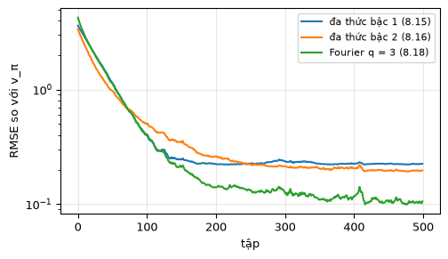
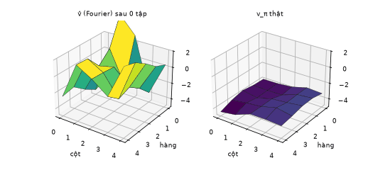
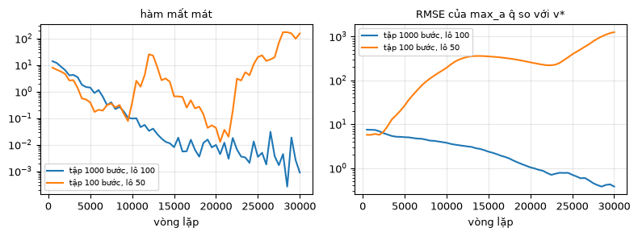
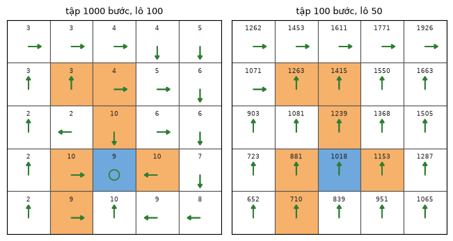

# Chương 8 · Code

> Ghi chú của người biên soạn: trang này không có trong sách. Nó chạy hai thuật toán chính của [chương 8](mathrl/ch08_vi) bằng mẫu thật: TD-Linear (thuật toán 8.1) với các bộ đặc trưng khác nhau, và học Q sâu (thuật toán 8.4) trên lưới 5×5. Điểm hội tụ lý thuyết $w^{\ast} = A^{-1}b$ của TD-Linear đã được tính ở mục "Kiểm tra bằng mã" trong chương; ở đây ta xem thuật toán lấy mẫu có thực sự tới đó không. Ký hiệu theo [Quy ước ký hiệu](notation_vi).

Mỗi khối code đã được chạy sẵn. Kết quả, hình và ảnh động nằm ngay bên dưới. Các khối chạy lần lượt từ trên xuống và dùng chung biến, như notebook. Muốn tự chạy, xem [mục 4](#_4-chạy-trên-máy).

## 1. TD-Linear

<small class="viz-ref">Mục 8.2 · thuật toán 8.1 · hình 8.6–8.9</small>

Thiết lập của mục 8.2.4: đánh giá chính sách đều ($\pi(a\mid s) = 0.2$) trên lưới của hình 3.4a, $\gamma = 0.9$. Dữ liệu là 500 tập, mỗi tập 500 bước, mỗi tập bắt đầu từ một cặp trạng thái–hành động ngẫu nhiên. $w$ khởi tạo theo phân phối chuẩn tắc. Mỗi bước cập nhật:

$$
w_{t+1} = w_t + \alpha_t\big[r_{t+1} + \gamma\, \phi^T(s_{t+1}) w_t - \phi^T(s_t) w_t\big]\phi(s_t)
$$

<!-- run -->
```python
import numpy as np
import matplotlib.pyplot as plt
from zhao_grid import make_grid, value_iteration, plot_grid
from viz import save_gif

P, R = make_grid()
gamma, n_s, n_a = 0.9, 25, 5
next_state = P.argmax(axis=2)
pi_u = np.full((n_s, n_a), 1 / n_a)
P_pi, r_pi = np.einsum("sa,sat->st", pi_u, P), (pi_u * R).sum(axis=1)
v_pi = np.linalg.solve(np.eye(n_s) - gamma * P_pi, r_pi)       # giá trị thật, chỉ để đo sai số

rows, cols = np.divmod(np.arange(n_s), 5)
x, y = cols / 2 - 1, rows / 2 - 1                                 # chuẩn hóa về [-1, 1]
features = {
    "đa thức bậc 1 (8.15)": np.stack([np.ones(n_s), x, y], axis=1),
    "đa thức bậc 2 (8.16)": np.stack([np.ones(n_s), x, y, x**2, y**2, x * y], axis=1),
    "Fourier q = 3 (8.18)": np.array([[np.cos(np.pi * (c1 * cx + c2 * cy))
                                       for c1 in range(4) for c2 in range(4)]
                                      for cx, cy in zip(cols / 4, rows / 4)]),
}

def td_linear(Phi, alpha, n_episodes=500, T=500, seed=0, snap_every=None):
    rng = np.random.default_rng(seed)
    w = rng.standard_normal(Phi.shape[1])
    errors, snaps = [], []
    for ep in range(n_episodes):
        s = rng.integers(n_s)
        a = rng.integers(n_a)                                     # cặp (s, a) đầu tiên ngẫu nhiên
        actions = rng.integers(n_a, size=T)
        for t in range(T):
            r, s2 = R[s, a], next_state[s, a]
            td_error = r + gamma * Phi[s2] @ w - Phi[s] @ w
            w += alpha * td_error * Phi[s]                        # thuật toán 8.1
            s, a = s2, actions[t]
        errors.append(np.sqrt(np.mean((Phi @ w - v_pi) ** 2)))
        if snap_every and ep % snap_every == 0:
            snaps.append((ep, Phi @ w))
    return w, errors, snaps

results = {}
for name, Phi in features.items():
    w_fixed = np.linalg.solve(Phi.T @ np.diag(np.full(n_s, 1 / n_s)) @ (np.eye(n_s) - gamma * P_pi) @ Phi,
                              Phi.T @ np.diag(np.full(n_s, 1 / n_s)) @ r_pi)   # A^{-1} b với d_π đều
    w, errors, snaps = td_linear(Phi, alpha=0.0005, snap_every=10)
    results[name] = (errors, snaps)
    print(f"{name:22s}: {Phi.shape[1]:2d} tham số, RMSE sau 500 tập = {errors[-1]:.3f}, "
          f"RMSE của điểm hội tụ A⁻¹b = {np.sqrt(np.mean((Phi @ w_fixed - v_pi) ** 2)):.3f}")

plt.figure(figsize=(5.5, 3))
for name, (errors, _) in results.items():
    plt.plot(errors, label=name)
plt.yscale("log"); plt.xlabel("tập"); plt.ylabel("RMSE so với v_π"); plt.legend(fontsize=8); plt.grid(alpha=.3)
```

<!-- output -->
```output
đa thức bậc 1 (8.15)  :  3 tham số, RMSE sau 500 tập = 0.225, RMSE của điểm hội tụ A⁻¹b = 0.223
đa thức bậc 2 (8.16)  :  6 tham số, RMSE sau 500 tập = 0.197, RMSE của điểm hội tụ A⁻¹b = 0.194
Fourier q = 3 (8.18)  : 16 tham số, RMSE sau 500 tập = 0.106, RMSE của điểm hội tụ A⁻¹b = 0.097
```

<div align=center></div>
<!-- /output -->

Ở lưới này, $d_\pi$ của chính sách đều là phân phối đều (mỗi cột của $P_\pi$ cũng cộng lại bằng 1), nên điểm hội tụ $A^{-1}b$ tính được bằng trọng số đều. Đặc trưng càng giàu thì sai số càng nhỏ: mặt phẳng (3 tham số) chỉ nắm được xu hướng chung, mặt bậc hai tốt hơn, và Fourier 16 tham số đã khá sát $v_\pi$. Với $\alpha = 0.0005$, thuật toán lấy mẫu dừng rất sát điểm hội tụ lý thuyết. Thử $\alpha$ lớn hơn (0.005) thì học nhanh hơn lúc đầu, nhưng dừng ở mức sai số cao hơn hẳn điểm hội tụ, vì nhiễu của từng mẫu không được trung bình hóa đủ.

Ảnh động dưới vẽ mặt $\hat v(s, w)$ với đặc trưng Fourier sau mỗi 10 tập, cạnh mặt giá trị thật $v_\pi$ (hình 8.6c):

<!-- run -->
```python
X, Y = np.meshgrid(np.arange(5), np.arange(5))
snaps = results["Fourier q = 3 (8.18)"][1]

def surface(ax, v, title):
    ax.plot_surface(X, Y, v.reshape(5, 5), cmap="viridis", vmin=-4, vmax=1, edgecolor="k", lw=0.3)
    ax.set_zlim(-5, 2); ax.set_title(title, fontsize=9)
    ax.set_xlabel("cột"); ax.set_ylabel("hàng"); ax.invert_yaxis(); ax.view_init(28, -55)

def draw(fig, i):
    ep, v_hat = snaps[i]
    surface(fig.add_subplot(1, 2, 1, projection="3d"), v_hat, f"v̂ (Fourier) sau {ep} tập")
    surface(fig.add_subplot(1, 2, 2, projection="3d"), v_pi, "v_π thật")

save_gif(draw, 26, "td_linear_surface.gif", fps=4, figsize=(7, 3.2), dpi=75)
```

<!-- output -->
<div align=center></div>
<!-- /output -->

## 2. Học Q sâu trên lưới

<small class="viz-ref">Mục 8.4 · thuật toán 8.4 · hình 8.11, 8.12</small>

Thiết lập của hình 8.11: phạt biên và phạt ô cấm $-10$, thưởng đích $1$, $\gamma = 0.9$. Dữ liệu là **một** tập 1000 bước do chính sách đều sinh ra, dùng làm bộ nhớ phát lại. Mỗi vòng lặp lấy một lô 100 mẫu, hồi quy về $y = r + \gamma \max_{a} \hat q(s', a, w_T)$, và chép mạng chính sang mạng mục tiêu $w_T$ sau mỗi $C$ vòng.

Có hai chỗ khác với sách, đều do người biên soạn chọn sau khi thử:

- **Kiến trúc.** Sách dùng 3 đầu vào (hàng, cột, hành động) và 1 đầu ra. Với một lớp ẩn 100 nơ-ron, kiến trúc này không khớp nổi $q^{\ast}$, kể cả khi huấn luyện có giám sát trực tiếp (MSE còn khoảng 3 sau 5000 bước Adam). Lý do là hành động được đưa vào như một số thực, nên mạng phải học một hàm rất gồ ghề theo con số đó. Ở đây dùng thiết kế khác mà sách cũng nhắc tới: 2 đầu vào (hàng, cột), 5 đầu ra (một giá trị cho mỗi hành động), giống bài báo DQN gốc. Với kiến trúc này, mạng khớp $q^{\ast}$ gần như tuyệt đối.
- **Siêu tham số.** Với $C = 100$ và tốc độ học $10^{-3}$, giá trị bị ước lượng quá cao rồi phân kỳ (lên tới khoảng 70, trong khi $v^{\ast} \le 10$). Dùng $C = 500$ và tốc độ học $10^{-2}$ thì ổn định: mỗi lần mục tiêu đứng yên đủ lâu để mạng khớp xong.

<!-- run -->
```python
import torch
from torch import nn
torch.set_num_threads(1)

P10, R10 = make_grid(r_boundary=-10, r_forbidden=-10, r_target=1)
ns10 = P10.argmax(axis=2)
v_star10, _ = value_iteration(P10, R10, gamma, tol=1e-10)
q_star10 = R10 + gamma * P10 @ v_star10
XS = torch.tensor(np.stack([rows / 4, cols / 4], axis=1), dtype=torch.float32)   # (hàng, cột) chuẩn hóa

def deep_q(T, batch, n_iter=30_000, C=500, lr=1e-2, seed=0, log_every=500):
    rng = np.random.default_rng(seed)
    torch.manual_seed(seed)
    s, data = 0, []                                      # một tập T bước, chính sách hành vi đều
    for a in rng.integers(n_a, size=T):
        data.append((s, a, R10[s, a], ns10[s, a]))
        s = ns10[s, a]
    S, A, Rw, S2 = (torch.as_tensor(np.array(x)) for x in zip(*data))
    Rw = Rw.float()
    visited = len(set(zip(S.tolist(), A.tolist())))
    make = lambda: nn.Sequential(nn.Linear(2, 100), nn.ReLU(), nn.Linear(100, n_a))
    net, target = make(), make()
    target.load_state_dict(net.state_dict())
    opt = torch.optim.Adam(net.parameters(), lr=lr)
    log = []
    for it in range(1, n_iter + 1):
        idx = torch.as_tensor(rng.integers(T, size=batch))
        with torch.no_grad():
            y = Rw[idx] + gamma * target(XS[S2[idx]]).max(dim=1).values      # y = r + γ max_a q̂(s', a, w_T)
        q_sa = net(XS[S[idx]]).gather(1, A[idx][:, None]).squeeze(1)         # q̂(s, a, w)
        loss = ((q_sa - y) ** 2).mean()
        opt.zero_grad(); loss.backward(); opt.step()
        if it % C == 0:
            target.load_state_dict(net.state_dict())                          # w_T ← w
        if it % log_every == 0:
            with torch.no_grad():
                q = net(XS).numpy()
            log.append((it, loss.item(), np.sqrt(np.mean((q.max(axis=1) - v_star10) ** 2))))
    return q, log, visited

runs = {"tập 1000 bước, lô 100": deep_q(1000, 100), "tập 100 bước, lô 50": deep_q(100, 50)}
fig, axes = plt.subplots(1, 2, figsize=(8, 3))
for name, (q, log, visited) in runs.items():
    it, loss, err = zip(*log)
    axes[0].semilogy(it, loss, label=name)
    axes[1].semilogy(it, err, label=name)
    optimal = np.isclose(q_star10[np.arange(n_s), q.argmax(axis=1)], v_star10).sum()
    print(f"{name}: thăm {visited}/125 cặp (s,a); mất mát nhỏ nhất = {min(loss):.4f}; "
          f"RMSE cuối của max_a q̂ so với v* = {err[-1]:.2f}; số ô có hành động tham lam tối ưu = {optimal}/25")
axes[0].set_title("hàm mất mát", fontsize=9); axes[1].set_title("RMSE của max_a q̂ so với v*", fontsize=9)
for ax in axes: ax.set_xlabel("vòng lặp"); ax.legend(fontsize=7); ax.grid(alpha=.3)
plt.tight_layout()
```

<!-- output -->
```output
tập 1000 bước, lô 100: thăm 125/125 cặp (s,a); mất mát nhỏ nhất = 0.0003; RMSE cuối của max_a q̂ so với v* = 0.38; số ô có hành động tham lam tối ưu = 25/25
tập 100 bước, lô 50: thăm 58/125 cặp (s,a); mất mát nhỏ nhất = 0.0127; RMSE cuối của max_a q̂ so với v* = 1254.54; số ô có hành động tham lam tối ưu = 9/25
```

<div align=center></div>
<!-- /output -->

Cột "số ô có hành động tham lam tối ưu" so sánh theo **giá trị**: hành động tham lam theo $\hat q$ có cho đúng $v^{\ast}$ hay không. Có ô có nhiều hành động cùng tối ưu, nên so chỉ số hành động sẽ không công bằng.

Hai lần chạy cho đúng hai bài học của mục 8.4.2:

- **Tập 1000 bước** thăm đủ 125 cặp $(s,a)$. Mất mát giảm về gần 0, sai số so với $v^{\ast}$ cũng giảm (còn khoảng 0.4), và chính sách tham lam tối ưu ở cả 25 ô. Trong khi đó, Q-learning dạng bảng ở mục kiểm tra bằng mã của chương 7 cần tới 100 000 bước.
- **Tập 100 bước** chỉ thăm 58 trên 125 cặp. Mất mát vẫn xuống rất thấp (nhỏ nhất khoảng 0.01): mạng khớp tốt những mẫu nó có. Nhưng giá trị thì **phân kỳ**, lên tới hàng nghìn. Ở đây còn nặng hơn hình 8.12 trong sách. Lý do: những cặp chưa từng thấy không bị ràng buộc gì, mạng có thể gán cho chúng giá trị lớn tùy ý. Phép $\max$ trong mục tiêu lại chọn đúng những giá trị đó, nên sai số bị đưa ngược vào mục tiêu, vòng sau càng lớn hơn. Mất mát thấp **không** có nghĩa là học đúng.

<!-- run -->
```python
fig, axes = plt.subplots(1, 2, figsize=(6.6, 3.4))
for ax, (name, (q, *_)) in zip(axes, runs.items()):
    plot_grid(q.max(axis=1), q.argmax(axis=1), title=name, ax=ax, fmt="{:.0f}")
plt.tight_layout()
```

<!-- output -->
<div align=center></div>
<!-- /output -->

## 3. Đối chiếu với DQN của MinRL

[Trang Code chương 6 của EasyRL](chapter6/chapter6_code_vi) chạy `DQNAgent` của MinRL trên CartPole. Thuật toán giống thuật toán 8.4 ở đây, chỉ khác cách lấy dữ liệu. Ở đây dữ liệu là **cố định**: một tập do chính sách hành vi đều sinh ra từ trước, nên đây là học ngoài chính sách thuần túy. Còn MinRL vừa học vừa thu thêm dữ liệu bằng chính sách ε-tham lam theo mạng hiện tại. Mạng của MinRL nhận trạng thái và trả ra giá trị của mọi hành động cùng lúc, như bài báo DQN gốc. Sách đã nhắc tới cách thiết kế đó ở mục 8.4.2.

## 4. Chạy trên máy

```bash
git clone https://github.com/nmc2004nd/easy-rl-vi.git
cd easy-rl-vi/docs/code/py          # chạy từ đây để import được zhao_grid, viz
pip install numpy matplotlib pillow torch
```

Chép lần lượt các khối code vào Jupyter rồi chạy theo thứ tự. Kết quả trên trang được dựng bằng `python3 scripts/build_code_pages.py docs/mathrl/ch08_code_vi.md`.
