# Chương 8 Phương pháp hàm giá trị

> Ghi chú của người biên soạn: đây là bản tổng hợp tiếng Việt chương 8 sách *Mathematical Foundations of Reinforcement Learning* (Shiyu Zhao, 2025), có bổ sung từ các bài [Value Function Approximation](https://lyk-love.cn/2024/06/22/Value-Function-Approximation/), [Stationary Distribution of a Markov Decision Process](https://lyk-love.cn/2024/06/24/Stationary-Distribution-of-a-Markov-Decision-Process/) và [Deep Q-Learning](https://lyk-love.cn/2024/04/16/Deep-Q-Learning/) trên blog lyk-love. Xem [giới thiệu phần này](mathrl/README_vi) để biết nguồn, và [Quy ước ký hiệu](notation_vi) cho chuẩn ký hiệu dùng chung. Ý không có trong sách được ghi rõ.

<div align=center>
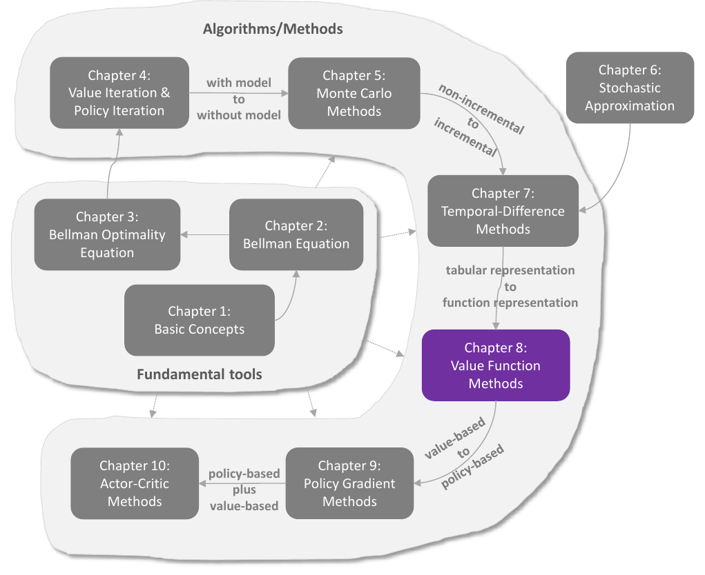
</div>
<div align=center>Hình 8.1 Vị trí của chương này trong sách. Nguồn: Zhao (2025)</div>

Chương này tiếp tục với học TD, nhưng **đổi cách biểu diễn giá trị**. Đến giờ, giá trị trạng thái và hành động được lưu trong **bảng**. Cách dạng bảng dễ hiểu nhưng kém hiệu quả khi không gian trạng thái hay hành động lớn. Chương này giới thiệu **phương pháp hàm giá trị (value function method)**, nay đã thành cách chuẩn để biểu diễn giá trị. Đây cũng là chỗ **mạng nơ-ron** đi vào học tăng cường, đóng vai trò bộ xấp xỉ hàm. Ý tưởng hàm giá trị còn mở rộng được sang **hàm chính sách** ở chương 9.

**Lộ trình của chương:**

| Mục | Nội dung |
|---|---|
| 8.1 | Từ bảng sang hàm: so sánh hai cách biểu diễn |
| 8.2 | Học TD giá trị trạng thái với xấp xỉ hàm: hàm mục tiêu, phân phối dừng, thuật toán, chọn đặc trưng, ví dụ, phân tích lý thuyết |
| 8.3 | Sarsa và Q-learning với xấp xỉ hàm |
| 8.4 | Học Q sâu (DQN): mạng mục tiêu và phát lại kinh nghiệm |

## 8.1 Biểu diễn giá trị: từ bảng sang hàm

Giả sử có $n$ trạng thái $\{s_i\}_{i=1}^n$ với giá trị thật $\{v_\pi(s_i)\}_{i=1}^n$ dưới chính sách $\pi$ cho trước. Gọi $\{\hat v(s_i)\}_{i=1}^n$ là các ước lượng. Với **phương pháp dạng bảng**, các giá trị ước lượng được lưu trong một bảng (một mảng hay vectơ trong bộ nhớ); muốn đọc hay cập nhật giá trị nào thì đọc hay ghi trực tiếp ô đó.

| Trạng thái | $s_1$ | $s_2$ | $\cdots$ | $s_n$ |
|---|---|---|---|---|
| Giá trị ước lượng | $\hat v(s_1)$ | $\hat v(s_2)$ | $\cdots$ | $\hat v(s_n)$ |

Các giá trị trong bảng có thể **xấp xỉ bằng một hàm**. Coi $\{(s_i, \hat v(s_i))\}_{i=1}^n$ là $n$ điểm trên mặt phẳng (hình 8.2); có thể khớp các điểm này bằng một đường cong. Đơn giản nhất là đường thẳng:

$$
\hat v(s, w) = as + b = \underbrace{[s, 1]}_{\phi^T(s)}\underbrace{\begin{bmatrix} a \\ b \end{bmatrix}}_{w} = \phi^T(s)\,w. \tag{8.1}
$$

<div align=center>
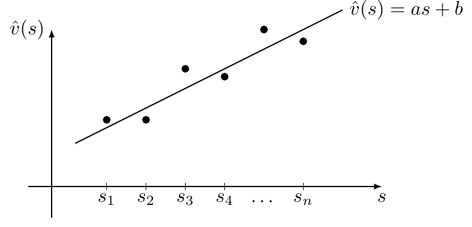
</div>
<div align=center>Hình 8.2 Minh họa phương pháp xấp xỉ hàm: trục ngang là s, trục dọc là v̂(s). Nguồn: Zhao (2025)</div>

$\hat v(s, w)$ là hàm xấp xỉ $v_\pi(s)$, xác định bởi trạng thái $s$ và **vectơ tham số** $w \in \mathbb R^2$; đôi khi viết $\hat v_w(s)$. $\phi(s) \in \mathbb R^2$ gọi là **vectơ đặc trưng (feature vector)** của $s$.

### Khác biệt thứ nhất: cách đọc và cập nhật một giá trị

**Đọc một giá trị.**

- Dạng bảng: đọc thẳng ô tương ứng.
- Dạng hàm: phải đưa $s$ vào hàm rồi tính giá trị hàm (hình 8.3). Với (8.1), tính $\phi(s)$ rồi tính $\phi^T(s)w$. Nếu hàm là mạng nơ-ron thì phải **lan truyền xuôi** từ đầu vào tới đầu ra.

<div align=center>
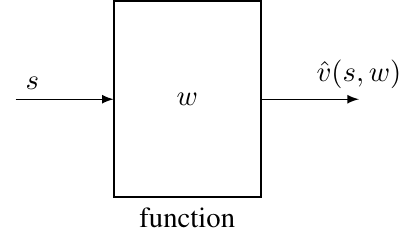
</div>
<div align=center>Hình 8.3 Đọc giá trị của s khi dùng phương pháp xấp xỉ hàm. Nguồn: Zhao (2025)</div>

Nhờ cách đọc này, phương pháp hàm **tiết kiệm bộ nhớ** hơn: dạng bảng lưu $n$ giá trị, còn dạng hàm chỉ lưu vectơ tham số $w$ có số chiều thấp hơn nhiều. Cái giá phải trả: giá trị trạng thái **có thể không được biểu diễn chính xác**. Ví dụ, đường thẳng không khớp đúng các điểm ở hình 8.2; vì thế mới gọi là **xấp xỉ**. Về bản chất, dùng một vectơ số chiều thấp để biểu diễn một tập dữ liệu số chiều cao thì chắc chắn mất thông tin. Phương pháp hàm **tăng hiệu quả bộ nhớ bằng cách hy sinh độ chính xác**.

**Cập nhật một giá trị.**

- Dạng bảng: ghi đè thẳng ô tương ứng.
- Dạng hàm: hoàn toàn khác. Phải **cập nhật $w$** để thay đổi giá trị **một cách gián tiếp**. Cách cập nhật $w$ để tìm giá trị tối ưu sẽ trình bày chi tiết sau.

Nhờ cách cập nhật này, phương pháp hàm có thêm một ưu điểm: **khả năng tổng quát hóa (generalization)** mạnh hơn. Với dạng bảng, chỉ cập nhật được giá trị của trạng thái được thăm; trạng thái chưa thăm thì không cập nhật được. Với dạng hàm, phải cập nhật $w$ để cập nhật giá trị một trạng thái, và việc cập nhật $w$ **cũng làm thay đổi giá trị của các trạng thái khác**, kể cả chưa được thăm. Như vậy mẫu kinh nghiệm của một trạng thái giúp ước lượng giá trị của các trạng thái khác.

Hình 8.4 minh họa với ba trạng thái $\{s_1, s_2, s_3\}$, có một mẫu kinh nghiệm cho $s_3$ và muốn cập nhật $\hat v(s_3)$:

- dạng bảng: chỉ $\hat v(s_3)$ thay đổi, $\hat v(s_1)$ và $\hat v(s_2)$ giữ nguyên (hình 8.4a);
- dạng hàm: cập nhật $w$ không chỉ đổi $\hat v(s_3)$ mà còn đổi $\hat v(s_1)$, $\hat v(s_2)$ (hình 8.4b). Mẫu của $s_3$ giúp cập nhật giá trị các trạng thái lân cận.

<div align=center>
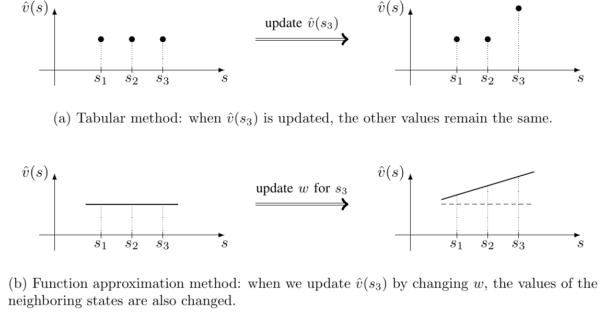
</div>
<div align=center>Hình 8.4 Cập nhật giá trị của một trạng thái. (a) Dạng bảng: khi v̂(s3) được cập nhật, các giá trị khác giữ nguyên. (b) Xấp xỉ hàm: cập nhật v̂(s3) bằng cách đổi w thì giá trị các trạng thái lân cận cũng đổi. Nguồn: Zhao (2025)</div>

### Hàm phức tạp hơn và xấp xỉ tuyến tính

Có thể dùng hàm có khả năng xấp xỉ mạnh hơn đường thẳng, ví dụ đa thức bậc hai:

$$
\hat v(s, w) = as^2 + bs + c = \underbrace{[s^2, s, 1]}_{\phi^T(s)}\underbrace{\begin{bmatrix} a \\ b \\ c \end{bmatrix}}_{w} = \phi^T(s)\,w. \tag{8.2}
$$

Bậc càng cao thì xấp xỉ càng chính xác, nhưng số chiều của tham số cũng tăng, tốn bộ nhớ và tính toán hơn.

Để ý $\hat v(s, w)$ ở (8.1) hay (8.2) đều **tuyến tính theo $w$** (dù có thể phi tuyến theo $s$). Kiểu này gọi là **xấp xỉ hàm tuyến tính (linear function approximation)**, phương pháp xấp xỉ hàm đơn giản nhất. Muốn dùng nó phải chọn vectơ đặc trưng $\phi(s)$ phù hợp, ví dụ chọn đường thẳng bậc một hay đường cong bậc hai. Việc chọn đặc trưng không dễ, đòi hỏi hiểu biết trước về bài toán: hiểu bài toán càng rõ thì chọn đặc trưng càng tốt. Nếu biết các điểm ở hình 8.2 nằm gần một đường thẳng thì dùng đường thẳng. Nhưng thực tế thường không có hiểu biết đó; khi đó giải pháp phổ biến là dùng **mạng nơ-ron** làm bộ xấp xỉ **phi tuyến**.

### Tìm tham số tối ưu khi biết giá trị thật

Nếu biết $\{v_\pi(s_i)\}_{i=1}^n$ thì đây là bài toán **bình phương tối thiểu**. Tham số tối ưu cực tiểu hóa

$$
J_1 = \sum_{i=1}^n\big(\hat v(s_i, w) - v_\pi(s_i)\big)^2 = \sum_{i=1}^n\big(\phi^T(s_i)w - v_\pi(s_i)\big)^2 = \lVert\Phi w - v_\pi\rVert^2,
$$

với

$$
\Phi = \begin{bmatrix} \phi^T(s_1) \\ \vdots \\ \phi^T(s_n) \end{bmatrix} \in \mathbb R^{n\times 2}, \qquad v_\pi = \begin{bmatrix} v_\pi(s_1) \\ \vdots \\ v_\pi(s_n) \end{bmatrix} \in \mathbb R^n.
$$

Nghiệm tối ưu là

$$
w^{\ast} = (\Phi^T\Phi)^{-1}\Phi^T v_\pi.
$$

(Ghi chú của người biên soạn: bản PDF viết $(\Phi^T\Phi)^{-1}\Phi v_\pi$, thiếu dấu chuyển vị ở $\Phi$ thứ hai; đây là công thức đã sửa.)

Ví dụ khớp đường cong này minh họa ý tưởng cơ bản của xấp xỉ hàm giá trị; mục sau trình bày ý tưởng đó một cách chính thức.

## 8.2 Học TD giá trị trạng thái với xấp xỉ hàm

Mục này đưa xấp xỉ hàm vào học TD để ước lượng giá trị trạng thái của một chính sách cho trước. Mục 8.3 mở rộng sang giá trị hành động và chính sách tối ưu.

**Bố cục của mục:**

- Phương pháp xấp xỉ hàm được phát biểu thành **bài toán tối ưu**: hàm mục tiêu ở 8.2.1, thuật toán TD tối ưu nó ở 8.2.2.
- Chọn vectơ đặc trưng phù hợp: 8.2.3.
- Ví dụ minh họa thuật toán và ảnh hưởng của đặc trưng: 8.2.4.
- Phân tích lý thuyết: 8.2.5 (nặng toán, có thể đọc chọn lọc).

### 8.2.1 Hàm mục tiêu

Gọi $v_\pi(s)$ và $\hat v(s, w)$ là giá trị thật và giá trị xấp xỉ của $s$. Bài toán: tìm $w$ tối ưu sao cho $\hat v(s, w)$ xấp xỉ $v_\pi(s)$ tốt nhất với mọi $s$. Hàm mục tiêu:

$$
J(w) = \mathbb E\big[(v_\pi(S) - \hat v(S, w))^2\big], \tag{8.3}
$$

với kỳ vọng lấy theo biến ngẫu nhiên $S \in \mathcal S$. **$S$ có phân phối gì?** Đây là câu hỏi quan trọng để hiểu hàm mục tiêu. Có vài cách chọn:

**Cách 1: phân phối đều.** Coi mọi trạng thái quan trọng như nhau, xác suất mỗi trạng thái là $1/n$:

$$
J(w) = \frac1n\sum_{s\in\mathcal S}\big(v_\pi(s) - \hat v(s, w)\big)^2, \tag{8.4}
$$

tức trung bình sai số xấp xỉ trên mọi trạng thái. Nhưng cách này **không xét động lực thật** của quá trình Markov dưới chính sách đã cho. Có những trạng thái chính sách rất ít khi thăm, coi chúng quan trọng như mọi trạng thái khác thì không hợp lý.

**Cách 2: phân phối dừng** (trọng tâm của chương). **Phân phối dừng (stationary distribution)** mô tả hành vi dài hạn của một MDP: sau khi tác tử đi theo chính sách đủ lâu, xác suất tác tử ở mỗi trạng thái được mô tả bởi phân phối này (chi tiết ở hộp 8.1). Gọi $\{d_\pi(s)\}_{s\in\mathcal S}$ là phân phối dừng của quá trình Markov dưới $\pi$: sau một thời gian dài, xác suất tác tử ở $s$ là $d_\pi(s)$, và $\sum_s d_\pi(s) = 1$. Hàm mục tiêu (8.3) thành

$$
J(w) = \sum_{s\in\mathcal S} d_\pi(s)\big(v_\pi(s) - \hat v(s, w)\big)^2, \tag{8.5}
$$

tức **trung bình có trọng số** của sai số xấp xỉ: trạng thái hay được thăm thì trọng số lớn hơn.

Tính $d_\pi(s)$ không dễ, vì cần biết ma trận chuyển $P_\pi$ (hộp 8.1). May là **không cần** tính cụ thể $d_\pi(s)$ để cực tiểu hóa hàm mục tiêu, như sẽ thấy ở mục sau. Ngoài ra, (8.4) và (8.5) giả sử số trạng thái hữu hạn; khi không gian trạng thái liên tục thì thay tổng bằng tích phân.

> **Hộp 8.1: Phân phối dừng của một MDP**
>
> Công cụ then chốt là $P_\pi \in \mathbb R^{n\times n}$, ma trận xác suất chuyển dưới chính sách $\pi$: $[P_\pi]_{ij}$ là xác suất tác tử đi từ $s_i$ sang $s_j$ (mục 2.6).
>
> **Ý nghĩa của $P_\pi^k$ ($k = 1, 2, 3, \dots$).** Gọi xác suất đi từ $s_i$ tới $s_j$ trong **đúng $k$ bước** là $p_{ij}^{(k)} = \Pr(S_{t_k} = j \mid S_{t_0} = i)$, với $t_0$, $t_k$ là bước đầu và bước thứ $k$. Theo định nghĩa, $[P_\pi]_{ij} = p_{ij}^{(1)}$. Xét $P_\pi^2$:
> $$[P_\pi^2]_{ij} = [P_\pi P_\pi]_{ij} = \sum_{q=1}^n [P_\pi]_{iq}[P_\pi]_{qj}.$$
> $[P_\pi]_{iq}[P_\pi]_{qj}$ là xác suất đồng thời đi từ $s_i$ sang $s_q$ rồi từ $s_q$ sang $s_j$, nên $[P_\pi^2]_{ij} = p_{ij}^{(2)}$ là xác suất đi từ $s_i$ tới $s_j$ trong đúng hai bước. Tương tự, $[P_\pi^k]_{ij} = p_{ij}^{(k)}$.
>
> **Định nghĩa phân phối dừng.** Gọi $d_0 \in \mathbb R^n$ là phân phối của trạng thái ở bước đầu (ví dụ luôn xuất phát từ $s$ thì $d_0(s) = 1$, còn lại bằng 0). Gọi $d_k \in \mathbb R^n$ là phân phối sau đúng $k$ bước. Khi đó
> $$d_k(s_i) = \sum_{j=1}^n d_0(s_j)\,[P_\pi^k]_{ji}, \qquad i = 1, 2, \dots \tag{8.6}$$
> tức xác suất ở $s_i$ tại bước $k$ bằng tổng xác suất đi từ mọi $s_j$ tới $s_i$ trong đúng $k$ bước. Dạng ma trận–vectơ:
> $$d_k^T = d_0^T P_\pi^k. \tag{8.7}$$
> Xét hành vi dài hạn: dưới một số điều kiện,
> $$\lim_{k\to\infty} P_\pi^k = \mathbf 1_n d_\pi^T, \tag{8.8}$$
> với $\mathbf 1_n = [1, \dots, 1]^T \in \mathbb R^n$, và $\mathbf 1_n d_\pi^T$ là ma trận hằng có mọi hàng bằng $d_\pi^T$. Thay vào (8.7):
> $$\lim_{k\to\infty} d_k^T = d_0^T\lim_{k\to\infty}P_\pi^k = d_0^T\mathbf 1_n d_\pi^T = d_\pi^T, \tag{8.9}$$
> vì $d_0^T\mathbf 1_n = 1$. Vậy phân phối $d_k$ hội tụ về một hằng $d_\pi$, gọi là **phân phối giới hạn (limiting distribution)**. Nó phụ thuộc mô hình và chính sách, nhưng **không phụ thuộc phân phối ban đầu** $d_0$: xuất phát từ đâu thì sau đủ lâu, phân phối của tác tử luôn là $d_\pi$.
>
> **Tính $d_\pi$:** lấy giới hạn hai vế $d_k^T = d_{k-1}^T P_\pi$ được
> $$d_\pi^T = d_\pi^T P_\pi. \tag{8.10}$$
> Vậy $d_\pi$ là **vectơ riêng trái** của $P_\pi$ ứng với trị riêng 1. Nghiệm của (8.10) gọi là **phân phối dừng**. Có $\sum_s d_\pi(s) = 1$ và $d_\pi(s) > 0$ với mọi $s$ (lý do có dấu $>$ thay vì $\ge$ nêu ở dưới).
>
> **Điều kiện để phân phối dừng duy nhất.** Nghiệm của (8.10) gọi là phân phối dừng; $d_\pi$ ở (8.9) gọi là phân phối giới hạn. (8.9) kéo theo (8.10), nhưng chiều ngược lại có thể sai. Một lớp quá trình Markov tổng quát có phân phối dừng (hay giới hạn) duy nhất là quá trình **tối giản (irreducible)** hoặc **chính quy (regular)**:
>
> - $s_j$ **tới được (accessible)** từ $s_i$ nếu có số nguyên hữu hạn $k$ với $[P_\pi^k]_{ij} > 0$: xuất phát từ $s_i$ có thể tới $s_j$ sau hữu hạn bước.
> - Hai trạng thái tới được lẫn nhau thì gọi là **liên thông (communicate)**.
> - Quá trình Markov **tối giản** nếu mọi trạng thái liên thông với nhau: với mọi $s_i, s_j$ có $k \ge 1$ để $[P_\pi^k]_{ij} > 0$ ($k$ có thể khác nhau cho các cặp).
> - Quá trình Markov **chính quy** nếu có $k \ge 1$ để $[P_\pi^k]_{ij} > 0$ **với mọi** $i, j$, tức $P_\pi^k > 0$ (so sánh từng phần tử). Chính quy thì tối giản, nhưng không ngược lại. Tuy vậy, nếu tối giản **và** có $i$ với $[P_\pi]_{ii} > 0$ thì chính quy. Hơn nữa, nếu $P_\pi^k > 0$ thì $P_\pi^{k'} > 0$ với mọi $k' \ge k$ vì $P_\pi \ge 0$; từ (8.9) suy ra $d_\pi(s) > 0$ với mọi $s$.
>
> **Chính sách nào cho phân phối dừng duy nhất?** Khi cố định chính sách, MDP thành quá trình Markov với hành vi dài hạn do chính sách và mô hình cùng quyết định. Nói chung, câu trả lời là **chính sách có tính khám phá** như ε-tham lam: chúng chọn mọi hành động ở mọi trạng thái với xác suất dương, nên các trạng thái liên thông với nhau khi mô hình cho phép.
>
> **Ví dụ (hình 8.5).** Chính sách ε-tham lam với $\varepsilon = 0.5$ trên lưới 2×2; $s_1, s_2, s_3, s_4$ lần lượt là ô trên–trái, trên–phải, dưới–trái, dưới–phải. So sánh hai cách tính $d_\pi$:
>
> - **Giá trị lý thuyết:** quá trình Markov vừa tối giản (mọi trạng thái liên thông) vừa chính quy (mọi trạng thái chuyển được về chính nó). Từ hình 8.5:
> $$P_\pi^T = \begin{bmatrix} 0.3 & 0.1 & 0.1 & 0 \\ 0.1 & 0.3 & 0 & 0.1 \\ 0.6 & 0 & 0.3 & 0.1 \\ 0 & 0.6 & 0.6 & 0.8 \end{bmatrix}.$$
> Trị riêng của $P_\pi^T$ là $\{-0.0449,\ 0.3,\ 0.4449,\ 1\}$. Vectơ riêng (phải) độ dài 1 của $P_\pi^T$ ứng với trị riêng 1 là $[0.0463, 0.1455, 0.1785, 0.9720]^T$. Chuẩn hóa cho tổng bằng 1:
> $$d_\pi = [0.0345,\ 0.1084,\ 0.1330,\ 0.7241]^T.$$
> Phần tử thứ $i$ là xác suất dài hạn tác tử ở $s_i$.
> - **Giá trị ước lượng:** chạy chính sách đủ lâu rồi lấy tỉ lệ số lần thăm mỗi trạng thái *(theo lyk-love: $d_\pi(s) \approx n_\pi(s)/\sum_{s'} n_\pi(s')$, với $n_\pi(s)$ là số lần thăm $s$ trong một tập rất dài)*. Xuất phát từ $s_1$, chạy 1.000 bước: tỉ lệ hội tụ về giá trị lý thuyết sau vài trăm bước.

<div align=center>
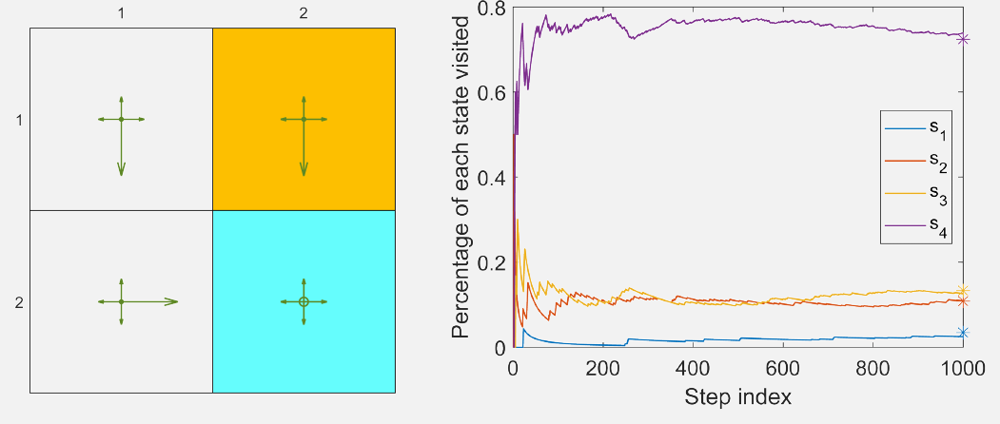
</div>
<div align=center>Hình 8.5 Hành vi dài hạn của chính sách ε-tham lam với ε = 0.5. Trái: chính sách. Phải: tỉ lệ số lần thăm mỗi trạng thái theo số bước; dấu sao là giá trị lý thuyết của d_π. Nguồn: Zhao (2025)</div>

### 8.2.2 Thuật toán tối ưu

Cực tiểu hóa $J(w)$ ở (8.3) bằng giảm gradient: $w_{k+1} = w_k - \alpha_k\nabla_w J(w_k)$, với

$$
\begin{aligned}
\nabla_w J(w_k) &= \nabla_w\mathbb E\big[(v_\pi(S) - \hat v(S, w_k))^2\big] = \mathbb E\big[\nabla_w(v_\pi(S) - \hat v(S, w_k))^2\big]\\
&= 2\,\mathbb E\big[(v_\pi(S) - \hat v(S, w_k))(-\nabla_w\hat v(S, w_k))\big] = -2\,\mathbb E\big[(v_\pi(S) - \hat v(S, w_k))\nabla_w\hat v(S, w_k)\big].
\end{aligned}
$$

Vậy thuật toán giảm gradient là

$$
w_{k+1} = w_k + 2\alpha_k\,\mathbb E\big[(v_\pi(S) - \hat v(S, w_k))\nabla_w\hat v(S, w_k)\big], \tag{8.11}
$$

(hệ số 2 gộp được vào $\alpha_k$). (8.11) cần tính kỳ vọng. Theo tinh thần **SGD** (chương 6), thay gradient thật bằng gradient ngẫu nhiên:

$$
w_{t+1} = w_t + \alpha_t\big(v_\pi(s_t) - \hat v(s_t, w_t)\big)\nabla_w\hat v(s_t, w_t), \tag{8.12}
$$

với $s_t$ là mẫu của $S$ tại thời điểm $t$.

(8.12) **chưa cài đặt được** vì cần giá trị thật $v_\pi$, vốn chưa biết. Thay $v_\pi(s_t)$ bằng một xấp xỉ; có hai cách:

- **Monte Carlo:** với một tập $(s_0, r_1, s_1, r_2, \dots)$, gọi $g_t$ là lợi tức chiết khấu từ $s_t$, dùng $g_t$ xấp xỉ $v_\pi(s_t)$:
$$w_{t+1} = w_t + \alpha_t\big(g_t - \hat v(s_t, w_t)\big)\nabla_w\hat v(s_t, w_t).$$
Đây là **học MC với xấp xỉ hàm**.
- **Sai phân thời gian:** theo tinh thần học TD, dùng $r_{t+1} + \gamma\hat v(s_{t+1}, w_t)$ xấp xỉ $v_\pi(s_t)$:
$$w_{t+1} = w_t + \alpha_t\big[r_{t+1} + \gamma\hat v(s_{t+1}, w_t) - \hat v(s_t, w_t)\big]\nabla_w\hat v(s_t, w_t). \tag{8.13}$$
Đây là **học TD với xấp xỉ hàm**, tóm tắt ở thuật toán 8.1.

Hiểu (8.13) là quan trọng để học các thuật toán khác trong chương. Lưu ý (8.13) chỉ học được **giá trị trạng thái** của một chính sách cho trước; mục 8.3 sẽ mở rộng sang giá trị hành động.

*(ghi chú của người biên soạn)* Một điểm tinh tế: ở (8.13), mục tiêu $r_{t+1} + \gamma\hat v(s_{t+1}, w_t)$ cũng phụ thuộc $w$, nhưng ta **không lấy đạo hàm qua nó**, chỉ lấy đạo hàm qua $\hat v(s_t, w_t)$. Vì vậy (8.13) thường được gọi là **semi-gradient TD**: nó không phải giảm gradient thật của hàm nào cả. Đây chính là lý do ở mục 8.2.5, TD-Linear hóa ra không cực tiểu hóa $J$ ở (8.3).

### 8.2.3 Chọn bộ xấp xỉ hàm

Có hai cách chọn $\hat v(s, w)$:

1. dùng **mạng nơ-ron** làm bộ xấp xỉ phi tuyến: đầu vào là trạng thái, đầu ra là $\hat v(s, w)$, tham số mạng là $w$;
2. dùng **hàm tuyến tính**:
$$\hat v(s, w) = \phi^T(s)\,w,$$
với $\phi(s) \in \mathbb R^m$ là vectơ đặc trưng của $s$; độ dài của $\phi(s)$ và $w$ bằng $m$, thường nhỏ hơn nhiều so với số trạng thái.

Trường hợp tuyến tính, gradient là $\nabla_w\hat v(s, w) = \phi(s)$. Thay vào (8.13):

$$
w_{t+1} = w_t + \alpha_t\big[r_{t+1} + \gamma\phi^T(s_{t+1})w_t - \phi^T(s_t)w_t\big]\phi(s_t). \tag{8.14}
$$

Đây là **học TD với xấp xỉ hàm tuyến tính**, gọi tắt là **TD-Linear**.

**Thuật toán 8.1: Học TD giá trị trạng thái với xấp xỉ hàm**

```
Input:  v̂(s,w) khả vi theo w; tham số ban đầu w_0;
        chính sách π cần đánh giá
Output: w sao cho v̂(·,w) ≈ v_π

for each episode {(s_t, r_{t+1}, s_{t+1})}_t sinh bởi π do
    for each sample (s_t, r_{t+1}, s_{t+1}) do
        δ ← r_{t+1} + γ·v̂(s_{t+1},w) − v̂(s_t,w)   # sai số TD
        w ← w + α_t·δ·∇_w v̂(s_t,w)
        # trường hợp tuyến tính: v̂(s,w) = φ(s)ᵀw nên ∇_w v̂(s_t,w) = φ(s_t)
    end for
end for
```

Trường hợp tuyến tính được **hiểu rõ về lý thuyết** hơn nhiều so với phi tuyến, nhưng **khả năng xấp xỉ hạn chế** và khó chọn đặc trưng cho bài toán phức tạp. Ngược lại, mạng nơ-ron là bộ xấp xỉ phi tuyến phổ quát kiểu hộp đen, dễ dùng hơn.

Dù vậy, vẫn đáng học trường hợp tuyến tính: hiểu nó giúp nắm ý tưởng xấp xỉ hàm; nó đủ để giải các bài thế giới lưới trong sách; và quan trọng hơn, nó vẫn mạnh ở chỗ **phương pháp dạng bảng là một trường hợp tuyến tính đặc biệt**.

> **Hộp 8.2: TD dạng bảng là trường hợp đặc biệt của TD-Linear**
>
> Chọn vectơ đặc trưng đặc biệt cho mọi $s$:
> $$\phi(s) = e_s \in \mathbb R^n,$$
> với $e_s$ là vectơ có phần tử ứng với $s$ bằng 1, các phần tử khác bằng 0 (vectơ one-hot). Khi đó
> $$\hat v(s, w) = e_s^T w = w(s),$$
> với $w(s)$ là phần tử của $w$ ứng với $s$. Thay vào (8.14):
> $$w_{t+1} = w_t + \alpha_t\big(r_{t+1} + \gamma w_t(s_{t+1}) - w_t(s_t)\big)e_{s_t}.$$
> Phương trình này chỉ cập nhật phần tử $w_t(s_t)$, do định nghĩa của $e_{s_t}$. Nhân $e_{s_t}^T$ hai vế:
> $$w_{t+1}(s_t) = w_t(s_t) + \alpha_t\big(r_{t+1} + \gamma w_t(s_{t+1}) - w_t(s_t)\big),$$
> đúng là thuật toán TD dạng bảng (7.1). Vậy với $\phi(s) = e_s$, TD-Linear trở thành TD dạng bảng. $\blacksquare$

### 8.2.4 Ví dụ minh họa

Dùng TD-Linear (8.14) để ước lượng giá trị trạng thái của một chính sách cho trước, đồng thời minh họa cách chọn đặc trưng.

<div align=center>
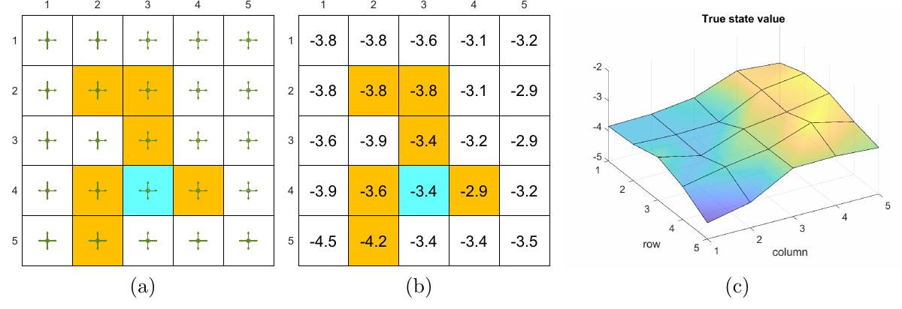
</div>
<div align=center>Hình 8.6 (a) Chính sách cần đánh giá. (b) Giá trị trạng thái thật dạng bảng. (c) Giá trị trạng thái thật dưới dạng mặt cong 3 chiều. Nguồn: Zhao (2025)</div>

Chính sách ở hình 8.6 chọn mọi hành động ở mọi trạng thái với xác suất 0.2. Có 25 giá trị trạng thái; mục tiêu là xấp xỉ chúng bằng **ít hơn 25 tham số**.

**Thiết lập:** 500 tập do chính sách sinh ra, mỗi tập 500 bước, bắt đầu từ một cặp trạng thái–hành động chọn đều ngẫu nhiên. Mỗi lần chạy, $w$ khởi tạo ngẫu nhiên, mỗi phần tử theo phân phối chuẩn tắc. $r_{\text{forbidden}} = r_{\text{boundary}} = -1$, $r_{\text{target}} = 1$, $\gamma = 0.9$.

**Đặc trưng đa thức.** Trạng thái $s$ ứng với vị trí 2 chiều; gọi $x$, $y$ là chỉ số cột và hàng, **chuẩn hóa về $[-1, +1]$** để tránh vấn đề số học.

- Đơn giản nhất: $\phi(s) = [x, y]^T \in \mathbb R^2$, cho $\hat v(s, w) = w_1 x + w_2 y$: một mặt phẳng **đi qua gốc tọa độ**. Mặt giá trị thật có thể không đi qua gốc, nên cần thêm **hệ số tự do (bias)**:
$$\phi(s) = [1, x, y]^T \in \mathbb R^3, \qquad \hat v(s, w) = w_1 + w_2 x + w_3 y. \tag{8.15}$$
Thứ tự phần tử không quan trọng, ví dụ $[x, y, 1]^T$ cũng được. Kết quả (hình 8.7a): giá trị ước lượng tạo thành một mặt phẳng; sai số hội tụ khi có thêm tập nhưng **không giảm về 0**, vì mặt phẳng có khả năng xấp xỉ hạn chế.
- Tăng số chiều để tăng khả năng xấp xỉ:
$$\phi(s) = [1, x, y, x^2, y^2, xy]^T \in \mathbb R^6, \tag{8.16}$$
ứng với mặt bậc hai, và
$$\phi(s) = [1, x, y, x^2, y^2, xy, x^3, y^3, x^2 y, x y^2]^T \in \mathbb R^{10}. \tag{8.17}$$
Kết quả ở hình 8.7b, c: vectơ đặc trưng càng dài thì xấp xỉ càng chính xác. Nhưng cả ba trường hợp sai số đều **không về 0**, vì các bộ xấp xỉ tuyến tính này vẫn có khả năng hạn chế.

<div align=center>
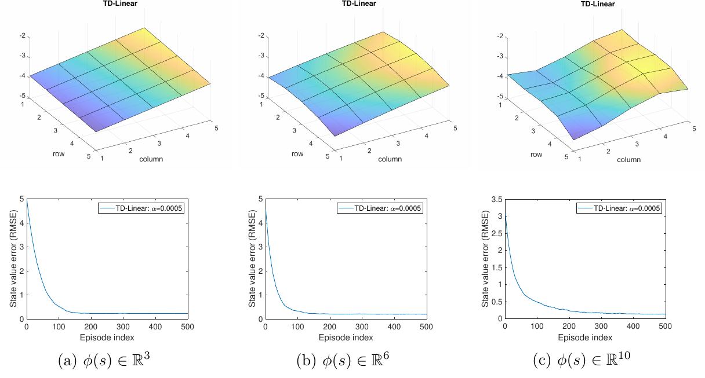
</div>
<div align=center>Hình 8.7 Kết quả TD-Linear với đặc trưng đa thức (8.15), (8.16), (8.17): mặt giá trị ước lượng và RMSE theo số tập. Nguồn: Zhao (2025)</div>

**Đặc trưng Fourier.** Ngoài đa thức còn nhiều loại đặc trưng khác như **cơ sở Fourier** và **tile coding** (Sutton và Barto, chương 9). Chuẩn hóa $x$, $y$ về $[0, 1]$; vectơ đặc trưng:

$$
\phi(s) = \begin{bmatrix} \vdots \\ \cos\big(\pi(c_1 x + c_2 y)\big) \\ \vdots \end{bmatrix} \in \mathbb R^{(q+1)^2}, \tag{8.18}
$$

trong đó $\pi$ ở đây là **hằng số 3.1415…**, không phải chính sách. $c_1$, $c_2$ nhận mọi giá trị nguyên trong $\{0, 1, \dots, q\}$ với $q$ do người dùng chọn, nên có $(q+1)^2$ cặp $(c_1, c_2)$ và $\phi(s)$ có $(q+1)^2$ chiều. Ví dụ $q = 1$:

$$
\phi(s) = \begin{bmatrix} \cos(\pi(0x + 0y)) \\ \cos(\pi(0x + 1y)) \\ \cos(\pi(1x + 0y)) \\ \cos(\pi(1x + 1y)) \end{bmatrix} = \begin{bmatrix} 1 \\ \cos(\pi y) \\ \cos(\pi x) \\ \cos(\pi(x+y)) \end{bmatrix} \in \mathbb R^4.
$$

Kết quả với $q = 1, 2, 3$ (số chiều 4, 9, 16) ở hình 8.8: số chiều càng cao thì xấp xỉ càng chính xác.

<div align=center>
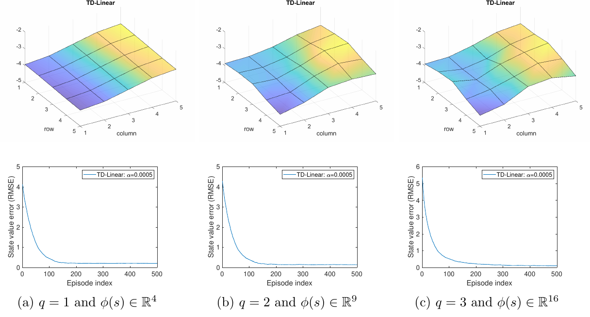
</div>
<div align=center>Hình 8.8 Kết quả TD-Linear với đặc trưng Fourier (8.18), q = 1, 2, 3. Nguồn: Zhao (2025)</div>

### 8.2.5 Phân tích lý thuyết *(phần nâng cao)*

Câu chuyện đến đây: bắt đầu từ hàm mục tiêu (8.3), dùng thuật toán ngẫu nhiên (8.12), rồi thay giá trị thật chưa biết bằng một xấp xỉ, được thuật toán TD (8.13). Câu chuyện này giúp hiểu ý tưởng, nhưng **chưa chặt chẽ**: thực ra (8.13) **không** cực tiểu hóa hàm mục tiêu (8.3).

Phần này phân tích TD (8.13) để thấy vì sao nó chạy được và nó thực sự giải bài toán gì. Bộ xấp xỉ phi tuyến khó phân tích, nên chỉ xét trường hợp **tuyến tính**. Phần này nặng toán, nên đọc chọn lọc.

#### Phân tích hội tụ

Trước hết xét thuật toán **tất định**

$$
w_{t+1} = w_t + \alpha_t\,\mathbb E\Big[\big(r_{t+1} + \gamma\phi^T(s_{t+1})w_t - \phi^T(s_t)w_t\big)\phi(s_t)\Big], \tag{8.19}
$$

với kỳ vọng lấy theo $s_t, s_{t+1}, r_{t+1}$, và $s_t$ giả sử theo phân phối dừng $d_\pi$. Thuật toán tất định vì mọi biến ngẫu nhiên đã biến mất sau khi lấy kỳ vọng.

**Vì sao xét thuật toán tất định?** Thứ nhất, sự hội tụ của nó dễ phân tích hơn (dù không tầm thường). Thứ hai, quan trọng hơn, sự hội tụ của nó **kéo theo** sự hội tụ của TD ngẫu nhiên (8.13), vì (8.13) có thể coi là một cài đặt SGD của (8.19).

Định nghĩa

$$
\Phi = \begin{bmatrix} \vdots \\ \phi^T(s) \\ \vdots \end{bmatrix} \in \mathbb R^{n\times m}, \qquad D = \begin{bmatrix} \ddots & & \\ & d_\pi(s) & \\ & & \ddots \end{bmatrix} \in \mathbb R^{n\times n}, \tag{8.20}
$$

với $\Phi$ chứa mọi vectơ đặc trưng và $D$ là ma trận đường chéo chứa phân phối dừng.

> **Bổ đề 8.1.** Kỳ vọng trong (8.19) viết lại được thành
> $$\mathbb E\Big[\big(r_{t+1} + \gamma\phi^T(s_{t+1})w_t - \phi^T(s_t)w_t\big)\phi(s_t)\Big] = b - Aw_t,$$
> với
> $$A \doteq \Phi^T D(I - \gamma P_\pi)\Phi \in \mathbb R^{m\times m}, \qquad b \doteq \Phi^T D r_\pi \in \mathbb R^m. \tag{8.21}$$
> Ở đây $P_\pi$, $r_\pi$ là hai thành phần của phương trình Bellman $v_\pi = r_\pi + \gamma P_\pi v_\pi$.

Chứng minh ở hộp 8.3. Với bổ đề 8.1, (8.19) viết lại thành quá trình tất định đơn giản

$$
w_{t+1} = w_t + \alpha_t(b - Aw_t). \tag{8.22}
$$

**$w_t$ hội tụ về đâu?** Giả sử $w_t \to w^{\ast}$; khi đó (8.22) cho $w^{\ast} = w^{\ast} + \alpha_\infty(b - Aw^{\ast})$, nên $b - Aw^{\ast} = 0$ và

$$
w^{\ast} = A^{-1}b.
$$

- **$A$ có khả nghịch không?** Có. Thực ra $A$ không chỉ khả nghịch mà còn **xác định dương**: $x^T A x > 0$ với mọi $x \ne 0$. Chứng minh ở hộp 8.4.
- **$w^{\ast} = A^{-1}b$ nghĩa là gì?** Nó là nghiệm tối ưu cực tiểu hóa **sai số Bellman chiếu** (xem bên dưới).
- **Dạng bảng là trường hợp đặc biệt.** Khi số chiều của $w$ bằng $n = \lvert\mathcal S\rvert$ và $\phi(s) = [0, \dots, 1, \dots, 0]^T$ (phần tử ứng với $s$ bằng 1):
$$w^{\ast} = A^{-1}b = v_\pi. \tag{8.23}$$
Tham số học được chính là giá trị trạng thái thật, khớp với việc TD dạng bảng là trường hợp đặc biệt của TD-Linear (hộp 8.2). Chứng minh: khi đó $\Phi = I$, nên $A = D(I - \gamma P_\pi)$, $b = Dr_\pi$, và $w^{\ast} = (I - \gamma P_\pi)^{-1}D^{-1}Dr_\pi = (I - \gamma P_\pi)^{-1}r_\pi = v_\pi$.

**$w_t$ trong (8.22) hội tụ về $w^{\ast} = A^{-1}b$.** Hai cách chứng minh:

- **Cách 1.** Đặt sai số $\delta_t = w_t - w^{\ast}$. Thay $w_t = \delta_t + w^{\ast}$ vào (8.22): $\delta_{t+1} = \delta_t - \alpha_t A\delta_t = (I - \alpha_t A)\delta_t$, nên $\delta_{t+1} = (I - \alpha_t A)\cdots(I - \alpha_0 A)\delta_0$. Với $\alpha_t = \alpha$ hằng số: $\lVert\delta_{t+1}\rVert_2 \le \lVert I - \alpha A\rVert_2^{t+1}\lVert\delta_0\rVert_2$. Khi $\alpha > 0$ đủ nhỏ, $\lVert I - \alpha A\rVert_2 < 1$ (vì $A$ xác định dương), nên $\delta_t \to 0$.
- **Cách 2.** Đặt $g(w) = b - Aw$; $w^{\ast}$ là nghiệm của $g(w) = 0$, nên đây là bài toán tìm nghiệm, và (8.22) là một thuật toán **Robbins-Monro** (chương 6). RM được thiết kế cho quá trình ngẫu nhiên nhưng cũng áp dụng được cho trường hợp tất định: $w_t \to w^{\ast}$ khi $\sum_t\alpha_t = \infty$ và $\sum_t\alpha_t^2 < \infty$.

> **Hộp 8.3: Chứng minh bổ đề 8.1**
>
> Theo luật kỳ vọng toàn phần, với $s_t$ theo phân phối dừng $d_\pi$:
> $$\begin{aligned}
> &\mathbb E\Big[r_{t+1}\phi(s_t) + \phi(s_t)\big(\gamma\phi^T(s_{t+1}) - \phi^T(s_t)\big)w_t\Big]\\
> &= \sum_{s\in\mathcal S} d_\pi(s)\,\mathbb E\big[r_{t+1}\phi(s_t) \mid s_t = s\big] + \sum_{s\in\mathcal S} d_\pi(s)\,\mathbb E\Big[\phi(s_t)\big(\gamma\phi^T(s_{t+1}) - \phi^T(s_t)\big)w_t \,\Big|\, s_t = s\Big].
> \end{aligned} \tag{8.24}$$
> **Số hạng thứ nhất.** $\mathbb E[r_{t+1}\phi(s_t) \mid s_t = s] = \phi(s)\,\mathbb E[r_{t+1} \mid s_t = s] = \phi(s)\,r_\pi(s)$, với $r_\pi(s) = \sum_a \pi(a \mid s)\sum_r r\,p(r \mid s, a)$. Nên
> $$\sum_{s\in\mathcal S} d_\pi(s)\,\mathbb E\big[r_{t+1}\phi(s_t) \mid s_t = s\big] = \sum_{s\in\mathcal S} d_\pi(s)\,\phi(s)\,r_\pi(s) = \Phi^T D r_\pi. \tag{8.25}$$
> **Số hạng thứ hai.** Vì
> $$\begin{aligned}
> \mathbb E\Big[\phi(s_t)\big(\gamma\phi^T(s_{t+1}) - \phi^T(s_t)\big)w_t \,\Big|\, s_t = s\Big] &= -\phi(s)\phi^T(s)w_t + \gamma\phi(s)\,\mathbb E\big[\phi^T(s_{t+1}) \mid s_t = s\big]w_t\\
> &= -\phi(s)\phi^T(s)w_t + \gamma\phi(s)\sum_{s'\in\mathcal S} p(s' \mid s)\,\phi^T(s')w_t,
> \end{aligned}$$
> nên
> $$\begin{aligned}
> \sum_{s\in\mathcal S} d_\pi(s)\,\mathbb E[\cdots \mid s_t = s] &= \sum_{s\in\mathcal S} d_\pi(s)\,\phi(s)\Big[-\phi(s) + \gamma\sum_{s'\in\mathcal S} p(s' \mid s)\,\phi(s')\Big]^T w_t\\
> &= \Phi^T D(-\Phi + \gamma P_\pi\Phi)w_t = -\Phi^T D(I - \gamma P_\pi)\Phi\,w_t.
> \end{aligned} \tag{8.26}$$
> Gộp (8.25) và (8.26):
> $$\mathbb E\Big[\big(r_{t+1} + \gamma\phi^T(s_{t+1})w_t - \phi^T(s_t)w_t\big)\phi(s_t)\Big] = \Phi^T D r_\pi - \Phi^T D(I - \gamma P_\pi)\Phi\,w_t \doteq b - Aw_t. \tag{8.27}$$
> $\blacksquare$

> **Hộp 8.4: $A = \Phi^T D(I - \gamma P_\pi)\Phi$ khả nghịch và xác định dương**
>
> $A$ **xác định dương** nếu $x^T A x > 0$ với mọi $x \ne 0$, ký hiệu $A \succ 0$ (khác với $>$ là so sánh từng phần tử). $A$ có thể không đối xứng; ma trận không đối xứng vẫn có thể xác định dương.
>
> Ý tưởng: chứng minh
> $$D(I - \gamma P_\pi) \doteq M \succ 0. \tag{8.28}$$
> Rõ ràng $M \succ 0$ kéo theo $A = \Phi^T M\Phi \succ 0$, vì $\Phi$ là ma trận cao có hạng cột đầy đủ (giả sử các vectơ đặc trưng độc lập tuyến tính). Viết
> $$M = \frac{M + M^T}{2} + \frac{M - M^T}{2}.$$
> $M - M^T$ phản đối xứng nên $x^T(M - M^T)x = 0$ với mọi $x$; do đó $M \succ 0$ khi và chỉ khi $M + M^T \succ 0$. Để chứng minh $M + M^T \succ 0$, dùng sự kiện: **ma trận chéo trội chặt (đối xứng, đường chéo dương) thì xác định dương**.
>
> **Thứ nhất,**
> $$(M + M^T)\mathbf 1_n > 0. \tag{8.29}$$
> Vì $P_\pi\mathbf 1_n = \mathbf 1_n$: $M\mathbf 1_n = D(I - \gamma P_\pi)\mathbf 1_n = D(\mathbf 1_n - \gamma\mathbf 1_n) = (1-\gamma)d_\pi$. Và $M^T\mathbf 1_n = (I - \gamma P_\pi^T)D\mathbf 1_n = (I - \gamma P_\pi^T)d_\pi = (1-\gamma)d_\pi$, đẳng thức cuối do $P_\pi^T d_\pi = d_\pi$. Vậy $(M + M^T)\mathbf 1_n = 2(1-\gamma)d_\pi > 0$, vì mọi phần tử của $d_\pi$ dương (hộp 8.1).
>
> **Thứ hai,** dạng từng phần tử của (8.29): $\sum_{j=1}^n [M + M^T]_{ij} > 0$, tức $[M + M^T]_{ii} + \sum_{j\ne i}[M + M^T]_{ij} > 0$. Theo biểu thức (8.28), các phần tử đường chéo của $M$ dương và các phần tử ngoài đường chéo không dương. Do đó bất đẳng thức trên viết lại được thành
> $$[M + M^T]_{ii} > \sum_{j\ne i}\big\lvert[M + M^T]_{ij}\big\rvert.$$
> Giá trị tuyệt đối của phần tử đường chéo thứ $i$ lớn hơn tổng giá trị tuyệt đối các phần tử ngoài đường chéo cùng hàng: $M + M^T$ **chéo trội chặt**, và chứng minh hoàn tất. $\blacksquare$

#### TD cực tiểu hóa sai số Bellman chiếu

TD-Linear hội tụ về $w^{\ast} = A^{-1}b$; bây giờ chứng minh $w^{\ast}$ là nghiệm tối ưu cực tiểu hóa **sai số Bellman chiếu**. Xét ba hàm mục tiêu:

**1. Sai số giá trị thật.**
$$J_E(w) = \mathbb E\big[(v_\pi(S) - \hat v(S, w))^2\big] = \lVert\hat v(w) - v_\pi\rVert_D^2,$$
đã gặp ở (8.3). Ở đây $\lVert\cdot\rVert_D^2$ là chuẩn có trọng số: $\lVert x\rVert_D^2 = x^T D x = \lVert D^{1/2}x\rVert_2^2$, với $D$ ở (8.20). Đây là hàm mục tiêu đơn giản nhất, nhưng dựa vào giá trị thật vốn chưa biết. Muốn có thuật toán cài đặt được phải xét các hàm mục tiêu khác như sai số Bellman và sai số Bellman chiếu.

**2. Sai số Bellman.** $v_\pi$ thỏa phương trình Bellman $v_\pi = r_\pi + \gamma P_\pi v_\pi$, nên mong $\hat v(w)$ cũng thỏa phương trình này hết mức có thể:
$$J_{BE}(w) = \lVert\hat v(w) - (r_\pi + \gamma P_\pi\hat v(w))\rVert_D^2 \doteq \lVert\hat v(w) - T_\pi(\hat v(w))\rVert_D^2, \tag{8.30}$$
với **toán tử Bellman** $T_\pi(x) \doteq r_\pi + \gamma P_\pi x$ cho mọi $x \in \mathbb R^n$. Cực tiểu hóa sai số Bellman là bài toán bình phương tối thiểu chuẩn (bỏ qua chi tiết).

**3. Sai số Bellman chiếu.** $J_{BE}(w)$ có thể không về 0 được vì khả năng xấp xỉ hạn chế. Ngược lại, hàm mục tiêu sau **có thể** cực tiểu hóa về 0:
$$J_{PBE}(w) = \lVert\hat v(w) - M\,T_\pi(\hat v(w))\rVert_D^2,$$
với $M \in \mathbb R^{n\times n}$ là **ma trận chiếu trực giao**, chiếu mọi vectơ lên không gian các xấp xỉ khả dĩ.

**TD (8.13) thực ra cực tiểu hóa $J_{PBE}$**, không phải $J_E$ hay $J_{BE}$. Xét trường hợp tuyến tính $\hat v(w) = \Phi w$; không gian ảnh của $\Phi$ là tập mọi xấp xỉ tuyến tính khả dĩ. Khi đó

$$
M = \Phi(\Phi^T D\Phi)^{-1}\Phi^T D \in \mathbb R^{n\times n}
$$

là ma trận chiếu lên không gian ảnh của $\Phi$. Vì $\hat v(w)$ nằm trong không gian ảnh của $\Phi$, luôn tìm được $w$ cực tiểu hóa $J_{PBE}(w)$ về 0, và nghiệm đó chính là $w^{\ast} = A^{-1}b$:

$$
w^{\ast} = A^{-1}b = \arg\min_w J_{PBE}(w).
$$

> **Hộp 8.5: $w^{\ast} = A^{-1}b$ cực tiểu hóa $J_{PBE}(w)$**
>
> $J_{PBE}(w) = 0 \Leftrightarrow \hat v(w) - M\,T_\pi(\hat v(w)) = 0$, nên chỉ cần xét nghiệm của $\hat v(w) = M\,T_\pi(\hat v(w))$. Trường hợp tuyến tính, thay $\hat v(w) = \Phi w$ và biểu thức của $M$:
> $$\Phi w = \Phi(\Phi^T D\Phi)^{-1}\Phi^T D(r_\pi + \gamma P_\pi\Phi w). \tag{8.31}$$
> Vì $\Phi$ có hạng cột đầy đủ, $\Phi x = \Phi y \Leftrightarrow x = y$. Nên (8.31) kéo theo
> $$\begin{aligned}
> w &= (\Phi^T D\Phi)^{-1}\Phi^T D(r_\pi + \gamma P_\pi\Phi w)\\
> \Longleftrightarrow\quad \Phi^T D(r_\pi + \gamma P_\pi\Phi w) &= (\Phi^T D\Phi)w\\
> \Longleftrightarrow\quad \Phi^T D r_\pi &= \Phi^T D(I - \gamma P_\pi)\Phi w\\
> \Longleftrightarrow\quad w &= \big(\Phi^T D(I - \gamma P_\pi)\Phi\big)^{-1}\Phi^T D r_\pi = A^{-1}b.
> \end{aligned}$$
> $\blacksquare$

**$\hat v(w^{\ast})$ gần $v_\pi$ tới đâu?** TD cực tiểu hóa $J_{PBE}$ chứ không phải $J_E$, nên cần biết giá trị ước lượng lệch bao nhiêu so với giá trị thật. Trường hợp tuyến tính:

$$
\lVert\hat v(w^{\ast}) - v_\pi\rVert_D = \lVert\Phi w^{\ast} - v_\pi\rVert_D \le \frac{1}{1-\gamma}\min_w\lVert\hat v(w) - v_\pi\rVert_D = \frac{1}{1-\gamma}\min_w\sqrt{J_E(w)}. \tag{8.32}
$$

Độ lệch bị chặn trên bởi giá trị nhỏ nhất của $J_E$, nhân với $1/(1-\gamma)$. Cận này **khá lỏng**, nhất là khi $\gamma$ gần 1, nên chủ yếu có giá trị lý thuyết.

> **Hộp 8.6: Chứng minh cận sai số (8.32)**
>
> $$\begin{aligned}
> \lVert\Phi w^{\ast} - v_\pi\rVert_D &= \lVert\Phi w^{\ast} - Mv_\pi + Mv_\pi - v_\pi\rVert_D \le \lVert\Phi w^{\ast} - Mv_\pi\rVert_D + \lVert Mv_\pi - v_\pi\rVert_D\\
> &= \lVert M\,T_\pi(\Phi w^{\ast}) - M\,T_\pi(v_\pi)\rVert_D + \lVert Mv_\pi - v_\pi\rVert_D,
> \end{aligned} \tag{8.33}$$
> đẳng thức cuối vì $\Phi w^{\ast} = M\,T_\pi(\Phi w^{\ast})$ và $v_\pi = T_\pi(v_\pi)$. Thay
> $$M\,T_\pi(\Phi w^{\ast}) - M\,T_\pi(v_\pi) = M(r_\pi + \gamma P_\pi\Phi w^{\ast}) - M(r_\pi + \gamma P_\pi v_\pi) = \gamma MP_\pi(\Phi w^{\ast} - v_\pi)$$
> vào (8.33):
> $$\begin{aligned}
> \lVert\Phi w^{\ast} - v_\pi\rVert_D &\le \lVert\gamma MP_\pi(\Phi w^{\ast} - v_\pi)\rVert_D + \lVert Mv_\pi - v_\pi\rVert_D\\
> &\le \gamma\lVert M\rVert_D\lVert P_\pi(\Phi w^{\ast} - v_\pi)\rVert_D + \lVert Mv_\pi - v_\pi\rVert_D\\
> &= \gamma\lVert P_\pi(\Phi w^{\ast} - v_\pi)\rVert_D + \lVert Mv_\pi - v_\pi\rVert_D && (\text{vì } \lVert M\rVert_D = 1)\\
> &\le \gamma\lVert\Phi w^{\ast} - v_\pi\rVert_D + \lVert Mv_\pi - v_\pi\rVert_D && (\text{vì } \lVert P_\pi x\rVert_D \le \lVert x\rVert_D\ \forall x).
> \end{aligned}$$
> Chuyển vế:
> $$\lVert\Phi w^{\ast} - v_\pi\rVert_D \le \frac{1}{1-\gamma}\lVert Mv_\pi - v_\pi\rVert_D = \frac{1}{1-\gamma}\min_w\lVert\hat v(w) - v_\pi\rVert_D,$$
> đẳng thức cuối vì $\lVert Mv_\pi - v_\pi\rVert_D$ là sai số giữa $v_\pi$ và hình chiếu trực giao của nó lên không gian các xấp xỉ khả dĩ, tức là sai số nhỏ nhất giữa $v_\pi$ và mọi $\hat v(w)$.
>
> **Các sự kiện đã dùng:**
>
> - **Chuẩn ma trận có trọng số.** $\lVert x\rVert_D = \sqrt{x^T D x} = \lVert D^{1/2}x\rVert_2$. Chuẩn ma trận cảm sinh: $\lVert A\rVert_D = \max_{x\ne 0}\lVert Ax\rVert_D/\lVert x\rVert_D = \lVert D^{1/2}AD^{-1/2}\rVert_2$. Với $A$, $B$ có kích thước phù hợp: $\lVert ABx\rVert_D \le \lVert A\rVert_D\lVert B\rVert_D\lVert x\rVert_D$, vì $\lVert ABx\rVert_D = \lVert D^{1/2}AD^{-1/2}D^{1/2}BD^{-1/2}D^{1/2}x\rVert_2 \le \lVert D^{1/2}AD^{-1/2}\rVert_2\lVert D^{1/2}BD^{-1/2}\rVert_2\lVert D^{1/2}x\rVert_2$.
> - **$\lVert M\rVert_D = 1$:** $\lVert M\rVert_D = \lVert D^{1/2}\Phi(\Phi^T D\Phi)^{-1}\Phi^T D D^{-1/2}\rVert_2 = 1$, vì ma trận bên trong là một ma trận chiếu trực giao và chuẩn $L_2$ của mọi ma trận chiếu trực giao (khác 0) bằng 1.
> - **$\lVert P_\pi x\rVert_D \le \lVert x\rVert_D$ với mọi $x$:**
> $$\lVert P_\pi x\rVert_D^2 = x^T P_\pi^T D P_\pi x = \sum_k [D]_{kk}\Big(\sum_i [P_\pi]_{ki}x_i\Big)^2 \le \sum_k [D]_{kk}\sum_i [P_\pi]_{ki}x_i^2 = \sum_i\Big(\sum_k [D]_{kk}[P_\pi]_{ki}\Big)x_i^2 = \sum_i [D]_{ii}x_i^2 = \lVert x\rVert_D^2,$$
> bất đẳng thức theo bất đẳng thức Jensen (mỗi hàng của $P_\pi$ là một phân phối xác suất), đẳng thức áp chót do $d_\pi^T P_\pi = d_\pi^T$. $\blacksquare$

*(ghi chú của người biên soạn)* Bảng so sánh ba hàm mục tiêu:

| Hàm mục tiêu | Công thức | Cần biết | Đặc điểm |
|---|---|---|---|
| $J_E$ | $\lVert\hat v(w) - v_\pi\rVert_D^2$ | giá trị thật $v_\pi$ | "lý tưởng" nhưng không tính được |
| $J_{BE}$ | $\lVert\hat v(w) - T_\pi\hat v(w)\rVert_D^2$ | mô hình (để lấy kỳ vọng) | có thể không về 0 được |
| $J_{PBE}$ | $\lVert\hat v(w) - M\,T_\pi\hat v(w)\rVert_D^2$ | không | TD-Linear hội tụ về cực tiểu của nó, giá trị cực tiểu bằng 0 |

#### Bình phương tối thiểu TD (LSTD)

**LSTD (least-squares TD)** cũng cực tiểu hóa sai số Bellman chiếu như TD-Linear, nhưng có một số ưu điểm.

Tham số tối ưu là $w^{\ast} = A^{-1}b$ với $A = \Phi^T D(I - \gamma P_\pi)\Phi$, $b = \Phi^T D r_\pi$. Theo (8.27), $A$ và $b$ cũng viết được thành kỳ vọng:

$$
A = \mathbb E\Big[\phi(s_t)\big(\phi(s_t) - \gamma\phi(s_{t+1})\big)^T\Big], \qquad b = \mathbb E\big[r_{t+1}\phi(s_t)\big].
$$

Ý tưởng LSTD rất đơn giản: **dùng mẫu ước lượng trực tiếp $A$ và $b$**, gọi là $\hat A$, $\hat b$, rồi ước lượng thẳng $w^{\ast} \approx \hat A^{-1}\hat b$. Với một quỹ đạo $(s_0, r_1, s_1, \dots, s_t, r_{t+1}, s_{t+1}, \dots)$ theo $\pi$:

$$
\hat A_t = \sum_{k=0}^{t-1}\phi(s_k)\big(\phi(s_k) - \gamma\phi(s_{k+1})\big)^T, \qquad \hat b_t = \sum_{k=0}^{t-1} r_{k+1}\phi(s_k), \tag{8.34}
$$

$$
w_t = \hat A_t^{-1}\hat b_t.
$$

Hệ số $1/t$ bị bỏ khỏi (8.34) cho gọn, vì nó không làm thay đổi $w_t$. Khi $t$ nhỏ, $\hat A_t$ có thể không khả nghịch, nên thường cộng thêm một ma trận nhỏ $\sigma I$ ($\sigma > 0$ nhỏ).

**Ưu điểm của LSTD:** dùng mẫu hiệu quả hơn và hội tụ nhanh hơn TD, vì nó được thiết kế dựa trên **biểu thức của nghiệm tối ưu**. Hiểu bài toán càng rõ, thiết kế thuật toán càng tốt.

**Nhược điểm của LSTD:**

1. Chỉ ước lượng được giá trị trạng thái; TD thì mở rộng được sang giá trị hành động (mục sau). Và TD cho phép bộ xấp xỉ phi tuyến, còn LSTD thì không, vì nó dựa trên biểu thức của $w^{\ast}$ trong trường hợp tuyến tính.
2. Chi phí tính toán cao hơn: mỗi bước LSTD cập nhật một ma trận $m\times m$, còn TD cập nhật một vectơ $m$ chiều. Quan trọng hơn, mỗi bước LSTD phải nghịch đảo $\hat A_t$, độ phức tạp $O(m^3)$.

Cách khắc phục phổ biến là **cập nhật trực tiếp nghịch đảo của $\hat A_t$**. Ta có

$$
\hat A_{t+1} = \sum_{k=0}^{t}\phi(s_k)\big(\phi(s_k) - \gamma\phi(s_{k+1})\big)^T = \hat A_t + \phi(s_t)\big(\phi(s_t) - \gamma\phi(s_{t+1})\big)^T,
$$

tức tổng của $\hat A_t$ và một ma trận hạng 1. Nghịch đảo tính được bằng công thức Sherman–Morrison:

$$
\hat A_{t+1}^{-1} = \hat A_t^{-1} - \frac{\hat A_t^{-1}\phi(s_t)\big(\phi(s_t) - \gamma\phi(s_{t+1})\big)^T\hat A_t^{-1}}{1 + \big(\phi(s_t) - \gamma\phi(s_{t+1})\big)^T\hat A_t^{-1}\phi(s_t)}.
$$

Vậy có thể lưu và cập nhật trực tiếp $\hat A_t^{-1}$, không cần nghịch đảo ma trận. Thuật toán đệ quy này không cần tốc độ học, nhưng cần giá trị ban đầu $\hat A_0^{-1}$, thường chọn $\hat A_0^{-1} = \sigma I$ với $\sigma > 0$.

(Ghi chú của người biên soạn: bản PDF in công thức nghịch đảo với dấu cộng ở giữa; theo công thức Sherman–Morrison $(B + uv^T)^{-1} = B^{-1} - \frac{B^{-1}uv^TB^{-1}}{1 + v^TB^{-1}u}$, dấu đúng là **trừ**, như viết ở trên.)

### Kiểm tra bằng mã *(ghi chú của người biên soạn)*

Đoạn mã dưới tái tạo hộp 8.1 và hình 8.6, rồi so sánh điểm hội tụ của TD-Linear ($w^{\ast} = A^{-1}b$) với nghiệm tốt nhất theo $J_E$ cho các bộ đặc trưng khác nhau. Dùng lại `make_grid` ở [chương 3](mathrl/ch03_vi).

```python
import numpy as np
# make_grid: xem mục "Kiểm tra bằng mã" ở chương 3

# Hộp 8.1: phân phối dừng của ví dụ 2x2
PT = np.array([[0.3, 0.1, 0.1, 0.0], [0.1, 0.3, 0.0, 0.1],
               [0.6, 0.0, 0.3, 0.1], [0.0, 0.6, 0.6, 0.8]])
w, V = np.linalg.eig(PT)
d = np.real(V[:, np.argmin(abs(w - 1))]); d /= d.sum()
print(d.round(4))                                   # [0.0345 0.1084 0.133  0.7241]

# Hình 8.6: chính sách đều trên lưới 5x5
P, R = make_grid(); gamma = 0.9; n_s, n_a = R.shape
pi = np.full((n_s, n_a), 1 / n_a)
P_pi = np.einsum('sa,sat->st', pi, P); r_pi = (pi * R).sum(1)
v_pi = np.linalg.solve(np.eye(n_s) - gamma * P_pi, r_pi)
w, V = np.linalg.eig(P_pi.T); d_pi = np.real(V[:, np.argmin(abs(w - 1))]); d_pi /= d_pi.sum()
D = np.diag(d_pi)

def fourier(q):                                     # đặc trưng (8.18), x, y chuẩn hóa về [0, 1]
    rows, cols = np.divmod(np.arange(n_s), 5)
    x, y = cols / 4, rows / 4
    return np.array([[np.cos(np.pi * (c1 * xi + c2 * yi))
                      for c1 in range(q + 1) for c2 in range(q + 1)] for xi, yi in zip(x, y)])

for q in [1, 2, 3]:
    Phi = fourier(q)
    A = Phi.T @ D @ (np.eye(n_s) - gamma * P_pi) @ Phi
    b = Phi.T @ D @ r_pi
    w_td = np.linalg.solve(A, b)                    # điểm hội tụ của TD-Linear: cực tiểu J_PBE
    w_best = np.linalg.lstsq(np.sqrt(D) @ Phi, np.sqrt(D) @ v_pi, rcond=None)[0]   # cực tiểu J_E
    rmse = lambda v: np.sqrt(np.mean((v - v_pi) ** 2))
    print(q, Phi.shape[1], round(rmse(Phi @ w_td), 3), round(rmse(Phi @ w_best), 3))
```

Kết quả: $d_\pi$ khớp đúng hộp 8.1, và $v_\pi$ khớp đúng hình 8.6b. RMSE (không trọng số) của điểm hội tụ TD-Linear so với nghiệm tốt nhất theo $J_E$:

| Đặc trưng | Số chiều | TD-Linear ($A^{-1}b$) | Tốt nhất theo $J_E$ |
|---|---|---|---|
| đa thức (8.15) | 3 | 0.223 | 0.221 |
| đa thức (8.16) | 6 | 0.194 | 0.192 |
| đa thức (8.17) | 10 | 0.125 | 0.125 |
| Fourier $q = 1$ | 4 | 0.207 | 0.206 |
| Fourier $q = 2$ | 9 | 0.137 | 0.136 |
| Fourier $q = 3$ | 16 | 0.097 | 0.093 |
| one-hot (dạng bảng) | 25 | 0.000 | 0.000 |

Ba điều rút ra: (1) đặc trưng càng nhiều chiều thì sai số càng nhỏ, đúng như hình 8.7–8.8; (2) với one-hot, sai số bằng 0, đúng như (8.23); (3) trong ví dụ này điểm hội tụ của TD **gần như tốt bằng** nghiệm tối ưu theo $J_E$, nghĩa là cận (8.32) với hệ số $1/(1-\gamma) = 10$ là rất bi quan. Chạy TD-Linear ngẫu nhiên thật (500 tập × 500 bước, $\alpha = 0.0005$, Fourier $q = 3$) cho RMSE $0.103$, sát với điểm hội tụ lý thuyết $0.097$.

## 8.3 Học TD giá trị hành động với xấp xỉ hàm

Mục 8.2 ước lượng giá trị trạng thái; mục này ước lượng **giá trị hành động**. Sarsa và Q-learning dạng bảng được mở rộng sang xấp xỉ hàm; việc mở rộng rất trực tiếp.

### 8.3.1 Sarsa với xấp xỉ hàm

Có được ngay từ (8.13) bằng cách thay giá trị trạng thái bằng giá trị hành động. Giả sử $q_\pi(s, a)$ được xấp xỉ bằng $\hat q(s, a, w)$; thay $\hat v(s, w)$ trong (8.13) bằng $\hat q(s, a, w)$:

$$
w_{t+1} = w_t + \alpha_t\big[r_{t+1} + \gamma\hat q(s_{t+1}, a_{t+1}, w_t) - \hat q(s_t, a_t, w_t)\big]\nabla_w\hat q(s_t, a_t, w_t). \tag{8.35}
$$

Phân tích (8.35) tương tự (8.13). Với hàm tuyến tính, $\hat q(s, a, w) = \phi^T(s, a)w$, với $\phi(s, a)$ là vectơ đặc trưng, và $\nabla_w\hat q(s, a, w) = \phi(s, a)$.

Bước ước lượng giá trị (8.35) kết hợp được với bước cải thiện chính sách để học chính sách tối ưu (thuật toán 8.2). Lưu ý: muốn ước lượng chính xác giá trị hành động của một chính sách thì phải chạy (8.35) đủ nhiều lần, nhưng ở đây (8.35) chỉ chạy **một lần** rồi chuyển sang cải thiện chính sách, giống Sarsa dạng bảng. Ngoài ra, cài đặt ở thuật toán 8.2 giải bài toán tìm đường tốt từ một trạng thái xuất phát cố định tới đích, nên không tìm được chính sách tối ưu cho mọi trạng thái; có đủ dữ liệu thì dễ dàng điều chỉnh để làm được việc đó.

**Thuật toán 8.2: Sarsa với xấp xỉ hàm**

```
Input:  tham số ban đầu w_0; chính sách ban đầu π_0;
        α > 0; ε ∈ (0,1); trạng thái xuất phát s_0
Output: chính sách đưa tác tử từ s_0 tới đích

for each episode do
    s ← s_0;  a ~ π(·|s)
    while s không phải trạng thái đích do
        r, s' ← env.step(s, a)
        a' ~ π(·|s')
        y ← r + γ·q̂(s',a',w)          # mục tiêu TD của Sarsa
        w ← w + α·[ y − q̂(s,a,w) ]·∇_w q̂(s,a,w)
        π(·|s) ← ε-greedy(q̂(s,·,w))   # cải thiện chính sách tại s
        s ← s';  a ← a'
    end while
end for
```

Ví dụ ở hình 8.9: tìm chính sách tốt dẫn tác tử từ ô trên–trái tới đích. Cả tổng phần thưởng lẫn độ dài mỗi tập đều dần ổn định. Vectơ đặc trưng tuyến tính là hàm Fourier bậc 5, theo (8.18).

<div align=center>
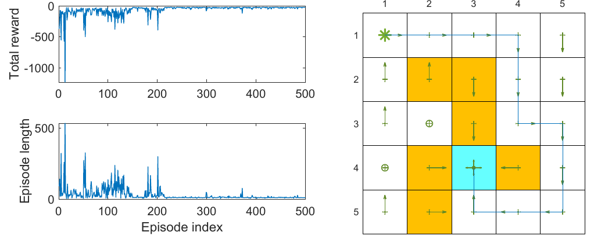
</div>
<div align=center>Hình 8.9 Sarsa với xấp xỉ hàm tuyến tính; γ = 0.9, ε = 0.1, phạt biên = phạt ô cấm = −10, thưởng đích = 1, α = 0.001. Nguồn: Zhao (2025)</div>

### 8.3.2 Q-learning với xấp xỉ hàm

Q-learning dạng bảng cũng mở rộng được:

$$
w_{t+1} = w_t + \alpha_t\Big[r_{t+1} + \gamma\max_{a\in\mathcal A(s_{t+1})}\hat q(s_{t+1}, a, w_t) - \hat q(s_t, a_t, w_t)\Big]\nabla_w\hat q(s_t, a_t, w_t). \tag{8.36}
$$

Giống (8.35), chỉ thay $\hat q(s_{t+1}, a_{t+1}, w_t)$ bằng $\max_{a\in\mathcal A(s_{t+1})}\hat q(s_{t+1}, a, w_t)$.

Giống trường hợp dạng bảng, (8.36) cài đặt được theo kiểu theo chính sách hoặc ngoài chính sách. Phiên bản theo chính sách ở thuật toán 8.3; phiên bản ngoài chính sách sẽ minh họa ở phần học Q sâu (mục 8.4).

**Thuật toán 8.3: Q-learning với xấp xỉ hàm (phiên bản theo chính sách)**

```
Input:  tham số ban đầu w_0; chính sách ban đầu π_0;
        α > 0; ε ∈ (0,1); trạng thái xuất phát s_0
Output: đường đi tối ưu từ s_0 tới đích

for each episode do
    s ← s_0
    while s không phải trạng thái đích do
        a ~ π(·|s)
        r, s' ← env.step(s, a)
        y ← r + γ·max_a' q̂(s',a',w)   # mục tiêu TD của Q-learning
        w ← w + α·[ y − q̂(s,a,w) ]·∇_w q̂(s,a,w)
        π(·|s) ← ε-greedy(q̂(s,·,w))
        s ← s'
    end while
end for
```

Ví dụ ở hình 8.10: Q-learning với xấp xỉ hàm tuyến tính (cơ sở Fourier bậc 5) học được chính sách tối ưu.

<div align=center>
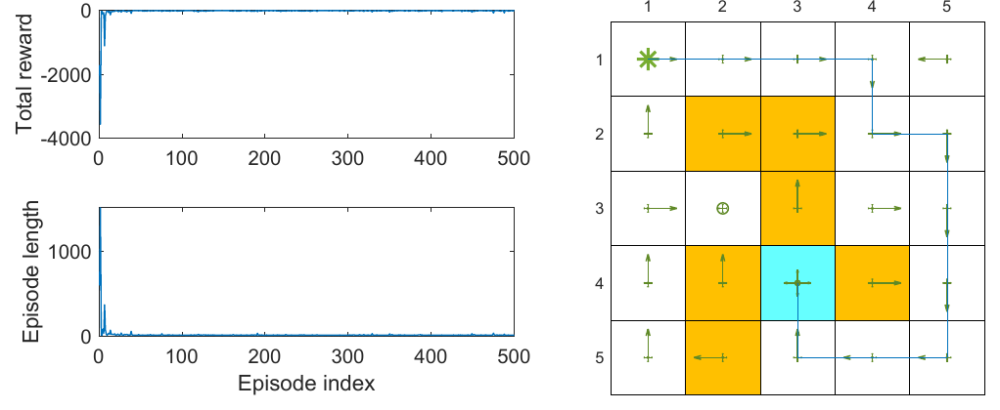
</div>
<div align=center>Hình 8.10 Q-learning với xấp xỉ hàm tuyến tính; γ = 0.9, ε = 0.1, phạt biên = phạt ô cấm = −10, thưởng đích = 1, α = 0.001. Nguồn: Zhao (2025)</div>

Để ý ở thuật toán 8.2 và 8.3: dù **giá trị** được biểu diễn bằng hàm, **chính sách** $\pi(a \mid s)$ vẫn là bảng, nên vẫn giả sử số trạng thái và hành động hữu hạn. Chương 9 sẽ biểu diễn chính sách bằng hàm, xử lý được không gian trạng thái và hành động liên tục.

## 8.4 Học Q sâu

Đưa mạng nơ-ron sâu vào Q-learning được **học Q sâu (deep Q-learning)** hay **mạng Q sâu (deep Q-network, DQN)**, một trong những thuật toán học tăng cường sâu sớm nhất và thành công nhất. Lưu ý mạng không nhất thiết phải sâu: với bài toán đơn giản như thế giới lưới, mạng nông 1–2 lớp ẩn có thể đủ.

Học Q sâu có thể coi là mở rộng của (8.36), nhưng cách phát biểu toán học và kỹ thuật cài đặt khác đáng kể.

### 8.4.1 Mô tả thuật toán

Về toán học, học Q sâu cực tiểu hóa

$$
J = \mathbb E\Big[\Big(R + \gamma\max_{a\in\mathcal A(S')}\hat q(S', a, w) - \hat q(S, A, w)\Big)^2\Big], \tag{8.37}
$$

với $(S, A, R, S')$ là các biến ngẫu nhiên: trạng thái, hành động, phần thưởng tức thời và trạng thái kế tiếp. Hàm mục tiêu này là **bình phương sai số tối ưu Bellman**, vì

$$
q(s, a) = \mathbb E\Big[R_{t+1} + \gamma\max_{a\in\mathcal A(S_{t+1})} q(S_{t+1}, a) \,\Big|\, S_t = s, A_t = a\Big], \qquad \forall s, a
$$

là phương trình tối ưu Bellman (hộp 7.5). Vậy khi $\hat q(S, A, w)$ xấp xỉ chính xác giá trị hành động tối ưu thì $R + \gamma\max_a\hat q(S', a, w) - \hat q(S, A, w)$ phải bằng 0 theo kỳ vọng.

Cực tiểu hóa (8.37) bằng giảm gradient thì cần gradient của $J$ theo $w$. Nhưng $w$ xuất hiện **cả** trong $\hat q(S, A, w)$ **lẫn** trong $y \doteq R + \gamma\max_{a\in\mathcal A(S')}\hat q(S', a, w)$, nên tính gradient không đơn giản. Để đơn giản, **giả sử $w$ trong $y$ cố định** (trong một khoảng thời gian ngắn). Ta dùng hai mạng: **mạng chính** $\hat q(s, a, w)$ và **mạng mục tiêu** $\hat q(s, a, w_T)$. Hàm mục tiêu thành

$$
J = \mathbb E\Big[\Big(R + \gamma\max_{a\in\mathcal A(S')}\hat q(S', a, w_T) - \hat q(S, A, w)\Big)^2\Big],
$$

với $w_T$ là tham số mạng mục tiêu. Khi $w_T$ cố định, gradient là

$$
\nabla_w J = -\mathbb E\Big[\Big(R + \gamma\max_{a\in\mathcal A(S')}\hat q(S', a, w_T) - \hat q(S, A, w)\Big)\nabla_w\hat q(S, A, w)\Big], \tag{8.38}
$$

(bỏ các hệ số hằng không mất tổng quát).

*(theo lyk-love)* Giả thiết "$w_T$ cố định" thực chất là một **lựa chọn kỹ thuật**, không có chứng minh hội tụ chặt chẽ cho DQN dựa trên nó. Trực giác: nếu chỉ dùng một mạng, mỗi lần cập nhật làm mục tiêu $y$ dịch chuyển theo, như "đuổi theo cái bóng của chính mình"; mạng mục tiêu giữ $y$ ổn định trong một khoảng thời gian.

**Hai kỹ thuật then chốt:**

**1. Hai mạng: mạng chính và mạng mục tiêu.** Gọi $w$, $w_T$ là tham số mạng chính và mạng mục tiêu; ban đầu đặt bằng nhau.

- Mỗi vòng lặp, rút một lô nhỏ mẫu $\{(s, a, r, s')\}$ từ bộ nhớ phát lại (giải thích ngay sau). Đầu vào mạng chính là $s$, $a$; đầu ra $y = \hat q(s, a, w)$ là giá trị $q$ ước lượng. Giá trị mục tiêu của đầu ra là $y_T \doteq r + \gamma\max_{a\in\mathcal A(s')}\hat q(s', a, w_T)$. Mạng chính được cập nhật để cực tiểu hóa sai số TD (còn gọi là **hàm mất mát**) $\sum(y - y_T)^2$ trên các mẫu $\{(s, a, y_T)\}$.
- Cập nhật $w$ **không** dùng trực tiếp gradient (8.38), mà dựa vào các công cụ huấn luyện mạng nơ-ron sẵn có. Vì thế cần **một lô nhỏ** mẫu để huấn luyện mạng thay vì một mẫu như (8.38); đây là một khác biệt đáng chú ý giữa học tăng cường sâu và không sâu.
- Mạng chính được cập nhật **mỗi vòng**; mạng mục tiêu được **gán bằng mạng chính sau mỗi một số vòng** nhất định, để thỏa giả thiết $w_T$ cố định khi tính gradient (8.38).

**2. Phát lại kinh nghiệm (experience replay).** Sau khi thu một số mẫu kinh nghiệm, **không** dùng chúng theo thứ tự thu được. Thay vào đó, lưu chúng vào một tập dữ liệu gọi là **bộ nhớ phát lại (replay buffer)** $\mathcal B \doteq \{(s, a, r, s')\}$. Mỗi lần cập nhật mạng chính, rút một lô nhỏ mẫu từ bộ nhớ. Việc rút mẫu này phải theo **phân phối đều**.

**Vì sao cần phát lại kinh nghiệm, và vì sao phải rút đều?** Câu trả lời nằm ở hàm mục tiêu (8.37). Muốn hàm mục tiêu được định nghĩa rõ, phải xác định phân phối của $S, A, R, S'$. Khi biết $(S, A)$ thì phân phối của $R$ và $S'$ do mô hình quyết định. Cách đơn giản nhất để mô tả phân phối của cặp $(S, A)$ là **giả sử nó đều**. Nhưng trong thực tế, các mẫu trạng thái–hành động sinh ra thành một **chuỗi** theo chính sách hành vi, nên không phân phối đều và tương quan với nhau. Phải phá vỡ tương quan giữa các mẫu trong chuỗi để thỏa giả thiết phân phối đều; cách làm là rút đều từ bộ nhớ phát lại. Đó là **lý do toán học** của phát lại kinh nghiệm và của việc rút đều. Một lợi ích nữa của rút ngẫu nhiên: mỗi mẫu có thể được dùng **nhiều lần**, tăng hiệu quả dữ liệu, rất quan trọng khi dữ liệu ít.

**Thuật toán 8.4: Học Q sâu (phiên bản ngoài chính sách)**

*(Bản PDF đánh số thuật toán này cũng là "8.3", trùng với Q-learning với xấp xỉ hàm; ở đây đánh lại là 8.4.)*

```
Input:  mạng chính q̂(s,a,w) và mạng mục tiêu q̂(s,a,w_T), w_T ← w;
        chính sách hành vi π_b; kích thước lô m; chu kỳ đồng bộ C
Output: mạng q̂(·,·,w) xấp xỉ giá trị hành động tối ưu

B ← { (s,a,r,s') } sinh bởi π_b             # bộ nhớ phát lại
for each iteration i = 1, 2, … do
    {(s_j,a_j,r_j,s'_j)}_{j=1..m} ← sample_uniform(B, m)
    for j = 1, …, m do
        y_j ← r_j + γ·max_a q̂(s'_j,a,w_T)   # mục tiêu từ mạng mục tiêu
    end for
    # một bước huấn luyện mạng chính (công cụ huấn luyện mạng nơ-ron)
    w ← train_step(w, loss = (1/m)·Σ_j (y_j − q̂(s_j,a_j,w))²)
    if i mod C = 0 then
        w_T ← w                             # đồng bộ mạng mục tiêu
    end if
end for
```

Cài đặt này là **ngoài chính sách**; có thể điều chỉnh thành theo chính sách nếu cần.

*(theo lyk-love)* Giống Q-learning, hành động trong $\hat q(s, a, w)$ gọi là **hành động hiện tại**, còn hành động đạt max trong $\hat q(s', a, w_T)$ (tức trong $y_T$) gọi là **hành động mục tiêu**.

### 8.4.2 Ví dụ minh họa

Hình 8.11 minh họa thuật toán 8.4. Mục tiêu là học giá trị hành động tối ưu cho **mọi** cặp trạng thái–hành động; có giá trị tối ưu thì có ngay chính sách tham lam tối ưu.

<div align=center>
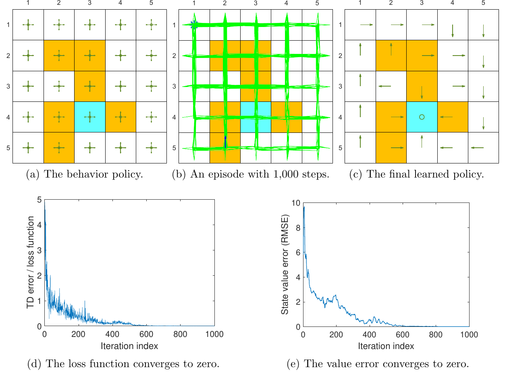
</div>
<div align=center>Hình 8.11 Học chính sách tối ưu bằng học Q sâu. (a) Chính sách hành vi. (b) Tập 1.000 bước. (c) Chính sách học được. (d) Hàm mất mát hội tụ về 0. (e) Sai số giá trị hội tụ về 0. γ = 0.9, phạt biên = phạt ô cấm = −10, thưởng đích = 1, kích thước lô 100. Nguồn: Zhao (2025)</div>

- **Dữ liệu:** một tập duy nhất do chính sách hành vi ở hình 8.11a sinh ra; chính sách này chọn mọi hành động ở mọi trạng thái với xác suất bằng nhau, nên có tính khám phá cao. Tập chỉ dài **1.000 bước** (hình 8.11b), nhưng gần như mọi cặp trạng thái–hành động đều được thăm. Bộ nhớ phát lại là tập 1.000 mẫu đó; kích thước lô 100.
- **Mạng:** mạng chính và mạng mục tiêu cùng cấu trúc, **một lớp ẩn 100 nơ-ron**. Ba đầu vào: chỉ số hàng và cột của trạng thái (chuẩn hóa về $[0, 1]$), và chỉ số hành động (chuẩn hóa). Một đầu ra: giá trị ước lượng. Dùng hàng và cột thay vì chỉ số trạng thái vì biết trạng thái ứng với một vị trí 2 chiều trên lưới; càng dùng nhiều thông tin về trạng thái khi thiết kế mạng thì mạng càng tốt. Cũng có thể thiết kế khác, ví dụ hai đầu vào (hàng, cột) và năm đầu ra (giá trị của năm hành động), như bài báo DQN gốc.
- **Kết quả:** hàm mất mát (trung bình bình phương sai số TD mỗi lô) hội tụ về 0, nghĩa là mạng khớp tốt các mẫu huấn luyện (hình 8.11d). Sai số ước lượng giá trị trạng thái cũng hội tụ về 0 (hình 8.11e), nên ước lượng giá trị hành động tối ưu đủ chính xác và chính sách tham lam tương ứng là tối ưu.

**Ví dụ này cho thấy học Q sâu rất hiệu quả:** một tập ngắn 1.000 bước đã đủ để có chính sách tối ưu, trong khi Q-learning dạng bảng cần tập 100.000 bước (hình 7.4). Hai lý do: phương pháp xấp xỉ hàm có khả năng tổng quát hóa mạnh, và các mẫu kinh nghiệm được dùng lại nhiều lần.

**Thử thách với ít dữ liệu hơn (hình 8.12):** một tập chỉ **100 bước**. Mạng vẫn được huấn luyện tốt theo nghĩa hàm mất mát hội tụ về 0, nhưng sai số ước lượng giá trị **không** hội tụ về 0. Nghĩa là mạng khớp được các mẫu đã cho, nhưng mẫu quá ít để ước lượng chính xác giá trị hành động tối ưu.

<div align=center>
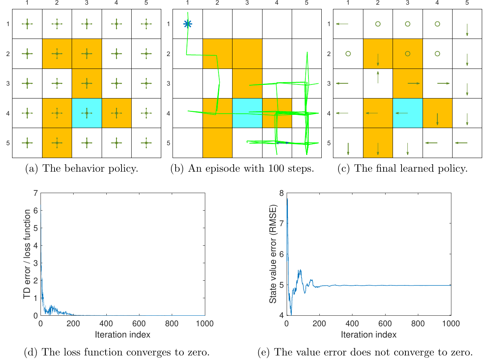
</div>
<div align=center>Hình 8.12 Học Q sâu với tập chỉ 100 bước. Hàm mất mát hội tụ về 0 (d) nhưng sai số giá trị không hội tụ về 0 (e). Kích thước lô 50. Nguồn: Zhao (2025)</div>

*(ghi chú của người biên soạn)* Đây là một bài học thực hành quan trọng: **mất mát huấn luyện về 0 không có nghĩa là học đúng**. Mất mát đo mức khớp với mục tiêu tự tạo ra (tự cập nhật), không đo khoảng cách tới giá trị thật. Phải có thước đo độc lập (ở đây là sai số so với $v^{\ast}$) mới biết thuật toán có thực sự học đúng hay không.

## 8.5 Tóm tắt

Chương này tiếp tục với học TD, nhưng chuyển từ phương pháp **dạng bảng** sang **xấp xỉ hàm**.

- Chìa khóa để hiểu xấp xỉ hàm: nó là **một bài toán tối ưu**. Hàm mục tiêu đơn giản nhất là bình phương sai số giữa giá trị thật và giá trị ước lượng; ngoài ra còn sai số Bellman và sai số Bellman chiếu. TD-Linear thực ra cực tiểu hóa **sai số Bellman chiếu**.
- Các thuật toán: TD, Sarsa và Q-learning với xấp xỉ hàm, và học Q sâu.
- Xấp xỉ hàm quan trọng vì nó cho phép **đưa mạng nơ-ron vào học tăng cường**; học Q sâu là một trong những thuật toán học tăng cường sâu thành công nhất.
- Dù mạng nơ-ron là bộ xấp xỉ phi tuyến phổ biến, chương trình bày kỹ trường hợp **tuyến tính**; hiểu thấu trường hợp tuyến tính giúp hiểu tốt hơn trường hợp phi tuyến.
- **Phân phối dừng** đóng vai trò quan trọng trong việc định nghĩa hàm mục tiêu cho xấp xỉ hàm giá trị, và sẽ đóng vai trò then chốt ở chương 9 khi xấp xỉ chính sách bằng hàm.

**Bảng thuật toán:**

| Thuật toán | Cập nhật | Giải bài toán |
|---|---|---|
| TD với xấp xỉ hàm (8.13) | $w \leftarrow w + \alpha[r + \gamma\hat v(s', w) - \hat v(s, w)]\nabla_w\hat v(s, w)$ | đánh giá $v_\pi$ |
| TD-Linear (8.14) | như trên với $\nabla_w\hat v = \phi(s)$ | hội tụ về $A^{-1}b$, cực tiểu $J_{PBE}$ |
| LSTD | $w = \hat A^{-1}\hat b$ | cực tiểu $J_{PBE}$, dùng mẫu hiệu quả hơn |
| Sarsa với xấp xỉ hàm (8.35) | mục tiêu $r + \gamma\hat q(s', a', w)$ | đánh giá $q_\pi$ (+ cải thiện chính sách) |
| Q-learning với xấp xỉ hàm (8.36) | mục tiêu $r + \gamma\max_a\hat q(s', a, w)$ | $q^{\ast}$ |
| Học Q sâu (8.37) | mục tiêu $r + \gamma\max_a\hat q(s', a, w_T)$, phát lại kinh nghiệm | $q^{\ast}$ |

## 8.6 Hỏi đáp

**Hỏi: Khác biệt giữa phương pháp dạng bảng và xấp xỉ hàm?**
Đáp: Một khác biệt quan trọng là cách đọc và cập nhật giá trị. Đọc: dạng bảng đọc thẳng ô tương ứng; dạng hàm phải đưa $s$ vào hàm và tính giá trị hàm (với mạng nơ-ron là một lượt lan truyền xuôi). Cập nhật: dạng bảng ghi đè thẳng ô tương ứng; dạng hàm phải cập nhật tham số để thay đổi giá trị gián tiếp.

**Hỏi: Ưu điểm của xấp xỉ hàm so với dạng bảng?**
Đáp: Nhờ cách đọc giá trị, xấp xỉ hàm tiết kiệm bộ nhớ hơn: dạng bảng lưu $\lvert\mathcal S\rvert$ giá trị, còn xấp xỉ hàm chỉ lưu một vectơ tham số có số chiều thường nhỏ hơn nhiều. Nhờ cách cập nhật giá trị, xấp xỉ hàm còn có khả năng tổng quát hóa mạnh hơn: với dạng bảng, cập nhật giá trị một trạng thái không đổi giá trị các trạng thái khác; với xấp xỉ hàm, cập nhật tham số ảnh hưởng giá trị nhiều trạng thái, nên mẫu kinh nghiệm của một trạng thái giúp ước lượng giá trị các trạng thái khác.

**Hỏi: Có thống nhất được hai phương pháp không?**
Đáp: Có. Dạng bảng là trường hợp đặc biệt của xấp xỉ hàm (hộp 8.2).

**Hỏi: Phân phối dừng là gì, vì sao quan trọng?**
Đáp: Nó mô tả hành vi dài hạn của một MDP: sau khi tác tử đi theo chính sách đủ lâu, xác suất tác tử ở mỗi trạng thái được mô tả bởi phân phối dừng (hộp 8.1). Khái niệm này xuất hiện vì cần nó để định nghĩa một hàm mục tiêu hợp lệ: hàm mục tiêu có chứa phân phối của trạng thái, thường chọn là phân phối dừng. Phân phối dừng quan trọng cả với xấp xỉ giá trị lẫn với gradient chính sách ở chương 9.

**Hỏi: Ưu nhược điểm của xấp xỉ hàm tuyến tính?**
Đáp: Đây là trường hợp đơn giản nhất, có thể phân tích lý thuyết thấu đáo. Nhưng khả năng xấp xỉ hạn chế, và khó chọn đặc trưng cho bài toán phức tạp. Ngược lại, mạng nơ-ron là bộ xấp xỉ phi tuyến phổ quát kiểu hộp đen, dễ dùng hơn. Dù vậy vẫn đáng học trường hợp tuyến tính để nắm ý tưởng xấp xỉ hàm; và nó vẫn mạnh ở chỗ dạng bảng là một trường hợp tuyến tính đặc biệt.

**Hỏi: Vì sao học Q sâu cần phát lại kinh nghiệm?**
Đáp: Lý do nằm ở hàm mục tiêu (8.37). Muốn hàm mục tiêu được định nghĩa rõ, phải xác định phân phối của $S, A, R, S'$. Khi biết $(S, A)$ thì phân phối của $R$, $S'$ do mô hình quyết định. Cách đơn giản nhất để mô tả phân phối của $(S, A)$ là giả sử nó đều. Nhưng các mẫu thực tế sinh ra thành chuỗi theo chính sách hành vi nên không đều; phải phá tương quan giữa các mẫu trong chuỗi, bằng cách rút đều từ bộ nhớ phát lại. Lợi ích thêm: mỗi mẫu có thể dùng nhiều lần, tăng hiệu quả dữ liệu.

**Hỏi: Q-learning dạng bảng có dùng được phát lại kinh nghiệm không?**
Đáp: Q-learning dạng bảng không cần phát lại kinh nghiệm, nhưng dùng cũng không gặp vấn đề gì, vì Q-learning là ngoài chính sách nên không đòi hỏi gì về cách thu mẫu. Lợi ích là mẫu được dùng lại nhiều lần, hiệu quả hơn.

**Hỏi: Vì sao học Q sâu cần hai mạng?**
Đáp: Lý do căn bản là để đơn giản hóa việc tính gradient của (8.37). Vì $w$ xuất hiện cả trong $\hat q(S, A, w)$ lẫn trong $R + \gamma\max_a\hat q(S', a, w)$, tính gradient theo $w$ không đơn giản. Nếu cố định $w$ trong $R + \gamma\max_a\hat q(S', a, w)$ thì gradient tính dễ như (8.38), và gradient này gợi ý duy trì hai mạng: tham số mạng chính cập nhật mỗi vòng, tham số mạng mục tiêu cố định trong một khoảng. Nhưng tham số mạng mục tiêu không thể cố định mãi; nó phải được cập nhật sau mỗi một số vòng nhất định.

**Hỏi: Khi dùng mạng nơ-ron làm bộ xấp xỉ phi tuyến, cập nhật tham số thế nào?**
Đáp: Không nên cập nhật trực tiếp vectơ tham số bằng các công thức như (8.36). Thay vào đó, làm theo quy trình huấn luyện mạng nơ-ron, dùng các bộ công cụ huấn luyện mạng nơ-ron đã rất phổ biến và hoàn thiện.

## Đọc tiếp

- Quay lại [Chương 7 Phương pháp sai phân thời gian](mathrl/ch07_vi) · Tiếp theo [Chương 9 Phương pháp gradient chính sách](mathrl/ch09_vi)
- Đối chiếu với EasyRL: [Chương 6 DQN (khái niệm cơ bản)](chapter6/chapter6_vi), [Chương 7 DQN (kỹ thuật nâng cao)](chapter7/chapter7_vi), [Chương 8 DQN (hành động liên tục)](chapter8/chapter8_vi) và [Dự án 2 DQN giải CartPole](chapter7/project2_vi). EasyRL viết mạng mục tiêu là $\hat Q$; xem [bảng quy đổi ký hiệu](notation_vi).
- Thử tương tác: [mô phỏng chương 6](chapter6/chapter6_viz_vi) có DQN.
