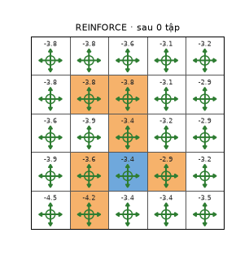
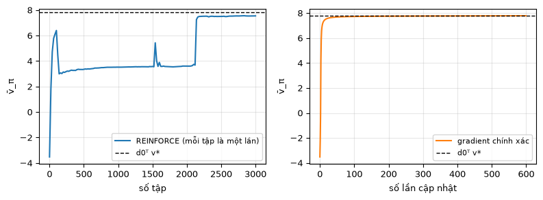

# Chương 9 · Code

> Ghi chú của người biên soạn: trang này không có trong sách. Nó chạy REINFORCE (thuật toán 9.1) của [chương 9](mathrl/ch09_vi) trên lưới 5×5, với chính sách softmax dạng bảng $\pi(a \mid s, \theta) \propto e^{\theta[s,a]}$. Vì biết mô hình, ta tính được **chính xác** thước đo $\bar v_\pi$ ở mỗi bước để theo dõi quá trình học, và so với đi lên theo gradient chính xác của định lý 9.2. Phép kiểm chứng định lý 9.2 bằng sai phân hữu hạn đã có ở mục "Kiểm tra bằng mã" trong chương. Ký hiệu theo [Quy ước ký hiệu](notation_vi).

Mỗi khối code đã được chạy sẵn. Kết quả, hình và ảnh động nằm ngay bên dưới. Các khối chạy lần lượt từ trên xuống và dùng chung biến, như notebook. Muốn tự chạy, xem [mục 5](#_5-chạy-trên-máy).

## 1. Chính sách softmax và thước đo $\bar v_\pi$

<small class="viz-ref">Mục 9.1, 9.2 · công thức (9.1)</small>

Lưới của hình 3.4a, $\gamma = 0.9$. Thước đo là giá trị trung bình $\bar v_\pi = d_0^T v_\pi$ với $d_0$ đều: mọi ô xuất phát quan trọng như nhau. Giá trị tốt nhất có thể đạt được là $d_0^T v^{\ast}$.

<!-- run -->
```python
import numpy as np
import matplotlib.pyplot as plt
from zhao_grid import make_grid, value_iteration, plot_grid
from viz import save_gif

P, R = make_grid()
gamma, n_s, n_a = 0.9, 25, 5
next_state = P.argmax(axis=2)
d0 = np.full(n_s, 1 / n_s)
v_star, _ = value_iteration(P, R, gamma, tol=1e-10)
J_star = d0 @ v_star

def policy(theta):
    z = np.exp(theta - theta.max(axis=1, keepdims=True))
    return z / z.sum(axis=1, keepdims=True)                 # π(a|s,θ) = softmax(θ[s])

def evaluate(theta):
    """v_π và q_π chính xác (dùng mô hình, chỉ để theo dõi)."""
    pi = policy(theta)
    P_pi, r_pi = np.einsum("sa,sat->st", pi, P), (pi * R).sum(axis=1)
    v = np.linalg.solve(np.eye(n_s) - gamma * P_pi, r_pi)
    return pi, P_pi, v, R + gamma * P @ v

theta0 = np.zeros((n_s, n_a))                                # π_0: chính sách đều
print(f"v̄ của chính sách đều = {d0 @ evaluate(theta0)[2]:.3f},  v̄ tốt nhất d0ᵀv* = {J_star:.3f}")
```

<!-- output -->
```output
v̄ của chính sách đều = -3.520,  v̄ tốt nhất d0ᵀv* = 7.799
```
<!-- /output -->

## 2. REINFORCE

<small class="viz-ref">Mục 9.4 · thuật toán 9.1 · công thức (9.32)</small>

Mỗi vòng: sinh một tập theo $\pi(\theta_k)$, bắt đầu từ một ô ngẫu nhiên theo $d_0$. Lưới không có ô kết thúc, nên ta cắt tập sau $T = 40$ bước ($\gamma^{40} \approx 0.015$, phần bị bỏ rất nhỏ). Sau đó với mỗi bước $t$, lấy lợi tức $q_t(s_t, a_t) = \sum_{k \ge t} \gamma^{k-t} r_{k+1}$ làm ước lượng của $q_\pi(s_t, a_t)$, rồi cập nhật:

$$
\theta_{t+1} = \theta_t + \alpha\, \nabla_\theta \ln \pi(a_t \mid s_t, \theta_t)\, q_t(s_t, a_t)
$$

Với softmax dạng bảng, $\nabla_{\theta[s,\cdot]} \ln \pi(a \mid s, \theta) = \mathbf e_a - \pi(\cdot \mid s, \theta)$, và gradient bằng 0 ở các hàng khác $s$.

<!-- run -->
```python
def reinforce(n_episodes=3000, T=40, alpha=0.1, seed=0, snap_every=100):
    rng = np.random.default_rng(seed)
    theta = np.zeros((n_s, n_a))
    J_curve, snaps = [], []
    for ep in range(n_episodes):
        if ep % 20 == 0:
            J_curve.append((ep, d0 @ evaluate(theta)[2]))
        if ep % snap_every == 0:
            snaps.append((ep, policy(theta)))
        # 1. Sinh một tập theo π(θ)
        pi = policy(theta)
        s = rng.integers(n_s)
        S, A, Rw = [], [], []
        for t in range(T):
            a = rng.choice(n_a, p=pi[s])
            S.append(s); A.append(a); Rw.append(R[s, a])
            s = next_state[s, a]
        # 2. Lợi tức q_t từ cuối tập về đầu, rồi cập nhật θ theo từng bước
        g = 0.0
        for t in reversed(range(T)):
            g = Rw[t] + gamma * g                              # q_t(s_t, a_t)
            grad_log = -policy(theta)[S[t]]
            grad_log[A[t]] += 1                                # e_a − π(·|s)
            theta[S[t]] += alpha * grad_log * g                # (9.32)
    J_curve.append((n_episodes, d0 @ evaluate(theta)[2]))
    snaps.append((n_episodes, policy(theta)))
    return theta, J_curve, snaps

theta_rf, J_rf, snaps = reinforce()
print(f"REINFORCE sau 3000 tập: v̄ = {J_rf[-1][1]:.3f}  (tốt nhất {J_star:.3f})")
```

<!-- output -->
```output
REINFORCE sau 3000 tập: v̄ = 7.542  (tốt nhất 7.799)
```
<!-- /output -->

Ảnh động dưới vẽ chính sách $\pi(\theta)$ sau mỗi 100 tập, với giá trị thật $v_\pi$ trong từng ô. Độ dài mũi tên tỉ lệ với xác suất, so với hành động có xác suất lớn nhất trong ô.

<!-- run -->
```python
def draw(fig, i):
    ep, pi = snaps[i]
    P_pi, r_pi = np.einsum("sa,sat->st", pi, P), (pi * R).sum(axis=1)
    v = np.linalg.solve(np.eye(n_s) - gamma * P_pi, r_pi)
    plot_grid(v, pi, title=f"REINFORCE · sau {ep} tập", ax=fig.add_subplot(1, 1, 1))

save_gif(draw, len(snaps), "reinforce_policy.gif", fps=4, figsize=(3.4, 3.6), dpi=90)
```

<!-- output -->
<div align=center></div>
<!-- /output -->

## 3. So với đi lên theo gradient chính xác

<small class="viz-ref">Mục 9.3 · định lý 9.2</small>

Nếu biết mô hình, ta tính được gradient chính xác theo định lý 9.2:

$$
\nabla_\theta \bar v_\pi^0 = \sum_s \rho_\pi(s) \sum_a \nabla_\theta \pi(a \mid s, \theta)\, q_\pi(s, a), \qquad \rho_\pi^T = d_0^T (I - \gamma P_\pi)^{-1}
$$

Với softmax dạng bảng, $\partial \bar v / \partial \theta[s,a] = \rho_\pi(s)\, \pi(a \mid s)\big(q_\pi(s,a) - v_\pi(s)\big)$. REINFORCE chính là phiên bản lấy mẫu của phép tính này. Ta so tốc độ hai cách theo cùng một trục: số lần cập nhật chính sách.

<!-- run -->
```python
def exact_gradient_ascent(n_iter=600, lr=5.0):
    theta, curve = np.zeros((n_s, n_a)), []
    for k in range(n_iter):
        pi, P_pi, v, q = evaluate(theta)
        curve.append(d0 @ v)
        rho = d0 @ np.linalg.inv(np.eye(n_s) - gamma * P_pi)          # ρ_π
        theta += lr * rho[:, None] * pi * (q - v[:, None])              # định lý 9.2, softmax
    return theta, curve

theta_ex, J_ex = exact_gradient_ascent()
print(f"Gradient chính xác sau 600 lần cập nhật: v̄ = {J_ex[-1]:.3f}")

fig, axes = plt.subplots(1, 2, figsize=(8, 3))
axes[0].plot(*zip(*J_rf), label="REINFORCE (mỗi tập là một lần)")
axes[0].set_xlabel("số tập")
axes[1].plot(J_ex, color="C1", label="gradient chính xác")
axes[1].set_xlabel("số lần cập nhật")
for ax in axes:
    ax.axhline(J_star, color="k", ls="--", lw=1, label="d0ᵀ v*")
    ax.set_ylabel("v̄_π"); ax.legend(fontsize=8); ax.grid(alpha=.3)
plt.tight_layout()
```

<!-- output -->
```output
Gradient chính xác sau 600 lần cập nhật: v̄ = 7.788
```

<div align=center></div>
<!-- /output -->

Cả hai đều đi từ $\bar v = -3.5$ (chính sách đều) lên gần $d_0^T v^{\ast} \approx 7.8$. Gradient chính xác đi lên trơn tru, tới $7.79$ sau 600 lần cập nhật. REINFORCE tới $7.54$ sau 3000 tập, với đường cong gồ ghề hơn: mỗi tập chỉ cho một ước lượng nhiễu của gradient, từ một ô xuất phát và 40 bước. Đó là cái giá của việc không biết mô hình. Chính sách softmax cũng chỉ tiến dần tới tất định chứ không bao giờ tất định hẳn, nên $\bar v_\pi$ chỉ tiệm cận $d_0^T v^{\ast}$ từ dưới lên.

## 4. Đối chiếu với code của EasyRL

[Trang Code chương 4 của EasyRL](chapter4/chapter4_code_vi) chạy REINFORCE với mạng nơ-ron trên CartPole, và cho thấy vì sao cần đường cơ sở. Ở đây chính sách là một bảng $\theta[s, a]$, và lưới không có đường cơ sở nào. Phần thưởng có cả dương lẫn âm, nên $q_t$ tự đổi dấu: hành động dẫn tới ô cấm hay đâm biên thì bị giảm xác suất. Chương 10 sẽ thêm đường cơ sở $v_\pi(s)$ để giảm phương sai.

## 5. Chạy trên máy

```bash
git clone https://github.com/nmc2004nd/easy-rl-vi.git
cd easy-rl-vi/docs/code/py          # chạy từ đây để import được zhao_grid, viz
pip install numpy matplotlib pillow
```

Chép lần lượt các khối code vào Jupyter rồi chạy theo thứ tự. Kết quả trên trang được dựng bằng `python3 scripts/build_code_pages.py docs/mathrl/ch09_code_vi.md`.
