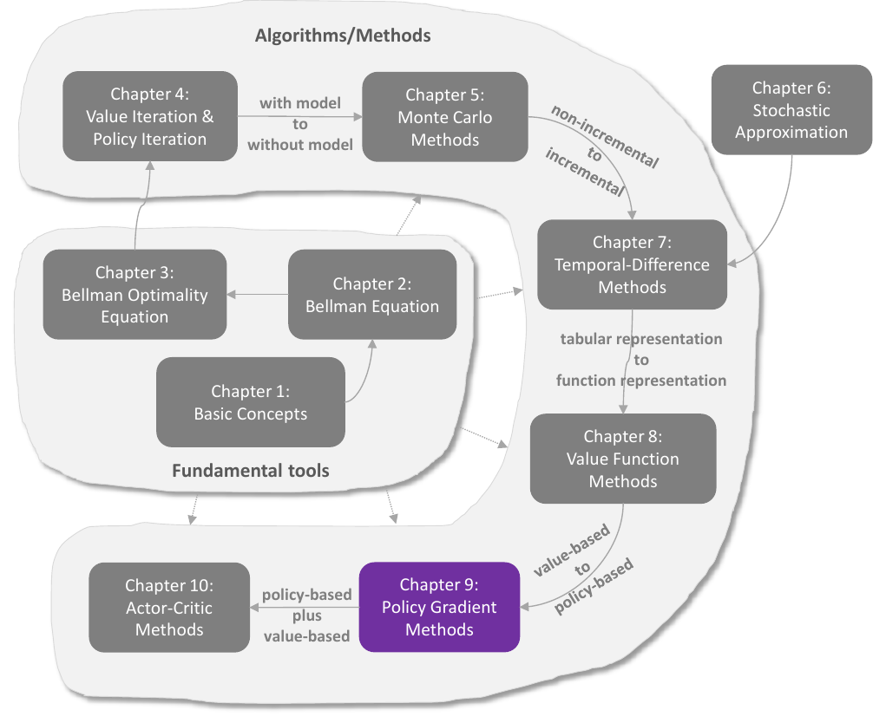
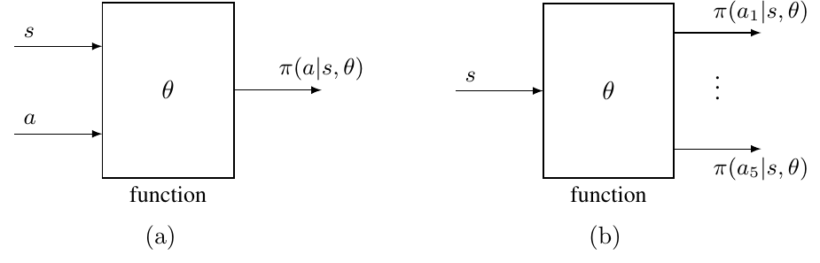

# Chương 9 Phương pháp gradient chính sách

> Ghi chú của người biên soạn: đây là bản tổng hợp tiếng Việt chương 9 sách *Mathematical Foundations of Reinforcement Learning* (Shiyu Zhao, 2025), có bổ sung từ các bài [Policy Gradient Methods](https://lyk-love.cn/2024/06/24/Policy-Gradient-Methods/) và [Proof of the Policy Gradient Theorem](https://lyk-love.cn/2024/06/24/Proof-of-the-Policy-Gradient-Theorem/) trên blog lyk-love. Xem [giới thiệu phần này](mathrl/README_vi) để biết nguồn, và [Quy ước ký hiệu](notation_vi) cho chuẩn ký hiệu dùng chung. Ý không có trong sách được ghi rõ.

<div align=center>

</div>
<div align=center>Hình 9.1 Vị trí của chương này trong sách. Nguồn: Zhao (2025)</div>

Ý tưởng xấp xỉ hàm không chỉ dùng để biểu diễn **giá trị** (chương 8) mà còn để biểu diễn **chính sách** (chương này). Đến giờ, chính sách được lưu trong **bảng**: xác suất hành động ở mọi trạng thái (bảng 9.1). Chương này biểu diễn chính sách bằng **hàm có tham số** $\pi(a \mid s, \theta)$, với $\theta \in \mathbb R^m$ là vectơ tham số. Các tài liệu khác có thể viết $\pi_\theta(a \mid s)$, $\pi_\theta(a, s)$ hay $\pi(a, s, \theta)$.

| | $a_1$ | $a_2$ | $a_3$ | $a_4$ | $a_5$ |
|---|---|---|---|---|---|
| $s_1$ | $\pi(a_1 \mid s_1)$ | $\pi(a_2 \mid s_1)$ | $\pi(a_3 \mid s_1)$ | $\pi(a_4 \mid s_1)$ | $\pi(a_5 \mid s_1)$ |
| $\vdots$ | $\vdots$ | $\vdots$ | $\vdots$ | $\vdots$ | $\vdots$ |
| $s_9$ | $\pi(a_1 \mid s_9)$ | $\pi(a_2 \mid s_9)$ | $\pi(a_3 \mid s_9)$ | $\pi(a_4 \mid s_9)$ | $\pi(a_5 \mid s_9)$ |

<div align=center>Bảng 9.1 Biểu diễn chính sách dạng bảng: 9 trạng thái, mỗi trạng thái 5 hành động</div>

Khi chính sách là hàm, chính sách tối ưu có được bằng cách **tối ưu một thước đo vô hướng**. Cách làm này gọi là **gradient chính sách (policy gradient)**. Đây là **một bước tiến lớn** của sách, vì nó **dựa trên chính sách (policy-based)**, còn mọi chương trước đều **dựa trên giá trị (value-based)**. Gradient chính sách có nhiều ưu điểm: xử lý không gian trạng thái/hành động lớn hiệu quả hơn, khả năng tổng quát hóa mạnh hơn nên dùng mẫu hiệu quả hơn.

## 9.1 Biểu diễn chính sách: từ bảng sang hàm

<div align=center>

</div>
<div align=center>Hình 9.2 Biểu diễn chính sách bằng hàm, với cấu trúc khác nhau. (a) Đầu vào (s, a), đầu ra π(a|s, θ). (b) Đầu vào s, đầu ra xác suất của mọi hành động. Nguồn: Zhao (2025)</div>

Đổi biểu diễn chính sách từ bảng sang hàm thì có ba khác biệt:

| | Dạng bảng | Dạng hàm |
|---|---|---|
| **Định nghĩa chính sách tối ưu** | cực đại hóa **mọi** giá trị trạng thái | cực đại hóa một **thước đo vô hướng** nào đó |
| **Cập nhật chính sách** | sửa trực tiếp ô trong bảng | chỉ cập nhật được bằng cách đổi tham số $\theta$ |
| **Lấy xác suất một hành động** | tra thẳng ô trong bảng | đưa $(s, a)$ vào hàm để tính (hình 9.2a); hoặc đưa $s$ vào và nhận xác suất mọi hành động (hình 9.2b) |

**Ý tưởng cơ bản của gradient chính sách.** Giả sử $J(\theta)$ là một thước đo vô hướng. Chính sách tối ưu có được bằng thuật toán dựa trên gradient:

$$
\theta_{t+1} = \theta_t + \alpha\nabla_\theta J(\theta_t),
$$

với $\nabla_\theta J$ là gradient của $J$ theo $\theta$, $t$ là bước thời gian, $\alpha$ là tốc độ tối ưu. *(Chú ý dấu cộng: ở đây ta **tăng** gradient để cực đại hóa $J$, khác với giảm gradient ở chương 6 và 8.)*

Chương trả lời ba câu hỏi:

1. Dùng **thước đo** nào? (mục 9.2)
2. Tính **gradient** của thước đo thế nào? (mục 9.3)
3. Dùng **mẫu kinh nghiệm** để tính gradient thế nào? (mục 9.4)

## 9.2 Các thước đo để định nghĩa chính sách tối ưu

Khi chính sách là hàm, có hai loại thước đo: dựa trên **giá trị trạng thái** và dựa trên **phần thưởng tức thời**.

### Thước đo 1: giá trị trung bình

**Giá trị trạng thái trung bình (average state value)**, gọi tắt là **giá trị trung bình**:

$$
\bar v_\pi = \sum_{s\in\mathcal S} d(s)\,v_\pi(s),
$$

với $d(s) \ge 0$ là trọng số của $s$ và $\sum_s d(s) = 1$. Có thể coi $d$ là một phân phối xác suất của $s$, nên

$$
\bar v_\pi = \mathbb E_{S\sim d}[v_\pi(S)].
$$

**Chọn phân phối $d$ thế nào?** Có hai trường hợp:

- **$d$ không phụ thuộc chính sách $\pi$.** Khi đó ký hiệu riêng là $d_0$ và $\bar v_\pi^0$. Có thể coi mọi trạng thái quan trọng như nhau, $d_0(s) = 1/\lvert\mathcal S\rvert$. Hoặc chỉ quan tâm một trạng thái $s_0$ (ví dụ tác tử luôn xuất phát từ $s_0$): $d_0(s_0) = 1$ và $d_0(s \ne s_0) = 0$.
- **$d$ phụ thuộc $\pi$.** Thường chọn $d = d_\pi$, **phân phối dừng** dưới $\pi$, thỏa $d_\pi^T P_\pi = d_\pi^T$ (hộp 8.1). Ý nghĩa: phân phối dừng phản ánh hành vi dài hạn dưới chính sách; trạng thái được thăm thường xuyên về lâu dài thì quan trọng hơn, đáng được trọng số cao hơn.

$\bar v_\pi$ là trung bình có trọng số của các giá trị trạng thái; $\theta$ khác nhau cho $\bar v_\pi$ khác nhau. Mục tiêu cuối cùng: tìm chính sách tối ưu (tức $\theta$ tối ưu) để cực đại hóa $\bar v_\pi$.

**Hai cách viết tương đương khác của $\bar v_\pi$:**

- Tác tử đi theo $\pi(\theta)$ và thu phần thưởng $\{R_{t+1}\}_{t=0}^\infty$. Tài liệu hay dùng thước đo
$$J(\theta) = \lim_{n\to\infty}\mathbb E\left[\sum_{t=0}^n\gamma^t R_{t+1}\right] = \mathbb E\left[\sum_{t=0}^\infty\gamma^t R_{t+1}\right]. \tag{9.1}$$
Thoạt nhìn khó hiểu, nhưng nó bằng $\bar v_\pi$:
$$\mathbb E\left[\sum_{t=0}^\infty\gamma^t R_{t+1}\right] = \sum_{s\in\mathcal S} d(s)\,\mathbb E\left[\sum_{t=0}^\infty\gamma^t R_{t+1} \,\Big|\, S_0 = s\right] = \sum_{s\in\mathcal S} d(s)\,v_\pi(s) = \bar v_\pi.$$
Đẳng thức đầu theo luật kỳ vọng toàn phần (với $d$ là phân phối của trạng thái xuất phát $S_0$), đẳng thức sau theo định nghĩa giá trị trạng thái.
- Viết thành tích vô hướng: với $v_\pi = [\dots, v_\pi(s), \dots]^T$ và $d = [\dots, d(s), \dots]^T$ thuộc $\mathbb R^{\lvert\mathcal S\rvert}$,
$$\bar v_\pi = d^T v_\pi.$$
Cách viết này hữu ích khi phân tích gradient.

### Thước đo 2: phần thưởng trung bình

**Phần thưởng một bước trung bình (average one-step reward)**, gọi tắt là **phần thưởng trung bình**:

$$
\bar r_\pi \doteq \sum_{s\in\mathcal S} d_\pi(s)\,r_\pi(s) = \mathbb E_{S\sim d_\pi}[r_\pi(S)], \tag{9.2}
$$

với $d_\pi$ là phân phối dừng và

$$
r_\pi(s) \doteq \sum_{a\in\mathcal A}\pi(a \mid s, \theta)\,r(s, a) = \mathbb E_{A\sim\pi(s,\theta)}[r(s, A) \mid s] \tag{9.3}
$$

là kỳ vọng phần thưởng tức thời, với $r(s, a) \doteq \mathbb E[R \mid s, a] = \sum_r r\,p(r \mid s, a)$.

**Hai cách viết tương đương khác của $\bar r_\pi$:**

- Tác tử đi theo $\pi(\theta)$ và thu $\{R_{t+1}\}_{t=0}^\infty$. Một thước đo hay gặp:
$$J(\theta) = \lim_{n\to\infty}\frac1n\mathbb E\left[\sum_{t=0}^{n-1}R_{t+1}\right]. \tag{9.4}$$
Nó bằng $\bar r_\pi$:
$$\lim_{n\to\infty}\frac1n\mathbb E\left[\sum_{t=0}^{n-1}R_{t+1}\right] = \sum_{s\in\mathcal S} d_\pi(s)\,r_\pi(s) = \bar r_\pi. \tag{9.5}$$
Chứng minh ở hộp 9.1.
- Viết thành tích vô hướng: với $r_\pi = [\dots, r_\pi(s), \dots]^T$ và $d_\pi = [\dots, d_\pi(s), \dots]^T$, có $\bar r_\pi = d_\pi^T r_\pi$.

> **Hộp 9.1: Chứng minh (9.5)**
>
> **Bước 1:** chứng minh với **mọi** trạng thái xuất phát $s_0 \in \mathcal S$:
> $$\bar r_\pi = \lim_{n\to\infty}\frac1n\mathbb E\left[\sum_{t=0}^{n-1}R_{t+1} \,\Big|\, S_0 = s_0\right]. \tag{9.6}$$
> Ta có
> $$\lim_{n\to\infty}\frac1n\mathbb E\left[\sum_{t=0}^{n-1}R_{t+1} \,\Big|\, S_0 = s_0\right] = \lim_{n\to\infty}\frac1n\sum_{t=0}^{n-1}\mathbb E[R_{t+1} \mid S_0 = s_0] = \lim_{t\to\infty}\mathbb E[R_{t+1} \mid S_0 = s_0], \tag{9.7}$$
> đẳng thức cuối theo tính chất **trung bình Cesàro**: nếu dãy $\{a_k\}$ hội tụ thì dãy trung bình $\{\frac1n\sum_{k=1}^n a_k\}$ cũng hội tụ về cùng giới hạn.
>
> Theo luật kỳ vọng toàn phần:
> $$\mathbb E[R_{t+1} \mid S_0 = s_0] = \sum_{s\in\mathcal S}\mathbb E[R_{t+1} \mid S_t = s, S_0 = s_0]\,p^{(t)}(s \mid s_0) = \sum_{s\in\mathcal S}\mathbb E[R_{t+1} \mid S_t = s]\,p^{(t)}(s \mid s_0) = \sum_{s\in\mathcal S} r_\pi(s)\,p^{(t)}(s \mid s_0),$$
> với $p^{(t)}(s \mid s_0)$ là xác suất đi từ $s_0$ tới $s$ trong đúng $t$ bước; đẳng thức thứ hai do tính Markov. Theo định nghĩa phân phối dừng, $\lim_{t\to\infty}p^{(t)}(s \mid s_0) = d_\pi(s)$, nên trạng thái xuất phát không quan trọng:
> $$\lim_{t\to\infty}\mathbb E[R_{t+1} \mid S_0 = s_0] = \lim_{t\to\infty}\sum_{s\in\mathcal S} r_\pi(s)\,p^{(t)}(s \mid s_0) = \sum_{s\in\mathcal S} r_\pi(s)\,d_\pi(s) = \bar r_\pi.$$
> Thay vào (9.7) được (9.6).
>
> **Bước 2:** với phân phối trạng thái xuất phát $d$ bất kỳ, theo luật kỳ vọng toàn phần:
> $$\lim_{n\to\infty}\frac1n\mathbb E\left[\sum_{t=0}^{n-1}R_{t+1}\right] = \sum_{s\in\mathcal S} d(s)\lim_{n\to\infty}\frac1n\mathbb E\left[\sum_{t=0}^{n-1}R_{t+1} \,\Big|\, S_0 = s\right] = \sum_{s\in\mathcal S} d(s)\,\bar r_\pi = \bar r_\pi.$$
> $\blacksquare$

### Nhận xét

| Thước đo | Cách viết 1 | Cách viết 2 | Cách viết 3 |
|---|---|---|---|
| $\bar v_\pi$ | $\sum_s d(s)\,v_\pi(s)$ | $\mathbb E_{S\sim d}[v_\pi(S)]$ | $\lim_{n\to\infty}\mathbb E\big[\sum_{t=0}^n\gamma^t R_{t+1}\big]$ |
| $\bar r_\pi$ | $\sum_s d_\pi(s)\,r_\pi(s)$ | $\mathbb E_{S\sim d_\pi}[r_\pi(S)]$ | $\lim_{n\to\infty}\frac1n\mathbb E\big[\sum_{t=0}^{n-1}R_{t+1}\big]$ |

<div align=center>Bảng 9.2 Các cách viết khác nhau nhưng tương đương của v̄π và r̄π</div>

Đôi khi dùng $\bar v_\pi$ để chỉ riêng trường hợp phân phối là $d_\pi$, và $\bar v_\pi^0$ khi $d_0$ không phụ thuộc $\pi$.

- Mọi thước đo trên đều là hàm của $\pi$, mà $\pi$ có tham số $\theta$, nên chúng là hàm của $\theta$. Có thể tìm $\theta$ tối ưu để cực đại hóa chúng; đó là ý tưởng cơ bản của gradient chính sách.
- Trong trường hợp **có chiết khấu** ($\gamma < 1$), hai thước đo $\bar v_\pi$ và $\bar r_\pi$ **tương đương**:
$$\bar r_\pi = (1 - \gamma)\,\bar v_\pi,$$
nên cực đại hóa cái này cũng là cực đại hóa cái kia. Chứng minh ở bổ đề 9.1.

## 9.3 Gradient của các thước đo

Kết quả lý thuyết quan trọng nhất của chương:

> **Định lý 9.1 (Định lý gradient chính sách).** Gradient của $J(\theta)$ là
> $$\nabla_\theta J(\theta) = \sum_{s\in\mathcal S}\eta(s)\sum_{a\in\mathcal A}\nabla_\theta\pi(a \mid s, \theta)\,q_\pi(s, a), \tag{9.8}$$
> với $\eta$ là một phân phối trạng thái và $\nabla_\theta\pi$ là gradient của $\pi$ theo $\theta$. Hơn nữa, (9.8) có dạng gọn viết bằng kỳ vọng:
> $$\nabla_\theta J(\theta) = \mathbb E_{S\sim\eta,\,A\sim\pi(S,\theta)}\big[\nabla_\theta\ln\pi(A \mid S, \theta)\,q_\pi(S, A)\big], \tag{9.9}$$
> với $\ln$ là logarit tự nhiên.

**Lưu ý quan trọng về định lý 9.1:**

- Định lý 9.1 là **bản tóm tắt** kết quả của các định lý 9.2, 9.3 và 9.5, ứng với các thước đo và trường hợp có/không chiết khấu khác nhau. Gradient trong các trường hợp đó có biểu thức tương tự nên được gộp lại. $J(\theta)$ có thể là $\bar v_\pi^0$, $\bar v_\pi$ hoặc $\bar r_\pi$; đẳng thức (9.8) có thể là đẳng thức thật hoặc xấp xỉ; phân phối $\eta$ cũng khác nhau tùy trường hợp.
- Suy ra gradient là phần **phức tạp nhất** của gradient chính sách. **Với nhiều người đọc, chỉ cần nắm kết quả của định lý 9.1, không cần biết chứng minh.** Phần suy ra ở phần còn lại của mục này nặng toán; nên đọc chọn lọc.
- Dạng (9.9) tốt hơn (9.8) vì nó là **một kỳ vọng**; mục 9.4 sẽ xấp xỉ gradient thật này bằng một gradient ngẫu nhiên.

**Vì sao (9.8) viết được thành (9.9)?** Theo định nghĩa kỳ vọng, (9.8) thành

$$
\nabla_\theta J(\theta) = \sum_{s\in\mathcal S}\eta(s)\sum_{a\in\mathcal A}\nabla_\theta\pi(a \mid s, \theta)\,q_\pi(s, a) = \mathbb E_{S\sim\eta}\left[\sum_{a\in\mathcal A}\nabla_\theta\pi(a \mid S, \theta)\,q_\pi(S, a)\right]. \tag{9.10}
$$

Gradient của $\ln\pi(a \mid s, \theta)$ là

$$
\nabla_\theta\ln\pi(a \mid s, \theta) = \frac{\nabla_\theta\pi(a \mid s, \theta)}{\pi(a \mid s, \theta)},
$$

nên

$$
\nabla_\theta\pi(a \mid s, \theta) = \pi(a \mid s, \theta)\,\nabla_\theta\ln\pi(a \mid s, \theta). \tag{9.11}
$$

Thay (9.11) vào (9.10):

$$
\nabla_\theta J(\theta) = \mathbb E\left[\sum_{a\in\mathcal A}\pi(a \mid S, \theta)\,\nabla_\theta\ln\pi(a \mid S, \theta)\,q_\pi(S, a)\right] = \mathbb E_{S\sim\eta,\,A\sim\pi(S,\theta)}\big[\nabla_\theta\ln\pi(A \mid S, \theta)\,q_\pi(S, A)\big].
$$

*(ghi chú của người biên soạn)* Đây là **mẹo log-đạo hàm (log-derivative trick)**: nhân rồi chia cho $\pi$ để biến tổng theo $a$ thành kỳ vọng theo $A \sim \pi$. Chính nhờ có $\pi$ đứng trước mà ta lấy mẫu $A$ theo $\pi$ được. Đó là lý do có hàm $\ln$ trong gradient chính sách (xem hỏi đáp).

**$\pi(a \mid s, \theta)$ phải dương với mọi $(s, a)$** để $\ln\pi(a \mid s, \theta)$ có nghĩa. Có thể đạt được bằng hàm **softmax**:

$$
\pi(a \mid s, \theta) = \frac{e^{h(s,a,\theta)}}{\sum_{a'\in\mathcal A}e^{h(s,a',\theta)}}, \qquad a \in \mathcal A, \tag{9.12}
$$

với $h(s, a, \theta)$ là hàm chỉ **mức ưa thích** chọn $a$ ở $s$. Chính sách (9.12) thỏa $\pi(a \mid s, \theta) \in (0, 1)$ và $\sum_a\pi(a \mid s, \theta) = 1$ với mọi $s$. Có thể hiện thực bằng mạng nơ-ron: đầu vào $s$, lớp ra là lớp softmax, nên mạng xuất $\pi(a \mid s, \theta)$ cho mọi $a$ và tổng các đầu ra bằng 1 (hình 9.2b).

Vì $\pi(a \mid s, \theta) > 0$ với mọi $a$, chính sách là **ngẫu nhiên**, do đó **có tính khám phá**. Chính sách không nói trực tiếp chọn hành động nào; hành động phải được **lấy mẫu** theo phân phối của chính sách.

### 9.3.1 Suy ra gradient trong trường hợp có chiết khấu

Xét $\gamma \in (0, 1)$. Giá trị trạng thái và giá trị hành động:

$$
\begin{aligned}
v_\pi(s) &= \mathbb E[R_{t+1} + \gamma R_{t+2} + \gamma^2 R_{t+3} + \cdots \mid S_t = s],\\
q_\pi(s, a) &= \mathbb E[R_{t+1} + \gamma R_{t+2} + \gamma^2 R_{t+3} + \cdots \mid S_t = s, A_t = a],
\end{aligned}
$$

với $v_\pi(s) = \sum_a\pi(a \mid s, \theta)\,q_\pi(s, a)$, và giá trị trạng thái thỏa phương trình Bellman.

> **Bổ đề 9.1 (Tương đương giữa $\bar v_\pi(\theta)$ và $\bar r_\pi(\theta)$).** Trong trường hợp có chiết khấu $\gamma \in (0, 1)$:
> $$\bar r_\pi = (1 - \gamma)\,\bar v_\pi. \tag{9.13}$$
>
> **Chứng minh.** $\bar v_\pi(\theta) = d_\pi^T v_\pi$ và $\bar r_\pi(\theta) = d_\pi^T r_\pi$, với $v_\pi$, $r_\pi$ thỏa phương trình Bellman $v_\pi = r_\pi + \gamma P_\pi v_\pi$. Nhân $d_\pi^T$ hai vế:
> $$\bar v_\pi = \bar r_\pi + \gamma d_\pi^T P_\pi v_\pi = \bar r_\pi + \gamma d_\pi^T v_\pi = \bar r_\pi + \gamma\bar v_\pi,$$
> suy ra (9.13). $\blacksquare$

> **Bổ đề 9.2 (Gradient của $v_\pi(s)$).** Trong trường hợp có chiết khấu, với mọi $s \in \mathcal S$:
> $$\nabla_\theta v_\pi(s) = \sum_{s'\in\mathcal S}\Pr_\pi(s' \mid s)\sum_{a\in\mathcal A}\nabla_\theta\pi(a \mid s', \theta)\,q_\pi(s', a), \tag{9.14}$$
> với
> $$\Pr_\pi(s' \mid s) \doteq \sum_{k=0}^\infty\gamma^k[P_\pi^k]_{ss'} = \big[(I_n - \gamma P_\pi)^{-1}\big]_{ss'}$$
> là **xác suất tổng có chiết khấu** đi từ $s$ tới $s'$ dưới chính sách $\pi$. Ở đây $[\cdot]_{ss'}$ là phần tử hàng $s$ cột $s'$, và $[P_\pi^k]_{ss'}$ là xác suất đi từ $s$ tới $s'$ trong đúng $k$ bước.

> **Hộp 9.2: Chứng minh bổ đề 9.2**
>
> Với mọi $s \in \mathcal S$:
> $$\nabla_\theta v_\pi(s) = \nabla_\theta\left[\sum_{a\in\mathcal A}\pi(a \mid s, \theta)\,q_\pi(s, a)\right] = \sum_{a\in\mathcal A}\big[\nabla_\theta\pi(a \mid s, \theta)\,q_\pi(s, a) + \pi(a \mid s, \theta)\,\nabla_\theta q_\pi(s, a)\big], \tag{9.15}$$
> với $q_\pi(s, a) = r(s, a) + \gamma\sum_{s'} p(s' \mid s, a)\,v_\pi(s')$. Vì $r(s, a) = \sum_r r\,p(r \mid s, a)$ không phụ thuộc $\theta$:
> $$\nabla_\theta q_\pi(s, a) = 0 + \gamma\sum_{s'\in\mathcal S} p(s' \mid s, a)\,\nabla_\theta v_\pi(s').$$
> Thay vào (9.15):
> $$\nabla_\theta v_\pi(s) = \sum_{a\in\mathcal A}\nabla_\theta\pi(a \mid s, \theta)\,q_\pi(s, a) + \gamma\sum_{a\in\mathcal A}\pi(a \mid s, \theta)\sum_{s'\in\mathcal S} p(s' \mid s, a)\,\nabla_\theta v_\pi(s'). \tag{9.16}$$
> $\nabla_\theta v_\pi$ xuất hiện ở cả hai vế. Một cách tính là kỹ thuật **khai triển (unrolling)**; ở đây dùng dạng ma trận–vectơ, dễ hiểu hơn. Đặt
> $$u(s) \doteq \sum_{a\in\mathcal A}\nabla_\theta\pi(a \mid s, \theta)\,q_\pi(s, a).$$
> Vì $\sum_a\pi(a \mid s, \theta)\sum_{s'} p(s' \mid s, a)\,\nabla_\theta v_\pi(s') = \sum_{s'} p(s' \mid s)\,\nabla_\theta v_\pi(s') = \sum_{s'}[P_\pi]_{ss'}\nabla_\theta v_\pi(s')$, phương trình (9.16) viết được thành dạng ma trận–vectơ:
> $$\underbrace{\begin{bmatrix} \vdots \\ \nabla_\theta v_\pi(s) \\ \vdots \end{bmatrix}}_{\nabla_\theta v_\pi\in\mathbb R^{mn}} = \underbrace{\begin{bmatrix} \vdots \\ u(s) \\ \vdots \end{bmatrix}}_{u\in\mathbb R^{mn}} + \gamma(P_\pi\otimes I_m)\underbrace{\begin{bmatrix} \vdots \\ \nabla_\theta v_\pi(s') \\ \vdots \end{bmatrix}}_{\nabla_\theta v_\pi\in\mathbb R^{mn}},$$
> tức $\nabla_\theta v_\pi = u + \gamma(P_\pi\otimes I_m)\nabla_\theta v_\pi$. Ở đây $n = \lvert\mathcal S\rvert$, $m$ là số chiều của $\theta$; **tích Kronecker** $\otimes$ xuất hiện vì mỗi $\nabla_\theta v_\pi(s)$ là một vectơ. Đây là phương trình tuyến tính theo $\nabla_\theta v_\pi$, giải được:
> $$\nabla_\theta v_\pi = (I_{nm} - \gamma P_\pi\otimes I_m)^{-1}u = (I_n\otimes I_m - \gamma P_\pi\otimes I_m)^{-1}u = \big[(I_n - \gamma P_\pi)^{-1}\otimes I_m\big]u. \tag{9.17}$$
> Với mọi trạng thái $s$:
> $$\nabla_\theta v_\pi(s) = \sum_{s'\in\mathcal S}\big[(I_n - \gamma P_\pi)^{-1}\big]_{ss'}u(s') = \sum_{s'\in\mathcal S}\big[(I_n - \gamma P_\pi)^{-1}\big]_{ss'}\sum_{a\in\mathcal A}\nabla_\theta\pi(a \mid s', \theta)\,q_\pi(s', a). \tag{9.18}$$
> Đại lượng $[(I_n - \gamma P_\pi)^{-1}]_{ss'}$ có ý nghĩa xác suất rõ ràng: vì $(I_n - \gamma P_\pi)^{-1} = I + \gamma P_\pi + \gamma^2 P_\pi^2 + \cdots$,
> $$\big[(I_n - \gamma P_\pi)^{-1}\big]_{ss'} = [I]_{ss'} + \gamma[P_\pi]_{ss'} + \gamma^2[P_\pi^2]_{ss'} + \cdots = \sum_{k=0}^\infty\gamma^k[P_\pi^k]_{ss'},$$
> với $[P_\pi^k]_{ss'}$ là xác suất đi từ $s$ tới $s'$ trong đúng $k$ bước. Vậy nó là **xác suất tổng có chiết khấu** đi từ $s$ tới $s'$ qua số bước bất kỳ. Ký hiệu nó là $\Pr_\pi(s' \mid s)$, (9.18) thành (9.14). $\blacksquare$

> **Định lý 9.2 (Gradient của $\bar v_\pi^0$ trong trường hợp có chiết khấu).** Với $\gamma \in (0, 1)$, gradient của $\bar v_\pi^0 = d_0^T v_\pi$ là
> $$\nabla_\theta\bar v_\pi^0 = \mathbb E\big[\nabla_\theta\ln\pi(A \mid S, \theta)\,q_\pi(S, A)\big],$$
> với $S \sim \rho_\pi$ và $A \sim \pi(S, \theta)$. Phân phối trạng thái $\rho_\pi$ là
> $$\rho_\pi(s) = \sum_{s'\in\mathcal S} d_0(s')\Pr_\pi(s \mid s'), \qquad s \in \mathcal S, \tag{9.19}$$
> với $\Pr_\pi(s \mid s') = \sum_{k=0}^\infty\gamma^k[P_\pi^k]_{s's} = [(I - \gamma P_\pi)^{-1}]_{s's}$ là xác suất tổng có chiết khấu đi từ $s'$ tới $s$ dưới $\pi$.

> **Hộp 9.3: Chứng minh định lý 9.2**
>
> $d_0$ không phụ thuộc $\pi$, nên $\nabla_\theta\bar v_\pi^0 = \nabla_\theta\sum_s d_0(s)\,v_\pi(s) = \sum_s d_0(s)\,\nabla_\theta v_\pi(s)$. Thay bổ đề 9.2:
> $$\begin{aligned}
> \nabla_\theta\bar v_\pi^0 &= \sum_{s\in\mathcal S} d_0(s)\sum_{s'\in\mathcal S}\Pr_\pi(s' \mid s)\sum_{a\in\mathcal A}\nabla_\theta\pi(a \mid s', \theta)\,q_\pi(s', a)\\
> &= \sum_{s'\in\mathcal S}\left(\sum_{s\in\mathcal S} d_0(s)\Pr_\pi(s' \mid s)\right)\sum_{a\in\mathcal A}\nabla_\theta\pi(a \mid s', \theta)\,q_\pi(s', a)\\
> &\doteq \sum_{s'\in\mathcal S}\rho_\pi(s')\sum_{a\in\mathcal A}\nabla_\theta\pi(a \mid s', \theta)\,q_\pi(s', a)\\
> &= \sum_{s\in\mathcal S}\rho_\pi(s)\sum_{a\in\mathcal A}\pi(a \mid s, \theta)\,\nabla_\theta\ln\pi(a \mid s, \theta)\,q_\pi(s, a) \qquad (\text{đổi tên } s' \text{ thành } s)\\
> &= \mathbb E\big[\nabla_\theta\ln\pi(A \mid S, \theta)\,q_\pi(S, A)\big],
> \end{aligned}$$
> với $S \sim \rho_\pi$, $A \sim \pi(S, \theta)$. $\blacksquare$

*(ghi chú của người biên soạn)* $\rho_\pi$ **không** tổng bằng 1: $\sum_s\rho_\pi(s) = d_0^T(I - \gamma P_\pi)^{-1}\mathbf 1 = 1/(1-\gamma)$. Nói chính xác thì $(1-\gamma)\rho_\pi$ mới là phân phối xác suất; hệ số $1/(1-\gamma)$ chỉ làm gradient nhân thêm một hằng số dương, không đổi hướng. Đây là chi tiết hay bị bỏ qua trong các tài liệu.

> **Định lý 9.3 (Gradient của $\bar r_\pi$ và $\bar v_\pi$ trong trường hợp có chiết khấu).** Với $\gamma \in (0, 1)$:
> $$\nabla_\theta\bar r_\pi = (1 - \gamma)\nabla_\theta\bar v_\pi \approx \sum_{s\in\mathcal S} d_\pi(s)\sum_{a\in\mathcal A}\nabla_\theta\pi(a \mid s, \theta)\,q_\pi(s, a) = \mathbb E\big[\nabla_\theta\ln\pi(A \mid S, \theta)\,q_\pi(S, A)\big],$$
> với $S \sim d_\pi$ và $A \sim \pi(S, \theta)$. Xấp xỉ càng chính xác khi $\gamma$ càng gần 1.

> **Hộp 9.4: Chứng minh định lý 9.3**
>
> Theo định nghĩa của $\bar v_\pi$:
> $$\nabla_\theta\bar v_\pi = \nabla_\theta\sum_{s\in\mathcal S} d_\pi(s)\,v_\pi(s) = \sum_{s\in\mathcal S}\nabla_\theta d_\pi(s)\,v_\pi(s) + \sum_{s\in\mathcal S} d_\pi(s)\,\nabla_\theta v_\pi(s). \tag{9.20}$$
> **Số hạng thứ hai:** thay $\nabla_\theta v_\pi$ ở (9.17):
> $$\sum_{s\in\mathcal S} d_\pi(s)\,\nabla_\theta v_\pi(s) = (d_\pi^T\otimes I_m)\nabla_\theta v_\pi = (d_\pi^T\otimes I_m)\big[(I_n - \gamma P_\pi)^{-1}\otimes I_m\big]u = \big[d_\pi^T(I_n - \gamma P_\pi)^{-1}\big]\otimes I_m\,u. \tag{9.21}$$
> Để ý
> $$d_\pi^T(I_n - \gamma P_\pi)^{-1} = \frac{1}{1-\gamma}d_\pi^T,$$
> kiểm tra dễ bằng cách nhân $(I_n - \gamma P_\pi)$ vào hai vế (dùng $d_\pi^T P_\pi = d_\pi^T$). Nên
> $$\sum_{s\in\mathcal S} d_\pi(s)\,\nabla_\theta v_\pi(s) = \frac{1}{1-\gamma}(d_\pi^T\otimes I_m)u = \frac{1}{1-\gamma}\sum_{s\in\mathcal S} d_\pi(s)\sum_{a\in\mathcal A}\nabla_\theta\pi(a \mid s, \theta)\,q_\pi(s, a).$$
> **Số hạng thứ nhất** của (9.20) chứa $\nabla_\theta d_\pi$. Nhưng số hạng thứ hai có hệ số $\frac{1}{1-\gamma}$ nên trở nên áp đảo khi $\gamma \to 1$, còn số hạng thứ nhất trở nên không đáng kể. Vậy
> $$\nabla_\theta\bar v_\pi \approx \frac{1}{1-\gamma}\sum_{s\in\mathcal S} d_\pi(s)\sum_{a\in\mathcal A}\nabla_\theta\pi(a \mid s, \theta)\,q_\pi(s, a).$$
> Từ $\bar r_\pi = (1-\gamma)\bar v_\pi$:
> $$\nabla_\theta\bar r_\pi = (1-\gamma)\nabla_\theta\bar v_\pi \approx \sum_{s\in\mathcal S} d_\pi(s)\sum_{a\in\mathcal A}\pi(a \mid s, \theta)\,\nabla_\theta\ln\pi(a \mid s, \theta)\,q_\pi(s, a) = \mathbb E\big[\nabla_\theta\ln\pi(A \mid S, \theta)\,q_\pi(S, A)\big].$$
> Xấp xỉ này đòi hỏi số hạng thứ nhất không tiến ra vô cùng khi $\gamma \to 1$. $\blacksquare$

### 9.3.2 Suy ra gradient trong trường hợp không chiết khấu *(phần nâng cao)*

Xét $\gamma = 1$. Vì sao đột nhiên xét trường hợp không chiết khấu, trong khi cả sách chỉ xét có chiết khấu? Vì định nghĩa phần thưởng trung bình $\bar r_\pi$ hợp lệ cho **cả hai** trường hợp. Gradient của $\bar r_\pi$ trong trường hợp có chiết khấu chỉ là xấp xỉ; trong trường hợp không chiết khấu thì **đẹp hơn**: là đẳng thức thật.

#### Giá trị trạng thái và phương trình Poisson

Khi không chiết khấu, phải định nghĩa lại giá trị trạng thái và hành động, vì tổng không chiết khấu $\mathbb E[R_{t+1} + R_{t+2} + \cdots \mid S_t = s]$ có thể phân kỳ. Định nghĩa đặc biệt:

$$
\begin{aligned}
v_\pi(s) &\doteq \mathbb E\big[(R_{t+1} - \bar r_\pi) + (R_{t+2} - \bar r_\pi) + (R_{t+3} - \bar r_\pi) + \cdots \mid S_t = s\big],\\
q_\pi(s, a) &\doteq \mathbb E\big[(R_{t+1} - \bar r_\pi) + (R_{t+2} - \bar r_\pi) + (R_{t+3} - \bar r_\pi) + \cdots \mid S_t = s, A_t = a\big],
\end{aligned}
$$

với $\bar r_\pi$ là phần thưởng trung bình (xác định khi biết $\pi$). Tài liệu gọi $v_\pi(s)$ bằng nhiều tên: **phần thưởng vi sai (differential reward)** hay **độ lệch (bias)**. Giá trị trạng thái này thỏa một phương trình giống Bellman:

$$
v_\pi(s) = \sum_a\pi(a \mid s, \theta)\left[\sum_r p(r \mid s, a)(r - \bar r_\pi) + \sum_{s'} p(s' \mid s, a)\,v_\pi(s')\right]. \tag{9.22}
$$

Vì $v_\pi(s) = \sum_a\pi(a \mid s, \theta)\,q_\pi(s, a)$, ta có $q_\pi(s, a) = \sum_r p(r \mid s, a)(r - \bar r_\pi) + \sum_{s'} p(s' \mid s, a)\,v_\pi(s')$. Dạng ma trận–vectơ của (9.22):

$$
v_\pi = r_\pi - \bar r_\pi\mathbf 1_n + P_\pi v_\pi, \tag{9.23}
$$

gọi là **phương trình Poisson**.

> **Định lý 9.4 (Nghiệm của phương trình Poisson).** Đặt
> $$v_\pi^{\ast} = (I_n - P_\pi + \mathbf 1_n d_\pi^T)^{-1}r_\pi. \tag{9.24}$$
> Khi đó $v_\pi^{\ast}$ là một nghiệm của phương trình Poisson (9.23). Hơn nữa, mọi nghiệm có dạng $v_\pi = v_\pi^{\ast} + c\mathbf 1_n$ với $c \in \mathbb R$.

Nghiệm của phương trình Poisson **có thể không duy nhất**. *(Ở đây $v_\pi^{\ast}$ chỉ là tên một nghiệm cụ thể, không phải giá trị tối ưu $v^{\ast}$.)*

> **Hộp 9.5: Chứng minh định lý 9.4**
>
> **Bước 1: $v_\pi^{\ast}$ ở (9.24) là một nghiệm.** Đặt $A \doteq I_n - P_\pi + \mathbf 1_n d_\pi^T$, nên $v_\pi^{\ast} = A^{-1}r_\pi$ ($A$ khả nghịch, chứng minh ở bước 3). Thay vào (9.23), dùng $\bar r_\pi = d_\pi^T r_\pi$:
> $$A^{-1}r_\pi = r_\pi - \mathbf 1_n d_\pi^T r_\pi + P_\pi A^{-1}r_\pi,$$
> tương đương $(-A^{-1} + I_n - \mathbf 1_n d_\pi^T + P_\pi A^{-1})r_\pi = 0$, tức $(-I_n + A - \mathbf 1_n d_\pi^T A + P_\pi)A^{-1}r_\pi = 0$. Biểu thức trong ngoặc bằng 0:
> $$-I_n + (I_n - P_\pi + \mathbf 1_n d_\pi^T) - \mathbf 1_n d_\pi^T(I_n - P_\pi + \mathbf 1_n d_\pi^T) + P_\pi = 0,$$
> vì $d_\pi^T P_\pi = d_\pi^T$ và $d_\pi^T\mathbf 1_n = 1$. Vậy $v_\pi^{\ast}$ là nghiệm.
>
> **Bước 2: dạng tổng quát của nghiệm.** Thay $\bar r_\pi = d_\pi^T r_\pi$ vào (9.23):
> $$v_\pi = r_\pi - \mathbf 1_n d_\pi^T r_\pi + P_\pi v_\pi, \tag{9.25}$$
> $$(I_n - P_\pi)v_\pi = (I_n - \mathbf 1_n d_\pi^T)r_\pi. \tag{9.26}$$
> $I_n - P_\pi$ **suy biến** vì $(I_n - P_\pi)\mathbf 1_n = 0$. Nên nghiệm của (9.26) không duy nhất: nếu $v_\pi^{\ast}$ là nghiệm thì $v_\pi^{\ast} + x$ cũng là nghiệm với mọi $x \in \operatorname{Null}(I_n - P_\pi)$. Khi $P_\pi$ tối giản, $\operatorname{Null}(I_n - P_\pi) = \operatorname{span}\{\mathbf 1_n\}$, nên mọi nghiệm có dạng $v_\pi^{\ast} + c\mathbf 1_n$.
>
> **Bước 3: $A = I_n - P_\pi + \mathbf 1_n d_\pi^T$ khả nghịch.**
>
> > **Bổ đề 9.3.** Ma trận $I_n - P_\pi + \mathbf 1_n d_\pi^T$ khả nghịch, và
> > $$\big[I_n - (P_\pi - \mathbf 1_n d_\pi^T)\big]^{-1} = \sum_{k=1}^\infty(P_\pi^k - \mathbf 1_n d_\pi^T) + I_n.$$
>
> **Chứng minh.** Hai sự kiện (không chứng minh): gọi $\rho(M)$ là bán kính phổ của $M$; $I - M$ khả nghịch nếu $\rho(M) < 1$; và $\rho(M) < 1$ khi và chỉ khi $\lim_{k\to\infty}M^k = 0$. Ta chứng minh $\lim_{k\to\infty}(P_\pi - \mathbf 1_n d_\pi^T)^k = 0$. Bằng quy nạp:
> $$(P_\pi - \mathbf 1_n d_\pi^T)^k = P_\pi^k - \mathbf 1_n d_\pi^T, \qquad k \ge 1. \tag{9.27}$$
> Ví dụ $k = 2$: $(P_\pi - \mathbf 1_n d_\pi^T)^2 = P_\pi^2 - P_\pi\mathbf 1_n d_\pi^T - \mathbf 1_n d_\pi^T P_\pi + \mathbf 1_n d_\pi^T\mathbf 1_n d_\pi^T = P_\pi^2 - \mathbf 1_n d_\pi^T$, do $P_\pi\mathbf 1_n = \mathbf 1_n$, $d_\pi^T P_\pi = d_\pi^T$, $d_\pi^T\mathbf 1_n = 1$. Vì $\lim_k P_\pi^k = \mathbf 1_n d_\pi^T$ (hộp 8.1), (9.27) cho $\lim_k(P_\pi - \mathbf 1_n d_\pi^T)^k = 0$. Do đó $\rho(P_\pi - \mathbf 1_n d_\pi^T) < 1$ và $I_n - (P_\pi - \mathbf 1_n d_\pi^T)$ khả nghịch, với nghịch đảo
> $$\sum_{k=0}^\infty(P_\pi - \mathbf 1_n d_\pi^T)^k = I_n + \sum_{k=1}^\infty(P_\pi^k - \mathbf 1_n d_\pi^T) = \sum_{k=0}^\infty(P_\pi^k - \mathbf 1_n d_\pi^T) + \mathbf 1_n d_\pi^T. \qquad\blacksquare$$
>
> Sách lưu ý: một tài liệu tham khảo viết nghịch đảo là $\sum_{k=0}^\infty(P_\pi^k - \mathbf 1_n d_\pi^T)$, điều này **không chính xác** vì ma trận đó suy biến ($\sum_{k=0}^\infty(P_\pi^k - \mathbf 1_n d_\pi^T)\mathbf 1_n = 0$); bổ đề 9.3 sửa sai sót này.

#### Suy ra gradient

Theo định lý 9.4, $v_\pi$ không duy nhất, nhưng $\bar r_\pi$ **duy nhất**. Từ phương trình Poisson:

$$
\bar r_\pi\mathbf 1_n = r_\pi + (P_\pi - I_n)v_\pi = r_\pi + (P_\pi - I_n)(v_\pi^{\ast} + c\mathbf 1_n) = r_\pi + (P_\pi - I_n)v_\pi^{\ast},
$$

hằng số $c$ bị triệt tiêu. Vậy tính được gradient của $\bar r_\pi$. Ngược lại, $v_\pi$ không duy nhất nên $\bar v_\pi$ cũng không duy nhất; không xét gradient của $\bar v_\pi$ trong trường hợp này. (Có thể thêm ràng buộc để xác định duy nhất $v_\pi$, ví dụ giả sử có một trạng thái hồi quy và cố định giá trị của nó.)

> **Định lý 9.5 (Gradient của $\bar r_\pi$ trong trường hợp không chiết khấu).** Gradient của phần thưởng trung bình là
> $$\nabla_\theta\bar r_\pi = \sum_{s\in\mathcal S} d_\pi(s)\sum_{a\in\mathcal A}\nabla_\theta\pi(a \mid s, \theta)\,q_\pi(s, a) = \mathbb E\big[\nabla_\theta\ln\pi(A \mid S, \theta)\,q_\pi(S, A)\big], \tag{9.28}$$
> với $S \sim d_\pi$ và $A \sim \pi(S, \theta)$.

So với định lý 9.3, gradient (9.28) **đẹp hơn**: là đẳng thức chặt, và $S$ theo đúng phân phối dừng.

> **Hộp 9.6: Chứng minh định lý 9.5**
>
> Từ $v_\pi(s) = \sum_a\pi(a \mid s, \theta)\,q_\pi(s, a)$:
> $$\nabla_\theta v_\pi(s) = \sum_{a\in\mathcal A}\big[\nabla_\theta\pi(a \mid s, \theta)\,q_\pi(s, a) + \pi(a \mid s, \theta)\,\nabla_\theta q_\pi(s, a)\big], \tag{9.29}$$
> với $q_\pi(s, a) = r(s, a) - \bar r_\pi + \sum_{s'} p(s' \mid s, a)\,v_\pi(s')$. Vì $r(s, a)$ không phụ thuộc $\theta$:
> $$\nabla_\theta q_\pi(s, a) = 0 - \nabla_\theta\bar r_\pi + \sum_{s'\in\mathcal S} p(s' \mid s, a)\,\nabla_\theta v_\pi(s').$$
> Thay vào (9.29):
> $$\nabla_\theta v_\pi(s) = \sum_{a\in\mathcal A}\nabla_\theta\pi(a \mid s, \theta)\,q_\pi(s, a) - \nabla_\theta\bar r_\pi + \sum_{a\in\mathcal A}\pi(a \mid s, \theta)\sum_{s'\in\mathcal S} p(s' \mid s, a)\,\nabla_\theta v_\pi(s'). \tag{9.30}$$
> Với $u(s) \doteq \sum_a\nabla_\theta\pi(a \mid s, \theta)\,q_\pi(s, a)$, dạng ma trận–vectơ của (9.30) là
> $$\nabla_\theta v_\pi = u - \mathbf 1_n\otimes\nabla_\theta\bar r_\pi + (P_\pi\otimes I_m)\nabla_\theta v_\pi,$$
> nên
> $$\mathbf 1_n\otimes\nabla_\theta\bar r_\pi = u + (P_\pi\otimes I_m)\nabla_\theta v_\pi - \nabla_\theta v_\pi.$$
> Nhân $d_\pi^T\otimes I_m$ hai vế:
> $$(d_\pi^T\mathbf 1_n)\otimes\nabla_\theta\bar r_\pi = (d_\pi^T\otimes I_m)u + (d_\pi^T P_\pi)\otimes I_m\nabla_\theta v_\pi - (d_\pi^T\otimes I_m)\nabla_\theta v_\pi = (d_\pi^T\otimes I_m)u,$$
> vì $d_\pi^T P_\pi = d_\pi^T$ làm hai số hạng cuối triệt tiêu. Với $d_\pi^T\mathbf 1_n = 1$:
> $$\nabla_\theta\bar r_\pi = (d_\pi^T\otimes I_m)u = \sum_{s\in\mathcal S} d_\pi(s)\,u(s) = \sum_{s\in\mathcal S} d_\pi(s)\sum_{a\in\mathcal A}\nabla_\theta\pi(a \mid s, \theta)\,q_\pi(s, a).\qquad\blacksquare$$

*(ghi chú của người biên soạn)* Điểm mấu chốt của cả mục 9.3: gradient thật **không cần đạo hàm của phân phối trạng thái** ($\nabla_\theta d_\pi$ hay $\nabla_\theta\rho_\pi$), dù phân phối trạng thái phụ thuộc chính sách. Đó là điều làm định lý gradient chính sách hữu dụng: chỉ cần lấy mẫu trạng thái theo chính sách hiện tại, không cần biết mô hình để tính đạo hàm của phân phối.

## 9.4 Gradient chính sách Monte Carlo (REINFORCE)

Có gradient ở định lý 9.1, dùng thuật toán dựa trên gradient để tối ưu thước đo và có chính sách tối ưu.

Thuật toán **tăng gradient** cực đại hóa $J(\theta)$:

$$
\theta_{t+1} = \theta_t + \alpha\nabla_\theta J(\theta_t) = \theta_t + \alpha\,\mathbb E\big[\nabla_\theta\ln\pi(A \mid S, \theta_t)\,q_\pi(S, A)\big], \tag{9.31}
$$

với $\alpha > 0$ là tốc độ học hằng số. Gradient thật chưa biết, nên thay bằng **gradient ngẫu nhiên**:

$$
\theta_{t+1} = \theta_t + \alpha\nabla_\theta\ln\pi(a_t \mid s_t, \theta_t)\,q_t(s_t, a_t), \tag{9.32}
$$

với $q_t(s_t, a_t)$ là một xấp xỉ của $q_\pi(s_t, a_t)$. Nếu $q_t(s_t, a_t)$ ước lượng bằng **Monte Carlo** thì thuật toán gọi là **REINFORCE** hay **gradient chính sách Monte Carlo**, một trong những thuật toán gradient chính sách sớm nhất và đơn giản nhất.

(9.32) quan trọng vì nhiều thuật toán gradient chính sách khác có được bằng cách mở rộng nó. Vì $\nabla_\theta\ln\pi(a_t \mid s_t, \theta_t) = \frac{\nabla_\theta\pi(a_t \mid s_t, \theta_t)}{\pi(a_t \mid s_t, \theta_t)}$, viết lại (9.32):

$$
\theta_{t+1} = \theta_t + \alpha\underbrace{\left(\frac{q_t(s_t, a_t)}{\pi(a_t \mid s_t, \theta_t)}\right)}_{\beta_t}\nabla_\theta\pi(a_t \mid s_t, \theta_t),
$$

tức

$$
\theta_{t+1} = \theta_t + \alpha\beta_t\nabla_\theta\pi(a_t \mid s_t, \theta_t). \tag{9.33}
$$

Từ (9.33) thấy được hai ý nghĩa quan trọng.

**Thứ nhất,** (9.33) là thuật toán tăng gradient đơn giản cho **xác suất $\pi(a_t \mid s_t, \theta)$**:

- Nếu $\beta_t \ge 0$: xác suất chọn $(s_t, a_t)$ **tăng**, $\pi(a_t \mid s_t, \theta_{t+1}) \ge \pi(a_t \mid s_t, \theta_t)$. $\beta_t$ càng lớn thì tăng càng mạnh.
- Nếu $\beta_t < 0$: xác suất chọn $(s_t, a_t)$ **giảm**, $\pi(a_t \mid s_t, \theta_{t+1}) < \pi(a_t \mid s_t, \theta_t)$.

Chứng minh: khi $\theta_{t+1} - \theta_t$ đủ nhỏ, theo khai triển Taylor:

$$
\begin{aligned}
\pi(a_t \mid s_t, \theta_{t+1}) &\approx \pi(a_t \mid s_t, \theta_t) + \big(\nabla_\theta\pi(a_t \mid s_t, \theta_t)\big)^T(\theta_{t+1} - \theta_t)\\
&= \pi(a_t \mid s_t, \theta_t) + \alpha\beta_t\big(\nabla_\theta\pi(a_t \mid s_t, \theta_t)\big)^T\nabla_\theta\pi(a_t \mid s_t, \theta_t) \qquad (\text{thay (9.33)})\\
&= \pi(a_t \mid s_t, \theta_t) + \alpha\beta_t\lVert\nabla_\theta\pi(a_t \mid s_t, \theta_t)\rVert_2^2.
\end{aligned}
$$

Rõ ràng xác suất tăng khi $\beta_t \ge 0$ và giảm khi $\beta_t < 0$.

**Thứ hai,** thuật toán **cân bằng khám phá và khai thác** ở một mức độ nào đó, nhờ biểu thức

$$
\beta_t = \frac{q_t(s_t, a_t)}{\pi(a_t \mid s_t, \theta_t)}.
$$

- $\beta_t$ **tỉ lệ thuận** với $q_t(s_t, a_t)$: giá trị hành động của $(s_t, a_t)$ lớn thì xác suất chọn $a_t$ tăng. Thuật toán **khai thác** hành động có giá trị lớn.
- Khi $q_t(s_t, a_t) > 0$, $\beta_t$ **tỉ lệ nghịch** với $\pi(a_t \mid s_t, \theta_t)$: xác suất chọn $a_t$ nhỏ thì nó được tăng mạnh hơn. Thuật toán **khám phá** hành động có xác suất thấp.

**Lấy mẫu thế nào?** (9.32) dùng mẫu để xấp xỉ gradient thật (9.31), nên cần hiểu mẫu phải lấy ra sao.

- **Lấy mẫu $S$:** trong $\mathbb E[\nabla_\theta\ln\pi(A \mid S, \theta_t)\,q_\pi(S, A)]$, $S$ phải theo phân phối $\eta$: phân phối dừng $d_\pi$ hoặc phân phối xác suất tổng có chiết khấu $\rho_\pi$ ở (9.19). Cả hai đều biểu diễn hành vi dài hạn dưới $\pi$.
- **Lấy mẫu $A$:** $A$ phải theo phân phối $\pi(A \mid S, \theta)$. Cách lý tưởng là chọn $a_t$ theo $\pi(a \mid s_t, \theta_t)$. Do đó **gradient chính sách là theo chính sách (on-policy)**.

Trong thực tế, các cách lấy mẫu lý tưởng trên **không được tuân thủ chặt chẽ** vì kém hiệu quả về mẫu. Thuật toán 9.1 là một cài đặt dùng mẫu hiệu quả hơn: trước hết sinh một tập theo $\pi(\theta)$, rồi cập nhật $\theta$ nhiều lần, dùng mọi mẫu trong tập.

**Thuật toán 9.1: Gradient chính sách Monte Carlo (REINFORCE)**

```
Input:  tham số ban đầu θ; γ ∈ (0,1); α > 0
Output: chính sách tối ưu π(a|s,θ) cực đại hóa J(θ)

for each episode do
    s_0, a_0, r_1, …, s_{T−1}, a_{T−1}, r_T ← rollout(π(·|·,θ))
    for t = 0, 1, …, T−1 do
        q_t ← Σ_{k=t+1..T} γ^(k−t−1)·r_k    # ước lượng MC của q_π(s_t,a_t)
        θ ← θ + α·∇_θ ln π(a_t|s_t,θ)·q_t   # tăng gradient
    end for
end for
```

*(ghi chú của người biên soạn)* Có hai điểm "lệch lý thuyết" quen thuộc trong cài đặt này. (1) Sách dùng $q_t$ mà không nhân thêm $\gamma^t$; nếu bám đúng $\rho_\pi$ có chiết khấu thì bước $t$ phải có trọng số $\gamma^t$, nhưng thực hành thường bỏ đi (giống như dùng $d_\pi$ thay vì $\rho_\pi$). (2) Cập nhật $\theta$ ngay trong tập làm các bước sau dùng chính sách đã hơi khác với chính sách sinh ra tập; nếu muốn đúng hơn thì cộng dồn gradient của cả tập rồi mới cập nhật.

### Kiểm tra bằng mã *(ghi chú của người biên soạn)*

Kiểm chứng trực tiếp định lý 9.2 trên lưới 5×5 (thiết lập hình 3.4a), với chính sách softmax dạng bảng $\pi(a \mid s, \theta) \propto e^{\theta[s,a]}$ và $d_0$ đều: so gradient theo định lý với gradient tính bằng sai phân hữu hạn.

```python
import numpy as np
# make_grid: xem mục "Kiểm tra bằng mã" ở chương 3

P, R = make_grid(); gamma = 0.9; n_s, n_a = R.shape
d0 = np.full(n_s, 1 / n_s)

def policy(theta):                                  # softmax dạng bảng
    z = np.exp(theta - theta.max(1, keepdims=True))
    return z / z.sum(1, keepdims=True)

def values(theta):
    pi = policy(theta)
    P_pi = np.einsum('sa,sat->st', pi, P); r_pi = (pi * R).sum(1)
    v = np.linalg.solve(np.eye(n_s) - gamma * P_pi, r_pi)
    return pi, P_pi, v, R + gamma * P @ v           # q = r + γ P v

def J(theta):                                       # v̄π⁰ = d0ᵀ vπ
    return d0 @ values(theta)[2]

def grad_theorem(theta):
    """Định lý 9.2: ∇v̄π⁰ = Σ_s ρπ(s) Σ_a ∇θ π(a|s,θ) qπ(s,a), với ρπᵀ = d0ᵀ(I − γPπ)⁻¹."""
    pi, P_pi, v, q = values(theta)
    rho = d0 @ np.linalg.inv(np.eye(n_s) - gamma * P_pi)
    return rho[:, None] * pi * (q - v[:, None])     # softmax: ∂/∂θ[s,b] = π(b|s)(q(s,b) − v(s))

theta = np.random.default_rng(0).standard_normal((n_s, n_a))
g, eps = grad_theorem(theta), 1e-6
g_fd = np.zeros_like(theta)
for s in range(n_s):
    for a in range(n_a):
        e = np.zeros_like(theta); e[s, a] = eps
        g_fd[s, a] = (J(theta + e) - J(theta - e)) / (2 * eps)
print(np.abs(g - g_fd).max())                       # ≈ 1e-9
```

Kết quả: sai lệch lớn nhất giữa gradient theo định lý và gradient sai phân hữu hạn là khoảng $10^{-9}$, tức định lý đúng tới sai số số học. Kiểm tra thêm bổ đề 9.1 với $d = d_\pi$ cho $\bar r_\pi = -0.282612 = (1-\gamma)\bar v_\pi$. Chạy tăng gradient đúng (`theta += 5 * grad_theorem(theta)`) đưa $\bar v_\pi^0$ từ $-3.19$ lên $7.775$ sau 3.000 bước, tiến sát giá trị tối ưu $\bar v^{0\ast} = 7.799$ (trung bình của $v^{\ast}$ ở hình 3.4a). Không chạm đúng vì chính sách softmax không bao giờ trở thành tất định hoàn toàn.

## 9.5 Tóm tắt

- Chương này giới thiệu **gradient chính sách**, nền tảng của nhiều thuật toán học tăng cường hiện đại. Gradient chính sách **dựa trên chính sách**, một bước tiến lớn vì mọi phương pháp ở các chương trước đều dựa trên giá trị.
- Ý tưởng cơ bản rất đơn giản: **chọn một thước đo vô hướng phù hợp rồi tối ưu nó bằng tăng gradient.**
- Phần phức tạp nhất là **suy ra gradient** của các thước đo, vì phải phân biệt các thước đo và các trường hợp có/không chiết khấu. May là biểu thức gradient trong các trường hợp đều tương tự, nên được gộp vào **định lý 9.1**, kết quả lý thuyết quan trọng nhất của chương. Với nhiều người đọc, biết định lý này là đủ.
- Thuật toán gradient chính sách (9.32) cần được hiểu kỹ, vì nó là nền của nhiều thuật toán gradient chính sách nâng cao. Chương sau mở rộng nó thành **diễn viên–nhà phê bình**.

**Bảng thước đo và gradient:**

| Thước đo | Trường hợp | Gradient | Phân phối $\eta$ | Chính xác? |
|---|---|---|---|---|
| $\bar v_\pi^0 = d_0^T v_\pi$ | có chiết khấu | $\mathbb E[\nabla_\theta\ln\pi\,q_\pi]$ | $\rho_\pi = d_0^T(I - \gamma P_\pi)^{-1}$ | đúng (định lý 9.2) |
| $\bar r_\pi = (1-\gamma)\bar v_\pi$ | có chiết khấu | $\mathbb E[\nabla_\theta\ln\pi\,q_\pi]$ | $d_\pi$ | xấp xỉ, tốt khi $\gamma \to 1$ (định lý 9.3) |
| $\bar r_\pi$ | không chiết khấu | $\mathbb E[\nabla_\theta\ln\pi\,q_\pi]$ | $d_\pi$ | đúng (định lý 9.5) |

## 9.6 Hỏi đáp

**Hỏi: Ý tưởng cơ bản của gradient chính sách là gì?**
Đáp: Định nghĩa một thước đo vô hướng phù hợp, suy ra gradient của nó, rồi dùng tăng gradient để tối ưu. Kết quả lý thuyết quan trọng nhất là định lý 9.1.

**Hỏi: Phần phức tạp nhất của gradient chính sách là gì?**
Đáp: Ý tưởng cơ bản đơn giản, nhưng suy ra gradient khá phức tạp vì phải phân biệt nhiều trường hợp, và chứng minh từng trường hợp đều không tầm thường. Với nhiều người đọc, biết kết quả ở định lý 9.1 là đủ.

**Hỏi: Nên dùng thước đo nào?**
Đáp: Chương giới thiệu ba thước đo phổ biến: $\bar v_\pi$, $\bar v_\pi^0$ và $\bar r_\pi$. Chúng cho gradient tương tự nhau nên đều dùng được. Quan trọng hơn, các biểu thức (9.1) và (9.4) rất hay gặp trong tài liệu.

**Hỏi: Vì sao có hàm logarit tự nhiên trong gradient chính sách?**
Đáp: Hàm logarit được đưa vào để viết gradient thành một kỳ vọng. Nhờ vậy có thể xấp xỉ gradient thật bằng gradient ngẫu nhiên.

**Hỏi: Vì sao phải xét trường hợp không chiết khấu khi suy ra gradient chính sách?**
Đáp: Định nghĩa phần thưởng trung bình $\bar r_\pi$ hợp lệ cho cả hai trường hợp. Gradient của $\bar r_\pi$ trong trường hợp có chiết khấu chỉ là xấp xỉ, còn trong trường hợp không chiết khấu thì đẹp hơn (đẳng thức chặt).

**Hỏi: Thuật toán gradient chính sách (9.32) làm gì về mặt toán học?**
Đáp: Nên xem dạng gọn (9.33): nó cho thấy rõ đây là thuật toán tăng gradient để cập nhật giá trị của $\pi(a_t \mid s_t, \theta_t)$. Khi có một mẫu $(s_t, a_t)$, chính sách được cập nhật sao cho $\pi(a_t \mid s_t, \theta_{t+1}) \ge \pi(a_t \mid s_t, \theta_t)$ hoặc $\pi(a_t \mid s_t, \theta_{t+1}) < \pi(a_t \mid s_t, \theta_t)$, tùy theo hệ số.

## Đọc tiếp

- Quay lại [Chương 8 Phương pháp hàm giá trị](mathrl/ch08_vi) · Tiếp theo [Chương 10 Phương pháp diễn viên–nhà phê bình](mathrl/ch10_vi)
- Đối chiếu với EasyRL: [Chương 4 Gradient chính sách](chapter4/chapter4_vi) (REINFORCE, các mẹo cài đặt như baseline và gán điểm) và [Chương 5 PPO](chapter5/chapter5_vi). EasyRL viết $\pi_\theta$, $\bar R_\theta$, $R(\tau)$; xem [bảng quy đổi ký hiệu](notation_vi).
- Thử tương tác: [mô phỏng chương 4](chapter4/chapter4_viz_vi) có REINFORCE.
