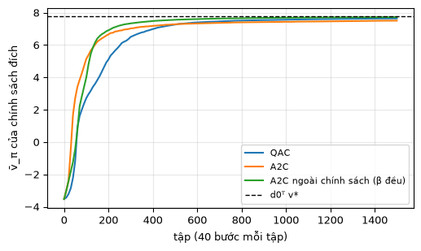
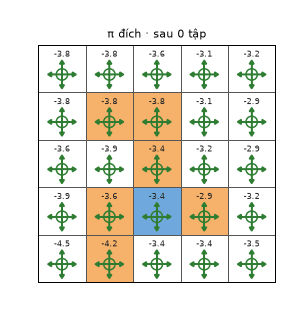

# Chương 10 · Code

> Ghi chú của người biên soạn: trang này không có trong sách. Nó chạy ba thuật toán diễn viên–nhà phê bình của [chương 10](mathrl/ch10_vi) trên lưới 5×5, với diễn viên là softmax dạng bảng và nhà phê bình là một bảng: QAC (thuật toán 10.1), A2C (thuật toán 10.2) và A2C ngoài chính sách (thuật toán 10.3). Thí nghiệm về lấy mẫu theo trọng số quan trọng (hình 10.2) và về tác dụng của baseline đã có ở mục "Kiểm tra bằng mã" trong chương. Phần diễn viên–nhà phê bình tất định (mục 10.4) có code DDPG/TD3 ở [trang Code chương 12 của EasyRL](chapter12/chapter12_code_vi). Ký hiệu theo [Quy ước ký hiệu](notation_vi).

Mỗi khối code đã được chạy sẵn. Kết quả, hình và ảnh động nằm ngay bên dưới. Các khối chạy lần lượt từ trên xuống và dùng chung biến, như notebook. Muốn tự chạy, xem [mục 5](#_5-chạy-trên-máy).

## 1. Khung chung

Cùng thiết lập với [trang Code chương 9](mathrl/ch09_code_vi): lưới của hình 3.4a, $\gamma = 0.9$, thước đo $\bar v_\pi = d_0^T v_\pi$ với $d_0$ đều, tính chính xác bằng mô hình chỉ để theo dõi. Khác với REINFORCE, cả ba thuật toán ở đây cập nhật **sau mỗi bước**, không chờ hết tập. Mỗi tập vẫn xuất phát từ một ô ngẫu nhiên và bị cắt sau 40 bước, để mọi ô đều được thăm.

<!-- run -->
```python
import numpy as np
import matplotlib.pyplot as plt
from zhao_grid import make_grid, value_iteration, plot_grid
from viz import save_gif

P, R = make_grid()
gamma, n_s, n_a, T = 0.9, 25, 5, 40
next_state = P.argmax(axis=2)
d0 = np.full(n_s, 1 / n_s)
v_star, _ = value_iteration(P, R, gamma, tol=1e-10)
J_star = d0 @ v_star

def policy(theta):
    z = np.exp(theta - theta.max(axis=1, keepdims=True))
    return z / z.sum(axis=1, keepdims=True)

def J(theta):
    pi = policy(theta)
    P_pi, r_pi = np.einsum("sa,sat->st", pi, P), (pi * R).sum(axis=1)
    return d0 @ np.linalg.solve(np.eye(n_s) - gamma * P_pi, r_pi)

def grad_log(theta, s, a):
    g = -policy(theta)[s]
    g[a] += 1                                       # ∇_θ[s] ln π(a|s,θ) = e_a − π(·|s)
    return g

def run(update, n_episodes=1500, seed=0, behavior=None, log_every=10, snap_every=None):
    """Khung chung: sinh dữ liệu từng bước, gọi update(...) sau mỗi bước chuyển."""
    rng = np.random.default_rng(seed)
    state = {"theta": np.zeros((n_s, n_a)), "v": np.zeros(n_s), "q": np.zeros((n_s, n_a))}
    curve, snaps = [], []
    for ep in range(n_episodes):
        if ep % log_every == 0:
            curve.append((ep, J(state["theta"])))
        if snap_every and ep % snap_every == 0:
            snaps.append((ep, policy(state["theta"])))
        s = rng.integers(n_s)
        pi_s = behavior if behavior is not None else policy(state["theta"])[s]
        a = rng.choice(n_a, p=pi_s)
        for t in range(T):
            r, s2 = R[s, a], next_state[s, a]
            pi_s2 = behavior if behavior is not None else policy(state["theta"])[s2]
            a2 = rng.choice(n_a, p=pi_s2)
            update(state, s, a, r, s2, a2)
            s, a = s2, a2
    curve.append((n_episodes, J(state["theta"])))
    if snap_every:
        snaps.append((n_episodes, policy(state["theta"])))
    return state, curve, snaps

print(f"v̄ của chính sách đều = {J(np.zeros((n_s, n_a))):.3f},  tốt nhất = {J_star:.3f}")
```

<!-- output -->
```output
v̄ của chính sách đều = -3.520,  tốt nhất = 7.799
```
<!-- /output -->

## 2. QAC và A2C

<small class="viz-ref">Mục 10.1, 10.2 · thuật toán 10.1, 10.2</small>

| | Nhà phê bình học gì | Diễn viên đi theo |
|---|---|---|
| **QAC** | $q(s,a)$ bằng Sarsa: $q \leftarrow q + \alpha_w[r + \gamma q(s',a') - q(s,a)]$ | $\alpha_\theta\, \nabla \ln \pi(a \mid s)\, q(s,a)$ |
| **A2C** | $v(s)$ bằng TD: $\delta = r + \gamma v(s') - v(s)$, $v(s) \leftarrow v(s) + \alpha_w \delta$ | $\alpha_\theta\, \nabla \ln \pi(a \mid s)\, \delta$ |

A2C dùng sai số TD $\delta$ làm ước lượng của lợi thế $q_\pi(s,a) - v_\pi(s)$, tức là có baseline $v_\pi(s)$ (mục 10.2.1). QAC không có baseline.

<!-- run -->
```python
alpha_w, alpha_theta = 0.1, 0.05

def qac_update(st, s, a, r, s2, a2):
    st["theta"][s] += alpha_theta * grad_log(st["theta"], s, a) * st["q"][s, a]          # diễn viên
    st["q"][s, a] += alpha_w * (r + gamma * st["q"][s2, a2] - st["q"][s, a])               # nhà phê bình (Sarsa)

def a2c_update(st, s, a, r, s2, a2):
    delta = r + gamma * st["v"][s2] - st["v"][s]                                           # lợi thế ≈ δ
    st["v"][s] += alpha_w * delta                                                          # nhà phê bình (TD)
    st["theta"][s] += alpha_theta * grad_log(st["theta"], s, a) * delta                    # diễn viên

curves = {}
for name, upd in [("QAC", qac_update), ("A2C", a2c_update)]:
    finals = []
    for seed in range(3):
        st, curve, _ = run(upd, seed=seed)
        finals.append(curve[-1][1])
        if seed == 0:
            curves[name] = curve
    print(f"{name}: v̄ sau 1500 tập (3 hạt giống) = {np.round(finals, 3)}")
```

<!-- output -->
```output
QAC: v̄ sau 1500 tập (3 hạt giống) = [7.644 7.674 7.651]
A2C: v̄ sau 1500 tập (3 hạt giống) = [7.507 7.611 7.639]
```
<!-- /output -->

## 3. A2C ngoài chính sách

<small class="viz-ref">Mục 10.3 · thuật toán 10.3</small>

Dữ liệu giờ do chính sách hành vi **đều** $\beta(a \mid s) = 0.2$ sinh ra, cố định từ đầu tới cuối. Diễn viên và nhà phê bình vẫn học về chính sách đích $\pi$, nhờ nhân thêm trọng số quan trọng $\rho = \pi(a \mid s) / \beta(a \mid s)$ vào cả hai phép cập nhật:

<!-- run -->
```python
beta = np.full(n_a, 1 / n_a)

def offpolicy_a2c_update(st, s, a, r, s2, a2):
    rho = policy(st["theta"])[s, a] / beta[a]                                              # π(a|s) / β(a|s)
    delta = r + gamma * st["v"][s2] - st["v"][s]
    st["v"][s] += alpha_w * rho * delta
    st["theta"][s] += alpha_theta * rho * grad_log(st["theta"], s, a) * delta

finals = []
for seed in range(3):
    st, curve, snaps_off = run(offpolicy_a2c_update, seed=seed, behavior=beta, snap_every=50)
    finals.append(curve[-1][1])
    if seed == 0:
        curves["A2C ngoài chính sách (β đều)"] = curve
        snaps = snaps_off
print(f"A2C ngoài chính sách: v̄ sau 1500 tập (3 hạt giống) = {np.round(finals, 3)}")

plt.figure(figsize=(5.8, 3.2))
for name, curve in curves.items():
    plt.plot(*zip(*curve), label=name)
plt.axhline(J_star, color="k", ls="--", lw=1, label="d0ᵀ v*")
plt.xlabel("tập (40 bước mỗi tập)"); plt.ylabel("v̄_π của chính sách đích"); plt.legend(fontsize=8); plt.grid(alpha=.3)
```

<!-- output -->
```output
A2C ngoài chính sách: v̄ sau 1500 tập (3 hạt giống) = [7.728 7.723 7.725]
```

<div align=center></div>
<!-- /output -->

Đọc đồ thị:

- **A2C** đi lên nhanh nhất trong khoảng 100 tập đầu. Baseline $v(s)$ làm tín hiệu cập nhật bớt nhiễu, đúng như mục 10.2.1 phân tích. Nhưng về cuối, cả ba hạt giống của A2C lại hơi thấp hơn QAC (khoảng 7.5–7.64 so với 7.64–7.67). Trên bài nhỏ này, ưu thế của baseline thể hiện ở tốc độ lúc đầu, không phải ở điểm dừng.
- **A2C ngoài chính sách** dừng cao nhất (khoảng 7.72) và đều nhất giữa các hạt giống. Một lý do hợp lý: chính sách hành vi đều thăm mọi cặp $(s,a)$ như nhau suốt quá trình học. Còn ở hai thuật toán theo chính sách, khi $\pi$ dần tất định thì các hành động kém hầu như không được thử nữa, và ước lượng của nhà phê bình ở đó ngừng được cải thiện. Cái giá là trọng số $\rho$ có thể lớn (tới $1/0.2 = 5$ khi $\pi$ gần tất định), làm phương sai tăng. Ở bài này cái giá đó vẫn chấp nhận được.
- Không thuật toán nào chạm hẳn $d_0^T v^{\ast} = 7.8$, vì chính sách softmax chỉ tiến dần tới tất định.

Ảnh động: chính sách đích $\pi$ của A2C ngoài chính sách, sau mỗi 50 tập. Dữ liệu lúc nào cũng là những bước đi ngẫu nhiên đều, vậy mà chính sách đích vẫn dần thành chính sách tốt.

<!-- run -->
```python
def draw(fig, i):
    ep, pi = snaps[i]
    P_pi, r_pi = np.einsum("sa,sat->st", pi, P), (pi * R).sum(axis=1)
    v = np.linalg.solve(np.eye(n_s) - gamma * P_pi, r_pi)
    plot_grid(v, pi, title=f"π đích · sau {ep} tập", ax=fig.add_subplot(1, 1, 1))

save_gif(draw, len(snaps), "offpolicy_a2c.gif", fps=4, figsize=(3.4, 3.6), dpi=90)
```

<!-- output -->
<div align=center></div>
<!-- /output -->

## 4. Đối chiếu với code của MinRL

`ActorCriticAgent` của MinRL ([trang Code chương 9 của EasyRL](chapter9/chapter9_code_vi)) là đúng A2C ở mục 2: lợi thế là sai số TD $r + \gamma V(s') - V(s)$, nhà phê bình hồi quy $V$ về mục tiêu TD. Có hai khác biệt. Thứ nhất, diễn viên và nhà phê bình là mạng nơ-ron thay vì bảng. Thứ hai, nó cộng thêm một số hạng entropy vào hàm mất mát để giữ khám phá, điều mà thuật toán 10.2 không có.

## 5. Chạy trên máy

```bash
git clone https://github.com/nmc2004nd/easy-rl-vi.git
cd easy-rl-vi/docs/code/py          # chạy từ đây để import được zhao_grid, viz
pip install numpy matplotlib pillow
```

Chép lần lượt các khối code vào Jupyter rồi chạy theo thứ tự. Kết quả trên trang được dựng bằng `python3 scripts/build_code_pages.py docs/mathrl/ch10_code_vi.md`.
