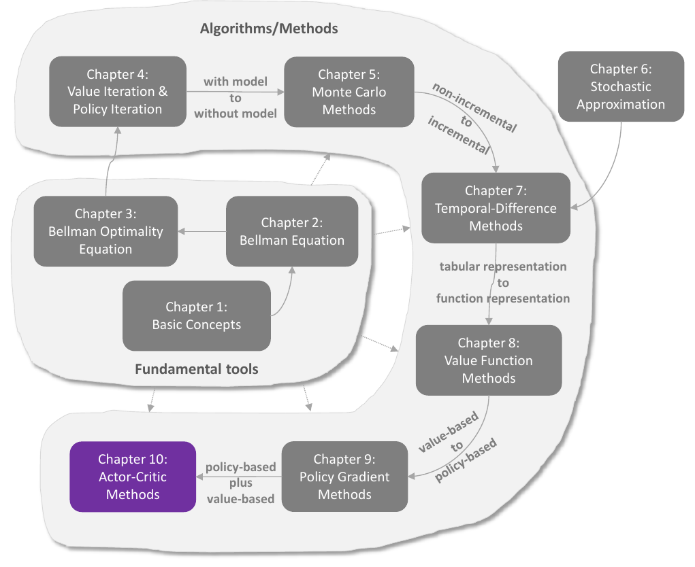
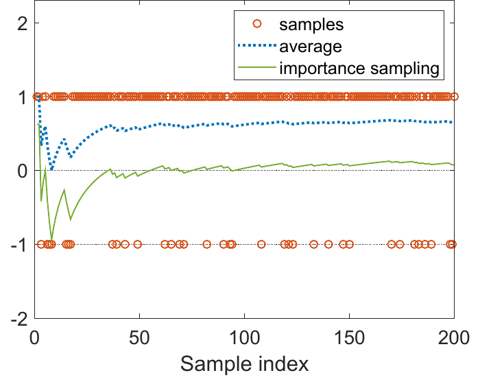

# Chương 10 Phương pháp diễn viên–nhà phê bình

> Ghi chú của người biên soạn: đây là bản tổng hợp tiếng Việt chương 10 sách *Mathematical Foundations of Reinforcement Learning* (Shiyu Zhao, 2025), có bổ sung từ các bài [Actor-Critic Methods](https://lyk-love.cn/2024/06/24/Actor-Critic-Methods/) và [Off-Policy Actor-Critic Methods](https://lyk-love.cn/2024/06/24/Off-Policy-Actor-Critic-Methods/) trên blog lyk-love. Xem [giới thiệu phần này](mathrl/README_vi) để biết nguồn, và [Quy ước ký hiệu](notation_vi) cho chuẩn ký hiệu dùng chung. Ý không có trong sách được ghi rõ.
>
> **Về ký hiệu:** sách viết chính sách hành vi ở chương này là $\beta(a \mid s)$; theo [chuẩn chung](notation_vi?id=_34-sách-zhao-bản-pdf-gốc), trang này viết $\pi_b(a \mid s)$ cho thống nhất với chương 5 và 7. Hàm giá trị xấp xỉ viết $\hat q(s, a, w)$, $\hat v(s, w)$ như chương 8 (sách viết $q(s, a, w)$, $v(s, w)$).

<div align=center>

</div>
<div align=center>Hình 10.1 Vị trí của chương này trong sách. Nguồn: Zhao (2025)</div>

Chương cuối giới thiệu các phương pháp **diễn viên–nhà phê bình (actor-critic)**. Có hai cách nhìn:

- **Như một cấu trúc** kết hợp phương pháp dựa trên chính sách và dựa trên giá trị.
  - **Diễn viên (actor)** là bước **cập nhật chính sách**; gọi là diễn viên vì hành động được thực hiện theo chính sách.
  - **Nhà phê bình (critic)** là bước **cập nhật giá trị**; gọi là nhà phê bình vì nó "phê bình" diễn viên bằng cách đánh giá giá trị tương ứng.
- **Như thuật toán gradient chính sách:** diễn viên–nhà phê bình vẫn là gradient chính sách, có được bằng cách mở rộng thuật toán ở chương 9.

Cần hiểu kỹ chương 8 và 9 trước khi học chương này.

**Lộ trình:**

| Mục | Thuật toán | Cải tiến so với mục trước |
|---|---|---|
| 10.1 | **QAC** | REINFORCE nhưng ước lượng $q$ bằng TD thay vì MC |
| 10.2 | **A2C** (TD actor-critic) | thêm baseline để giảm phương sai |
| 10.3 | **Diễn viên–nhà phê bình ngoài chính sách** | dùng lấy mẫu theo trọng số quan trọng |
| 10.4 | **Gradient chính sách tất định (DPG)** | chính sách tất định, tự nhiên là ngoài chính sách, xử lý hành động liên tục |

## 10.1 Thuật toán diễn viên–nhà phê bình đơn giản nhất (QAC)

Có được ngay bằng cách mở rộng thuật toán gradient chính sách (9.32).

Ý tưởng gradient chính sách là tìm chính sách tối ưu bằng cách cực đại hóa thước đo vô hướng $J(\theta)$:

$$
\theta_{t+1} = \theta_t + \alpha\nabla_\theta J(\theta_t) = \theta_t + \alpha\,\mathbb E_{S\sim\eta,\,A\sim\pi}\big[\nabla_\theta\ln\pi(A \mid S, \theta_t)\,q_\pi(S, A)\big], \tag{10.1}
$$

với $\eta$ là một phân phối trạng thái (định lý 9.1). Gradient thật chưa biết, nên dùng gradient ngẫu nhiên:

$$
\theta_{t+1} = \theta_t + \alpha\nabla_\theta\ln\pi(a_t \mid s_t, \theta_t)\,q_t(s_t, a_t). \tag{10.2}
$$

Đây là (9.32).

**(10.2) cho thấy rõ cách kết hợp phương pháp dựa trên chính sách và dựa trên giá trị.** Một mặt, nó dựa trên chính sách vì cập nhật trực tiếp tham số chính sách. Mặt khác, nó cần $q_t(s_t, a_t)$, ước lượng của $q_\pi(s_t, a_t)$, nên cần thêm một thuật toán dựa trên giá trị để sinh ra $q_t$. Sách đã học hai cách ước lượng giá trị hành động:

- ước lượng $q_t$ bằng **Monte Carlo** thì thuật toán gọi là **REINFORCE** (chương 9);
- ước lượng $q_t$ bằng **TD** thì thuật toán thường gọi là **diễn viên–nhà phê bình**.

Vậy **diễn viên–nhà phê bình = gradient chính sách + ước lượng giá trị bằng TD**.

Thuật toán 10.1 là diễn viên–nhà phê bình đơn giản nhất. Nhà phê bình là bước cập nhật giá trị bằng Sarsa với xấp xỉ hàm (8.35), giá trị hành động biểu diễn bằng hàm có tham số $\hat q(s, a, w)$. Diễn viên là bước cập nhật chính sách (10.2). Thuật toán này đôi khi gọi là **Q actor-critic (QAC)**. Dù đơn giản, QAC làm lộ ý tưởng cốt lõi của diễn viên–nhà phê bình, và mở rộng được thành nhiều thuật toán nâng cao ở phần sau.

**Thuật toán 10.1: Diễn viên–nhà phê bình đơn giản nhất (QAC)**

```
Input:  chính sách π(a|s,θ_0); hàm giá trị q̂(s,a,w_0); α_w, α_θ > 0
Output: chính sách tối ưu cực đại hóa J(θ)

for each time step t of each episode do
    a_t ~ π(·|s_t,θ_t)
    r_{t+1}, s_{t+1} ← env.step(s_t, a_t)
    a_{t+1} ~ π(·|s_{t+1},θ_t)
    # Diễn viên (cập nhật chính sách)
    θ_{t+1} ← θ_t + α_θ·∇_θ ln π(a_t|s_t,θ_t)·q̂(s_t,a_t,w_t)
    # Nhà phê bình (cập nhật giá trị, kiểu Sarsa)
    y ← r_{t+1} + γ·q̂(s_{t+1},a_{t+1},w_t)
    w_{t+1} ← w_t + α_w·[ y − q̂(s_t,a_t,w_t) ]·∇_w q̂(s_t,a_t,w_t)
end for
```

*(theo lyk-love)* Vì là một phương pháp gradient chính sách, QAC cũng là **theo chính sách**.

## 10.2 Diễn viên–nhà phê bình lợi thế (A2C)

Ý tưởng cốt lõi của **diễn viên–nhà phê bình lợi thế (advantage actor-critic, A2C)**: đưa vào một **baseline** để **giảm phương sai ước lượng**.

### 10.2.1 Tính bất biến với baseline

Một tính chất thú vị: gradient chính sách **không đổi** khi trừ đi một baseline:

$$
\mathbb E_{S\sim\eta,\,A\sim\pi}\big[\nabla_\theta\ln\pi(A \mid S, \theta_t)\,q_\pi(S, A)\big] = \mathbb E_{S\sim\eta,\,A\sim\pi}\big[\nabla_\theta\ln\pi(A \mid S, \theta_t)\,(q_\pi(S, A) - b(S))\big], \tag{10.3}
$$

với baseline $b(S)$ là một **hàm vô hướng của $S$** (không phụ thuộc $A$).

**Thứ nhất, vì sao (10.3) đúng?** (10.3) đúng khi và chỉ khi $\mathbb E_{S\sim\eta,\,A\sim\pi}\big[\nabla_\theta\ln\pi(A \mid S, \theta_t)\,b(S)\big] = 0$. Thật vậy:

$$
\begin{aligned}
\mathbb E_{S\sim\eta,\,A\sim\pi}\big[\nabla_\theta\ln\pi(A \mid S, \theta_t)\,b(S)\big] &= \sum_{s\in\mathcal S}\eta(s)\sum_{a\in\mathcal A}\pi(a \mid s, \theta_t)\,\nabla_\theta\ln\pi(a \mid s, \theta_t)\,b(s)\\
&= \sum_{s\in\mathcal S}\eta(s)\sum_{a\in\mathcal A}\nabla_\theta\pi(a \mid s, \theta_t)\,b(s) = \sum_{s\in\mathcal S}\eta(s)\,b(s)\sum_{a\in\mathcal A}\nabla_\theta\pi(a \mid s, \theta_t)\\
&= \sum_{s\in\mathcal S}\eta(s)\,b(s)\,\nabla_\theta\sum_{a\in\mathcal A}\pi(a \mid s, \theta_t) = \sum_{s\in\mathcal S}\eta(s)\,b(s)\,\nabla_\theta 1 = 0.
\end{aligned}
$$

*(ghi chú của người biên soạn)* Điểm then chốt: tổng xác suất luôn bằng 1, nên đạo hàm của nó bằng 0. Vì vậy baseline phải **không phụ thuộc hành động**; nếu $b$ phụ thuộc $a$ thì không đưa được ra ngoài tổng theo $a$, và đẳng thức trên không còn đúng.

**Thứ hai, vì sao baseline có ích?** Vì nó **giảm phương sai xấp xỉ** khi dùng mẫu để xấp xỉ gradient thật. Đặt

$$
X(S, A) \doteq \nabla_\theta\ln\pi(A \mid S, \theta_t)\,[q_\pi(S, A) - b(S)]. \tag{10.4}
$$

Gradient thật là $\mathbb E[X(S, A)]$. Vì dùng một mẫu ngẫu nhiên $x$ để xấp xỉ $\mathbb E[X]$, tốt nhất là phương sai $\operatorname{var}(X)$ nhỏ: nếu $\operatorname{var}(X)$ gần 0 thì mẫu nào cũng xấp xỉ chính xác $\mathbb E[X]$; ngược lại, $\operatorname{var}(X)$ lớn thì một mẫu có thể cách xa $\mathbb E[X]$.

$\mathbb E[X]$ bất biến với baseline, nhưng $\operatorname{var}(X)$ thì **không**. Mục tiêu: thiết kế baseline tốt để cực tiểu hóa $\operatorname{var}(X)$. Ở REINFORCE và QAC, $b = 0$, không bảo đảm là baseline tốt.

Baseline **tối ưu** cực tiểu hóa $\operatorname{var}(X)$ là

$$
b^{\ast}(s) = \frac{\mathbb E_{A\sim\pi}\big[\lVert\nabla_\theta\ln\pi(A \mid s, \theta_t)\rVert^2\,q_\pi(s, A)\big]}{\mathbb E_{A\sim\pi}\big[\lVert\nabla_\theta\ln\pi(A \mid s, \theta_t)\rVert^2\big]}, \qquad s \in \mathcal S. \tag{10.5}
$$

Chứng minh ở hộp 10.1.

Baseline (10.5) tối ưu nhưng **quá phức tạp** để dùng thực tế. Bỏ trọng số $\lVert\nabla_\theta\ln\pi(A \mid s, \theta_t)\rVert^2$ đi, được một baseline **gần tối ưu** có biểu thức gọn:

$$
b^\dagger(s) = \mathbb E_{A\sim\pi}[q_\pi(s, A)] = v_\pi(s), \qquad s \in \mathcal S.
$$

Thú vị là baseline gần tối ưu này chính là **giá trị trạng thái**.

> **Hộp 10.1: $b^{\ast}(s)$ ở (10.5) là baseline tối ưu**
>
> Đặt $\bar x \doteq \mathbb E[X]$, bất biến với mọi $b(s)$. Nếu $X$ là vectơ thì phương sai của nó là ma trận; thường chọn **vết (trace)** của $\operatorname{var}(X)$ làm hàm mục tiêu vô hướng:
> $$\operatorname{tr}[\operatorname{var}(X)] = \operatorname{tr}\mathbb E[(X - \bar x)(X - \bar x)^T] = \operatorname{tr}\mathbb E[XX^T - \bar xX^T - X\bar x^T + \bar x\bar x^T] = \mathbb E[X^TX - X^T\bar x - \bar x^TX + \bar x^T\bar x] = \mathbb E[X^TX] - \bar x^T\bar x. \tag{10.6}$$
> (Dùng tính chất $\operatorname{tr}(AB) = \operatorname{tr}(BA)$.) Vì $\bar x$ bất biến, (10.6) cho thấy chỉ cần cực tiểu hóa $\mathbb E[X^TX]$. Với $X$ ở (10.4):
> $$\mathbb E[X^TX] = \mathbb E\big[(\nabla_\theta\ln\pi)^T(\nabla_\theta\ln\pi)\,(q_\pi(S, A) - b(S))^2\big] = \mathbb E\big[\lVert\nabla_\theta\ln\pi\rVert^2\,(q_\pi(S, A) - b(S))^2\big],$$
> với $\pi(A \mid S, \theta)$ viết gọn là $\pi$. Vì $S \sim \eta$, $A \sim \pi$:
> $$\mathbb E[X^TX] = \sum_{s\in\mathcal S}\eta(s)\,\mathbb E_{A\sim\pi}\big[\lVert\nabla_\theta\ln\pi\rVert^2\,(q_\pi(s, A) - b(s))^2\big].$$
> Để $\nabla_b\mathbb E[X^TX] = 0$, mỗi $b(s)$ phải thỏa
> $$\mathbb E_{A\sim\pi}\big[\lVert\nabla_\theta\ln\pi\rVert^2\,(b(s) - q_\pi(s, A))\big] = 0, \qquad s \in \mathcal S.$$
> Giải ra được baseline tối ưu (10.5). $\blacksquare$

### 10.2.2 Mô tả thuật toán

Với $b(s) = v_\pi(s)$, thuật toán tăng gradient (10.1) thành

$$
\theta_{t+1} = \theta_t + \alpha\,\mathbb E\big[\nabla_\theta\ln\pi(A \mid S, \theta_t)\,[q_\pi(S, A) - v_\pi(S)]\big] \doteq \theta_t + \alpha\,\mathbb E\big[\nabla_\theta\ln\pi(A \mid S, \theta_t)\,\delta_\pi(S, A)\big]. \tag{10.7}
$$

Ở đây

$$
\delta_\pi(S, A) \doteq q_\pi(S, A) - v_\pi(S)
$$

gọi là **hàm lợi thế (advantage function)**, phản ánh **lợi thế của một hành động so với các hành động khác**. Cụ thể, $v_\pi(s) = \sum_a\pi(a \mid s)\,q_\pi(s, a)$ là **trung bình** các giá trị hành động; nếu $\delta_\pi(s, a) > 0$ thì hành động đó có giá trị **cao hơn trung bình**.

Phiên bản ngẫu nhiên của (10.7):

$$
\theta_{t+1} = \theta_t + \alpha\nabla_\theta\ln\pi(a_t \mid s_t, \theta_t)\,[q_t(s_t, a_t) - v_t(s_t)] = \theta_t + \alpha\nabla_\theta\ln\pi(a_t \mid s_t, \theta_t)\,\delta_t(s_t, a_t), \tag{10.8}
$$

với $s_t$, $a_t$ là mẫu của $S$, $A$ tại thời điểm $t$, và $q_t(s_t, a_t)$, $v_t(s_t)$ là xấp xỉ của $q_{\pi(\theta_t)}(s_t, a_t)$, $v_{\pi(\theta_t)}(s_t)$. Thuật toán (10.8) cập nhật chính sách dựa trên giá trị **tương đối** của $q_t$ so với $v_t$, không phải giá trị tuyệt đối của $q_t$. Điều này hợp lý theo trực giác: khi chọn hành động ở một trạng thái, ta chỉ quan tâm hành động nào có giá trị lớn nhất **so với các hành động khác**.

- Ước lượng $q_t$, $v_t$ bằng **Monte Carlo**: thuật toán gọi là **REINFORCE với baseline**.
- Ước lượng bằng **TD**: thuật toán thường gọi là **diễn viên–nhà phê bình lợi thế (A2C)**.

Trong cài đặt A2C (thuật toán 10.2), hàm lợi thế được xấp xỉ bằng **sai số TD**:

$$
q_t(s_t, a_t) - v_t(s_t) \approx r_{t+1} + \gamma v_t(s_{t+1}) - v_t(s_t).
$$

Xấp xỉ này hợp lý vì

$$
q_\pi(s_t, a_t) - v_\pi(s_t) = \mathbb E\big[R_{t+1} + \gamma v_\pi(S_{t+1}) - v_\pi(S_t) \mid S_t = s_t, A_t = a_t\big],
$$

đúng theo định nghĩa của $q_\pi(s_t, a_t)$. Lợi ích của sai số TD: chỉ cần **một mạng nơ-ron** biểu diễn $v_\pi(s)$. Nếu dùng $\delta_t = q_t(s_t, a_t) - v_t(s_t)$ thì phải duy trì hai mạng cho $v_\pi(s)$ và $q_\pi(s, a)$. Khi dùng sai số TD, thuật toán còn gọi là **TD actor-critic**. Ngoài ra, chính sách $\pi(\theta_t)$ là ngẫu nhiên nên có sẵn tính khám phá; dùng trực tiếp nó để sinh mẫu được, không cần kỹ thuật như ε-tham lam.

*(ghi chú của người biên soạn)* Lưu ý **dấu**: ở chương này sách định nghĩa sai số TD là $\delta_t = r_{t+1} + \gamma v(s_{t+1}) - v(s_t)$ (mục tiêu trừ ước lượng), **ngược dấu** với chương 7 ($\delta_t = v_t(s_t) - \bar v_t$). Dạng ở chương này là dạng phổ biến (Sutton và Barto, EasyRL), và có lợi là $\delta_t$ chính là ước lượng mẫu của hàm lợi thế $\delta_\pi$.

**Thuật toán 10.2: Diễn viên–nhà phê bình lợi thế (A2C), hay TD actor-critic**

```
Input:  chính sách π(a|s,θ_0); hàm giá trị v̂(s,w_0); α_w, α_θ > 0
Output: chính sách tối ưu cực đại hóa J(θ)

for each time step t of each episode do
    a_t ~ π(·|s_t,θ_t)
    r_{t+1}, s_{t+1} ← env.step(s_t, a_t)
    δ_t ← r_{t+1} + γ·v̂(s_{t+1},w_t) − v̂(s_t,w_t)   # lợi thế ≈ sai số TD
    # Diễn viên
    θ_{t+1} ← θ_t + α_θ·δ_t·∇_θ ln π(a_t|s_t,θ_t)
    # Nhà phê bình
    w_{t+1} ← w_t + α_w·δ_t·∇_w v̂(s_t,w_t)
end for
```

A2C có một số biến thể như **diễn viên–nhà phê bình lợi thế bất đồng bộ (A3C)**.

## 10.3 Diễn viên–nhà phê bình ngoài chính sách

Mọi phương pháp gradient chính sách đã học (REINFORCE, QAC, A2C) đều **theo chính sách**. Lý do thấy từ biểu thức gradient thật:

$$
\nabla_\theta J(\theta) = \mathbb E_{S\sim\eta,\,A\sim\pi}\big[\nabla_\theta\ln\pi(A \mid S, \theta_t)\,(q_\pi(S, A) - v_\pi(S))\big].
$$

Muốn dùng mẫu xấp xỉ gradient này thì mẫu hành động phải sinh theo $\pi(\theta)$, nên $\pi(\theta)$ là chính sách hành vi. Mà $\pi(\theta)$ cũng là chính sách mục tiêu cần cải thiện, nên gradient chính sách là theo chính sách.

Nếu đã có sẵn mẫu do một chính sách hành vi khác sinh ra, vẫn dùng được gradient chính sách nhờ kỹ thuật **lấy mẫu theo trọng số quan trọng (importance sampling)**. Kỹ thuật này không chỉ dùng trong học tăng cường; nó là kỹ thuật chung để ước lượng kỳ vọng theo một phân phối bằng mẫu rút từ một phân phối khác.

### 10.3.1 Lấy mẫu theo trọng số quan trọng

Xét biến ngẫu nhiên $X \in \mathcal X$ và phân phối $p_0(X)$. Mục tiêu: ước lượng $\mathbb E_{X\sim p_0}[X]$. Giả sử có các mẫu i.i.d. $\{x_i\}_{i=1}^n$.

- Nếu mẫu sinh theo $p_0$: trung bình $\bar x = \frac1n\sum_{i=1}^n x_i$ xấp xỉ được $\mathbb E_{X\sim p_0}[X]$, vì $\bar x$ không chệch và phương sai về 0 khi $n \to \infty$ (luật số lớn, hộp 5.1).
- Nếu mẫu **không** sinh theo $p_0$ mà theo phân phối khác $p_1$: vẫn dùng được để ước lượng $\mathbb E_{X\sim p_0}[X]$, nhưng **không** dùng $\bar x$ được nữa, vì $\bar x \approx \mathbb E_{X\sim p_1}[X]$ chứ không phải $\mathbb E_{X\sim p_0}[X]$.

Trường hợp sau dùng lấy mẫu theo trọng số quan trọng:

$$
\mathbb E_{X\sim p_0}[X] = \sum_{x\in\mathcal X} p_0(x)\,x = \sum_{x\in\mathcal X} p_1(x)\underbrace{\frac{p_0(x)}{p_1(x)}x}_{f(x)} = \mathbb E_{X\sim p_1}[f(X)]. \tag{10.9}
$$

Ước lượng $\mathbb E_{X\sim p_0}[X]$ thành ước lượng $\mathbb E_{X\sim p_1}[f(X)]$. Đặt $\bar f \doteq \frac1n\sum_{i=1}^n f(x_i)$; vì $\bar f$ xấp xỉ tốt $\mathbb E_{X\sim p_1}[f(X)]$:

$$
\mathbb E_{X\sim p_0}[X] = \mathbb E_{X\sim p_1}[f(X)] \approx \bar f = \frac1n\sum_{i=1}^n f(x_i) = \frac1n\sum_{i=1}^n\underbrace{\frac{p_0(x_i)}{p_1(x_i)}}_{\text{trọng số quan trọng}}x_i. \tag{10.10}
$$

$\mathbb E_{X\sim p_0}[X]$ xấp xỉ bằng **trung bình có trọng số** của $x_i$; $\frac{p_0(x_i)}{p_1(x_i)}$ gọi là **trọng số quan trọng (importance weight)**.

- $p_1 = p_0$: trọng số bằng 1, $\bar f$ thành $\bar x$.
- $p_0(x_i) \ge p_1(x_i)$: $x_i$ hay được $p_0$ rút hơn nhưng ít được $p_1$ rút; trọng số lớn hơn 1 **nhấn mạnh** mẫu này.

**Vì sao không tính thẳng $\mathbb E_{X\sim p_0}[X] = \sum_x p_0(x)\,x$?** Muốn dùng định nghĩa thì phải biết biểu thức giải tích của $p_0$, hoặc giá trị $p_0(x)$ với **mọi** $x$. Khó có biểu thức giải tích khi phân phối là một mạng nơ-ron, và khó có $p_0(x)$ với mọi $x$ khi $\mathcal X$ lớn. Ngược lại, (10.10) chỉ cần $p_0(x_i)$ tại **một số mẫu**, dễ cài đặt hơn nhiều.

**Ví dụ (hình 10.2).** $X \in \mathcal X \doteq \{+1, -1\}$, với $p_0(X = +1) = 0.5$, $p_0(X = -1) = 0.5$, nên $\mathbb E_{X\sim p_0}[X] = 0$. Phân phối khác $p_1(X = +1) = 0.8$, $p_1(X = -1) = 0.2$, nên $\mathbb E_{X\sim p_1}[X] = 0.6$. Có mẫu $\{x_i\}$ rút theo $p_1$; mục tiêu là ước lượng $\mathbb E_{X\sim p_0}[X]$ từ chúng.

- Trung bình thường $\sum_i x_i/n$ hội tụ về $\mathbb E_{X\sim p_1}[X] = 0.6$ (đường chấm).
- Trung bình có trọng số (10.10) hội tụ đúng về $\mathbb E_{X\sim p_0}[X] = 0$ (đường liền).

<div align=center>

</div>
<div align=center>Hình 10.2 Minh họa lấy mẫu theo trọng số quan trọng: mẫu rút theo p1 (0.8 / 0.2); trung bình thường hội tụ về 0.6, trung bình có trọng số quan trọng hội tụ về 0 = E_{p0}[X]. Nguồn: Zhao (2025)</div>

⚠️ **Điều kiện:** phân phối sinh mẫu $p_1$ phải thỏa $p_1(x) \ne 0$ **khi** $p_0(x) \ne 0$. Nếu $p_1(x) = 0$ trong khi $p_0(x) \ne 0$ thì kết quả có thể sai. Ví dụ $p_1(X = +1) = 1$, $p_1(X = -1) = 0$: mọi mẫu đều là $+1$, và
$$\frac1n\sum_{i=1}^n\frac{p_0(x_i)}{p_1(x_i)}x_i = \frac1n\sum_{i=1}^n\frac{p_0(+1)}{p_1(+1)}\cdot 1 = \frac1n\sum_{i=1}^n\frac{0.5}{1}\cdot 1 \equiv 0.5,$$
không bao giờ bằng $0$ dù $n$ lớn đến đâu.

*(ghi chú của người biên soạn)* Một cái giá ẩn: khi $p_0$ và $p_1$ khác nhau nhiều, trọng số $p_0/p_1$ có thể rất lớn ở những mẫu hiếm, làm **phương sai** của ước lượng tăng vọt. Đây là lý do các thuật toán hiện đại như PPO ([EasyRL chương 5](chapter5/chapter5_vi)) phải **cắt (clip)** hoặc giới hạn tỉ số $\pi_\theta/\pi_{\theta'}$, và giữ chính sách mới gần chính sách cũ.

### 10.3.2 Định lý gradient chính sách ngoài chính sách

Gọi $\pi_b$ là chính sách hành vi. Mục tiêu: dùng mẫu do $\pi_b$ sinh ra để học chính sách mục tiêu $\pi$ cực đại hóa

$$
J(\theta) = \sum_{s\in\mathcal S} d_{\pi_b}(s)\,v_\pi(s) = \mathbb E_{S\sim d_{\pi_b}}[v_\pi(S)],
$$

với $d_{\pi_b}$ là phân phối dừng dưới $\pi_b$ và $v_\pi$ là giá trị trạng thái dưới $\pi$.

> **Định lý 10.1 (Định lý gradient chính sách ngoài chính sách).** Trong trường hợp có chiết khấu $\gamma \in (0, 1)$, gradient của $J(\theta)$ là
> $$\nabla_\theta J(\theta) = \mathbb E_{S\sim\rho,\,A\sim\pi_b}\Big[\underbrace{\frac{\pi(A \mid S, \theta)}{\pi_b(A \mid S)}}_{\text{trọng số quan trọng}}\nabla_\theta\ln\pi(A \mid S, \theta)\,q_\pi(S, A)\Big], \tag{10.11}$$
> với phân phối trạng thái
> $$\rho(s) \doteq \sum_{s'\in\mathcal S} d_{\pi_b}(s')\Pr_\pi(s \mid s'), \qquad s \in \mathcal S,$$
> và $\Pr_\pi(s \mid s') = \sum_{k=0}^\infty\gamma^k[P_\pi^k]_{s's} = [(I - \gamma P_\pi)^{-1}]_{s's}$ là xác suất tổng có chiết khấu đi từ $s'$ tới $s$ dưới $\pi$.

Gradient (10.11) giống trường hợp theo chính sách ở định lý 9.1, với hai khác biệt: (1) có **trọng số quan trọng**; (2) $A \sim \pi_b$ thay vì $A \sim \pi$. Vậy có thể dùng mẫu hành động do $\pi_b$ sinh ra để xấp xỉ gradient thật.

> **Hộp 10.2: Chứng minh định lý 10.1**
>
> $d_{\pi_b}$ không phụ thuộc $\theta$, nên
> $$\nabla_\theta J(\theta) = \nabla_\theta\sum_{s\in\mathcal S} d_{\pi_b}(s)\,v_\pi(s) = \sum_{s\in\mathcal S} d_{\pi_b}(s)\,\nabla_\theta v_\pi(s). \tag{10.12}$$
> Theo bổ đề 9.2:
> $$\nabla_\theta v_\pi(s) = \sum_{s'\in\mathcal S}\Pr_\pi(s' \mid s)\sum_{a\in\mathcal A}\nabla_\theta\pi(a \mid s', \theta)\,q_\pi(s', a). \tag{10.13}$$
> Thay (10.13) vào (10.12):
> $$\begin{aligned}
> \nabla_\theta J(\theta) &= \sum_{s\in\mathcal S} d_{\pi_b}(s)\sum_{s'\in\mathcal S}\Pr_\pi(s' \mid s)\sum_{a\in\mathcal A}\nabla_\theta\pi(a \mid s', \theta)\,q_\pi(s', a)\\
> &= \sum_{s'\in\mathcal S}\left(\sum_{s\in\mathcal S} d_{\pi_b}(s)\Pr_\pi(s' \mid s)\right)\sum_{a\in\mathcal A}\nabla_\theta\pi(a \mid s', \theta)\,q_\pi(s', a)\\
> &\doteq \sum_{s\in\mathcal S}\rho(s)\sum_{a\in\mathcal A}\nabla_\theta\pi(a \mid s, \theta)\,q_\pi(s, a) \qquad (\text{đổi tên } s' \text{ thành } s)\\
> &= \mathbb E_{S\sim\rho}\left[\sum_{a\in\mathcal A}\nabla_\theta\pi(a \mid S, \theta)\,q_\pi(S, a)\right].
> \end{aligned}$$
> Dùng kỹ thuật lấy mẫu theo trọng số quan trọng:
> $$\begin{aligned}
> \mathbb E_{S\sim\rho}\left[\sum_{a\in\mathcal A}\nabla_\theta\pi(a \mid S, \theta)\,q_\pi(S, a)\right] &= \mathbb E_{S\sim\rho}\left[\sum_{a\in\mathcal A}\pi_b(a \mid S)\,\frac{\pi(a \mid S, \theta)}{\pi_b(a \mid S)}\,\frac{\nabla_\theta\pi(a \mid S, \theta)}{\pi(a \mid S, \theta)}\,q_\pi(S, a)\right]\\
> &= \mathbb E_{S\sim\rho,\,A\sim\pi_b}\left[\frac{\pi(A \mid S, \theta)}{\pi_b(A \mid S)}\,\nabla_\theta\ln\pi(A \mid S, \theta)\,q_\pi(S, A)\right].
> \end{aligned}$$
> $\blacksquare$

### 10.3.3 Mô tả thuật toán

Trường hợp ngoài chính sách rất giống theo chính sách, nên chỉ nêu các bước then chốt.

Gradient ngoài chính sách cũng **bất biến với baseline** $b(s)$:

$$
\nabla_\theta J(\theta) = \mathbb E_{S\sim\rho,\,A\sim\pi_b}\left[\frac{\pi(A \mid S, \theta)}{\pi_b(A \mid S)}\,\nabla_\theta\ln\pi(A \mid S, \theta)\,\big(q_\pi(S, A) - b(S)\big)\right],
$$

vì $\mathbb E\left[\frac{\pi(A \mid S, \theta)}{\pi_b(A \mid S)}\nabla_\theta\ln\pi(A \mid S, \theta)\,b(S)\right] = 0$. Để giảm phương sai, chọn $b(S) = v_\pi(S)$:

$$
\nabla_\theta J(\theta) = \mathbb E\left[\frac{\pi(A \mid S, \theta)}{\pi_b(A \mid S)}\,\nabla_\theta\ln\pi(A \mid S, \theta)\,\big(q_\pi(S, A) - v_\pi(S)\big)\right].
$$

Thuật toán tăng gradient ngẫu nhiên tương ứng:

$$
\theta_{t+1} = \theta_t + \alpha_\theta\frac{\pi(a_t \mid s_t, \theta_t)}{\pi_b(a_t \mid s_t)}\nabla_\theta\ln\pi(a_t \mid s_t, \theta_t)\,\big(q_t(s_t, a_t) - v_t(s_t)\big),
$$

với $\alpha_\theta > 0$. Giống trường hợp theo chính sách, thay hàm lợi thế bằng sai số TD: $q_t(s_t, a_t) - v_t(s_t) \approx r_{t+1} + \gamma v_t(s_{t+1}) - v_t(s_t) \doteq \delta_t(s_t, a_t)$. Thuật toán thành

$$
\theta_{t+1} = \theta_t + \alpha_\theta\frac{\pi(a_t \mid s_t, \theta_t)}{\pi_b(a_t \mid s_t)}\nabla_\theta\ln\pi(a_t \mid s_t, \theta_t)\,\delta_t(s_t, a_t).
$$

(Bản PDF trên GitHub đã sửa lỗi in của bản Springer: dùng $\theta_t$ thay vì $\theta$ trong tỉ số và trong $\nabla\ln\pi$.)

Thuật toán 10.3 giống A2C, chỉ thêm **trọng số quan trọng ở cả diễn viên lẫn nhà phê bình**. Lưu ý: không chỉ diễn viên, **nhà phê bình cũng được chuyển** từ theo chính sách sang ngoài chính sách bằng trọng số quan trọng. Thật vậy, lấy mẫu theo trọng số quan trọng là kỹ thuật chung, áp dụng được cho cả thuật toán dựa trên chính sách lẫn dựa trên giá trị. Thuật toán 10.3 còn mở rộng được theo nhiều hướng, ví dụ kết hợp **vết đủ điều kiện (eligibility traces)**.

**Thuật toán 10.3: Diễn viên–nhà phê bình ngoài chính sách dựa trên trọng số quan trọng**

```
Input:  chính sách hành vi π_b(a|s); chính sách mục tiêu π(a|s,θ_0);
        hàm giá trị v̂(s,w_0); α_w, α_θ > 0
Output: chính sách tối ưu cực đại hóa J(θ)

for each time step t of each episode do
    a_t ~ π_b(·|s_t)                      # dữ liệu từ chính sách hành vi
    r_{t+1}, s_{t+1} ← env.step(s_t, a_t)
    ρ_t ← π(a_t|s_t,θ_t) / π_b(a_t|s_t)   # trọng số quan trọng
    δ_t ← r_{t+1} + γ·v̂(s_{t+1},w_t) − v̂(s_t,w_t)
    # Diễn viên
    θ_{t+1} ← θ_t + α_θ·ρ_t·δ_t·∇_θ ln π(a_t|s_t,θ_t)
    # Nhà phê bình
    w_{t+1} ← w_t + α_w·ρ_t·δ_t·∇_w v̂(s_t,w_t)
end for
```

*(Trong khối trên, $\rho_t$ là trọng số quan trọng tại bước $t$, khác với phân phối trạng thái $\rho(s)$ ở định lý 10.1.)*

## 10.4 Diễn viên–nhà phê bình tất định

Đến giờ, chính sách trong gradient chính sách đều **ngẫu nhiên**, vì đòi $\pi(a \mid s, \theta) > 0$ với mọi $(s, a)$. Mục này cho thấy **chính sách tất định** cũng dùng được: với mỗi trạng thái, một hành động có xác suất 1, các hành động khác xác suất 0. Trường hợp tất định quan trọng vì nó **tự nhiên là ngoài chính sách** và **xử lý hiệu quả không gian hành động liên tục**.

Ký hiệu chính sách tất định là

$$
a = \mu(s, \theta).
$$

Khác với $\pi$ (cho xác suất của hành động), $\mu$ **cho trực tiếp hành động**, vì nó là ánh xạ từ $\mathcal S$ sang $\mathcal A$. Có thể biểu diễn bằng mạng nơ-ron: đầu vào $s$, đầu ra $a$, tham số $\theta$. Để gọn, thường viết $\mu(s)$.

### 10.4.1 Định lý gradient chính sách tất định

Định lý gradient chính sách ở chương 9 chỉ đúng cho chính sách ngẫu nhiên. Khi chính sách tất định, cần một định lý mới.

> **Định lý 10.2 (Định lý gradient chính sách tất định).** Gradient của $J(\theta)$ là
> $$\nabla_\theta J(\theta) = \sum_{s\in\mathcal S}\eta(s)\,\nabla_\theta\mu(s)\,\big(\nabla_a q_\mu(s, a)\big)\big|_{a=\mu(s)} = \mathbb E_{S\sim\eta}\Big[\nabla_\theta\mu(S)\,\big(\nabla_a q_\mu(S, a)\big)\big|_{a=\mu(S)}\Big], \tag{10.14}$$
> với $\eta$ là một phân phối trạng thái.

Định lý 10.2 tóm tắt định lý 10.3 và 10.4, vì gradient trong hai định lý có biểu thức tương tự; biểu thức cụ thể của $J(\theta)$ và $\eta$ có ở hai định lý đó.

- Khác với trường hợp ngẫu nhiên, gradient (10.14) **không chứa biến ngẫu nhiên hành động $A$**. Khi dùng mẫu để xấp xỉ gradient thật thì **không cần lấy mẫu hành động**. Do đó gradient chính sách tất định là **ngoài chính sách**.
- Vì sao viết $\big(\nabla_a q_\mu(S, a)\big)\big|_{a=\mu(S)}$ mà không viết gọn $\nabla_a q_\mu(S, \mu(S))$? Vì viết gọn thì không rõ $q_\mu(S, \mu(S))$ là hàm của $a$ thế nào. Một cách viết gọn mà ít gây nhầm là $\nabla_a q_\mu(S, a = \mu(S))$.

*(ghi chú của người biên soạn)* Đọc (10.14) theo **quy tắc dây chuyền**: muốn tăng $q$ thì đẩy hành động $a$ theo hướng $\nabla_a q$ (nhà phê bình chỉ hướng), rồi lan ngược hướng đó về tham số qua $\nabla_\theta\mu$ (Jacobian của diễn viên). Đó là lý do nhà phê bình phải là hàm **khả vi theo $a$**, nên DPG/DDPG hợp với hành động liên tục.

Phần còn lại của mục suy ra định lý 10.2 cho hai thước đo: **giá trị trung bình** và **phần thưởng trung bình**. Với phần lớn người đọc, biết định lý 10.2 là đủ.

#### Thước đo 1: giá trị trung bình

$$
J(\theta) = \mathbb E[v_\mu(s)] = \sum_{s\in\mathcal S} d_0(s)\,v_\mu(s), \tag{10.15}
$$

với $d_0$ là phân phối trạng thái, chọn **không phụ thuộc $\mu$** cho đơn giản. Hai trường hợp đặc biệt quan trọng:

- $d_0(s_0) = 1$ và $d_0(s \ne s_0) = 0$, với $s_0$ là trạng thái quan tâm: chính sách cực đại hóa lợi tức chiết khấu khi xuất phát từ $s_0$.
- $d_0$ là phân phối của một **chính sách hành vi khác** với chính sách mục tiêu.

Xét trường hợp có chiết khấu $\gamma \in (0, 1)$. Cần gradient của $v_\mu(s)$ trước.

> **Bổ đề 10.1 (Gradient của $v_\mu(s)$).** Trong trường hợp có chiết khấu, với mọi $s \in \mathcal S$:
> $$\nabla_\theta v_\mu(s) = \sum_{s'\in\mathcal S}\Pr_\mu(s' \mid s)\,\nabla_\theta\mu(s')\,\big(\nabla_a q_\mu(s', a)\big)\big|_{a=\mu(s')}, \tag{10.16}$$
> với $\Pr_\mu(s' \mid s) \doteq \sum_{k=0}^\infty\gamma^k[P_\mu^k]_{ss'} = [(I - \gamma P_\mu)^{-1}]_{ss'}$ là xác suất tổng có chiết khấu đi từ $s$ tới $s'$ dưới $\mu$.

> **Hộp 10.3: Chứng minh bổ đề 10.1**
>
> Chính sách tất định nên $v_\mu(s) = q_\mu(s, \mu(s))$. Cả $q_\mu$ và $\mu$ đều là hàm của $\theta$, nên
> $$\nabla_\theta v_\mu(s) = \nabla_\theta q_\mu(s, \mu(s)) = \big(\nabla_\theta q_\mu(s, a)\big)\big|_{a=\mu(s)} + \nabla_\theta\mu(s)\,\big(\nabla_a q_\mu(s, a)\big)\big|_{a=\mu(s)}. \tag{10.17}$$
> Theo định nghĩa giá trị hành động, với $(s, a)$ cho trước: $q_\mu(s, a) = r(s, a) + \gamma\sum_{s'} p(s' \mid s, a)\,v_\mu(s')$, với $r(s, a) = \sum_r r\,p(r \mid s, a)$ không phụ thuộc $\mu$. Nên
> $$\nabla_\theta q_\mu(s, a) = 0 + \gamma\sum_{s'\in\mathcal S} p(s' \mid s, a)\,\nabla_\theta v_\mu(s').$$
> Thay vào (10.17):
> $$\nabla_\theta v_\mu(s) = \gamma\sum_{s'\in\mathcal S} p(s' \mid s, \mu(s))\,\nabla_\theta v_\mu(s') + \underbrace{\nabla_\theta\mu(s)\,\big(\nabla_a q_\mu(s, a)\big)\big|_{a=\mu(s)}}_{u(s)}, \qquad s \in \mathcal S.$$
> Gom cho mọi $s$ thành dạng ma trận–vectơ:
> $$\nabla_\theta v_\mu = u + \gamma(P_\mu\otimes I_m)\nabla_\theta v_\mu,$$
> với $n = \lvert\mathcal S\rvert$, $m$ là số chiều của $\theta$, $[P_\mu]_{ss'} = p(s' \mid s, \mu(s))$, và $\otimes$ là tích Kronecker. Giải:
> $$\nabla_\theta v_\mu = (I_{mn} - \gamma P_\mu\otimes I_m)^{-1}u = (I_n\otimes I_m - \gamma P_\mu\otimes I_m)^{-1}u = \big[(I_n - \gamma P_\mu)^{-1}\otimes I_m\big]u. \tag{10.18}$$
> Dạng từng phần tử:
> $$\nabla_\theta v_\mu(s) = \sum_{s'\in\mathcal S}\big[(I - \gamma P_\mu)^{-1}\big]_{ss'}\,\nabla_\theta\mu(s')\,\big(\nabla_a q_\mu(s', a)\big)\big|_{a=\mu(s')}. \tag{10.19}$$
> Như ở hộp 9.2, $[(I - \gamma P_\mu)^{-1}]_{ss'} = \sum_{k=0}^\infty\gamma^k[P_\mu^k]_{ss'}$ là xác suất tổng có chiết khấu đi từ $s$ tới $s'$; ký hiệu là $\Pr_\mu(s' \mid s)$, (10.19) cho (10.16). $\blacksquare$

> **Định lý 10.3 (Định lý gradient chính sách tất định, trường hợp có chiết khấu).** Với $\gamma \in (0, 1)$, gradient của $J(\theta)$ ở (10.15) là
> $$\nabla_\theta J(\theta) = \sum_{s\in\mathcal S}\rho_\mu(s)\,\nabla_\theta\mu(s)\,\big(\nabla_a q_\mu(s, a)\big)\big|_{a=\mu(s)} = \mathbb E_{S\sim\rho_\mu}\Big[\nabla_\theta\mu(S)\,\big(\nabla_a q_\mu(S, a)\big)\big|_{a=\mu(S)}\Big],$$
> với phân phối trạng thái
> $$\rho_\mu(s) = \sum_{s'\in\mathcal S} d_0(s')\Pr_\mu(s \mid s'), \qquad s \in \mathcal S,$$
> và $\Pr_\mu(s \mid s') = \sum_{k=0}^\infty\gamma^k[P_\mu^k]_{s's} = [(I - \gamma P_\mu)^{-1}]_{s's}$.

> **Hộp 10.4: Chứng minh định lý 10.3**
>
> $d_0$ không phụ thuộc $\mu$, nên $\nabla_\theta J(\theta) = \sum_s d_0(s)\,\nabla_\theta v_\mu(s)$. Thay bổ đề 10.1:
> $$\begin{aligned}
> \nabla_\theta J(\theta) &= \sum_{s\in\mathcal S} d_0(s)\sum_{s'\in\mathcal S}\Pr_\mu(s' \mid s)\,\nabla_\theta\mu(s')\,\big(\nabla_a q_\mu(s', a)\big)\big|_{a=\mu(s')}\\
> &= \sum_{s'\in\mathcal S}\left(\sum_{s\in\mathcal S} d_0(s)\Pr_\mu(s' \mid s)\right)\nabla_\theta\mu(s')\,\big(\nabla_a q_\mu(s', a)\big)\big|_{a=\mu(s')}\\
> &\doteq \sum_{s\in\mathcal S}\rho_\mu(s)\,\nabla_\theta\mu(s)\,\big(\nabla_a q_\mu(s, a)\big)\big|_{a=\mu(s)} \qquad (\text{đổi tên } s' \text{ thành } s)\\
> &= \mathbb E_{S\sim\rho_\mu}\Big[\nabla_\theta\mu(S)\,\big(\nabla_a q_\mu(S, a)\big)\big|_{a=\mu(S)}\Big].
> \end{aligned}$$
> Chứng minh này khớp với chứng minh định lý 1 trong bài báo DPG gốc (Silver và cộng sự, 2014). Ở đây xét trạng thái và hành động hữu hạn; khi liên tục, chứng minh tương tự nhưng thay tổng bằng tích phân. $\blacksquare$

#### Thước đo 2: phần thưởng trung bình

$$
J(\theta) = \bar r_\mu = \sum_{s\in\mathcal S} d_\mu(s)\,r_\mu(s) = \mathbb E_{S\sim d_\mu}[r_\mu(S)], \tag{10.20}
$$

với $r_\mu(s) = \mathbb E[R \mid s, a = \mu(s)] = \sum_r r\,p(r \mid s, a = \mu(s))$ là kỳ vọng phần thưởng tức thời (xem thêm mục 9.2).

> **Định lý 10.4 (Định lý gradient chính sách tất định, trường hợp không chiết khấu).** Trong trường hợp không chiết khấu, gradient của $J(\theta)$ ở (10.20) là
> $$\nabla_\theta J(\theta) = \sum_{s\in\mathcal S} d_\mu(s)\,\nabla_\theta\mu(s)\,\big(\nabla_a q_\mu(s, a)\big)\big|_{a=\mu(s)} = \mathbb E_{S\sim d_\mu}\Big[\nabla_\theta\mu(S)\,\big(\nabla_a q_\mu(S, a)\big)\big|_{a=\mu(S)}\Big],$$
> với $d_\mu$ là phân phối dừng của trạng thái dưới $\mu$.

> **Hộp 10.5: Chứng minh định lý 10.4**
>
> Chính sách tất định nên $v_\mu(s) = q_\mu(s, \mu(s))$, và
> $$\nabla_\theta v_\mu(s) = \big(\nabla_\theta q_\mu(s, a)\big)\big|_{a=\mu(s)} + \nabla_\theta\mu(s)\,\big(\nabla_a q_\mu(s, a)\big)\big|_{a=\mu(s)}. \tag{10.21}$$
> Trong trường hợp không chiết khấu, theo định nghĩa giá trị hành động (mục 9.3.2):
> $$q_\mu(s, a) = \mathbb E[R_{t+1} - \bar r_\mu + v_\mu(S_{t+1}) \mid s, a] = r(s, a) - \bar r_\mu + \sum_{s'} p(s' \mid s, a)\,v_\mu(s').$$
> Vì $r(s, a)$ không phụ thuộc $\theta$: $\nabla_\theta q_\mu(s, a) = 0 - \nabla_\theta\bar r_\mu + \sum_{s'} p(s' \mid s, a)\,\nabla_\theta v_\mu(s')$. Thay vào (10.21):
> $$\nabla_\theta v_\mu(s) = -\nabla_\theta\bar r_\mu + \sum_{s'} p(s' \mid s, \mu(s))\,\nabla_\theta v_\mu(s') + \underbrace{\nabla_\theta\mu(s)\,\big(\nabla_a q_\mu(s, a)\big)\big|_{a=\mu(s)}}_{u(s)}, \qquad s \in \mathcal S.$$
> Dạng ma trận–vectơ:
> $$\nabla_\theta v_\mu = u - \mathbf 1_n\otimes\nabla_\theta\bar r_\mu + (P_\mu\otimes I_m)\nabla_\theta v_\mu,$$
> nên
> $$\mathbf 1_n\otimes\nabla_\theta\bar r_\mu = u + (P_\mu\otimes I_m)\nabla_\theta v_\mu - \nabla_\theta v_\mu. \tag{10.22}$$
> Vì $d_\mu$ là phân phối dừng, $d_\mu^T P_\mu = d_\mu^T$. Nhân $d_\mu^T\otimes I_m$ hai vế (10.22):
> $$(d_\mu^T\mathbf 1_n)\otimes\nabla_\theta\bar r_\mu = (d_\mu^T\otimes I_m)u + (d_\mu^T P_\mu)\otimes I_m\nabla_\theta v_\mu - (d_\mu^T\otimes I_m)\nabla_\theta v_\mu = (d_\mu^T\otimes I_m)u.$$
> Với $d_\mu^T\mathbf 1_n = 1$:
> $$\nabla_\theta\bar r_\mu = (d_\mu^T\otimes I_m)u = \sum_{s\in\mathcal S} d_\mu(s)\,u(s) = \mathbb E_{S\sim d_\mu}\Big[\nabla_\theta\mu(S)\,\big(\nabla_a q_\mu(S, a)\big)\big|_{a=\mu(S)}\Big].\qquad\blacksquare$$

### 10.4.2 Mô tả thuật toán

Theo định lý 10.2, thuật toán tăng gradient cực đại hóa $J(\theta)$:

$$
\theta_{t+1} = \theta_t + \alpha_\theta\,\mathbb E_{S\sim\eta}\Big[\nabla_\theta\mu(S)\,\big(\nabla_a q_\mu(S, a)\big)\big|_{a=\mu(S)}\Big].
$$

Phiên bản ngẫu nhiên:

$$
\theta_{t+1} = \theta_t + \alpha_\theta\nabla_\theta\mu(s_t)\,\big(\nabla_a q_\mu(s_t, a)\big)\big|_{a=\mu(s_t)}.
$$

Cài đặt ở thuật toán 10.4. Thuật toán này **ngoài chính sách**, vì chính sách hành vi $\pi_b$ có thể khác $\mu$:

- **Diễn viên ngoài chính sách:** lý do đã giải thích khi trình bày định lý 10.2 (gradient không chứa biến ngẫu nhiên hành động).
- **Nhà phê bình cũng ngoài chính sách**, nhưng **không cần trọng số quan trọng**. Lý do: mẫu nhà phê bình cần là $(s_t, a_t, r_{t+1}, s_{t+1}, \tilde a_{t+1})$, với $\tilde a_{t+1} = \mu(s_{t+1})$. Mẫu này liên quan hai chính sách. Chính sách sinh $a_t$ tại $s_t$ là **chính sách hành vi**, vì $a_t$ dùng để tương tác với môi trường. Chính sách sinh $\tilde a_{t+1}$ tại $s_{t+1}$ phải là $\mu$, vì đó là chính sách nhà phê bình cần đánh giá; vậy $\mu$ là **chính sách mục tiêu**. Lưu ý $\tilde a_{t+1}$ **không** dùng để tương tác với môi trường ở bước sau, nên $\mu$ không phải chính sách hành vi. Do đó nhà phê bình là ngoài chính sách. *(ghi chú của người biên soạn: đây đúng là lập luận "Q-learning không cần trọng số quan trọng" ở mục 7.4.2: mục tiêu TD không phụ thuộc vào chính sách đã chọn $a_t$.)*

**Thuật toán 10.4: Gradient chính sách tất định, hay diễn viên–nhà phê bình tất định**

```
Input:  chính sách hành vi π_b(a|s); chính sách mục tiêu tất định μ(s,θ_0);
        hàm giá trị q̂(s,a,w_0); α_w, α_θ > 0
Output: chính sách tối ưu cực đại hóa J(θ)

for each time step t of each episode do
    a_t ~ π_b(·|s_t)
    r_{t+1}, s_{t+1} ← env.step(s_t, a_t)
    # sai số TD; hành động kế tiếp lấy từ μ, không lấy từ π_b
    δ_t ← r_{t+1} + γ·q̂(s_{t+1}, μ(s_{t+1},θ_t), w_t) − q̂(s_t,a_t,w_t)
    # Diễn viên: quy tắc dây chuyền qua hành động
    θ_{t+1} ← θ_t + α_θ·∇_θ μ(s_t,θ_t)·( ∇_a q̂(s_t,a,w_t) )|_{a=μ(s_t)}
    # Nhà phê bình
    w_{t+1} ← w_t + α_w·δ_t·∇_w q̂(s_t,a_t,w_t)
end for
```

**Chọn $\hat q(s, a, w)$ thế nào?** Công trình gốc đề xuất gradient chính sách tất định dùng hàm tuyến tính $\hat q(s, a, w) = \phi^T(s, a)w$, với $\phi(s, a)$ là vectơ đặc trưng. Hiện nay phổ biến là dùng mạng nơ-ron, như trong **DDPG (deep deterministic policy gradient)**.

**Chọn chính sách hành vi $\pi_b$ thế nào?** Có thể là bất kỳ chính sách có tính khám phá nào. Cũng có thể là một chính sách ngẫu nhiên có được bằng cách **thêm nhiễu vào $\mu$** (như DDPG). Khi đó $\mu$ cũng là chính sách hành vi, nên đây là một cài đặt theo chính sách.

## 10.5 Tóm tắt

| Mục | Nội dung |
|---|---|
| 10.1 | **QAC**, thuật toán diễn viên–nhà phê bình đơn giản nhất; giống REINFORCE, chỉ khác là ước lượng giá trị $q$ bằng TD thay vì Monte Carlo |
| 10.2 | Mở rộng QAC thành **A2C**: gradient chính sách bất biến với baseline, và baseline tối ưu (hoặc gần tối ưu, $v_\pi$) giúp giảm phương sai |
| 10.3 | Mở rộng A2C sang **ngoài chính sách** bằng kỹ thuật quan trọng: **lấy mẫu theo trọng số quan trọng** |
| 10.4 | Các thuật toán trước đều dùng chính sách ngẫu nhiên; mục này buộc chính sách là **tất định**, suy ra gradient tương ứng và thuật toán **gradient chính sách tất định** |

Gradient chính sách và diễn viên–nhà phê bình được dùng rộng rãi trong học tăng cường hiện đại. Có rất nhiều thuật toán nâng cao như **SAC, TRPO, PPO, TD3**. Trường hợp một tác tử còn mở rộng sang **học tăng cường đa tác tử**. Mẫu kinh nghiệm cũng có thể dùng để khớp mô hình hệ thống, gọi là **học tăng cường dựa trên mô hình**. **Học tăng cường phân phối (distributional RL)** đưa ra một góc nhìn khác về bản chất. Quan hệ giữa học tăng cường và lý thuyết điều khiển cũng đã được bàn nhiều. Sách không bao quát hết các chủ đề này, nhưng hy vọng nền móng của sách giúp người đọc học chúng tốt hơn về sau.

*(ghi chú của người biên soạn)* Bản đồ từ sách này sang các thuật toán học sâu trong EasyRL:

| Thuật toán EasyRL | Gốc trong sách Zhao |
|---|---|
| [REINFORCE (EasyRL ch. 4)](chapter4/chapter4_vi) | thuật toán 9.1 |
| [PPO (EasyRL ch. 5)](chapter5/chapter5_vi) | gradient chính sách + trọng số quan trọng (10.3) + cắt tỉ số để kiểm soát phương sai |
| [DQN và các biến thể (EasyRL ch. 6–8)](chapter6/chapter6_vi) | học Q sâu (8.4) |
| [A2C, A3C (EasyRL ch. 9)](chapter9/chapter9_vi) | thuật toán 10.2 |
| [DDPG, TD3 (EasyRL ch. 12)](chapter12/chapter12_vi) | gradient chính sách tất định (10.4) + mạng nơ-ron + mạng mục tiêu + phát lại kinh nghiệm |

### Kiểm tra bằng mã *(ghi chú của người biên soạn)*

Hai thí nghiệm nhỏ: tái tạo hình 10.2, và đo tác dụng giảm phương sai của baseline $b = v_\pi(s)$ (mục 10.2.1). Thí nghiệm sau dùng một chính sách softmax ngẫu nhiên trên lưới 5×5 (`make_grid` ở [chương 3](mathrl/ch03_vi)) và xét trạng thái $s = 7$.

```python
import numpy as np
# make_grid: xem mục "Kiểm tra bằng mã" ở chương 3
rng = np.random.default_rng(0)

# Hình 10.2: lấy mẫu theo trọng số quan trọng
p0 = {+1: 0.5, -1: 0.5}; p1 = {+1: 0.8, -1: 0.2}
x = rng.choice([+1, -1], size=10_000, p=[0.8, 0.2])       # mẫu sinh theo p1
w = np.array([p0[xi] / p1[xi] for xi in x])               # trọng số p0/p1
print(x.mean(), (w * x).mean())                           # ≈ 0.6 và ≈ 0

# Baseline: cùng kỳ vọng, phương sai khác hẳn
P, R = make_grid(); gamma = 0.9; n_s, n_a = R.shape
theta = rng.standard_normal((n_s, n_a))
pi = np.exp(theta) / np.exp(theta).sum(1, keepdims=True)
P_pi = np.einsum('sa,sat->st', pi, P); r_pi = (pi * R).sum(1)
v = np.linalg.solve(np.eye(n_s) - gamma * P_pi, r_pi); q = R + gamma * P @ v
s = 7
def X(a, b):                                              # ∇θ ln π(a|s,θ)·(q(s,a) − b), hàng s
    g = -pi[s].copy(); g[a] += 1                          # gradient của log-softmax
    return g * (q[s, a] - b)
for b in [0.0, v[s]]:
    samples = np.array([X(a, b) for a in rng.choice(n_a, size=200_000, p=pi[s])])
    print(samples.mean(0).round(3), samples.var(0).sum().round(3))
```

Kết quả: trung bình thường $0.596$, trung bình có trọng số $-0.007$, khớp hình 10.2. Với baseline, kỳ vọng của gradient gần như trùng nhau ở cả hai trường hợp, đúng như (10.3), nhưng vết phương sai giảm từ $11.776$ ($b = 0$) xuống $0.291$ ($b = v_\pi(s)$), tức **khoảng 40 lần**. Đó là lý do A2C ổn định hơn nhiều so với REINFORCE/QAC không baseline.

## 10.6 Hỏi đáp

**Hỏi: Quan hệ giữa diễn viên–nhà phê bình và gradient chính sách?**
Đáp: Diễn viên–nhà phê bình **chính là** gradient chính sách; đôi khi hai tên dùng thay nhau. Mọi thuật toán gradient chính sách đều cần ước lượng giá trị hành động. Khi giá trị hành động được ước lượng bằng học TD với xấp xỉ hàm giá trị, thuật toán gradient chính sách được gọi là diễn viên–nhà phê bình. Cái tên nhấn mạnh cấu trúc kết hợp thành phần cập nhật chính sách và cập nhật giá trị; cấu trúc này cũng là cấu trúc nền tảng của mọi thuật toán học tăng cường.

**Hỏi: Vì sao cần thêm baseline vào diễn viên–nhà phê bình?**
Đáp: Gradient chính sách bất biến với mọi baseline, nên có thể dùng baseline để giảm phương sai ước lượng. Thuật toán thu được gọi là diễn viên–nhà phê bình lợi thế.

**Hỏi: Lấy mẫu theo trọng số quan trọng có dùng được trong thuật toán dựa trên giá trị không, ngoài thuật toán dựa trên chính sách?**
Đáp: Có. Vì nó là kỹ thuật chung để ước lượng kỳ vọng theo một phân phối bằng mẫu rút từ phân phối khác. Nó hữu ích trong học tăng cường vì nhiều bài toán là ước lượng kỳ vọng: trong phương pháp dựa trên giá trị, giá trị trạng thái hay hành động là kỳ vọng; trong gradient chính sách, gradient thật cũng là kỳ vọng. Thực ra nó đã được dùng ở thành phần dựa trên giá trị (nhà phê bình) của thuật toán 10.3.

**Hỏi: Vì sao gradient chính sách tất định là ngoài chính sách?**
Đáp: Gradient thật trong trường hợp tất định không chứa biến ngẫu nhiên hành động. Khi dùng mẫu xấp xỉ gradient thật thì không cần lấy mẫu hành động, nên dùng chính sách nào cũng được. Do đó gradient chính sách tất định là ngoài chính sách.

## Đọc tiếp

- Quay lại [Chương 9 Phương pháp gradient chính sách](mathrl/ch09_vi) · [Giới thiệu phần này](mathrl/README_vi)
- Đối chiếu với EasyRL: [Chương 9 Diễn viên–nhà phê bình](chapter9/chapter9_vi) (A2C, A3C), [Chương 12 DDPG](chapter12/chapter12_vi) (DDPG, TD3) và [Dự án 3 Pendulum](chapter12/project3_vi). EasyRL viết $A(s,a)$ cho hàm lợi thế $\delta_\pi(s,a)$ và $\mu_\theta(s)$ cho $\mu(s,\theta)$; xem [bảng quy đổi ký hiệu](notation_vi).
- Thử tương tác: [mô phỏng chương 9](chapter9/chapter9_viz_vi) có A2C và A3C; [mô phỏng chương 12](chapter12/chapter12_viz_vi) có DDPG và TD3.
