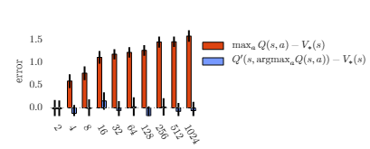
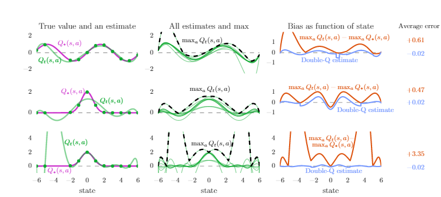
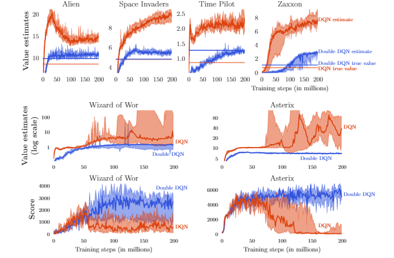

# Phân tích bài báo Deep Reinforcement Learning with Double Q-Learning

Hado van Hasselt, Arthur Guez, David Silver from Google DeepMind

##  0. Thông tin bài báo

**Deep Reinforcement Learning with Double Q-learning**

Tác giả: Hado van Hasselt, Arthur Guez, David Silver from Google DeepMind, 2015

https://arxiv.org/abs/1509.06461


##  1. Động cơ viết bài

Vấn đề ước lượng quá cao (overestimation) luôn là vấn đề tồn tại trong học tăng cường, nhưng từ trước đến nay có nhiều cách giải thích về nguồn gốc của nó, một là quy cho xấp xỉ hàm không linh hoạt (Thrun và Schwartz, 1993), một là do nhiễu (van Hasselt, 2010, 2011). Thực nghiệm cũng cho thấy, vấn đề ước lượng quá cao phổ biến hơn nhiều so với nhận thức trước đây, cần tìm cách giảm bớt ảnh hưởng của nó.

Động cơ viết bài báo này là khám phá nguồn gốc của ước lượng quá cao, kiểm chứng xem vấn đề ước lượng quá cao có bất lợi cho Q-Learning hay không, và tìm cách giảm bớt vấn đề ước lượng quá cao.


## 2. Lịch sử phát triển của thuật toán Q-Learning

Trong bài báo này, tác giả tổng kết sự phát triển của DQN:

### 1. Q-Learning — phương pháp giải bài toán ra quyết định tuần tự

Q-Learning là một **phương pháp sai phân thời gian**, được dùng rất tốt trong các bài toán ra quyết định tuần tự (Watkins, 1989), nó ước lượng hàm giá trị hành động tối ưu $`Q_{\pi}(s,a)=\mathbb{E}[R_1+\gamma R_2+...|S_0=s, A_0=a,\pi],`$ và với mỗi trạng thái chọn hành động ứng với hàm giá trị hành động tối ưu, từ đó gián tiếp sinh ra chính sách tối ưu.

Chi tiết xin tham khảo bài viết về Q-Learning, ở đây đưa ra công thức lặp để tiện giải thích phần sau.

```math
Q(S_t,A_t)=Q(S_t,A_t)+ \alpha (Y_t^Q-Q(S_t,A_t)) \tag{1}
```

### 2. Q-Learning với xấp xỉ hàm giá trị

Vì số trạng thái quá nhiều hoặc liên tục, không thể duyệt hết tất cả các trạng thái, cần dùng hàm tham số hóa $`Q(s,a;\theta _t)`$ để khớp các giá trị hiện có, và dự đoán hàm giá trị cho các trạng thái chưa biết, thông qua công thức

```math
\theta_{t-1}=\theta_t +\alpha(Y_t^Q-Q(S_t,A_t;\theta_t))\nabla Q(S_t, A_t,;\theta _t) \tag{2}
```

để hoàn thành việc cập nhật tham số, trong đó $`Y_t^Q =R_{t+1}+\gamma \max_{a}Q(S_{t+1},a;\theta _t)`$ là TD-target (mục tiêu sai phân thời gian), ý tưởng chính là dùng phương pháp tương tự giảm gradient, giúp hàm tham số hóa được khớp gần mục tiêu hơn, tức là phù hợp hơn với giá trị thực.

Phương pháp này giải quyết vấn đề **trạng thái chưa biết** mà Q-Learning truyền thống không giải quyết được, tức vấn đề kém bền vững.

### 3. Deep Q Networks (DQN)

(Mnih et al., 2015) — mạng nơ-ron + Q-Learning

Nói đến xấp xỉ hàm thì không thể không nhắc đến mạng nơ-ron, nó có khả năng **xấp xỉ hàm** cực mạnh, DQN ra đời từ đó.

DQN có ba điểm cải tiến sau so với Q-Learning truyền thống, nâng cao hiệu năng của thuật toán:

1. #### Dùng mạng nơ-ron thay cho hàm tham số hóa, tăng cường khả năng xấp xỉ hàm

2. #### Dùng mạng mục tiêu

   Dùng một mạng mục tiêu được cập nhật bất đồng bộ, tham số mạng ký hiệu là $`\theta^-`$ (cứ mỗi $`\tau`$ lần thì gán tham số $`\theta`$ của Q-net cho mạng mục tiêu) để tính mục tiêu.

   ```math
   Y_t^Q = R_{t+1}+\gamma\max_{a}Q(S_t=s, A_t=a;\theta^-_t) \tag{3}
   ```

   

3. #### Dùng **phát lại kinh nghiệm** (Lin, 1992): lưu kinh nghiệm và dùng lại nhiều lần, tăng hiệu suất sử dụng, giảm chi phí lấy mẫu

4. #### Double DQN

	Trọng tâm của bài báo này, sẽ giới thiệu ở chương tiếp theo


## 3. Double DQN

### 1. Thao tác cụ thể

Thay đổi cách tính mục tiêu, công thức là:

```math
Y_t^Q = R_{t+1}+\gamma Q(S_t=s, A_t=\arg\max_{a \in \mathbb{A}}Q(s,a|\theta_t^-);\theta_t) \tag{4}
```

### 2. Nguồn gốc ý tưởng: tách rời việc chọn và việc tính

​	Trong DQN truyền thống, việc tính TD-target có thể chia thành hai bước: **chọn hành động tối ưu** và **tính hàm giá trị hành động tối ưu**. Công thức này có thể biến đổi thành dạng phân tách sau:

   ```math
   \begin{gathered}
   a^*=\arg\max_{a \in \mathbb{A}}Q(s,a|\theta_t)\\Y_t^Q=r+\gamma Q(S_t=s, A_t=a^*;\theta_t)
   \end{gathered}
   ```

​	Nhiệm vụ tính mục tiêu được chuyển sang mạng mục tiêu:

```math
\begin{gathered}
a^*=\arg\max_{a \in \mathbb{A}}Q(s,a|\theta_t^-)\\Y_t^Q=r+\gamma Q(S_t=s, A_t=a^*;\theta_t^-)
\end{gathered}
```
​	Dùng Double Q-Learning đã nhắc ở trên, thì trở thành dạng sau:

```math
\begin{gathered}
a^*=\arg\max_{a \in \mathbb{A}}Q(s,a|\theta_t^-)\\Y_t^Q=r+\gamma Q(S_t=s, A_t=a^*;\theta_t)
\end{gathered}
```

***Thực ra Q-Learning cũng có dạng Double, huấn luyện riêng hai mô hình $`\theta`$, $`\theta'`$ với thao tác như nhau, chỉ là ở đây Double DQN khéo léo dùng mạng mục tiêu $`\theta^-`$ làm mạng thứ hai***

​	Để tiện theo dõi, trình bày dưới dạng bảng

|                        |       DQN        | DQN+target network |     Double DQN     |
| :--------------------: | :--------------: | :----------------: | :----------------: |
|     Chọn hành động tối ưu     | Mạng chính sách $`\theta`$ | Mạng mục tiêu $`\theta^-`$ | Mạng mục tiêu $`\theta^-`$ |
| Tính hàm giá trị hành động tối ưu | Mạng chính sách $`\theta`$ | Mạng mục tiêu $`\theta^-`$ |  Mạng chính sách $`\theta`$  |

Từ đó có thể thấy cách tách rời: trong phương pháp DQN + mạng mục tiêu truyền thống, hai bước chọn hành động tối ưu và tính hàm giá trị hành động tối ưu bị gắn với nhau, nhưng Double DQN tách rời hai bước này, đạt được hiệu quả giảm bớt ước lượng quá cao. Còn vì sao phải làm vậy, cần hiểu rõ vấn đề ước lượng quá cao sinh ra như thế nào, ở phần tiếp theo tác giả chứng minh rõ ràng sự xảy ra của hiện tượng ước lượng quá cao và cận trên, cận dưới của nó, đồng thời dùng thực nghiệm để kiểm chứng lý thuyết.


## 4. Vấn đề ước lượng quá cao

Một đóng góp khác của bài báo này là phân tích có hệ thống nguyên nhân sinh ra vấn đề ước lượng quá cao và cách nó ảnh hưởng đến Q-Learning.

### 1. Suy luận lý thuyết

#### (1) Tại sao xảy ra ước lượng quá cao?

Nói đơn giản, vì các phương pháp ước lượng như mạng nơ-ron có sai số, dẫn đến hàm giá trị hành động $`Q(A_t=a_i, S_t=s)`$ của các hành động khác nhau ở một trạng thái cố định $`s`$ có sai số ước lượng so với giá trị thực $`Q_*(A_t=a_i, S_t=s)`$. Giả sử nhiễu ước lượng là Gauss, không chệch với trung bình 0, sai số có thể dương có thể âm, đến đây chưa có vấn đề gì, nhưng thao tác khi cập nhật tiếp theo là tính TD-target, như công thức $`(3)`$, dùng phép max, điều này khiến sai số ở bước này luôn dương, gây ra độ chệch dương, đây chính là nguyên nhân dẫn đến ước lượng quá cao.

Lấy một ví dụ sinh động: mỗi ngày lấy cơm hộp ở căng tin, lượng cơm mỗi hộp 500g gần như bằng nhau, nhưng có hộp hơi nhiều là 530g, có hộp hơi ít là 470g. Mỗi ngày bạn chọn ngẫu nhiên một hộp làm bữa trưa, sau một tháng cân nặng của bạn không thay đổi, vì kỳ vọng hộp cơm ăn được là giá trị trung bình 500g mỗi hộp. Nhưng tháng thứ hai nhờ thị giác nhạy bén, mỗi ngày bạn đều chọn hộp nhiều nhất, sau một tháng bạn béo thêm ba cân (1,5 kg), vì lúc này kỳ vọng hộp cơm ăn được là giá trị lớn nhất 530g.

Quá trình chọn hộp cơm nhiều nhất chính là phép max, cơm bạn ăn vào được tiêu hóa (cập nhật) qua công thức $`(1)`$, cập nhật cân nặng của bạn, tức giá trị ước lượng của hàm giá trị hành động.

#### (2) Suy luận lý thuyết về chỉ số ước lượng quá cao

Thrun và Schwartz (1993) lần đầu phát hiện hiện tượng ước lượng quá cao, cho thấy nếu giá trị hành động chứa sai số ngẫu nhiên phân phối đều trong khoảng $`[-\epsilon,\epsilon]`$, thì mỗi mục tiêu bị ước lượng quá cao đến cận trên $`\gamma \in \frac{m-1}{m+1}`$, trong đó m là số hành động.

Từ phương trình tối ưu Bellman có thể suy ra quan hệ giữa hàm giá trị hành động tối ưu và hàm giá trị trạng thái tối ưu:

```math
Q_*(s,a)=V_*(s) \tag{5}
```

​		Vì khi môi trường cố định, phần thưởng cố định, hàm giá trị trạng thái là hằng số, giả sử: ước lượng không chệch của hàm giá trị hành động bất kỳ là $`Q_t(s,a)`$, thì đẳng thức $`(6)`$ đúng

```math
\sum_a (Q_t(s,a)-V_*(s))=0 \tag{6}
```

​		Dù định nghĩa ước lượng là không chệch, sai số trung bình bằng 0, nhưng không phải sai số của mỗi ước lượng đều bằng 0, cũng có thể xảy ra trường hợp sau:

```math
\frac{1}{m} \sum_a(Q_t(s,a)-V_*(s))^2=C \quad (m>1 \text{ là số hành động}, C>0 \text{ là số thực}) \tag{7}
```

​		Dưới giả định này, dùng phép max trong $`(3)`$, khi dùng $`(2)`$ để cập nhật hàm giá trị, $`\max_aQ_t(s,a) \geq V_*(s)+ \sqrt{\frac{C}{m-1}}`$, có được cận dưới của ước lượng quá cao.

​		Bài báo đặc biệt nhắc đến, cận dưới ước lượng quá cao của Double Q-Learning là 0.

​		Chứng minh có thể tham khảo phụ lục của bài gốc, rất chi tiết, ở đây không nhắc lại.

#### (3) Tại sao Double DQN có thể giải quyết ước lượng quá cao?

​	Tiếp tục với ví dụ cơm hộp. Lúc này bạn thấy mình hơi béo, nhờ bạn cùng phòng lấy cơm hộp giúp, dù bạn cùng phòng lấy thế nào, chắc chắn cũng không nhiều hơn lúc bạn tự lấy (chọn hộp nặng nhất), tức $`Q(s,a_*;\theta^-) \leq \max_{a}Q(s,a)`$, như vậy cũng giảm ảnh hưởng ước lượng quá cao của mục tiêu, từ đó giảm ước lượng của hàm giá trị hành động.


### 2. Thực nghiệm

Bài báo làm tổng cộng hai thực nghiệm để kiểm chứng suy luận lý thuyết trên

#### Thực nghiệm một: so sánh hiệu năng ước lượng hàm giá trị của Q-Learning và Double Q-Learning



Tác giả chứng minh bằng thực nghiệm, trong hình trên trục hoành là số hành động, trục tung là sai số giữa giá trị Q ước lượng và giá trị tối ưu (lặp lại 100 lần lấy trung bình), màu cam là Q-learning, màu xanh lam là Double Q-learning, có thể thấy khi số hành động tăng, sai số của Q-learning tăng dần, còn Double Q-learning về cơ bản không chệch.


#### Thực nghiệm hai: kiểm chứng nguồn gốc ước lượng quá cao qua thực nghiệm so sánh khớp tham số, và kiểm chứng Double Q-Learning có thể giảm hiệu quả vấn đề ước lượng quá cao



Sau khi chứng minh Double Q-learning có thể giảm khớp quá mức (overfitting), tác giả làm ba nhóm thực nghiệm **mô phỏng khớp tham số**, để kiểm chứng sự xuất hiện của ước lượng quá cao.

Trong biểu đồ trục hoành là trạng thái, tổng cộng có 13 trạng thái, trục tung là độ lớn giá trị Q. Tổng cộng có mười hành động.

- Ở cột trái, đường màu tím biểu thị giá trị Q tối ưu thực của mỗi trạng thái, đường màu xanh lá là giá trị thực của hàm giá trị hành động, các điểm màu xanh lá là các điểm lấy mẫu thực không chứa nhiễu. Hành động chỉ được lấy mẫu ở 11 trong 13 trạng thái, quan sát tình hình ở các điểm không được lấy mẫu. Thực nghiệm hàng thứ nhất và hàng thứ hai dùng đa thức bậc 6 để khớp, thực nghiệm hàng thứ ba dùng đa thức bậc 9. Có thể thấy ở hàng thứ hai hình trái, việc xấp xỉ trên các điểm lấy mẫu cũng không chính xác, do bậc đa thức thấp nên không đủ linh hoạt; ở hàng thứ ba hình trái có thể thấy, tuy xấp xỉ trên các điểm lấy mẫu đều rất tốt, nhưng ở những chỗ không được lấy mẫu sai số rất lớn, tức khớp quá mức.
- Ba hàng hình ở cột giữa, trong mỗi hình 10 đường màu xanh lá là hàm giá trị hành động tương ứng với 10 hành động, đường nét đứt là giá trị hành động lớn nhất ở mỗi trạng thái. Có thể thấy **giá trị hành động lớn nhất về cơ bản đều lớn hơn giá trị Q tối ưu thực ở hình bên trái**, khi ta dùng các ước lượng hàm giá trị hành động này để cập nhật Q-Learning, **dùng $`\max_aQ_t(s,a)`$ trong công thức $`(2)`$, hiện tượng ước lượng quá cao xảy ra**.
- Ba hàng hình ở cột phải, đường màu cam là kết quả lấy đường nét đứt màu đen ở hình giữa trừ đường màu tím ở hình trái, tức ước lượng quá cao, đường màu xanh lam là hiệu quả ước lượng khi dùng Double Q-Learning, giá trị trung bình của đường màu xanh lam gần 0 hơn, cho thấy **Double Q-Learning thực sự có thể giảm vấn đề ước lượng quá cao của Q-Learning trong xấp xỉ hàm**.

Qua thực nghiệm, phát hiện xấp xỉ hàm không đủ linh hoạt ước lượng giá trị Q không chính xác, nhưng **xấp xỉ hàm đủ linh hoạt sẽ sinh ra sai số lớn hơn ở các trạng thái chưa biết**, **dẫn đến ước lượng quá cao hơn**, DQN chính là một loại xấp xỉ hàm rất linh hoạt, dùng mạng nơ-ron để xấp xỉ hàm giá trị. Mà ước lượng quá cao cuối cùng sẽ ngăn cản việc học được chính sách tối ưu, tác giả về sau cũng chứng minh điều này qua thực nghiệm trên Atari, và thông qua Double Q-Learning giảm ước lượng quá cao thì chính sách cuối cùng cũng được cải thiện.

### 3. Ước lượng quá cao ảnh hưởng đến DQN như thế nào?

Việc lựa chọn là tương đối, ước lượng quá cao đồng đều sẽ không ảnh hưởng đến việc chọn hành động.

Thứ thực sự gây ảnh hưởng là: ước lượng quá cao không đồng đều, quay lại ví dụ ăn cơm hộp. Bạn và tôi có cùng thể trạng (tỉ lệ ăn-tăng cân giống nhau), tôi nặng hơn bạn một chút, mỗi lần chúng ta đều chỉ lấy hộp cơm nhiều nhất 530g, một tháng cân nặng tăng như nhau, sau một tháng vẫn là tôi nặng hơn bạn một chút. Nhưng bạn ăn cơm hộp loại A, tôi ăn cơm hộp loại B, điều này sẽ dẫn đến ước lượng quá cao không đồng đều, khiến bạn có thể béo nhanh hơn một chút, sau một tháng thậm chí vượt tôi, **dẫn đến lời giải gần tối ưu (suboptimal)**.

Chuyện quan trọng nói ba lần: **ước lượng quá cao đồng đều không có ảnh hưởng, thứ thực sự gây ảnh hưởng là ước lượng quá cao không đồng đều**, từ đây về sau từ ước lượng quá cao được dùng để chỉ ước lượng quá cao không đồng đều.

## 5. Thực nghiệm trên Atari 2600

### 1. Chi tiết huấn luyện

Kiến trúc mạng là một mạng nơ-ron tích chập (Fukushima, 1988; LeCun et al., 1998), có 3 tầng tích chập và một tầng ẩn kết nối đầy đủ (tổng cộng khoảng 1,5 triệu tham số). Mạng lấy bốn khung hình cuối cùng làm đầu vào, đưa ra giá trị hành động của mỗi hành động. Trong mỗi trò chơi, mạng được huấn luyện 200M khung hình trên một GPU, tức khoảng 1 tuần.

### 2. Kết quả thực nghiệm



Tác giả lặp lại thực nghiệm trên 6 trò chơi, được kết quả sau

- Hàng 1, 2 trình bày giá trị thực và giá trị ước lượng của sáu trò chơi, màu xanh lam là DoubleDQN, màu đỏ là DQN. Nhìn bằng mắt thường cũng thấy, việc khớp giá trị của DoubleDQN gần với giá trị thực hơn, so với DQN thì hiện tượng ước lượng quá cao giảm rõ rệt. Hơn nữa trong đó có hai trò chơi bị ước lượng quá cao rất nghiêm trọng.
- Chọn hai trò chơi có hiện tượng ước lượng quá cao nghiêm trọng hơn (giữa dưới), trình bày điểm số trong thời gian huấn luyện: khi ước lượng quá cao bắt đầu thì điểm số giảm, chứng minh hiện tượng ước lượng quá cao có thể ảnh hưởng đến hiệu năng thuật toán. Dùng Double DQN thì việc học ổn định hơn.

Cuối cùng, để chứng minh tính ổn định của thuật toán, dùng các thời điểm bắt đầu học khác nhau (để người chơi một lúc trước, rồi tác tử mới tiếp quản), phát hiện kết quả của DDQN ổn định hơn, và lời giải của DDQN không tận dụng các đặc tính liên quan của môi trường.

#####  Chú ý: vì giới hạn độ dài, ở đây không trình bày thêm các kết quả thực nghiệm khác

> Ghi chú của người dịch: tiêu đề mục 5 trong bản gốc viết "Atari2006", đã sửa thành "Atari 2600" (tên đúng của hệ máy).

## 6. Đóng góp của bài báo

Bài báo này có năm đóng góp.

- Thứ nhất, chỉ ra vì sao Q-Learning có vấn đề ước lượng quá cao.
- Thứ hai, qua phân tích ước lượng giá trị của các trò chơi Atari, phát hiện các ước lượng quá cao này trong thực tế phổ biến và nghiêm trọng hơn so với nhận định trước đây.
- Thứ ba, chứng minh có thể dùng học Double Q-Learning để giảm hiệu quả ước lượng quá cao, từ đó giúp việc học ổn định và đáng tin cậy hơn.
- Thứ tư, đề xuất một cách cài đặt cụ thể của Double DQN, nó dùng kiến trúc hiện có của thuật toán DQN và mạng nơ-ron sâu, không cần mạng hay tham số bổ sung.
- Cuối cùng, chỉ ra Double DQN tìm được chính sách tốt hơn, đạt kết quả tốt nhất thời điểm đó trên miền Atari 2600.

## 7. Giới thiệu người viết

Yu Tianqi (于天琪), nam, ngoài 20 tuổi, độc thân, đang học tại lớp thực nghiệm Trần Canh (陈赓实验班) Đại học Kỹ thuật Cáp Nhĩ Tân\
Trang Zhihu: https://www.zhihu.com/people/Yutianqi \
qq:2206422122 \
Hoan nghênh giao lưu, cùng nhau học hỏi
