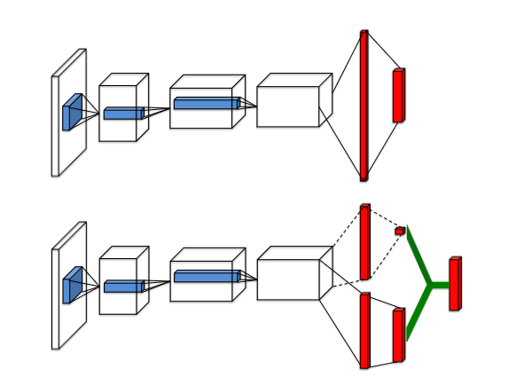
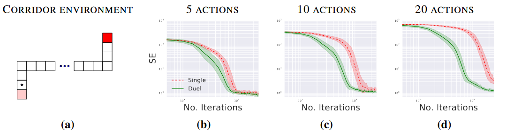
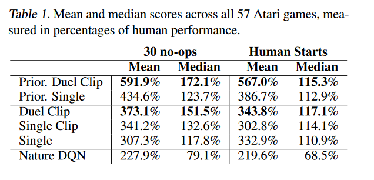

# Dueling Network Architectures for Deep Reinforcement Learning

## 0. Thông tin bài báo

**Dueling Network Architectures for Deep Reinforcement Learning**

Ziyu Wang, Tom Schaul, Matteo Hessel, Hado van Hasselt, Marc Lanctot, Nando de Freitas

Google DeepMind

[https://arxiv.org/abs/1511.06581](https://arxiv.org/abs/1511.06581 "https://arxiv.org/abs/1511.06581")

## **1. Động cơ viết bài**

Trước khi Dueling DQN xuất hiện, đa số phương pháp RL dựa trên học sâu đều dùng cấu trúc mạng nơ-ron tiêu chuẩn, như MLP, LSTM,... Trọng tâm của các công trình loại này là cải tiến điều khiển và thuật toán RL, hoặc mở rộng các kiến trúc mạng nơ-ron hiện có vào RL.

Bài báo này nhằm đề xuất một cấu trúc mạng nơ-ron phù hợp với các thuật toán RL không mô hình (model-free), cấu trúc này có tính linh hoạt và tính bổ trợ tốt.

## **2.** Kiến thức chuẩn bị

&#x20;Nếu $s_t$ là video gồm $M$ khung hình mà tác tử cảm nhận được, thì:

$$
s_t = (x_{t−M+1},\cdots,x_t)\in S
$$

Tương ứng, $a_t$ là tập rời rạc các hành động có thể chọn của tác tử, thì $a_t \in A={1,2,3,\cdots,|A|}$; tín hiệu phần thưởng do bộ giả lập trò chơi sinh ra là $r_t$. Mục tiêu của tác tử là tối đa hóa lợi tức chiết khấu $R_t$ ($R_t= \sum _{r=t}^\infty \gamma^{r-t}r_t$), trong công thức này, $\gamma\in[0,1]$ là hệ số chiết khấu, nó cân bằng tầm quan trọng của phần thưởng tức thời và phần thưởng tương lai.

Với tác tử hành động theo chính sách ngẫu nhiên $\pi$, giá trị của cặp trạng thái-hành động $(s, a)$ và trạng thái $s$ được định nghĩa như sau:

  $Q^{\pi}(s,a) = E[R_{t}|s_{t}=s,a_{t}=a,\pi]$ (hàm giá trị hành động)

  $V^{\pi}(s) = E_{a \sim \pi(s)}[Q^{\pi}(s,a)]$ (hàm giá trị trạng thái)

&#x20;   $Q^{\star}(s, a) = \mathop{max}\limits_{\pi} Q^\pi(s, a)$ (hàm giá trị hành động tối ưu)

  $V^{\star}(s)=\mathop{max}\limits_{\pi}V^{\pi}(s)$ (hàm giá trị trạng thái tối ưu)

&#x20;   $A^{\pi}(s,a) = Q^{\pi}(s,a) - V^{\pi}(s,a)$ (hàm lợi thế)

**Theorem 1 (Định lý 1):** $V^{\star}(s) = \mathop{max}\limits_{a} Q^{\star}(s, a)$ (hàm giá trị tối ưu bằng giá trị lớn nhất của hàm giá trị hành động tối ưu theo hành động $a$)
$$
A^{\star}(s, a)=Q^{\star}(s, a)-V^{\star}(s).\text{ (lấy max theo hành động a ở cả hai vế)}
$$

$$
\mathop{max}\limits_{a}A^{\star}(s, a)=\mathop{max}\limits_{a}Q^{\star}(s, a)-V^{\star}(s)
$$

$$
\mathop{max}\limits_{a}A^{\star}(s, a) = \mathop{max}\limits_{a}Q^{\star}(s, a) - \mathop{max}\limits_{a}Q^{\star}(s, a) =0
$$

Ngoài ra có:

$$
A^{\star}(s, a)=Q^{\star}(s, a)-V^{\star}(s) \Rightarrow Q^{\star}(s, a)=A^{\star}(s, a)+V^{\star}(s)
$$

$$
Q^{\star}(s, a)=A^{\star}(s, a)+V^{\star}(s) \Rightarrow Q^{\star}(s, a)=A^{\star}(s, a)+V^{\star}(s)-0
$$

$$
A^{\star}(s, a)+V^{\star}(s)+0 = A^{\star}(s, a)+V^{\star}(s)-\mathop{max}\limits_{a}A^{\star}(s, a)
$$

**Theorem 2 (Định lý 2):** $Q^{\star}(s, a)=A^{\star}(s, a)+V^{\star}(s)-\mathop{max}\limits_{a}A^{\star}(s, a)$

### 2.1 Deep Q-networks

$Q(s, a; θ)$ là xấp xỉ của mạng nơ-ron cho $Q^{\star}(s, a)$, đầu vào của mạng nơ-ron là trạng thái $s$, thông qua mạng nơ-ron ánh xạ đầu vào thành một vectơ đầu ra, vectơ đầu ra là điểm cho từng hành động $a$ ở trạng thái $s$.

Hàm mất mát ở vòng lặp $i$:

$$
L_i(\theta_i)=E_{s,a,r,s'}[(y_i^{DQN}-Q(s,a;\theta_i))^2]
$$

Trong đó, $y^{DDQN}{i}=r+\gamma Q(s'+ \mathop{max}\limits_{a'}Q(s',a';\theta^{-}))$.

Ngoài ra, còn có thể sửa đổi cách huấn luyện từ góc độ giảm gradient và phát lại kinh nghiệm.

*   Giảm gradient

$$
\nabla_{\theta_i}  L_i(\theta_i)=E_{s,a,r,s'}[(y_i^{DQN}-Q(s,a;\theta_i))\nabla_{\theta_i}Q(s,a;\theta_i)]
$$

*   Phát lại kinh nghiệm

$$
L_i(\theta_i) = E_{s,a,r,s'} \sim u(D)[y_i^{DQN}-Q(s,a;\theta_i))^2]
$$

Trong quá trình học, tác tử tích lũy một tập dữ liệu $D_t = {e_1, e_2, . . . , e_t}$, trong đó kinh nghiệm $e_t = (s_t, a_t, r_t, s_{t+1})$ đến từ nhiều tập.

### 2.2 Double Deep Q-networks

$$
y^{DDQN}_{i}=r+\gamma Q(s'+ argmax_{a'}Q(s',a';\theta_{i};\theta^{-}))
$$

DDQN cơ bản giống DQN, chỉ thay đổi biểu thức của $y^{DDQN}_{i}$.

## **3. Kiến trúc Dueling Network**

Khác với DQN, Dueling Network xấp xỉ $A^{\star}(s, a)$ và $V^{\star}(s)$, lần lượt là $A(s,a;\theta,\alpha)$ và $V(s;\theta,\beta)$. Điều này cũng có nghĩa là Dueling Network có thể dùng tham số của cùng một mạng tích chập để trích xuất đặc trưng, nhưng đầu ra thì dùng các cấu trúc khác nhau.

Cụ thể, theo **Theorem 2**, có:

$$
Q(s, a; \theta, \alpha, \beta) = V (s; \theta, \beta) + A(s, a; \theta, \alpha)-\mathop{max}\limits_{a}A(s, a; \theta, \alpha)
$$

Vì Dueling Network chỉ thay đổi kiến trúc mạng, nên cách huấn luyện mạng giống DQN và DDQN, mọi cải tiến huấn luyện dựa trên DQN đều có thể dùng trên Dueling Network.

### 3.1 Tác dụng của $\mathop{max}\limits_{a}A(s, a; θ, α)$

Vì $Q^{\star}(s, a)=A^{\star}(s, a)+V^{\star}(s)$, nên $Q^{\star}(s, a)$ có được theo cách này không duy nhất.

Nếu đồng thời cộng thêm một số vào $A^\star$ và trừ đi cùng số đó ở $V^\star$, sẽ được $Q^{\star}(s, a)$ giống như trước. Còn khi thêm số hạng $\mathop{max}\limits_{a}A(s, a; θ, α)$ thì sẽ không xảy ra tình huống này.

### 3.2 $\mathop{max}\limits_{a}A(s, a; θ, α)$ trong sử dụng thực tế

Trong sử dụng thực tế, số hạng thứ ba trong $Q(s, a; \theta, \alpha, \beta)$ thường không dùng $\mathop{max}\limits_{a}A(s, a; \theta, \alpha)$, mà dùng giá trị trung bình, tức là:

$$
  Q(s, a; \theta, \alpha, \beta) = V (s; \theta, \beta) + ( A(s, a; \theta, \alpha) − \frac{1} {|A|} \sum_ {a'} A(s, a'; \theta, \alpha) )
$$

## **4.** Thực nghiệm

### 4.1 Đánh giá chính sách

Để đánh giá giá trị $Q$ học được, bài báo chọn một môi trường đơn giản, trong đó có thể tính chính xác giá trị $Q_\pi(s,a)$ riêng cho mọi $(s, a) ∈ S × A$.

Môi trường này, gọi là hành lang (corridor), gồm ba hành lang nối với nhau. Sơ đồ môi trường hành lang như hình (a), tác tử bắt đầu từ góc dưới bên trái của môi trường, phải di chuyển đến góc trên bên phải mới nhận được phần thưởng lớn nhất. Tổng cộng có 5 hành động có thể dùng: lên, xuống, trái, phải và không thao tác (no-op). Hai phần dọc đều có 10 trạng thái, còn phần ngang có 50 trạng thái.

Bài báo so sánh kiến trúc Q một luồng (single-stream) với kiến trúc Dueling Network trên ba biến thể của môi trường hành lang, lần lượt dùng 5, 10 và 20 hành động (biến thể 10 và 20 hành động được tạo bằng cách thêm các hành động không thao tác vào môi trường gốc).

Kiến trúc một luồng là một MLP ba tầng, mỗi tầng ẩn có 50 đơn vị. Kiến trúc Dueling Network cũng gồm ba tầng. Tuy nhiên, sau tầng ẩn thứ nhất có 50 đơn vị, mạng rẽ nhánh thành hai luồng, mỗi luồng là một MLP hai tầng có 25 đơn vị ẩn.

Kết quả cho thấy, với 5 hành động, hai kiến trúc hội tụ với tốc độ gần như nhau. Tuy nhiên, khi ta tăng số hành động, kiến trúc Dueling Network thể hiện tốt hơn mạng Q truyền thống. Trong Dueling Network, luồng $V (s; θ, β)$ học được một giá trị chung, giá trị này được dùng chung giữa nhiều hành động tương tự ở trạng thái $s$, từ đó dẫn đến hội tụ nhanh hơn.

### 4.2 General Atari Game-Playing (Chơi game Atari tổng quát)

Bài báo đánh giá tổng hợp phương pháp đề xuất trên Arcade Learning Environment gồm 57 trò chơi Atari.

Kiến trúc mạng của bài báo có cấu trúc tích chập cấp thấp giống DQN. Có 3 tầng tích chập, phía sau là 2 tầng kết nối đầy đủ. Tầng tích chập thứ nhất có 32 bộ lọc 8×8 với bước nhảy (stride) 4, tầng thứ hai là 64 bộ lọc 4×4 với bước nhảy 2, tầng tích chập thứ ba cũng là tầng cuối cùng gồm 64 bộ lọc 3×3 với bước nhảy 1. Vì cả hai luồng A và V đều lan truyền gradient về tầng tích chập cuối cùng trong lan truyền ngược, bài báo co giãn lại gradient kết hợp đi vào tầng tích chập cuối cùng với hệ số 1/√2. Phương pháp kinh nghiệm (heuristic) đơn giản này tăng nhẹ tính ổn định. Ngoài ra, chúng tôi cắt (clip) gradient để chuẩn của nó nhỏ hơn hoặc bằng 10.

**Hàm đánh giá:**

$$
30 no-op=\frac{Score_{Agent} − Score_{Baseline}} {max\{Score_{Human}, Score_{Baseline}\} − Score_{Random}}
$$

**Kết quả:**

Hiệu năng của Single Clip tốt hơn Single. Chúng tôi kiểm chứng rằng mức tăng này chủ yếu do cắt gradient mang lại. Vì lý do này, chúng tôi thêm cắt gradient vào tất cả các phương pháp mới. Duel Clip thể hiện tốt hơn Single Clip ở 75,4% trò chơi (43 trên 57 trò). So với đường cơ sở đơn (single baseline), nó cũng đạt điểm cao hơn ở 80,7% trò chơi (46 trên 57 trò). Trong tất cả các trò chơi có 18 hành động, Duel Clip có 86,6% khả năng tốt hơn (26 trên 30 trò). Điều này nhất quán với kết quả nghiên cứu ở phần trước. Nhìn chung, tác tử Duel (Duel Clip) đạt hiệu năng ngang con người ở 42 trên 57 trò chơi.

## 5. Đóng góp

1.  Giúp mạng Q hội tụ tốt hơn. Vì với giá trị hành động Q, thuật toán DQN truyền thống ước lượng trực tiếp giá trị Q, còn Dueling DQN tách nó thành hai số hạng: V và A, tức hàm giá trị trạng thái V và hàm lợi thế A, lợi ích của việc này là khi các giá trị Q gần nhau, có thể dùng A được tách ra để tìm hành động tối ưu.

2.  Tính bền vững (robustness) tốt hơn. Trong trường hợp chênh lệch giữa các giá trị Q của một trạng thái cho trước thường rất nhỏ, sự khác biệt về thang đo này có thể khiến một lượng nhiễu nhỏ trong cập nhật dẫn đến việc sắp xếp lại các hành động, từ đó làm chính sách chuyển đổi đột ngột. Nhưng vì có hàm lợi thế A, nên kiến trúc Dueling Network bền vững với hiệu ứng này.

## 6. Giới thiệu người viết

Cheng Yue (程岳), nghiên cứu sinh, Đại học Bưu chính Viễn thông Trùng Khánh, hướng nghiên cứu hiện tại là phân tích chuỗi thời gian mờ, hợp nhất dữ liệu dị thể đa nguồn, Phòng thí nghiệm trọng điểm thành phố Trùng Khánh về Phân tích dữ liệu lớn và Ra quyết định thông minh.
