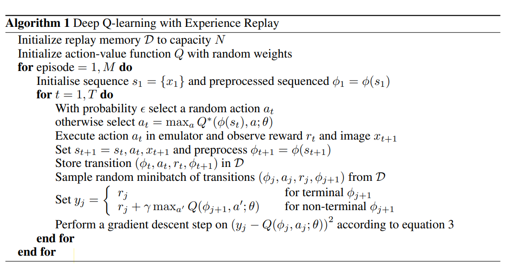
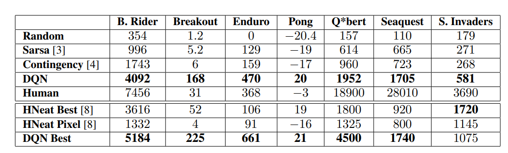

## Playing Atari with Deep Reinforcement Learning

Tác giả: Volodymyr Mnih, Koray Kavukcuoglu, David Silver, Alex Graves, Ioannis Antonoglou, Daan Wierstra, Martin Riedmiller

Đơn vị: Deepmind

Link bài báo: https://arxiv.org/abs/1312.5602

**Điểm nổi bật: tác giả đề xuất thuật toán học tăng cường sâu DQN, dùng mô hình học sâu để khớp (fit) hàm giá trị, kết hợp với Q-Learning để huấn luyện, và kiểm chứng trên Atari 2600.**

### **Motivation (Why - Động cơ):**

RL (học tăng cường) truyền thống dựa vào đặc trưng thủ công và hàm giá trị tuyến tính, hiệu năng bị hạn chế. Tiến bộ kỹ thuật của DL (học sâu) cho phép trích xuất thông tin nhiều chiều từ dữ liệu thô, không cần trích xuất đặc trưng thủ công nữa. Nếu kết hợp DL và RL, hiệu năng của thuật toán RL có thể tăng đáng kể, nhưng cần vượt qua hai vấn đề sau:

1. Thuật toán DL cần lượng lớn dữ liệu có nhãn, còn việc huấn luyện thuật toán RL chỉ trả về một phần thưởng vô hướng, và phần thưởng đó thưa, đầy nhiễu và bị trễ.
2. DL cần dữ liệu độc lập và phân phối đồng nhất (i.i.d.), còn dữ liệu của thuật toán RL vừa không độc lập, phân phối cũng không cố định. Các trạng thái trong thuật toán RL thường có tương quan cao, hơn nữa phân phối dữ liệu của RL cũng thay đổi khi thuật toán bắt đầu học các hành vi mới.

### **Main Idea (What - Ý tưởng chính):**

Tác giả giải quyết các vấn đề trên bằng thuật toán DQN, kết hợp một mạng CNN với thuật toán Q-Learning. Cụ thể, vấn đề thuật toán DL cần lượng lớn dữ liệu có nhãn nêu trong phần động cơ được giải quyết bằng ý tưởng Fixed Q-target (mục tiêu Q cố định) trong huấn luyện Q-Learning, còn vấn đề dữ liệu trong thuật toán RL không i.i.d. được giảm bớt (alleviate) bằng phát lại kinh nghiệm (experience replay).

### **Main Contribution (How - Đóng góp chính):**

Khác với TD-Gammon trước đây học trực tiếp trong chính sách on-policy, DQN dùng dạng off-policy, lưu dữ liệu lấy mẫu vào một tập hợp có kích thước cố định gọi là bể phát lại kinh nghiệm (experience replay pool), khi huấn luyện chia tập hợp thành nhiều mini-batch, dùng bộ tối ưu SGD để cập nhật trọng số. Với việc dùng chiến lược phát lại kinh nghiệm trong Q-learning để giảm bớt vấn đề không i.i.d., thuật toán mà bài báo đề xuất như hình dưới đây:

Trên đây là thuật toán DQN hoàn chỉnh, thuật toán dựa vào chính sách $\epsilon$-tham lam để chọn và thực hiện một hành động $a_t$ ở trạng thái $s_t$, quan sát phần thưởng $r_t$ do hệ thống đưa ra cùng khung hình trò chơi $x_{t+1}$ sau khi thực hiện hành động. Vì dùng lịch sử có độ dài bất kỳ làm đầu vào của mạng nơ-ron rất khó, nên tác giả dùng hàm biến đổi chuỗi $\phi()$ để chuyển chuỗi $s_{t+1} = s_t,a_t,x_t+1$ thành vectơ trạng thái $s_{t+1}$, giúp hàm Q có thể làm việc trên lịch sử có độ dài cố định. Ngoài ra, tác giả dùng một kỹ thuật gọi là phát lại kinh nghiệm, gom dữ liệu kinh nghiệm $e_t = (s_t, a_t, r_t, s_{t+1})$ thu thập được ở từng bước thời gian trong các tập khác nhau lưu vào một bộ nhớ phát lại kinh nghiệm $D=e_1,...,e_N$. Khi cần cập nhật mô hình trong vòng lặp bên trong của thuật toán, ta rút mẫu ngẫu nhiên từ bộ nhớ phát lại kinh nghiệm đã lưu mẫu để cập nhật tham số mô hình.

**Ưu điểm của phương pháp bài báo đề xuất:**

1. Đầu vào của hàm Q là trạng thái, không phải cặp trạng thái-hành động, có thể giảm hiệu quả khối lượng tính toán của mô hình. Cách trước chỉ cần tính một lần, xem các hành động khác nhau là các nơ-ron của tầng đầu ra, chọn hành động có giá trị lớn nhất, còn cách sau cần tính một lần cho mỗi hành động.
2. Việc cập nhật trọng số có dạng SGD, không phải OGD (giảm gradient trực tuyến). Có thể nâng cao hiệu suất sử dụng mẫu, đồng thời lấy trung bình và làm trơn phân phối hàm Q ứng với các hành vi khác nhau ở các trạng thái khác nhau, tránh thuật toán không hội tụ.

**Chỗ cần cải tiến:**

Phần phát lại kinh nghiệm chỉ lưu các kinh nghiệm gần nhất, và khi lấy mẫu thì lấy mẫu ngẫu nhiên, không phân biệt các mẫu quan trọng hơn, còn vì vấn đề bộ nhớ nên liên tục ghi đè các kinh nghiệm trước đó. Có thể dùng chiến lược lấy mẫu phức tạp hơn để phân biệt mẫu nào quan trọng hơn và tận dụng chúng.

**Kết quả:**

Điểm của DQN trên 7 trò chơi Atari 2600 có 6 trò vượt phương pháp tốt nhất, có 3 trò vượt chuyên gia con người, nhưng ở các trò như Q*bert, Seaquest, Space Invaders thì còn cách xa con người, tác giả đánh giá chúng khó hơn, cần mạng tìm được chính sách có thể mở rộng đến thang thời gian dài hơn.

**Suy nghĩ cá nhân**

1. Tác giả dùng cùng một mạng, cùng thuật toán và cùng siêu tham số trên 7 trò chơi này.
2. Có lẽ để làm nổi bật đây là bài báo đầu tiên về DL và RL, tác giả liên tục nhấn mạnh trong bài rằng DQN dùng chính hình ảnh gốc của trò chơi, không làm bất kỳ việc trích xuất đặc trưng thủ công nào, và trừ những lý do bất đắc dĩ (vấn đề thiết lập trò chơi) thì không thay đổi siêu tham số trong cả huấn luyện lẫn kiểm thử.
3. Phần trước tác giả cũng đề cập rằng hàm giá trị phi tuyến thường thiếu đảm bảo hội tụ, điều này cũng dẫn đến việc rất nhiều nghiên cứu trước đây đều dùng hàm giá trị tuyến tính có tính hội tụ tốt hơn. Nhưng trong thực nghiệm DQN vẫn không làm phân tích lý thuyết về tính hội tụ, chỉ nói rằng trong rất nhiều thực nghiệm chúng tôi chưa gặp vấn đề này.

### Giới thiệu người viết

Wu Wenhao (吴文昊), đang học thạc sĩ tại Đại học Giao thông Tây An
