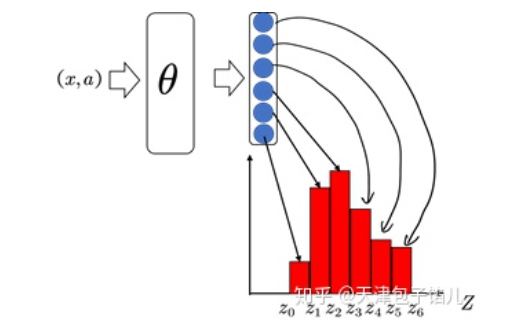
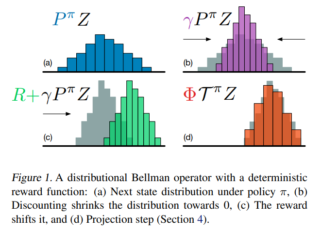
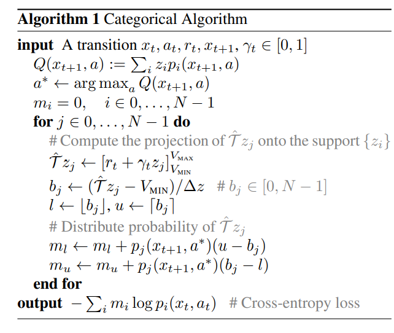
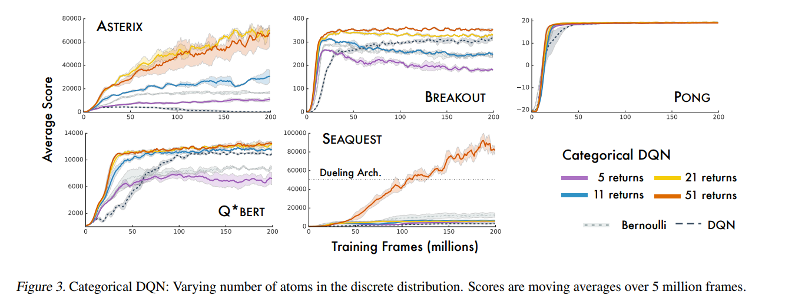
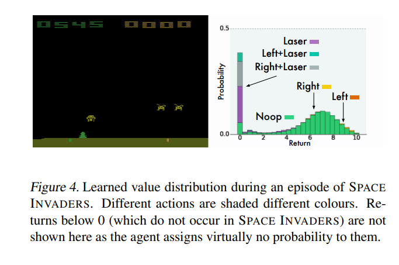
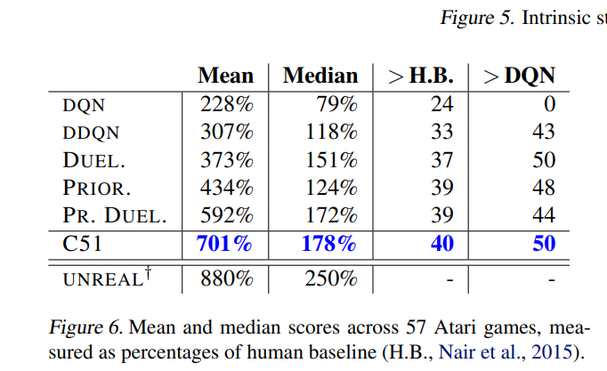

## A Distributional Perspective on Reinforcement Learning

Tác giả: Marc G. Bellemare, Will Dabney, Rémi Munos

Nguồn: DeepMind, ICML, 2017

Link bài báo: https://arxiv.org/abs/1707.06887

**Điểm nổi bật: tác giả đề xuất một thuật toán học tăng cường dựa trên phân phối giá trị, chuyển việc mô hình hóa kỳ vọng của lợi tức tích lũy trong các thuật toán học tăng cường trước đây thành mô hình hóa phân phối của lợi tức tích lũy, đề xuất một thuật toán mới, và kiểm chứng bằng thực nghiệm, vượt các thuật toán cũ trên chuẩn đánh giá Atari**

### **Motivation (Why - Động cơ):**

Các thuật toán học tăng cường dựa trên giá trị chỉ mô hình hóa kỳ vọng của lợi tức tích lũy, rất nhiều thông tin về phân phối bị mất, như phương sai, phân vị,... Trong các kịch bản né tránh rủi ro, ta có xu hướng chọn hành vi có phương sai nhỏ hơn chứ không phải chỉ chọn hành vi có trung bình cao.

### **Main Idea (What - Ý tưởng chính):**

Thay toán tử Bellman ban đầu bằng toán tử Bellman phân phối (distributional Bellman operator), và đưa ra chứng minh các tính chất liên quan, chuyển lý thuyết hàm giá trị hội tụ về một giá trị cố định theo kỳ vọng thành một lý thuyết về hàm giá trị hội tụ về một phân phối cố định.

**Phương trình Bellman**

Các phương pháp học tăng cường dựa trên giá trị kinh điển cố gắng dùng giá trị kỳ vọng để mô hình hóa lợi tức tích lũy, biểu diễn bằng hàm giá trị $V(x)$ hoặc hàm giá trị hành động $Q(x,a)$, sau đó tác tử xem hàm giá trị như "bản đồ", theo chỉ dẫn mà chọn hành vi ở các trạng thái khác nhau. Học tăng cường thường dùng phương trình Bellman để mô tả hàm giá trị
$$
\begin{aligned}
&Q^\pi(x, a):=\mathbb{E} Z^\pi(x, a)=\mathbb{E}\left[\sum_{t=0}^{\infty} \gamma^t R\left(x_t, a_t\right)\right] \\
&x_t \sim P\left(\cdot \mid x_{t-1}, a_{t-1}\right), a_t \sim \pi\left(\cdot \mid x_t\right), x_0=x, a_0=a
\end{aligned}
$$
Trong đó, $Z^\pi$ biểu thị lợi tức, là tổng phần thưởng chiết khấu nhận được dọc theo quỹ đạo tương tác của tác tử với môi trường dưới chính sách $\pi$. Hàm giá trị $Q^\pi$ của chính sách $\pi$ mô tả lợi tức kỳ vọng khi bắt đầu từ trạng thái $x \in X$ thực hiện hành động $a \in A$, rồi hành động theo $\pi$. Phương trình Bellman cũng có thể viết lại thành dạng lặp như sau:
$$
Q^\pi(x, a)=\mathbb{E} R(x, a)+\gamma \underset{P, \pi}{\mathbb{E}} Q^\pi\left(x^{\prime}, a^{\prime}\right)
$$
Trong học tăng cường, ta thường quan tâm đến việc thực hiện hành động để tối đa hóa lợi tức. Cách phổ biến nhất là dùng phương trình tối ưu:
$$
Q^*(x, a)=\mathbb{E} R(x, a)+\gamma \mathbb{E}_P \max _{a^{\prime} \in \mathcal{A}} Q^*\left(x^{\prime}, a^{\prime}\right) .
$$
Phương trình này có điểm bất động duy nhất $\mathrm{Q}^*$, tức hàm giá trị tối ưu, ứng với tập chính sách tối ưu $\pi^*$ ($\pi^*$ là tối ưu khi $\mathbb{E}_{a \sim \pi^*} Q^*(x, a)=\max _a Q^*(x, a)$). Ta xem hàm giá trị là một vectơ trong $\mathbb{R}^{\mathcal{X} \times \mathcal{A}}$, và cũng xem hàm phần thưởng kỳ vọng là một vectơ như vậy. Trong trường hợp này, toán tử Bellman và toán tử tối ưu T được định nghĩa như sau:
$$
\begin{aligned}
\mathcal{T}^\pi Q(x, a) &:=\mathbb{E} R(x, a)+\gamma \underset{P, \pi}{\mathbb{E}} Q\left(x^{\prime}, a^{\prime}\right) \\
\mathcal{T} Q(x, a) &:=\mathbb{E} R(x, a)+\gamma \mathbb{E}_P \max _{a^{\prime} \in \mathcal{A}} Q\left(x^{\prime}, a^{\prime}\right)
\end{aligned}
$$
Các toán tử này rất hữu ích, rất nhiều thuật toán học tăng cường được xây dựng trên chúng. Đặc biệt, chúng đều là ánh xạ co (contraction mapping), và việc áp dụng lặp lại chúng trên một $Q_0$ ban đầu nào đó sẽ hội tụ về $Q^\pi$ hoặc $Q^*$.

**Phương trình Bellman phân phối**

Phương trình Bellman ở trên là phương trình Bellman dựa trên kỳ vọng, mô tả quan hệ giữa kỳ vọng của ba biến ngẫu nhiên, tức $Q^\pi(x, a), \mathbb{E} R(x, a), \gamma \underset{P, \pi}{\mathbb{E}} Q^\pi\left(x^{\prime}, a^{\prime}\right)$. Trong đó số hạng thứ nhất là tổng của hai số hạng sau, nên cũng có dạng kỳ vọng. Phương trình Bellman phân phối thay kỳ vọng của biến ngẫu nhiên bằng chính biến ngẫu nhiên đó, tức là:
$$
Z(x, a)=R(x, a)+\gamma Z(X^{\prime}, A^{\prime})
$$
Trong đó, $Z(x,a)$ là biến ngẫu nhiên biểu thị lợi tức dưới $(x, a)$, $R(x,a)$ là biến ngẫu nhiên biểu thị phần thưởng hiện tại, $\gamma Z(X^{\prime}, A^{\prime})$ là biến ngẫu nhiên về lợi tức đã chiết khấu của trạng thái tiếp theo, về ý nghĩa vật lý không thay đổi.

Công thức cập nhật của toán tử Bellman phân phối giá trị ${T}^\pi$:
$$
\begin{aligned}
\mathcal{T}^\pi Q(x, a) &:=R(x, a)+\gamma P^\pi Z\left(x,a\right) 
\end{aligned}
$$
Trong đó,
$$
\begin{aligned}
&P^\pi Z\left(x,a\right) :\overset{D}{=} Z(X^{\prime}, A^{\prime})
\\
& X \sim P\left(\cdot \mid x, a\right), A^\prime \sim \pi\left(\cdot \mid X^\prime\right)
\end{aligned}
$$
**Ưu điểm của việc ước lượng phân phối:**

1. Nhiều khi giá trị trung bình không phản ánh được đặc điểm của phân phối
2. Nếu các hành vi khác nhau có kỳ vọng giống nhau, phương sai khác nhau, chỉ xét trung bình thì không thể đưa ra lựa chọn đúng.

### **Main Contribution (How - Đóng góp chính):**

Thuật toán C51 gồm hai quá trình quan trọng: tham số hóa phân phối và cập nhật Bellman có chiếu (projected Bellman update).

**Quá trình 1: Tham số hóa phân phối**

Ở bất kỳ cặp trạng thái-hành động (x,a) nào, lợi tức chiết khấu tích lũy đều là một phân phối. Để biểu diễn phân phối này, C51 rời rạc hóa không gian biến ngẫu nhiên, rồi mô hình hóa biến ngẫu nhiên thành tổng được biểu diễn trên các không gian rời rạc này. Giả sử giá trị lớn nhất của lợi tức chiết khấu tích lũy $Z$ là $V_{M A X}$, giá trị nhỏ nhất là $V_{M I N}$, và rời rạc hóa đều khoảng giữa giá trị nhỏ nhất và lớn nhất thành $\mathrm{N}$ khoảng, thì mỗi tập giá trị (support) đều nhau là $\left\{z_i=V_{\min }+i \Delta z: 0 \leq i<N, \Delta z:=\frac{V_{M A X}-V_{M I N}}{N-1}\right\}$, support là các điểm có mật độ xác suất khác 0. Do đó ta có thể mô hình hóa phân phối xác suất trên support
$$
Z_{\theta}(x,a) = z_i \quad w.p. \quad p_i(x,a):=\frac{e^{\theta_i(x,a)}}{\sum_je^{\theta_j(x,a)}}
$$
Trong đó w.p. là viết tắt của with probability (với xác suất).

Hình trên tham khảo từ [một câu trả lời trên Zhihu](https://zhuanlan.zhihu.com/p/337209047) (C51 - học tăng cường phân phối giá trị), thể hiện sinh động quá trình thuật toán C51 đưa cặp trạng thái-hành động (x,a) ra thành phân phối hàm.

**Quá trình 2: Cập nhật Bellman có chiếu**

Phần màu xanh lam trong hình (a) là phân phối của cặp trạng thái-hành động tiếp theo, sau khi chịu tác dụng của hệ số chiết khấu $\gamma$ trở thành phần màu tím trong hình (b), sau khi cộng với phần thưởng là biến ngẫu nhiên hằng, tịnh tiến thành phần ánh xạ trong hình (c). Rõ ràng có thể thấy, toán tử Bellman phân phối giá trị là co, nên cuối cùng có thể hội tụ. Nhưng đồng thời dưới tác dụng lặp đi lặp lại của toán tử Bellman phân phối giá trị, phân phối sẽ rời khỏi miền xác định ban đầu, vượt ra ngoài phạm vi support đã rời rạc hóa ở trên, vì vậy ta cần một ánh xạ $\phi$ để chiếu biến ngẫu nhiên sau khi cập nhật về support rời rạc ban đầu, đây chính là cập nhật Bellman có chiếu

**Thuật toán tổng thể**

Trên đây là ý tưởng cập nhật tổng thể của thuật toán C51 như sau. Ánh xạ cặp trạng thái-hành động lên một phân phối, rồi lặp đi lặp lại phân phối này, dùng ý tưởng của Q-Learning, xem hiệu giữa phân phối hiện có và phân phối sau khi cập nhật là hàm mất mát, cập nhật tham số mạng, cho đến khi phân phối này hội tụ về một phân phối cố định. Trong quá trình này có các khó khăn sau: 1. làm sao biểu diễn một phân phối, 2. làm sao đo hiệu giữa hai phân phối. Quá trình 1 và quá trình 2 lần lượt giải quyết hai vấn đề này.

**Kết quả:**

Hình trên là hiệu năng của thuật toán với số lượng khoảng cố định khác nhau trên các nhiệm vụ khác nhau, thuật toán cuối cùng được đặt tên là C51 vì sau thực nghiệm cắt bỏ phát hiện biểu diễn phân phối xác suất thành tổng xác suất của 51 khoảng cố định cho hiệu quả tốt nhất.

Phân phối của hàm Q tại một thời điểm trong quá trình thực nghiệm, từ hình có thể thấy rõ hành động nào tốt hay xấu

Tác giả so sánh C51 với DQN, DQN kép (Double DQN), DQN cấu trúc đối đầu (Dueling DQN) và DQN phát lại ưu tiên (Prioritized DQN), so sánh điểm đánh giá tốt nhất đạt được trong quá trình huấn luyện, phát hiện C51 tốt hơn rõ rệt các thuật toán khác. Và phát hiện C51 vượt xa trình độ kỹ thuật mới nhất hiện tại ở nhiều trò chơi (đặc biệt là SEAQUEST). Một sự thật đặc biệt đáng chú ý là thuật toán này thể hiện xuất sắc trong các trò chơi phần thưởng thưa.

**Ưu điểm của phương pháp bài báo đề xuất:**

1. Đầu ra của mạng nơ-ron tích chập trong thuật toán C51 không còn là hàm giá trị hành động, mà là xác suất tại các điểm tựa (atom), mục tiêu học của mạng nơ-ron chuyển từ một giá trị số thành một phân phối. Có thể giúp nội dung học được có thêm nhiều thông tin ngoài giá trị số, tức toàn bộ phân phối hàm Q.
2. C51 thể hiện tốt hơn trong các nhiệm vụ phần thưởng thưa, vì phần thưởng thưa tương đối khó bị mất trong quá trình lan truyền theo phân phối
3. Khung thuật toán C51 tuy vẫn là thuật toán DQN, nhưng hàm mất mát không còn là tổng sai số bình phương, mà là độ phân kỳ KL, có thể mô tả tốt hơn khác biệt giữa hai phân phối.

### Giới thiệu người viết

Wu Wenhao (吴文昊), đang học thạc sĩ tại Đại học Giao thông Tây An, liên hệ: wwhwwh05@qq.com
