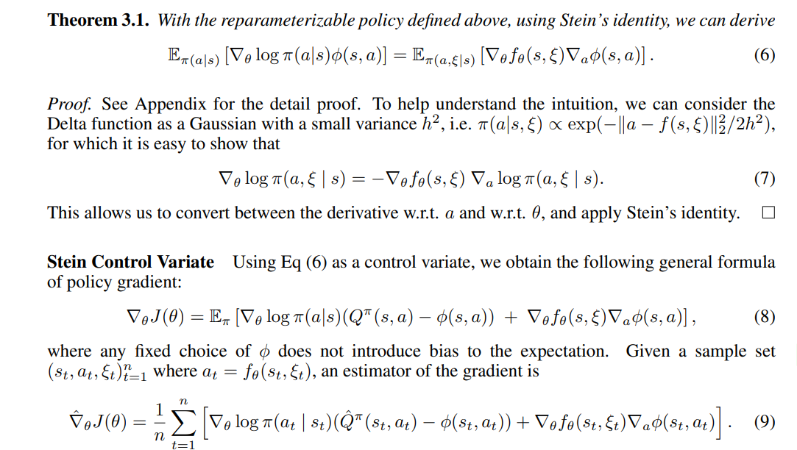
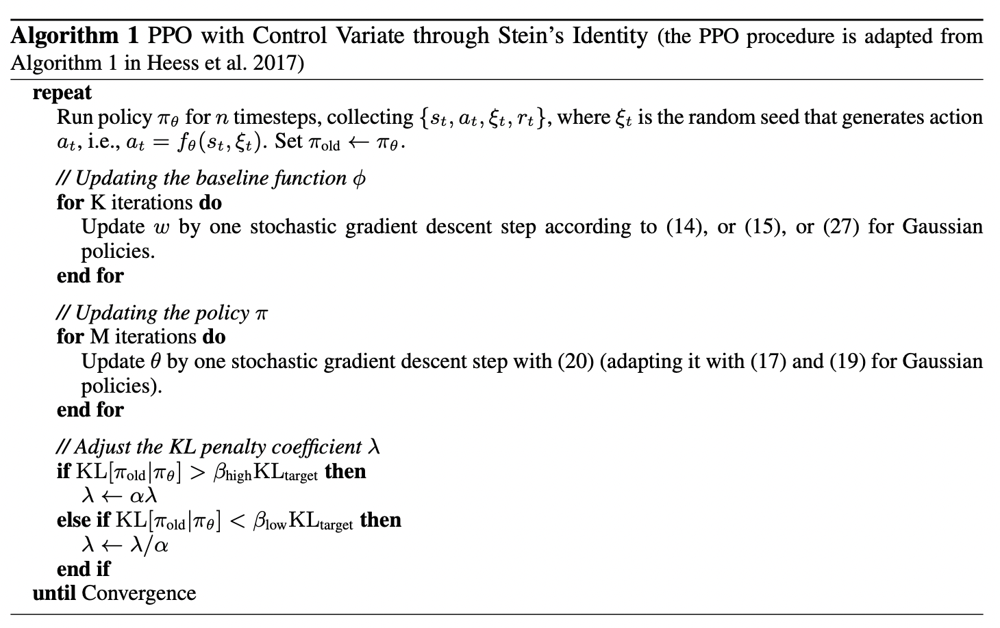
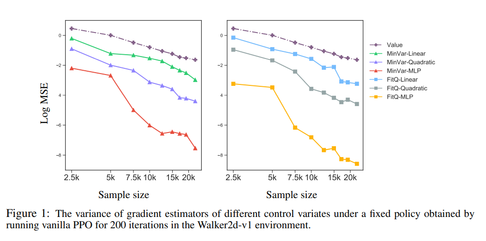
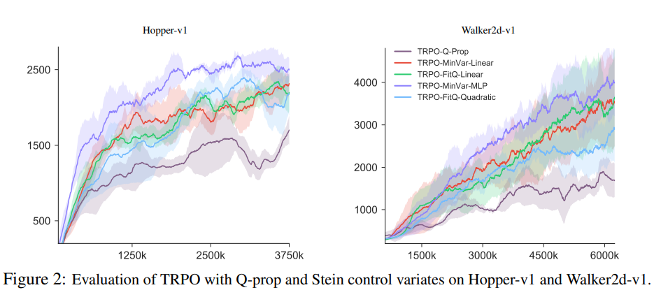
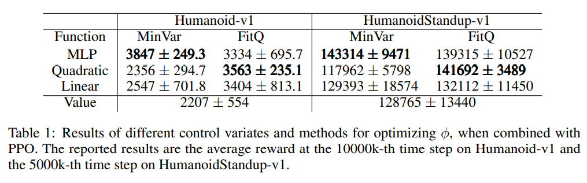
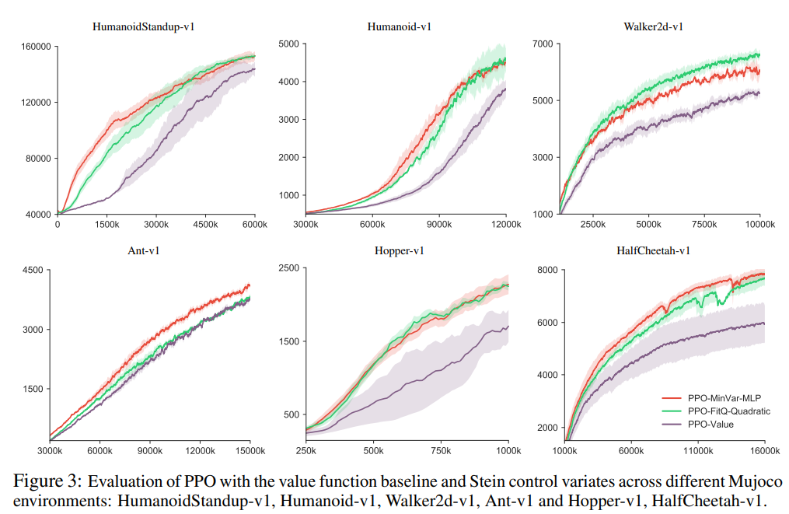

## Action-depedent Control Variates for Policy Optimization via Stein's Identity

Tác giả: Hao Liu, Yihao Feng, Yi Mao, Dengyong Zhou, Jian Peng, Qiang Liu

Nguồn: ICLR 2018

Link bài báo: https://arxiv.org/abs/1710.11198

**Điểm nổi bật: đề xuất một phương pháp giảm phương sai của bộ ước lượng trong gradient chính sách, và xây dựng một bộ phương pháp tạo hàm đường cơ sở, có thể giảm phương sai trong quá trình huấn luyện, nâng cao hiệu suất sử dụng mẫu**

### **Motivation (Why - Động cơ):**

Thuật toán gradient chính sách thường có phương sai khá lớn khi ước lượng gradient, dẫn đến hiệu suất sử dụng mẫu khi huấn luyện khá kém, cần dùng rất nhiều dữ liệu mẫu mới có được bộ ước lượng có phương sai nhỏ. Trước đây khi ước lượng người ta dùng đường cơ sở phụ thuộc trạng thái để giảm phương sai, nhưng hiệu quả không tốt, bài báo này nghiên cứu việc dùng đường cơ sở phụ thuộc cả trạng thái lẫn hành động để giảm phương sai.

### **Main Idea (What - Ý tưởng chính):**

#### **Ôn lại gradient chính sách**

**Gradient chính sách**

Bài toán học tăng cường có thể hiểu là một quá trình quyết định Markov về trạng thái môi trường $s \in S$ và hành động của tác tử $a \in A$, trong một môi trường chưa biết, quá trình này gồm một xác suất chuyển $T\left(s^{\prime} \mid s, a\right)$ và một phần thưởng $r(s, a)$ ngay sau hành động $a$ được thực hiện ở trạng thái $s$. Hành động $a$ của tác tử được quyết định bởi chính sách $\pi(a \mid s)$. Trong phương pháp gradient chính sách, ta xét một nhóm chính sách ứng viên $\pi_\theta(a \mid s)$, trong đó $\theta$ là tham số, thu được chính sách tốt nhất bằng cách tối đa hóa phần thưởng tích lũy kỳ vọng hay lợi tức.
$$
J(\theta)=\mathbb{E}_{s \sim \rho_\pi, a \sim \pi(a \mid s)}[R(\tau)],
$$
Gradient của $J(\theta)$ có thể viết là
$$
\nabla_\theta J(\theta)=\mathbb{E}_\pi\left[\nabla_\theta \log \pi(a \mid s) Q^\pi(s, a)\right],
$$
Trong đó

 $$Q^\pi(s, a)=\mathbb{E}_\pi\left[\sum_{t=1}^{\infty} \gamma^{t-1} r\left(s_t, a_t\right) \mid s_1=s, a_1=a\right]$$  

Cách đơn giản nhất để ước lượng $\nabla_\theta J(\theta)$ là thu thập rất nhiều mẫu $\left\{\left(s_t, a_t, r_t\right)\right\}_{t=1}^n$, rồi ước lượng Monte Carlo
$$
\hat{\nabla}_\theta J(\theta)=\frac{1}{n} \sum_{t=1}^n \gamma^{t-1} \nabla_\theta \log \pi\left(a_t \mid s_t\right) \hat{Q}^\pi\left(s_t, a_t\right),
$$
Trong đó $\hat{Q}^\pi\left(s_t, a_t\right)$ là bộ ước lượng của $Q^\pi\left(s_t, a_t\right)$, ví dụ $\hat{Q}^\pi\left(s_t, a_t\right)=\sum_{j \geq t} \gamma^{j-t} r_j$.

Nhưng phương sai ước lượng bằng cách này rất lớn, vì vậy người ta đưa vào biến điều khiển (control variate) để giảm phương sai trong khi giữ nguyên kỳ vọng

**Biến điều khiển**:

Khi ước lượng kỳ vọng $\mu=\mathbb{E}_\tau[g(s, a)]$, tìm một hàm $f(s, a)$ thỏa mãn $\mathbb{E}_\tau[f(s, a)]=0$. Như vậy có thể dùng bộ ước lượng sau để ước lượng $\mu$
$$
\hat{\mu}=\frac{1}{n} \sum_{t=1}^n\left(g\left(s_t, a_t\right)-f\left(s_t, a_t\right)\right),
$$
Phương sai là $\operatorname{var}_\tau(g-f) / n$, kỳ vọng vẫn không đổi (vì $\mathbb{E}_\tau[f]=0$). Vấn đề then chốt ở đây là tìm $f$ thỏa yêu cầu. Trong các nghiên cứu trước, thường dùng bộ ước lượng của hàm trạng thái $V(s)$ hoặc hằng số làm biến điều khiển, vì loại hàm này không làm thay đổi kỳ vọng của bộ ước lượng khi tính gradient. Bộ ước lượng gradient sau khi đưa vào biến điều khiển như sau:
$$
\hat{\nabla}_\theta J(\theta)=\frac{1}{n} \sum_{t=1}^n  \nabla_\theta \log \pi\left(a_t \mid s_t\right) (\hat{Q}^\pi\left(s_t, a_t\right)-\phi(s_t)),
$$
Nhưng chỉ dùng hàm phụ thuộc trạng thái làm biến điều khiển thì không thể giảm phương sai về 0, trong trường hợp lý tưởng ta muốn dùng một hàm phụ thuộc cả hành động lẫn trạng thái làm biến điều khiển.

> Ghi chú của người dịch: bản gốc viết "kỳ vọng vẫn bằng 0" và "loại hàm này không thay đổi **phương sai** của bộ ước lượng"; theo lập luận về biến điều khiển, đúng ra là kỳ vọng của bộ ước lượng **không đổi** (vẫn bằng $\mu$) và hàm phụ thuộc trạng thái không làm thay đổi **kỳ vọng** (không gây chệch), bản dịch đã diễn đạt lại cho đúng.

#### Thuật toán giảm gradient với biến điều khiển Stein:

Thông qua công thức Stein đưa vào một biến điều khiển $\phi(s,a)$ phụ thuộc cả hành động lẫn trạng thái, nhưng trong quá trình đưa vào, số chiều có một số vấn đề, nên dùng mẹo tham số hóa lại (reparameterization) để mở rộng số chiều và đưa ra chứng minh, có được cách xây dựng biến điều khiển Stein, cuối cùng xây dựng một họ biến điều khiển Stein.

**Công thức Stein (Stein's identity)**

Theo công thức Stein, với hàm $\phi(s, a)$ thỏa các điều kiện phù hợp, có thể được,
$$
\mathbb{E}_{\pi(a \mid s)}\left[\nabla_a \log \pi(a \mid s) \phi(s, a)+\nabla_a \phi(s, a)\right]=0, \quad \forall s
$$
Điều này cung cấp cho ta một số hướng để xây dựng biến điều khiển. Đáng chú ý là vế trái của công thức trên có thể viết thành $\int \nabla_a(\pi(a \mid s) \phi(s, a)) d a$.

**Biến điều khiển Stein**

Số chiều của vế trái công thức trên khác với số chiều của gradient chính sách cần ước lượng, cái trước được tính theo $a$, còn cái sau theo $\theta$; ta cần xây dựng liên kết giữa $\nabla_a \log \pi(a \mid s)$ và $\nabla_\theta \log \pi(a \mid s)$, để thông qua đẳng thức Stein có được biến điều khiển có thể dùng cho gradient chính sách. Ta làm theo cách sau:

Ta có thể biểu diễn $a \sim \pi_\theta(a \mid s)$ bằng $a=f_\theta(s, \xi)$, trong đó $\xi$ là một nhiễu ngẫu nhiên độc lập với $\theta$. Bài báo dùng $\pi(a, \xi \mid s)$ để biểu thị phân phối của $(a, \xi)$ khi cho trước $s$. Có thể được, $\pi(a \mid s)=\int \pi(a \mid s, \xi) \pi(\xi) d \xi$ trong đó $\pi(\xi)$ là mật độ xác suất sinh ra $\xi$, $\pi(a \mid s, \xi)=\delta(a-f(s, \xi))$, $\delta$ là hàm Delta

Hình trên trích từ bài báo, định lý 3.1 lấp đầy khoảng cách số chiều đã nhắc ở trên, cho phép ta xây dựng biến điều khiển theo đẳng thức Stein. Vì vậy ngay sau đó trong công thức 8, 9, tác giả đưa biến điều khiển vào gradient chính sách, và đưa ra bộ ước lượng.

**Xây dựng biến điều khiển**

Khi xây dựng biến điều khiển, tác giả xét hai cách, một là ước lượng hàm Q, để $\phi(s,a)$ càng gần hàm $Q$ càng tốt, từ đó giảm phương sai, cách còn lại là trực tiếp tối thiểu hóa phương sai của bộ ước lượng.

### **Main Contribution (How - Đóng góp chính):**

Bài báo nghiên cứu biến điều khiển Stein, một phương pháp giảm phương sai trong gradient chính sách, có thể nâng cao hiệu quả mẫu. Phương pháp bài báo đề xuất khái quát một số phương pháp trước đây, và chứng minh ưu thế thực tế của nó trong một số nhiệm vụ RL có tính thách thức.

#### Thuật toán

#### 

Thuật toán PPO áp dụng biến điều khiển Stein.

#### Thực nghiệm

Bài báo kết hợp phương pháp giảm phương sai được đề xuất với các thuật toán PPO và TRPO, dùng trong môi trường liên tục MuJoco. Chứng minh rằng dùng hàm đường cơ sở được xây dựng bằng biến điều khiển Stein có thể nâng cao đáng kể hiệu suất sử dụng mẫu, tăng tốc độ huấn luyện.

Tất cả các thực nghiệm trong bài đều dùng nhiễu Gauss, theo thảo luận ở trên đặt dạng hàm đường cơ sở là $\phi_w(s, a)=\hat{V}^\pi(s)+\psi_w(s, a)$, trong đó $\hat{V}^\pi$ là ước lượng của hàm giá trị, $\psi_w(s, a)$ là một hàm có tham số $w$, hướng thiết lập $w$ lần lượt là khớp hàm Q (FitQ) và tối thiểu hóa phương sai (MinVar). Trong thực nghiệm tác giả thử các dạng của $\psi_w(s, a)$, gồm tuyến tính, dạng toàn phương, mạng nơ-ron kết nối đầy đủ, kết quả thực nghiệm như sau:

Tiếp đó tác giả thực nghiệm thuật toán TRPO trong các môi trường Walker2d-v1 và Hopper-v1, phát hiện tất cả các thuật toán dùng biến điều khiển Stein để giảm phương sai đều thể hiện tốt hơn thuật toán Q-prop trước đây.

Cuối cùng tác giả kiểm tra thuật toán PPO dùng hàm điều khiển Stein

#### Ưu điểm của phương pháp bài báo đề xuất:

1. Có thể giảm hiệu quả phương sai của bộ ước lượng, nâng cao hiệu suất sử dụng mẫu.
2. Có thể xây dựng hàm đường cơ sở linh hoạt hơn, xây dựng hàm đường cơ sở có dạng tuyến tính, toàn phương, phi tuyến.

### Giới thiệu người viết

Wu Wenhao (吴文昊), đang học thạc sĩ tại Đại học Giao thông Tây An, liên hệ: wwhwwh05@qq.com
