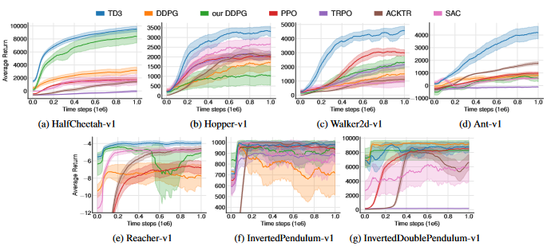
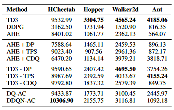

# Phân tích bài báo TD3: Addressing Function Approximation Error in Actor-Critic Methods

Scott Fujimoto, Herke van Hood, David Meger

## 1. Thông tin bài báo

****

**Addressing Function Approximation Error in Actor-Critic Methods**

https://arxiv.org/abs/1802.09477

https://github.com/sfujim/TD3

## 2. Động cơ viết bài

Trong Q-learning, nhiễu bắt nguồn từ các ước lượng không chính xác không thể tránh khỏi trong xấp xỉ hàm. Các ước lượng không chính xác này liên tục được cộng dồn qua mỗi lần cập nhật, và thông qua phép tối đa hóa ước lượng thì liên tục bị ước lượng thành giá trị cao, dẫn đến vấn đề ước lượng quá cao (overestimation). Là bản mở rộng của DQN, DDPG khi giải các bài toán điều khiển liên tục cũng gặp vấn đề ước lượng quá cao.

Bài báo học hỏi kinh nghiệm của Double DQN khi giải quyết vấn đề ước lượng quá cao trong DQN, để giải quyết vấn đề ước lượng quá cao xuất hiện trong các bài toán điều khiển hành động liên tục.

## 3. Công trình liên quan

### 1. DDPG

DDPG giải quyết vấn đề DQN không dùng được cho điều khiển liên tục, dùng cấu trúc Actor-Critic dựa trên DPG. Phần Actor dùng mạng ước lượng $\mu_\theta(s)$ phụ trách đưa ra hành động tất định, mạng mục tiêu của nó có cùng cấu trúc với mạng ước lượng nhưng tham số khác, chủ yếu phụ trách cập nhật mạng giá trị Critic; phần Critic phụ trách khớp hàm giá trị $Q_{\omega}(s,a)$, mạng ước lượng của nó lấy hành động đầu ra của mạng ước lượng Actor làm đầu vào, tham gia tối ưu Actor và Critic. Mạng mục tiêu Critic tham gia tính $Q_{target}$ khi tối ưu Critic.

Việc cập nhật mạng giá trị Critic chủ yếu dựa trên giảm gradient của TD-error, công thức cập nhật cụ thể như sau:
$$
L_{critic}=\frac{1}{N}\sum_{i}(y_i-Q(s_i,a_i|\theta^{Q}))^2
$$
Việc cập nhật mạng chính sách Actor thì dựa trên tăng gradient, từ đó tối đa hóa giá trị Q do mạng giá trị đưa ra, công thức cập nhật như sau:
$$
\nabla_{\theta^\mu}J \approx \frac{1}{N}\sum_i\nabla_aQ(s,a|\theta^Q)|_{s=s_i,a=\mu(s_i)} \nabla_{\theta^\mu}\mu(s|\theta^{\mu})|_{s_i}
$$

### 2. Double DQN

Nhắm vào vấn đề ước lượng quá cao xuất hiện trong DQN, Double DQN dùng hai bộ ước lượng độc lập để ước lượng không chệch. Nó tách rời việc chọn hành động tối ưu và tính hàm giá trị hành động tối ưu trong DQN truyền thống, dùng mạng mục tiêu $\theta^-$ và mạng chính sách $\theta$ để tính riêng, dạng tính cụ thể như sau:
$$
a^*=\substack{argmax\\{a \in \mathbb{A}}}Q(s,a|\theta_t^-)\\Y_t^Q=r+\gamma Q(S_t=s, A_t=a^*;\theta_t)
$$
Bằng cách giảm ước lượng quá cao của target, Double DQN giảm ước lượng của hàm giá trị hành động.

### 3. Averaged-DQN

Averaged-DQN đề xuất một cách khác để giải quyết vấn đề ước lượng quá cao, nó tập trung vào tối thiểu hóa phương sai, bằng cách lấy trung bình các giá trị Q để giảm phương sai xấp xỉ target (TAE), và khác với Ensemble DQN, Averaged-DQN dùng K phiên bản Q Function gần nhất để tính mục tiêu trung bình, bằng cách dùng các target network trong quá khứ để tránh tính toán K-Fold, có được kết quả giảm phương sai tốt hơn, dạng tính Variance như sau:
$$
Var[Q^A_i(s_0,a)]=\sum^{M-1}_{m=0}D_{K,m}\gamma^{2m}\sigma^2_{s_m}
$$
Công thức tính của Averaged-DQN như sau:
$$
Q^A_N(s,a)=\frac{1}{K} \sum^{K-1}_{k=0}Q(s,a;\theta_{N-k})
$$

## 4. TD3

Trong Double DQN, vấn đề ước lượng quá cao được giảm bớt bằng cách tách rời việc chọn hành động tối ưu và tính hàm giá trị hành động tối ưu, hướng suy nghĩ này được tiếp tục trong TD3. Là một thuật toán học tăng cường tất định trong khung Actor-Critic, TD3 kết hợp thuật toán gradient chính sách tất định sâu và mạng kép, đạt hiệu năng xuất sắc khi giảm bớt vấn đề ước lượng quá cao của thuật toán DDPG.

### 1. Mạng kép

Khác với cấu trúc bốn mạng Actor-Target Actor và Critic-Target Critic trong DDPG, thuật toán TD3 thêm một bộ mạng Critic_2 trên nền DDPG. Sau khi hai mạng Target Critic tính ra Q-target riêng, chọn $\min(targetQ_1, targetQ_2)$ thay cho $Q(a')$ trong DDPG gốc để tính mục tiêu cập nhật Q-target, công thức như sau:
$$
Y_{target} = r+\gamma \min(targetQ_1, targetQ_2)
$$
Sau khi hai mạng Critic dựa vào đầu ra của Actor tính ra giá trị riêng $Q_1,Q_2$, dùng $MSE$ để tính Loss giữa giá trị Q và Q-target, cập nhật tham số, công thức như sau:
$$
\theta_i = argmin_{\theta_i}\frac{1}{N}\sum(y-Q_{\theta_i}(s,a))^2
$$
Sau khi mạng Critic cập nhật xong, mạng Actor dùng cách cập nhật trễ, tự cập nhật qua tăng gradient. Mạng target thì dùng cách cập nhật mềm, công thức cập nhật của hai bên như sau:
$$
Actor:\  \nabla_{\phi}J(\phi)=\frac{1}{N} \sum\nabla_aQ_{\theta_1}(s,a)|a=\pi_{\phi}(s)\nabla_{\phi}\pi_{\phi}(s) \\
target:\ \theta=\tau\theta'+(1-\tau)\theta
$$

### 2. Chính quy hóa làm trơn chính sách mục tiêu

Chính sách tất định dùng trong DDPG rất dễ bị ảnh hưởng bởi sai số xấp xỉ hàm khi cập nhật mạng Critic, khiến phương sai của ước lượng mục tiêu tăng, giá trị ước lượng bất thường. TD3 đưa vào ý tưởng làm trơn (Smoothing), bằng cách thêm nhiễu phân phối chuẩn vào hành động mục tiêu và lấy trung bình để xấp xỉ kỳ vọng của hành động, bản chất là một phương pháp chính quy hóa, dùng nhiễu để làm trơn các đỉnh Q, từ đó tránh khớp quá mức. Công thức biểu diễn là:
$$
a'=\pi_{\phi'}(s')+\epsilon, \\ \epsilon \sim clip(N(0, \tilde \sigma),  -c,c)
$$

### 3. Cập nhật trễ

Khi huấn luyện mạng Actor và Critic, bài báo phát hiện tương tác giữa Actor và Critic khiến Actor luôn bị động đi theo mạng Critic để cập nhật, trạng thái không ổn định này khiến hàm chính sách cập nhật theo hướng sai dựa trên các giá trị ước lượng không chính xác, và tích lũy các sai lệch này qua nhiều lần cập nhật, cuối cùng rơi vào vòng xoáy suy thoái. Vì vậy mạng Actor cần một mạng Critic ổn định để hỗ trợ cập nhật.

Bài báo tăng tần suất cập nhật của mạng Critic, làm nó cao hơn Actor. Đảm bảo giảm sai số ước lượng nhiều nhất có thể trước, đảm bảo TD-error đủ nhỏ. Sau khi có kết quả ổn định hơn mới hỗ trợ mạng Actor cập nhật.

## 5. Phần thực nghiệm

### 1. Đánh giá

Bài báo dùng các nhiệm vụ điều khiển liên tục MuJoCo để đánh giá TD3 với PPO, DDPG và các thuật toán khác, trong đó mô hình DDPG được cài đặt bằng một mạng nơ-ron truyền thẳng hai tầng, và giữa mỗi tầng đều dùng các đơn vị ReLU và Tanh cho cả Actor và Critic, đồng thời tác giả còn sửa thuật toán DDPG gốc, cho trạng thái và hành động cùng được nhận và đưa vào tầng thứ nhất. Tham số của cả hai mạng đều được cập nhật bằng Adam, đặt tốc độ học là $10^{-3}$.

Làm trơn chính sách mục tiêu được thực hiện bằng cách thêm $\epsilon \sim N(0, 0.2)$, cắt nó vào khoảng $(-0.5,0.5)$. Chiến lược cập nhật trễ đặt cứ 2 vòng lặp thì cập nhật Actor và Target Critic một lần. Khi cập nhật mềm, đặt $\tau=0.005$.

Trong các môi trường như HalfCheetah-v1, Hopper-v1, đường cong học càng cao thì hiệu quả thuật toán càng tốt. Kết quả cụ thể như hình dưới:

Có thể thấy hiệu năng của thuật toán TD3 được cải thiện khá rõ rệt so với các thuật toán khác.

### 2. Thực nghiệm cắt bỏ

Trong phần này tác giả làm thực nghiệm cắt bỏ cho ba chiến lược: chiến lược cập nhật trễ DP, làm trơn chính sách mục tiêu TPS và Q-learning kép có cắt CDQ; ngoài ra tác giả còn thảo luận tính hiệu quả của cấu trúc Actor-Critic trong Double Q-learning và Double DQN, kết quả cụ thể như sau:

Có thể thấy thực nghiệm cắt bỏ các chiến lược DP và TPS ảnh hưởng hơi nhỏ đến kết quả, còn khi bỏ cấu trúc CDQ thì kết quả thay đổi rõ rệt, chứng minh việc kìm hãm ước lượng quá cao của bộ ước lượng không chệch có tác dụng cải thiện đáng kể hiệu năng thuật toán.

> Ghi chú của người dịch: trong bản gốc, đường dẫn ảnh viết dạng Windows `img\TD_1.png`, `img\TD_2.png`; bản dịch đổi thành `img/...` để hiển thị được trên GitHub/Linux.

## 6. Đóng góp của bài báo

Trong bài báo này, các đóng góp chủ yếu gồm các điểm sau:

1. Thiết lập mạng tương tự Double DQN, dùng hai bộ mạng Critic để ước lượng giá trị Q, giải quyết vấn đề giá trị Q bị ước lượng quá cao trong DDPG, và chứng minh tầm quan trọng của nó qua thực nghiệm cắt bỏ.
2. Nhắm vào vấn đề tương tác giữa mạng Actor và Critic khiến Actor không ổn định, giải quyết bằng cách đặt cập nhật trễ cho Actor.
3. Thông qua việc thêm nhiễu làm trơn để tối ưu các đỉnh khi tính phương sai, giải quyết vấn đề phương sai do hàm ước lượng khớp giá trị thực không chính xác.

========

Tác giả: Wang Zhenkai (王振凯)

Hướng nghiên cứu: học sâu, học tăng cường

Đang học thạc sĩ tại Đại học Địa chất Hà Bắc
