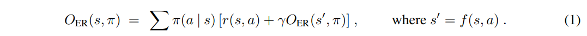
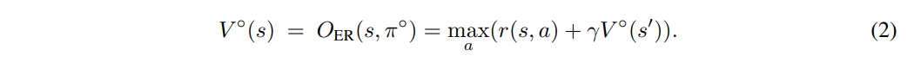
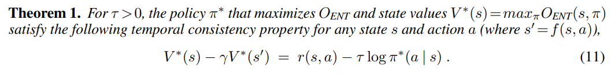
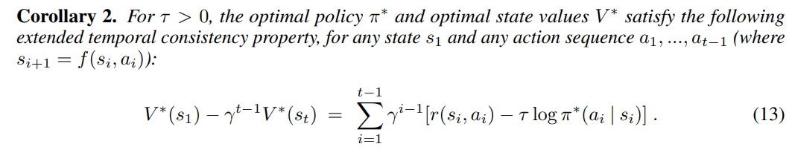
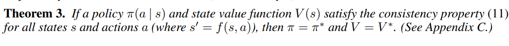
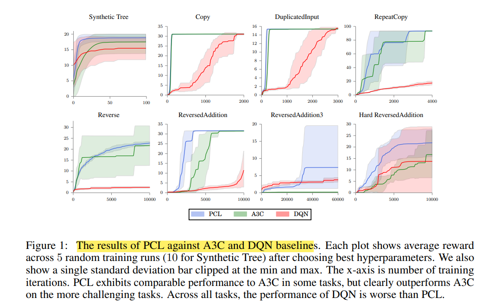
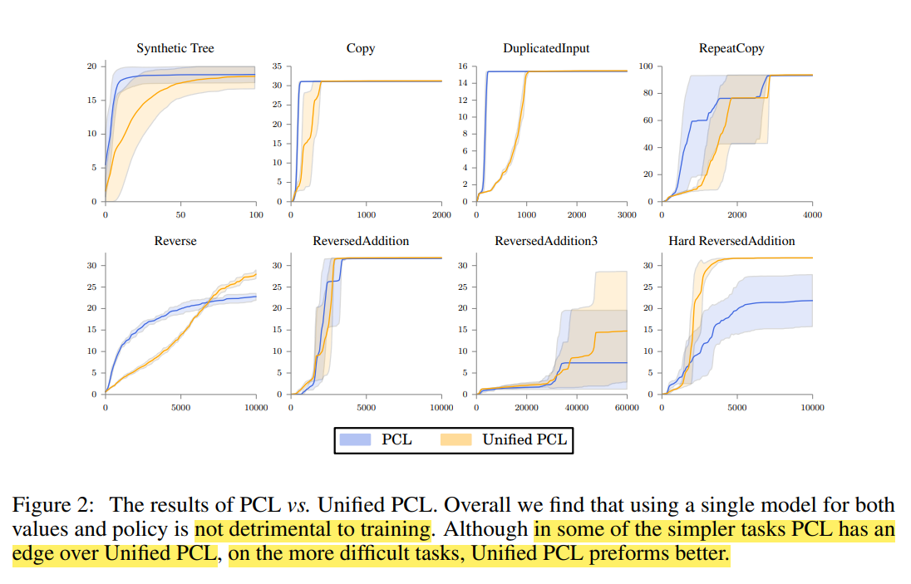
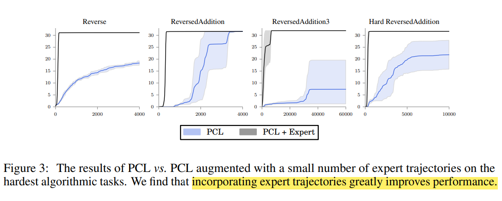

## Bridging the Gap Between Value and Policy Based Reinforcement Learning

Tác giả: Ofir Nachum, Mohammad Norouzi, Kelvin Xu, and Dale Schuurmans

Nguồn: NIPS'17, Google Brain

Link bài báo: https://arxiv.org/abs/1702.08892

**Điểm nổi bật: đưa vào chính quy hóa entropy, đề xuất một phương pháp huấn luyện học tăng cường off-policy ổn định**

### **Motivation (Why - Động cơ):**

Các thuật toán học tăng cường dựa trên chính sách và dựa trên giá trị trước đây đều có ưu và nhược điểm riêng, ví dụ các thuật toán dựa trên chính sách phần lớn là on-policy, ổn định nhưng hiệu suất sử dụng mẫu thấp, các thuật toán dựa trên giá trị phần lớn là off-policy, hiệu suất sử dụng mẫu rất cao nhưng thuật toán không ổn định. Trước đây tuy có một số nghiên cứu kết hợp ưu điểm của cả hai, nhưng chúng còn một số vấn đề lý thuyết chưa giải quyết, nên vẫn còn tiềm năng tối ưu rất lớn. Tác giả thông qua chính quy hóa entropy nghiên cứu quan hệ giữa chính sách và tính nhất quán giá trị softmax (softmax value consistency), đưa ra một thuật toán học tăng cường off-policy dựa trên chính sách ổn định.

### **Main Idea (What - Ý tưởng chính):**

#### **Thiết lập ký hiệu**

Ý tưởng cốt lõi là thêm một nhiễu loạn vào việc chọn hành động, thay đổi mục tiêu tối ưu

Tác giả dùng $`O_{ER}(s,\pi)`$ có dạng sau để biểu thị lợi ích kỳ vọng có thể nhận được sau khi thực hiện chính sách $`\pi`$ ở trạng thái $`s`$, có cùng ý nghĩa với hàm Q $`Q(s,a)`$ mà ta thường dùng.



Theo hướng suy nghĩ của phương trình Bellman, ta có hàm giá trị tối ưu $`V^{\circ}(s)`$ cho một trạng thái cụ thể, và chính sách tối ưu $`\pi^{\circ}`$, định nghĩa như sau:
```math
\begin{gathered}
V^{\circ}(s)=\max _\pi O_{\mathrm{ER}}(s, \pi) \\
\pi^{\circ}=\arg\max_\pi O_{\mathrm{ER}}(s, \pi).
\end{gathered}
```
Có thể viết thành dạng lặp như sau:



#### Phân tích tính nhất quán

Trong bài báo này tác giả nghiên cứu hàm giá trị tối ưu của một trạng thái theo cách softmax, ý nghĩa của softmax là khác với hard max, không phải mỗi trạng thái nhất định phải chọn hành động có giá trị lớn nhất, kiểu trắng đen rõ ràng, mà đưa vào số hạng chính quy hóa entropy để thêm một chút màu xám, hành động được chọn là "khá mềm" về mặt giá trị lớn nhất, đồng thời đưa vào số hạng chính quy hóa entropy còn có thể ngăn quá trình tối ưu hội tụ về lời giải gần tối ưu.

Phần thưởng kỳ vọng sau khi chính quy hóa có dạng sau, ENT là viết tắt của entropy (Entropy):
```math
O_{\mathrm{ENT}}(s, \pi)=O_{\mathrm{ER}}(s, \pi)+\tau \mathbb{H}(s, \pi),
```
Trong đó $`\tau`$ là một tham số có thể điều chỉnh, $`\mathbb{H}(s, \pi)`$ được định nghĩa như sau:
```math
\mathbb{H}(s, \pi)=\sum_a \pi(a \mid s)\left[-\log \pi(a \mid s)+\gamma \mathbb{H}\left(s^{\prime}, \pi\right)\right] .
```
Phần thưởng kỳ vọng sau khi chính quy hóa cũng có thể viết thành dạng lặp như sau:
```math
O_{\mathrm{ENT}}(s, \pi)=\sum_a \pi(a \mid s)\left[r(s, a)-\tau \log \pi(a \mid s)+\gamma O_{\mathrm{ENT}}\left(s^{\prime}, \pi\right)\right]
```
Dùng $`V^*(s)=\max _\pi O_{\mathrm{ENT}}(s, \pi)`$ để biểu thị giá trị tối ưu mềm (soft optimal value) của trạng thái $`s`$, $`\pi^*(a \mid s)`$ biểu thị chính sách tối ưu, đại diện cho việc chọn hành động có thể đạt giá trị tối ưu mềm ở trạng thái $`s`$. Như vậy hành động của chính sách tối ưu không còn cố định nữa, vì đã đưa vào số hạng chính quy hóa entropy để làm nhiễu quá trình tối đa hóa, vì số hạng entropy sẽ khuyến khích chính sách trở nên không ổn định. Tác giả biểu diễn chính sách tối ưu dưới dạng sau:
```math
\pi^*(a \mid s) \propto \exp \left\{\left(r(s, a)+\gamma V^*\left(s^{\prime}\right)\right) / \tau\right\}
```
Thay vào biểu thức ở trên được
```math
\begin{gathered}
V^*(s)=O_{\mathrm{ENT}}\left(s, \pi^*\right)=\tau \log \sum_a \exp \left\{\left(r(s, a)+\gamma V^*\left(s^{\prime}\right)\right) / \tau\right\} .\\
Q^*(s, a)=r(s, a)+\gamma V^*\left(s^{\prime}\right)=r(s, a)+\gamma \tau \log \sum_{a^{\prime}} \exp \left(Q^*\left(s^{\prime}, a^{\prime}\right) / \tau\right)
\end{gathered}
```
#### Tính nhất quán giữa giá trị tối ưu và chính sách

Viết chính sách tối ưu dưới dạng sau
```math
\pi^*(a \mid s)=\frac{\exp \left\{\left(r(s, a)+\gamma V^*\left(s^{\prime}\right)\right) / \tau\right\}}{\exp \left\{V^*(s) / \tau\right\}}
```
Lấy logarit hai vế, có thể được quan hệ giá trị tối ưu mềm giữa các trạng thái kề nhau



Vì định lý trên áp dụng giữa các trạng thái kề nhau, có thể dùng lặp lại công thức này, để có được quan hệ giá trị tối ưu mềm giữa hai trạng thái cách nhau một khoảng nhất định



Tiếp theo ta có thể dựa vào biểu thức trên để ước lượng giá trị tối ưu mềm và tối ưu chính sách, tác giả đồng thời đưa ra định lý đánh giá tính hội tụ.



### **Main Contribution (How - Đóng góp chính):**

Đưa vào số hạng chính quy hóa entropy, có thể đồng thời tối ưu việc ước lượng giá trị trạng thái và chính sách. Tức là có thể dùng cả dữ liệu on-policy lẫn off-policy để huấn luyện. Vượt các thuật toán đường cơ sở trên các trò chơi khác nhau

#### Thuật toán

**Thuật toán nhất quán đường đi (Path Consistency Learning, PCL)**

Sau khi đưa vào chính quy hóa entropy, quan hệ giữa hàm giá trị tối ưu và chính sách tối ưu này cho phép ta vừa tìm chính sách tối ưu vừa tìm hàm giá trị tối ưu dọc theo một chuỗi đường đi. Tác giả định nghĩa hàm nhất quán sau

```math
C\left(s_{i: i+d}, \theta, \phi\right)=-V_\phi\left(s_i\right)+\gamma^d V_\phi\left(s_{i+d}\right)+\sum_{j=0}^{d-1} \gamma^j\left[r\left(s_{i+j}, a_{i+j}\right)-\tau \log \pi_\theta\left(a_{i+j} \mid s_{i+j}\right)\right].
```
Trong đó, $`s_{i: i+d} \equiv\left(s_i, a_i, \ldots, s_{i+d-1}, a_{i+d-1}, s_{i+d}\right)`$ là một quỹ đạo con độ dài $`d`$. Mục tiêu của thuật toán huấn luyện là tìm hàm giá trị và chính sách có thể làm tính nhất quán tiến về 0 nhiều nhất có thể. Vì vậy tác giả đề xuất học nhất quán đường đi, thuật toán PCL, mục tiêu tối ưu có thể viết dưới dạng sau.

```math
O_{\mathrm{PCL}}(\theta, \phi)=\sum_{s_{i: i+d} \in E} \frac{1}{2} C\left(s_{i: i+d}, \theta, \phi\right)^2
```
Gradient cập nhật tham số như sau,

```math
\begin{aligned}
\Delta \theta & =\eta_\pi C\left(s_{i: i+d}, \theta, \phi\right) \sum_{j=0}^{d-1} \gamma^j \nabla_\theta \log \pi_\theta\left(a_{i+j} \mid s_{i+j}\right) \\
\Delta \phi & =\eta_v C\left(s_{i: i+d}, \theta, \phi\right)\left(\nabla_\phi V_\phi\left(s_i\right)-\gamma^d \nabla_\phi V_\phi\left(s_{i+d}\right)\right)
\end{aligned}
```
Trong đó, việc cập nhật PCL vừa có thể dùng dữ liệu trực tuyến thu thập theo on-policy, vừa có thể dùng dữ liệu ngoại tuyến thu thập theo off-policy trong bộ đệm phát lại. Trong bài báo này, tác giả trộn lấy mẫu từ hai loại dữ liệu này để cập nhật.

**Thuật toán nhất quán đường đi hợp nhất (Unified PCL, UPCL)**

Thuật toán trên khi tìm hàm giá trị tối ưu và chính sách tối ưu là đang tối ưu hai mô hình độc lập, tác giả thông qua dạng hàm Q, viết chính sách và giá trị vào cùng một biểu thức,
```math
\begin{aligned}
V_\rho(s) & =\tau \log \sum_a \exp \left\{Q_\rho(s, a) / \tau\right\} \\
\pi_\rho(a \mid s) & =\exp \left\{\left(Q_\rho(s, a)-V_\rho(s)\right) / \tau\right\}
\end{aligned}
```
Trong đó $`\rho`$ là tham số của mô hình hợp nhất này, cách cập nhật như sau:
```math
\begin{aligned}
\Delta \rho= & \eta_\pi C\left(s_{i: i+d}, \rho\right) \sum_{j=0}^{d-1} \gamma^j \nabla_\rho \log \pi_\rho\left(a_{i+j} \mid s_{i+j}\right)+ \\
& \eta_v C\left(s_{i: i+d}, \rho\right)\left(\nabla_\rho V_\rho\left(s_i\right)-\gamma^d \nabla_\rho V_\rho\left(s_{i+d}\right)\right)
\end{aligned}
```

#### Thực nghiệm

Tác giả so sánh thuật toán PCL, thuật toán UPCL với các thuật toán hiện có A3C, DQN trên một số nhiệm vụ cụ thể.



Hiệu năng của thuật toán PCL ngang ngửa A3C trên một số nhiệm vụ, và vượt thuật toán A3C trên một số nhiệm vụ có tính thách thức. Trên tất cả các nhiệm vụ, PCL đều thể hiện tốt hơn thuật toán DQN.



So sánh hiệu năng huấn luyện của PCL và UPCL.



So sánh hiệu năng giữa PCL-expert, có thêm một ít dữ liệu chuyên gia khá tốt trong quá trình huấn luyện, và thuật toán PCL.

### Giới thiệu người viết

Wu Wenhao (吴文昊), đang học thạc sĩ tại Đại học Giao thông Tây An, liên hệ: wwhwwh05@qq.com
